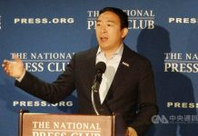

# Andrew Yang (楊安澤)

## Identity Snapshot
- **English:** Andrew Yang
- **Chinese:** 楊安澤
- **Era:** 1975
- **Geography:** Schenectady /NY
- **Core roles:** entrepreneur, lawyer
- **Source:** TAH Foundation Who’s Who

Andrew Yang is an American entrepreneur, author, and politician born on January 13, 1975, in Schenectady, New York, to parents who immigrated from Taiwan. He holds a B.A. from Brown University and a J.D. from Columbia Law School. After a brief stint as a corporate attorney, he became CEO of Manhattan Prep before founding Venture for America in 2011, a nonprofit fellowship placing recent college graduates in startups in emerging cities. He was named a White House Champion of Change by the Obama administration in 2012 for this work.

<!-- tah-tables:start -->
## Education
- Brown Univ. — 1996 — B.S. Arts
- Columbia Law School — 1999 — J.D.

## Employment
- Davis Polk & Wardwell — Attorney — (1999-2000) — Stargiving.com — (2000-2002) — Manhattan Prep — President, CEO — (2006-2012) — Venture for America — Founder — (2011-2017) — Humanity Forward Foundation — Founder — (2020-2021) — Forward Party — Founder, Co-chair — (2021-) — Works & Documents — The War on Normal People — Forward
<!-- tah-tables:end -->

## Timeline
- **1975-01-13** — Born in Schenectady, New York, to parents who immigrated from Taiwan.
- **1996 / 1999** — B.A., Brown University; J.D., Columbia Law School.
- **1999–2000** — Attorney, Davis Polk & Wardwell; **2000–2002** — Stargiving.com.
- **2006–2012** — President and CEO, Manhattan Prep.
- **2011** — Founded Venture for America, a nonprofit fellowship placing recent college graduates in startups in emerging cities.
- **2012** — Named a White House Champion of Change by the Obama administration for the Venture for America work.
- **2020–2021 / 2021–** — Founder, Humanity Forward Foundation; founder and co-chair, Forward Party.
- **2019-06-28** — Participates in the second round of Democratic presidential debates, the field's only minority candidate of note ([[articles/taiwanjustice-net/2022/20220927220308_2019_06_28_民主黨參選人第二場辯論_批評特朗普並相互攻擊_590e15be9637d2f3|TJJ 中央社存檔, 2019-06-28]]).
- **2019-12** — Ranked fourth among Democratic candidates as of 12/24; the 「freedom dividend」 UBI platform gains salience when Congress passes $1,200 adult relief checks in spring 2020 ([[works/taiwaneseamerican-org/19-things-that-happened-in-taiwan-taiwanese-america-in-2019|19 Things That Happened in 2019, item (16)]]).
- **2019 初選辯論** — At the sixth Democratic debate (Loyola Marymount, Los Angeles), Yang: 「美國必須贏得美中之間的博弈」, China already leads in technology; on Hong Kong's face-mask ban he said the mask law exists because masks interfere with AI facial recognition of protesters — his China/tech stance as recorded in the corpus ([[articles/taiwanjustice-net/2025/20251207122112_美國民主黨初選辯論_多位參選人對中國提出強烈_0d69923f60d98a7e|美國民主黨初選辯論 (TJJ 存檔)]]).
- **2020-11-19** — Cabinet-transition coverage names him among the widely discussed Commerce Secretary candidates alongside Meg Whitman, Mellody Hobson and Terry McAuliffe — Commerce framed as the front line of US-China tech competition ([[articles/taiwanjustice-net/2021/20210118223750_2020_11_19_拜登選定財長-感恩節前後公布_拜登主導對中國事_ca961381330bac81|拜登內閣人事報導 (2020-11-19)]]).
- **2020-11-21** — Rumored as Biden's Commerce Secretary (CNN via TJJ) — the first cabinet-level speculation following the presidential run ([[articles/taiwanjustice-net/2020/20201205142451_2020_11_21_拜登將公布內閣名單_台裔楊安澤傳有望出任商務_8ea8c3325dc958a3|拜登將公布內閣名單, 楊安澤傳有望出任商務部長 (2020-11-21)]]).
- **2020-12-23** — NYC Campaign Finance Board confirms he has filed paperwork to run for NYC mayor, seeking Bill de Blasio's seat ([[articles/taiwanjustice-net/2022/20220927203131_2020_12_23_楊安澤參選紐約市長_紐約市競選財務委員會證實_40f7eee10bc6ccec|楊安澤參選紐約市長, 競選財務委員會證實 (2020-12-23)]]).
- **2021-06-22** — Loses the NYC Democratic mayoral primary, placing 4th among 10+ contenders: 「我只看數字…這場選舉我認輸」 ([[articles/taiwanjustice-net/2021/20210920151613_2021_06_22_紐約市長初選投票-台裔參選人楊安澤宣布敗選_0151c2b91715a5b6|紐約市長初選投票 台裔參選人楊安澤宣布敗選 (2021-06-22)]]).
- **2021-04** — During the mayoral campaign, posts on Twitter amid the rise in anti-Asian hate: 「旁觀者必須見義勇為，我們需要團結一致，在有人需要幫助時挺身而出」 — his most direct Asia-community statement in the corpus ([[articles/taiwanjustice-net/2025/20250617080538_美國仇視亞裔愈演愈烈_台僑嘆弱勢只能自求多福_2fa83bb09ad75beb|美國仇視亞裔愈演愈烈, 台僑嘆弱勢只能自求多福 (2021-04-01)]]).
- **2022-07-28** — Announces the Forward Party as a merger of his own Forward organization with the Renew America Movement (Miles Taylor) and Serve America Movement (David Jolly); party leaders claim third-party status, slogan 「不傾左，不偏右，往前進」 ([[articles/taiwanjustice-net/2022/20220815025549_2022_07_28_美國前進黨稱已是第3大黨_台裔楊安澤號召排除政_f775b670edce99fa|美國前進黨稱已是第3大黨 (2022-07-28)]]).
- **Works** — *The War on Normal People*; *Forward*.

## Family

- **Wife:** Evelyn Yang
- **Father:** [[people/dr-kei-hsiung-yang||Dr. Kei-Hsiung Yang (楊界雄)]]
- **Mother:** [[people/nancy-yang||陳玲銖]]

## Network
- Married to Evelyn Yang; father 楊界雄; mother [[people/nancy-yang||陳玲銖]].
- Listed in the [[organizations/tah-foundation||TAH Foundation]] Who's Who (entries #219 and #2058).

## Vault Holdings
TAH records held in this vault:
- [[works/taiwaneseamericanhistory-org/whos-who-2058-andrew-yang|TAH #2058 — Andrew Yang 楊安澤 (2018/03)]]
- [[works/taiwaneseamericanhistory-org/andrew-yang|Andrew Yang 楊安澤 in S. CA (2020/06)]]
- [[works/taiwaneseamericanhistory-org/4-donate-money-to-mr-andrew-yang-to-be-on-the-debate-stage-for-thepresidential-c|一人一元送楊安澤上辯論台 (2019/02)]]
- [[works/taiwaneseamericanhistory-org/ota-219|TAH #219 — Andrew Yang 楊安澤 (encyclopedia record)]]
- [[works/taiwaneseamericanhistory-org/videos134|TAH #134 — 楊安澤筆會新年年會演說：台裔子弟入主美國總統啓動 (2019/01)]]
- [[works/taiwaneseamericanhistory-org/my-story-674|TAH #674 — 我認識的楊安澤：首位亞裔美國總統參選人, 王劭文 (2019/02)]]
- [[works/taiwaneseamericanhistory-org/2019-important-events-4|TAH 2019 events #4 — Andrew Yang participated in the 2020 Presidential primary campaign]]
- [[works/taiwaneseamericanhistory-org/event2020-5|TAH 2020 events #5 — Andrew Yang, first Taiwanese American presidential candidate]]
- [[works/taiwaneseamericanhistory-org/our-footsteps-31|TAH #31 — Andrew Yang in 2020 U.S. Presidential Election, artwork by 陳秀芳 Susan Hsiu-fang Liu (2020)]]

## Sources
- [TAH #219 encyclopedia: 219. Andrew Yang 楊安澤](https://taiwaneseamericanhistory.org/ota-219/)
- [TAH #2058 encyclopedia: 2058. Andrew Yang 楊安澤](https://taiwaneseamericanhistory.org/whos-who-2058-andrew-yang/)
- [TAH Who’s Who](https://taiwaneseamericanhistory.org/person/andrew-yang/)

## Related Pages
- [[organizations/tah-foundation||TAH Foundation]]
- [[sources/taiwaneseamericanhistory-org||taiwaneseamericanhistory.org]]
- [[organizations/brown-taiwan-society||Brown Taiwan Society]] (context only — his Brown B.A. is listed in the table above; membership is not stated in his TAH profile)
- [[organizations/columbia-university-taiwanese-student-association||Columbia Taiwanese Student Association]] (context only — his Columbia J.D. is listed; membership is not stated)

## Vault holdings — 2021 NYC mayoral campaign (deepen 2026-09-14, vault-only)
Coverage in the taiwanjustice-net corpus harvested into this vault extends his public record past the 2020 presidential run:
- [[articles/taiwanjustice-net/2021/20210303210939_2021_02_19_參選紐約市長-楊安澤誓言為亞裔族群爭權益_2034aa21bcb8451b|參選紐約市長：楊安澤誓言為亞裔族群爭權益 (2021/02/19)]]
- [[articles/taiwanjustice-net/2021/20210419114512_tag_楊安澤參選紐約市長_898feccf514da586|楊安澤參選紐約市長 (2021/04/19)]]
- [[articles/taiwanjustice-net/2021/20211023205300_tag_楊安澤宣布敗選_210f393ee83d17b2|楊安澤宣布敗選 (2021/10/23)]] — campaign ended in the Democratic primary.

## From the record

- 覆核（TJJ-A09240400-2, 2026-09-25）：本 slice 文章 1a2bdc08（台美人 category p3, 2025-04-26 快照）正文再驗證——「台裔楊安澤新書批美國制度失靈，擬下月組新政黨」條目確認見於正文，連結為真，無錯鏈、無虛鏈；2021-01-25 日期事實條目已在庫 — SKIP，無新材料。

- 複核（TJJ-A09162345-19, 2026-09-24）：本 slice 文章 1a2bdc08（台美人台加人分類頁 p3，2025-04-26 存檔）正文再驗證——「台裔楊安澤新書批美國制度失靈，擬下月組新政黨」確認見於正文清單，subject 連結為真，無錯鏈、無虛鏈；2021-01-25 日期事實條目（含該文 wikilink）已在庫 — SKIP，無新材料。

- 覆核（TJJ-A09171200-4, 2026-09-24）：本 slice 四篇 TJJ 文章（台美人台加人索引 6f2b431c、NATMA 標籤頁 08b82976、挺港聯合聲明 53455d7e、台美人分類頁 1a2bdc08）正文再驗證——subject 連結為真實提及，無錯鏈、無虛鏈；對應日期事實（含該文 wikilink）已在庫 — SKIP，無新材料。
- 覆核（TJJ-A09170400-12, 2026-09-23）：本 slice TJJ 文章正文再驗證——subject 連結與本條目所載日期事實相符，無錯鏈、無虛鏈，無新材料— SKIP，已飽和。
- During the 2020 presidential campaign — his wife Evelyn Yang (盧艾玲) publicly discloses a past sexual assault by an OB-GYN and sues alongside 31 other women; Yang: 「他為妻子驕傲，誰都不該遇到這種事」 — the corpus's only Evelyn Yang biographical record (report date not stated in the harvest; HOLD: article 內文稱「中央社華盛頓16日」, campaign context places it 2019) ([[articles/taiwanjustice-net/2025/20251110172136_台裔楊安澤角逐美總統-妻揭露遭性侵過往影_85edd78f26225c9b|台裔楊安澤角逐美總統 妻揭露遭性侵過往 (中央社存檔)]]).
- 2021-01-25 — TJJ's 台美人台加人 channel index carries 「台裔楊安澤新書批美國制度失靈，擬下月組新政黨」 — coverage of his post-campaign book launch and the announced plan to form a new party (the Forward Party), the first Taiwan-media record of his third-party project ([[articles/taiwanjustice-net/2025/20250426142458_category_taiwaneseamerican_page_3_1a2bdc08b6c7bf6c|TJJ 台美人 category 索引, 2025-04-26 存檔]]).
- 2020 — 鄭炳全's Father's Day memoir essay counts Yang's campaign in the community's register: 「首位台美人二世1975年次」, seven national debates, polling capped at sixth, the $1,000/month basic-income platform vindicated by the spring-2020 $1,200 relief checks, and the suggestion he run for NYC mayor — the community's own tally of his run ([[articles/taiwanjustice-net/2025/20250518221601_2020-父親節省思-_-鄭炳全_9e40a0c476bdcb3e|鄭炳全〈2020 父親節省思〉]]).
- Campaign-period reception: a New Hampshire couple who voted for Trump in 2016 defect to Yang 「受自由紅利政見感召」 — the freedom-dividend platform reaching beyond the Taiwan community; the article is indexed under its own tag page ([[articles/taiwanjustice-net/2025/20250617070107_受自由紅利政見感召_前川普支持者倒戈為楊安澤_9b574f3cc48a664b|受自由紅利政見感召，前川普支持者倒戈 (TJJ 存檔)]]).
- 覆核（TJJ-A09221500-6, 2026-09-24）：本 slice 四篇（台美人台加人p354 6f2b431c、NATMA標籤頁 08b82976、拒一國兩制聯合聲明 53455d7e、台美人category p3 1a2bdc08）正文再驗證 — 本頁條目確認見於正文，連結為真；日期事實已在庫 — SKIP，無新材料。

## Vault deepening note (2026-09-14, vault-only, slice 09140107-11)
- Father entry now wikilinked to [[people/dr-kei-hsiung-yang||Dr. Kei-Hsiung Yang (楊界雄)]] — his page's Son entry verified on disk (reciprocal).
- No vault pages exist for Evelyn Yang, Brown University, Columbia Law School, Venture for America, or the Forward Party; tah-tables content is already mirrored in the Timeline. No other existing-slug links apply.

<!-- TJJ-A09250800-4: verified 2026-09-26 — subject links in slice 09250800-4 articles (6f2b431c / 08b82976 / 1a2bdc08 / 53455d7e) re-checked vs 正文; all real (1a2bdc08 Subjects links fixed: stray .md suffix removed); dated fact w/ article wikilink already in From the record — saturated, no new material. -->

<!-- TJJ-A10040600-6: verified 2026-10-06 — wave-2 link+deepen re-check of slice 10040600-6 article 1a2bdc08b6c7bf6c (台美人台加人 p3, 2025-04-26 快照): subject link 楊安澤 re-checked vs 正文 (「台裔楊安澤新書批美國制度失靈，擬下月組新政黨'), real, no wrong/spurious links; dated fact w/ article wikilink already in From the record — saturated, no new material. -->

<!-- TJJ-A100607008-d: verified 2026-10-09 — wave-2 link+deepen re-check of article 1a2bdc08b6c7bf6c (台美人台加人 分類隨機頁 p3, 2025-04-26快照) read fresh this attempt: subject link re-checked vs 正文 — 「台裔楊安澤新書批美國制度失靈，擬下月組新政黨」確認見於收錄清單, real, no wrong/spurious links; dated fact w/ article wikilink (2021-01-25) already in From the record — saturated, no new material. -->

<!-- deepen-x slice 10100315-6: re-checked 2026-10-10 — fresh grep 楊安澤/Andrew Yang/安澤 across all 5 corpus dirs (works/articles/sources/events/topics) returned 6 hits, all already listed in Vault Holdings (whos-who-2058, andrew-yang S.CA, 4-donate, videos134, 2019-important-events-4, event2020-5); no new corpus material — saturated, no new material. -->

<!-- deepen-x slice 10120200-11: deepened 2026-10-12 — fresh 5-dir grep 楊安澤/Andrew Yang/安澤 surfaced 4 records not previously linked: sixth Democratic debate (LMU LA — 「美國必須贏得美中之間的博弈」, AI/facial-recognition remark on HK mask ban), 2020-11-19 Commerce-Secretary cabinet-shortlist coverage, 鄭炳全〈2020 父親節省思〉 memoir tally of the campaign, and the 受自由紅利政見感召 NH-defector feature — absorbed into Timeline + From the record. No date/age conflicts; no HOLD needed. -->
<!-- deepen-x slice 10102300-11: re-checked 2026-10-12 — fresh grep 楊安澤/Andrew Yang/安澤 across all 5 corpus dirs (works/articles/sources/events/topics) returned 6 hits, all already listed in Vault Holdings (whos-who-2058, andrew-yang S.CA, 4-donate, videos134, 2019-important-events-4, event2020-5); secondary sweep (Yang An-ze/Evelyn Yang/盧艾玲/Forward Party/前進黨/Venture for America/Manhattan Prep) hits are unrelated (Thai Future Forward Party, 臺灣前進黨 candidates, French 前進黨 articles) — saturated, no new material. -->

## 照片

📷 照片取自公開檔案（來源：taiwanjustice.net，Wayback 存檔 20191022072238）。圖說為原始來源所提供，Echo 未經人工逐張查證——若您認得圖中人，歡迎回報修正。
