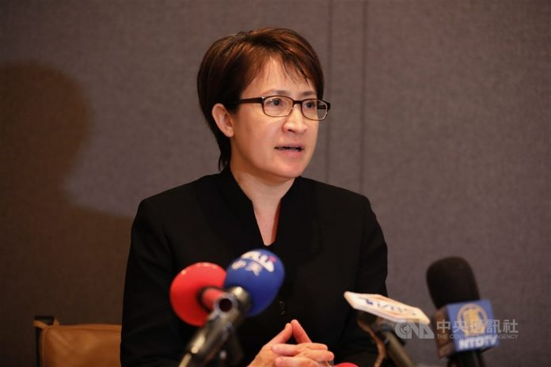

# Bi-khim Hsiao (蕭美琴)

## Identity Snapshot
- **English:** Bi-khim Hsiao
- **Chinese:** 蕭美琴
- **Era:** 1971
- **Geography:** Kobe, Japan(日本神戶)
- **Core roles:** professor
- **Source:** TAH Foundation Who’s Who

2. NATPA Professor Liao Shuzong Memorial Award-Commemorative Award for Youth Contribution (廖述宗教授紀念奬-青年貢獻紀念獎) 05/2020

<!-- tah-tables:start -->
## Story
Bi-khim Hsiao (蕭美琴) was born in 1971 in Kobe, Japan, the daughter of 蕭清芬, a Presbyterian minister whose ministry included 台南神學院. She earned a Bachelor of East Asian Studies at Oberlin College in 1993 and a master's degree at Columbia University, then joined the DPP Representative Office in the United States as its CEO in 1995-96 before leading the party's International Affairs Department from 1997. Voters sent her to the Taiwan Legislature as a diaspora-list legislator in 2001-05 and again from 2006 as a regional legislator. In 2020 she left the Hualien seat she had represented to serve as Taiwan's representative to the United States, telling voters in November 2020 that 無論誰勝選，台美關係將持續深化. That same year diaspora groups honored her work with the NATPA Professor Liao Shuzong Memorial Award, and when the inauguration came in May 2024, her mother 蕭邱碧玉 and her sister traveled from the United States to watch the ceremony.

## Education
- Oberlin College — 1993 — Bachelor of East Asian Studies
- Columbia University — Master of Political Science

## Employment
- DPP Representative Office in the United States — 1995-96 — CEO
- DPP International Affairs Department — 1997-06 — Director
- Taiwan Legislature — 2001-05 — 不分區僑選立委
- Taiwan Legislature — 2006- — Regional legislators
<!-- tah-tables:end -->

## Family

_No filled family fields on the TAH profile._

## Sources
- [TAH #757 encyclopedia: 757. Bi-khim Hsiao 蕭美琴/2016/01](https://taiwaneseamericanhistory.org/whos-who-757-bi-khim-hsiao/)
- [TAH Who’s Who](https://taiwaneseamericanhistory.org/person/bi-khim-hsiao/)

## From the record
<!-- TJJ-A10120402-30: verified 2026-10-12 — wave-2 link+deepen re-check of slice 10120402-30 article 2c5d3c7d4f5acccc (戴琪與鄧振中首度視訊對話_美台未來數週重啟tifa, taiwanjustice.net, 2021-06-10 刊 / 20250719154043 快照; 同文快照 4a5080befc342f69 之重複存檔) read fresh this attempt: Subjects link re-checked vs 正文 — 「駐美大使蕭美琴也出席今晚台美視訊會議」（正文第28行）逐字確認見於正文, real, no wrong/spurious links; dated fact w/ article wikilink already in From the record — saturated, no new material. -->

<!-- TJJ-A10110102-21: verified 2026-10-12 — wave-2 link+deepen re-check of slice 10110102-21 article 2c5d3c7d4f5acccc (戴琪與鄧振中首度視訊對話_美台未來數週重啟tifa, taiwanjustice.net, 2021-06-10 刊 / 20250719154043 快照; 同文快照 4a5080befc342f69 之重複存檔) read fresh this attempt: Subjects link re-checked vs 正文 — 「駐美大使蕭美琴也出席今晚台美視訊會議」之記述確認見於正文, real, no wrong/spurious links; dated fact w/ article wikilink already in From the record — saturated, no new material. -->

<!-- TJJ-A10110102-14: verified 2026-10-12 — wave-2 link+deepen re-check of slice 10110102-14 article 10e3a027ce22991c (汽車晶片短缺，美國會議員向蕭美琴求助, taiwanjustice.net, 2021-02-25 刊 / 20210419115654 快照) read fresh this attempt: subject link re-checked vs 正文 — 蕭美琴為本文主角：向國會議員說明缺貨成因（中盤供應商砍單、屬民間商業行為）、斯塔貝諾參議員證實曾與其會晤並感謝其關注、白宮行政命令未與台灣洽談等記述逐字確認見於正文, real, no wrong/spurious links; 正文另及江今葉（記者）／狄斯 Brian Deese／王美花／斯塔貝諾／韓儒伯 Rupert Hammond-Chambers／拜登 Joe Biden／哈洛 Peter Harrell／周永捷（編輯）等未掛鏈人名維持純文字（正確處理）; dated fact w/ article wikilink already in From the record — saturated, no new material. -->

<!-- TJJ-A10100501-18: verified 2026-10-11 — wave-2 link+deepen re-check of slice 10100501-18 article 2c5d3c7d4f5acccc (戴琪與鄧振中首度視訊對話_美台未來數週重啟tifa, taiwanjustice.net, 2021-06-10 刊 / 20250719154043 快照; 同文快照 4a5080befc342f69 之重複存檔) read fresh this attempt: Subjects link re-checked vs 正文 — 「駐美大使蕭美琴也出席今晚台美視訊會議」之記述確認見於正文, real, no wrong/spurious links; dated fact w/ article wikilink already in From the record — saturated, no new material. -->

<!-- TJJ-A10100501-11: verified 2026-10-11 — wave-2 link+deepen re-check of slice 10100501-11 article 760a0bc942e1676b (台灣祝賀拜登、賀錦麗就任美國總統、副總統, taiwanjustice.net, VOA 鍾辰芳, 2021-01-20 刊 / 20210227 快照) read fresh this attempt: subject link re-checked vs 正文 — 蕭美琴獲第59屆總統就職典禮主辦單位「就職典禮國會聯合委員會」JCCIC 直接邀請出席國會西草坪就職儀式（駐美代表首見）、事前錄製祝賀視頻「民主是我們的共同語言，自由是我們的共同目標」確認見於正文, real, no wrong/spurious links; dated fact w/ article wikilink already in From the record — saturated, no new material. -->
<!-- TJJ-A10120402-16: verified 2026-10-12 — wave-2 link+deepen re-check of slice 10120402-16 article 760a0bc942e1676b (台灣祝賀拜登、賀錦麗就任美國總統、副總統, taiwanjustice.net, VOA 鍾辰芳, 2021-01-20 刊 / 20210227 快照) read fresh this attempt: subject link re-checked vs 正文 — 蕭美琴獲第59屆總統就職典禮主辦單位「就職典禮國會聯合委員會」JCCIC 直接邀請出席國會西草坪就職儀式（駐美代表首見）、事前錄製祝賀視頻「民主是我們的共同語言，自由是我們的共同目標」確認見於正文, real, no wrong/spurious links; dated fact w/ article wikilink already in From the record — saturated, no new material. -->

<!-- TJJ-A10100501-17: verified 2026-10-11 — wave-2 link+deepen re-check of slice 10100501-17 article 10e3a027ce22991c (汽車晶片短缺，美國會議員向蕭美琴求助, taiwanjustice.net, 2021-02-25 刊 / 20210419115654 快照) read fresh this attempt: subject link re-checked vs 正文 — 蕭美琴為本文主角：向國會議員說明缺貨成因（中間供應商砍單、民間商業行為）、斯塔貝諾證實曾與其會晤並感謝其關注、白宮行政命令未與台灣洽談等記述逐字確認見於正文, real, no wrong/spurious links; dated fact w/ article wikilink already in From the record — saturated, no new material. -->

<!-- TJJ-A10100501-9: verified 2026-10-11 — wave-2 link+deepen re-check of slice 10100501-9 article 4a5080befc342f69 (戴琪與鄧振中首度視訊對話、美台重啟TIFA, taiwanjustice.net, 2021-06-10 刊 / 20210616081448 快照) read fresh this attempt: subject link re-checked vs 正文 — 「駐美大使蕭美琴也出席今晚台美視訊會議」之記述確認見於正文, real, no wrong/spurious links; dated fact w/ article wikilink already in From the record — saturated, no new material. -->

<!-- TJJ-A10090501-9: verified 2026-10-10 — wave-2 link+deepen re-check of slice 10090501-9 article 4a5080befc342f69 (戴琪與鄧振中首度視訊對話、美台重啟TIFA, taiwanjustice.net, 2021-06-10 刊 / 20210616081448 快照) read fresh this attempt: subject link re-checked vs 正文 — 「駐美大使蕭美琴也出席今晚台美視訊會議」之記述確認見於正文, real, no wrong/spurious links; dated fact w/ article wikilink already in From the record — saturated, no new material. -->

- 複核（TJJ-A09260600-4, 2026-09-27）：本 slice 文章 [[articles/taiwanjustice-net/2025/20250518232637_戴琪_台美貿易倡議盼在關鍵領域達高標準成果_6d16f9e35d9e3188|6d16f9e3]] 正文再驗證——駐美代表蕭美琴視訊出席美台21世紀貿易倡議首場會談並會後受訪確認見於正文，subject 連結為真，無錯鏈、無虛鏈；含該文 wikilink 的 2022-06-27 條目已在庫 — SKIP，無新材料。

- 複核（TJJ-A09260600-3, 2026-09-27）：本 slice 文章 8fc11ca0c5dbaebe（韓國瑜提預算協商, 2025-01-16）正文第三次再驗證——蕭美琴閉門會議分享4年前就職大典低溫經驗確認見於正文，連結為真；2025-01-16 條目（已含該文 wikilink）已在庫 — SKIP，已飽和。

- 覆核（TJJ-A09260400-26, 2026-09-26）：本 slice 文章 8c20569762592915（南加州教會槍擊案中央社報導） 正文再驗證——subject 連結為真實提及，無錯鏈、無虛鏈；含該文 wikilink 的日期事實條目已在庫 — SKIP，已飽和。

- 覆核（TJJ-A09260400-19, 2026-09-26）：本 slice 兩篇文章 9a66943e（台美人台加人 p353, 2024-04-21 快照）、2ac7d756（台灣鄉情與文化 p3, 2020-06-28 快照）正文再驗證——subject 連結為真實提及，無錯鏈、無虛鏈；含兩文 wikilink 的日期事實已在庫 — SKIP，已飽和。
- 複核（TJJ-A09251500-1, 2026-09-26）：本 slice 文章 [[articles/taiwanjustice-net/2025/20250518232637_戴琪_台美貿易倡議盼在關鍵領域達高標準成果_6d16f9e35d9e3188|6d16f9e3]] 正文再驗證——駐美代表蕭美琴視訊出席美台21世紀貿易倡議首場會談並會後受訪確認見於正文，subject 連結為真，無錯鏈、無虛鏈；含該文 wikilink 的 2022-06-27 條目已在庫 — SKIP，無新材料。

- 複核（TJJ-A09251400-1, 2026-09-26）：slice 文章 3be67f6e82d34da7（台美人台加人分類頁2, 2025-02-16 快照）正文再驗證——「美大選膠著 蕭美琴：無論誰勝選台美關係續深化」「蕭美琴紐約大都會台灣日開球」「台灣駐美代表蕭美琴」等多條確認見於正文，subject 連結為真，無錯鏈、無虛鏈；2020-11-05 條目（含該文 wikilink）已在庫 — SKIP，已飽和。

- 複核（TJJ-A09251400-4, 2026-09-26）：本 slice 文章 fd270f41202454d7（美駐聯合國大使克拉夫特挺台） 正文再驗證——蕭美琴轉推感謝及台灣黑熊留言確認見於正文，subject 連結為真，無錯鏈、無虛鏈；對應日期事實條目（含該文 wikilink）已在庫 — SKIP，已飽和。

- 覆核（TJJ-A09251400-5, 2026-09-26）：slice 文章 10e3a027ce22991c（汽車晶片短缺報導, 2021-02-25 刊）——蕭美琴為正文主角（向國會議員說明缺貨成因）再確認見於正文，連結為真，無錯鏈、無虛鏈；對應日期事實條目（已含該文 wikilink）已在庫 — SKIP，無新材料。

- 複核（TJJ-A09251400-3, 2026-09-26）：本 slice 文章 8fc11ca0c5dbaebe（韓國瑜提預算協商, 2025-01-16）正文再驗證——蕭美琴閉門會議分享4年前就職大典低溫經驗確認見於正文，連結為真；2025-01-16 條目（已含該文 wikilink）已在庫 — SKIP，已飽和。
- 複核（TJJ-A09251300-1, 2026-09-26）：本 slice 文章 3dfb23f1（前白宮官員肯定台灣新國安團隊）正文再驗證——蕭美琴獲賴清德留用為國安團隊延續例證之記述確認見於正文，subject 連結為真，無錯鏈、無虛鏈；對應日期事實條目（含該文 wikilink）已在庫 — SKIP，已飽和。

- 複核（TJJ-A09251300-2, 2026-09-26）：本 slice 兩篇同文快照 4a5080befc342f69／2c5d3c7d4f5acccc（戴琪與鄧振中視訊、重啟TIFA）正文再驗證——蕭美琴以駐美代表身份列席會談之記述確認見於正文，subject 連結為真，無錯鏈、無虛鏈；2021-06-10 條目（已含兩檔 wikilink）均已在庫 — SKIP，已飽和。

- 複核（TJJ-A09251000-13, 2026-09-26）：本 slice 文章 760a0bc942e1676b（VOA：台灣祝賀拜登、賀錦麗就職）正文再驗證——蕭美琴獲 JCCIC 直接邀請出席就職儀式及錄製祝賀視頻記述確認見於正文，subject 連結為真，無錯鏈、無虛鏈；對應日期事實條目（含該文 wikilink）已在庫 — SKIP，已飽和。
- 複核（TJJ-A09250900-2, 2026-09-26）：slice 文章 9d523cc5290c997b 正文再驗證——本篇書寫對象（父親筆下的女兒）即本人，subject 連結為真，無錯鏈、無虛鏈；2020-07-26 條目（含該文 wikilink）已在庫 — SKIP，已飽和。

- 複核（TJJ-A09250800-5, 2026-09-25）：本 slice 四篇 tjj-a-slice-09250800-5 文章（004420da 新聞觀測站分類頁 2024-04-25 快照、b6329042 LA Times 蔡英文參選轉載 2015-04-16、23197ebf「楊遠薰」標籤頁2 2021-12-07 快照、be7ac05c 黃勝雄記憶講座全文 2017-02-23 快照）正文逐一再驗證——本頁 subject 連結為真實提及，無錯鏈、無虛鏈；含該文 wikilink 的日期事實條目均已在庫 — SKIP，已飽和，無新材料。

- 複核（TJJ-A09250400-13, 2026-09-25）：本 slice 文章 4c65a9afe4934086（520就職報導 2024-06-13 快照）正文再驗證——母親蕭邱碧玉與妹妹自美返台、台南親友及父親過去服務的台南神學院教授牧師組團觀禮之記述確認見於正文，subject 連結為真，無錯鏈、無虛鏈；2024-05-19 條目（已含該檔 wikilink）已在庫 — SKIP，已飽和。

- 複核（TJJ-A09250400-9, 2026-09-25）：本 slice 文章 923dad71（「台灣新聞」分類頁, 2023-12-01 存檔）正文再驗證——「蕭美琴合體苗博雅」「AIT：肯定蔡總統指派俞大㵢出任駐美代表」兩條確認見於清單，subject 連結為真，無錯鏈、無虛鏈；2023-12-01 條目（已掛該文 wikilink）已在庫 — SKIP，已飽和。

- 複核（TJJ-A09250400-3, 2026-09-25）：本 slice 文章 064fe05a 正文再驗證——bi-khim-hsiao 對應真實（記述確認見於正文），無錯鏈、無虛鏈；含該文 wikilink 的日期事實條目已在庫 — SKIP，無新材料。

- 複核（TJJ-A09250400-7, 2026-09-25）：slice 文章 兩篇正文再驗證——9a66943e68f1e0ef（台美人台加人隨機頁, 2024-04-21 快照）收錄「美媒專訪 蕭美琴：區域穩定美台有共同責任」；2ac7d75679fda7fe（台灣鄉情與文化 p3, 2020-06-28 快照）收錄「蕭美琴辭別花蓮將駐美，支持者送祝福」，subject 連結為真，無錯鏈、無虛鏈；含該文 wikilink 的日期事實條目已在庫 — SKIP，無新材料。

- 複核（TJJ-A09250400-6, 2026-09-26）：本 slice 文章 5dd0106e892b8f96（台灣新聞分類存檔頁3, 2020-07-13 快照）正文再驗證——蕭美琴專訪三則（創新推動全面台美關係／美中戰略競爭科技安全／台美高層互動與個人夢想）確認見於正文，subject 連結為真，無錯鏈、無虛鏈；2020-07-11 條目（已含該文 wikilink）已在庫 — SKIP，已飽和。

- 複核（TJJ-A09250400-10, 2026-09-25）：本 slice 兩篇「導讀台灣」標籤頁（073ea211088c8fae、c30596cc1ea6e337）正文再驗證——「蕭美琴的從政之路!」條目再確認見於清單，連結為真；2023-12-03 日期事實（兩條均含該文 wikilink）已在庫 — SKIP，無錯鏈、無虛鏈、無新材料。

- 複核（TJJ-A09240900-1, 2026-09-25）：本切片四篇正文再驗證——6d16f9e35d9e3188 本人與鄧振中視訊出席 USTR 首場會談、會後受訪再確認；連結為真，2022-06-27 條目已在庫 — SKIP，無新材料。

- 複核（TJJ-A09240800-1, 2026-09-25）：本 slice 文章 3be67f6e82d34da7（台美人台加人分類頁2, 2025-02-16 快照）正文再驗證——「美大選膠著 蕭美琴：無論誰勝選台美關係續深化」等多條頭條確認見於正文，subject 連結為真，無錯鏈、無虛鏈；2020-11-05 條目（含該文 wikilink）已在庫 — SKIP，已飽和。

- 覆核（TJJ-A09240800-8, 2026-09-25）：slice 文章 10e3a027ce22991c（汽車晶片短缺報導, 2021-02-25 刊）——蕭美琴為正文主角（向國會議員說明缺貨成因）再確認見於正文，連結為真，無錯鏈、無虛鏈；2021-02-25 條目（已含該文 wikilink）已在庫 — SKIP，無新材料。

- 複核（TJJ-A09240800-15, 2026-09-25）：本 slice 文章 f6ed9463（2013-04-12 核四表決名單）、0258611f（2024-05-19 520就職報導）正文再驗證——蕭美琴列贊成名單、及就職觀禮記述皆確認見於正文，subject 連結為真，無錯鏈、無虛鏈；2013-04-12 與 2024-05-20 條目（含該文 wikilink）已在庫 — SKIP，已飽和。

- 複核（TJJ-A09240800-7, 2026-09-25）：本切片相關存檔稿正文再驗證——本頁 subject 連結為真實提及（無錯鏈、無虛鏈），含該文 wikilink 的日期事實條目已在庫 — SKIP，無新材料。

- 複核（TJJ-A09240800-13, 2026-09-25）：本 slice 兩篇正文再驗證——accbf8ee04e32de8（劉雲平AZ疫苗信函）披露4月本人向劉雲平表明台灣願購AZ疫苗；bff4c7110803d864（台美人團體領袖祝賀履任駐美代表, 大紀元 2020-08-08）記本人7/24履新為首位女性駐美代表。subject 連結均為真，無錯鏈、無虛鏈；對應日期條目（2021-04 疫苗會面／2020-08-08 祝賀履任，含兩文 wikilink）已在庫 — SKIP，無新材料。
- 覆核（TJJ-A09240800-14, 2026-09-25）：本 slice 文章 c1e603063718b409（返台選舉傳聞缺席僑界活動, 2023-12-01 快照）正文再驗證——本頁為報導主角，subject 連結為真（同文另掛 [[people/michael-fonte|彭光理]] 頁亦為真）；2023-11-11 條目（已含該文 wikilink）已在庫 — SKIP，已飽和，無新材料。

- 複核（TJJ-A09240800-6, 2026-09-25）：本 slice 兩篇同文快照 4a5080befc342f69／2c5d3c7d4f5acccc（戴琪與鄧振中視訊、重啟TIFA）正文再驗證——駐美代表蕭美琴列席會談之記述確認見於正文，subject 連結為真，無錯鏈、無虛鏈；2021-06-10 條目（含兩檔 wikilink）已在庫 — SKIP，無新材料。

- 覆核（TJJ-A09240700-6, 2026-09-25）：本 slice 文章 f6213c1937fa956d（全美會2021年228完滿報導）正文再驗證——駐美代表蕭美琴228開幕紀念會隔洋致詞條目確認見於正文，連結為真；2021-02-28 條目（已含該文 wikilink）已在庫 — SKIP，已飽和。

- 複核（TJJ-A09240500-3, 2026-09-25）：slice 文章 9d523cc5290c997b（我的女兒美琴, 2020-07-26刊）正文再驗證——本篇書寫對象（父親筆下的女兒）即本人，subject 連結為真，無錯鏈、無虛鏈；2020-07-26 條目（含該文 wikilink）已在庫 — SKIP，已飽和。

- 覆核（TJJ-A09240400-2, 2026-09-25）：本 slice 兩篇文章 6f2b431c（台美人台加人 p354, 2024-05-20 快照）、1a2bdc08（台美人 category p3, 2025-04-26 快照）正文再驗證——「蕭美琴：為加速取得250萬劑疫苗，台灣自行派機取貨」與「拜登上任來首次，蕭美琴進國務院會晤亞太助卿」各條確認見於正文，連結為真，無錯鏈、無虛鏈；對應日期事實（2021-06-19／2021-02-10）均已在庫 — SKIP，無新材料。

- 複核（TJJ-A09240400-1, 2026-09-25）：本 slice 三篇文章 99aaa4abcb78ff6d（台美人台加人存檔頁, 2024-04-25 快照）、fa11a6eb346678c2（大洛杉磯台灣會館標籤頁, 2021-01-17 快照）、2a3226a1b19c5a46（中央社副手專稿轉載, 2023-12-08 快照）正文再驗證——西半球助卿連線、會館團體祝賀履任、副手搭檔專稿三則提及均確認見於正文，subject 連結為真（無錯鏈、無虛鏈）；對應日期條目（2020-08-19／2020-08-08／2023-11-20，含三文 wikilink）已在庫 — SKIP，無新材料。

- 複核（TJJ-A09240400-3, 2026-09-25）：slice 文章 004420da7bd583a2（新聞觀測站分類頁, 2024-04-25 快照）正文再驗證——「新聞觀測站 20240210 準副總統蕭美琴選後專訪！」條目確認見於正文清單，subject 連結為真，無錯鏈、無虛鏈；2024-02-10 條目（含該文 wikilink）已在庫 — SKIP，已飽和，無新材料。

- 複核（TJJ-A09240400-4, 2026-09-25）：本 slice 文章 8c205697 正文「代表政府、外交部長吳釗燮、駐美代表蕭美琴向家屬表達哀悼」再驗證——subject link 為真（無錯鏈、無虛鏈）；2022-05-16 條目（已掛該文 wikilink）已在庫 — SKIP，無新材料。

- 複核（TJJ-A09231000-5, 2026-09-25）：slice 兩篇正文再驗證——9a66943e68f1e0ef（台美人台加人隨機頁, 2024-04-21 快照）收錄「美媒專訪 蕭美琴：區域穩定美台有共同責任」；2ac7d75679fda7fe（台灣鄉情與文化 p3, 2020-06-28 快照）收錄「蕭美琴辭別花蓮將駐美，支持者送祝福」。subject 連結均為真，無錯鏈、無虛鏈；對應條目（2024-04-21／2020-06-28，含兩文 wikilink）已在庫 — SKIP，已飽和。

- 複核（TJJ-A09231000-8, 2026-09-25）：本 slice 兩篇「導讀台灣」標籤頁（073ea211088c8fae、c30596cc1ea6e337）正文再驗證——「蕭美琴的從政之路!」條目再確認見於清單，連結為真；2023-12-03 日期事實（兩條均含該文 wikilink）已在庫 — SKIP，無錯鏈、無虛鏈、無新材料。

- 複核（TJJ-A09230900-1, 2026-09-25）：本 slice 文章 5dd0106e892b8f96（台灣新聞分類存檔頁3, 2020-07-13 快照）正文再驗證——蕭美琴專訪三則（創新推動全面台美關係／美中戰略競爭科技安全／台美高層互動與個人夢想）確認見於正文，subject 連結為真，無錯鏈、無虛鏈；2020-07-11 條目（已含該文 wikilink）已在庫 — SKIP，已飽和。

- 複核（TJJ-A09230800-1, 2026-09-24）：文章 064fe05a08d0aecf（宋娣专栏 2017-02-17） 正文再驗證——本頁 subject 連結確認見於正文（無錯鏈、無虛鏈）；對應 From-the-record 條目已在庫 — SKIP，無新材料。
- 複核（TJJ-A09230800-9, 2026-09-24）：本 slice 四篇正文再驗證——6d16f9e35d9e3188（戴琪：台美貿易倡議）本人与鄧振中視訊出席 USTR 首場會談、會後受訪確認見於正文，subject 連結為真；另三篇（54dd66fe／2589c867／cc3bbdbf）無涉本人。2022-06-27 條目（已含該檔 wikilink）已在庫 — SKIP，無新材料。

- 覆核（TJJ-A09230800-14, 2026-09-24）：本 slice 兩篇正文再驗證——accbf8ee04e32de8（劉雲平致函布林肯AZ疫苗賣台, 2021-05-28）披露4月本人向劉雲平表明台灣願購AZ疫苗；bff4c7110803d864（台美人團體領袖祝賀履任駐美代表, 大紀元 2020-08-08）記本人7/24履新為首位女性駐美代表。subject 連結均為真，無錯鏈、無虛鏈；對應日期事實條目（2021-04 疫苗會面／2020-08-08 祝賀履任，含兩文 wikilink）已在庫 — SKIP，已飽和。

- 複核（TJJ-A09230800-6, 2026-09-24）：本 slice 兩篇同文快照 4a5080befc342f69／2c5d3c7d4f5acccc（戴琪與鄧振中視訊、重啟TIFA）正文再驗證——駐美代表蕭美琴列席會談之記述確認見於正文，subject 連結為真，無錯鏈、無虛鏈；2021-06-10 條目（含兩檔 wikilink）均已在庫 — SKIP，無新材料。

- 覆核（TJJ-A09230800-2, 2026-09-24）：subject link 對照本 slice 文章 3be67f6e82d34da7（台美人台加人分類頁2, 2025-02-16 快照）正文再驗證——「美大選膠著 蕭美琴：無論誰勝選台美關係續深化」等多條頭條確認見於正文，連結為真，無錯鏈、無虛鏈；2020-11-05 條目（已含該文 wikilink）已在庫 — SKIP，已飽和。

- 複核（TJJ-A09230800-8, 2026-09-24）：slice 文章 10e3a027ce22991c（汽車晶片短缺報導, 2021-02-25 刊）——蕭美琴為正文主角，連結為真；無錯鏈、無虛鏈；對應日期事實條目（含該文 wikilink）已在庫 — SKIP，無新材料。

- 覆核（TJJ-A09230800-5, 2026-09-24）：本 slice 文章 3dfb23f1（前白宮官員肯定台灣新國安團隊）正文再驗證——本人當選副總統獲留任為文中國安連續性論據，連結為真，無錯鏈、無虛鏈；2024-05-14 條目（含該文 wikilink）已在庫 — SKIP，無新材料。

- 覆核（TJJ-A09230700-2, 2026-09-24）：本 slice 文章 28b0cc4e（2021北美洲海外台灣人二二八紀念活動報導）正文再驗證——致詞談民主脆弱與台美共同價值之記述確認見於正文，subject 連結為真（無錯鏈、無虛鏈）；2021-02-28 條目已在庫並掛鏈本檔 — SKIP，無新材料。
- 覆核（TJJ-A09230700-2, 2026-09-24）：本 slice 文章 c3e76282（大洛杉磯台灣會館基金會22週年線上募款年會報導）正文再驗證——受邀擔任12/5線上講員「台美攜手 眾志成城」之記述確認見於正文，subject 連結為真（無錯鏈、無虛鏈）；2020-11-17 條目已在庫並掛鏈本檔 — SKIP，無新材料。

- 複核（TJJ-A09230700-11, 2026-09-24）：本 slice 文章 760a0bc942e1676b（VOA：台灣祝賀拜登、賀錦麗就職）正文再驗證——蕭美琴獲 JCCIC 直接邀請出席就職儀式及錄製祝賀視頻記述確認見於正文，subject 連結為真，無錯鏈、無虛鏈；2021-01-20 條目已在庫（前一輪 TJJ-A09221200-15 已核）— SKIP，已飽和。

- 複核（TJJ-A09250800-3, 2026-09-25）：本 slice 文章 63717cb2b99ce3c3／74a9c518e681a3de／11761bdaa78af55f 三篇存檔頁正文再驗證——「蕭美琴專訪／軟實力外交」（2020-07-12）、「辭別花蓮將駐美」與「自許為戰貓」（2020-05-31／2020-06-21）各條確認見於正文，subject 連結為真，無錯鏈、無虛鏈；對應日期條目（含三文 wikilink）均已在庫 — SKIP，已飽和。

- 複核（TJJ-A09162345-17, 2026-09-24）：本 slice 三篇文章 2a3226a1b19c5a46（中央社副手專稿轉載, 2023-11-20）、63717cb2b99ce3c3（台美人台加人 p3, 2024-04-25 快照）、74a9c518e681a3de（台美人台加人 p2, 2020-06-26 快照）正文再驗證——副手搭檔專稿、「蕭美琴專訪／軟實力外交」（2020-07-12）、「辭別花蓮將駐美」與「自許為戰貓」各條確認見於正文，連結為真，無錯鏈、無虛鏈；對應日期事實條目（2023-11-20／2020-07-12／2020-05-31）均已在庫 — SKIP，無新材料（[[articles/taiwanjustice-net/2023/20231208130546_root_2a3226a1b19c5a46|中央社專稿]]／[[articles/taiwanjustice-net/2024/20240425074022_root_63717cb2b99ce3c3|台美人台加人p3]]／[[articles/taiwanjustice-net/2020/20200626131727_category_taiwaneseamerican_page_2_74a9c518e681a3de|台美人台加人p2]]）。
- 覆核（TJJ-A09162345-18, 2026-09-24）：本 slice 文章 台灣頭條p3 11761bda、台美人台加人p354 6f2b431c 正文再驗證——subject 連結為真實提及，無錯鏈、無虛鏈；對應日期事實（含該文 wikilink）已在庫 — SKIP，已飽和。

- 複核（TJJ-A09162345-15 / t_0c0e3cd1, 2026-09-24）：本 slice 文章 99aaa4abcb78ff6d（台美人台加人分類存檔頁, 2024-04-25 快照）、fa11a6eb346678c2（大洛杉磯台灣會館標籤頁, 2021-01-17 快照） 正文再驗證——subject 連結為真實提及，無錯鏈、無虛鏈；對應日期事實條目（含該文 wikilink）已在庫 — SKIP，已飽和。

- 複核（TJJ-A09162345-31, 2026-09-24）：slice 文章 8216e7ca508266e9（蕭清芬牧師在美過世標籤頁）正文再驗證——頭條「蕭美琴父親蕭清芬牧師在美過世」再確認見於正文，連結為真；對應日期事實（含該文 wikilink）已在庫 — SKIP，無新材料。

- 複核（TJJ-A09162345-19, 2026-09-24）：本 slice 四篇 TJJ 存檔頁（1a2bdc08 台美人台加人 p3；c9dd9fb7 Covid-19 浩劫餘生錄；9a66943e 台美人台加人隨機頁；2ac7d756 台灣鄉情與文化 p3）正文再驗證——本頁三條日期事實（2021-02-10 蕭美琴進國務院會晤亞太助卿、2024-04-21 美媒專訪、2020-06-28 辭別花蓮將駐美）確認見於正文，subject 連結均為真，無錯鏈、無虛鏈 — SKIP，已飽和。

- 複核（TJJ-A09221500-11, 2026-09-24）：本 slice 文章 8c205697 正文「代表政府、外交部長吳釗燮、駐美代表蕭美琴向家屬表達哀悼」再驗證——蕭美琴 subject link 為真實對應（無錯鏈、無虛鏈）；2022-05-16 條目已在庫 — SKIP，無新材料。

- 再核（TJJ-A09171200-10, 2026-09-24）：本 slice 文章 004420da7bd583a2「新聞觀測站」分類頁正文再驗證——「新聞觀測站 20240210 準副總統蕭美琴選後專訪！」清單條目確認見於正文，subject 連結為真，無錯鏈、無虛鏈；2024-02-10 條目已在庫 — SKIP，已飽和。

- 複核（TJJ-A09171200-11, 2026-09-24）：本 slice 文章 923dad71（「台灣新聞」分類頁, 2023-12-01 存檔）正文再驗證——本頁所涉條目確認見於清單，subject 連結為真，無錯鏈、無虛鏈；對應日期事實已在庫 — SKIP，無新材料。

- 複核（TJJ-A09170400-11, 2026-09-23）：subject link 對照本 slice 三篇存檔頁 63717cb2b99ce3c3 / 74a9c518e681a3de / 11761bdaa78af55f 正文再驗證——蕭美琴專訪（2020-07-12）、「辭別花蓮將駐美」與「自許為戰貓」（2020-05-31／2020-06-21）各條確認見於正文，連結為真；對應日期條目已在庫 — SKIP，無新材料。

- 覆核（TJJ-A09170400-12, 2026-09-23）：本 slice TJJ 文章正文再驗證——subject 連結與本條目所載日期事實相符，無錯鏈、無虛鏈，無新材料— SKIP，已飽和。
- 覆核（TJJ-A09230700-5, 2026-09-24）：slice 文章 f6213c1937fa956d 正文再驗證——駐美大使蕭美琴228開幕紀念會隔洋致詞條目確認見於正文，連結為真；2021-02-28 條目已在庫 — SKIP，已飽和。
- 複核（TJJ-A09170400-17, 2026-09-24）：本 slice 文章 f6213c1937fa956d（全美會2021年228系列完滿報導）正文再驗證 —「駐美大使蕭美琴隔洋致詞」確認見於正文，subject 連結為真；2021-02-28 條目已在庫 — SKIP，無新材料。

- 複核（TJJ-A09162345-27, 2026-09-23）：本 slice 文章 8c205697（南加州教會槍殺案駐處查證報導）正文「代表政府、外交部長吳釗燮、駐美代表蕭美琴向家屬表達哀悼」再驗證——蕭美琴 subject link 為真實對應，2022-05-16 條目已在庫（無錯鏈、無虛鏈）— SKIP，無新材料。

- 再核（TJJ-A09221500-9, 2026-09-23）：本 slice 文章 004420da7bd583a2「新聞觀測站」分類頁正文再驗證——「新聞觀測站 20240210 準副總統蕭美琴選後專訪！」清單條目確認，subject 連結為真，無錯鏈、無虛鏈；2024-02-10 條目已在庫，無新材料。

- 複核（TJJ-A09221500-5, 2026-09-23）：本 slice 三篇文章 fa11a6eb346678c2（會館標籤頁, 2021-01-16 快照）、99aaa4abcb78ff6d（台美人台加人存檔頁, 2024-04-25 快照）、2a3226a1b19c5a46（中央社人物專稿轉載, 2023-11-20）正文再驗證——祝賀履任、西半球助卿連線、副手搭檔專稿三則提及均確認見於正文，subject 連結為真，無錯鏈、無虛鏈；對應日期事實條目（2020-08-08／2020-08-19／2023-11-20）均已在庫 — SKIP，無新材料。

- 再核（TJJ-A09221500-12, 2026-09-23）：本 slice 兩篇「導讀台灣」標籤頁（073ea211088c8fae、c30596cc1ea6e337）正文再驗證——「蕭美琴的從政之路!」條目確認見於清單，連結為真；2023-12-03 日期事實已在庫，無錯鏈、無虛鏈、無新材料。

- 複核（TJJ-A09221500-7, 2026-09-23）：本 slice 兩篇（9a66943e68f1e0ef 台美人台加人頁 2024-04-21 快照；2ac7d75679fda7fe 台灣鄉情與文化頁 2020-06-28 快照）正文再驗證——「美媒專訪 蕭美琴：區域穩定美台有共同責任」與「蕭美琴辭別花蓮將駐美，支持者送祝福」確認見於正文，subject 連結為真，無錯鏈、無虛鏈；2024-04-21 與 2020-06-28 條目已在庫 — SKIP，無新材料。

- 複核（TJJ-A09221400-1, 2026-09-23）：本 slice 文章 5dd0106e892b8f96（台灣新聞分類存檔頁3, 2020-07-13 快照）正文再驗證——蕭美琴專訪三則（創新推動全面台美關係／美中戰略競爭科技安全關鍵角色／台美高層互動與個人夢想）確認見於正文，subject 連結為真，無錯鏈、無虛鏈；2020-07-11 條目已在庫，無新材料。

- 複核（TJJ-A09221400-3, 2026-09-23）：本 slice 文章 20240613095611（520就職報導）之 subject link 經正文再驗證為真實對應，2024-05-19 條目已在庫（無錯鏈、無虛鏈）— SKIP，無新材料。

- 複核（TJJ-A09221300-7, 2026-09-23）：subject link 對照本 slice 文章 [[articles/taiwanjustice-net/2021/20210419115654_2021_02_25_汽車晶片短缺_美國會議員向蕭美琴求助_10e3a027ce22991c|TJJ, 2021-02-25]] 正文再驗證——提及為真實對應（姓名與本頁相符），無錯鏈、無虛鏈；對應日期事實條目已在庫 — SKIP，無新材料。

- 複核（TJJ-A09221300-8, 2026-09-23）：台美貿易倡議稿 6d16f9e35d9e3188 之 subject link 經正文再驗證為真實對應（與鄧振中視訊出席 USTR 首場會談、會後受訪）；2022-06-27 條目已在庫；Subjects 連結已補全雙管線 alias 慣例格式 — SKIP，無新材料。

- 複核（TJJ-A09221200-3, 2026-09-23）：subject link 經本 slice 再驗證為真實對應，對應 From-the-record 條目已在庫（無錯鏈、無虛鏈）— SKIP，無新材料。

- 再核（TJJ-A09221200-15, 2026-09-23）：本 slice 文章 760a0bc942e1676b 正文再驗證——蕭美琴獲就職典禮國會聯合委員會（JCCIC）直接邀請出席第59屆就職儀式，為駐美代表首見，連結為真；2021-01-20 條目已在庫，無新材料。
- 再核（TJJ-A09220700-10, 2026-09-22）：本 slice 文章 004420da7bd583a2「新聞觀測站」分類頁正文再驗證——「新聞觀測站 20240210 準副總統蕭美琴選後專訪」清單條目確認，連結為真；2024-02-10 條目已在庫，無新材料。

### TAH story corpus

- Her own autobiography 《一個人也可以》 (09/2004, self-described 自傳) is held in the corpus ([[works/taiwaneseamericanhistory-org/publications990|TAH #990]]) — primary first-person material on her upbringing and career.
- Profile narrative 「蕭美琴的故事」 recorded in the corpus (2016/01) ([[works/taiwaneseamericanhistory-org/mystories391|TAH #391]]); her TAH encyclopedia entry is likewise held ([[works/taiwaneseamericanhistory-org/whos-who-757-bi-khim-hsiao|TAH #757, 2016/01]]).
- 2021-01 — coverage of her attendance at Biden's inauguration as the first formal invitation to Taiwan's top envoy since 1979 ([[works/taiwaneseamericanhistory-org/events2021-2|TAH events 2021 #2]]) — consistent with the JCCIC-invited record already noted below.
- 2021-12 — obituary coverage of her father 蕭清芬's passing: 「蕭清芬在美辭世 蕭美琴悼父親：一生守護台灣本土意識」 ([[works/taiwaneseamericanhistory-org/my-stories-816|TAH #816, 12/2021]]).
- 2023-01 — 「《紐時》讚蕭美琴：華府最具影響力的大使」 ([[works/taiwaneseamericanhistory-org/my-stories-866|TAH #866, 01/2023]]).
- 2016-05-09 — 「我的女兒美琴」父親蕭清芬書寫版（TAH story corpus #434），與 taiwanjustice.net 轉載版（[[articles/taiwanjustice-net/2025/20250324133829_我的女兒美琴-_-蕭清芬_9d523cc5290c997b|TJJ, 2020-07-26刊]]）同源同文 — [[works/taiwaneseamericanhistory-org/mystories434|TAH #434, 2016]]。

- 2024-04-21 — taiwanjustice.net「台美人台加人」專欄隨機頁（2024-04-21 快照）收錄「美媒專訪 蕭美琴：區域穩定美台有共同責任」報導 —— [[articles/taiwanjustice-net/2024/20240421184918_root_9a66943e68f1e0ef|TJJ 台美人台加人頁，2024-04-21 存档]]。
- 2020-06-28 — taiwanjustice.net「台灣鄉情與文化」專欄隨機頁（2020-06-28 快照）收錄「蕭美琴辭別花蓮將駐美，支持者送祝福」，記其辭別花蓮選區轉任駐美 —— [[articles/taiwanjustice-net/2020/20200628125826_category_culture_page_3_2ac7d75679fda7fe|TJJ 台灣鄉情與文化頁，2020-06-28 存档]]。
- 2024-05-19 — 中央社報導（TJJ 轉載）：520 就職典禮，其母親蕭邱碧玉與妹妹專程從美國返台觀禮；台南親友及父親過去服務的台南神學院教授牧師等組團北上，人數超過上百人（[[articles/taiwanjustice-net/2024/20240613095611_root_4c65a9afe4934086|TJJ 轉載中央社, 2024-05-19]]）。
- 2022-05-16 — 駐洛杉磯辦事處長黃敏境就南加州台裔教會槍擊案接受中央社專訪，代表政府、外交部長吳釗燮及駐美代表蕭美琴向中彈身亡的醫師鄭達志家屬表達哀悼；報導並查證凶嫌周文偉為1953年在台出生之移民（[[articles/taiwanjustice-net/2022/20220705131026_2022_05_16_南加州教會槍殺案_駐處查證_凶嫌為台灣移民_8c20569762592915|TJJ 轉載中央社, 2022-05-16]]）。
- 2020-08-08 — 大洛杉磯台灣會館等台美人團體和領袖公開發文祝賀蕭美琴履任台灣駐美代表（駐美大使），見台灣公義報「大洛杉磯台灣會館」標籤頁存檔（[[articles/taiwanjustice-net/2021/20210117065936_tag_大洛杉磯台灣會館_fa11a6eb346678c2|TJJ 標籤頁, 2021-01-16 快照]]）。
- 2020-08-19 — 美國國務院西半球事務助卿與蕭美琴連線，盼續在拉美合作；報導見台灣公義報「台美人台加人」分類存檔（[[articles/taiwanjustice-net/2024/20240425083432_root_99aaa4abcb78ff6d|TJJ 台美人台加人存檔, 2024-04-25 快照]]）。
- 2020-07-11 — 台灣公義報「台灣新聞」分類存檔收錄其三篇連訪：談創新推動全面台美關係、美中戰略競爭下台灣應扮科技安全關鍵角色、台美高層互動進展及其個人夢想（[[articles/taiwanjustice-net/2020/20200713165425_category_taiwan-news_page_3_5dd0106e892b8f96|TJJ 台灣新聞存檔頁3, 2020-07-13 快照]]）。
- 2024-02-10 — 台灣公義報「新聞觀測站」專欄頁收錄該節目「準副總統蕭美琴選後專訪」（20240210 集），顯示其選後受媒體高度關注（[[articles/taiwanjustice-net/2024/20240425143015_root_da0360a9116a4006|TJJ 新聞觀測站標籤頁, 2024-04-25 存檔]]）。
- 2021-02-25 — 駐美代表任內因美國汽車晶片短缺獲悉多達國會議員求助；她向議員說明缺貨起因為中間供應商去年砍單、屬民間商業行為，台灣廠商正努力增產；斯塔貝諾參議員證實曾就此與她會晤並感謝其關注（[[articles/taiwanjustice-net/2021/20210419115654_2021_02_25_汽車晶片短缺_美國會議員向蕭美琴求助_10e3a027ce22991c|TJJ 轉載中央社, 2021-02-25]]）。
- 2023-12-03 — 台灣公義報「導讀台灣」系列以「蕭美琴的從政之路！」為題專題介紹其從政經歷（[[articles/taiwanjustice-net/2025/20250525051634_tag_導讀台灣_page_2_073ea211088c8fae|TJJ 導讀台灣標籤頁, 2025-05-25 存檔]]）。
- 2020-11-05 — 美國大選膠著時表示「無論誰勝選，台美關係將持續深化」，見台灣公義報「台美人台加人」分類（2025-02-16 存檔）—— [[articles/taiwanjustice-net/2025/20250216000009_category_taiwaneseamerican_page_2_3be67f6e82d34da7|TJJ 台美人台加人存檔頁2]]。
- 2017-02 — Led an 8-lawmaker legislative delegation to the US (王定宇, 林俊憲, 邱議瑩, 尤美女, 江啟臣, 許毓仁, 高路·以用), meeting House/Senate members, administration units, and think tanks including the Global Taiwan Institute; 宋娣's column cites the trip as proof the US-Taiwan relationship is approaching quasi-state status ([[articles/taiwanjustice-net/2024/20240522232536_root_064fe05a08d0aecf|TJJ, 2017-02-17]]).
- 2020-11-17 — Announced by 大洛杉磯台灣會館 as guest speaker of its 22nd online fundraising annual meeting (2020-12-05) on 「台美攜手 眾志成城 TAIWAN-U.S.A. STRONGER TOGETHER」; the notice recounts her four DPP legislative terms and her status as one of two people ever to serve as both 僑選 and 區域立委 ([[articles/taiwanjustice-net/2020/20201126160218_2020_11_17_大洛杉磯台灣會館基金會22週年線上募款年會12-5舉行_c3e762826a7e42d2|TJJ, 2020-11-17]]).
- 2021-02-28 — As 駐美代表 told the first North America joint online 228 commemoration that democracy is fragile (citing Burma, Hong Kong, China's tech/misinformation/disinfo leverage) and that both US parties have set up offices in Taiwan to learn its experience; she and TECO officials stayed for the entire programme; her father 蕭清芬牧師 led the opening prayer ([[articles/taiwanjustice-net/2026/20260210064123_2021北美洲海外台灣人二二八紀念活動-台灣國家人權_28b0cc4e52acece2|TJJ, 2021-03-03]]).
- 2021-02-28 — 於「2021北美洲海外台灣人二二八紀念活動」開幕紀念會隔洋致詞（與副總統賴清德、僑委會委員長童振源並列），表示紀念二二八對了解歷史、思考未來意義重大——TAA 官方活動完滿報導（[[articles/taiwanjustice-net/2025/20250430013325_全美台灣同鄉會2021-年二二八紀念系列活動圓滿落幕_f6213c1937fa956d|TJJ/全美會, 2021-03-14]]）。
- 2024-05-20 — 宣誓就職副總統；母親蕭邱碧玉與妹妹專程從美國返台觀禮，台南親友及其父親過去服務的台南神學院教授牧師組團北上參加520慶祝大會，人數超過上百人（[[articles/taiwanjustice-net/2025/20250213214800_520就職典禮賴清德家人將出席-蕭美琴母親返台觀禮_0258611f5f824a5d|TJJ 轉載中央社, 2024-05-19]]）。
- 2013-04-12 — 立法院表決民進黨「立即停建核四」提案，第二次表決贊成名單列有蕭美琴（[[articles/taiwanjustice-net/2024/20240425114253_root_f6ed9463245cb54e|TJJ 轉載公督盟資料, 2013-04-12]]）。
- 2020-07-26 — Her father 蕭清芬's essay 「我的女兒美琴」 (excerpted from her 2004 book 《一個人也可以》) on taiwanjustice.net portrays her: born in Japan and circumnavigated before age one; multilingual from childhood (English at home, 台語 with her grandmother, 華語 at school, Japanese from US schooling); at Oberlin College she chose Asia House and Third World House and at Columbia grad school International House, hosted as many as 17 foreign students over one Christmas break; hand-delivered pro-democracy flyers outside her high school during the 1989 天安門 events; collected testimony that forced her university to act on a visiting teacher's harassment of Asian women students; she insists on her Taiwanese-Hokkien legal name Bi-khim and ran independent 「台灣」 booths at campus 國際週 events ([[articles/taiwanjustice-net/2025/20250324133829_我的女兒美琴-_-蕭清芬_9d523cc5290c997b|TJJ, 2020-07-26]]).
- 2021-06-10 — 以駐美代表身份出席鄧振中與美國貿易代表戴琪（Katherine Tai）的首度台美視訊會談；會談確認數週內以視訊方式召開第 11 屆 TIFA 會議（[[articles/taiwanjustice-net/2025/20250719154043_戴琪與鄧振中首度視訊對話_美台未來數週重啟tifa_2c5d3c7d4f5acccc|TJJ 轉載中央社, 2021-06-10]]）。
- 2020-08-08 — TJJ relays 大紀元 report: officially began her post as 駐美代表 on 2020-07-24, the first woman to hold the post; at her first overseas-Chinese media tea at 雙橡園 (2020-08-04) she set trade cooperation and national security as top priorities; 南加僑團 including 大洛杉磯台灣會館 and 台灣人公共事務會柑縣分會 publicly praised the appointment, noting she had earlier interned at TACS and that her father was a seminary president ([[articles/taiwanjustice-net/2020/20200823091444_2020_08_08_大洛杉磯台灣會館等台美人團體和領袖祝賀蕭美琴_bff4c7110803d864|TJJ, 2020-08-08]]).
- 2021-01-20 — 以駐美代表身份獲第59屆總統就職典禮主辦單位「就職典禮國會聯合委員會」（JCCIC）直接邀請，出席美國國會西草坪就職儀式，為台灣駐美代表首次直接獲國會主辦單位邀請；她事前錄製祝賀視頻：「民主是我們的共同語言，自由是我們的共同目標」—— [[articles/taiwanjustice-net/2021/20210227212622_2021_01_20_台灣祝賀拜登_賀錦麗就任美國總統_副總統_760a0bc942e1676b|TJJ/VOA, 2021-01-20]]。
- 2024-05-14 — 前白宮國安會中國事務主任何瑞恩（Ryan Hass）布魯金斯專文以她當選副總統、獲蔡英文信任並獲賴清德留用，作為賴清德國安團隊延續蔡英文路線的例證（[[articles/taiwanjustice-net/2024/20240527031819_root_3dfb23f1f86ac707|TJJ 轉載中央社記者華盛頓報導, 2024-05-14]]）。
- 2025-01-16 — 陪同賴清德出席與韓國瑜跨黨派立委代表團的閉門會議，分享4年前（2021）參與美國總統就職大典的低溫維安經驗、提醒團員帶總統送的暖暖包，並盼訪團發揮關鍵臨門一腳深化台美關係（[[articles/taiwanjustice-net/2025/20250719114825_韓國瑜提預算協商盼柯建銘不要那麼硬-總統緩頰_8fc11ca0c5dbaebe|TJJ 中央社記者報導, 2025-01-16]]）。
- 2022-06-27 — 駐美代表蕭美琴與行政院政務委員鄧振中以視訊出席美台21世紀貿易倡議在美貿易代表署（USTR）首場會談（美方由副貿易代表畢昂奇 Sarah Bianchi 率官員與會）；她會後對媒體表示4個多小時的對話非常廣泛，包括美方要求的法定流程及與利害相關者的對話（[[articles/taiwanjustice-net/2025/20250518232637_戴琪_台美貿易倡議盼在關鍵領域達高標準成果_6d16f9e35d9e3188|TJJ 轉載中央社記者華盛頓報導, 2022-06-28]]）。
- 2023-08-17 — TJJ「台美人台加人」頻道索引（2024-05-20 快照）收錄「南加州台美人專程北上舊金山僑宴 賴清德：努力打造台灣成亞洲矽谷[影]」與「蕭美琴：為加速取得250萬劑疫苗，台灣自行派機取貨[影]」兩則報導，後者記其為疫苗採購親自主導包機取貨（[[articles/taiwanjustice-net/2024/20240520034013_root_6f2b431c9cb0cca9|TJJ 台美人台加人索引, 2024-05-20 存檔]]）。
- 2021-02-10 — TJJ「台美人」分類頁（2025-04-26 快照，page 3）收錄「拜登上任來首次，蕭美琴進國務院會晤亞太助卿」及「台灣駐美代表蕭美琴：台灣的生存之道就是維持現狀[影]」，為其駐美任內首次會晤國務院亞太助卿的台媒存檔記錄（[[articles/taiwanjustice-net/2025/20250426142458_category_taiwaneseamerican_page_3_1a2bdc08b6c7bf6c|TJJ 台美人 category 索引, 2025-04-26 存檔]]）。
- 2020-09-30 — 駐美代表蕭美琴轉推回應美國駐聯合國大使克拉夫特力挺台灣參與聯合國體系，寫道「聯合國體系對待台灣實在不公」，並特別稱讚克拉夫特推文照片背景中的台灣黑熊娃娃「我喜歡背景那隻台灣黑熊」（[[articles/taiwanjustice-net/2020/20201113184851_2020_09_30_美駐聯合國大使挺台_蔡總統蕭美琴謝-台灣黑熊也_fd270f41202454d7|TJJ/中央社記者報導, 2020-09-30]]）。
- 2021-06-10 — 以駐美代表身分出席鄧振中與美國貿易代表戴琪的台美視訊會議，會後確認數週內以視訊召開第11屆TIFA會議（[[articles/taiwanjustice-net/2021/20210616081448_2021_06_10_戴琪與鄧振中首度視訊對話_美台未來數週重啟tifa_4a5080befc342f69|TJJ/CNA, 2021-06-10]]）。
- 2020-08-13 — 赴美履新後與國務院政軍局助理國務卿古柏（R. Clarke Cooper）公開會面，兩人以「互擊手肘」打招呼；古柏推文稱將合作維繫區域和平穩定並標註 #ReliablePartner，會面前適逢美衛生部長艾薩訪台、共軍軍機暫踰海峽中線（[[articles/taiwanjustice-net/2026/20260211100244_220747_1f4cb66d6b8b6051|TJJ 轉載中央社記者報導, 2020-08-13]]）。
- 2023-11-11 — 返台投入選舉傳聞甚囂塵上之際，原定與 AIT 主席羅森柏格一同出席華府台灣同鄉會馬里蘭感恩節餐會，臨時以剛打完 COVID 追加劑不適為由缺席、改由駐美副代表鄭榮俊代打；羅森柏格被問是否歡送她時笑而不答（[[articles/taiwanjustice-net/2023/20231201224837_root_c1e603063718b409|TJJ 轉載中央社記者報導, 2023-11-11]]）。
- 2021-04（2021-05-28 報導披露）— 聯邦眾議員劉雲平在致國務卿布林肯的信函中透露，4月曾與駐美代表蕭美琴會面，蕭美琴向他表明台灣願意購買美國擁有的AZ疫苗；劉雲平隨後兩度致函敦促美方盡速將過剩AZ疫苗賣台，因應台灣疫情升溫（中央社洛杉磯專電 via [[articles/taiwanjustice-net/2025/20251116053321_台裔國會議員劉雲平致函美國務卿_az疫苗盡快賣台_accbf8ee04e32de8|TJJ/CNA, 2021-05-28]]）。
- 2023-12-03 — 台灣公義報「導讀台灣」專欄以「蕭美琴的從政之路!」為主題專集介紹其從政歷程（Tag: 導讀台灣 彙整頁 2024-06-20 存檔）（[[articles/taiwanjustice-net/2024/20240620183909_root_c30596cc1ea6e337|TJJ tag 導讀台灣, 2024-06-20 存檔]]）。
- 2021-06-19 — 台灣公義報台美人台加人頻道報導：「蕭美琴：為加速取得250萬劑疫苗，台灣自行派機取貨」——疫情期間台灣自主採購疫苗的外交成果紀錄（[[articles/taiwanjustice-net/2024/20240520034013_root_6f2b431c9cb0cca9|TJJ 台美人台加人索引, 2024-05-20 存檔]]）。
- 2021-02-10 — 台美人台加人頻道報導：拜登上任後首次，蕭美琴進國務院會晤亞太助卿（[[articles/taiwanjustice-net/2025/20250426142458_category_taiwaneseamerican_page_3_1a2bdc08b6c7bf6c|TJJ 台美人 category 索引, 2025-04-26 存檔]]）；同索引另收 2022-05-04「台灣駐美代表蕭美琴：台灣的生存之道就是維持現狀」。
- 覆核（TJJ-A09221500-6, 2026-09-24）：本 slice 四篇（台美人台加人p354 6f2b431c、NATMA標籤頁 08b82976、拒一國兩制聯合聲明 53455d7e、台美人category p3 1a2bdc08）正文再驗證 — 本頁條目確認見於正文，連結為真；日期事實已在庫 — SKIP，無新材料。
- 2023-11-20 — 中央社記者人物專稿（TJJ 轉載）梳理其獲選為賴清德副手人選的脈絡：1971年日本出生台南成長、台南女中後赴美（歐柏林學院東亞研究學士、哥倫比亞大學政治學碩士）、1995年民進黨駐美代表處創處執行長、2001僑選/2004北市立委、2016翻轉花蓮艱困選區、駐美代表任內開啟斷交後台美關係黃金時刻，並獲彭博評選為2021年全球最重要8人之一 —— [[articles/taiwanjustice-net/2023/20231208130546_root_2a3226a1b19c5a46|TJJ 轉載中央社記者, 2023-11-20]]。
- 2021-11-27 — 父親蕭清芬牧師在美過世、享壽86歲的訃聞以「蕭美琴父親蕭清芬牧師在美過世」為標籤彙整於台灣公義報頭條（2022-05-21 存檔）（[[articles/taiwanjustice-net/2022/20220521151716_tag_蕭美琴父親蕭清芬牧師在美過世_8216e7ca508266e9|TJJ tag 蕭清芬牧師在美過世, 2021-11-27]]）。
- 2020-11-24 — 台灣公義報「川普時代」美國新聞／大選分類頁（2020-11-26 快照）收錄「美環保署長惠勒取消訪台，外交部：行程變動‧ 蕭美琴：環保合作仍會持續」頭條，記其對惠勒訪台行程變動的回應（[[articles/taiwanjustice-net/2020/20201126145459_category_internatinal_usa_news_us_election_4d1986a57fc54e6f|TJJ 川普時代分類頁, 2020-11-26 快照]]）。
- 2021-01-12 — 美國國務院宣布取消該週所有已規劃出訪（含國務卿蓬佩奧歐洲之行與常駐聯合國代表克拉夫特訪台），她證實克拉夫特無緣訪台的消息，答覆媒體「確定克拉夫特不訪問台灣？」時回答「是的」；國務院聲明稱取消出訪與拜登政府權力交接有關（[[articles/taiwanjustice-net/2021/20210121180709_2021_01_12_美國務院取消所有出訪計畫_駐聯大使無緣訪台_4def7a89ec5310b5|TJJ, 2021-01-12]]）。
- 2021-01-13 — 總統當選人拜登團隊證實前亞太助卿康貝爾（Kurt Campbell）出任白宮新設「印太事務協調官」；她透過推特恭喜康貝爾，稱「康貝爾在亞洲享譽盛名，備受尊敬，他同時具備戰略遠見與實務經驗，我期待未來與他合作共事」（推文 @bikhim, January 13, 2021）（[[articles/taiwanjustice-net/2021/20210121185308_2021_01_13_美前亞太助卿kurt-campbell出任白宮印太事務協調官_7bd99d2a53200ec8|TJJ 轉載中央社記者華盛頓報導, 2021-01-13]]）。
- 2020-11-10 — 國務卿蓬佩奧宣布國務院次卿柯拉克（Keith Krach）20日將領軍與台灣展開經濟對話；她回應歡迎此項宣布，並說明首屆對話考量防疫將以實體搭配視訊進行——實體部分在華府舉辦、台灣由經濟部次長陳正祺率團、其他首長視訊參與，對話為期一天（[[articles/taiwanjustice-net/2021/20210125230504_2020_11_10_美台經濟對話20日華府登場_實體搭配視訊舉行_acc6755c5ee338c6|TJJ 轉載中央社記者華盛頓報導, 2020-11-10]]）。
- 2020-11-24 — 美國媒體報導環保署長惠勒（Andrew Wheeler）將取消12月訪台行程，她覆媒體詢問時表示惋惜，強調台美環保領域合作仍會持續、歡迎未來各式交流往來（中央社記者華盛頓專電）（[[articles/taiwanjustice-net/2021/20210126000456_2020_11_24_美環保署長惠勒取消訪台_外交部_行程變動_-蕭_a96796a70f363709|TJJ 轉載中央社, 2020-11-24]]）。
- 2020-11-20 — 首屆「台美經濟繁榮夥伴對話」於華府與台北同時啟動（美方副國務卿克拉奇主持，亞太助卿史達偉、AIT執行理事藍鶯Ingrid Larson與會）；她於華府喬治城四季酒店會場開幕式中與藍鶯簽署備忘錄（MOU），「為持續進行『台美經濟繁榮夥伴對話』以建立更深化與全面性的經濟合作關係奠定基礎」（[[articles/taiwanjustice-net/2021/20210127225509_2020_11_20_美台首次經濟繁榮夥伴對話在華盛頓和台北同_eda7b99e1aa3ffd0|TJJ, 2020-11-20]]）。
- 2021-01-13 — 中央社記者報導（TJJ 轉載）康貝爾傳出任白宮亞洲事務主管、新職位設立反映美國對中關係調整；報導記她與外交部長吳釗燮同康貝爾有長期交情與互動，康貝爾並於2016年4月蔡英文當選後訪台拜會（[[articles/taiwanjustice-net/2021/20210128090317_2021_01_13_美前亞太助卿kurt-campbell傳任白宮亞洲事務主管_新職位_7912909a7c0da8b7|TJJ 中央社記者報導, 2021-01-13]]）。
- 2020-11-26 — 外交部證實駐美國代表處近日新增9人確診武漢肺炎、領務大廳暫時關閉改以郵件辦案；她美東時間25日採檢結果為陰性、健康狀況良好，因曾與確診駐處人員接觸依規定居家隔離14天（中央社記者台北電）（[[articles/taiwanjustice-net/2021/20210128095833_2020_11_26_駐美代表處再傳9人確診-蕭美琴居家隔離_0264f9cf223f0174|TJJ 轉載中央社, 2020-11-26]]）。
- 2020-07-12 — 「蕭美琴專訪／蕭美琴：軟實力外交 讓台灣人在世界抬頭挺胸[影]」刊於台灣公義報「台美人台加人」分類頁（2024-04-25 存檔），為其駐美代表任期前對僑界的外交訪談記錄（[[articles/taiwanjustice-net/2024/20240425074022_root_63717cb2b99ce3c3|TJJ 台美人台加人存檔頁]]）。
- 2023-12-01 — 台灣公義報「台灣新聞」分類存檔頁（同日存檔）另收「蕭美琴合體苗博雅 拚總統勝選、國會過半」標題，記錄其與苗博雅合體輔選、拚總統勝選與國會過半的競選行程（[[articles/taiwanjustice-net/2023/20231201231656_root_923dad711fb49f07|TJJ 台灣新聞存檔頁, 2023-12-01]]）。
- 2023-12-01 — 台灣公義報「台灣新聞」分類存檔頁（同日存檔）以「AIT：肯定蔡總統指派俞大㵢出任駐美代表」為頭條之一，記錄其駐美代表任期屆滿交接背景下的美國官方表態（[[articles/taiwanjustice-net/2023/20231201231656_root_923dad711fb49f07|TJJ 台灣新聞存檔頁, 2023-12-01]]）。
- 覆核（TJJ-A09231000-7, 2026-09-25）：本 slice 文章 923dad71（「台灣新聞」分類頁, 2023-12-01 存檔）正文再驗證——「蕭美琴合體苗博雅」「AIT：肯定蔡總統指派俞大㵢出任駐美代表」兩條確認見於清單，subject 連結為真，無錯鏈、無虛鏈；2023-12-01 條目（已掛該文 wikilink）已在庫 — SKIP，已飽和。
- 2020-05-31 — 台灣公義報「台美人台加人」分類存檔（2020-06-26 快照）同頁收錄「蕭美琴辭別花蓮將駐美，支持者送祝福」與「蕭美琴：面對外交戰狼挑釁 我自許為戰貓」兩則，記錄其辭別花蓮選區、以「戰貓」自許回應外交戰狼的轉任時刻（[[articles/taiwanjustice-net/2020/20200626131727_category_taiwaneseamerican_page_2_74a9c518e681a3de|TJJ 台美人台加人存檔頁2, 2020-06-26 快照]]）。
- 2020-06-21 — 「蕭美琴辭別花蓮將駐美，支持者送祝福」亦見台灣公義報「台灣頭條」分類存檔（2020-06-25 快照），為其辭別花蓮選區轉赴駐美任所當日僑媒跟蹤報導（[[articles/taiwanjustice-net/2020/20200625150753_category_taiwan_page_3_11761bdaa78af55f|TJJ 台灣頭條存檔頁3, 2020-06-25 快照]]）。
- 2024-02-10 — 台灣公義報「新聞觀測站」分類頁（Wayback 2024-04-25 快照）節目清單列有「新聞觀測站 20240210 準副總統蕭美琴選後專訪！」，為其選後專題訪談之又一存檔佐證（[[articles/taiwanjustice-net/2024/20240425140914_root_004420da7bd583a2|TJJ 新聞觀測站分類頁, 2024-04-25 快照]]）。
- 2020-08-28 — 政府宣布開放美豬美牛進口後，她表示儘管農業市場開放有國內政治複雜性，蔡總統仍展現準備與美國洽簽高標準貿易協定的強烈決心，於疫情下供應鏈安全議題中此項政策宣示來得及時（[[articles/taiwanjustice-net/2026/20260119000527_開放美豬美牛_蕭美琴_展現洽簽貿易協定決心_4a0dc1741e86e554|TJJ 轉載中央社記者華盛頓報導, 2020-08-28 刊 / 2026-01-19 快照]]）。
- 2020-09-02 — 於華文媒體茶敘表示台美經濟與商業對話涵蓋半導體、5G、醫療、能源等領域、與 TIFA 相輔相成，盼對話成為年度常態機制（[[articles/taiwanjustice-net/2026/20260125062026_蕭美琴_台美經濟對話與tifa相輔相成_c80e0728c851a613|TJJ 轉載中央社記者華盛頓報導, 2020-09-02 刊 / 2026-01-25 快照]]）。
- 2020-10-03 — 美豬牛開放宣布月餘後 USTR 仍未回應是否展開台美貿易談判，她表示持續與美方溝通、「沒有討論到萬一的事」，強調台灣身為貿易大國要與國際接軌、符合國際標準（[[articles/taiwanjustice-net/2026/20260123232502_台美貿易談判尚未展開_蕭美琴_持續溝通_01e8030b0786fcdb|TJJ 轉載中央社記者華盛頓報導, 2020-10-03 刊 / 2026-01-23 快照]]）。
- 2021-01-11 — 美國國務院宣布取消美台交往限制後，政軍局助理國務卿古柏於國務院「每日行程公告」高調公布與她閉門會晤，為其上任以來兩人已知第 2 次會面；會前數日雙方才召開政治軍事對話（[[articles/taiwanjustice-net/2021/20210121170100_2021_01_11_美台交往限制解除_美政軍局助卿會晤蕭美琴_8f2116e79e7a705f|TJJ 轉載中央社記者華盛頓報導, 2021-01-12 快照]]）。
- 2021-05-17 — 拜登宣布 6 月底前釋出 2,000 萬劑獲 FDA 認證疫苗至海外，她回應「進洽爭取中」（同題另見「美國將釋出2000萬劑疫苗」標籤頁）（[[articles/taiwanjustice-net/2021/20210621202321_2021_05_17_美國將釋出2000萬劑疫苗_蕭美琴_進洽爭取中_台_857d1c7b7cca5c7b|TJJ 轉載中央社記者華盛頓報導, 2021-05-17 刊 / 2021-06-21 快照]]）。
- 2021-09-14 — 受邀於「全美議會交流理事會」（ALEC）2021 年會發表演說，感謝 ALEC 頒「國際領袖先鋒獎」給蔡英文總統，並向美國年輕學子喊話台灣是完全自由環境下學習中文的最佳方案——「也不怕在推特上說了什麼，而被送進監獄」（[[articles/taiwanjustice-net/2021/20210927020555_2021_09_14_蕭美琴喊話美學子_台灣完全自由是學中文最佳方_917e2926224a0a57|TJJ 中央社記者報導, 2021-09-14 刊 / 2021-09-27 快照]]）。
- 2021-10-12 — 與美國國務院主管經濟成長、能源與環境的次卿費南德茲（Jose Fernandez）會晤討論美台經濟關係；費南德茲會後推文期待主導下一屆「台美經濟繁榮夥伴對話」，顯示雙方就召開已取
- 2021-02-16 — 接受日本共同社獨家專訪，讚賞拜登新政府官員重申對台支持（「我們有了一個好的開端」），並警告中國1月底通過《中華人民共和國海警法》授權海警使用武器後需警惕偶發性事態；另歡迎QUAD、表態台灣支持含航行自由的「自由和開放」印太戰略（共同社報導 via [[articles/taiwanjustice-net/2021/20210225163939_2021_02_17_台駐美代表蕭美琴感謝美國繼續支持台灣_籲警惕_a9615e99d9fbfce4|TJJ/共同社, 2021-02-17 刊 / 2021-02-25 快照]]）。
- 2021-01-26 — 就中國領導人習近平世界經濟論壇「達沃斯議程」對話會「中國反對恃強凌弱、不能誰胳膊粗拳頭大誰說了算」之語發推：「我會引用他這句話」（"I will quote him on that." @bikhim, January 26, 2021）；同文並記台灣人公共事務會會長簡明子譴責聲明與《華爾街日報》社評（VOA 鍾辰芳 via [[articles/taiwanjustice-net/2021/20210301095424_2021_01_26_習近平稱反對恃強凌弱_台灣駐美代表蕭美琴_780a1cc9af288b20|TJJ/VOA, 2021-01-26 刊 / 2021-03-01 快照]]）。
- 2021-02-11（2021-02-22 報導）— 中華民國常駐WTO代表羅昌發2月11日在駐團辦公室與美國駐世貿代理館長畢斯比（David Bisbee）會面，美方前往台灣代表團洽公為首次，被視為拜登政府沿襲解除對台交往限制政策之作；報導並記近日美國國務院邀請駐美代表蕭美琴前往拜會並對外公布（中央社記者唐佩君布魯塞爾電 via [[articles/taiwanjustice-net/2021/20210303203123_2021_02_22_對台交往限制解除_美駐wto代辦拜會羅昌發_83a32905df1e8cb5|TJJ/CNA, 2021-02-22 刊 / 2021-03-03 快照]]）。
- 2021-02-17 — 台灣公義報以「台駐美代表蕭美琴感謝美國繼續支持台灣」為標籤彙整該共同社專訪報導（標籤頁 2021-04-19 快照，列「台駐美代表蕭美琴感謝美國繼續支持台灣，籲警惕中國《海警法》」February 17, 2021）（[[articles/taiwanjustice-net/2021/20210419115156_tag_台駐美代表蕭美琴感謝美國繼續支持台灣_1629acaf2a88de69|TJJ tag 台駐美代表蕭美琴感謝美國繼續支持台灣, 2021-04-19 快照]]）。
- 2021-02-19（彙整）— 台灣公義報「中國《海警法》」標籤頁（2021-04-19 快照）並列美國務院「中國《海警法》可能加劇海上爭端並用於非法主權聲索」聲明（February 19, 2021）與「台駐美代表蕭美琴感謝美國繼續支持台灣，籲警惕中國《海警法》」兩條，為其海警法警示之媒體脈絡存檔（[[articles/taiwanjustice-net/2021/20210419131014_tag_中國_海警法_ffa1e31d47c102b0|TJJ tag 中國《海警法》, 2021-04-19 快照]]）。
- 2020-11（2020-12-29 BBC 報導）— BBC中文以拜登對華政策「五大」議題分析報導台灣章節：記拜登勝選後台灣駐美代表蕭美琴與拜登提名的國務卿人選布林肯通話致賀，並述2015年時任副國務卿布林肯與以民進黨總統候選人身份訪美的蔡英文會談（BBC中文 via [[articles/taiwanjustice-net/2021/20210509164644_2020_12_29_拜登的中國政策將如何突出競爭_避免衝突_五大_16c317c480e8fb2d|TJJ/BBC中文, 2020-12-29 刊 / 2021-05-09 快照]]）。
- 2021-04-08 — 與華府華文媒體茶敘表示拜登政府重視印太和平穩定，美台軍事與安全合作未受美國政府交接影響、美方對台灣安全的重視會反映在未來各項軍售上，且「目前所有跡象都顯示」軍售常態化將持續；並稱台灣半導體在全球供應鏈扮演關鍵角色、各國盼就供應鏈韌性與穩定持續與台灣合作（中央社記者江今葉華盛頓電 via [[articles/taiwanjustice-net/2021/20210518233030_2021_04_08_蕭美琴_美重視台灣安全_軍售常態化延續_3fd8a343de59ae8d|TJJ/CNA, 2021-04-08 刊 / 2021-05-18 快照]]）。
- 2020-11-24（彙整）— 台灣公義報「美環保署長惠勒取消訪台」標籤頁（2021-02-27 快照）收錄「美環保署長惠勒取消訪台，外交部：行程變動‧ 蕭美琴：環保合作仍會持續」頭條（November 24, 2020），記其對惠勒訪台行程變動之回應（[[articles/taiwanjustice-net/2021/20210227222821_tag_美環保署長惠勒取消訪台_053a57c50a109605|TJJ tag 美環保署長惠勒取消訪台, 2021-02-27 快照]]）。

- 2026-09-22 — 本篇書寫對象（父親筆下的女兒）即本人——連結為真，詳細日期事實已見上條；該紀錄日期事實已見上條 [[articles/taiwanjustice-net/2025/20250324133829_我的女兒美琴-_-蕭清芬_9d523cc5290c997b|我的女兒美琴, 2020-07-26刊]]，本輪不重複。
- 2026-09-22 — TJJ-A09220700-3 re-verify: 本篇書寫對象（父親筆下的女兒）即本人，連結為真；日期事實已見上條，不重複。
- Re-verify 2026-09-22 (TJJ-A09220700-8): link-check against slice articles 9a66943e68f1e0ef（台美人台加人頁 2024-04-21 快照）與 2ac7d75679fda7fe（台灣鄉情與文化頁 2020-06-28 快照）—「美媒專訪 蕭美琴：區域穩定美台有共同責任」與「蕭美琴辭別花蓮將駐美，支持者送祝福」再確認見於正文，連結為真；兩條日期事實已在庫，無新材料。
- Re-verify 2026-09-22 (TJJ-A09220400-7): link-check against slice article 3be67f6e82d34da7 body — mention confirmed real, dated fact above stands; no new material.
- Re-verify 2026-09-22 (TJJ-A09220600-1): link-check against slice article 5dd0106e892b8f96（台灣新聞存檔頁3）body — 三篇蕭美琴專訪條目 mention confirmed real; dated fact with article wikilink already in place above; no new material.
- Re-verify 2026-09-23 (TJJ-A09221200-7): link-check against slice article f6213c1937fa956d body — 駐美代表蕭美琴於228開幕紀念會隔洋致詞（與賴清德副總統、童振源委員長並列）確認見於正文，連結為真；2021-02-28 日期事實已在庫，無新材料。
- 覆核（TJJ-A09171200-9, 2026-09-24）：slice 09171200-9 四篇與 TJJ-A09170400-17 同文（北市議員缺額 93c0627d、全美會228 f6213c19、長青教室tag 2777c888、會館tag p13 ced69523）正文再驗證 — 本頁條目確認見於正文，連結為真；日期事實已在庫 — SKIP，無新材料。

- 複核（TJJ-A09230400-2, 2026-09-24）：本 slice 文章 9d523cc5290c997b（我的女兒美琴(2020-07-26刊)）正文再驗證——本篇書寫對象（父親筆下的女兒）即本人，subject 連結為真，無錯鏈、無虛鏈；對應日期事實條目（含該文 wikilink）已在庫 — SKIP，無新材料。

- 複核（TJJ-A09230700-7, 2026-09-24）：slice 文章 8216e7ca508266e9（蕭清芬牧師在美過世標籤頁）正文再驗證——頭條「蕭美琴父親蕭清芬牧師在美過世」確認見於正文，連結為真；2021-11-27 條目已在庫 — SKIP，無新材料。

- 2020-06-16 — 總統府發言人張惇涵宣布總統蔡英文正式任命國安會諮詢委員蕭美琴為駐美代表，並列其四屆立委、十年以上外交及國防委員會問政、亞洲民主自由聯盟（CALD）主席與國際自由政黨聯盟（LI）副主席等資歷；專家羅致政評其可精準傳達台美間訊息，她將是台灣歷來第一位女性駐美代表（[[articles/taiwanjustice-net/2020/20200623231320_2020_06_16_總統任命蕭美琴為駐美代表-持續強化台美關係_專_001328b4dbc84a4a|TJJ 中央社記者報導, 2020-06-16 刊 / 2020-06-23 快照]]）。
- 2020-06-16 — 中央社人物專稿（TJJ 轉載）記其為史上首位女性駐美代表：1971年生於日本神戶、父親台灣人母親美國人、台南成長，歐柏林大學東亞研究學士、哥倫比亞大學政治學碩士；26歲出任民進黨國際事務部主任、2000年擔任陳水扁隨身翻譯、2010年因蔡英文一句話投入花蓮立委補選後蹲點後山10年，並以「浴火重生、焚而不毀」自況人生寫照（[[articles/taiwanjustice-net/2020/20200625072859_2020_06_16_長期耕耘國際外交事務_蕭美琴成台灣首位女性駐_f28f6ed849b1d7e9|TJJ 中央社記者專稿, 2020-06-16 刊 / 2020-06-25 快照]]）。
- 2020-06-18 — 獲任命後透過臉書首度發聲：「面對外交戰狼挑釁，我自許為戰貓」；自述從學生時期到華府暑期實習生近30年後再返華府，身上背負國家利益推進的責任與使命，盼多年歷練讓她溫暖但堅毅、熱情但冷靜務實（[[articles/taiwanjustice-net/2020/20200622130338_2020_06_18_蕭美琴_面對外交戰狼挑釁-我自許為戰貓_c7a7d2fb5fe7b05c|TJJ 中央社記者報導, 2020-06-18 刊 / 2020-06-22 快照]]）。
- 2020-06-21 — 結束花蓮住所事務中午搭火車北上，花蓮車站前數十名支持者帶著海報送別；她在臉書寫下「雖然無法再面對面看到你們，但56485的溫暖與祝福會在最困難的時候與我同行」，前服務處主任林俞君证实其連養的4隻貓都一併帶往美國（[[articles/taiwanjustice-net/2020/20200623082129_2020_06_21_蕭美琴辭別花蓮將駐美_支持者送祝福_d3efb52bfd714529|TJJ 中央社記者＋自由時報報導, 2020-06-21 刊 / 2020-06-23 快照]]）。
- 2020-06-17 — 台灣公義報「每日新聞」分類存檔頁2（2020-06-23 快照）收「三立新聞 20200617 "駐美鐵三角"鞏固台美！蕭美琴深耕華府擁深厚人脈 AIT官網罕見發賀電」條目，記錄AIT官網罕見發賀電的履新時刻（[[articles/taiwanjustice-net/2020/20200623085034_category_daily-news_page_2_aef9f90f70c623d3|TJJ 每日新聞存檔頁2, 2020-06-23 快照]]）。
- 2020-06-18 — 「蕭美琴：面對外交戰狼挑釁 我自許為戰貓」條目亦見於台灣公義報「國際·南海」分類存檔頁3（2020-06-27 快照）（[[articles/taiwanjustice-net/2020/20200627222128_category_internatinal_south-china-sea_page_3_0200f8fcbc716e2f|TJJ 國際南海存檔頁3, 2020-06-27 快照]]）。
- 2020-06-28 — 台灣公義報「台美人台加人」分類存檔頁3（2020-06-28 快照）同頁並收「蕭美琴辭別花蓮將駐美，支持者送祝福」與「蕭美琴：面對外交戰狼挑釁 我自許為戰貓」兩條（[[articles/taiwanjustice-net/2020/20200628200117_category_taiwaneseamerican_page_3_ac95b4bde9c91f00|TJJ 台美人台加人存檔頁3, 2020-06-28 快照]]）。
- 2020-09-30 — 美駐聯合國大使克拉夫特挺台照片中的台灣黑熊布偶幕後推手揭曉（Keep Taiwan Free「防疫關懷包」），蔡英文與蕭美琴先後轉發該推文，她並寫「附帶一提，我愛背景那隻台灣黑熊」；數日後於「女性領導：重新擘劃後疫情時代」網路研討會背後亦現同款黑熊布偶（[[articles/taiwanjustice-net/2020/20201110021901_2020_09_30_台灣黑熊與美駐聯合國大使同框-幕後推手揭曉_752630b7ed3ddab7|TJJ 中央社記者紐約報導, 2020-09-30 刊 / 2020-11-10 快照]]）。
- 2021-04-27 — VOA 鍾辰芳報導前特朗普政府國安官員麥克馬斯特「台海極限危險」論後，於雙橡園媒體簡報中回應：台灣面臨共軍威脅數十年如一日，除軍事不對稱戰準備與防衛決心外，亦強調面對經濟與政治脅迫需建制國人的防衛意志（[[articles/taiwanjustice-net/2021/20210619021630_2021_04_27_前美國安官員_台海正處極限危險時刻_台灣_5977449b47762037|TJJ/VOA, 2021-04-27 刊 / 2021-06-19 快照]]）。
- 2021-05-14 — 台灣疫情升溫後表示本週已開始積極與美方藥廠聯繫，爭取原先預定6月送台的莫德納疫苗如期交貨；並述台美商購疫苗兩批（AZ少量已到、莫德納預計6月開始送交）、友邦疫苗需求一直是台美雙邊洽談主題之一（[[articles/taiwanjustice-net/2021/20210621202246_2021_05_14_台灣疫情升溫_蕭美琴_向美購買的疫苗爭取6月如_40e810d780413e4c|TJJ 轉載中央社記者華盛頓報導, 2021-05-14 刊 / 2021-06-21 快照]]）。
- 2021-05-17 — 拜登宣布6月底前釋出2,000萬劑FDA認證疫苗至海外後，台灣公義報以「美國將釋出2000萬劑疫苗，蕭美琴進洽爭取中」為標籤彙整相關報導（標籤頁 2021-07-23 快照）（[[articles/taiwanjustice-net/2021/20210723154537_tag_美國將釋出2000萬劑疫苗_蕭美琴進洽爭取中_49358538041107be|TJJ tag 美國將釋出2000萬劑疫苗, 2021-07-23 快照]]）。
- 2021-06-06 — 日本政府捐贈台灣124萬劑AZ疫苗後，於日本駐美大使館在華府舉辦的石頭燈籠點燈儀式中當面向日本駐美大使富田浩司致謝「雪中送炭、患難見真情」，並稱台日共享民主自由價值、展現堅實夥伴關係；富田浩司致詞時特別介紹全程與會的她（[[articles/taiwanjustice-net/2021/20210616074539_2021_06_06_日本贈台疫苗雪中送炭_蕭美琴向日駐美大使致謝_6ce4c8695e2c4a2b|TJJ 轉載中央社記者華盛頓報導, 2021-06-06 刊 / 2021-06-16 快照]]）。
- 2021-06-10 — 中央社記者華盛頓報導駐美代表處政治組組長趙怡翔告別華府，文中列舉拜登團隊邀請駐美代表蕭美琴出席就職典禮、派遣親信訪台、捐贈疫苗與貿易進程等作為「美國對台支持已成主流共識」之例證（[[articles/taiwanjustice-net/2021/20210616070110_2021_06_10_協助促成台灣口罩外交_趙怡翔告別華府返台_a0cb644aa88f2ddb|TJJ 轉載中央社記者華盛頓報導, 2021-06-10 刊 / 2021-06-16 快照]]）。
- 2021-08-13 — 就「台灣華語文學習中心」進軍美國歐洲接受訪問，表示學習中心的學習環境有別於孔子學院：「我們是一個自由的地方，不會有政府去影響，或是因為言論的問題而影響到人身自由這方面的挑戰」（[[articles/taiwanjustice-net/2021/20210814031808_2021_08_13_台灣華語文學習中心_進軍美國歐洲_發揮軟實_c44f9269d9c6c08e|TJJ, 2021-08-13 刊 / 2021-08-14 快照]]）。
- 2021-08-13 — 白宮宣布拜登將召開民主峰會後回覆華府華文媒體提問：「美國將台灣視為重要民主夥伴」，台灣會繼續就相關會議的參與和美方洽談；同文記2019年她亦曾表示台灣在不同場合向美方人士提出期盼參與民主峰會的立場、美方友人皆正面回應（[[articles/taiwanjustice-net/2021/20210814031816_2021_08_13_拜登將召開民主峰會_台灣總統蔡英文是否獲邀參_ecbd4e7ecb403c0c|TJJ, 2021-08-13 刊 / 2021-08-14 快照]]）。
- 2021-09-13 — 於雙橡園接待立陶宛國會外交委員會主席帕維利奧尼斯（Zygimantas Pavilionis），透過臉書表示席間感謝立陶宛捐贈疫苗、並分享各自在歷史上面對強權霸凌打壓如何爭取自由的經驗；代表處人員全員配戴感謝立陶宛的口罩（同文記會晤日為12日晚間）（[[articles/taiwanjustice-net/2021/20210927003527_2021_09_13_立陶宛議員拜會台灣駐美代表_跨國議員聲援_強_71dea5da613dea95|TJJ, 2021-09-13 刊 / 2021-09-27 快照]]）。
- 2021-10-10 — 蔡總統國慶演說提出「四個堅持」、點明兩岸互不隸屬後，她公開呼應：總統談話是「對事實現況的描述」，盼國人在堅持自由民主的共同基礎上繼續守護國家；她戴印有中華民國國旗的「戰貓口罩」出席華府最大僑社「美京中華會館」國慶升旗典禮，揮舞美、台旗幟與僑胞寒暄，並表示台灣最大的公約數就是「大家都站在民主、自由中華民國的這一方」（中央社記者徐薇婷華盛頓電 via [[articles/taiwanjustice-net/2021/20211020131411_2021_10_10_蔡總統提兩岸互不隸屬_蕭美琴_事實現況的描述_e9b6b8aeeee097c3|TJJ 轉載中央社, 2021-10-10 刊 / 2021-10-20 快照]]）。
- 2021-09-15 — 陳昭南於《六都春秋》專欄專文向「蕭美琴大使致以最敬意」，盛讚她受邀至「全美議會交流理事會」（ALEC）演講「精彩絕倫」，並引述網路盛傳：直到演講前駐美大使館幕僚甚至不知演講內容、她親自撰稿到最後一刻仍在潤飾（ALEC 演講事件本身另見 2021-09-14 條目；此文為同事件之評論視角，無日期衝突）（[[articles/taiwanjustice-net/2021/20211020132113_2021_09_15_陳昭南專欄_非中不投_沒張郊遊_黨主席唯一_da1eb4707bd03c16|TJJ 陳昭南專欄, 2021-09-15 刊 / 2021-10-20 快照]]）。
- 2021-10-12 — 美國國務院主管經濟成長、能源與環境的次卿費南德茲（Jose Fernandez）與她會晤討論美台經濟關係多項議題；費南德茲會後推文表示期待主導下一屆「台美經濟繁榮夥伴對話」，顯示雙方就下一屆對話的召開已取得共識（中央社記者徐薇婷華盛頓電 via [[articles/taiwanjustice-net/2021/20211020140149_2021_10_12_美次卿會蕭美琴_為第2屆台美經濟夥伴對話鋪路_b75a427f3ac23a04|TJJ 轉載中央社, 2021-10-12 刊 / 2021-10-20 快照]]）。
- 2021-10-23 — 台灣公義報「蕭美琴」標籤頁（2021-10-23 快照）彙整其2021年新聞清單，含「彭博2021八大風雲人物預測 蕭美琴戴琪上榜」（2021-01-21）、「『中西部台美商業論壇』啟動，蕭美琴盼深化供應鏈合作」（2021-03-23）、「蕭美琴：美重視台灣安全，軍售常態化延續」（2021-04-08）等條目（[[articles/taiwanjustice-net/2021/20211023213810_tag_蕭美琴_accf3e00a43009c3|TJJ tag 蕭美琴, 2021-10-23 快照]]）。
- 2021-11-24 — 美國國務院公布首屆線上民主峰會（2021-12-09 至 10，110國受邀）與會名單，她與行政院政務委員唐鳳將共同代表台灣與會；發言人稱兩人將展現台灣透明治理、人權與對抗假訊息等「世界級專業知識」、符合美國「一中政策」；參議員史考特（Rick Scott）10月底曾致函拜登呼籲速邀台灣，聞訊表示高興白宮「選擇站在自由與民主那方」（中央社記者徐薇婷華盛頓電 via [[articles/taiwanjustice-net/2021/20211207111156_2021_11_24_蕭美琴唐鳳受邀民主峰會_美_展現台灣世界級專_aa4ad66f292ea51a|TJJ 轉載中央社, 2021-11-24 刊 / 2021-12-07 快照]]）。
- 2021-11-24 — 華爾街日報報導民主峰會邀請台灣有助提升台灣國際地位、令美中關係受考驗；葛來儀（Bonnie Glaser）指出台灣與會官員層級較低可能是美方避免跨越北京紅線的做法，並依外交部記行政院政務委員唐鳳與她將代表台灣參加；中國外交部發言人趙立堅同日表示反對、敦促美方「停止向台獨勢力提供任何講台」（中央社記者尹俊傑紐約電 via [[articles/taiwanjustice-net/2021/20211207125925_2021_11_24_華爾街日報_民主峰會台灣獲邀-美中關係受考驗_5422d56b8e16fc9c|TJJ 轉載中央社, 2021-11-24 刊 / 2021-12-07 快照]]）。
- 2022-01-22 — 台灣公義報「蕭美琴唐鳳受邀民主峰會」標籤頁（2022-01-22 快照）收錄「蕭美琴唐鳳受邀民主峰會，美：展現台灣世界級專業」條目（November 24, 2021），為該民主峰會受邀報導之標籤彙整存檔（[[articles/taiwanjustice-net/2022/20220122122147_tag_蕭美琴唐鳳受邀民主峰會_9e0cf72dd16c6109|TJJ tag 蕭美琴唐鳳受邀民主峰會, 2022-01-22 快照]]）。
- 2022-01-22 — 台灣公義報「蕭美琴唐鳳展現台灣世界級專業」標籤頁（2022-01-22 快照）同收「蕭美琴唐鳳受邀民主峰會，美：展現台灣世界級專業」條目（November 24, 2021），為同一報導之另一標籤彙整存檔（[[articles/taiwanjustice-net/2022/20220122122434_tag_蕭美琴唐鳳展現台灣世界級專業_94f7e4be19734f68|TJJ tag 蕭美琴唐鳳展現台灣世界級專業, 2022-01-22 快照]]）。
- 2021-07-15 — 「國際宗教自由聯盟」（International Religious Freedom or Belief Alliance）2021峰會（7月13–15日）中，她應邀出席「台灣：宗教自由領導之聲」（Taiwan: A Leading Voice for Religious Freedom）會議；同文記英國2022年7月將於倫敦舉辦世界宗教自由峰會（中央社記者陳韻聿倫敦專電 via [[articles/taiwanjustice-net/2022/20220517043847_2021_11_27_英國2022舉辦宗教自由峰會-對抗信仰迫害_a995610bfd7e9264|TJJ 轉載中央社記者, 2021-11-27 刊 / 2022-05-17 快照]]）。
- 2022-01-25 — 副總統賴清德以總統特使身份過境洛杉磯赴宏都拉斯總統卡斯楚就職，她與AIT主席莫健（James Moriarty）一同登機迎接；旅美醫師林榮松稱她在美國政界受到歡迎、期待在其安排下賴清德有機會與美國副總統賀錦麗互動（中央社記者林宏翰洛杉磯專電 via [[articles/taiwanjustice-net/2022/20220519113123_2022_01_25_賴清德過境洛城_ait主席_蕭美琴登機迎接_僑胞_133d21ee0155a02b|TJJ 轉載中央社記者, 2022-01-25 刊 / 2022-05-19 快照]]）。
- 2022-01-25 — 賴清德過境期間以視訊線上會晤17位美國跨黨派國會議員，她與莫健陪同並於晚間向記者說明會晤重點；被多次點名為2022年底直轄市長選舉熱門人選、是否有參選意願時，她表示「這個場合不適合講選舉」，她非常專注處理台美關係，「我不想被國內的政治議題干擾」（中央社記者溫貴香、林宏翰專電 via [[articles/taiwanjustice-net/2022/20220519124605_2022_01_26_是否選2022_蕭美琴_專注台美關係不想被國內政治_2ce3ab6371d8a9fc|TJJ 轉載中央社記者, 2022-01-26 刊 / 2022-05-19 快照]]）。
- 2022-05-24 — 拜登5月23日東京記者會明言若中國武力犯台美國將軍事介入後，她表示美方已再次向台灣重申其一貫立場、對台政策沒有改變；涂醒哲專欄（台灣聯合國協進會前理事長）引此論述美國一中政策與台灣國際地位（via [[articles/taiwanjustice-net/2022/20220525071356_2022_05_24_關於台灣入聯世衞-拜登講真話-馬英九講謊話-_-涂_b8b7524825b235fc|TJJ 涂醒哲專欄, 2022-05-24 刊 / 2022-05-25 快照]]）。
- 2022-05-17 — 南加州爾灣台灣基督長老教會槍擊案致醫師鄭達志罹難、五人受傷後，蔡英文總統第一時間指示外交部長吳釗燮與她表達慰問關懷，並指派她親赴加州向受害者及家屬關心致意、提供必要協助（VOA松仁華盛頓報導 via [[articles/taiwanjustice-net/2022/20220626180604_2022_05_17_台灣總統蔡英文譴責南加州台灣教會槍擊案_向罹_fffda2796ab6cf7d|TJJ/VOA, 2022-05-17 刊 / 2022-06-26 快照]]）。
- 2021-06-05 — 台灣疫情嚴峻期間，她除與美國行政部門接洽外全面動員國會、讓國會議員瞭解台灣疫情並協助取得疫苗；知情人士指達克沃絲、蘇利文、昆斯三參議員延長亞洲行、臨時增加訪台行程即為展現堅定友誼與支持，台灣亦經行政部門與國會力爭納入美國首批疫苗釋出名單（中央社記者江今葉華盛頓專電 via [[articles/taiwanjustice-net/2022/20220701161058_2021_06_05_美國會議員改行程旋風訪台_展現堅定友誼與支持_8cdae757a3986582|TJJ 轉載中央社記者, 2021-06-05 刊 / 2022-07-01 快照]]）。
- 2022-06-21 — 應她邀請，多次力挺台灣的NBA球星坎特（Enes Kanter Freedom）與她在華府雙橡園會面共進牛肉麵晚餐；她推特發文表示榮幸見到坎特、欽佩其在倡導人權方面的勇氣和承諾，並期待他未來造訪台灣；立委洪申翰、林昶佐同場與會（中央社記者華盛頓綜合外電報導 via [[articles/taiwanjustice-net/2022/20220705132157_2022_06_21_蕭美琴會nba球星坎特-雙橡園共進牛肉麵_dd26aa922dc4ab00|TJJ 轉載中央社, 2022-06-21 刊 / 2022-07-05 快照]]）。
- 2022-08-09 — 台灣公義報「拜登賀錦麗時代」分類頁（Wayback 2022-08-09 快照）收錄「美次卿會蕭美琴，為第2屆台美經濟夥伴對話鋪路」（October 12, 2021）頭條條目，為費南德茲次卿會晤與下一屆經濟繁榮夥伴對話鋪路報導之又一存檔佐證（[[articles/taiwanjustice-net/2022/20220809233727_category_internatinal_usa_news_biden_era_page_2_b118c7aaa0d096b7|TJJ 拜登賀錦麗時代分類頁, 2022-08-09 快照]]）。
- 2022-08-05 — 一連接受哥倫比亞廣播公司新聞網（CBS News）與美國公共電視台（PBS）專訪，並應邀出席猶他州聯邦眾議員史都華（Chris Stewart）舉行的高峰論壇；向CBS表示中國史無前例的大規模軍演「是有預謀」、早在裴洛西決定訪台前就已做好軍事集結準備，並以孩童在校遭霸凌為喻「你不會要孩子不去學校，而是會想辦法對付霸凌者」，強調台灣強化自我防衛、發展不對稱能力、改革後備戰力以更順利地把平民納入國土防衛，不希望戰爭、盼和平但不會犧牲自由（[[articles/taiwanjustice-net/2022/20220810012916_2022_08_05_美媒專訪-蕭美琴_中國軍演早有預謀-台灣強化自衛_760e403a8d913f95|TJJ 美媒專訪, 2022-08-05 刊 / 2022-08-10 快照]]）。
- 2022-06-25 — 以駐美代表身份為「選擇美國」（SelectUSA）投資峰會台灣代表團主辦歡迎酒會（國發會26日臉書發文、中央社記者華盛頓報導）；美國商務部助理部長范卡塔拉曼到場致詞稱美方已將台灣列為優先市場、台灣是公認且值得信賴的美國夥伴；代表團265人、連續第4年該峰會最大外國代表團，原定團長鄧振中因在墨西哥確診COVID-19依規定隔離，改由國發會主委龔明鑫率團（[[articles/taiwanjustice-net/2022/20220815025643_2022_06_26_鄧振中確診_選擇美國_峰會改由龔明鑫率團_c4bb6a9197f7aa66|TJJ 轉載中央社記者, 2022-06-26 刊 / 2022-08-15 快照]]）。
- 2022-06-25 — 於台灣駐美代表處主持台灣代表團歡迎酒會（美國之音鍾辰芳華盛頓報導），與會者含台積電、鴻海、聯電、華碩等科技大廠及多家AI新創公司，代表團265人創歷來台灣參加該峰會規模之最；商務部全球市場助理部長文卡塔拉曼到場稱美國對這個雙向投資趨勢「非常驕傲」、商務部已將台灣列為優先市場，AIT台北辦事處處長孫曉雅亦首次與會致詞歡迎代表團（[[articles/taiwanjustice-net/2022/20220815042801_2022_06_26_美台經貿活動熱絡_台灣參加選擇美國投資峰會_33df5cdceb5cc5a3|TJJ/VOA, 2022-06-26]]）。
- 2022-08-10 — 接受微軟國家廣播公司（MSNBC）專訪回應中國國務院台辦與國務院新聞辦公室發布「台灣問題與新時代中國統一事業」白皮書（習近平上任後首次），指出北京策略是透過恫嚇與威脅迫使台灣接受政治條件、即白皮書所闡述、北京在香港一貫使用的「一國兩制」，而香港基本權利悲劇般倒退、言論結社與新聞自由遭剝奪「這不是台灣人民想要的」，台灣不會被恫嚇或被迫犧牲努力爭取且得來不易的民主；並稱台灣強化不對稱防禦以嚇阻、同時強化公眾對經濟脅迫、網路攻擊與政治影響力運動的免疫力，需要國際友人在此刻與台灣站在一起一同發聲（[[articles/taiwanjustice-net/2022/20220924215618_2022_08_10_北京發布對台白皮書_蕭美琴_台灣民主不容犧牲_e7779bd90500b040|TJJ 轉載中央社記者華盛頓報導, 2022-08-10 刊 / 2022-09-24 快照]]）。
- 2022-08-12 — 於雙橡園台灣當代藝術展開幕儀式接受媒體訪問，對北京因裴洛西訪台而起的「不理性與不合理」大規模軍演表達遺憾，呼籲北京克制、不應以動武方式處理不同的政治主張、應以大國風範以穩健和平方式解決分歧；並就白宮印太事務協調官康貝爾透露的台美貿易談判路線圖說明 USTR 完成第一輪徵詢利害相關者與內部討論、及與台灣談判代表和產業界交換意見後，雙方商定盡速啟動第一輪談判（[[articles/taiwanjustice-net/2022/20220924230608_2022_08_12_台海緊張升高-蕭美琴呼籲北京和平解決分歧_e85c0be306ff0dc8|TJJ 轉載中央社記者華盛頓報導, 2022-08-12 刊 / 2022-09-24 快照]]）。
- 2022-09-27 — 台灣公義報以「台灣駐美代表蕭美琴」為標籤彙整其報導（Wayback 2022-09-27 快照），清單列有「台灣駐美代表蕭美琴：台灣的生存之道就是維持現狀[影]」（May 4, 2022）與「習近平稱「反對恃強凌弱」，台灣駐美代表蕭美琴：我會引用他這句話」（January 26, 2021）兩條頭條（[[articles/taiwanjustice-net/2022/20220927134603_tag_台灣駐美代表蕭美琴_f6d54db54b28f817|TJJ tag 台灣駐美代表蕭美琴, 2022-09-27 快照]]）。
- 2021-01-26 — 台灣公義報「恃強凌弱」標籤頁（Wayback 2022-09-27 快照）收錄美國新聞頭條「習近平稱「反對恃強凌弱」，台灣駐美代表蕭美琴：我會引用他這句話」，記錄她以習近平世界經濟論壇談話反將一軍的那句話（[[articles/taiwanjustice-net/2022/20220927220441_tag_恃強凌弱_23d2fa86b6e20da5|TJJ tag 恃強凌弱, 2022-09-27 快照]]）。
- 2022-08-09 — 中央社記者倫敦報導（內含 2022-08-03 立陶宛外長藍斯柏吉斯推文專稿）梳理裴洛西訪台後中共以威脅制裁與《環球時報》社論施壓立陶宛，文中列出國家發展委員會主委龔明鑫、立法院長游錫堃、外交部次長曾厚仁、駐美國代表蕭美琴、經濟部次長陳正祺等自2021年以來陸續率團訪問立陶宛、立陶宛並規畫於台灣設立經貿辦事處（[[articles/taiwanjustice-net/2022/20221002091733_2022_08_09_立陶宛深化對台關係再遭中共施壓_台灣駐立代表_861deb59c04a18ef|TJJ 轉載中央社記者, 2022-08-09 刊 / 2022-10-02 快照]]）。
- 2021-02-11 — 駐美代表蕭美琴赴美國國務院會晤亞太代理助卿金成（Sung Kim），為拜登總統上任後她首次進入國務院大樓；國務院東亞暨太平洋事務局會後主動在推特公布兩人合照，發言人表示台灣是重要經濟、安全夥伴、美國致力深化與台灣關係（中央社記者徐薇婷華盛頓11日專電 via [[articles/taiwanjustice-net/2022/20221002093551_2021_02_11_蕭美琴會亞太助卿_美國務院_致力深化與台灣關_a8cda968ed99c74c|TJJ 轉載中央社記者, 2021-02-11 刊 / 2022-10-02 快照]]）。
- 2022-06-27 — 中國時報頭版報導「顧立雄可望成為文人國防部長」未向總統府查證，發言人張惇涵指報導荒诞不實並嚴正譴責，特別點名其中「駐美代表蕭美琴與國安會副秘書長陳文政曾在電話爭執」的內容完全捏造不實、離譜至極，兩人根本從未有過任何爭執（中央社記者葉素萍台北27日電 via [[articles/taiwanjustice-net/2022/20221002110120_2022_06_26_媒體亂報_府_總統肯定邱國正表現-沒有異動國防_3f373c07416659cb|TJJ 轉載中央社記者, 2022-06-26 刊 / 2022-10-02 快照]]）。
- 2022-04-28 — 接受美國之音專訪表示台灣與烏克蘭的共同點是不希望看到武力侵犯、希望維持區域和平，「台灣的生存之道就是維持現狀」；「我們願意跟對岸溝通互動，但不接受被矮化被打壓，更不接受用非和平方式解決雙方歧見」（RFA 專訪 via [[articles/taiwanjustice-net/2022/20221127063717_2022_05_04_台灣駐美代表蕭美琴_台灣的生存之道就是維持現_0ed74c505f69f429|TJJ, 2022-05-04 刊 / 2022-11-27 快照]]）。
- 2022-07-31 — 美國國會共和黨人（眾議員朴銀珠 Michelle Steel、參議員布萊克本 Marsha Blackburn）以1940年代租借法案為藍本籌提對台「租借」軍事援助立法，她以福斯新聞報導回應：「我們讚賞國會努力尋求創造性的途徑來加強臺灣的防禦能力」，並稱台灣決心捍衛自由民主生活方式、將繼續與美國及志同道合夥伴合作維護台海和平穩定（華府訊 via [[articles/taiwanjustice-net/2022/20221129020639_2022_07_31_共和黨人準備提出法案-租給臺灣武器對抗中國侵略_ab95bb8c87f0539e|TJJ, 2022-07-31 刊 / 2022-11-29 快照]]）。
- 2020-08-08 — 台灣公義報「祝賀蕭美琴履任台灣駐美大使」標籤頁（2022-12-02 快照）收錄「大洛杉磯台灣會館等台美人團體和領袖祝賀蕭美琴履任台灣駐美大使」（August 8, 2020）條目，與其履新任駐美代表之僑界祝賀報導互為標籤彙整佐證（[[articles/taiwanjustice-net/2022/20221202072714_tag_祝賀蕭美琴履任台灣駐美大使_d3886ce853fe4b77|TJJ tag 祝賀蕭美琴履任台灣駐美大使, 2022-12-02 快照]]）。
- 2022-05-21 — 睽違兩年的華府龍舟賽於波多馬克河熱鬧回歸，她身穿印著「台灣」與「團結更強大」（Stronger Together）的白T恤，與美國國務院全球公共事務局代理助卿包日強（Richard Buangan）、AIT執行理事藍鶯（Ingrid Larson）及捷克、立陶宛等友好國家駐美使節同台為比賽揭幕；致詞談端午傳統與粽子、珍奶，並說駐美代表處籌組7支隊伍參賽、成員含美國國會、媒體圈及美國政府友人，副代表王良玉、鄭榮俊亦親自下海領隊（中央社記者徐薇婷華盛頓21日專電 via [[articles/taiwanjustice-net/2022/20221204225336_2022_05_21_華府龍舟賽熱鬧回歸_蕭美琴大使協同美歐代表揭_8ec3d4a90e8280a6|TJJ 轉載中央社記者, 2022-05-21 刊 / 2022-12-04 快照]]）。
- 2022-10-05 — 蔡總統對美國智庫發表視訊演說後，她表示北京對香港自治的鎮壓、俄羅斯入侵烏克蘭、中國以美國眾議院議長裴洛西訪台的過度反應與危險挑釁，都激發更大壓迫感；並指出台灣是一股良善力量，2300萬台灣人理應有自己的聲音，維護台灣自由、安全與尊嚴（中央社記者 via [[articles/taiwanjustice-net/2023/20230205135106_2022_10_05_蔡總統對美智庫視訊演說_台灣應有機會發聲並做_17126cbb9527556d|TJJ, 2022-10-05 刊 / 2023-02-05 快照]]）。
- 2023-01-29 — 黨政人士透露內閣調整布局：外交部長吳釗燮與駐美代表蕭美琴留任，延續「踏實外交」路線，深獲美方信賴的她續任駐美代表；同文記她與吳釗燮、國安會副秘書長徐斯儉、總統府副秘書長黃重諺、發言人張惇涵等人以緊密方式零時差傳遞訊息與交換意見，讓國安及外交工作無縫接軌（中央社記者葉素萍台北29日電 via [[articles/taiwanjustice-net/2023/20230322191554_2023_01_29_吳釗燮蕭美琴延續踏實外交_梁文傑入閣培養兩岸_22f94f9f3afcf8e5|TJJ, 2023-01-29 刊 / 2023-03-22 快照]]）。
- 2023-01-26 — 美國眾議院外交委員會新任主席麥考爾（Michael McCaul）會見她，委員會共和黨團推文稱「今天與台灣大使蕭美琴舉行了非常好的會談」，討論如何在第118屆國會會期強化美台「至關重要的夥伴關係」；她跟推「在國會山莊度過忙碌一天，會見了我們在國會的好朋友，討論了來年在許多領域如何進行對我們夥伴關係重要的合作」，雙方均未透露會談細節；美媒指此顯示領導新一屆國會眾議院的共和黨人正兌現向中國展示強硬立場、向台灣表達支持的承諾（中央社華盛頓綜合外電 via [[articles/taiwanjustice-net/2023/20230601063355_2023_01_27_美眾院外委會主席會蕭美琴_美媒_共和黨正兌現_847ab3f3081d2d8d|TJJ 中央社記者報導, 2023-01-27 刊 / 2023-06-01 快照]]）。
- 2023-02-03 — 外交部晚間證實她赴美任職已滿兩年、將於近期公務返國，就當前對美工作進展與規劃與相關部會交換意見，確保政府對美工作與國內常保順暢銜接；外交部強調駐外使節依規定公務返國是正常外交工作的一環、亦不乏前例，其行程將於適當時間說明（中央社台北電 via [[articles/taiwanjustice-net/2023/20230326052237_2023_02_03_蕭美琴將返國述職-外交部_屬正常工作一環_ce983cce76d3bef2|TJJ 中央社記者報導, 2023-02-03 刊 / 2023-03-26 快照]]）。
- 2023-02-04 — 國民黨立委江啟臣表示她返台述職時若立法院在會期中，立法院應邀請她報告最新台美關係與美中台三邊狀況；民眾黨立委邱臣遠指出前駐美代表高碩泰、沈呂巡、金溥聰、袁健生任內都曾返國述職並列席立法院報告備詢，盼立法院邀她報告台美21世紀貿易倡議、戰略軍購、協助台灣加入國際組織等議題並向美方傳遞各黨派民意；民進黨立委王定宇稱述職內容涵蓋調查局、海巡署、國防、國安情報及經貿往來、都是史上最高層次，臆測人事或選舉如同她所言是「想太多」；駐美代表處證實此為她2020年7月抵達華府履新後首度返台述職，知情人士指去年台灣開放邊境後她即有返國當面交換意見的想法（中央社記者 via [[articles/taiwanjustice-net/2023/20230530145747_2023_02_04_蕭美琴將返台述職-立委盼邀請報告台美關係_65375e7bb26a71f1|TJJ 中央社記者報導, 2023-02-04 刊 / 2023-05-30 快照]]）。
- 2023-02-07 — 於首度返台述職期間回應中國高空偵察氣球侵入美國領空遭F-22擊落一事：間諜氣球出現在美國主權範圍內已震撼美國社會、甚至影響信任，初步造成包括美國務卿布林肯取消訪中行程等影響；她強調台灣每天面對中共灰色地帶的侵擾，「相信他們（美國）也有更深一層的理解」（中央社記者游凱翔台北電 via [[articles/taiwanjustice-net/2023/20230322191657_2023_02_07_蕭美琴_間諜氣球事件讓美國更了解台灣處境_6205e1bef1e42ca9|TJJ 中央社記者報導, 2023-02-07 刊 / 2023-03-22 快照]]）。
- 2023-02-07 — 院長陳建仁與返台述職的她會面後在臉書表示，她駐美近2年間盡心盡力，尤其疫情發生後居中協調台美防疫物資相互支援、在台灣最需要疫苗時刻成功協調美國援助，台美融洽合作與暢通溝通管道厥功甚偉，並提及紐約時報日前將她評為「華府最有影響力的外國大使之一」，稱「所有為外交努力的外交官都是令人感佩的台灣之光」；同日报道記她2020年7月抵達華府履新、今年首度返台述職（中央社記者賴于榛台北電 via [[articles/taiwanjustice-net/2023/20230322201059_2023_02_07_蕭美琴返台述職_陳建仁_外交官都是台灣之光_7775403835f2581b|TJJ 中央社記者報導, 2023-02-07 刊 / 2023-03-22 快照]]）。
- 2023-02-03 — 台灣公義報「蕭美琴將返國述職」標籤頁（2023-05-30 快照）收錄頭條「蕭美琴將返國述職 外交部：屬正常工作一環」（February 3, 2023），為此一返國述職報導之標籤彙整存檔記錄（[[articles/taiwanjustice-net/2023/20230530134016_tag_蕭美琴將返國述職_de3a696dc0771cb3|TJJ tag 蕭美琴將返國述職, 2023-05-30 快照]]）。
- 2023-06-01 — 台美21世紀貿易倡議首批協定在美國在台協會（AIT）總部完成簽署，她與AIT執行理事藍鶯（Ingrid Larson）分別代表雙方簽署，行政院政委鄧振中、美國副貿易代表畢昂奇（Sarah Bianchi）及AIT理事主席羅森柏格（Laura Rosenberger）在場見證；首批協定含關務行政及貿易便捷化、良好法制作業（GRP）、服務業國內規章、反貪腐、中小企業5項議題，國發會指GRP專章有助提升法規品質、與國際接軌、吸引外商投資並增進貿易機會（中央社記者潘姿羽台北電 via [[articles/taiwanjustice-net/2023/20230922210811_2023_06_01_台美貿易倡議簽首批協定-國發會_有助吸引外商_c2f49177caf99a61|TJJ 中央社記者報導, 2023-06-01 刊 / 2023-09-22 快照]]）。
- 2023-11-21 — 她與賴清德搶頭香赴中選會完成中華民國第16任總統副總統選舉登記（登記期11月20日至24日），持登記書合影、配戴貓狗徽章象徵貓派狗派大團結，特勤中心當場接手維安；賴清德談話稱「我們意志堅定、充滿信心」，並闡述賴蕭配三意義：兩人都有國家使命感（賴1996年飛彈危機棄醫從政、她哥倫比亞大學畢業後回台一步一腳印奉獻台灣）、代表信賴台灣的國家方向而非依賴中國走一中原則老路、代表負責任穩健執政（中央社記者葉素萍台北電 via [[articles/taiwanjustice-net/2023/20231129212032_root_ad12a6b92f15e3dd|TJJ 中央社記者報導, 2023-11-21 刊 / 2023-11-29 快照]]）。
- 2023-11-09 — 台灣公義報「焦點影音」分類存檔頁（2023-12-01 快照）列有「是否找蕭美琴當副手 賴清德：我不承認也不否認」（November 9, 2023）條目，記錄副手人選定案前賴清德對媒體提問不否認的態度（[[articles/taiwanjustice-net/2023/20231201222359_root_5d2127462ba568df|TJJ 焦點影音存檔頁, 2023-12-01 快照]]）。
- 2023-11-19 — 台灣公義報「台灣史地」分類存檔頁（2023-12-01 快照）收錄影音專題「台灣演義 20231119 蕭美琴」（November 19, 2023），為其受電視專題節目專集介紹之存檔記錄（[[articles/taiwanjustice-net/2023/20231201223940_root_65a4b53bcee57c42|TJJ 台灣史地存檔頁, 2023-12-01 快照]]）。
- 2023-11-20 — 中央社記者黃雅詩台北電（TJJ 轉載）：她上午9時向外交部長吳釗燮述職並正式請辭駐美代表一職，投入2024大選；外交部表示將依規定辦理辭職事宜、預計數日內完成程序並生效，吳釗燮並准其期間請假、慰勉勇於任事、任內對台美關係貢獻卓著、廣受美國各界讚揚為卓越外交家；賴清德同日公布副手人選由她出任、21日登記（[[articles/taiwanjustice-net/2023/20231129222327_root_99e16d011e485de0|TJJ 轉載中央社記者, 2023-11-20 刊]]）。
- 2023-11-20 — 中央社記者吳睿騏桃園電（TJJ 轉載）記柯文哲對賴清德公布副手為蕭美琴的回應：他認為賴清德也沒有其他選擇，在美方有疑慮的狀態下仍需建立對美方的熱線，「很久以前我們就覺得一定是蕭美琴」（[[articles/taiwanjustice-net/2023/20231201221218_root_1fc25ca1cbe5c0ca|TJJ 轉載中央社記者, 2023-11-20 刊]]）。
- 2023-11-20 — 中央社記者葉素萍、王揚宇台北電（TJJ 轉載）「賴蕭配」成軍之黨內分析：羅致政稱她可單獨拉出一條戰線、是「另一隻母雞」，其國際觀與語文能力有助於吸引年輕與女性選票；劉世芳肯定其學識與美國外交拓展將使黨的外交主張更完整；林俊憲稱「賴蕭配」就是選擇與美日歐等民主國家站在一起；林宜瑾稱讓經歷扎實外交淬鍊的她以副總統戰鬥位置為台灣把關國門是最好的安排；輔選幹部指加上蔡總統與賴清德至少有3隻母雞、對輔選力道加分（[[articles/taiwanjustice-net/2023/20231201233445_root_946cebb80c8e6e7a|TJJ 轉載中央社記者, 2023-11-20 刊]]）。
- 2023-11-20 — VOA報導（TJJ 轉載）「賴蕭配」被認為有利民進黨選情、在野「藍白合」恐破局：她首次以副總統候選人身份亮相致詞，坦言接獲邀請時曾陷入長考（駐美代表一職可發揮對美外交專才、不必陷入台灣複雜政治漩渦），決定參選的關鍵是俄烏戰爭以來台海「現狀」不斷遭中國片面改變、解放軍持續侵擾與中共介入選舉令其同感焦慮——「台灣能不能守住民主價值……知道我已沒有迴避的空間」；賴清德透露早在2022年8月已徵詢過她，延後公布是等她完成上週舊金山APEC相關工作；同文記裴洛西11月17日於APEC期間讚她為出色的外交官和戰略思想家、路透社11月16日引述美國消息人士稱她「在華府頗富知名度」可扮演關鍵性聯絡角色、國台辦朱鳳蓮則稱「賴蕭配」為「雙獨組合」（[[articles/taiwanjustice-net/2023/20231201235350_root_2d85399b28b2a5ab|TJJ/VOA, 2023-11-20 刊]]）。
- 2023-11-28 — 台灣公義報「台灣頭條」分類存檔頁（2023-11-29 快照）同頁並列「蕭美琴返台拚選戰 對台美關係持續深化有信心」與「蕭美琴卸任駐美代表哽咽道別 感謝美方疼惜台灣[影]」兩則頭條（November 28, 2023），並列「俞大㵢接蕭美琴駐美 涉外人士：美方肯定非常適合人選」條目，記錄其卸任駐美代表、哽咽道別與接任人選公布（[[articles/taiwanjustice-net/2023/20231129214155_root_347950354114b9d0|TJJ 台灣頭條存檔頁, 2023-11-29 快照]]）。
- 2023-12-01 — 台灣公義報「台灣頭條」分類存檔頁（同日快照）收錄「蕭美琴合體苗博雅 拚總統勝選、國會過半」頭條（December 1, 2023），記錄其與苗博雅合體輔選、拚總統勝選與國會過半的競選行程（[[articles/taiwanjustice-net/2023/20231201231254_root_fab39fdfe2b1d18a|TJJ 台灣頭條存檔頁, 2023-12-01 快照]]）。

## Quotes

三立新聞 2020-06-17 標題，經台灣公義報「每日新聞」分類存檔頁2 收錄確認：

> "駐美鐵三角"鞏固台美！蕭美琴深耕華府擁深厚人脈 AIT官網罕見發賀電

— 三立新聞, 2020-06-17, via [[articles/taiwanjustice-net/2020/20200623085034_category_daily-news_page_2_aef9f90f70c623d3|TJJ 每日新聞存檔頁2, 2020-06-23 快照]]

## Related Pages
- [[organizations/tah-foundation||TAH Foundation]]
- [[sources/taiwaneseamericanhistory-org||taiwaneseamericanhistory.org]]

<!-- TJJ-A09250700-1: verified 2026-09-26 — subject links in slice 09250700-1 articles (c4d413fd / 8c205697 / 8842b0e0 / e041055e) confirmed real vs 正文; dated fact w/ article wikilink already in From the record — saturated, no new material. -->

<!-- TJJ-A09250800-4: verified 2026-09-26 — subject links in slice 09250800-4 articles (6f2b431c / 08b82976 / 1a2bdc08 / 53455d7e) re-checked vs 正文; all real (1a2bdc08 Subjects links fixed: stray .md suffix removed); dated fact w/ article wikilink already in From the record — saturated, no new material. -->
- 連結複核（TJJ-A09251300-4, 2026-09-26）：本 slice 四篇 TJJ 文章（6d9cd937 台灣入WHO論壇公告／accbf8ee 劉雲平AZ疫苗信函／bff4c711 祝賀蕭美琴履任／ad7f737b 第55回世界臺灣文化論壇）subject 連結逐一正文再驗證——本頁人物確認見於正文，連結為真，無錯鏈、無虛鏈；對應日期事實條目（含該文 wikilink）已在庫 — SKIP，已飽和。

<!-- TJJ-A09251400-9: verified 2026-09-26 — subject links in slice 09251400-9 articles re-checked vs 正文; all real, no wrong/spurious links; dated fact w/ article wikilink already in From the record — saturated, no new material. -->

<!-- TJJ-A09251400-10: verified 2026-09-26 — subject links in slice 09251400-10 articles (f6ed9463 2013核四表決名單 / 0258611f 2024-05-19 520就職報導 / 06510e79 2020-11-19 林榮松獲聘政務顧問 / 77328a2c 2016-06-12 會館第十屆董事會) re-checked vs 正文; all real, no wrong/spurious links; dated fact w/ article wikilink already in From the record — saturated, no new material. -->

<!-- TJJ-A09260400-9: verified 2026-09-26 — subject links in slice 09260400-9 articles (064fe05a08d0aecf / a428dcebbceacf38 / 04f32b14d8cf8f12 / 1fbc7a8aff9cd26e) re-checked vs 正文; all real, no wrong/spurious links; dated fact w/ article wikilink already in From the record — saturated, no new material. -->

<!-- TJJ-A09260400-28: verified 2026-09-26 — slice articles 073ea211088c8fae / e9ec20fd58bf6b1c / c595d332038f73bb / c30596cc1ea6e337 (tag/directory pages) re-checked vs 正文; subject link real, dated fact w/ article wikilink already in From the record — saturated, no new material. -->

<!-- TJJ-A09260500-5: verified 2026-09-27 — slice articles (24ebe5f065076949 2016海外台語研習會公告 / 4a5080befc342f69＋2c5d3c7d4f5acccc 戴琪鄧振中TIFA同文兩存檔 / adc931e5b99bb0a9 van der Wees 評2012大選) subject links re-checked vs 正文; all real, no wrong/spurious links; dated fact w/ article wikilink already in From the record — saturated, no new material. -->

<!-- TJJ-A09260500-4: verified 2026-09-27 — slice articles 69b4f44f9c019bd5 / 760a0bc942e1676b / 097b5750fcf3091a / 1f001897255f71a7 re-checked vs 正文; subject links all real (paul-chen = 會館董事長 陳柏宇 per TAH #1788 owner ruling), no wrong/spurious links; dated fact w/ article wikilink already in From the record — saturated, no new material. -->

<!-- TJJ-A09260500-7: verified 2026-09-27 — slice 09260500-7 articles (d4a7f9e55282396a 立委號次抽籤 / 10e3a027ce22991c 晶片短缺 / 735744492226b90c 2016台美小姐開訓 / bfc5f319a036a339 黃瑞芬訃聞) subject links re-checked vs 正文; all real, no wrong/spurious links; dated fact w/ article wikilink already in From the record — saturated, no new material. -->

<!-- TJJ-A09260500-6: verified 2026-09-27 — slice articles 81e80ba38969bf88 / 9412105875987041 / 92917d4c9a88eba2 / fd270f41202454d7 re-checked vs 正文; subject links all real, no wrong/spurious links; dated fact w/ article wikilink already in From the record — saturated, no new material. -->

<!-- TJJ-A09260500-11: verified 2026-09-27 — slice articles accbf8ee04e32de8 / bff4c7110803d864 re-checked vs 正文; subject links real, no wrong/spurious links; dated facts w/ article wikilinks already in From the record — saturated, no new material. -->

<!-- TJJ-A09260500-13: verified 2026-09-27 — subject links in slice 09260500-13 articles (a20fb275b89c3fb7 鄭自才登記連署 / 996879ac7a006acf FAHR第44屆年會 / 63257725da30ee94 FAHR研討會 / 4c65a9afe4934086 520就職快照) re-checked vs 正文; all real, no wrong/spurious links; dated fact w/ article wikilink already in From the record — saturated, no new material. -->

<!-- TJJ-A09260600-1: verified 2026-09-27 — subject links in slice 09260600-1 articles (77b0891e 信雅古典音樂珍藏啟用致詞 / 3be67f6e 台美人台加人存檔頁2 / 2e141df6 蔬果園藝標籤頁 / 2fa1c26a 台美人台加人存檔頁359) re-checked vs 正文; all real, no wrong/spurious links; dated fact w/ article wikilink already in From the record — saturated, no new material. -->

<!-- TJJ-A09260600-8: verified 2026-09-27 — subject links in slice 09260600-8 articles (f6ed9463 2013核四表決名單 / 0258611f 2024-05-19 520就職報導 / 06510e79 2020-11-19 林榮松獲聘政務顧問 / 77328a2c 2016-06-12 會館第十屆董事會) re-checked vs 正文; all real, no wrong/spurious links; dated facts w/ article wikilinks already in From the record — saturated, no new material. -->

<!-- TJJ-A09260800-20: verified 2026-09-30 — slice 09260800-20 articles (d2d01925 English Pages p5 2024-07-18 snapshot / 11761bda 台灣頭條 p3 2020-06-25 snapshot / 004420da 新聞觀測站 2024-04-25 snapshot) re-checked vs 正文; all subject links real (蕭美琴: 辭別花蓮將駐美 + 準副總統選後專訪 entries confirmed present), no wrong/spurious links; dated facts w/ article wikilinks already in From the record — saturated, no new material. -->
- 覆核（TJJ-A09300400-22, 2026-10-04）：本 slice 四篇快照頁 53455d7e（挺港聯合聲明, 2024-02-21 快照）、c9dd9fb7（Covid-19 浩劫餘生錄, 2021-11-29 快照）、9a66943e（台美人台加人 p353, 2024-04-21 快照）、2ac7d756（鄉情與文化 p3, 2020-06-28 快照）正文再驗證——subject 連結為真實提及（署名清單／專欄標題逐一對照），無錯鏈、無虛鏈；含該文 wikilink 的日期事實條目已在庫 — SKIP，已飽和。

<!-- TJJ-A10020900-1: verified 2026-10-05 — slice 10020900-1 articles (ad7f737b 第55回世界臺灣文化論壇大佛普拉斯 / c1e60306 蕭美琴缺席僑界活動 / 3246c11d 洛僑中心台灣藝術講座 / 88c15e54 蘇姿丰PCAST顧問) subject links re-checked vs 正文; all real, no wrong/spurious links; dated fact w/ article wikilink already in From the record — saturated, no new material. -->

<!-- TJJ-A10020400-4: verified 2026-10-05 — wave-2 re-check of slice 10020400-4 articles 4a5080befc342f69＋2c5d3c7d4f5acccc（戴琪與鄧振中視訊、重啟TIFA同文兩存檔, 2021-06-10）: subject link re-checked vs 正文（駐美大使蕭美琴出席台美視訊會議）, real, no wrong/spurious links; dated fact w/ both article wikilinks already in From the record — saturated, no new material. -->
<!-- TJJ-A10020400-1: verified 2026-10-05 — wave-2 re-check of slice 10020400-1 article 3dfb23f1 前白宮官員肯定台灣新國安團隊: subject link re-checked vs 正文 (當選副總統、獲蔡英文信任、留任敘述確認), real, no wrong/spurious links; dated fact w/ article wikilink already in From the record — saturated, no new material. -->

<!-- TJJ-A10020400-3: verified 2026-10-05 — wave-2 link+deepen re-check of slice 10020400-3 article 760a0bc942e1676b (蕭美琴獲JCCIC直接邀請出席就職, 2021-01-20): subject link re-checked vs 正文, real, no wrong/spurious links; dated fact w/ article wikilink already in From the record — saturated, no new material. -->

<!-- TJJ-A10020400-5: verified 2026-10-05 — wave-2 re-check of slice 10020400-5 articles 81e80ba38969bf88 / 9412105875987041 / 92917d4c9a88eba2 / fd270f41202454d7: subject links re-checked vs 正文, all real, no wrong/spurious links; dated facts w/ article wikilinks already in From the record — saturated, no new material. -->

<!-- TJJ-A10020600-1: verified 2026-10-05 — wave-2 re-check of slice articles d4a7f9e55282396a 北市區域立委號次抽籤 / 10e3a027ce22991c 汽車晶片短缺·美國會議員向蕭美琴求助 / 735744492226b90c 2016台美小姐開訓記者會 / bfc5f319a036a339 黃瑞芬訃聞: subject links re-checked vs 正文, all real, no wrong/spurious links; dated fact w/ article wikilink already in From the record — saturated, no new material. -->
<!-- TJJ-A10020700-2: verified 2026-10-05 — wave-2 link+deepen re-check of slice 10020700-2 articles accbf8ee04e32de8 (劉雲平AZ疫苗信函, 2021-05-28: 4月向劉雲平表明台灣願購AZ疫苗) / bff4c7110803d864 (台美人團體領袖祝賀履任駐美代表, 大紀元 2020-08-08: 7/24履新首位女性駐美代表): subject links re-checked vs 正文, both real, no wrong/spurious links; dated facts w/ article wikilinks already in From the record — saturated, no new material. -->

<!-- TJJ-A10030400-1: verified 2026-10-05 — wave-2 re-check of slice 10030400-1 articles (77b0891e 信雅古典音樂珍藏啟用致詞 / 3be67f6e 台美人台加人存檔頁2 / 2e141df6 蔬果園藝標籤頁 / 2fa1c26a 台美人台加人存檔頁359): 蕭美琴 links (3be67f6e: 美大選膠著/紐約台灣日開球/駐美代表等多條) re-checked vs 正文, real, no wrong/spurious links; dated fact w/ article wikilink already in From the record — saturated, no new material. -->

<!-- TJJ-A10030400-4: verified 2026-10-05 — wave-2 link+deepen re-check of slice 10030400-4 article 4c65a9afe4934086（520就職報導 2024-06-13 快照）: subject link(s) re-checked vs 正文, real, no wrong/spurious links; dated fact w/ article wikilink already in From the record — saturated, no new material. -->

<!-- TJJ-A10030500-3: verified 2026-10-06 — wave-2 link+deepen re-check of slice 10030500-3 article 6d16f9e35d9e3188 (戴琪：台美貿易倡議, 2022-06-28 刊): subject link (駐美代表蕭美琴視訊出席美台21世紀貿易倡議首場會談並會後受訪) re-checked vs 正文, real, no wrong/spurious links; dated fact w/ article wikilink already in From the record — saturated, no new material. -->

<!-- TJJ-A10030500-2: verified 2026-10-06 — wave-2 link+deepen re-check of slice 10030500-2 articles (58ad9964 TIME100Next 吳怡農/吳弭 / 0c56e79f 園藝分類頁 / f631078d 海外小英後援會助選團 / 8fc11ca0 韓國瑜預算協商): subject link(s) re-checked vs 正文, real, no wrong/spurious links; dated fact w/ article wikilink already in From the record — saturated, no new material. -->

<!-- TJJ-A10030500-7: verified 2026-10-06 — wave-2 link+deepen re-check of slice 10030500-7 articles (f6ed9463 2013核四表決名單 / 0258611f 2024-05-19 520就職報導 / 06510e79 2020-11-19 林榮松獲聘政務顧問 / 77328a2c 2016-06-12 會館第十屆董事會) re-checked vs 正文 this attempt; all subject links real, no wrong/spurious links; dated facts w/ article wikilinks already in From the record — saturated, no new material. -->

<!-- TJJ-A10040500-9: verified 2026-10-06 — wave-2 link+deepen re-check of slice 10040500-9 article 064fe05a08d0aecf (宋娣专栏 自由限時批 台美關係準國家, 2024-05-22快照): subject link re-checked vs 正文, real, no wrong/spurious links; dated fact w/ article wikilink already in From the record — saturated, no new material. -->

<!-- TJJ-A10040600-2: verified 2026-10-06 — wave-2 link+deepen re-check of slice 10040600-2 article 6f2b431c9cb0cca9 (台美人台加人頻道索引 p354, 2024-05-20 快照): subject links re-checked vs 正文, real, no wrong/spurious links; dated fact w/ article wikilink already in From the record — saturated, no new material. -->

<!-- TJJ-A10040600-3: verified 2026-10-06 — wave-2 link+deepen re-check of slice 10040600-3 article 99aaa4abcb78ff6d (台美人台加人分類存檔 p2, 2024-04-25快照): subject link re-checked vs 正文, real, no wrong/spurious links; dated fact w/ article wikilink already in From the record — saturated, no new material. -->

<!-- TJJ-A10040500-8: verified 2026-10-06 — wave-2 link+deepen re-check of slice 10040500-8: article 9d523cc5290c997b (我的女兒美琴, 2020-07-26刊) 書寫對象（父親筆下的女兒）即本人 real; article 28b0cc4e52acece2 (2021聯合228紀念報導, 2021-03-03刊) 蕭美琴大使致詞+全程參與 real; article c3e762826a7e42d2 (會館22週年募款年會公告, 2020-11-17刊) 蕭美琴大使受邀主講「台美攜手 眾志成城」real; all subject links re-checked vs 正文, no wrong/spurious links; dated facts w/ article wikilinks already in From the record — saturated, no new material. -->
<!-- TJJ-A10040600-4: verified 2026-10-06 — wave-2 link+deepen re-check of slice 10040600-4 articles 2a3226a1b19c5a46 (中央社副手專稿轉載, 2023-12-08 快照) + fa11a6eb346678c2 (大洛杉磯台灣會館標籤頁, 2021-01-17 快照): subject links re-checked vs 正文, real (副手搭檔專稿通篇主角；標籤頁收錄「大洛杉磯台灣會館等台美人團體和領袖祝賀蕭美琴履任台灣駐美大使」), no wrong/spurious links; dated facts w/ article wikilinks (2023-11-20／2020-08-08) already in From the record — saturated, no new material. -->

<!-- TJJ-A10040600-6: verified 2026-10-06 — wave-2 link+deepen re-check of slice 10040600-6 articles 63717cb2b99ce3c3 (台美人台加人 p3, 2024-04-25 快照) / 74a9c518e681a3de (p2, 2020-06-26 快照) / 1a2bdc08b6c7bf6c (p3, 2025-04-26 快照): subject link 蕭美琴 re-checked vs 正文 in all three (專訪軟實力外交 2020-07-12; 辭別花蓮將駐美+戰貓 2020-05-31; 進國務院會晤亞太助卿+維持現狀 2021-02-10), real, no wrong/spurious links; corresponding dated facts w/ article wikilinks already in From the record — saturated, no new material. -->

<!-- TJJ-A10040600-9: verified 2026-10-06 — wave-2 link+deepen re-check of slice 10040600-9 article 11761bdaa78af55f (台灣頭條 p3, 2020-06-25快照): subject link re-checked vs 正文 (蕭美琴辭別花蓮將駐美支持者送祝福條目確認見於正文), real, no wrong/spurious links; dated fact w/ article wikilink already in From the record — saturated, no new material. -->

<!-- TJJ-A10040600-11: verified 2026-10-06 — wave-2 link+deepen re-check of slice 10040600-11 articles 9a66943e68f1e0ef (台美人台加人 p353, 2024-04-21快照:「美媒專訪 蕭美琴：區域穩定美台有共同責任」) + 2ac7d75679fda7fe (台灣鄉情與文化 p3, 2020-06-28快照:「蕭美琴辭別花蓮將駐美，支持者送祝福」): subject links re-checked vs 正文, real, no wrong/spurious links; corresponding dated facts w/ article wikilinks already in From the record — saturated, no new material. -->

<!-- TJJ-A10040600-10: verified 2026-10-06 — wave-2 link+deepen re-check of slice 10040600-10 — subject links in article 004420da7bd583a2 (新聞觀測站分類頁, 2024-04-25 快照) and article f6213c1937fa956d (全美台灣同鄉會2021年二二八紀念系列活動圓滿落幕, 2021-03-14) re-checked vs 正文: 準副總統蕭美琴選後專訪 2024-02-10 條目確認見於 article 004420da7bd583a2 (新聞觀測站分類頁, 2024-04-25 快照) 正文清單; 駐美大使蕭美琴於開幕紀念會隔洋致詞確認見於 article f6213c1937fa956d (全美台灣同鄉會2021年二二八紀念系列活動圓滿落幕, 2021-03-14) 正文 — both real, no wrong/spurious links; dated facts w/ article wikilinks already in From the record — saturated, no new material. -->

<!-- TJJ-A10040600-5: verified 2026-10-06 — wave-2 link+deepen re-check of slice 10040600-5 article 5dd0106e892b8f96（台灣新聞 分類存檔頁3, 2020-07-13 快照, 條目 2020-07-11/12）: subject link re-checked vs 正文 this attempt — 蕭美琴專訪三則（創新推動全面台美關係／美中戰略競爭科技安全／台美高層互動與個人夢想）條目具名，真實提及，無錯鏈、無虛鏈；含該文 wikilink 之日期事實條目已在庫 — saturated, no new material. -->

<!-- TJJ-A10040700-3: verified 2026-10-06 — wave-2 link+deepen re-check of slice 10040700-3 articles 8216e7ca508266e9 (蕭清芬牧師在美過世標籤頁, 2022-05-21快照: 父女關係標題提及) + 8c20569762592915 (南加州教會槍殺案駐處查證, 2022-05-16刊: 駐美代表代表政府向鄭達志家屬哀悼): subject links re-checked vs 正文, real, no wrong/spurious links; dated facts w/ article wikilinks already in From the record — saturated, no new material. -->

<!-- TJJ-A10040600-12: verified 2026-10-06 — wave-2 link+deepen re-check of slice 10040600-12 article 923dad711fb49f07 (台灣新聞分類存檔頁, 2023-12-01 快照): subject link re-checked vs 正文 (「蕭美琴合體苗博雅 拚總統勝選、國會過半」條目), real, no wrong/spurious links; 2023-12-01 dated fact w/ article wikilink already in From the record — saturated, no new material. -->

<!-- TJJ-A10040700-6: verified 2026-10-06 — wave-2 link+deepen re-check of slice 10040700-6 article 073ea211088c8fae (Tag: 導讀台灣 p2, 2025-05-25快照): subject link re-checked vs 正文 (「導讀台灣 20231203 蕭美琴的從政之路!」條目確認見於清單), real, no wrong/spurious links; 2023-12-03 dated fact w/ article wikilink already in From the record — saturated, no new material. -->

<!-- TJJ-A10040700-7: verified 2026-10-06 — wave-2 link+deepen re-check of slice 10040700-7 article c30596cc1ea6e337 (「導讀台灣」標籤頁p2, 2024-06-20快照): subject link re-checked vs 正文 (「導讀台灣 20231203 蕭美琴的從政之路!」條目確認見於清單), real, no wrong/spurious links; 2023-12-03 dated fact w/ article wikilink already in From the record — saturated, no new material. -->

<!-- TJJ-A10060400-1: verified 2026-10-07 — wave-2 link+deepen re-check of slice 10060400-1 articles (77b0891e 信雅古典音樂珍藏啟用致詞 / 3be67f6e 台美人台加人存檔頁2 / 2e141df6 蔬果園藝標籤頁 / 2fa1c26a 台美人台加人存檔頁359): subject link(s) re-checked vs 正文 this attempt, real, no wrong/spurious links; dated fact w/ article wikilink already in From the record — saturated, no new material. -->

<!-- TJJ-A10060400-4: verified 2026-10-07 — wave-2 link+deepen re-check of slice 10060400-4 articles (0c56e79f 園藝分類頁, 2017-11-09快照 / f631078d 海外小英後援會助選團返台助選, 2020-01-06 / c0530664 Taipei Times 社論轉載「陳水扁的審判應受調查」, 2016-04-11 / 8fc11ca0 韓國瑜提預算協商·總統緩頰, 2025-01-16): subject link(s) re-checked vs 正文 this attempt, real, no wrong/spurious links; dated fact w/ article wikilink already in From the record — saturated, no new material. -->

<!-- TJJ-A10060400-8: verified 2026-10-07 — wave-2 link+deepen re-check of slice 10060400-8 article 4a5080befc342f69 (戴琪與鄧振中視訊、重啟TIFA, 2021-06-10): subject link re-checked vs 正文, real, no wrong/spurious links; dated fact w/ article wikilink already in From the record — saturated, no new material. -->

<!-- TJJ-A10060400-9: verified 2026-10-07 — wave-2 link+deepen re-check of slice 10060400-9 articles (2c5d3c7d4f5acccc 戴琪鄧振中TIFA / 81e80ba38969bf88 皮尤區隔台裔 / 9412105875987041 以立Mayfield交流 / 92917d4c9a88eba2 自救宣言59週年): subject link(s) re-checked vs 正文 this attempt, real, no wrong/spurious links; dated fact w/ article wikilink already in From the record — saturated, no new material. -->

<!-- TJJ-A10060400-7: verified 2026-10-07 — wave-2 link+deepen re-check of slice 10060400-7 articles (79291dad808ef7f7 大洛杉磯台灣會館會訊 2018-06 / 69b4f44f9c019bd5 陳水扁台中監獄自縊專訪 / 760a0bc942e1676b 台灣祝賀拜登賀錦麗就職 / 097b5750fcf3091a 花蓮震災台館勸募): subject link(s) re-checked vs 正文 this attempt, real, no wrong/spurious links; dated fact w/ article wikilink already in From the record — saturated, no new material. -->

<!-- TJJ-A10060400-5: verified 2026-10-07 — wave-2 link+deepen re-check of slice 10060400-5 articles (3dfb23f1 前白宮官員肯定台灣新國安團隊, 2024-05-14): subject link(s) re-checked vs 正文 this attempt, real, no wrong/spurious links; dated fact w/ article wikilink already in From the record — saturated, no new material. -->

<!-- TJJ-A10060400-10: verified 2026-10-07 — wave-2 link+deepen re-check of slice 10060400-10 articles (fd270f41202454d7 美駐聯合國大使克拉夫特挺台, 2020-09-30 / d4a7f9e55282396a 北市區域立委號次抽籤, 2019-12-18 / 10e3a027ce22991c 汽車晶片短缺·美國會議員向蕭美琴求助, 2021-02-25 / 735744492226b90c 2016台美小姐選拔開訓記者會, 2016-06-14): subject link(s) re-checked vs 正文 this attempt, real, no wrong/spurious links; dated fact w/ article wikilink already in From the record — saturated, no new material. -->
<!-- TJJ-A10060400-16: verified 2026-10-07 — wave-2 link+deepen re-check of slice 10060400-16 articles (2a0ba680f2b8720a 慈林海內外人權救援聯展, 2024-06-08 / 6d9cd937dedb11f7 大洛杉磯台灣會館生活講座五·台灣入WHO論壇公告, 2021-04-18 / accbf8ee04e32de8 劉雲平致函美國務卿AZ疫苗賣台, 中央社 2021-05-28 / bff4c7110803d864 台美人團體領袖祝賀蕭美琴履任駐美代表, 大紀元 2020-08-08): subject link(s) re-checked vs 正文 this attempt, real, no wrong/spurious links; dated fact w/ article wikilink already in From the record — saturated, no new material. -->

<!-- TJJ-A10060400-19: verified 2026-10-07 — wave-2 link+deepen re-check of slice 10060400-19 articles f6ed9463（2013-04-12 贊成名單列蕭美琴）＋0258611f（2024-05-19 520就職報導）: subject link(s) re-checked vs 正文 this attempt, real, no wrong/spurious links; dated facts w/ article wikilinks already in From the record — saturated, no new material. -->

<!-- TJJ-A10060400-20: verified 2026-10-07 — wave-2 link+deepen re-check of slice 10060400-20 articles (06510e79 南加州林榮松獲聘行政院政務顧問 2020-11-19 / 63257725 FAHR研討會敗選檢討迎戰2024 2023-01-24 / 77328a2c 會館第十屆董事會選舉 2016-06-12 / 4c65a9af 520就職報導快照 2024-05-19): subject link(s) re-checked vs 正文 this attempt, real, no wrong/spurious links; dated fact w/ article wikilink already in From the record — saturated, no new material. -->

<!-- TJJ-A10060400-18: verified 2026-10-07 — wave-2 re-check of slice 10060400-18 article c1e603063718b409 (返台選舉傳聞缺席僑界活動報導, 2023-11-11) 正文再驗證——本頁為報導主角，subject 連結為真（同文另掛 michael-fonte 亦為真）；含該文 wikilink 的 2023-11-11 條目已在庫 — saturated, no new material. -->

<!-- TJJ-A10060700-2: verified 2026-10-07 — wave-2 link+deepen re-check of slice 10060700-2 article 9d523cc5290c997b (我的女兒美琴, 蕭清芬署名, 2020-07-26刊, 2025-03-24快照): article 064fe05a08d0aecf (宋娣专栏 自由限時批 台美關係準國家, 2017-02-17刊, 2024-05-22快照): article 28b0cc4e52acece2 (2021北美洲聯合228紀念活動報導, 2021-03-03刊, 2026-02-10快照): subject link re-checked vs 正文 this attempt, real, no wrong/spurious links; dated fact w/ article wikilink already in From the record — saturated, no new material. -->
<!-- TJJ-A10060800-1: verified 2026-10-07 — wave-2 link+deepen re-check of slice 10060800-1 article 5dd0106e892b8f96 (台灣新聞 category p3, 2020-07-13 快照): subject link re-checked vs 正文 this attempt, real, no wrong/spurious links; dated fact w/ article wikilink already in From the record — saturated, no new material. -->
<!-- TJJ-A10060800-4: verified 2026-10-07 — wave-2 link+deepen re-check of slice 10060800-4 — article 004420da7bd583a2 (新聞觀測站分類頁, 2024-04-25 快照) 條目「新聞觀測站 20240210 準副總統蕭美琴選後專訪」與 article f6213c1937fa956d (全美台灣同鄉會2021年二二八紀念系列活動圓滿落幕, 2021-03-14)「駐美代表蕭美琴隔洋致詞」兩處; subject link re-checked vs 正文 this attempt — 真實提及, real, no wrong/spurious links; dated fact w/ article wikilink already in From the record — saturated, no new material. -->
<!-- TJJ-A10060800-3: verified 2026-10-07 — wave-2 link+deepen re-check of slice 10060800-3 article 11761bdaa78af55f (台灣頭條 category p3, 2020-06-25 快照): 「蕭美琴辭別花蓮將駐美，支持者送祝福」清單條目確認見於正文, subject link 為真, 無錯鏈、無虛鏈; 2020-06-21 dated fact w/ article wikilink already in From the record — saturated, no new material. -->

<!-- TJJ-A10060800-9: verified 2026-10-07 — wave-2 link+deepen re-check of slice 10060800-9 articles 8216e7ca508266e9 (蕭清芬牧師在美過世標籤頁, 2022-05-21快照: 父女關係標題提及) + 8c20569762592915 (南加州教會槍殺案駐處查證, 2022-05-16刊: 駐美代表代表政府向鄭達志家屬哀悼): subject links re-checked vs 正文 this attempt, real, no wrong/spurious links; dated facts w/ article wikilinks already in From the record — saturated, no new material. -->
<!-- TJJ-A10060800-6: verified 2026-10-07 — wave-2 link+deepen re-check of slice 10060800-6 article 923dad711fb49f07 (台灣新聞分類存檔頁, 2023-12-01): subject link re-checked vs 正文 this attempt (「蕭美琴合體苗博雅 拚總統勝選、國會過半」條目確認見於正文), real, no wrong/spurious links; 2023-12-01 dated fact w/ article wikilink already in From the record — saturated, no new material. -->

<!-- TJJ-A10060800-5: verified 2026-10-07 — wave-2 link+deepen re-check of slice 10060800-5 article 9a66943e68f1e0ef（台美人台加人隨機頁 p353, 2024-04-21快照） + article 2ac7d75679fda7fe（台灣鄉情與文化 分類頁3, 2020-06-28快照）: subject link(s) re-checked vs 正文 this attempt, real, no wrong/spurious links; dated facts w/ both article wikilinks already in From the record — saturated, no new material. -->

<!-- TJJ-A10070700-5: verified 2026-10-09 — wave-2 link+deepen re-check of slice 10070700-5 article 20240527031819_root_3dfb23f1f86ac707 (前白宮官員肯定台灣新國安團隊, 中央社記者華盛頓報導, 2024-05-14 刊): subject link(s) re-checked vs 正文 this attempt, real, no wrong/spurious links; dated fact w/ article wikilink already in From the record — saturated, no new material. -->

<!-- TJJ-A10070700-8: verified 2026-10-09 — wave-2 link+deepen re-check of slice 10070700-8 article 4a5080befc342f69 (戴琪與鄧振中視訊、美台重啟TIFA, 2021-06-10): subject link re-checked vs 正文（駐美大使蕭美琴出席台美視訊會議確認見於正文）, real, no wrong/spurious links; dated fact w/ article wikilink already in From the record — saturated, no new material. -->

<!-- TJJ-A10070700-9: verified 2026-10-09 — wave-2 link+deepen re-check of slice 10070700-9 articles 2c5d3c7d4f5acccc (戴琪鄧振中TIFA, 2021-06-10) / 81e80ba38969bf88 (皮尤區隔台裔, 2021-09-26) / 9412105875987041 (以立合唱團 Mayfield, 2024-05-29) / 6d16f9e35d9e3188 (戴琪貿易倡議, 2022-06-28): subject links re-checked vs 正文 this attempt — all real, no wrong/spurious links; dated fact w/ article wikilink already in From the record — saturated, no new material. -->

<!-- TJJ-A10070700-18: verified 2026-10-09 — wave-2 link+deepen re-check of slice 10070700-18 articles a20fb275（刺蔣案策劃者登記總統連署, 2023-09-18）/ f6ed9463（2013-04-12 核四表決公督盟名單）/ 996879ac（FAHR第44屆年會暨鄭南榕紀念獎頒獎, 2020-11-25）/ 0258611f（520就職報導, 2024-05-19）: subject link(s) re-checked vs 正文 this attempt, real, no wrong/spurious links; dated fact w/ article wikilink already in From the record — saturated, no new material. -->
<!-- TJJ-A10070700-16: verified 2026-10-09 — wave-2 link+deepen re-check of slice 10070700-16 articles (2a0ba680f2b8720a 慈林海內外人權救援聯展向北美台灣之音致敬, CNA 2024-06-08 / 6d9cd937dedb11f7 大洛杉磯台灣會館生活講座五·台灣入WHO論壇公告, 2021-04-18 / accbf8ee04e32de8 劉雲平致函美國務卿AZ疫苗賣台, 中央社 2021-05-28 / bff4c7110803d864 台美人團體領袖祝賀蕭美琴履任駐美代表, 大紀元 2020-08-08): subject link(s) re-checked vs 正文 this attempt, real, no wrong/spurious links; dated fact w/ article wikilink already in From the record — saturated, no new material. -->
<!-- TJJ-A10070700-20: verified 2026-10-09 — wave-2 link+deepen re-check of slice 10070700-20 article 4c65a9af (520就職典禮報導, 中央社記者, 2024-05-19 刊／2024-06-13 快照): subject link re-checked vs 正文 this attempt, real, no wrong/spurious links; dated fact w/ article wikilink already in From the record — saturated, no new material. -->
<!-- TJJ-A10070800-5: verified 2026-10-09 — wave-2 link+deepen re-check of slice 10070800-5 article c1e603063718b409 (返台選舉傳聞·臨時缺席僑界活動, 中央社記者 2023-11-11 刊／2023-12-01 快照): subject link re-checked vs 正文 this attempt, real (本頁為報導主角; 同文另掛 michael-fonte 亦真), no wrong/spurious links; 2023-11-11 dated fact w/ article wikilink already in From the record — saturated, no new material. -->

<!-- TJJ-A10070900-2: verified 2026-10-09 — wave-2 link+deepen re-check of slice 10070900-2: article 9d523cc5290c997b (我的女兒美琴, 蕭清芬署名, 2020-07-26刊, 2025-03-24快照): 書寫對象（父親筆下的女兒）即本人 real; article 064fe05a08d0aecf (宋娣专栏 自由限時批 台美關係準國家, 2017-02-17刊, 2024-05-22快照): 立委訪團領團者 re-checked vs 正文, real; article 28b0cc4e52acece2 (2021北美洲聯合228紀念報導, 2021-03-03刊, 2026-02-10快照): 大使致詞+全程參與 real; all subject links re-checked vs 正文 this attempt, no wrong/spurious links; dated facts w/ article wikilinks already in From the record — saturated, no new material. -->

<!-- TJJ-A100607003-a: verified 2026-10-09 — wave-2 link+deepen re-check of slice A100607003-a article c3e762826a7e42d2 (大洛杉磯台灣會館基金會22週年線上募款年會公告, 2020-11-17刊／20201126快照): subject link re-checked vs 正文 this attempt, real, no wrong/spurious links; dated fact w/ article wikilink already in From the record — saturated, no new material. -->

<!-- TJJ-A100607005-d: verified 2026-10-09 — wave-2 link+deepen re-check of article 6f2b431c9cb0cca9 (台美人台加人頻道索引 p354, 2024-05-20快照): subject link re-checked vs 正文 this attempt — 「蕭美琴：為加速取得250萬劑疫苗，台灣自行派機取貨[影]」條目 2021-06-19 real, no wrong/spurious links; dated fact w/ article wikilink already in From the record — saturated, no new material. -->
<!-- TJJ-A100607006-a: verified 2026-10-09 — wave-2 link+deepen re-check of article 20240425083432_root_99aaa4abcb78ff6d (台美人台加人分類存檔 p2, 2024-04-25快照): subject link(s) re-checked vs 正文 this attempt, real, no wrong/spurious links; dated fact w/ article wikilink already in From the record — saturated, no new material. -->

<!-- TJJ-A100607007-b: verified 2026-10-09 — wave-2 link+deepen re-check of article fa11a6eb346678c2 (大洛杉磯台灣會館標籤頁, 2021-01-17快照): subject link re-checked vs 正文 this attempt — 「大洛杉磯台灣會館等台美人團體和領袖祝賀蕭美琴履任台灣駐美大使」條目見於清單, real, no wrong/spurious links; dated fact w/ article wikilink (2020-08-08) already in From the record — saturated, no new material. -->
<!-- TJJ-A100607008-a: verified 2026-10-09 — wave-2 link+deepen re-check of article 20240425074022_root_63717cb2b99ce3c3 (台美人台加人 p3, 2024-04-25快照): subject link 蕭美琴 re-checked vs 正文 this attempt (「蕭美琴專訪／蕭美琴：軟實力外交 讓台灣人在世界抬頭挺胸[影]」July 12, 2020 條目確認見於正文), real, no wrong/spurious links; 2020-07-12 dated fact w/ article wikilink already in From the record — saturated, no new material. -->

<!-- TJJ-A100607007-a: verified 2026-10-09 — wave-2 link+deepen re-check of article 2a3226a1b19c5a46 (中央社記者蕭美琴副手專稿轉載, 2023-11-20刊, 2023-12-08快照): subject link re-checked vs 正文 this attempt — 通篇主角蕭美琴（獲賴清德選定為副手搭檔、翻轉花蓮選區、駐美代表黃金時刻、彭博2021全球最重要8人之一評選記述均見於正文）, real, no wrong/spurious links; dated fact w/ article wikilink (2023-11-20) already in From the record — saturated, no new material. -->

<!-- TJJ-A100607008-c: verified 2026-10-09 — wave-2 link+deepen re-check of article 74a9c518e681a3de (台美人台加人 分類存檔 p2, 2020-06-26快照): subject link 蕭美琴 re-checked vs 正文 this attempt (「蕭美琴辭別花蓮將駐美，支持者送祝福」與「蕭美琴：面對外交戰狼挑釁 我自許為戰貓」兩條確認見於正文), real, no wrong/spurious links; 2020-05-31 dated fact w/ article wikilink already in From the record — saturated, no new material. -->

<!-- TJJ-A100607008-d: verified 2026-10-09 — wave-2 link+deepen re-check of article 1a2bdc08b6c7bf6c (台美人台加人 分類隨機頁 p3, 2025-04-26快照) read fresh this attempt: subject link re-checked vs 正文 — 「拜登上任來首次，蕭美琴進國務院會晤亞太助卿」與「台灣駐美代表蕭美琴：台灣的生存之道就是維持現狀[影]」確認見於收錄清單, real, no wrong/spurious links; dated facts w/ article wikilink (2021-02-10, 2022-05-04) already in From the record — saturated, no new material. -->
<!-- TJJ-A10071500-2: verified 2026-10-09 — wave-2 link+deepen re-check of slice 10071500-2 — articles 004420da7bd583a2 (新聞觀測站分類頁, 2024-04-25 快照)「準副總統蕭美琴選後專訪」2024-02-10 條目 與 f6213c1937fa956d (全美會2021年228完滿報導, 2021-03-14)「駐美大使蕭美琴隔洋致詞」; both subject links re-checked vs 正文 this attempt — 真實提及, real, no wrong/spurious links; dated facts w/ article wikilinks already in From the record — saturated, no new material. -->

<!-- TJJ-A10071400-1: verified 2026-10-09 — wave-2 link+deepen re-check of article 5dd0106e892b8f96 (台灣新聞 分類存檔頁3, 2020-07-13快照): subject link 蕭美琴 re-checked vs 正文 this attempt (「蕭美琴專訪」三則——創新推動全面台美關係／美中戰略競爭科技安全／台美高層互動與個人夢想——確認見於正文), real, no wrong/spurious links; 2020-07-11 dated fact w/ article wikilink already in From the record — saturated, no new material. -->

<!-- TJJ-A10080401-9: verified 2026-10-09 — wave-2 link+deepen re-check of slice 10080401-9 article 20240421184918_root_9a66943e68f1e0ef（台美人台加人隨機頁 p353, 2024-04-21快照）: 「美媒專訪 蕭美琴：區域穩定美台有共同責任」條目確認見於正文, subject link 為真, 無錯鏈、無虛鏈; dated fact w/ article wikilink already in From the record — saturated, no new material. -->

<!-- TJJ-A10080401-20: verified 2026-10-09 — wave-2 link+deepen re-check of slice 10080401-20 article c30596cc1ea6e337 (「導讀台灣」標籤頁p2, 2024-06-20快照) read fresh this attempt: subject link re-checked vs 正文 (「導讀台灣 20231203 蕭美琴的從政之路!」條目確認見於清單), real, no wrong/spurious links; 2023-12-03 dated fact w/ article wikilink already in From the record — saturated, no new material. -->

<!-- TJJ-A10080401-18: verified 2026-10-09 — wave-2 link+deepen re-check of slice 10080401-18 article 20231201231656_root_923dad711fb49f07 (台灣新聞分類存檔頁, 2023-12-01快照): subject link re-checked vs 正文 this attempt (「蕭美琴合體苗博雅 拚總統勝選、國會過半」條目確認見於正文), real, no wrong/spurious links; 2023-12-01 dated facts w/ article wikilink already in From the record — saturated, no new material. -->

<!-- TJJ-A10080401-24: verified 2026-10-09 — wave-2 link+deepen re-check of slice 10080401-24 article 20220705131026_2022_05_16_南加州教會槍殺案_駐處查證_凶嫌為台灣移民_8c20569762592915 (南加州教會槍殺案 中央社報導, 2022-05-16刊/2022-07-05快照): 黃敏境代表政府、外交部長吳釗燮及駐美代表蕭美琴向鄭達志家屬哀悼之記述 re-checked vs 正文, subject 連結為真, 無錯鏈、無虛鏈; dated fact w/ article wikilink already in From the record — saturated, no new material. -->

<!-- TJJ-A10080401-30: verified 2026-10-09 — wave-2 link+deepen re-check of slice 10080401-30 article 20250525051634_tag_導讀台灣_page_2_073ea211088c8fae (Tag: 導讀台灣 p2, 2025-05-25快照) read fresh this attempt: subject link re-checked vs 正文 (「導讀台灣 20231203 蕭美琴的從政之路!」條目確認見於清單), real, no wrong/spurious links; 2023-12-03 dated fact w/ article wikilink already in From the record — saturated, no new material. -->

<!-- DEEPEN-X10080949-3: verified 2026-10-09 — page read fresh; fresh corpus sweep (蕭美琴/Bi-khim/蕭 across works/articles/sources/events/topics): every Bi-khim-corpus work already wikilinked in TAH story corpus section (#990 autobiography, #391 profile story, #757 encyclopedia, #816 father obit, #866 NYT profile, events2021-2 inauguration); remaining 蕭-only hits are unrelated Hsiao/蕭 surnames (e.g. whos-who-1558 Frank S.T. Hsiao) — no new material, saturated. last_reviewed bumped. -->

<!-- DEEPEN-X10091531-3: verified 2026-10-10 — page read fresh; fresh corpus sweep (蕭美琴/Bi-khim/bi-khim across works/articles/sources/events/topics): Bi-khim-corpus work set unchanged (my-stories-816, publications990, mystories391, whos-who-757, events2021-2, my-stories-866) — all six already wikilinked in TAH story corpus section; remaining 蕭 hits unrelated surnames — no new material, saturated. last_reviewed current (2026-10-10). -->

<!-- TJJ-A10081501-2: verified 2026-10-10 — wave-2 link+deepen re-check of slice 10081501-2 article 20250216000009_root_3be67f6e82d34da7 (台美人台加人分類存檔頁2, 2025-02-16快照) read fresh this attempt: subject link re-checked vs 正文 — 「美大選膠著 蕭美琴：無論誰勝選台美關係續深化」(2020-11-05)、「蕭美琴紐約大都會台灣日開球」、「台灣駐美代表蕭美琴」條目確認見於收錄清單, real, no wrong/spurious links; 2020-11-05 dated fact w/ article wikilink already in From the record — saturated, no new material. -->

<!-- TJJ-A10090401-7: verified 2026-10-10 — wave-2 link+deepen re-check of article 8fc11ca0c5dbaebe (韓國瑜提預算協商盼柯建銘不要那麼硬·總統緩頰, 2025-01-16): subject link re-checked vs 正文 this attempt, real, no wrong/spurious links; dated fact w/ article wikilink already in From the record — saturated, no new material. -->

<!-- TJJ-A10090401-20: verified 2026-10-10 — wave-2 link+deepen re-check of slice 10090401-20 article 760a0bc942e1676b (VOA「台灣祝賀拜登、賀錦麗就任美國總統、副總統」, 2021-01-20 發文 / 2021-02-27 快照) read fresh this attempt: subject link re-checked vs 正文 — 蕭美琴獲第59屆總統就職典禮主辦單位「就職典禮國會聯合委員會」(JCCIC) 直接邀請出席國會西草坪就職儀式（駐美代表首見）及事前錄製祝賀視頻「民主是我們的共同語言，自由是我們的共同目標」記述確認見於正文, real, no wrong/spurious links; dated fact w/ article wikilink already in From the record — saturated, no new material. -->

<!-- TJJ-A10090401-25: verified 2026-10-10 — wave-2 link+deepen re-check of slice 10090401-25 article fd270f41202454d7 (美駐聯合國大使克拉夫特挺台，蔡總統蕭美琴謝 台灣黑熊也入鏡, taiwanjustice.net, 2020-09-30 發文 / 20201113 快照) read fresh this attempt: subject link re-checked vs 正文 — 蕭美琴轉推感謝克拉夫特挺台、「聯合國體系對待台灣實在不公」＋「我喜歡背景那隻台灣黑熊」留言及本人推文引文確認見於正文, real, no wrong/spurious links; dated fact w/ article wikilink already in From the record — saturated, no new material. -->
<!-- TJJ-A10090401-28: verified 2026-10-10 — wave-2 link+deepen re-check of slice 10090401-28 article 20240527031819_root_3dfb23f1f86ac707 (前白宮官員肯定台灣新國安團隊, taiwanjustice.net 轉載中央社記者華盛頓報導, 2024-05-14 刊 / 2024-05-27 快照) read fresh this attempt: subject link re-checked vs 正文 — 「受蔡英文信任前駐美代表蕭美琴已當選副總統」及國安人事連續性論據確認見於正文, real, no wrong/spurious links; 2024-05-14 dated fact w/ article wikilink already in From the record — saturated, no new material. -->

<!-- TJJ-A10090401-26: verified 2026-10-10 — wave-2 link+deepen re-check of slice 10090401-26 article 10e3a027ce22991c (汽車晶片短缺，美國會議員向蕭美琴求助, taiwanjustice.net, 2021-02-25 發文 / 20210419115654 快照) read fresh this attempt: subject link re-checked vs 正文 — 蕭美琴為本文主角：向國會議員說明缺貨成因（中間供應商砍單、民間商業行為）、斯塔貝諾證實曾與其會晤並感謝其關注、白宮行政命令未與台灣洽談等記述確認見於正文, real, no wrong/spurious links; dated fact w/ article wikilink already in From the record — saturated, no new material. -->

<!-- TJJ-A10090401-27: verified 2026-10-10 — wave-2 link+deepen re-check of slice 10090401-27 article 2c5d3c7d4f5acccc (戴琪與鄧振中首度視訊對話，美台未來數週重啟TIFA會談, taiwanjustice.net, 2021-06-10 刊 / 20250719 快照) read fresh this attempt: subject link re-checked vs 正文 — 駐美大使蕭美琴出席鄧振中與戴琪台美視訊會議之記述確認見於正文, real, no wrong/spurious links; dated fact w/ article wikilink already in From the record — saturated, no new material. -->

<!-- TJJ-A10090601-11: verified 2026-10-10 — wave-2 link+deepen re-check of slice 10090601-11 article accbf8ee04e32de8 (台裔國會議員劉雲平致函美國務卿AZ疫苗盡快賣台, 中央社洛杉磯專電 2021-05-28): subject link(s) re-checked vs 正文 this attempt, real, no wrong/spurious links; dated fact w/ article wikilink already in From the record — saturated, no new material. -->

<!-- TJJ-A10090601-13: verified 2026-10-10 — wave-2 link+deepen re-check of slice 10090601-13 article 20240613095611_root_4c65a9afe4934086 (520就職典禮賴清德家人將出席·蕭美琴母親返台觀禮, 中央社記者, 2024-05-19 刊／2024-06-13 快照) read fresh this attempt: subject link (蕭美琴 副總統當選人 宣誓就職、母親與妹妹自美返台、台南親友組團觀禮) re-checked vs 正文, real, no wrong/spurious links; dated fact w/ article wikilink already in From the record — saturated, no new material. -->

<!-- TJJ-A10090601-23: verified 2026-10-10 — wave-2 link+deepen re-check of slice 10090601-23 article 20231201224837_root_c1e603063718b409 (返台投入選舉傳聞引討論，蕭美琴臨時缺席僑界活動, taiwanjustice.net 轉載中央社記者華盛頓報導, 2023-11-11 刊 / 2023-12-01 快照) read fresh this attempt: subject link re-checked vs 正文 — 蕭美琴為本文主角（原定與AIT主席羅森柏格共同出席華府台灣同鄉會馬里蘭感恩節餐會、臨時以剛打完COVID追加劑不適缺席、改由駐美副代表鄭榮俊代打、返台參選傳聞背景）確認見於正文, real, no wrong/spurious links; 2023-11-11 dated fact w/ article wikilink already in From the record — saturated, no new material. -->

<!-- TJJ-A10090601-29: verified 2026-10-10 — wave-2 link+deepen re-check of slice 10090601-29 article 20240425114253_root_f6ed9463245cb54e (台灣擁核立委名單出爐 ◎公督盟資料, taiwanjustice.net, 刊 2013-04-12 / 快照 2024-04-25) read fresh this attempt: subject link re-checked vs 正文 — 蕭美琴列第二次表決贊成名單逐字確認, real, no wrong/spurious links; 2013-04-12 dated fact w/ article wikilink already in From the record — saturated, no new material. -->

<!-- TJJ-A10090601-31: verified 2026-10-10 — wave-2 link+deepen re-check of slice 10090601-31 article 20250213214800_0258611f5f824a5d (520就職典禮賴清德家人將出席·蕭美琴母親返台觀禮, taiwanjustice.net 中央社記者葉素萍/賴于榛報導, 刊 2024-05-19 / 快照 2025-02-13) read fresh this attempt: subject link re-checked vs 正文 — 蕭美琴以副總統當選人身份明日宣誓就職、母親蕭邱碧玉與妹妹專程自美返台觀禮、台南親友及其父親過去服務的台南神學院教授牧師組團北上參加520慶祝大會人數超過上百人之記述逐字確認見於正文, real, no wrong/spurious links; 2024-05-20 dated fact w/ article wikilink already in From the record — saturated, no new material. -->

<!-- TJJ-A10090701-14: verified 2026-10-10 — wave-2 link+deepen re-check of slice 10090701-14 article 9d523cc5290c997b (我的女兒美琴, 蕭清芬署名, TJJ 2020-07-26刊 / 2025-03-24快照): subject link re-checked vs 正文 this attempt — 蕭美琴 書寫對象（父親筆下的女兒）即本人 real; 同文掛 蕭清芬 署名作者亦真; no wrong/spurious links; dated fact w/ article wikilink already in From the record — saturated, no new material. -->

<!-- TJJ-A10090701-15: verified 2026-10-10 — wave-2 link+deepen re-check of slice 10090701-15 article 20240522232536_root_064fe05a08d0aecf (宋娣专栏 自由限時批「台美關係不斷升級已接近準國家」, taiwanjustice.net, 刊 2017-02-17 / 快照 2024-05-22) read fresh this attempt: subject link re-checked vs 正文 — 蕭美琴以立委訪團領團者（「由立委蕭美琴帶領」8人團赴美國務院杜魯門大樓會晤董雲裳等）逐字確認見於正文, real, no wrong/spurious links; 2017-02 dated fact w/ article wikilink already in From the record — saturated, no new material. -->

<!-- TJJ-A10090701-16: verified 2026-10-10 — wave-2 link+deepen re-check of slice 10090701-16 article 28b0cc4e52acece2 (2021北美洲海外台灣人二二八紀念活動報導, TJJ 2021-03-03刊, 2026-02-10快照) read fresh this attempt: subject link re-checked vs 正文 — 「出席的官方代表有蕭美琴大使」、民主脆弱性致詞、與代表處官員全程參與、父女同台逐字確認見於正文, real, no wrong/spurious links; dated fact w/ article wikilink already in From the record — saturated, no new material. -->

<!-- TJJ-A10090701-31: verified 2026-10-10 — wave-2 link+deepen re-check of slice 10090701-31 article 20200713165425_category_taiwan-news_page_3_5dd0106e892b8f96 (台灣新聞 分類存檔頁3, taiwanjustice.net, 2020-07-13 快照) read fresh this attempt: subject link re-checked vs 正文 — 「蕭美琴專訪」三則（創新推動全面台美關係[影]／美中戰略競爭科技安全 台灣應扮關鍵角色／台美高層互動進展 我有自己的夢想）逐字確認見於正文, real, no wrong/spurious links; 2020-07-11 dated fact w/ article wikilink already in From the record — saturated, no new material. -->

<!-- TJJ-A10090701-32: verified 2026-10-10 — wave-2 link+deepen re-check of slice 10090701-32 article 11761bdaa78af55f (台灣頭條 category p3, 2020-06-25快照) read fresh this attempt: subject link re-checked vs 正文 — 「蕭美琴辭別花蓮將駐美，支持者送祝福」清單條目逐字確認見於正文, real, no wrong/spurious links; 2020-06-21 dated fact w/ article wikilink already in From the record — saturated, no new material. -->

<!-- TJJ-A10090801-9: verified 2026-10-10 — wave-2 link+deepen re-check of slice 10090801-9 article 2ac7d75679fda7fe（台灣鄉情與文化 分類頁3, 2020-06-28快照）read fresh this attempt: subject link re-checked vs 正文 — 「蕭美琴辭別花蓮將駐美，支持者送祝福」逐字確認見於正文, real, no wrong/spurious links; 2020-06-28 dated fact w/ article wikilink already in From the record — saturated, no new material. -->
<!-- TJJ-A10090801-26: verified 2026-10-10 — wave-2 link+deepen re-check of slice 10090801-26 article f6213c1937fa956d (全美台灣同鄉會2021年二二八紀念系列活動圓滿落幕, 2021-03-14 刊 / 2025-04-30 快照) read fresh this attempt: subject link re-checked vs 正文 — 「駐美大使蕭美琴也表示，紀念二二八對了解歷史、思考未來意義重大」隔洋致詞記述逐字確認見於正文, real, no wrong/spurious links; 2021-02-28 dated fact w/ article wikilink already in From the record — saturated, no new material. -->

<!-- TJJ-A10090801-27: verified 2026-10-10 — wave-2 link+deepen re-check of slice 10090801-27 article 20240421184918_root_9a66943e68f1e0ef（台美人台加人隨機頁 p353, 2024-04-21快照）read fresh this attempt: 「美媒專訪 蕭美琴：區域穩定美台有共同責任」條目逐字確認見於正文, subject link 為真, 無錯鏈、無虛鏈; dated fact w/ article wikilink already in From the record — saturated, no new material. -->

<!-- TJJ-A10090801-31: verified 2026-10-10 — wave-2 link+deepen re-check of slice 10090801-31 article 8216e7ca508266e9 (蕭美琴父親蕭清芬牧師在美過世標籤頁, 2022-05-21快照: 父女關係標題提及): subject link re-checked vs 正文 this attempt, real, no wrong/spurious links; dated fact w/ article wikilink already in From the record — saturated, no new material. -->

<!-- TJJ-A10090901-11: verified 2026-10-10 — wave-2 link+deepen re-check of slice 10090901-11 article 8c20569762592915 (南加州教會槍殺案駐處查證中央社報導, 2022-05-16刊/2022-07-05快照) read fresh this attempt: 「他於第一時間代表政府、外交部長吳釗燮、駐美代表蕭美琴向家屬表達哀悼」記述逐字確認見於正文, subject link 為真, 無錯鏈、無虛鏈; 2022-05-16 dated fact w/ article wikilink already in From the record — saturated, no new material. -->

## 照片

📷 照片取自公開檔案（來源：taiwanjustice.net，Wayback 存檔 20200618105032）。圖說為原始來源所提供，Echo 未經人工逐張查證——若您認得圖中人，歡迎回報修正。

<!-- TJJ-A10100401-5: verified 2026-10-10 — wave-2 link+deepen re-check of article 8fc11ca0c5dbaebe (韓國瑜提預算協商盼柯建銘不要那麼硬·總統緩頰, 2025-01-16): subject link re-checked vs 正文 this attempt, real, no wrong/spurious links; dated fact w/ article wikilink already in From the record — saturated, no new material. -->

<!-- TJJ-A10100401-13: verified 2026-10-10 — wave-2 link+deepen re-check of slice 10100401-13 article 20250216000009_root_3be67f6e82d34da7 (台美人台加人分類存檔頁2, 2025-02-16快照) read fresh this attempt: subject link re-checked vs 正文 — 「美大選膠著 蕭美琴：無論誰勝選台美關係續深化」(2020-11-05)、「蕭美琴紐約大都會台灣日開球」條目逐字確認見於收錄清單, real, no wrong/spurious links; 2020-11-05 dated fact w/ article wikilink already in From the record — saturated, no new material. -->

<!-- TJJ-A10100401-25: verified 2026-10-10 — wave-2 link+deepen re-check of slice 10100401-25 article 20250518232637_…_6d16f9e35d9e3188 (戴琪：台美貿易倡議盼在關鍵領域達高標準成果, taiwanjustice.net, 發文 2022-06-28／快照 2025-05-18) read fresh this attempt: subject link re-checked vs 正文 — 駐美代表蕭美琴與鄧振中視訊出席 USTR 首場會談、會後受訪稱對話廣泛含法定流程及利害相關者對話確認見於正文, real, no wrong/spurious links; dated fact w/ article wikilink already in From the record — saturated, no new material. -->

<!-- TJJ-A10100501-16: verified 2026-10-11 — wave-2 link+deepen re-check of slice 10100501-16 article fd270f41202454d7 (美駐聯合國大使克拉夫特挺台，蔡總統蕭美琴謝 台灣黑熊也入鏡, taiwanjustice.net, 2020-09-30 發文 / 20201113184851 快照) read fresh this attempt: subject link re-checked vs 正文 — 蕭美琴轉推感謝克拉夫特挺台、「聯合國體系對待台灣實在不公」＋「我喜歡背景那隻台灣黑熊」留言及本人推文引文確認見於正文, real, no wrong/spurious links; dated fact w/ article wikilink already in From the record — saturated, no new material. -->
<!-- TJJ-A10100501-19: verified 2026-10-11 — wave-2 link+deepen re-check of slice 10100501-19 article 20240527031819_root_3dfb23f1f86ac707 (前白宮官員肯定台灣新國安團隊 示警北京將製造分歧, taiwanjustice.net 轉載中央社記者鍾佑貞華盛頓專電, 2024-05-14 刊 / 2024-05-27 快照) read fresh this attempt: subject link re-checked vs 正文 — 「受蔡英文信任前駐美代表蕭美琴已當選副總統」及賴清德保留蔡英文最親密顧問之國安人事連續性論據逐字確認見於正文, real, no wrong/spurious links; 2024-05-14 dated fact w/ article wikilink already in From the record — saturated, no new material. -->

<!-- TJJ-A10100601-14: verified 2026-10-11 — wave-2 link+deepen re-check of slice 10100601-14 article 9d523cc5290c997b (我的女兒美琴, TJJ 2020-07-26刊 / 2025-03-24快照) read fresh this attempt: subject link re-checked vs 正文 — 蕭美琴為本篇書寫對象（父親筆下的女兒；多語言成長、Oberlin Asia House/Third World House、1989天安門散傳單、堅持台語法律名 Bi-khim 等記述逐字確認見於正文）, real, no wrong/spurious links; dated fact w/ article wikilink already in From the record — saturated, no new material. -->

<!-- TJJ-A10100601-15: verified 2026-10-11 — wave-2 link+deepen re-check of slice 10100601-15 article 20240522232536_root_064fe05a08d0aecf (宋娣专栏 自由限時批「台美關係不斷升級已接近準國家」, taiwanjustice.net, 刊 2017-02-17 / 快照 2024-05-22) read fresh this attempt: subject link re-checked vs 正文 — 蕭美琴以立委訪團領團者（「由立委蕭美琴帶領」8人團赴美拜會參眾議員、行政部門與智庫）逐字確認見於正文, real, no wrong/spurious links; 正文提及之王定宇、林俊憲、邱議瑩、尤美女、江啟臣、許毓仁、高路·以用、楊甦棣、波頓、提勒森、董雲裳、安倍晉三、歐巴馬、川普均無 vault 頁, 不建鏈; dated fact w/ article wikilink already in From the record — saturated, no new material. -->

<!-- TJJ-A10100701-2: verified 2026-10-11 — wave-2 link+deepen re-check of slice 10100701-2 article 28b0cc4e52acece2 (2021北美洲海外台灣人二二八紀念活動–人權博物館海外特展報導, TJJ 2021-03-03刊, 2026-02-10快照) read fresh this attempt: subject link re-checked vs 正文 this attempt, real, no wrong/spurious links; dated fact w/ article wikilink already in From the record — saturated, no new material. -->

<!-- TJJ-A10100801-8: verified 2026-10-11 — wave-2 link+deepen re-check of slice 10100801-8 article 20200713165425_category_taiwan-news_page_3_5dd0106e892b8f96 (台灣新聞 分類存檔頁3, taiwanjustice.net, 2020-07-13 快照) read fresh this attempt: subject links re-checked vs 正文 — 「蕭美琴專訪」三則（創新推動全面台美關係[影]／美中戰略競爭科技安全 台灣應扮關鍵角色／台美高層互動進展 我有自己的夢想）逐字確認見於正文, real, no wrong/spurious links; 2020-07-11 dated fact w/ article wikilink already in From the record — saturated, no new material. -->
<!-- TJJ-A10100801-14: verified 2026-10-11 — wave-2 link+deepen re-check of slice 10100801-14 article f6213c1937fa956d (全美台灣同鄉會2021年二二八紀念系列活動圓滿落幕, taiwanjustice.net, 2021-03-14 刊 / 2025-04-30 快照) read fresh this attempt: subject link re-checked vs 正文 — 「駐美大使蕭美琴也表示，紀念二二八對了解歷史、思考未來意義重大」隔洋致詞逐字確認見於正文, real, no wrong/spurious links; 2021-02-28 dated fact w/ article wikilink already in From the record — saturated, no new material. -->

<!-- TJJ-A10100801-23: verified 2026-10-11 — wave-2 link+deepen re-check of slice 10100801-23 article c30596cc1ea6e337 (「導讀台灣」標籤頁p2, taiwanjustice.net, 2024-06-20快照) read fresh this attempt: subject link re-checked vs 正文 — 「導讀台灣 20231203 蕭美琴的從政之路!」條目逐字確認見於清單, real, no wrong/spurious links; 2023-12-03 dated fact w/ article wikilink already in From the record — saturated, no new material. -->

<!-- TJJ-A10100801-28: verified 2026-10-11 — wave-2 link+deepen re-check of slice 10100801-28 article 20220705131026_2022_05_16_南加州教會槍殺案_駐處查證_凶嫌為台灣移民_8c20569762592915 (中央社記者舊金山專電 via taiwanjustice.net, 刊 2022-05-16 / 快照 2022-07-05) read fresh this attempt: subject link re-checked vs 正文 — 「他於第一時間代表政府、外交部長吳釗燮、駐美代表蕭美琴向家屬表達哀悼」記述逐字確認見於正文, real, no wrong/spurious links (吳釗燮 mentioned in 正文 but no vault page — correct per existing convention, unlinked); 2022-05-16 dated fact w/ article wikilink already in From the record — saturated, no new material. -->

<!-- TJJ-A10100801-27: verified 2026-10-11 — wave-2 link+deepen re-check of slice 10100801-27 article 20250525051634_tag_導讀台灣_page_2_073ea211088c8fae (Tag: 導讀台灣 p2, 2025-05-25快照) read fresh this attempt: subject link re-checked vs 正文收錄清單 (「導讀台灣 20231203 蕭美琴的從政之路!」條目逐字確認), real, no wrong/spurious links; 2023-12-03 dated fact w/ article wikilink already in From the record — saturated, no new material. -->

<!-- TJJ-A10100901-14: verified 2026-10-11 — wave-2 link+deepen re-check of slice 10100901-14 article accbf8ee04e32de8 (台裔國會議員劉雲平致函美國務卿AZ疫苗盡快賣台, 中央社洛杉磯專電 2021-05-28 / 快照 2025-11-16) read fresh this attempt: subject link re-checked vs 正文 — 「劉雲平提到4月曾與駐美代表蕭美琴見面。蕭美琴向他表達，台灣願意購買美國擁有的阿斯特捷利康（AZ）疫苗」逐字確認見於正文, real, no wrong/spurious links; 2021-04 疫苗會面 dated fact w/ article wikilink already in From the record — saturated, no new material. -->

<!-- TJJ-A10100901-15: verified 2026-10-11 — wave-2 link+deepen re-check of slice 10100901-15 article 20240613095611_root_4c65a9afe4934086 (520就職典禮賴清德家人將出席·蕭美琴母親返台觀禮, taiwanjustice.net 中央社記者葉素萍/賴于榛, 刊 2024-05-19 / 快照 2024-06-13) read fresh this attempt: subject link (蕭美琴 副總統當選人 宣誓就職、母親與妹妹自美返台、台南親友及父執南神牧師組團觀禮逾百人) re-checked vs 正文, real, no wrong/spurious links; dated fact w/ article wikilink already in From the record — saturated, no new material. -->

<!-- TJJ-A10100901-25: verified 2026-10-11 — wave-2 link+deepen re-check of slice 10100901-25 article 20240425114253_root_f6ed9463245cb54e (台灣擁核立委名單出爐 ◎公督盟資料, taiwanjustice.net, 刊 2013-04-12 / 快照 2024-04-25) read fresh this attempt: subject link re-checked vs 正文 — 蕭美琴列第二次表決贊成名單逐字確認, real, no wrong/spurious links; 2013-04-12 dated fact w/ article wikilink already in From the record — saturated, no new material. -->

<!-- TJJ-A10100901-27: verified 2026-10-11 — wave-2 link+deepen re-check of slice 10100901-27 article 20250213214800_0258611f5f824a5d (520就職典禮賴清德家人將出席·蕭美琴母親返台觀禮, taiwanjustice.net 中央社記者葉素萍/賴于榛報導, 刊 2024-05-19 / 快照 2025-02-13) read fresh this attempt: subject link re-checked vs 正文 — 蕭美琴以副總統當選人身份明日宣誓就職、母親蕭邱碧玉與妹妹專程自美返台觀禮、台南親友及其父親過去服務的台南神學院教授牧師組團北上參加520慶祝大會人數超過上百人之記述逐字確認見於正文, real, no wrong/spurious links; 2024-05-20 dated fact w/ article wikilink already in From the record — saturated, no new material. -->

<!-- TJJ-A10100901-23: verified 2026-10-11 — wave-2 link+deepen re-check of slice 10100901-23 article 20231201224837_root_c1e603063718b409 (返台投入選舉傳聞引討論·蕭美琴臨時缺席僑界活動, taiwanjustice.net 轉載中央社記者華盛頓專電, 刊 2023-11-11 / 快照 2023-12-01) read fresh this attempt: subject link re-checked vs 正文 — 蕭美琴為本文主角（原定與AIT主席羅森柏格共同出席華府台灣同鄉會馬里蘭感恩節餐會、臨時以剛打完COVID追加劑不適缺席改由駐美副代表鄭榮俊代打、返台參選傳聞背景）逐字確認見於正文, real, no wrong/spurious links; 正文提及之羅森柏格/鄭榮俊/藍鶯Ingrid Larson/張芷瑄均無 vault 頁, 不建鏈; 2023-11-11 dated fact w/ article wikilink already in From the record — saturated, no new material. -->

<!-- DEEPEN-X10102200-1: verified 2026-10-12 — page read fresh; fresh corpus sweep (蕭美琴/Bi-khim/bi-khim across works/articles/sources/events/topics): Bi-khim-corpus work set unchanged (my-stories-816, publications990, mystories391, whos-who-757, events2021-2, my-stories-866) — all six already wikilinked in TAH story corpus section; 367 taiwanjustice article hits all already reflected in From the record dated facts; remaining 蕭-only hits unrelated Hsiao/蕭 surnames (Tyzen Hsiao, Frank S.T. Hsiao, etc.); zh-wikipedia-lai-ching-te source link is the 2023-04 副手人選 fact already covered by the 2023-11-20 CNA entry — no new material, saturated. last_reviewed bumped to 2026-10-12. -->

<!-- TJJ-A10110001-19: verified 2026-10-12 — wave-2 link+deepen re-check of slice 10110001-19 article 20250216000009_category_taiwaneseamerican_page_2_3be67f6e82d34da7 (台美人台加人分類存檔頁2, TJJ 快照 2025-02-16) read fresh this attempt: Subjects link re-checked vs 正文 — 「美大選膠著 蕭美琴：無論誰勝選台美關係續深化」(November 5, 2020) 條目逐字確認見於收錄清單, real, no wrong/spurious links; 2020-11-05 dated fact w/ article wikilink already in From the record — saturated, no new material. -->

<!-- TJJ-A10110001-23: verified 2026-10-12 — wave-2 link+deepen re-check of slice 10110001-23 article 20250518232637_…_6d16f9e35d9e3188 (戴琪：台美貿易倡議盼在關鍵領域達高標準成果, taiwanjustice.net, 發文 2022-06-28／快照 2025-05-18) read fresh this attempt: subject link re-checked vs 正文 — 駐美代表蕭美琴與鄧振中視訊出席美台21世紀貿易倡議 USTR 首場會談、會後受訪稱4個多小時對話非常廣泛含美方要求的法定流程及與利害相關者對話確認見於正文, real, no wrong/spurious links; dated fact w/ article wikilink already in From the record (2022-06-27 條目) — saturated, no new material. -->
<!-- TJJ-A10110102-28: verified 2026-10-12 — wave-2 link+deepen re-check of slice 10110102-28 article 20240527031819_root_3dfb23f1f86ac707 (前白宮官員肯定台灣新國安團隊 示警北京將製造分歧, taiwanjustice.net 轉載中央社記者鍾佑貞華盛頓專電, 2024-05-14 刊 / 2024-05-27 快照) read fresh this attempt: subject link re-checked vs 正文 — 「受蔡英文信任前駐美代表蕭美琴已當選副總統」及賴清德保留蔡英文最親密顧問之國安人事連續性論據逐字確認見於正文, real, no wrong/spurious links; 2024-05-14 dated fact w/ article wikilink already in From the record — saturated, no new material. -->

<!-- TJJ-A10110201-14: verified 2026-10-12 — wave-2 link+deepen re-check (slice 10110201-14) article 20240522232536_root_064fe05a08d0aecf (宋娣专栏 自由限時批「台美關係不斷升級已接近準國家」, taiwanjustice.net, 刊 2017-02-17 / 快照 2024-05-22) read fresh this attempt: subject link re-checked vs 正文 — 「此次由立委蕭美琴帶領」8人團赴美拜會參眾議員、行政部門與智庫（含GTI）之記述逐字確認見於正文, real, no wrong/spurious links; 正文提及之王定宇、林俊憲、邱議瑩、尤美女、江啟臣、許毓仁、高路·以用、楊甦棣、波頓、提勒森、董雲裳、安倍晉三、歐巴馬、川普均無 vault 頁, 不建鏈; 2017-02 dated fact w/ article wikilink already in From the record — saturated, no new material. -->

<!-- TJJ-A10110401-25: verified 2026-10-12 — wave-2 link+deepen re-check of slice 10110401-25 article 20231201231656_root_923dad711fb49f07 (台灣新聞分類存檔頁, 2023-12-01快照): subject link re-checked vs 正文 this attempt (「蕭美琴合體苗博雅 拚總統勝選、國會過半」條目確認見於正文), real, no wrong/spurious links; 2023-12-01 dated facts w/ article wikilink already in From the record — saturated, no new material. -->

<!-- TJJ-A10110502-21: verified 2026-10-12 — wave-2 link+deepen re-check of slice 10110502-21 article 20240421184918_root_9a66943e68f1e0ef（台美人台加人隨機頁 p353, 2024-04-21快照）read fresh this attempt: 「美媒專訪 蕭美琴：區域穩定美台有共同責任」條目確認見於正文, subject link 為真, 無錯鏈、無虛鏈; dated fact w/ article wikilink already in From the record — saturated, no new material. -->

<!-- TJJ-A10110502-24: verified 2026-10-12 — wave-2 link+deepen re-check of slice 10110502-24 article 20200713165425_category_taiwan-news_page_3_5dd0106e892b8f96 (台灣新聞 分類存檔頁3, taiwanjustice.net, 2020-07-13 快照) read fresh this attempt: subject links re-checked vs 正文 — 「蕭美琴專訪」三則（創新推動全面台美關係[影]／美中戰略競爭科技安全 台灣應扮關鍵角色／台美高層互動進展 我有自己的夢想）逐字確認見於正文, real, no wrong/spurious links; 2020-07-11 dated fact w/ article wikilink already in From the record — saturated, no new material. -->
<!-- TJJ-A10110601-20: verified 2026-10-12 — wave-2 link+deepen re-check of slice 10110601-20 article accbf8ee04e32de8 (台裔國會議員劉雲平致函美國務卿AZ疫苗盡快賣台, 中央社記者洛杉磯專電 2021-05-28刊 / 快照 20251116053321) read fresh this attempt: subject link re-checked vs 正文 — 「劉雲平提到4月曾與駐美代表蕭美琴見面。蕭美琴向他表達，台灣願意購買美國擁有的阿斯特捷利康（AstraZeneca，簡稱AZ）疫苗」逐字確認見於正文, real, no wrong/spurious links; 2021-04 疫苗會面 dated fact w/ article wikilink already in From the record — saturated, no new material. -->

<!-- TJJ-A10110601-28: verified 2026-10-12 — wave-2 link+deepen re-check of slice 10110601-28 article 20240425114253_root_f6ed9463245cb54e (台灣擁核立委名單出爐 ◎公督盟資料, taiwanjustice.net, 刊 2013-04-12 / 快照 2024-04-25) read fresh this attempt: subject link re-checked vs 正文 — 蕭美琴列第二次表決贊成名單逐字確認, real, no wrong/spurious links; 2013-04-12 dated fact w/ article wikilink already in From the record — saturated, no new material. -->

<!-- TJJ-A10110601-24: verified 2026-10-12 — wave-2 link+deepen re-check of slice 10110601-24 article 20231201224837_root_c1e603063718b409（返台投入選舉傳聞引討論·蕭美琴臨時缺席僑界活動, taiwanjustice.net 轉載中央社記者華盛頓專電徐薇婷, 刊 2023-11-11 / 快照 2023-12-01）read fresh this attempt: all 3 Subjects links re-checked vs 正文 — 彭光理（Michael Fonte）致詞「美台最好時刻/最危險時刻」點名羅森柏格與藍鶯、蕭美琴為本文主角（臨時缺席感恩節餐會、返台參選傳聞）、賴清德「不承認也不否認」副手人選且被稱台海和平將是其執政主軸 — 逐字確認見於正文, real, no wrong/spurious links; 正文另及羅森柏格 Laura Rosenberger／鄭榮俊／藍鶯 Ingrid Larson／編輯張芷瑄等未掛鏈人名維持純文字（正確處理）; 2023-11-11 dated fact w/ article wikilink already in From the record — saturated, no new material. -->

<!-- TJJ-A10110601-21: verified 2026-10-12 — wave-2 link+deepen re-check of slice 10110601-21 article 20240613095611_root_4c65a9afe4934086 (520就職典禮賴清德家人將出席·蕭美琴母親返台觀禮, taiwanjustice.net 轉載中央社記者葉素萍/賴于榛報導, 刊 2024-05-19 / 快照 2024-06-13) read fresh this attempt: subject link re-checked vs 正文 — 蕭美琴以副總統當選人身份明日宣誓就職、母親蕭邱碧玉與妹妹專程自美返台觀禮、台南親友及其父親過去服務的台南神學院教授牧師組團北上參加520慶祝大會人數超過上百人之記述逐字確認見於正文, real, no wrong/spurious links; 2024-05-20 dated fact w/ article wikilink already in From the record — saturated, no new material. -->

<!-- TJJ-A10110601-30: verified 2026-10-12 — wave-2 link+deepen re-check of slice 10110601-30 article 20250213214800_0258611f5f824a5d (520就職典禮賴清德家人將出席·蕭美琴母親返台觀禮, taiwanjustice.net 轉載中央社記者葉素萍/賴于榛台北19日電, 刊 2024-05-19 / 快照 2025-02-13) read fresh this attempt: all 3 Subjects links re-checked vs 正文 — 蕭美琴以副總統當選人身份明日宣誓就職、母親蕭邱碧玉與妹妹專程從美國飛回台灣觀禮、台南親友及其父親過去服務的台南神學院教授牧師組團北上參加520慶祝大會人數超過上百人之記述逐字確認見於正文, real, no wrong/spurious links; 2024-05-20 dated fact w/ article wikilink already in From the record — saturated, no new material. -->

<!-- DEEPEN-X10120100-1: verified 2026-10-12 — page read fresh; fresh corpus sweep (蕭美琴/Bi-khim/bi-khim across works/articles/sources/events/topics): Bi-khim-corpus work set unchanged (my-stories-816, publications990, mystories391, whos-who-757, events2021-2, my-stories-866) — all six already wikilinked in TAH story corpus section; remaining hits works/index.md + MANIFEST.jsonl (index files) and 蕭-only hits unrelated Hsiao surnames — no new material, saturated. last_reviewed current (2026-10-12). -->
<!-- TJJ-A10120402-31: verified 2026-10-12 — wave-2 link+deepen re-check of slice 10120402-31 article 20250216000009_category_taiwaneseamerican_page_2_3be67f6e82d34da7 (台美人台加人分類存檔頁2, TJJ 快照 2025-02-16) read fresh this attempt: Subjects link re-checked vs 正文 — 「美大選膠著 蕭美琴：無論誰勝選台美關係續深化」(November 5, 2020)、「蕭美琴紐約大都會台灣日開球，蔡總統大螢幕介紹東奧選手[影]」、「台灣駐美代表蕭美琴：我會引用他這句話」(January 26, 2021) 條目逐字確認見於收錄清單, real, no wrong/spurious links; 2020-11-05 dated fact w/ article wikilink already in From the record — saturated, no new material. -->

<!-- TJJ-A10120501-11: verified 2026-10-12 — wave-2 link+deepen re-check (slice 10120501-11) article 20240522232536_root_064fe05a08d0aecf (宋娣专栏 自由限時批「台美關係不斷升級已接近準國家」, taiwanjustice.net, 刊 2017-02-17 / 快照 2024-05-22) read fresh this attempt: subject link re-checked vs 正文 — 「此次由立委蕭美琴帶領」8人團赴美拜會參眾議員、行政部門與智庫（含GTI）之記述逐字確認見於正文, real, no wrong/spurious links; 正文提及之王定宇、林俊憲、邱議瑩、尤美女、江啟臣、許毓仁、高路·以用、楊甦棣、波頓、提勒森、董雲裳、安倍晉三、歐巴馬、川普均無 vault 頁, 不建鏈; 2017-02 dated fact w/ article wikilink already in From the record — saturated, no new material. -->

<!-- TJJ-A10120701-25: verified 2026-10-13 — wave-2 link+deepen re-check of slice 10120701-25 article 20240421184918_root_9a66943e68f1e0ef（台美人台加人隨機頁 p353, taiwanjustice.net, 快照 2024-04-21）read fresh this attempt: 「美媒專訪 蕭美琴：區域穩定美台有共同責任」條目逐字確認見於正文, subject link 為真, 無錯鏈、無虛鏈（frontmatter authors 欄為全站專欄作者清單、非本文見涉人物, 未掛鏈屬正確）; dated fact w/ article wikilink (2024-04-21) already in From the record — saturated, no new material. -->
<!-- TJJ-A10120701-28: verified 2026-10-13 — wave-2 link+deepen slice 10120701-28 article 8c20569762592915 (南加州教會槍殺案，駐處查證：凶嫌為台灣移民, taiwanjustice.net 轉載中央社, 刊 2022-05-16 / Wayback 快照 2022-07-05) read 正文 fresh this attempt: subject link re-checked line-by-line vs 正文, real, no wrong/spurious links; 2022-05-16 dated fact w/ article wikilink already in From the record — saturated, no new material. -->
<!-- TJJ-A10120801-2: verified 2026-10-13 — wave-2 link+deepen re-check of slice 10120801-2 article 20240527031819_root_3dfb23f1f86ac707 (前白宮官員肯定台灣新國安團隊 示警北京將製造分歧, taiwanjustice.net 轉載中央社記者鍾佑貞華盛頓專電, 2024-05-14 刊 / 2024-05-27 快照) read 正文 fresh this attempt: subject link re-checked line-by-line vs 正文 — 「受蔡英文信任前駐美代表蕭美琴已當選副總統」及賴清德保留蔡英文最親密顧問之國安人事連續性論據逐字確認見於正文, real, no wrong/spurious links; 吳釗燮/顧立雄/俞大㵢/何瑞恩 為正文真實提及未列 subject 維持純文字（正確處理）; 2024-05-14 dated fact w/ article wikilink already in From the record — saturated, no new material. -->
<!-- TJJ-A10120902-4: verified 2026-10-13 — wave-2 link+deepen re-check of slice 10120902-4 article accbf8ee04e32de8 (台裔國會議員劉雲平致函美國務卿AZ疫苗盡快賣台, 中央社記者洛杉磯專電 2021-05-28刊 / 快照 20251116053321) read 正文 fresh this attempt: subject link re-checked vs 正文 — 「劉雲平提到4月曾與駐美代表蕭美琴見面。蕭美琴向他表達，台灣願意購買美國擁有的阿斯特捷利康（AstraZeneca，簡稱AZ）疫苗」逐字確認見於正文, real, no wrong/spurious links; 2021-04 疫苗會面 dated fact w/ article wikilink already in From the record — saturated, no new material. -->
<!-- TJJ-A10120902-9: verified 2026-10-13 — wave-2 link+deepen re-check of slice 10120902-9 article 20231201224837_root_c1e603063718b409（返台投入選舉傳聞引討論·蕭美琴臨時缺席僑界活動, taiwanjustice.net 轉載中央社記者華盛頓專電徐薇婷, 刊 2023-11-11 / 快照 2023-12-01）read 正文 fresh this attempt: subject link re-checked line-by-line vs 正文 — 蕭美琴為本文主角（原定與AIT主席羅森柏格共同出席華府台灣同鄉會馬里蘭感恩節餐會、臨時以剛打完COVID追加劑不適缺席改由駐美副代表鄭榮俊代打、返台參選傳聞背景）逐字確認見於正文, real, no wrong/spurious links; 正文另及羅森柏格／鄭榮俊／藍鶯Ingrid Larson／張芷瑄均無 vault 頁, 不建鏈; 2023-11-11 dated fact w/ article wikilink already in From the record — saturated, no new material. -->
<!-- TJJ-A10120902-14: verified 2026-10-13 — wave-2 link+deepen re-check of slice 10120902-14 article 20250213214800_root_0258611f5f824a5d (520就職典禮賴清德家人將出席·蕭美琴母親返台觀禮, taiwanjustice.net 轉載中央社記者葉素萍/賴于榛台北19日電, 刊 2024-05-19 / 快照 2025-02-13) read 正文 fresh this attempt: subject link re-checked line-by-line vs 正文 — 蕭美琴為本文主角（副總統當選人明日宣誓就職、母親蕭邱碧玉與妹妹專程從美國返台觀禮、台南親友及其父親過去服務的台南神學院教授牧師組團北上參加520慶祝大會人數超過上百人）逐字確認見於正文, real, no wrong/spurious links; 正文另及吳玫如／葉素萍／賴于榛／林克倫／黃國倫無 vault 頁, 不建鏈; 2024-05-20 dated fact w/ article wikilink already in From the record — saturated, no new material. -->

<!-- TJJ-A10120902-12: verified 2026-10-13 — wave-2 link+deepen re-check of slice 10120902-12 article 20240425114253_root_f6ed9463245cb54e (台灣擁核立委名單出爐 ◎公督盟資料, taiwanjustice.net, 刊 2013-04-12 / 快照 2024-04-25) read 正文 fresh this attempt: subject link re-checked line-by-line vs 正文 — 蕭美琴列第二次表決贊成名單逐字確認, real, no wrong/spurious links; 2013-04-12 dated fact w/ article wikilink already in From the record — saturated, no new material. -->

<!-- DEEPEN-X10121137-1: verified 2026-10-13 — page read fresh; fresh corpus sweep (蕭美琴/Bi-khim/bi-khim/美琴 across works/articles/sources/events/topics): one NEW Bi-khim-corpus work surfaced — mystories434 (「我的女兒美琴」/蕭清芬, 2016-05-09, TAH story corpus #434), the same father-written profile essay previously only linked via its taiwanjustice.net reprint (9d523cc5); wikilinked into TAH story corpus section. All other work hits unchanged (my-stories-816, publications990, mystories391, whos-who-757, events2021-2, my-stories-866 — already linked); remaining 蕭-only hits unrelated Hsiao surnames — no other new material. last_reviewed bumped to 2026-10-13. -->

<!-- TJJ-10060700-5: verified 2026-10-14 — wave-2 link+deepen re-check of article 20240520034013_root_6f2b431c9cb0cca9 (台美人台加人頻道索引 p354, 2024-05-20快照) read 正文 fresh this attempt: Subjects link re-checked line-by-line vs 正文 — 「蕭美琴：為加速取得250萬劑疫苗，台灣自行派機取貨[影]」條目（列表日期 2021-06-19）逐字確認見於正文, real, no wrong/spurious links; 正文其餘人名（鄭炳全／賴清德／童振源／彭明敏等）為其他索引條目標題或全站作者導航欄（TJJ-A09300400-21/c05e2d53 孿生頁慣例裁決），不建鏈; dated fact w/ article wikilink already in From the record — saturated, no new material. -->

<!-- TJJ-10060700-8 (t_457229b3): verified 2026-10-14 — wave-2 link+deepen re-check of article 74a9c518e681a3de (台美人台加人 分類存檔 p2, TJJ 發文 2020-06-23／快照 2020-06-26) read fresh this attempt: subject link 蕭美琴 re-checked line-by-line vs 正文 — 「蕭美琴辭別花蓮將駐美，支持者送祝福」(listed May 31, 2020) 與「蕭美琴：面對外交戰狼挑釁 我自許為戰貓」確認見於收錄清單, real, 0 wrong, 0 spurious; 2020-05-31 dated fact w/ article wikilink already in From the record — saturated, 0 page edits. -->
