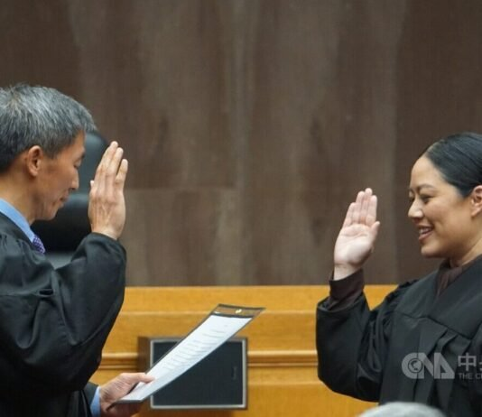

# Helen Huang (黃海倫)

## Identity Snapshot
- **English:** Helen Huang
- **Chinese:** 黃海倫
- **Era:** 1982
- **Geography:** Japan
- **Core roles:** professor, educator
- **Source:** TAH Foundation Who’s Who

Huang was born in Japan, of Taiwanese parents, in 1982. Her family moved to the United States in 1985 and Huang began her piano study in 1987. She attended the Manhattan School of Music, and then the Juilliard School, where she studied with the Israeli pianist Yoheved Kaplinsky, graduating in 2004.

<!-- tah-tables:start -->
## Education
- The Juilliard School — 2004 — B.S. Music
- 耶魯大學 — M.S. Music

## Employment
- Juilliard — 2008-Present — Teaching
<!-- tah-tables:end -->

## Role in the Community
- 2025-06-16 洛杉磯郡高等法院法官就職：穿上法官袍，致詞用台語感謝父母「教我台灣的歷史和民主」；約25年前曾戴上「台美小姐」后冠 — [[articles/taiwanjustice-net/2025/20250624105056_台美小姐黃海倫當上洛杉磯法官-台語謝父母_教我_5ddc8a197acc9163|台美小姐黃海倫當上洛杉磯法官 台語謝父母：教我台灣歷史和民主]]（2025-06，中央社記者報導）。報導記其全名 Helen Huang Yang：由州長紐松於2025-02任命（14名高等法院法官之一，7名服務洛杉磯郡），任職後為洛杉磯郡高等法院近500名法官中少數台裔女性法官，就職演說者含加州最高法院法官劉弘威（Goodwin Liu）。亦見 [[articles/taiwanjustice-net/2025/20250524194905_大洛杉磯台灣會館七月份會訊_74056a8f083d0a55|大洛杉磯台灣會館七月份會訊]]。
- TAH encyclopedia entries: [[works/taiwaneseamericanhistory-org/232-helen-huang-e9-bb-83-e6-b5-b7-e5-80-ab-pianist-201507|232. Helen Huang 黃海倫, Pianist]] 及 [[works/taiwaneseamericanhistory-org/482-helen-huang-e9-bb-83-e6-b5-b7-e5-80-ab-201507|482. Helen Huang 黃海倫]] (2015-07)。
- HOLD: conflict — TAH bio（鋼琴家，2004 Juilliard 畢業、2008 起任教 Juilliard）vs 2025 TJJ record（約1999年當選台美小姐、2025年任洛杉磯郡法官）。生涯路徑不相容，可能為兩位同名「黃海倫」，未自動合併。
- Re-verified 2026-09-20 and 2026-09-21 (slice 09201400-22): corpus re-grep (works/articles) returns only the records already linked/absorbed above (TAH #232/#482, the two TJJ 2025 records) plus index/manifest listings — no new mention; SKIP-with-reason (saturated). Re-grep 2026-09-22 (slice 09211400-20): hit set identical — two-person HOLD（鋼琴家 vs 洛杉磯法官）stands, nothing absorbable. Re-grep 2026-09-23 (slice 09220900-18): hit set again identical (#232/#482 + two TJJ 2025 records + index/manifest) — saturated. Re-grep 2026-09-24 (slice 09230400-18): hit set again identical — two-person HOLD（鋼琴家 vs 洛杉磯法官）stands. SKIP: saturated.

## Family

_No filled family fields on the TAH profile._

## Sources
- [TAH #232 encyclopedia: 232. Helen Huang 黃海倫, Pianist / 2015/07](https://taiwaneseamericanhistory.org/232-helen-huang-%e9%bb%83%e6%b5%b7%e5%80%ab-pianist-201507/)
- [TAH #482 encyclopedia: 482. Helen Huang 黃海倫 / 2015/07](https://taiwaneseamericanhistory.org/482-helen-huang-%e9%bb%83%e6%b5%b7%e5%80%ab-201507/)
- [TAH Who’s Who](https://taiwaneseamericanhistory.org/person/helen-huang/)

## From the record

- 2025-05-16 — 洛杉磯郡高等法院為黃海倫（Helen Huang Yang）舉行法官就職儀式，加州最高法院台裔法官劉弘威（Goodwin Liu）主持宣誓儀式；黃海倫由州長紐松（Gavin Newsom）於2025年2月任命（該批14名高等法院法官中7名服務洛杉磯郡），宣誓就職後成為洛杉磯郡高等法院近500名法官中少數具台裔背景的女性法官；致詞全程英語，另特別準備一段台語感謝父母「教我台灣的歷史、教育和民主」；丈夫楊振威（Jerry C. Yang）與女兒、兒子在旁觀禮。[中央社／美洲台灣日報報導](https://taiwandaily.net/%e5%8d%97%e5%8a%a0%e7%a4%be%e5%8c%80/78689/)（2025-05-17刊；存檔 `knowledge/web-archives/taiwandaily-net-78689-78689.md`）
- 2000 — 就讀加州大學洛杉磯分校（UCLA）期間獲選「台美小姐」皇后；母親黃雪英表示當時年19歲、以台灣台語演講，志願成為法官，歷經25年達成目標。[同上報導](https://taiwandaily.net/%e5%8d%97%e5%8a%a0%e7%a4%be%e5%8c%80/78689/)
- 求學與職涯（報導所述）— 大學就讀政治系與傳播系，後於康乃爾大學取得法律博士（J.D.）學位，擔任執業律師多年後獲任命為洛杉磯郡高等法院法官；在美國出生，自幼參加台灣人團體營隊，高中大學在校演講談台灣，熟悉二二八事件歷史。[同上報導](https://taiwandaily.net/%e5%8d%97%e5%8a%a0%e7%a4%be%e5%8c%80/78689/)
- 家庭（報導所述）— 父黃明信、母黃雪英；夫楊振威（Jerry C. Yang），育有一女一子；據報導（reported）夫妻二人為美國高等法院第一對華人法官夫婦。[同上報導](https://taiwandaily.net/%e5%8d%97%e5%8a%a0%e7%a4%be%e5%8c%80/78689/)
- 註（2026-10-15 吸收）：以上條目屬兩人生 HOLD 中「洛杉磯郡法官」一側之傳記細節，與上方 TAH 鋼琴家記錄不相容，維持 HOLD、未自動合併。

## Related Pages
- [[organizations/tah-foundation||TAH Foundation]]
- [[sources/taiwaneseamericanhistory-org||taiwaneseamericanhistory.org]]

> SKIP-note (deepen-x slice 09240400-3, 2026-09-25): fresh ZH+EN re-grep — hits again exactly TAH #232/#482 + the two TJJ 2025 records + index/manifest listings; no new mention. Two-person HOLD（鋼琴家 vs 洛杉磯郡法官）stands. SKIP: verified-saturated.

> SKIP-note (deepen-x slice 09250700-22, 2026-09-25): fresh ZH+EN re-grep — hits again exactly TAH #232/#482 + the two TJJ 2025 records + index/manifest; no new mention. Two-person HOLD（鋼琴家 vs 洛杉磯郡法官）stands. SKIP: verified-saturated.

> SKIP-note (deepen-x slice 09260400-20, 2026-09-26): fresh ZH+EN re-grep — hits again exactly TAH #232/#482 + the two TJJ 2025 records + works index/MANIFEST; no new mention. Two-person HOLD（鋼琴家 vs 洛杉磯郡法官）stands. SKIP: verified-saturated.

> Re-verified 2026-09-30 (slice 09260800-5): fresh ZH+EN re-grep — hit set identical (TAH #232/#482 + two TJJ 2025 records + works index / MANIFEST listing); no new mention. Two-person HOLD（鋼琴家 vs 洛杉磯郡法官）stands. SKIP: verified-saturated.

> Re-verified 2026-10-04 (deepen-x slice 09300315-10): fresh ZH+EN re-grep — hit set identical (TAH #232/#482 + the two TJJ 2025 records + works index/MANIFEST listing); no new mention. Two-person HOLD（鋼琴家 vs 洛杉磯郡法官）stands. SKIP: verified-saturated, hits-hash=152444697fea.

> Re-verified 2026-10-04 (deepen-x slice 09300848-15): fresh ZH+EN re-grep — hit set identical (TAH #232/#482 copies + the two TJJ 2025 records + index/MANIFEST listing); no new mention. Two-person HOLD（鋼琴家 vs 洛杉磯郡法官）stands. SKIP: verified-saturated. hits-hash=9a0e961df5d7

> Re-verified 2026-10-05 (slice 09300855-15): fresh ZH+EN re-grep — hit set identical (TAH #232/#482 + two TJJ 2025 records + works index/MANIFEST); no new mention. Two-person HOLD（鋼琴家 vs 洛杉磯郡法官）stands. SKIP: verified-saturated. hits-hash=5c6d49b97575

> Re-verified 2026-10-05 (slice 09300900-15): fresh ZH+EN re-grep — hit set identical (TAH #232/#482 + the two TJJ 2025 records + works index/MANIFEST listing); no new mention. Two-person HOLD（鋼琴家 vs 洛杉磯郡法官）stands. SKIP: verified-saturated. hits-hash=57e5c76c383b

> Re-verified 2026-10-05 (slice 09300927-15): exact-string sweep (audit-script formula, `黃海倫`/`Helen Huang` full-text over works+articles) — 5 hits: TAH #232/#482 + the two TJJ 2025 records + works index. All already wikilinked above; no new mention. Two-person HOLD（鋼琴家 vs 洛杉磯郡法官）stands. SKIP: verified-saturated. hits-hash=8f7fb944b287

> Re-verified 2026-10-05 (slice 09301000-15): exact-string sweep (audit-script formula) rerun — hit set identical (5 hits: TAH #232/#482 + the two TJJ 2025 records + works index), all already wikilinked; no new mention. Two-person HOLD（鋼琴家 vs 洛杉磯郡法官）stands. SKIP: verified-saturated. hits-hash=8f7fb944b287

## 照片

📷 照片取自公開檔案（來源：taiwanjustice.net，Wayback 存檔 20250522172435）。圖說為原始來源所提供，Echo 未經人工逐張查證——若您認得圖中人，歡迎回報修正。
