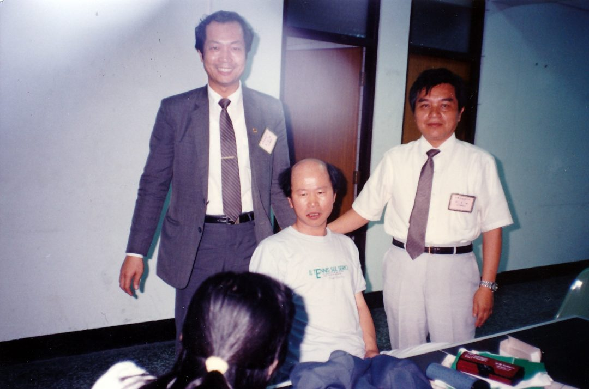

# Hsu Hsin-liang (許信良)

**許信良** is a central figure of the overseas Taiwanese democracy movement who, per 陳昭南's memoir, came from Taiwan to the United States after the 美麗島事件 and co-founded the Los Angeles 美國美麗島週報社 (Formosa Weekly Report) circle of 「職業革命家」.

## Identity Snapshot
- **English:** Hsu Hsin-liang
- **Chinese:** 許信良
- **Era:** 1970s–present
- **Geography:** Los Angeles, USA (per source record)
- **Core roles:** co-founder, 美國美麗島週報社; 副總書記, 台灣革命黨

## Role in the Community

- Co-founder of 美國美麗島週報社 in Los Angeles (late 1970s), alongside 陳昭南, 許丕龍 and the LA-local and Europe/Taiwan-transferred circle described in 陳昭南's memoir.
- After the 1983 WUFI chair-election dispute, co-founded the more radical 台灣革命黨 with 洪哲勝 (總書記), 田台仁, 黃再添 and 康泰山, serving as 副總書記.
- Publicly met visiting 黨外 figures (康寧祥、黃煌雄、尤清 et al.) passing through Los Angeles, shaping the 島內建黨 consensus behind the 「遷黨回台」 strategy.

## From the record

- 1973 — Nominated by the KMT for the Taiwan Provincial Assembly and elected — the 「愛將」 Chiang Ching-kuo had actively cultivated ([[articles/taiwanjustice-net/2026/20260210185236_書摘_蔣經國日記評陳菊許信良等黨外人士_把美_8992ada1e7a6c5a0|蔣經國日記書摘, TJJ 2026-02-10]]).
- 1977 — Published 風雨之聲 and 當仁不讓, sharply criticizing the KMT; ran as a 違紀 candidate for 桃園縣長 against the party's nominee 歐憲瑜, was expelled from the party, and won the election 22萬 to 13萬 votes amid the 中壢事件 (same diary book excerpt).
- 1979 — Chiang Ching-kuo's diary (1979-01-06) blamed 「反動派（許信良等）」 for the protests against Christopher's断交 negotiation team; after 許信良's support of the 橋頭事件 / 余登發父子, he was 彈劾 by the 監察院 on 4/20 and sentenced by the 公務員懲戒委員會 to 休職兩年 — the 停職案 whose news reached the 世臺會 convention on 1979-06-30 (see below) [[articles/taiwanjustice-net/2026/20260210185236_書摘_蔣經國日記評陳菊許信良等黨外人士_把美_8992ada1e7a6c5a0|蔣經國日記書摘, TJJ 2026-02-10]].
- 覆核（TJJ-A09240600-1, 2026-09-25）：本 slice 文章 e3440fec3eed8107（籌謀台灣不流血革命(陳昭南 2022-05-09)）正文再驗證——主體連結為真實提及（無錯鏈、無虛鏈），對應日期事實條目（含該文 wikilink）已在庫 — SKIP，無新材料。

- 覆核（TJJ-A09230500-1, 2026-09-24）：本 slice 文章 e3440fec3eed8107（籌謀台灣不流血革命(陳昭南 2022-05-09)） 正文再驗證——主體連結為真實提及（無錯鏈、無虛鏈），對應日期事實條目（含該文 wikilink）已在庫 — SKIP，無新材料。

- 覆核（TJJ-A09171100-2, 2026-09-24）：本 slice 文章 e3440fec3eed8107（籌謀不流血革命） 主體連結對照正文再驗證——連結為真實提及（無錯鏈、無虛鏈），對應日期事實條目（含該文 wikilink）已在庫 — SKIP，無新材料。
- 1989 — 陳昭南's memoir identifies 許信良 as the 「獻策高手」: when a well-known KMT envoy flew to Los Angeles that year and told reporters his mission was to meet 許信良, the two met (at the home of the envoy's friend Acadia, with one witness present) and 許信良 — first confirming the talk would reach 李總統「不會多一個字，也不會少一個字」— laid out the bloodless-revolution path: 聯合次要敵人打擊主要敵人、做大民進黨使李總統在國民黨內更安全、終極目標還政於民; the memoir also records him as co-founder of 美國美麗島週報社 and 副總書記 of the 台灣革命黨 under 洪哲勝's 總書記 ([[articles/taiwanjustice-net/2022/20220519131411_2022_05_09_籌謀台灣_不流血革命_的獻策高手原來是他-_-陳_e3440fec3eed8107|TJJ column, 2022-05-09]]).
- 1995 — Named in the same memoir's appended account as the DPP's presidential nominee who lost the 1996 general election to 李登輝 after a fiercely contested intra-party primary against 彭明敏 ([[articles/taiwanjustice-net/2022/20220519131411_2022_05_09_籌謀台灣_不流血革命_的獻策高手原來是他-_-陳_e3440fec3eed8107|TJJ column, 2022-05-09]]).

- 覆核（TJJ-A09251000-1, 2026-09-26）：本 slice 文章 e3440fec（陳昭南不流血革命 2022-05-09）正文再驗證——許信良以「獻策高手」（1989洛城會國民黨人士建議聯合次敵打擊主敵）、美島週報社與台灣革命黨副總書記記述確認見於正文（無錯鏈、無虛鏈）；對應條目（含該文 wikilink）已在庫 — SKIP，無新材料。

## Overseas movement record (TAH corpus)

- 1983 — As 「流浪美國的黨外人士」, his lecture at the 5th 美東南區台灣人夏令會 (Presbyterian College, Clinton S.C.) 「轟動全場」 alongside 許榮淑、周清玉、張良澤、史明 ([[works/taiwaneseamericanhistory-org/ourjourneys245|245. 美東南區台灣人夏令會簡史]])。
- 1986 — The 黑名單 record notes 陳明昭 escorted 許信良's 返台闖關 that year and was later stripped of passport/visa by the KMT for his conduct there ([[works/taiwaneseamericanhistory-org/ourjourneys106|106. 中華民國的黑名單]]).
- 1988–1991 — Named among the overseas 黑名單 who 「翻牆」 home in the 闖關回台 wave (with 陳翠玉、羅益世、陳昭南、陳婉真、郭倍宏 et al.) ([[works/taiwaneseamericanhistory-org/ourjourneys230|230. 海外黑名單闖關回台的故事]])。
- 1992 — 許信良言論選集 (with 鍾碧霞) appears in the TAH corpus as work #396 ([[works/taiwaneseamericanhistory-org/396-e8-a8-b1-e4-bf-a1-e8-89-af-e8-a8-80-e8-ab-96-e9-81-b8-e9-9b-86-e8-a8-b1-e4-b|396. 許信良言論選集]])。
- Attribution note — 林文義's memoir credits the 美麗島周報 as 「由許信良創辦」 ([[works/taiwaneseamericanhistory-org/ourjourneys237|237. 北卡海報事件 / 林文義]]), 林衡哲's memoir describes it as 「許信良主持的『美麗島週報』」 ([[works/taiwaneseamericanhistory-org/ourjourneys70|70. 各位敬愛的股東同仁平安 / 林衡哲]]), while other records (incl. 陳昭南's memoir) describe him as co-founder with 陳昭南/許丕龍. HOLD: founder vs co-founder attribution (創辦 vs 主持 vs 共同創辦人 — three memoir phrasings, never auto-merged); dates/roles otherwise consistent.
- 1979-06-30 — At the 世臺會 (World Taiwanese Association) convention in Seattle, news of 許信良's 停職案 arrived and the convention strongly condemned KMT dictatorship; after the 美麗島事件 many 世臺會 cadres were blacklisted (何義麟's Bay Area study, [[works/taiwaneseamericanhistory-org/our-journeys-357|357. 舊金山灣區臺灣人的社團活動與家國意識之形成]]).
- 1980-03-29 — On invitation of the 協志會, spoke at San Jose State on 「高雄事件的啓示」; KMT-linked gangsters again caused disturbances outside and slashed tires (石清正, [[works/taiwaneseamericanhistory-org/ourjourneys38|38. 北加州台灣同鄉聯合會三十年回顧]]).
- 1982 — Reported as 美麗島 representative to the 9th 世界台灣同鄉會 convention in Houston ([[works/taiwaneseamericanhistory-org/ourjourneys266|266. 台灣人在北美洲/黃武東]]).
- 1982-12 (per the memoir account) / 1986 — Met visiting 黨外 figures in the US; the same Bay Area record notes 張燦鍙 and 許信良 speaking in the Bay Area (02.26 entry, [[works/taiwaneseamericanhistory-org/our-journeys-357|357]]).
- 1986-11-30 — 許信良's 闖關回台 attempt (the 桃園機場事件, together with 林水泉 and the 23rd 北加州台灣人同鄉聯合會會長洪順五) failed, sparking police-citizen clashes at Taoyuan airport ([[works/taiwaneseamericanhistory-org/ourjourneys38|38. 北加州台灣同鄉聯合會三十年回顧]]); the NATMA/楊次雄 record frames the same event as the trigger for 「海外黑名單異議份子多人翻牆返鄉」 and the 1987-11 台醫學會80週年 突破黑名單 訪問團 that followed ([[works/taiwaneseamericanhistory-org/ourjourneys74|74. Our Journeys — 楊次雄與NATMA]]); the event is also its own TAH record — press photo 「許信良化妝抵台，原機遣送到菲律賓」, 1986/12/2 ([[works/taiwaneseamericanhistory-org/1-e8-a8-b1-e4-bf-a1-e8-89-af-e5-8c-96-e5-a6-9d-e6-8a-b5-e5-8f-b0-ef-bc-8c-e5-8e-|1. 許信良化妝抵台，原機遣送到菲律賓 1986/12/2]]).
- Also in the corpus: an overseas 台醫協會 letter recalls a 同鄉 telling 許信良 「你如果連台灣話都講不好，也不用來這裡與台灣同鄉溝通了」 — a window onto the language/identity debates inside overseas associations ([[works/taiwaneseamericanhistory-org/ourjourneys202|202. Our Journeys 文字紀要]]).
- 1983-12 — Co-hosted the first 「台灣學生」冬令會 (cadre-training gathering) with 洪哲勝, 劉重義 and 林孝信 — 「集各種不同政治理念的領導人物」. The same record: after 許信良 converted the 美麗島周報 into 「台灣民報」 and it folded, 「台灣公論報」 and 「台灣學生」 were the last non-KMT papers in North America — refines the 美麗島周報 end-of-run timeline ([[works/taiwaneseamericanhistory-org/ourjourneys238|238. 郭倍宏 / 台灣學生]]).
- 1984 — First Kansas City lecture: delivered in deliberately stiff 福佬話 (eschewing his fluent 北京話/客家話 as a sign of respect), and publicly rebuked by a 同鄉 for his 台灣話 — a second, first-hand account of the language/identity episode, with the narrator defending him on the spot ([[works/taiwaneseamericanhistory-org/ourjourneys200|200. Our Journeys — 語言與認同]]).
- 1986-03 — Overseas supporters announced the founding of 「台灣民主黨」 in New York, vowing to 遷黨回台; 許信良 joined the party together with 謝聰敏 and 林水泉, with 梅心怡 (then in the U.S.) as English-language press secretary. The 闖關 effort raised US$500,000 from 台裔美國人 — enough for at least 50 plane tickets for blacklisted 台美人 and persona non grata (Fr. James Collignon, Terry Caine, 艾琳達 et al.). A group photo records 林水泉、許信良、謝聰敏、艾琳達、許國泰 (front row) with 田台仁、洪哲勝 et al. in the second row ([[works/taiwaneseamericanhistory-org/our-journeys-363|363. Our Journeys — transnational democracy memory]]).
- 1983 — 同鄉會 record: 「黨外許信良演講」 during the 王金山/黃政哲 presidency ([[works/taiwaneseamericanhistory-org/ourjourneys123|123. Our Journeys 年表]]).

Corpus re-grep 2026-09-22: above records newly absorbed from works/.

## Sources
- [[articles/taiwanjustice-net/2022/20220519131411_2022_05_09_籌謀台灣_不流血革命_的獻策高手原來是他-_-陳_e3440fec3eed8107|陳昭南memoir column (taiwanjustice.net, 2022-05-09)]]

## Related Pages
- [[people/dr-cary-s-hung||洪哲勝]]
- [[people/chen-zhaonan||陳昭南]]
- [[people/prof-ming-min-peng||彭明敏教授]]
- [[people/ahhee-hsu||許丕龍]]
- [[people/tsung-ming-hsieh||謝聰敏]]
- [[people/philip-lin||林水泉]]
- [[people/mei-xinyi||梅心怡]]

<!-- TJJ-A10040500-2: verified 2026-10-06 — wave-2 link+deepen re-check of slice 10040500-2: article e3440fec 籌謀台灣不流血革命(陳昭南 2022-05-09): 許信良 link (獻策高手 1989 LA 會談、美麗島週報社創辦人、革命黨副總書記、1995 DPP 總統候選人) — all mentions confirmed in 正文 re-checked vs 正文 this attempt, link real, no wrong/spurious links; dated fact w/ article wikilink already in From the record — saturated, no new material. -->

<!-- TJJ-A10060600-1: verified 2026-10-07 — wave-2 link+deepen re-check of slice 10060600-1 articles (e3440fec3eed8107 籌謀台灣不流血革命(陳昭南 2022-05-09): 許信良 link (獻策高手 1989 LA 會談、美麗島週報社創辦人、革命黨副總書記、1995 DPP 總統候選人) — subject link(s) re-checked vs 正文 this attempt, real, no wrong/spurious links; dated fact w/ article wikilink already in From the record — saturated, no new material. -->

<!-- TJJ-A10070800-1: verified 2026-10-09 — wave-2 link+deepen re-check of slice 10070800-1 article e3440fec3eed8107 (籌謀台灣「不流血革命」的獻策高手原來是他 ◎ 陳昭南, TJJ 2022-05-09): subject link re-checked vs 正文 this attempt, real, no wrong/spurious links; dated fact w/ article wikilink already in From the record — saturated, no new material. -->

<!-- DEEPEN-X10080951-4 (2026-10-09): fresh ZH+EN grep across works/articles/sources/events/topics (47 hits). New material absorbed: the 桃園機場事件 press-photo record 「許信良化妝抵台，原機遣送到菲律賓」 1986/12/2 ([[works/taiwaneseamericanhistory-org/1-e8-a8-b1-e4-bf-a1-e8-89-af-e5-8c-96-e5-a6-9d-e6-8a-b5-e5-8f-b0-ef-bc-8c-e5-8e-|TAH work #1]]) — the work page the 1986-11-30 line had promised but never linked, now linked. ourjourneys123-eng (Tangwai timeline entries 1983/1986, Hsin-liang Hsu) confirms existing 1982–1986 record, no new dates. No conflicts to hold. -->

<!-- TJJ-A10090701-1: verified 2026-10-10 — wave-2 link+deepen re-check of slice 10090701-1 article e3440fec3eed8107 (籌謀台灣「不流血革命」的獻策高手原來是他 ◎ 陳昭南, TJJ 2022-05-09): subject link re-checked vs 正文 this attempt, real, no wrong/spurious links; dated fact w/ article wikilink already in From the record — saturated, no new material. -->

<!-- DEEPEN-X10100315-12 (2026-10-10): fresh ZH+EN grep (許信良/Hsin-liang) across all 5 corpus dirs — 47 hits. New material absorbed: (1) 蔣經國日記書摘 (TJJ 2026-02-10) — 愛將變叛徒 arc: 1973 KMT 省議員提名當選, 1977 風雨之聲/當仁不讓 + 違紀參選桃園縣長被開除黨籍後高票當選, 1979 diary blame for Christopher-visit protests + 彈劾/休職兩年 (= the 停職案 on the 世臺會 line); (2) 245 美東南區夏令會簡史 — 1983 Clinton S.C. lecture; (3) 106 黑名單 — 陳明昭 escort record; (4) 230 邱萬興 — 闖關回台 wave listing; (5) work #396 許信良言論選集 1992, first wikilink. HOLD: founder vs co-founder of 美麗島周報 (one memoir 「由許信良創辦」, others co-founder). No date/age conflicts. -->

## 照片

📷 照片取自公開檔案（來源：taiwanjustice.net，Wayback 存檔 20230606154516）。圖說為原始來源所提供，Echo 未經人工逐張查證——若您認得圖中人，歡迎回報修正。

<!-- DEEPEN-X10102300-17 (2026-10-12): fresh ZH+EN grep (許信良/Hsin-liang) across all 5 corpus dirs — 47 files. New material absorbed: (1) attribution triangulation — 林文義 memoir 「由許信良創辦」 (ourjourneys237) vs 林衡哲 memoir 「許信良主持的『美麗島週報』」 (ourjourneys70) vs co-founder (陳昭南 memoir) — HOLD retained, all three sources now wikilinked; (2) NATMA/楊次雄 record (ourjourneys74) — 1986 民進黨成立後許信良、林水泉闖關 → 桃園機場事件 framed as trigger for 「海外黑名單異議份子多人翻牆返鄉」 and the 1987-11 台醫學會80週年突破黑名單訪問團, linked to the existing 1986-11-30 line. ourjourneys123-eng/266/357/202/230/106/245/38/#1 re-confirmed existing record, no new dates. No date/age conflicts. -->

<!-- DEEPEN-X10120200-17 (2026-10-12): fresh ZH+EN grep (許信良/Hsin-liang) across all 5 corpus dirs — 47 files, 14 already linked. New material absorbed (4 works newly linked): (1) ourjourneys238 — 1983-12 first 「台灣學生」冬令會 co-hosted with 洪哲勝/劉重義/林孝信; 美麗島周報→「台灣民報」 conversion & fold (refines weekly end-of-run timeline, consistent with founder HOLD — no auto-merge); (2) ourjourneys200 — 1984 Kansas City lecture, first-hand account of the 福佬話 rebuke episode (narrator defended him: chose 福佬話 deliberately out of respect); (3) our-journeys-363 — 1986-03 New York founding of 「台灣民主黨」 (遷黨回台 vow), 許信良 joined with 謝聰敏/林水泉, 梅心怡 English press secretary, US$500k/50+ tickets 闖關 fund, group photo roster; (4) ourjourneys123 — 1983 「黨外許信良演講」 同鄉會 entry. Related Pages extended (謝聰敏/林水泉/梅心意 slugs verified to exist). No date/age conflicts to hold. -->
