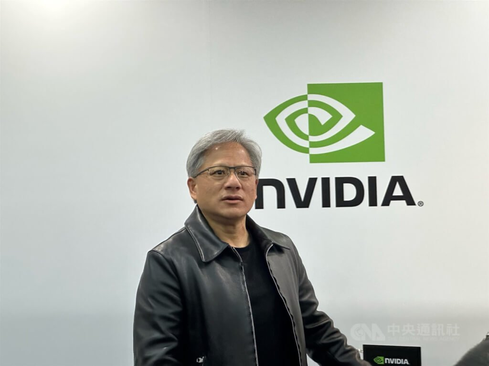

# Jensen Huang (黃仁勳)

## Story

The TAH Who's Who record places Jensen Huang (黃仁勳) in the era of 1963 with geography in Tainan, Taiwan, and lists his core roles as engineer, entrepreneur, scientist and philanthropist. Before co-founding NVIDIA he trained at Oregon State Univ—1984—and Stanford Univ—1992—in electrical engineering, and worked as a microprocessor designer at AMD (1983–1985) and director of coreware at LSI (1985–1993). He co-founded NVIDIA in 1993 and has served since its inception as president, chief executive officer and a member of the board of directors; he is married to Lori Huang, and the Jen-Hsun & Lori Huang Foundation carries the family's community work. The community archive records his honors — Time's 100 Most Influential People of 2021 and Fortune Businessperson of the Year 2017 — and in 06/2023 Stanford's engineering dean named him, alongside TSMC's Morris Chang and Yahoo's Jerry Yang, a Taiwan-born alumnus whose impact on world technology is profound. In the TAIGI-activism interview he is named a celebrity Tâi-gí user whose public use of 台語 made speaking it "trendy and cool" for the younger generation, and at his 台大 commencement speech on 2023-05-27 he opened in 台語 — 「愈想愈緊張」— before telling graduates 「要試著去追逐獵物，否則你自己就會成為獵物」and recounting NVIDIA's three brush-with-collapse failures, calling 1984 and 2023 both perfect years. The record follows the AI years: on 2023-05-25 the shares rose over 24% in a day and market cap neared 1 trillion dollars, analysts saying NVIDIA was 「正在販售淘金所需十字鎬和鏟子」, and in 2023-08 he announced a 25 billion dollar buyback, declaring 「AI 熱潮至少到明年」. His 14-day June 2024 Taiwan trip — the 追勳潮 — included calling Taiwan a 「國家」, banquets for supply-chain partners such as 張忠謀, 林百里 and 劉揚偉 followed by night-market walks, and a 台灣啟示錄 special titled 「從洗碗工到AI教父」that recalled his first job waiting tables and washing dishes at an American-style chain restaurant. He flew to 北京 on 2025-04-17 in a suit instead of his trademark 黑色皮衣 to meet 何立峰 and DeepSeek founder 梁文鋒, and when Beijing ordered Chinese tech firms to halt Nvidia AI-chip purchases on 2025-09-17 he publicly voiced 「失望」 and said he would respond with 「耐心」.

## Identity Snapshot
- **English:** Jensen Huang
- **Chinese:** 黃仁勳
- **Era:** 1963
- **Geography:** Tainan, Taiwan
- **Core roles:** engineer, entrepreneur, scientist, philanthropist
- **Source:** TAH Foundation Who’s Who

Jensen Huang founded NVIDIA in 1993 and has served since its inception as president, chief executive officer, and a member of the board of directors.

<!-- tah-tables:start -->
## Education
- Oregon State Univ. — 1984 — B.S., Electrical Eng.
- Stanford Univ. — 1992 — M.S., Electrical Eng.

## Employment
- AMD — Microprocessor Designer — (1983-1985) — LSI — Director of Coreware — (1985-1993) — Nvidia — Co-Founder, President and CEO — (1993-) — Community — Jen-Hsun & Lori Huang Foundation
<!-- tah-tables:end -->

## Family

- **Wife:** Lori Huang

## Role in the Community
- Recognized in the Taiwanese American community record multiple times: encyclopedia entries [[works/taiwaneseamericanhistory-org/ota-221|221. Jen-Hsun Jensen Huang 黃仁勳]] (2019) and [[works/taiwaneseamericanhistory-org/whos-who-226-jen-hsun-huang|226. Jen-Hsun Jensen Huang 黃仁勳]].
- Community archive records his honors: Time's 100 Most Influential People of 2021 ([[works/taiwaneseamericanhistory-org/award-79|79. Jensen Huang, Time's 100 Most Influential People of 2021]]) and Fortune Businessperson of the Year 2017 ([[works/taiwaneseamericanhistory-org/fortune-business-person-of-the-year-jensen-huang|54. Fortune: Business Person of the Year / Jensen Huang 黃仁勳 / 2017]]).
- Cited in the community coverage of Stanford's Taiwan Science & Technology Hub unveiling (06/2023): Stanford's engineering dean named him — alongside TSMC's Morris Chang and Yahoo's Jerry Yang — as a Taiwan-born alumnus whose impact on world technology is profound ([[works/taiwaneseamericanhistory-org/our-journeys-387|387. 史丹佛「台灣科學及科技中心」揭幕]]).
- **台語復興指標（corpus interview）** — In the TAIGI-activism interview with Keng-lam Su (林央敏) [[works/taiwaneseamerican-org/taigi-activism-keng-lam-su-in|TAIGI activism interview]], he is named as a celebrity Tâi-gí user whose public use of 台語 made speaking it "trendy and cool" for the younger generation — a community-identity role beyond business honors.
- 2026-09-20 re-grep: NEW absorbable record — TJJ coverage: Beijing ordered Chinese tech firms to halt Nvidia AI-chip purchases; he publicly expressed 失望 and said he would respond with 耐心 (see From the record, 2025-09-17 entry).

## Related Pages

- [[works/taiwaneseamericanhistory-org/ota-221]]
- [[works/taiwaneseamericanhistory-org/whos-who-226-jen-hsun-huang]]
- [[works/taiwaneseamericanhistory-org/award-79]]
- [[works/taiwaneseamericanhistory-org/fortune-business-person-of-the-year-jensen-huang]]
- [[works/taiwaneseamericanhistory-org/our-journeys-387]]
- [[works/taiwaneseamerican-org/taigi-activism-keng-lam-su-in]]

## Sources
- [TAH #221 encyclopedia: 221. Jen-Hsun Jensen Huang 黃仁勳](https://taiwaneseamericanhistory.org/ota-221/)
- [TAH #226 encyclopedia: 226. Jen-Hsun Jensen Huang 黃仁勳](https://taiwaneseamericanhistory.org/whos-who-226-jen-hsun-huang/)
- [TAH Who’s Who](https://taiwaneseamericanhistory.org/person/jensen-huang/)

## From the record

- **2026-05-29** *(reported)* — 美洲台灣日報「即時新聞」刊《迎接Vera Rubin 黃仁勳：在台AI超級電腦產能倍增》（中央社0529）：他於今日在南港展覽館2館主持 NVIDIA AI Factory MGX Ecosystem Ceremony，感謝打造 MGX 模組化伺服器的供應商，現場超過30家廠商集結，外商美光、意法半導體、西門子亦派高層到場；表示為迎接下一代 Vera Rubin 架構，輝達今年在台灣的人工智慧超級電腦產能將倍增，並稱 AI 已將電腦產業從單純的「電腦」轉化為國家級的「基礎設施」，未來每個國家、每家公司都將擁有自己的 AI 基礎建設、「我們意識到這將是一個非常龐大的市場」；手上展示縮小版 MGX 架構機櫃模型，透露每台此類電腦內部高達130萬個零件、重量高達2公噸，「這是世界上製造過最重的電腦，當然也是最貴的」，共動用生態中150家合作夥伴公司；Vera Rubin 架構有5種不同類型的電腦與運算機櫃組合出一個巨大 AI 超級電腦（一個「AI工廠」）；肯定台灣供應鏈這幾年的爆炸性成長、打趣台灣夥伴因此「發大財」（許多公司業績成長3、4倍，有些短短幾年成長10倍），並說「沒有你們，我一個人辦不到。我們正在共同重新發明電腦產業，也正在重新發明這個世界」；展示牆「輝達背板股」列雙鴻、奇鋐、貿聯-KY、可成、勤誠、台達電、台光電、光寶科、台郡、富世達、鴻海、健策、川湖、良維、嘉澤、南俊、立錡、泰碩、台積電、欣興等（欄內魏哲家以外之供應鏈主管均未於本文具名，不代筆添條）（存檔 `knowledge/web-archives/taiwandaily-net-139634-139634.md`）— [美洲台灣日報](https://taiwandaily.net/%e5%8d%b3%e6%99%82%e6%96%b0%e8%81%9e/139634/) (reported)

- **2026-08-28** *(reported)* — 《時代》TIME 公布 2026 年全球百大 AI 領域最具影響力人物名單，他與超微執行長蘇姿丰、Meta 執行長祖克柏等企業大咖均未上榜，榜單另列入好萊塢名媛 Paris Hilton（對抗深偽技術倡議）與聯邦參議員 Bernie Sanders（示警 AI 風險）等本業非 AI 領域人士（美洲台灣日報轉載自由時報 0828；存檔 `knowledge/web-archives/taiwandaily-net-154529-154529.md`）— [美洲台灣日報](https://taiwandaily.net/%e5%8d%b3%e6%99%82%e6%96%b0%e8%81%9e/154529/) (reported)

- **2026-05-29** *(reported)* — 美洲台灣日報刊《黃仁勳叮嚀台灣小孩講台語 吳欣岱嘆心情複雜》（自由時報0530）：一段與小朋友互動的社群影片疯傳，大人起鬨要小孩對他說英文，他希望用台語跟孩子對話、卻發現小朋友不會說台語，語重心長叮嚀「You need to learn Taiwanese（你需要學台語）」；吳欣岱（台灣基進台北市議員參選人）臉書回應稱「心情其實有點複雜」，並呼吁把「雙語政策」改回「先把孩子的母語撿回來」（欄內吳欣岱為另一被報導人物，不代筆添條）（存檔 `knowledge/web-archives/taiwandaily-net-139779-139779.md`）— [美洲台灣日報](https://taiwandaily.net/%e5%8d%b3%e6%99%82%e6%96%b0%e8%81%9e/139779/) (reported)

- **2024-06-06** *(reported)* — 美洲台灣日報「即時新聞」刊《T「AI」WAN極重要 黃仁勳：今年我會再來》（自由時報0606 轉載）：6 日晚間於台北市中山區「欣葉台菜創始店」宴請 180 名輝達在台同仁並慶祝台北國際電腦展（COMPUTEX）順利展出，太太洛瑞（Lori Huang）、兒子黃勝斌（Spencer Huang）、女兒黃敏珊（Madison Huang）同行的家人出席，宴席沒有科技界巨頭；宴席後步出餐廳受訪表示即將返回美國、今年還會再來台，「我會想念你們的！」，並稱「TAIWAN」的字母中隱含「AI」2 字、當 AI 世代來臨，這象徵台灣會幫助世界打造 AI 基礎建設，「從現在開始、從台灣開始」，為大家感到自豪、肯定在台所有供應鏈夥伴；現場民眾排隊求簽名，他不厭其煩完成心願，上車前回頭向民眾揮手道晚安（家人 洛瑞／黃勝斌／黃敏珊 為欄內被報導人物，無本人頁，不代筆添條；引語為受訪轉述 reported）（存檔 `knowledge/web-archives/taiwandaily-net-22127-22127.md`）— [美洲台灣日報](https://taiwandaily.net/即時新聞/22127/) (reported)
- **2024-07-06** *(reported)* — 卡內基基金會（Carnegie Corporation）於 2024-07-04 美國獨立日透過《紐約時報》整版刊登「傑出移民，傑出美國人」（Great Immigrants, Great Americans）廣告，表彰來自 16 國的 24 名傑出移民，他入榜且榜上資料註明出生地「Born in Taiwan」；網友於 LinkedIn、X 及 Threads 分享，讚其為台灣正名、台灣之光（報導並註該年名單無中國人；美洲台灣日報轉載自由時報 0706） — [美洲台灣日報](https://taiwandaily.net/即時新聞/26462/) (reported)
- **2026-02-05** *(reported)* — 崔泰源 (SK 集團總裁) flew to Santa Clara with two senior executives and met him at the 「99炸雞」 fried-chicken-and-beer dinner to deepen AI cooperation, chiefly the HBM4 supply plan for the AI accelerator NVIDIA was slated to launch that year, plus mid- and long-term cooperation on next-generation server memory modules (SOCAMM), NAND flash and AI data-center construction — the meeting cited as evidence that his personal relationships with Korea's memory giants, not just technology, were NVIDIA's real edge in locking down memory supply; SK Hynix had said at its 投資者日 that it was pushing HBM4 mass production per the customer-agreed schedule and expected to keep its lead despite capacity limits, with industry observers projecting a 70% HBM4 share in 2026 as its largest customer — [美洲台灣日報](https://taiwandaily.net/%e5%8d%b3%e6%99%82%e6%96%b0%e8%81%9e/121522/) (reported; sourced to 韓國朝鮮日報與Hankyung via 自由時報 0209)
- **2026-01-31** *(reported)* — 美洲台灣日報「即時新聞」刊《黃仁勳：輝達晶圓需求大 台積電未來10年產能至少翻倍》：黃仁勳於 1 月 29 日搭乘專機抵台展開為期 4 天行程，先赴四平街掃貨買蜜餞，当晚於台北市磚窯古早味懷舊餐廳宴請台灣供應鏈高層（「兆元宴」），與會者包括台積電董事長暨總裁魏哲家、廣達董事長林百里、鴻海董事長劉揚偉、華碩董事長施崇棠、和碩董事長童子賢等；受訪表示輝達需要大量晶圓，「未來10年台積電的產能可能會成長超過100%……光是輝達的需求就得翻一倍以上」，稱這是人類史上規模最大的基礎設施投資和規模擴張；並稱輝達已全面投產 Blackwell、同時全面生產含 6 款晶片的 Vera Rubin，今年記憶體供應限制對輝達確是問題（記憶體供應量每年成長 100%、需求成長更快）；強調「他為台灣感到非常自豪……沒有台灣，輝達根本不可能存在」，讚這座島嶼充滿魔力、公司擁有卓越技術與敬業精神；預告 GTC 台灣供應鏈都會來；晚宴期間兩度走出餐廳分送香腸油飯、香菇造型芝麻包、蘋果西打給媒體與粉絲，並首度與台灣媒體記者大合照（報導並註明日將再與魏哲家會面；魏哲家、林百里、劉揚偉、施崇棠、童子賢為欄內被報導人物，不代筆添條）（存檔 `knowledge/web-archives/taiwandaily-net-120014-120014.md`）— [美洲台灣日報](https://taiwandaily.net/%e5%8d%b3%e6%99%82%e6%96%b0%e8%81%9e/120014/)（引語為受訪轉述 reported）
- **2026-09-24** *(sourced)* — Seated at the head table with his wife at the White House state dinner for 習近平 (2026-09-24), alongside AMD CEO 蘇姿丰 and husband, Apple executive chairman Tim Cook and Tesla CEO Elon Musk, with the Trump and Xi couples — the four tech CEOs' placement (combined net worth >US$1T, company market caps >US$12T) read as Washington viewing the US–China relationship through the technology lens (美洲台灣日報 (Taiwan Daily) via SCMP; ASPI analyst 王勝宇 on AI supply chains as a converging force) — [美洲台灣日報](https://taiwandaily.net/%e5%8d%b3%e6%99%82%e6%96%b0%e8%81%9e/159189/), archived at [[sources/taiwandaily-net|美洲台灣日報]] (hub 202609 absorb line, 黃仁勳＋蘇姿丰 白宮國宴主桌 2026-09-24)
<!-- TJJ-A10100401-28: verified 2026-10-10 — wave-2 link+deepen re-check of slice 10100401-28 article 483521594640641a（紐約台灣會館蘇春槐接理事長, 2021-04-07）: subject link re-checked vs 正文 this attempt, real, no wrong/spurious links; dated fact w/ article wikilink already in From the record — saturated, no new material. -->
<!-- TJJ-A10090501-6: verified 2026-10-10 — wave-2 link+deepen re-check of slice 10090501-6 article 483521594640641a（紐約台灣會館蘇春槐接理事長, 2021-04-07）: subject link re-checked vs 正文 this attempt, real, no wrong/spurious links; dated fact w/ article wikilink already in From the record — saturated, no new material. -->
<!-- TJJ-A10110001-17: verified 2026-10-12 — wave-2 link+deepen re-check of slice 10110001-17 article 483521594640641a（紐約台灣會館蘇春槐接理事長, 2021-04-07）: subject link re-checked vs 正文 this attempt, real, no wrong/spurious links; dated fact w/ article wikilink already in From the record — saturated, no new material. -->

- 覆核（TJJ-A09260500-8, 2026-09-27）：slice 文章 483521594640641a 正文再驗證——紐約台灣會館交接 CNA 報導（2021-04-07）：黃仁勳為蘇春槐表弟之記述再確認見於正文，subject 連結為真，無錯鏈、無虛鏈；含該文 wikilink 的日期事實條目已在庫 — SKIP，已飽和。

- 覆核（TJJ-A09251300-3, 2026-09-26）：本 slice 文章 483521594640641a（紐約台灣會館蘇春槐接任理事長 CNA 報導, 2021-04-07）正文再驗證——subject 連結為真實提及，無錯鏈、無虛鏈；含該文 wikilink 的 2021-04-07 條目已在庫 — SKIP，已飽和。

- 複核（TJJ-A09250900-3, 2026-09-26）：本 slice 文章 00354cf6ba9cf607（台美人台加人分類頁 page 358, 2024-06-19 快照）正文再驗證——「黃仁勳加州理工畢典致詞」確認見於正文，subject 連結為真，無錯鏈、無虛鏈；對應日期事實（含該文 wikilink）已在庫 — SKIP，已飽和。 [[articles/taiwanjustice-net/2024/20240619181806_root_00354cf6ba9cf607|快照]]
- 複核（TJJ-A09250400-9, 2026-09-25）：本 slice 文章 923dad71（「台灣新聞」分類頁, 2023-12-01 存檔）正文再驗證——「Catch大錢潮 20231201 黃仁勳『晶片純美製造』還要20年?」條目確認見於清單，subject 連結為真，無錯鏈、無虛鏈；2023-12-01 條目（已掛該文 wikilink）已在庫 — SKIP，已飽和。

- 複核（TJJ-A09240500-5, 2026-09-25）：本 slice 文章 00354cf6ba9cf607（台美人台加人分類頁 page 358, 2024-06-19 快照）正文再驗證——「黃仁勳加州理工畢典致詞談輝達多次受挫『痛苦和磨難淬鍊超能力』」確認見於正文，連結為真；上方 2024-06-15 事實已引用本快照 — SKIP，無新材料。
- 複核（TJJ-A09240400-4, 2026-09-25）：本 slice 文章 e041055e（台灣演義分類頁 page 5）正文清單再驗證——「台灣演義 20230709 AI教父 黃仁勳」條目確認見於清單，subject link 為真（無錯鏈、無虛鏈）；2023-07-09 條目（已掛該文 wikilink）已在庫 — SKIP，無新材料。

- 2021-04-07 — 中央社記者報導（台灣公義報轉載）紐約台灣會館理事長交接典禮，報導中點出新任理事長蘇春槐與輝達（NVIDIA）執行長黃仁勳為表弟關係（[[articles/taiwanjustice-net/2021/20210415111016_2021_04_07_紐約台灣會館-蘇春槐接理事長盼永續經營_483521594640641a|TJJ/CNA, 2021-04-07]]）。

- 2024-06-15 — 於加州理工學院畢業典禮致詞，談輝達多次受挫「痛苦和磨難淬鍊超能力」，報導見於台灣公義報「台美人台加人」分類存檔頁 page 358（[[articles/taiwanjustice-net/2024/20240619181806_root_00354cf6ba9cf607|TJJ 台美人台加人 page 358, 2024-06-19 快照]]）。（TJJ-A09230400-4 補掛：此前複核note所稱條目實際未在庫）

- 2023-07-09 — 民視《台灣演義》以「AI教父 黃仁勳」為題專集介紹其半導體事業成就，該集條目見於台灣公義報「台灣演義」分類存檔頁（TJJ slice 09162345-28 補掛：此前複核note所稱條目實際未在庫）（[[articles/taiwanjustice-net/2025/20250514014154_category_taiwan_history_page_5_e041055e6555c89e|TJJ 台灣演義存檔頁5, 2025-05-14 存檔]]）。

- 複核（TJJ-A09221500-11, 2026-09-24）：本 slice 文章 e041055e（台灣演義分類頁 page 5）正文清單再驗證——「台灣演義 20230709 AI教父 黃仁勳」條目確認見於清單，subject link 為真（無錯鏈、無虛鏈）；2023-07-09 條目（已掛該文 wikilink）已在庫 — SKIP，無新材料。

- 複核（TJJ-A09171200-11, 2026-09-24）：本 slice 文章 923dad71（「台灣新聞」分類頁, 2023-12-01 存檔）正文再驗證——本頁所涉條目確認見於清單，subject 連結為真，無錯鏈、無虛鏈。（TJJ-A09231000-7 補掛：此前複核note所稱日期事實實際未在庫，下方 2023-12-01 條目為本次補齊）
- 2023-12-01 — 台灣公義報「台灣新聞」分類存檔頁收「Catch大錢潮 20231201 黃仁勳『晶片純美製造』還要20年?」頭條條目，記錄其關於晶片純美製造時程的輿論關注（[[articles/taiwanjustice-net/2023/20231201231656_root_923dad711fb49f07|TJJ 台灣新聞存檔頁, 2023-12-01]]）。

- 2021-06-08 — 輝達以約 400 億美元收購 Arm 案進行中，黃仁勳向金融時報表示已「展開程序」與中國監管機構接觸，有信心在其設定時間表內完成交易（中央通訊社報導，台灣公義報轉載）（[[articles/taiwanjustice-net/2021/20210616064700_2021_06_08_400億美元收購arm_nvidia向中國申請監管單位批准_99986483fda00af5|TJJ/CNA, 2021-06-08]]）。
- 2023-05-25 — 輝達搭 AI 熱潮股價單日漲逾 24%、市值逼近 1 兆美元；報導稱「成立 30 年的輝達由台裔執行長黃仁勳領軍」，分析師以 ChatGPT 帶動訂單如「淘金熱」喻之（中央通訊社報導，台灣公義報轉載）（[[articles/taiwanjustice-net/2023/20230923032451_2023_05_25_輝達搭ai熱潮股價漲逾24-市值近1兆美元_117a5e80fa0c0608|TJJ/CNA, 2023-05-25]]）。
- 2022-12 — 台積電亞利桑那州廠移機典禮，拜登總統率商務部長雷蒙多出席，蘋果執行長蒂姆·庫克與輝達創辦人兼執行長黃仁勳「都共襄盛舉，堪稱科技業盛事」（中央社記者報導，台灣公義報轉載）（[[articles/taiwanjustice-net/2025/20250213233236_補助台積電66億美元在亞利桑那建第3座晶圓廠-拜登_205f58da705e75d2|TJJ 台積電亞利桑那補助報導, post_date 2025-02-13]]）。（deepen-x 2026-10-13 補掛）
- 2023-08-25 — 宣布輝達 250 億美元庫藏股回購，公開表示「AI 熱潮至少到明年」，該條目見於台灣公義報「美股」分類存檔頁（2023-12-01 快照）（[[articles/taiwanjustice-net/2023/20231201232419_root_ef042d2cc805bd3e|TJJ 美股存檔頁, 2023-12-01]]）；同條目亦見於該存檔頁 2023-12-08 快照（[[articles/taiwanjustice-net/2023/20231208120740_root_0c1e20b4f01aa904|TJJ 美股存檔頁, 2023-12-08]]）。全文報導補齊（deepen-x 2026-10-13 補掛）：中央社舊金山綜合外電報導，他於電話會議告訴投資人「我們今年和明年的能見度都非常高」，並已與領先的雲端運算及資料中心業者共同規劃下一代基礎設施；接受路透社專訪指驅動需求有兩大基本趨勢（傳統 CPU 資料中心轉向輝達晶片基礎資料中心、AI 生成內容滲透各領域），稱「這種根本性的轉變不會結束。這不會只是一個季度的事」（[[articles/taiwanjustice-net/2023/20230923044332_2023_08_24_nvidia輝達250億美元買庫藏股-黃仁勳_ai熱潮至少到明年_62df24a9f1a19892|TJJ/CNA 全文報導, 2023-08-24]]）。
- 2023-05-27 — 應邀於台灣大學畢業典禮致詞：先「秀了一小段台語」（與上方台語復興指標相互印證——其台語使用已見於公開典禮場合），再以英語勉勵畢業生「要試著去追逐獵物，否則你自己就會成為獵物」，並連講輝達三次瀕倒挫折、稱 1984 與 2023 同為完美之年、青年正站在 AI 起跑線（[[articles/taiwanjustice-net/2023/20230923042746_2023_05_27_黃仁勳台大畢典致詞_畢業生站在ai起跑線-前景和40_f899ae200c599c7e|TJJ 台大畢典致詞報導, 2023-05-27]]；另見同日報導 [[articles/taiwanjustice-net/2023/20230923043416_2023_05_27_黃仁勳分享輝達3度受挫故事-鼓勵台大畢業生想成功_9abeb3e80a217e1c|TJJ「想成功別怕認錯」報導]]）。

- 2025-04-25 — 川普接受《時代》雜誌專訪，表示信任黃仁勳與台積電董事長魏哲家會實現對美投資承諾，點名黃仁勳承諾的 5,000 億美元投資，並稱「他們沒得選擇」（中央社記者華盛頓報導，台灣公義報轉載）（[[articles/taiwanjustice-net/2025/20250518191952_川普_信任黃仁勳魏哲家會實現對美投資承諾_aff8129576a3545d|TJJ 川普信任黃仁勳魏哲家報導, post_date 2025-04-25]]）。
- 2025-04-15 — AMD 執行長蘇姿丰於台大椰林講座談與黃仁勳互動：「對黃仁勳有很大的敬意，他建立了一家了不起的公司」，兩人於美國半導體產業協會交換想法（中央社記者報導，台灣公義報轉載）（[[articles/taiwanjustice-net/2025/20250512061109_蘇姿丰自認是台裔美國人-肯定台灣人努力工作並貢_0eef470ad2bf2c2b|TJJ 蘇姿丰台大講座報導, post_date 2025-04-15]]）。該報導亦確認蘇姿丰與黃仁勳為親戚（原文「與親戚輝達創辦人黃仁勳的互動」）——HOLD: 確切親屬關係（表親世系）本 corpus 未載，勿與 2021-04-07 蘇春槐條互推。
- 2023-12-06 — 於新加坡記者會表示輝達正與美國政府密切合作，確保供應中國市場的新晶片符合出口限制；稱華為為「強大的」競爭對手，並指出中國傳統上貢獻輝達營收約 20%（中央社記者綜合外電報導，台灣公義報轉載）（[[articles/taiwanjustice-net/2025/20250212081605_輝達與美國政府合作-確保供中國新晶片符合出口限_bc4842bb8c90636f|TJJ/CNA, post_date 2023-12-06]]）。此為 2025-04 訪北京與 2025-09 北京停購兩條的先前脈絡。
- 2023-05-27 — 台大畢典致詞另版報導：以台語開場（「愈想愈緊張」後改以英文），稱 1984 年畢業時「世界還比較簡單」，AI 將讓電腦產業重生、更是台灣產業黃金契機，並點名數據工程、提示工程等新工作（中央社記者鍾榮峰台北電，台灣公義報轉載）（[[articles/taiwanjustice-net/2023/20230923044218_2023_05_27_黃仁勳_ai讓電腦產業重生-更是台灣黃金契機影_9cea905ad401523b|TJJ/CNA, 2023-05-27]]）。與上方同日台大致詞條互補，台語開場記述與「台語復興指標」條互證。
- 2023-03-16 — 台積電創辦人張忠謀評英特爾建廠自給自足問題時，引用黃仁勳「台積電已學會和 400 個夥伴一起共舞，英特爾從頭到尾一個人在舞池跳舞」的評論並表示認同（中央社記者報導，台灣公義報轉載）（[[articles/taiwanjustice-net/2023/20230322182925_2023_03_16_半導體供應鏈兩極化_台灣工作文化具優勢_張忠_a247029362deeacb|TJJ/CNA, post_date 2023-03-16]]）——台灣半導體先輩對其產業哲學的公開背書。
- 2025-09-17（存檔 2026-01-12）— 媒體披露北京下令中國頂尖科技企業停止採購輝達 AI 晶片，黃仁勳公開表示「失望」，稱將對中國網路監管當局的舉動「耐心」以對，並說「有很多地方我們無法去，這也沒關係」；表態「支持美國」解決地緣政治問題的努力（中央通訊社報導，台灣公義報存檔）（[[articles/taiwanjustice-net/2026/20260112164251_北京下令中企停止採購輝達ai晶片_黃仁勳表達失望_9ec6e71aa7218fec|TJJ 北京停購輝達AI晶片報導, post_date 2025-09-17]]）。上方 2025-04-17 訪北京條目為其先前脈絡。

- 2024-02-22 — 「黃仁勳：輝達為中國市場開發2新款AI晶片 正提供樣品」頭條條目見於台灣公義報「中國新聞」精選存檔頁（2024-02-25 快照），為 2023-12-06 新加坡記者會「與美國政府合作、推出一套符合新法規的新產品」路線的後續進展（[[articles/taiwanjustice-net/2024/20240225011651_root_adf1952261aed008|TJJ 中國新聞精選存檔頁, 2024-02-25 快照]]）。

- 2024-02-22 — 同一条「黃仁勳：輝達為中國市場開發2新款AI晶片 正提供樣品」頭條亦見於台灣公義報「科技新聞」精選存檔頁（2024-02-25 快照），該頁同日另收「輝達市值突破2兆美元大關 半導體產業史上第一家」條目（[[articles/taiwanjustice-net/2024/20240225030054_root_a22171f0ff8fdaeb|TJJ 科技新聞精選存檔頁, 2024-02-25 快照]]）。

- 2023-12-06 — 新加坡記者會全文報導補齊：他稱「輝達一直與美國政府密切合作，生產符合其法規的產品。我們現在的計畫是繼續與政府合作，推出一套符合有一定限制的新法規的新產品」；拒斥證實中國定制晶片延後出貨一說，稱華為為「強大的」競爭對手，指中國傳統上貢獻輝達營收約 20% 且影響「很難預測」；另透露輝達正與新加坡相關部門洽談投資、並與新加坡合作開發大型語言模型「海獅」（Sealion），讚新加坡「擁有一個充滿活力的AI生態系統」（中央社記者綜合外電報導，台灣公義報轉載）（[[articles/taiwanjustice-net/2024/20240225160849_root_a4f73e01b632faf8|TJJ/CNA 全文報導, post_date 2023-12-06]]）。上方同日期條所引為後出轉載版，本條補齊記者會逐字發言與 Sealion 新加坡合作細節。

- 2023-08-24 — 250 億美元庫藏股報導全文另版：他於電話會議稱「我們今年和明年的能見度都非常高」，並描述出貨主力 HGX 系統「有70磅重，內含3萬5000個零組件，一套要價20萬美元」，稱「我們的供應鏈合作良好」，拒絕評論明年之後 AI 熱潮是否持續、僅指最大風險是確保供應無虞（中央社記者舊金山綜合外電報導，台灣公義報轉載）（[[articles/taiwanjustice-net/2024/20240301065445_root_16fa102300211174|TJJ/CNA 庫藏股報導, post_date 2023-08-24]]）——上方 2023-08-25 條為同一通訊稿另一快照，本條補齊 HGX 報價與供應鏈表態細節。

- 2023-05-25 — 輝達股價單日漲逾 24%、市值逼近 1 兆美元報導另版快照：本季營收預估約 110 億美元、年增 64%（遠高於華爾街預估 71.5 億美元），分析師以「淘金熱」喻 AI 晶片訂單、稱「輝達正在販售淘金所需十字鎬和鏟子」，同日英特爾股價重挫 5.5%（中央社記者報導，台灣公義報轉載）（[[articles/taiwanjustice-net/2024/20240425144042_root_6b97e95900bf1bc6|TJJ/CNA 市值近兆報導, post_date 2023-05-25]]）。上方 2023-05-25 條已引同一報導之另一存檔快照。

- 2023-08-24（存檔 2024-04-25）— 「NVIDIA輝達250億美元買庫藏股」標籤頁以「美國頭條」收「NVIDIA輝達250億美元買庫藏股 黃仁勳：AI熱潮至少到明年 August 24, 2023」條目，記錄該議題在台灣公義報美股分類中的標籤式追蹤（[[articles/taiwanjustice-net/2024/20240425152251_root_fdd73eb3a3720817|TJJ 庫藏股標籤頁, 2024-04-25 快照]]）。

- 2022-12-06 — 中央社記者報導（台灣公義報轉載）台積電亞利桑那州廠移機典禮原文：典禮由創辦人張忠謀、劉德音、魏哲家共同主持，美國總統拜登、商務部長雷蒙多、鳳凰城市長加勒戈、蘋果執行長庫克、超微董事長暨執行長蘇姿丰以及輝達執行長黃仁勳到場見證新里程碑（[[articles/taiwanjustice-net/2022/20221208134413_2022_12_06_台積電_在美建半導體生態系-提供客戶更好服務_5d96cd237efb9542|TJJ/CNA 移機典禮報導, post_date 2022-12-06]]）。上方 2022-12 條所引為後出補助台積電亞利桑那廠報導，本條為典禮當日原文。

- 2020-12-02 — 台灣公義報「股市亮點（167）AMD」投資專欄（扶丁／洪雅；正文自述原文撰於 2019-01-24、2020-12-02 加註股價後轉載）於介紹蘇姿豐時寫下「黃仁勳是她的叔叔」——本 corpus 內少見對蘇、黃親屬世系方向的具体記述（[[articles/taiwanjustice-net/2020/20201220100700_2020_12_02_股市亮點_167-amd-advanced-micro-devices_6f0896677c9e2c1e|TJJ 股市亮點(167) AMD, post_date 2020-12-02]]）。HOLD: 該世系聲稱屬投資專欄非新聞查證記述，與上方 2025-04-15 條「親戚」記述、2021-04-07 條蘇春槐「表弟」記述三者方向表面相容但本 corpus 皆未載确切世系，互不互推、不併入 Family 欄。

- QUOTE-GAP 覆核（deepen-x slice 10130800-5, 2026-10-13）：本輪候選句（「台積電亞利桑那州廠6日舉行移機典禮由創辦人張忠謀、劉德音、魏哲家共同主持……輝達執行長黃仁勳到場見證新里程碑」）經逐字比對確認為該文第三人稱到場名單敘述，非黃仁勳本人發言 → 依「非本人則不貼」規則未記入 ## Quotes；其本人逐字發言已以日期事實形式收於上方 2023-12-06 與 2023-08-24 條。

- 2025-04-17 — 美中關稅戰升級之際，應中國國際貿易促進委員會邀請訪問北京，與主管經濟事務的副總理何立峰會面，並會見 DeepSeek 創辦人梁文鋒，討論為中國開發符合雙方監管要求的新晶片；身著西裝（非慣常黑色皮衣）成為媒體話題（[[articles/taiwanjustice-net/2025/20250518201145_黃仁勳關稅戰烽火下訪北京-與中國副總理及梁文鋒_e43112de2451fa52|TJJ 訪北京報導, 2025-04-17]]）。此為 2026-01 北京下令中企停購輝達 AI 晶片一條的先前脈絡。

- 複核（deepen-x 2026-09-25, slice 09240317-21）：fresh ZH+EN re-grep（黃仁勳 / Jensen Huang, works+articles）命中集合不變（ota-221、whos-who-226、award-79、fortune-business-person-of-the-year、our-journeys-387、TAIGI interview、TJJ 存檔頁），全數已吸收並 wikilink。SKIP-with-reason（saturated）。

<!-- TJJ-A09240800-10: verified 2026-09-25 — subject links in slice 09240800-10 articles confirmed real; dated fact w/ article wikilink already in From the record — saturated, no new material. -->

<!-- TJJ-A09250700-1: verified 2026-09-26 — subject links in slice 09250700-1 articles (c4d413fd / 8c205697 / 8842b0e0 / e041055e) confirmed real vs 正文; dated fact w/ article wikilink already in From the record — saturated, no new material. -->

<!-- TJJ-A09260400-27: verified 2026-09-26 — subject links in slice 09260400-27 articles (e041055e 台灣演義分類頁 / cd646b86 WHO世衛專題頁 / 2fc3294e Michelle Steel募款餐會 / 432e1fca Ed Royce標籤頁) re-checked vs 正文; all real, no wrong/spurious links; dated fact w/ article wikilink already in From the record — saturated, no new material. -->
<!-- TJJ-A10030400-3: verified 2026-10-05 — wave-2 re-check of slice 10030400-3 article 48352159 (紐約台灣會館交接 CNA 報導, 2021-04-07): 黃仁勳為蘇春槐表弟記述再確認見於正文，subject 連結為真，無錯鏈、無虛鏈；含該文 wikilink 的 2021-04-07 條目已在庫 — saturated, no new material. -->

<!-- TJJ-A10040600-12: verified 2026-10-06 — wave-2 link+deepen re-check of slice 10040600-12 article 923dad711fb49f07 (台灣新聞分類存檔頁, 2023-12-01 快照): subject link re-checked vs 正文 (「Catch大錢潮 20231201 黃仁勳『晶片純美製造』還要20年?」條目), real, no wrong/spurious links; 2023-12-01 dated fact w/ article wikilink already in From the record — saturated, no new material. -->

<!-- TJJ-A10040600-8: verified 2026-10-06 — wave-2 link+deepen re-check of slice 10040600-8 article 00354cf6ba9cf607 (台美人台加人 featured p358, 2024-06-19 快照): subject link re-checked vs 正文, real (「黃仁勳加州理工畢典致詞談輝達多次受挫『痛苦和磨難淬鍊超能力』[影]」條目見於正文, 刊 2024-06-15), no wrong/spurious links; 2024-06-15 dated fact w/ article wikilink already in From the record — saturated, no new material. -->
<!-- TJJ-A10060400-13: verified 2026-10-07 — wave-2 link+deepen re-check of slice 10060400-13 articles (0832558e3b4e5ac7 台美史料中心 March 2021 Newsletter, 2021-02-28 / c082b03671e7c8ee 慈林海內外人權救援聯展, 2024-06-08 / 5f12408ab340f912 楊呈偉返台夢幻愛程, 2022-08-08 / 483521594640641a 紐約台灣會館蘇春槐接理事長, 2021-04-07): subject link(s) re-checked vs 正文 this attempt, real, no wrong/spurious links; dated fact w/ article wikilink already in From the record — saturated, no new material. -->
<!-- TJJ-A10060800-2: verified 2026-10-07 — wave-2 link+deepen re-check of slice 10060800-2 articles (00354cf6ba9cf607 台美人台加人 featured p358): subject link(s) re-checked vs 正文 this attempt, real, no wrong/spurious links; dated fact w/ article wikilink already in From the record — saturated, no new material. -->
<!-- TJJ-A10060800-6: verified 2026-10-07 — wave-2 link+deepen re-check of slice 10060800-6 article 923dad711fb49f07 (台灣新聞分類存檔頁, 2023-12-01): subject link re-checked vs 正文 this attempt (「Catch大錢潮 20231201 黃仁勳『晶片純美製造』還要20年?」條目確認見於正文), real, no wrong/spurious links; 2023-12-01 dated fact w/ article wikilink already in From the record — saturated, no new material. -->

<!-- TJJ-A10060900-1: verified 2026-10-08 — wave-2 link+deepen re-check of slice 10060900-1 article(s) e041055e6555c89e（台灣公義報「台灣演義」分類存檔頁 p5, 2025-05-14快照）: subject link(s) re-checked vs 正文 this attempt, real, no wrong/spurious links; dated fact w/ article wikilink already in From the record — saturated, no new material. -->
<!-- TJJ-A10100701-31: verified 2026-10-11 — wave-2 link+deepen re-check of slice 10100701-31 article e041055e6555c89e（台灣公義報「台灣演義」分類存檔頁 p5, 2025-05-14快照）: 「台灣演義 20230709 AI教父 黃仁勳」條目逐字再確認見於正文; subject link real, no wrong/spurious links; dated fact w/ article wikilink already in From the record — saturated, no new material. -->
<!-- TJJ-A10100701-30: verified 2026-10-11 — wave-2 link+deepen re-check of slice 10100701-30 article 00354cf6ba9cf607 (台美人台加人 featured p358, 2024-06-19快照) read fresh this attempt: 「黃仁勳加州理工畢典致詞談輝達多次受挫『痛苦和磨難淬鍊超能力』[影]」條目逐字再確認見於正文（刊 2024-06-15）, subject link real, no wrong/spurious links; 2024-06-15 dated fact w/ article wikilink already in From the record — saturated, no new material. -->

<!-- TJJ-A10071300-1: verified 2026-10-09 — wave-2 link+deepen re-check of slice 10071300-1 article 00354cf6ba9cf607（台美人台加人 featured p358, 2024-06-19快照）read fresh this attempt: subject link 黃仁勳 re-checked vs 正文 —「黃仁勳加州理工畢典致詞談輝達多次受挫『痛苦和磨難淬鍊超能力』[影]」條目確認見於正文（刊 2024-06-15）, real, no wrong/spurious links; 2024-06-15 dated fact w/ article wikilink already in From the record — saturated, no new material. -->

<!-- TJJ-A10080401-18: verified 2026-10-09 — wave-2 link+deepen re-check of slice 10080401-18 article 20231201231656_root_923dad711fb49f07 (台灣新聞分類存檔頁, 2023-12-01快照): subject link re-checked vs 正文 this attempt (「Catch大錢潮 20231201 黃仁勳『晶片純美製造』還要20年?」條目確認見於正文), real, no wrong/spurious links; 2023-12-01 dated fact w/ article wikilink already in From the record — saturated, no new material. -->

- 2024-04-08 — 美國商務部與台積電亞利桑那公司簽署非約束性初步備忘錄、於晶片法下提供 66 億美元直接資金（台積電亞利桑那總投資擴大至 650 億美元）；報導回溯 2022 年 12 月移機典禮時，拜登率商務部長雷蒙多出席、蘋果執行長庫克與輝達創辦人兼執行長黃仁勳「都共襄盛舉，堪稱科技業盛事」（中央社記者華盛頓專電＋美國之音報導，台灣公義報轉載）（[[articles/taiwanjustice-net/2024/20240527043337_root_642f074b78794a4a|TJJ 台積電亞利桑那第3廠補助報導, post_date 2024-04-08]]）。上方 2022-12 條所引為典禮當時報導，本條為 2024-04 補助新聞中的回溯視角記述。
- 2024-06-14 — 台灣公義報「Catch大錢潮」節目分類存檔頁（2024-06-14 快照）連收四集黃仁勳相關條目：「20240607 黃仁勳危險了 美要反壟斷調查?」「20240603 黃仁勳vs.蘇媽"AI生存戰?"」「20240530 黃仁勳+台灣幫掀AI新高潮?」「20240529 就愛台灣味! 黃仁勳巨星魅力?」，記錄該節目對其 2024 年 5–6 月亞洲行輿聲勢的高密度追蹤（[[articles/taiwanjustice-net/2024/20240614154907_root_8e02918c3782c168|TJJ Catch大錢潮存檔頁, 2024-06-14 快照]]）。
- 2024-06-16 — 台灣公義報「雅琴看世界」標籤頁（2024-06-20 快照）收「雅琴看世界 20240608 稱台灣重要國家 黃仁勳不甩中國？」集目，記錄其「稱台灣為國家」發言引發中國輿論後的節目回應視角（[[articles/taiwanjustice-net/2024/20240620184545_root_3bf047c27760fcae|TJJ 雅琴看世界標籤頁, 2024-06-20 快照]]）。
- 2024-06-16 — 同「雅琴看世界 20240608 稱台灣重要國家 黃仁勳不甩中國？」集目亦見於台灣公義報「雅琴看世界」分類存檔頁（2024-06-21 快照），確認該集同時以標籤頁與分類頁雙軌索引（[[articles/taiwanjustice-net/2024/20240621173122_root_865a0dd0acae4d58|TJJ 雅琴看世界分類頁, 2024-06-21 快照]]）。
- 2024-06-10 — 江百顯評論「台灣空氣，忽然瀰漫濃濃的金錢滋味」（台灣公義報）記錄「矽谷AI三巨頭」黃仁勳、AMD 蘇姿丰與英特爾季辛格先後抵台：蘇姿丰宣佈砸 50 億美元在台設研發中心、輝達聲稱擬設二廠並透露 AI 超級電腦「Taipei1」、未來或加碼「Taipei–2」；黃多次宴請供應鏈夥伴（張忠謀、廣達林百里、英業達葉力誠、鴻海劉揚偉皆出席）、餐後帶同逛夜市；文中並記其第一份打工為美式連鎖餐廳端盤子與洗碗工、對張忠謀台積電夜市女老闆與 SEGA 總裁入交昭一郎等「幾乎碰到誰，感謝誰」的感恩性格（[[articles/taiwanjustice-net/2024/20240622124621_root_1d651f77ea82fb20|TJJ 江百顯專欄, post_date 2024-06-10]]）。屬專欄視角之人物側寫，夜市宴請細節與上方 2022-12 移機典禮條互補。
- 2024-06-10 — 自由亞洲電台報導（台灣公義報轉載）：其於台灣 14 天「追勳潮」期間稱台灣 AI 科技成世界支柱、並稱台灣為「國家（country）」，遭觀察者網等中國媒體要求「給個說法」；2024-06-08 返美受訪回應此事無關地緣政治，「只是感謝所有科技業夥伴的支持，以及對產業的貢獻」；華爾街日報指其正傳遞「各國都應該擁有自己的AI」信號，加拿大宣示投資 15 億美元主權計算、日本於其造訪後宣佈投資約 7.4 億美元強化 AI 算力（[[articles/taiwanjustice-net/2024/20240622133012_root_dab0a2f41a87ca40|TJJ 黃仁勳禮讚臺灣報導, post_date 2024-06-10]]）。
- 2024-07-14 — 台灣公義報「雅琴看世界」分類 featured 存檔頁（2024-07-19 快照）仍收「雅琴看世界 20240608 稱台灣重要國家 黃仁勳不甩中國？」集目，確認該集於一個月後仍在該分類頁 featured 清單中（[[articles/taiwanjustice-net/2024/20240719002228_root_d044213d983ea2b8|TJJ 雅琴看世界 featured 存檔頁, 2024-07-19 快照]]）。
- 2025-02-15 — 台灣公義報「突發琪想」影片分類存檔頁（2025-02-15 快照）收「突發琪想 20230526 輝達財測驚呆！黃仁勳身價日增64億美金！」集目，記錄 2023-05-26 財測公布後市場對其身價單日暴增的節目追蹤（上方 2023-05-25 市值近兆條之輿論後續）（[[articles/taiwanjustice-net/2025/20250215232725_category_videos_突發琪想_82b31e71ec6e490b|TJJ 突發琪想影片存檔頁, 2025-02-15 快照]]）。

- 2023-05-25 — 中央社記者紐約專電（台灣公義報轉載）全文報導：輝達財測亮眼、當日股價漲幅接近 24.4% 收歷史新高 379.8 美元、市值逾 9,400 億美元、創 2016 年以來最大單日漲幅，「成立 30 年的輝達由台裔執行長黃仁勳領軍」，分析師以「淘金熱」喻 ChatGPT 帶動的晶片訂單、稱輝達「正在販售淘金所需十字鎬和鏟子」（[[articles/taiwanjustice-net/2025/20250215234341_輝達搭ai熱潮股價漲逾24-市值近1兆美元_36069659e6d84e8c|TJJ 輝達市值近兆報導, post_date 2023-05-25]]）。上方 2023-05-25 條所引為同一通訊稿之分類存檔頁快照，本條為報導全文版。（deepen-x slice 10140500-6 補掛）
- 2024-06-16 — 台灣公義報「看板人物」影音分類存檔頁（2025-03-17 快照）收「看板人物 20240616 黃仁勳旋風席捲台灣 獨家專訪！」集目，記錄其 2024 年 6 月亞洲行之後該節目以獨家專訪追蹤其來台聲勢（[[articles/taiwanjustice-net/2025/20250317182804_category_videos_看板人物_5e9354f5d6b876a9|TJJ 看板人物影音存檔頁, 2025-03-17 快照]]）。（deepen-x slice 10140500-6 補掛）
- 2025-04-17 — 「黃仁勳關稅戰烽火下訪北京 與中國副總理及梁文鋒會面」頭條見於台灣公義報「中國新聞」分類 featured 存檔頁 page 3（2025-04-17 快照），確認該訪北京議題於刊出當日即進入該分類索引（[[articles/taiwanjustice-net/2025/20250417221517_category_internatinal_china-news_page_3_f4ae9f1b022d8163|TJJ 中國新聞存檔頁 p3, 2025-04-17 快照]]）。上方 2025-04-17 條所引為報導全文，本條為分類頁索引視角。（deepen-x slice 10140500-6 補掛）
- 2025-04-17 — 同「黃仁勳關稅戰烽火下訪北京 與中國副總理及梁文鋒會面」頭條亦見於「中國新聞」分類存檔頁 page 2（2025-04-20 快照），確認該議題於該分類多頁 Featured 清單中持續掛置（[[articles/taiwanjustice-net/2025/20250420102058_category_internatinal_china-news_page_2_82efd0beb01ccab6|TJJ 中國新聞存檔頁 p2, 2025-04-20 快照]]）。（deepen-x slice 10140500-6 補掛）
- 2024-06-03 — 「94要客訴 20240603 黃仁勳愛台灣感性告白！」集目見於台灣公義報「94要客訴」影音分類存檔頁（2025-04-28 快照；頁面条目日期標示 June 2, 2024），記錄該節目對其 2024 年 6 月亞洲行「愛台灣」感性發言的評論視角（[[articles/taiwanjustice-net/2025/20250428211424_category_videos_94要客訴_90f489c93147de42|TJJ 94要客訴影音存檔頁, 2025-04-28 快照]]）。（deepen-x slice 10140500-6 補掛）
- 2024-06-16 — 「看板人物 20240616 黃仁勳旋風席捲台灣 獨家專訪！」集目另見於「看板人物」標籤頁（2025-05-18 快照），確認該集同時以分類頁與標籤頁雙軌索引（與上方 2025-03-17 分類頁條互證）（[[articles/taiwanjustice-net/2025/20250518172646_tag_看板人物_19e5b1491a903cfb|TJJ 看板人物標籤頁, 2025-05-18 快照]]）。（deepen-x slice 10140500-6 補掛）
- 2025-05-24 — 台灣公義報「新聞挖挖哇-20200610-惡鄰在身邊」頁（2025-05-24 快照）相關報導區塊列有「Catch大錢潮 20250524 黃仁勳”NVLink”新王朝!亂世需”機器人”制霸!」條目，顯示該日 NVLink／機器人議題以跨節目方式掛置於談話性節目頁（[[articles/taiwanjustice-net/2025/20250524155301_新聞挖挖哇-20200610-惡鄰在身邊_8e8ba9f00d37a26e|TJJ 新聞挖挖哇頁, 2025-05-24 快照]]）。（deepen-x slice 10140500-6 補掛）
- 2025-05-24 — 同「Catch大錢潮 20250524 黃仁勳”NVLink”新王朝!亂世需”機器人”制霸!」條目亦見於「民視晚間新聞-20220620」頁（2025-05-24 快照）相關報導區塊，確認該 NVLink 議題於多節目頁交叉索引（[[articles/taiwanjustice-net/2025/20250524164122_民視晚間新聞-20220620_5739fc3765685dbd|TJJ 民視晚間新聞頁, 2025-05-24 快照]]）。（deepen-x slice 10140500-6 補掛）

- 2020-05-27（存檔 2025-05-24）— 「新聞挖挖哇 20200527 路邊骨灰罈別亂撿」頁於跨頁相關報導區塊掛「Catch大錢潮 20250524 黃仁勳”NVLink”新王朝!亂世需”機器人”制霸!」條目，顯示該 NVLink／機器人議題於 2020 年談話節目頁之回溯交叉索引（[[articles/taiwanjustice-net/2025/20250524164217_新聞挖挖哇-20200527-路邊骨灰罈別亂撿_cffb83a932effff5|TJJ 新聞挖挖哇頁, 2020-05-27／存檔 2025-05-24]]）。（deepen-x slice 10140600-10 補掛）
- 2020-05-28（存檔 2025-05-24）— 「新聞挖挖哇 20200528 濕起來要人命」頁於跨頁相關報導區塊掛同「Catch大錢潮 20250524 黃仁勳”NVLink”新王朝!亂世需”機器人”制霸!」條目（[[articles/taiwanjustice-net/2025/20250524164949_新聞挖挖哇-20200528-濕起來要人命_42758415e7764838|TJJ 新聞挖挖哇頁, 2020-05-28／存檔 2025-05-24]]）。（deepen-x slice 10140600-10 補掛）
- 2020-06-05（存檔 2025-05-24）— 「新聞挖挖哇 20200605 另一半可以有性隱私嗎?」頁於跨頁相關報導區塊掛同「Catch大錢潮 20250524 黃仁勳”NVLink”新王朝!亂世需”機器人”制霸!」條目，為該議題於同節目連續三集頁面之交叉索引（[[articles/taiwanjustice-net/2025/20250524164923_新聞挖挖哇-20200605-另一半可以有性隱私嗎_2a824b68decb1d53|TJJ 新聞挖挖哇頁, 2020-06-05／存檔 2025-05-24]]）。（deepen-x slice 10140600-10 補掛）
- 2025-05-10（存檔 2025-05-24）— 「公視晚間新聞 20250510」頁於跨頁相關報導區塊掛「Catch大錢潮 20250524 黃仁勳”NVLink”新王朝!亂世需”機器人”制霸!」條目，顯示該議題於新聞節目頁之交叉索引（[[articles/taiwanjustice-net/2025/20250524165920_公視晚間新聞-20250510_600d8995485c60b0|TJJ 公視晚間新聞頁, 2025-05-10／存檔 2025-05-24]]）。（deepen-x slice 10140600-10 補掛）
- 2022-01-16（存檔 2025-05-24）— 「台灣演義 20220116 陳松勇」頁於跨頁相關報導區塊掛「Catch大錢潮 20250524 黃仁勳”NVLink”新王朝!亂世需”機器人”制霸!」條目（[[articles/taiwanjustice-net/2025/20250524185057_台灣演義-20220116-陳松勇_9e34726b73da4cc7|TJJ 台灣演義頁, 2022-01-16／存檔 2025-05-24]]）。（deepen-x slice 10140600-10 補掛）
- 2024-05-25（存檔 2025-05-24）— 「台灣演義 20240525 雪山隧道」頁於跨頁相關報導區塊掛同「Catch大錢潮 20250524 黃仁勳”NVLink”新王朝!亂世需”機器人”制霸!」條目（[[articles/taiwanjustice-net/2025/20250524185955_台灣演義-20240525-雪山隧道_303d446efba5df92|TJJ 台灣演義頁, 2024-05-25／存檔 2025-05-24]]）。（deepen-x slice 10140600-10 補掛）
- 2025-04-08（存檔 2025-05-24）— 「94要客訴 20250408 白宮證實台灣聯繫美方…」頁於跨頁相關報導區塊掛同「Catch大錢潮 20250524 黃仁勳”NVLink”新王朝!亂世需”機器人”制霸!」條目（[[articles/taiwanjustice-net/2025/20250524191140_94要客訴-20250408_a0f71f543597d8bd|TJJ 94要客訴頁, 2025-04-08／存檔 2025-05-24]]）。（deepen-x slice 10140600-10 補掛）
- 2024-08-28（存檔 2025-05-24）— 「94要客訴 20240828 京華城案檢調大搜索」頁於跨頁相關報導區塊掛同「Catch大錢潮 20250524 黃仁勳”NVLink”新王朝!亂世需”機器人”制霸!」條目（[[articles/taiwanjustice-net/2025/20250524193925_94要客訴-20240828_fc28fa1d31376c7d|TJJ 94要客訴頁, 2024-08-28／存檔 2025-05-24]]）。（deepen-x slice 10140600-10 補掛）
- 覆核說明（deepen-x slice 10140600-10, 2026-10-14）：本輪 8 檔經逐檔正文比對——黃仁勳於各檔正文皆無實質記述，唯一提及為跨頁「相關報導」區塊之「Catch大錢潮 20250524 黃仁勳”NVLink”新王朝!亂世需”機器人”制霸!」條目（與上方 2025-05-24 兩條同一底層條目）；各檔 ## Subjects 頁尾主體連結為自動掛載、非正文提及。故依「跨節目交叉索引」性質吸收為索引級日期事實 8 條，不另立傳記事實、不貼 ## Quotes。

- 2024-06-02（存檔 2025-05-24）— 「台灣啟示錄 20240602 黃仁勳「從洗碗工到AI教父」締造傳奇！」集目見於台灣公義報「台灣啟示錄」影音分類 featured 存檔頁 page 4，記錄該專題節目以其白手起家歷程（端盤子／洗碗工出身，參照上方 2024-06-10 江百顯專欄條）為主題的專題視角（[[articles/taiwanjustice-net/2025/20250524201358_category_videos_台灣啟示錄_page_4_5f4854c260eedab7|TJJ 台灣啟示錄 featured 存檔頁 p4, 2025-05-24 快照]]）。（deepen-x slice 10140700-10 補掛）
- 2025-07-04 — 川普政府計劃限制輝達等公司向馬來西亞和泰國出口 AI 晶片以打擊經東南亞中間商流入中國；美國商務部正起草規則、擬與拜登時期「AI擴散規則」全球限制結合（彭博報導，中央社華盛頓綜合外電，台灣公義報轉載）；輝達拒絕置評，黃仁勳先前公開表示「沒有證據」顯示 AI 晶片被轉移、且未提及任何特定國家（[[articles/taiwanjustice-net/2025/20250713194623_彭博_美擬管制ai晶片輸往馬來西亞泰國-防流入中_5f1e36134035fb2f|TJJ 彭博美擬管制報導, post_date 2025-07-04]]）。上方 2025-09-17 北京停購條與 2023-12-06 新加坡記者會條為其前後脈絡。（deepen-x slice 10140700-10 補掛）
- 2025-06-16（存檔 2025-07-13）— 「新聞挖挖哇 20250616 買房第一桶金如何存？」頁於跨頁「相關報導」區塊掛「黃仁勳：美國再工業化是正確之舉 也有助台灣緩解壓力」頭條，記錄該發言於 2025 年 6 月中旬之跨節目索引（[[articles/taiwanjustice-net/2025/20250713203647_新聞挖挖哇-20250616-買房第一桶金如何存_90ff97dc40e870c3|TJJ 新聞挖挖哇頁, 2025-06-16／存檔 2025-07-13]]）。（deepen-x slice 10140700-10 補掛）
- 2025-06-18（存檔 2025-07-13）— 「新聞挖挖哇 20250618 黃昏之戀行不行？」頁於跨頁「相關報導」區塊掛同「黃仁勳：美國再工業化是正確之舉 也有助台灣緩解壓力」頭條，確認該議題於該節目連續兩日頁面交叉索引（與上方 2025-06-16 條互證）（[[articles/taiwanjustice-net/2025/20250713205142_新聞挖挖哇-20250618-黃昏之戀行不行_b8d75d20f69219f8|TJJ 新聞挖挖哇頁, 2025-06-18／存檔 2025-07-13]]）。（deepen-x slice 10140700-10 補掛）
- 2022-06-22（存檔 2025-05-24）— 「新聞挖挖哇 20220622 猝不及防的別離」頁於跨頁「相關報導」區塊掛「Catch大錢潮 20250524 黃仁勳”NVLink”新王朝!亂世需”機器人”制霸!」條目，為該 NVLink／機器人議題於此節目頁之交叉索引（與上方 2025-05-24 兩條同一底層條目）（[[articles/taiwanjustice-net/2025/20250524202527_新聞挖挖哇-20220622-猝不及防的別離_8878e7c8efbc7911|TJJ 新聞挖挖哇頁, 2022-06-22／存檔 2025-05-24]]）。（deepen-x slice 10140700-10 補掛）
- 2022-12-11（存檔 2025-05-25）— 「三立新聞 20221211」頁於跨頁「相關報導」區塊掛同「Catch大錢潮 20250524 黃仁勳”NVLink”新王朝!亂世需”機器人”制霸!」條目（[[articles/taiwanjustice-net/2025/20250525042929_三立新聞-20221211_ee534683c4f55b7a|TJJ 三立新聞頁, 2022-12-11／存檔 2025-05-25]]）。（deepen-x slice 10140700-10 補掛）
- 2022-12-10（存檔 2025-05-25）— 「三立新聞 20221210」頁於跨頁「相關報導」區塊掛同條目，確認該議題於三立新聞連續兩日頁面交叉索引（[[articles/taiwanjustice-net/2025/20250525044309_三立新聞-20221210_d2f19df8d2686002|TJJ 三立新聞頁, 2022-12-10／存檔 2025-05-25]]）。（deepen-x slice 10140700-10 補掛）
- 2024-04-02（存檔 2025-05-25）— 「關鍵時刻 20240402 寶林代班廚師手部驗出米酵菌酸」頁於跨頁「相關報導」區塊掛同條目，為該 NVLink／機器人議題於談話性節目頁之交叉索引（[[articles/taiwanjustice-net/2025/20250525050312_關鍵時刻-20240402-寶林代班廚師手部驗出米酵菌酸_45c8159200aea8c9|TJJ 關鍵時刻頁, 2024-04-02／存檔 2025-05-25]]）。（deepen-x slice 10140700-10 補掛）
- 覆核說明（deepen-x slice 10140700-10, 2026-10-14）：本輪 8 檔逐檔正文比對——彭博檔（2025-07-04）為實質報導（泰馬出口管制＋其「沒有證據」表態）；台灣啟示錄 p4 檔為 featured 集目「20240602 從洗碗工到AI教父」；兩新聞挖挖哇檔（2025-06-16／06-18）為「美國再工業化」頭條之跨頁索引；其餘 4 檔黃仁勳於正文皆無實質記述，唯一提及為跨頁「相關報導」之「Catch大錢潮 20250524 NVLink」條目（與上方既有條目同一底層條目，本輪以不同檔路徑補掛 wikilink）。各檔 ## Subjects 頁尾主體連結為自動掛載、非正文提及。不另立傳記事實、不貼 ## Quotes。

- 2025-06-15（存檔 2025-07-13）— 「決策者 20250615 DoGa杜甲創辦人李威辰專訪」影音頁正文無黃仁勳實質記述，唯一提及為頁尾 RELATED ARTICLES 區塊掛「黃仁勳：美國再工業化是正確之舉 也有助台灣緩解壓力」頭條（與上方 2025-06-16／2025-06-18 新聞挖挖哇跨頁索引條同一底層頭條），記錄該發言於李威辰專訪同日之跨頁索引（[[articles/taiwanjustice-net/2025/20250713211037_決策者-20250615-doga杜甲創辦人李威辰專訪_10f4a80f76ac94b4|TJJ 決策者李威辰專訪頁, 2025-06-15／存檔 2025-07-13]]）。（deepen-x slice 10140800-10 補掛）
- 2025-07-11 — 共和黨參議員班克斯（Jim Banks）與民主黨參議員華倫（Elizabeth Warren）跨黨派致函黃仁勳，告誡其即將進行的中國之行勿會見涉嫌破壞美方晶片出口管制之企業、與解放軍及情報機構合作之企業代表、以及出口限制清單上的實體；信中稱「擔心您的中國之行可能會賦予與中國軍方密切合作的企業正當性」，並舉輝達上海新設研究機構為例；輝達發言人回應「當美國的技術立下全球標準時，美國就贏了」（中央社記者舊金山綜合外電、路透社報導，台灣公義報轉載）（[[articles/taiwanjustice-net/2025/20250804133900_美跨黨派議員致函黃仁勳-籲訪中期間勿會敏感企業_173d3c962e811f69|TJJ 跨黨派議員致函報導, post_date 2025-07-11]]）。上方 2025-04-17 訪北京條與 2025-05 台北 Computex 表態為其脈絡。（deepen-x slice 10140800-10 補掛）
- 2025-07-13 — CNN 札卡亞（Fareed Zakaria）專訪全文報導：他稱美國科技製造「再工業化」是「完全正確的事情」，「我們的產業中缺少完整的環節」，製造業遷回美國「也可以緩解台灣的壓力」；「擁有一個產業與製造業的完整生態系，不僅可以讓美國變得更強大，也能降低我們對其他國家的單一依賴，這是一個聰明的做法」（中央社記者洛杉磯綜合外電報導，台灣公義報轉載）（[[articles/taiwanjustice-net/2025/20250806152131_黃仁勳_美國再工業化是正確之舉-也有助台灣緩解_b7acede29c7e8df9|TJJ 美國再工業化專訪報導, post_date 2025-07-13]]）。上方 2025-06-16／2025-06-18 新聞挖挖哇條為同一頭條之跨頁索引視角，本條為專訪全文版。（deepen-x slice 10140800-10 補掛）
- 2025-07-15 — 美國政府解禁輝達對華降規版 AI 晶片 H20 出口：報導披露「美國總統川普和輝達執行長黃仁勳上週在華府碰面，會後決定撤銷禁令」；商務部長盧特尼克稱中國僅獲「第4級」晶片、政策與「稀土磁鐵」交易掛鉤、讓中國開發者「對美國技術上癮」符合美國利益；英國 RUSI 資深研究員彭朝思、IPAC 執行董事裴倫德與亨利傑克遜協會研究員杰努則憂該等晶片「不可避免」有用於軍事、恐加速共軍現代化（中央社記者倫敦／舊金山專電報導，台灣公義報轉載）（[[articles/taiwanjustice-net/2025/20250806152709_輝達h20解禁-英國專家憂恐壯大共軍_57bb3252d0c7b055|TJJ H20解禁報導, post_date 2025-07-15]]）。（deepen-x slice 10140800-10 補掛）
- 2025-07-14 — 中央社記者台北電（台灣公義報轉載）：黃仁勳擬將輝達台灣總部設於台北市北投士林科技園區 T17、T18 基地（新光人壽 2022 年 2 月完成地上權設定登記），因地上權歸屬卡關，北市府函文行政院內政部洽詢能否比照土地徵收條例第 44 條第 1 項第 4 款專案核准設定地上權給輝達；內政部答復北市府得於自訂「台北市區段徵收土地標售標租及設定地上權辦法」訂定相關規定後辦理（[[articles/taiwanjustice-net/2025/20250810103320_輝達落腳北士科_內政部_市府得訂辦法設定地上_a0a6e42ba1bf3401|TJJ 輝達落腳北士科報導, post_date 2025-07-14]]）。與其台灣布局條（2024-06 蘇姿丰研發中心／Taipei1 脈絡）互補。（deepen-x slice 10140800-10 補掛）
- 2024-06-14 — 加州理工學院第 130 屆畢業典禮致詞全文報導：稱輝達成功奠基於一連串挫折、「學會快速將挫折拋到腦後，它將是你的超能力」；述及輝達自圖形處理器轉為 AI 公司、以「第一原理」決策、機器人策略打造「沒有客戶的市場」「一個 0 億美元市場」、京都苔寺老人整理花園典故；稱自己最看重的能力非智慧而是「能夠忍受痛苦與磨難，專注在某件事情上面很長一段時間，以及處理挫折和發現機會的能力」，並引用泰勒絲「快速地通通甩掉吧」（中央社記者舊金山專電報導，台灣公義報轉載）（[[articles/taiwanjustice-net/2025/20250815054401_黃仁勳加州理工畢典致詞談輝達多次受挫_痛苦和_e49331f583286e1f|TJJ 加州理工畢典致詞全文報導, post_date 2024-06-15]]）。上方 2024-06-15 條所引為存檔頁快照，本條為同一報導全文版。（deepen-x slice 10140800-10 補掛）
- 2025-08-13 — 中央社記者紐約專電（台灣公義報轉載）報導紐約時報分析：川普與黃仁勳協議，同意輝達對中國輸出 H20 晶片但須向聯邦政府支付銷售額 15%——美國經濟史上從未見過業者需向政府付費取得輸出許可的案例，學者稱川普已成「全球晶片業總司令」；報導另記川普在白宮會見黃仁勳、英特爾執行長陳立武與蘋果執行長庫克後業者陸續增加在美投資（[[articles/taiwanjustice-net/2025/20250906033459_紐時_川普介入企業營運_成全球晶片業總司令_3fb7bea827d7e9e9|TJJ 紐時晶片業總司令報導, post_date 2025-08-13]]）。上方 2025-07-15 H20 解禁條為其先前脈絡。（deepen-x slice 10140800-10 補掛）
- 2025-08-22 — 中央社記者台北電（台灣公義報轉載）：市場傳美國政府擬以「股權換補助」入股台積電，台積電董事長魏哲家於當晚與輝達執行長黃仁勳餐敘後受訪證實「他們已經宣布不入股了」；華爾街日報報導美國商務部無意取得台積電與美光股權（因這些公司正擴大在美投資）；同場脈絡為川普同日宣布美政府將持有英特爾 10% 股權（[[articles/taiwanjustice-net/2025/20251008092518_美國無意取得台積電股票_魏哲家證實_他們宣布_92e531ada3a9674a|TJJ 美國無意取得台積電股票報導, post_date 2025-08-22]]）。黃仁勳於本條為餐敘場合之在場關聯，非本人發言。（deepen-x slice 10140800-10 補掛）
- 覆核說明（deepen-x slice 10140800-10, 2026-10-14）：本輪 8 檔逐檔正文比對——跨黨派議員致函、美國再工業化專訪、H20 解禁、北士科總部、加州理工畢典全文、紐時總司令、台積電入股 7 檔為實質記述，各吸收 1 條日期事實；決策者李威辰專訪檔正文無黃仁勳實質記述，唯一提及為 RELATED ARTICLES 跨頁頭條（與上方既有「美國再工業化」條同一底層頭條，本輪以不同檔路徑補掛 wikilink）。各檔 ## Subjects 頁尾主體連結為自動掛載。不另立傳記事實、不貼 ## Quotes（加州理工致詞逐字句屬演講內容，已以日期事實形式收錄）。
- **2025-10-08** *(sourced)* — CNBC《Squawk Box》專訪（中央社記者報導，美洲台灣日報 即時新聞 10-09 刊）：針對川普9月宣布的每件 H-1B 申請10萬美元費用，表示「我不認為我家能負擔那10萬美元」——他家（台灣出生、幼移泰國、9歲與兄長赴美）當年的移民機會可能不會存在；稱「移民是美國夢的基礎」，證實輝達目前贊助約1400名員工簽證、公司將繼續替外籍員工支付 H-1B 申請費，盼政策有「改進」。— [美洲台灣日報](https://taiwandaily.net/%e5%8d%b3%e6%99%82%e6%96%b0%e8%81%9e/102799/), archived at [[sources/taiwandaily-net|美洲台灣日報]] (hub 202510 absorb line, CNBC Squawk Box H-1B 專訪、個人移民史自述)

- **2026-11-08** *(sourced)* — 於致 NVIDIA 員工信中承認對妻子不忠並道歉（「I was unfaithful to my wife... There is no excuse」），未指名第三方；同日 NVIDIA 董事會宣布由獨立董事聘外部律師展開獨立調查，檢視是否為「境外情報單位鎖定目標」，並表示「尚無理由認為國安或 NVIDIA 機密外洩」。— DW、Straits Times 報導（見 [[topics/alice-huang-espionage-allegation|特別簡報：Alice Huang 間諜疑雲]] ## Wire）
- **2026-11-09/10** *(sourced，記為川普發言)* — 川普表示 FBI 已調查其與被美方疑為中國間諜之女子的婚外情；稱與本人談過、對方保證「no idea she was a spy」，「I really believe him」。同期報導：他同意稍後出席國會閉門說明（BBC、Straits Times）。
- **2026-11-11** *(alleged)* — 紐時報導另有第二起與直屬 NVIDIA 高階主管之婚外情（Reuters 引述知情人士指為醫療照護副總裁 Kimberly Powell；NVIDIA 拒絕評論；Reuters 未具名之第二案與本案無關，僅記為請辭脈絡）。AP、Reuters via Investing.com。
- **2026-11-12** *(sourced)* — NVIDIA 官方宣布：辭去總裁、執行長及董事，即刻生效；財務長 Colette Kress 任代理執行長（續兼 CFO），董事會啟動正選遴選；任命獨立董事 Harvey C. Jones 為史上首位董事長。**官方公告本身未載明請辭原因**，因果屬媒體框架。開盤股價下挫約 13%（DW）。上方 Employment 表所列「president, CEO and a member of the board... since its inception」為 2026-11-12 以前之存檔事實，以此條為分界。— [NVIDIA Newsroom（原始公告）](https://nvidianews.nvidia.com/news/nvidia-announces-ceo-transition)；AP。本案被指控方為 [[people/alice-huang|Alice Huang]]（報導另稱其中文名黃樂，本會記為報導別名、未斷言），與本人無親屬關係為 NVIDIA 官方聲明。

## 照片

📷 照片取自公開檔案（來源：taiwanjustice.net，Wayback 存檔 20250718092208）。圖說為原始來源所提供，Echo 未經人工逐張查證——若您認得圖中人，歡迎回報修正。

<!-- TJJ-A10110401-25: verified 2026-10-12 — wave-2 link+deepen re-check of slice 10110401-25 article 20231201231656_root_923dad711fb49f07 (台灣新聞分類存檔頁, 2023-12-01快照): subject link re-checked vs 正文 this attempt (「Catch大錢潮 20231201 黃仁勳『晶片純美製造』還要20年?」條目確認見於正文), real, no wrong/spurious links; 2023-12-01 dated fact w/ article wikilink already in From the record — saturated, no new material. -->

<!-- deepen-x 2026-10-13 (slice 10121137-5): fresh ZH+EN re-grep across works/articles/sources/events/topics. New material absorbed: 2022-12 台積電 AZ 移機典禮共襄盛舉條、2023-08-24 庫藏股/AI 熱潮全文報導補掛＋2023-12-08 存檔頁快照。HOLD: 蘇姿丰親屬世系（見 2025-04-15 條）corpus 未載，維持不推定。 -->

<!-- deepen-x 2026-10-13 (slice 10130800-5): 8 listed gap files absorbed as dated facts w/ one wikilink each (2020 AMD 股市亮點專欄、2022-12-06 移機典禮原文、2024-02-22 中國新聞/科技新聞精選存檔頁×2、2023-12-06 新加坡記者會全文、2023-08-24 庫藏股另版全文、2023-05-25 市值近兆另版快照、2024-04-25 庫藏股標籤頁)。QUOTE-GAP: 候選句經逐字比對屬第三人稱到場名單、非本人發言 → 未貼 ## Quotes（見上方覆核條）。HOLD: 蘇姿丰世系三向記述（2020 專欄「叔叔」/2025「親戚」/2021 蘇春槐「表弟」）互不互推。 -->

## Network

Pages that link to **jensen-huang** (jensen-huang):

### People (6)

1. [[people/alice-huang|alice-huang]]
2. [[people/alice-huang|alice-huang]]
3. [[people/alice-huang|alice-huang]]
4. [[people/dr-lisa-su|dr-lisa-su]]
5. [[people/dr-lisa-su|dr-lisa-su]]
6. [[people/index|index]]

### Articles (67)

1. [[articles/taiwanjustice-net/2021/20210415111016_2021_04_07_紐約台灣會館-蘇春槐接理事長盼永續經營_483521594640641a|20210415111016_2021_04_07_紐約台灣會館-蘇春槐接理事長盼永續經營_483521594640641a]]
2. [[articles/taiwanjustice-net/2023/20231201231656_root_923dad711fb49f07|20231201231656_root_923dad711fb49f07]]
3. [[articles/taiwanjustice-net/2024/20240619181806_root_00354cf6ba9cf607|20240619181806_root_00354cf6ba9cf607]]
4. [[articles/taiwanjustice-net/2025/20250514014154_category_taiwan_history_page_5_e041055e6555c89e|20250514014154_category_taiwan_history_page_5_e041055e6555c89e]]
5. [[articles/taiwanjustice-net/2020/20201220100700_2020_12_02_股市亮點_167-amd-advanced-micro-devices_6f0896677c9e2c1e|20201220100700_2020_12_02_股市亮點_167-amd-advanced-micro-devices_6f0896677c9e2c1e]]
6. [[articles/taiwanjustice-net/2021/20210616064700_2021_06_08_400億美元收購arm_nvidia向中國申請監管單位批准_99986483fda00af5|20210616064700_2021_06_08_400億美元收購arm_nvidia向中國申請監管單位批准_99986483fda00af5]]
7. [[articles/taiwanjustice-net/2022/20221208134413_2022_12_06_台積電_在美建半導體生態系-提供客戶更好服務_5d96cd237efb9542|20221208134413_2022_12_06_台積電_在美建半導體生態系-提供客戶更好服務_5d96cd237efb9542]]
8. [[articles/taiwanjustice-net/2023/20230322182925_2023_03_16_半導體供應鏈兩極化_台灣工作文化具優勢_張忠_a247029362deeacb|20230322182925_2023_03_16_半導體供應鏈兩極化_台灣工作文化具優勢_張忠_a247029362deeacb]]
9. [[articles/taiwanjustice-net/2023/20230923032451_2023_05_25_輝達搭ai熱潮股價漲逾24-市值近1兆美元_117a5e80fa0c0608|20230923032451_2023_05_25_輝達搭ai熱潮股價漲逾24-市值近1兆美元_117a5e80fa0c0608]]
10. [[articles/taiwanjustice-net/2023/20230923042746_2023_05_27_黃仁勳台大畢典致詞_畢業生站在ai起跑線-前景和40_f899ae200c599c7e|20230923042746_2023_05_27_黃仁勳台大畢典致詞_畢業生站在ai起跑線-前景和40_f899ae200c599c7e]]
11. [[articles/taiwanjustice-net/2023/20230923043416_2023_05_27_黃仁勳分享輝達3度受挫故事-鼓勵台大畢業生想成功_9abeb3e80a217e1c|20230923043416_2023_05_27_黃仁勳分享輝達3度受挫故事-鼓勵台大畢業生想成功_9abeb3e80a217e1c]]
12. [[articles/taiwanjustice-net/2023/20230923044218_2023_05_27_黃仁勳_ai讓電腦產業重生-更是台灣黃金契機影_9cea905ad401523b|20230923044218_2023_05_27_黃仁勳_ai讓電腦產業重生-更是台灣黃金契機影_9cea905ad401523b]]
13. [[articles/taiwanjustice-net/2023/20230923044332_2023_08_24_nvidia輝達250億美元買庫藏股-黃仁勳_ai熱潮至少到明年_62df24a9f1a19892|20230923044332_2023_08_24_nvidia輝達250億美元買庫藏股-黃仁勳_ai熱潮至少到明年_62df24a9f1a19892]]
14. [[articles/taiwanjustice-net/2023/20231201232419_root_ef042d2cc805bd3e|20231201232419_root_ef042d2cc805bd3e]]
15. [[articles/taiwanjustice-net/2023/20231208120740_root_0c1e20b4f01aa904|20231208120740_root_0c1e20b4f01aa904]]
16. [[articles/taiwanjustice-net/2024/20240225011651_root_adf1952261aed008|20240225011651_root_adf1952261aed008]]
17. [[articles/taiwanjustice-net/2024/20240225030054_root_a22171f0ff8fdaeb|20240225030054_root_a22171f0ff8fdaeb]]
18. [[articles/taiwanjustice-net/2024/20240225160849_root_a4f73e01b632faf8|20240225160849_root_a4f73e01b632faf8]]
19. [[articles/taiwanjustice-net/2024/20240301065445_root_16fa102300211174|20240301065445_root_16fa102300211174]]
20. [[articles/taiwanjustice-net/2024/20240425144042_root_6b97e95900bf1bc6|20240425144042_root_6b97e95900bf1bc6]]
21. [[articles/taiwanjustice-net/2024/20240425152251_root_fdd73eb3a3720817|20240425152251_root_fdd73eb3a3720817]]
22. [[articles/taiwanjustice-net/2024/20240527043337_root_642f074b78794a4a|20240527043337_root_642f074b78794a4a]]
23. [[articles/taiwanjustice-net/2024/20240614154907_root_8e02918c3782c168|20240614154907_root_8e02918c3782c168]]
24. [[articles/taiwanjustice-net/2024/20240620184545_root_3bf047c27760fcae|20240620184545_root_3bf047c27760fcae]]
25. [[articles/taiwanjustice-net/2024/20240621173122_root_865a0dd0acae4d58|20240621173122_root_865a0dd0acae4d58]]
26. [[articles/taiwanjustice-net/2024/20240622124621_root_1d651f77ea82fb20|20240622124621_root_1d651f77ea82fb20]]
27. [[articles/taiwanjustice-net/2024/20240622133012_root_dab0a2f41a87ca40|20240622133012_root_dab0a2f41a87ca40]]
28. [[articles/taiwanjustice-net/2024/20240719002228_root_d044213d983ea2b8|20240719002228_root_d044213d983ea2b8]]
29. [[articles/taiwanjustice-net/2025/20250212081605_輝達與美國政府合作-確保供中國新晶片符合出口限_bc4842bb8c90636f|20250212081605_輝達與美國政府合作-確保供中國新晶片符合出口限_bc4842bb8c90636f]]
30. [[articles/taiwanjustice-net/2025/20250213233236_補助台積電66億美元在亞利桑那建第3座晶圓廠-拜登_205f58da705e75d2|20250213233236_補助台積電66億美元在亞利桑那建第3座晶圓廠-拜登_205f58da705e75d2]]
31. [[articles/taiwanjustice-net/2025/20250215232725_category_videos_突發琪想_82b31e71ec6e490b|20250215232725_category_videos_突發琪想_82b31e71ec6e490b]]
32. [[articles/taiwanjustice-net/2025/20250215234341_輝達搭ai熱潮股價漲逾24-市值近1兆美元_36069659e6d84e8c|20250215234341_輝達搭ai熱潮股價漲逾24-市值近1兆美元_36069659e6d84e8c]]
33. [[articles/taiwanjustice-net/2025/20250317182804_category_videos_看板人物_5e9354f5d6b876a9|20250317182804_category_videos_看板人物_5e9354f5d6b876a9]]
34. [[articles/taiwanjustice-net/2025/20250417221517_category_internatinal_china-news_page_3_f4ae9f1b022d8163|20250417221517_category_internatinal_china-news_page_3_f4ae9f1b022d8163]]
35. [[articles/taiwanjustice-net/2025/20250420102058_category_internatinal_china-news_page_2_82efd0beb01ccab6|20250420102058_category_internatinal_china-news_page_2_82efd0beb01ccab6]]
36. [[articles/taiwanjustice-net/2025/20250428211424_category_videos_94要客訴_90f489c93147de42|20250428211424_category_videos_94要客訴_90f489c93147de42]]
37. [[articles/taiwanjustice-net/2025/20250512061109_蘇姿丰自認是台裔美國人-肯定台灣人努力工作並貢_0eef470ad2bf2c2b|20250512061109_蘇姿丰自認是台裔美國人-肯定台灣人努力工作並貢_0eef470ad2bf2c2b]]
38. [[articles/taiwanjustice-net/2025/20250518172646_tag_看板人物_19e5b1491a903cfb|20250518172646_tag_看板人物_19e5b1491a903cfb]]
39. [[articles/taiwanjustice-net/2025/20250518191952_川普_信任黃仁勳魏哲家會實現對美投資承諾_aff8129576a3545d|20250518191952_川普_信任黃仁勳魏哲家會實現對美投資承諾_aff8129576a3545d]]
40. [[articles/taiwanjustice-net/2025/20250518201145_黃仁勳關稅戰烽火下訪北京-與中國副總理及梁文鋒_e43112de2451fa52|20250518201145_黃仁勳關稅戰烽火下訪北京-與中國副總理及梁文鋒_e43112de2451fa52]]
41. [[articles/taiwanjustice-net/2025/20250524155301_新聞挖挖哇-20200610-惡鄰在身邊_8e8ba9f00d37a26e|20250524155301_新聞挖挖哇-20200610-惡鄰在身邊_8e8ba9f00d37a26e]]
42. [[articles/taiwanjustice-net/2025/20250524164122_民視晚間新聞-20220620_5739fc3765685dbd|20250524164122_民視晚間新聞-20220620_5739fc3765685dbd]]
43. [[articles/taiwanjustice-net/2025/20250524164217_新聞挖挖哇-20200527-路邊骨灰罈別亂撿_cffb83a932effff5|20250524164217_新聞挖挖哇-20200527-路邊骨灰罈別亂撿_cffb83a932effff5]]
44. [[articles/taiwanjustice-net/2025/20250524164923_新聞挖挖哇-20200605-另一半可以有性隱私嗎_2a824b68decb1d53|20250524164923_新聞挖挖哇-20200605-另一半可以有性隱私嗎_2a824b68decb1d53]]
45. [[articles/taiwanjustice-net/2025/20250524164949_新聞挖挖哇-20200528-濕起來要人命_42758415e7764838|20250524164949_新聞挖挖哇-20200528-濕起來要人命_42758415e7764838]]
46. [[articles/taiwanjustice-net/2025/20250524165920_公視晚間新聞-20250510_600d8995485c60b0|20250524165920_公視晚間新聞-20250510_600d8995485c60b0]]
47. [[articles/taiwanjustice-net/2025/20250524185057_台灣演義-20220116-陳松勇_9e34726b73da4cc7|20250524185057_台灣演義-20220116-陳松勇_9e34726b73da4cc7]]
48. [[articles/taiwanjustice-net/2025/20250524185955_台灣演義-20240525-雪山隧道_303d446efba5df92|20250524185955_台灣演義-20240525-雪山隧道_303d446efba5df92]]
49. [[articles/taiwanjustice-net/2025/20250524191140_94要客訴-20250408_a0f71f543597d8bd|20250524191140_94要客訴-20250408_a0f71f543597d8bd]]
50. [[articles/taiwanjustice-net/2025/20250524193925_94要客訴-20240828_fc28fa1d31376c7d|20250524193925_94要客訴-20240828_fc28fa1d31376c7d]]
51. [[articles/taiwanjustice-net/2025/20250524201358_category_videos_台灣啟示錄_page_4_5f4854c260eedab7|20250524201358_category_videos_台灣啟示錄_page_4_5f4854c260eedab7]]
52. [[articles/taiwanjustice-net/2025/20250524202527_新聞挖挖哇-20220622-猝不及防的別離_8878e7c8efbc7911|20250524202527_新聞挖挖哇-20220622-猝不及防的別離_8878e7c8efbc7911]]
53. [[articles/taiwanjustice-net/2025/20250525042929_三立新聞-20221211_ee534683c4f55b7a|20250525042929_三立新聞-20221211_ee534683c4f55b7a]]
54. [[articles/taiwanjustice-net/2025/20250525044309_三立新聞-20221210_d2f19df8d2686002|20250525044309_三立新聞-20221210_d2f19df8d2686002]]
55. [[articles/taiwanjustice-net/2025/20250525050312_關鍵時刻-20240402-寶林代班廚師手部驗出米酵菌酸_45c8159200aea8c9|20250525050312_關鍵時刻-20240402-寶林代班廚師手部驗出米酵菌酸_45c8159200aea8c9]]
56. [[articles/taiwanjustice-net/2025/20250713194623_彭博_美擬管制ai晶片輸往馬來西亞泰國-防流入中_5f1e36134035fb2f|20250713194623_彭博_美擬管制ai晶片輸往馬來西亞泰國-防流入中_5f1e36134035fb2f]]
57. [[articles/taiwanjustice-net/2025/20250713203647_新聞挖挖哇-20250616-買房第一桶金如何存_90ff97dc40e870c3|20250713203647_新聞挖挖哇-20250616-買房第一桶金如何存_90ff97dc40e870c3]]
58. [[articles/taiwanjustice-net/2025/20250713205142_新聞挖挖哇-20250618-黃昏之戀行不行_b8d75d20f69219f8|20250713205142_新聞挖挖哇-20250618-黃昏之戀行不行_b8d75d20f69219f8]]
59. [[articles/taiwanjustice-net/2025/20250713211037_決策者-20250615-doga杜甲創辦人李威辰專訪_10f4a80f76ac94b4|20250713211037_決策者-20250615-doga杜甲創辦人李威辰專訪_10f4a80f76ac94b4]]
60. [[articles/taiwanjustice-net/2025/20250804133900_美跨黨派議員致函黃仁勳-籲訪中期間勿會敏感企業_173d3c962e811f69|20250804133900_美跨黨派議員致函黃仁勳-籲訪中期間勿會敏感企業_173d3c962e811f69]]
61. [[articles/taiwanjustice-net/2025/20250806152131_黃仁勳_美國再工業化是正確之舉-也有助台灣緩解_b7acede29c7e8df9|20250806152131_黃仁勳_美國再工業化是正確之舉-也有助台灣緩解_b7acede29c7e8df9]]
62. [[articles/taiwanjustice-net/2025/20250806152709_輝達h20解禁-英國專家憂恐壯大共軍_57bb3252d0c7b055|20250806152709_輝達h20解禁-英國專家憂恐壯大共軍_57bb3252d0c7b055]]
63. [[articles/taiwanjustice-net/2025/20250810103320_輝達落腳北士科_內政部_市府得訂辦法設定地上_a0a6e42ba1bf3401|20250810103320_輝達落腳北士科_內政部_市府得訂辦法設定地上_a0a6e42ba1bf3401]]
64. [[articles/taiwanjustice-net/2025/20250815054401_黃仁勳加州理工畢典致詞談輝達多次受挫_痛苦和_e49331f583286e1f|20250815054401_黃仁勳加州理工畢典致詞談輝達多次受挫_痛苦和_e49331f583286e1f]]
65. [[articles/taiwanjustice-net/2025/20250906033459_紐時_川普介入企業營運_成全球晶片業總司令_3fb7bea827d7e9e9|20250906033459_紐時_川普介入企業營運_成全球晶片業總司令_3fb7bea827d7e9e9]]
66. [[articles/taiwanjustice-net/2025/20251008092518_美國無意取得台積電股票_魏哲家證實_他們宣布_92e531ada3a9674a|20251008092518_美國無意取得台積電股票_魏哲家證實_他們宣布_92e531ada3a9674a]]
67. [[articles/taiwanjustice-net/2026/20260112164251_北京下令中企停止採購輝達ai晶片_黃仁勳表達失望_9ec6e71aa7218fec|20260112164251_北京下令中企停止採購輝達ai晶片_黃仁勳表達失望_9ec6e71aa7218fec]]

### Sources (8)

1. [[sources/taiwandaily-net|taiwandaily-net]]
2. [[sources/taiwandaily-net|taiwandaily-net]]
3. [[sources/taiwandaily-net|taiwandaily-net]]
4. [[sources/taiwandaily-net|taiwandaily-net]]
5. [[sources/taiwandaily-net|taiwandaily-net]]
6. [[sources/taiwandaily-net|taiwandaily-net]]
7. [[sources/taiwandaily-net|taiwandaily-net]]
8. [[sources/taiwaneseamericanhistory-org|taiwaneseamericanhistory-org]]

### Other (9)

1. [[topics/alice-huang-espionage-allegation|alice-huang-espionage-allegation]]
2. [[topics/transnational-repression|transnational-repression]]
3. [[works/taiwaneseamerican-org/taigi-activism-keng-lam-su-in|taigi-activism-keng-lam-su-in]]
4. [[works/taiwaneseamericanhistory-org/award-79|award-79]]
5. [[works/taiwaneseamericanhistory-org/fortune-business-person-of-the-year-jensen-huang|fortune-business-person-of-the-year-jensen-huang]]
6. [[works/taiwaneseamericanhistory-org/ota-221|ota-221]]
7. [[works/taiwaneseamericanhistory-org/our-journeys-387|our-journeys-387]]
8. [[works/taiwaneseamericanhistory-org/our-journeys-387|our-journeys-387]]
9. [[works/taiwaneseamericanhistory-org/whos-who-226-jen-hsun-huang|whos-who-226-jen-hsun-huang]]
