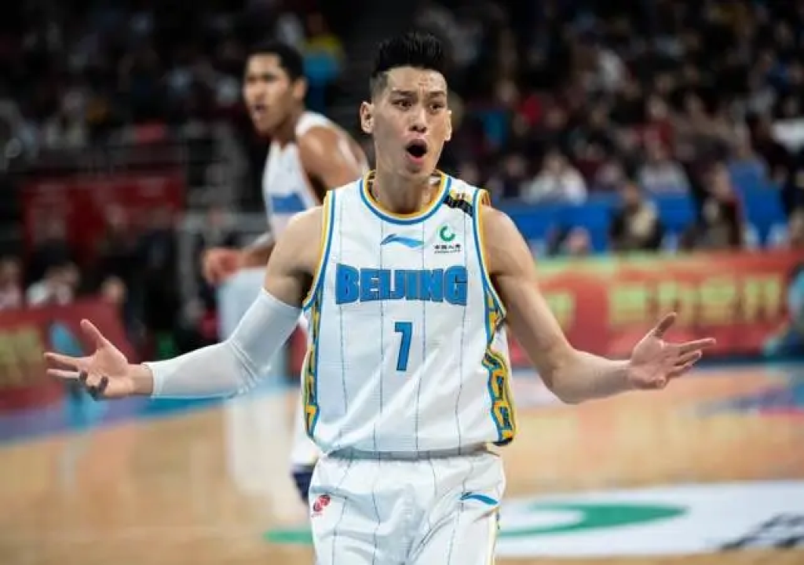

# Jeremy Lin (林書豪)

## Identity Snapshot
- **English:** Jeremy Lin
- **Chinese:** 林書豪
- **Era:** 1988
- **Geography:** Torrance, CA
- **Core roles:** Taiwanese American (TAH Who’s Who)
- **Source:** TAH Foundation Who’s Who

Growing up, Jeremy realized that teammates on his basketball team all came from different backgrounds. In middle school, Jeremy picked up his teammate for a basketball game, and his friend said he hadn’t slept all night. Jeremy learned that there were gunshots in the middle of the night, that kept his teammate up.

<!-- tah-tables:start -->
## Education
- Harvard Univ. — B.S., Economics

## Employment
- Golden State Warriors — (2010-2011) — New York Knicks — Linsanity — (2011-2012) — Houston Rockets — (2012-2014) — Los Angeles Lakers — (2014-2015) — Charlotte Hornets — (2015-2016) — Brooklyn Nets — (2016-2018) — Atlanta Hawks — (2018-2019) — Toronto Raptors — (2019-2019) — New Taipei Kings — (2023-2025) — Community — Jeremy Lin Foundation — Founder
<!-- tah-tables:end -->

## Family

- **Father:** 林繼明
- **Mother:** 吳信信

## Sources
- [TAH #113 encyclopedia: 113. Jeremy Lin【台灣演義】哈佛小子 林書豪 08/17/2013](https://taiwaneseamericanhistory.org/videos113/)
- [TAH #11 encyclopedia: 11. Jeremy Lin 林書豪](https://taiwaneseamericanhistory.org/11-jeremy-lin/)
- [TAH #195 encyclopedia: 195. 林書豪 Jeremy Lin / The First person to be recruited by NBA basketball team Go](https://taiwaneseamericanhistory.org/195-%e6%9e%97%e6%9b%b8%e8%b1%aa-jeremy-lin-the-first-person-to-be-recruited-by-nba-basketball-team-golden-state-warriors-7162010/)
- [TAH #21 encyclopedia: 21.	Jeremy Lin 林書豪 / The first T.A. professional basketball player / 2012](https://taiwaneseamericanhistory.org/21-jeremy-lin-%e6%9e%97%e6%9b%b8%e8%b1%aa-the-first-t-a-professional-basketball-player-2012/)
- [TAH #203 encyclopedia: 203. 台美人的榮耀 ( Pride of Taiwanese Americans) : 4, 林書豪 Jeremy Lin/2015/02](https://taiwaneseamericanhistory.org/11509/)
- [TAH #53 encyclopedia: 53. Jeremy Lin 林書豪](https://taiwaneseamericanhistory.org/whos-who-530-jeremy-lin/)
- [TAH Who’s Who](https://taiwaneseamericanhistory.org/person/jeremy-lin/)

## Career notes (vault-internal)
- **First TA professional basketball player** (TAH #21); **first recruited by an NBA team — Golden State Warriors, 7/16/2010** (TAH #195); “Linsanity” era with the New York Knicks (2011–2012) per tah-tables
- **Founder:** Jeremy Lin Foundation (tah-tables Community entry)
- **NBA teams (tah-tables):** Warriors · Knicks · Rockets · Lakers · Hornets · Nets · Hawks · Raptors; later New Taipei Kings (2023–2025)

## Vault records (deepen pass 2026-09-10)

- All six TAH encyclopedia records cited above are held in the vault (see the works links under Related Pages), including [[works/taiwaneseamericanhistory-org/21-jeremy-lin-e6-9e-97-e6-9b-b8-e8-b1-aa-the-first-t-a-professional-basketball-p|TAH #21 — the first T.A. professional basketball player (2012)]] and [[works/taiwaneseamericanhistory-org/195-e6-9e-97-e6-9b-b8-e8-b1-aa-jeremy-lin-the-first-person-to-be-recruited-by-nb|TAH #195 — first recruited by an NBA team (Golden State Warriors, 7/16/2010)]].
- The tah-tables above carry his full team sequence (Warriors 2010–2011 through Raptors 2019; New Taipei Kings 2023–2025), the Knicks "Linsanity" season (2011–2012), and his founding of the Jeremy Lin Foundation.

## Role in the Community

Jeremy Lin is a recurring subject — not just a mention — across the community record:

- **Community biography:** [[works/taiwaneseamericanhistory-org/publications293-2|TAH #296 — 台灣之子 福爾摩沙之光: 林書豪的成功故事]] (曾恆利 / Henry Tseng, 2013, biography), with Tseng's companion essays on writing it: [[works/taiwaneseamericanhistory-org/mystories8|TAH #8 — 編寫新書之心路歷程]] and [[works/taiwaneseamericanhistory-org/mystories69|TAH #69 — 林書豪邁入美職籃的辛酸成功奮鬥史]] (2014). See [[people/henry-tseng|曾恆利]].
- **Tribute art:** [[works/taiwaneseamericanhistory-org/footstep-20|TAH #20 — A tribute to Jeremy Lin (向林書豪致敬)]] by artist Susan Hsiu-fang Liu (陳秀芳), 2015.
- **Linsanity in the press:** [[works/taiwaneseamericanhistory-org/photo-albums-historical-24|TAH #24 — Linsanity on the TIME cover]] (2012/02/27); taiwaneseamerican.org coverage through his rise: [[works/taiwaneseamerican-org/jeremy-lin-one-step-closer-to-nba-contract|one step closer to an NBA contract]], [[works/taiwaneseamerican-org/all-eyes-on-nba-sensation-jeremy-lin|All Eyes on NBA Sensation Jeremy Lin]], [[works/taiwaneseamerican-org/friday-night-linsanity-jeremy-lin-vs-the-lakers-in-nyc|Friday Night Linsanity!]], [[works/taiwaneseamerican-org/dear-jeremy-lin|Dear Jeremy Lin…]], and [[works/taiwaneseamerican-org/warriors-asian-heritage-night-post-game-qa-with-jeremy-lin|Warriors Asian Heritage Night post-game Q&A]].
- **Cultural footprint:** [[works/taiwaneseamerican-org/eremy-lin-the-musical-a-journey-to-linsanity|Jeremy Lin: The Musical (a Journey to LinSanity)]]; appeared with [[works/taiwaneseamerican-org/johnny-hi-fis-eric-hsu-and-nba-player-jeremy-lin-at-kollaboration-sf|Johnny Hi-Fi's Eric Hsu at Kollaboration SF]]; named among "Taiwan zhiguang" athletes in [[works/taiwaneseamerican-org/taiwan-zhiguang-taiwanese-taiwanese-american-athletes-to-root-for|Taiwan zhiguang: athletes to root for]].
- **Asian-American advocacy:** in [[works/taiwaneseamericanhistory-org/videos-171|TAH #171]], Lin said violence towards Asian Americans was "hitting differently" amid the pandemic — the community record of him as a voice on anti-Asian hate.
- **Before the NBA (community press trail):** Harvard-era coverage in [[works/taiwaneseamerican-org/jeremy-lin-harvard-superstar-on-the-b-ball-court|Harvard Superstar on the B-ball Court]] (2009), the Warriors deal story [[works/taiwaneseamerican-org/jeremy-lin-nearing-deal-with-warriors|Jeremy Lin Nearing Deal with Warriors]] (2010), a Boston fan's bleacher broadcast ([[works/taiwaneseamerican-org/jeremy-lin-a-boston-fans-broadcast-from-the-bleachers|2010]]) and the community vote campaign [[works/taiwaneseamerican-org/vote-for-jeremy-lin-for-the-bob-cousy-award|Vote for Jeremy Lin for the Bob Cousy Award!]] (2010).
- **Linsanity as community organizing:** the documentary screened at community-organized events — [[works/taiwaneseamerican-org/linsanity-viewing-party-with-tap-in-la|Linsanity viewing party with TAP in LA]] (2012), [[works/taiwaneseamerican-org/linsanity-movie-night-with-tap-in-sd|movie night with TAP in SD]] (2013), [[works/taiwaneseamerican-org/linsanity-viewing-party-in-new-york-ny|viewing party in New York]], [[works/taiwaneseamerican-org/linsanity-documentary-screening-with-tap-in-ny|documentary screening with TAP in NY]], [[works/taiwaneseamerican-org/dinner-and-linsanity-screening-with-tasc-at-ucla|dinner + screening with TASC at UCLA]], and [[works/taiwaneseamerican-org/linsanity-movie-screening-in-la-for-kaohsiung-disaster-relief|a LA screening for Kaohsiung disaster relief]]; the film's Sundance premiere is recorded in [[works/taiwaneseamerican-org/linsanity-documentary-film-premieres-at-sundance-film-festival|Linsanity documentary premieres at Sundance]]. The "Linsanity" producer Allen Lu appears in the community network around [[works/taiwaneseamerican-org/stephanie-lin-champions-womens-empowerment|Stephanie Lin's women's-empowerment campaign]].
- **Cross-community discourse:** Linsanity surfaced in broader TA conversations — [[works/taiwaneseamerican-org/on-the-topic-of-tiger-mom-to-linsanity-a-discussion-in-flushing-ny|Tiger Mom to Linsanity, a discussion in Flushing, NY]] (2012).
- **Family-origin record (opinion piece, attributed):** [[articles/taiwanjustice-net/2020/20200622233811_2020_04_09_林書豪是心中有愛_還是心中有錢_-_-余杰_e37475d2a9ccd5bc|余杰, 「林書豪是心中有愛，還是心中有錢？」]] (taiwanjustice.net, 2020-04-09) preserves — as the author's account of NYT reporting — that uncle 林繼宗 stated the Lin family is Taiwanese: ancestors migrated from Fujian to Taiwan in 1707 (林繼明/林繼宗 the eighth generation), the grandfather worked in the South Seas during the Japanese era and went into hiding during 228, and the maternal grandmother was a doctor who came to Taiwan in 1949. The piece is a critical opinion column on his China stance and Beijing首钢 stint; treat its characterization as attributed commentary, not community fact.

## Related Pages
- [[organizations/tah-foundation||TAH Foundation]]
- [[sources/taiwaneseamericanhistory-org||taiwaneseamericanhistory.org]]
- Archival records in the vault: [[works/taiwaneseamericanhistory-org/11-jeremy-lin|TAH #11]] · [[works/taiwaneseamericanhistory-org/21-jeremy-lin-e6-9e-97-e6-9b-b8-e8-b1-aa-the-first-t-a-professional-basketball-p|TAH #21]] · [[works/taiwaneseamericanhistory-org/195-e6-9e-97-e6-9b-b8-e8-b1-aa-jeremy-lin-the-first-person-to-be-recruited-by-nb|TAH #195]] · [[works/taiwaneseamericanhistory-org/11509|TAH #203 台美人的榮耀]] · [[works/taiwaneseamericanhistory-org/videos113|TAH #113 台灣演義影片]] · [[works/taiwaneseamericanhistory-org/whos-who-530-jeremy-lin|TAH Who's Who #53]]

## Vault re-check 2026-09-14 (deepen-x slice 6, vault-only)
- All wikilink targets re-verified to exist. All six cited TAH encyclopedia records (#11, #21, #53, #113, #195, #203) resolve to vault works pages; family fields (林繼明, 吳信信) have no vault person pages, left unlinked.
- Career sequence (Warriors 2010–2011 → Knicks Linsanity 2011–2012 → Rockets → Lakers → Hornets → Nets → Hawks → Raptors; New Taipei Kings 2023–2025) and Jeremy Lin Foundation founder role remain the consolidated vault record. No web used, no new pages created, nothing published.

## 照片

📷 照片取自公開檔案（來源：taiwanjustice.net，Wayback 存檔 20200623032933）。圖說為原始來源所提供，Echo 未經人工逐張查證——若您認得圖中人，歡迎回報修正。
