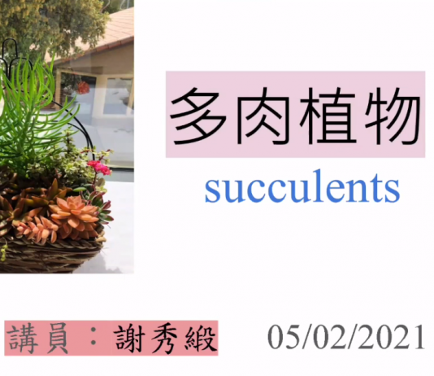

# Juliar Wang (謝綉緞)

## Identity Snapshot
- **English:** Juliar Wang
- **Chinese:** 謝綉緞
- **Era:** --
- **Geography:** Taiwan
- **Core roles:** entrepreneur · NATWA-SC（北美洲台灣婦女會南加分會）第29屆會長（2017-04-01 就任，2018-03-10 卸任 — 見「## Identity verification」2，具名報導佐證）
- **Source:** TAH Foundation Who’s Who

Source from 美洲台灣日報http://taiwandaily.net/gp2.aspx?_p=kSF1c9zU9HS21FClfOjsJD7dPHKLpMMZ

<!-- tah-tables:start -->
## Education
- National Taichung Univ. (臺中師範學院) — B.A., Music
- USC — M.Mus.

## Employment
- Brico King — Founder — (1979-) — Community — NATWA-SC (北美洲台灣婦女會南加分會) — President
<!-- tah-tables:end -->

## Family

- **Husband:** [[people/wang-yao-ting-xie-xiulan||王耀廷]] — 夫婦同為 TAHS 2017／2023 出版品人物專輯「王耀廷、謝秀緞」合輯條目（見下）；2017-06-10 會館「牽手50年音樂會」二人以金婚佳偶受表揚（大紀元 2017-06-12 報導，見「## Identity verification」3）
- **Son:** [[people/wilson-wang|王唯昇 (Wilson Wang)]] — 本人亦有 TAH Who's Who 條目（[[works/taiwaneseamericanhistory-org/whoswho2044|TAH #2044「Wilson Wang 王唯昇」, 2018-02-25]]）

## From the record

- 複核（TJJ-A09250400-6, 2026-09-26）：本 slice 文章 f454eda084b7ca99（園藝分類存檔頁, 2024-02-25 快照）正文再驗證——「多肉植物 succulent–謝秀緞 (Juliar Wang) 主講[影]」確認見於正文，subject 連結為真，無錯鏈、無虛鏈；2021-05-06 條目（已含該文 wikilink）已在庫 — SKIP，已飽和。

- 複核（TJJ-A09230900-1, 2026-09-25）：本 slice 文章 f454eda084b7ca99（園藝分類存檔頁, 2024-02-25 快照）正文再驗證——「多肉植物 succulent–謝秀緞 (Juliar Wang) 主講[影]」確認見於正文，subject 連結為真，無錯鏈、無虛鏈；2021 講座日期條目（已含該文 wikilink）已在庫，講座日期 HOLD（2021-05-06 vs 2021-07-18）不變 — SKIP，已飽和。

- 複核（TJJ-A09162345-15 / t_0c0e3cd1, 2026-09-24）：本 slice 文章 f454eda084b7ca99（園藝分類存檔頁, 2024-02-25 快照） 正文再驗證——subject 連結為真實提及，無錯鏈、無虛鏈；對應日期事實條目（含該文 wikilink）已在庫 — SKIP，已飽和。

- 複核（TJJ-A09221400-1, 2026-09-23）：本 slice 文章 f454eda084b7ca99（園藝分類 2024-02-24 快照）正文再驗證——「多肉植物 succulent–謝秀緞 (Juliar Wang) 主講[影]」確認見於正文，subject 連結為真，無錯鏈、無虛鏈；2021-05-06 條目已在庫，無新材料。

- 2021-05-13 — 南加州僑界48個社團（含台美人歷史協會、台美律師協會）於洛杉磯華僑文教服務中心開發布會，連署聯合聲明支持台灣以制度化管理參與WHA/WHO，為聲明共同發起人之一；本頁人物＝該名單第70位之「謝秀緞」，身份條見下方「## Identity verification」（[[articles/taiwanjustice-net/2021/20210616072940_2021_05_17_2021年南加州僑界支持台灣參與世界衛生大會wha聯合聲_b1d58af16c0a5e5b|TJJ 2021-06-16 轉載]]；[[articles/taiwanjustice-net/2025/20251108183438_2021年南加州僑界支持台灣參與世界衛生大會wha聯合聲_80c0a825a7a661b6|2025-11-08 快照]]）。

- 2021-05（日期存疑，見下方多肉植物講座條之 HOLD）— 台灣公義報「園藝」分類存檔收錄「多肉植物 succulent–謝秀緞 (Juliar Wang) 主講[影]」，記錄其在大洛杉磯台灣會館園藝講座讲授多肉植物栽培（[[articles/taiwanjustice-net/2024/20240225031504_root_f454eda084b7ca99|TJJ 園藝分類存檔, 2024-02-24 快照]]）。

- 2021-05 — 以「謝秀緞」名列「2021年南加州僑界支持台灣參與世界衛生大會（WHA）聯合聲明」共同發起人，與南加州台美人團體共同連署（[[articles/taiwanjustice-net/2021/20210616072940_2021_05_17_2021年南加州僑界支持台灣參與世界衛生大會wha聯合聲_b1d58af16c0a5e5b|TJJ 存檔, 2021-06-16 快照]]）；另有 2025-11-08 快照存檔收錄完整共同發起單位／發起人名單，其名列其中，發起單位含台美人歷史協會、北美洲台灣婦女會南加分會等（[[articles/taiwanjustice-net/2025/20251108183438_2021年南加州僑界支持台灣參與世界衛生大會wha聯合聲_80c0a825a7a661b6|TJJ 存檔, 2025-11-08 快照]]）。
- 2024-10-26 — 以「謝秀緞」執筆〈16位臺美音樂學者回國訪問僑委會，賓主盡歡〉刊於台灣公義報「台美人台加人」專欄，與其音樂背景（臺中師範音樂、USC 碩士）及 Brico King 創業身分相互印證（[[articles/taiwanjustice-net/2025/20250215221604_category_taiwaneseamerican_page_3_98bf76da5c3ac86d|TJJ 台美人分類存檔]]）。
- TAH 人物檔案存於 corpus：[[works/taiwaneseamericanhistory-org/whos-who-2043-juliar-wang|TAH #2043「Juliar Wang 謝綉緞」]]。
- SKIP note (deepen-x slice 09190130-5, 2026-09-20): fresh grep of content/works + content/articles for 謝綉緞/謝秀緞/Juliar Wang — hit set identical to prior passes (whos-who-2043 + works index + the four TJJ archive snapshots already cited above); no new absorbable corpus facts.
- 與夫 王耀廷 以「王耀廷、謝秀緞」合輯身分兩度刊入 TAHS 出版品檔案（2017 與 2023 年版人物專輯，2023 版註記「also in 2017 publication」）——見 [[sources/2017-tahs-publication||2017 TAHS Publication]]、[[sources/2023-tahs-publication||2023 TAHS Publication]] 與 [[people/wang-yao-ting-xie-xiulan||王耀廷、謝秀緞]] 條目。
- 園藝講座另有兩份台灣公義報存檔快照（[[articles/taiwanjustice-net/2025/20250423020103_category_gardenning_bf0e9978cb1c15ce|TJJ 園藝存檔, 2025-04-23 快照]]、[[articles/taiwanjustice-net/2024/20240221124353_root_b8dade4257cb29ca|TJJ 存檔, 2024-02-21 快照]]）收錄「洛杉磯聖東台灣同鄉會園藝分享會」與「多肉植物 succulent–謝秀緞 (Juliar Wang) 主講[影]」並列，記錄其亦為洛杉磯聖東台灣同鄉會園藝分享會講者。
- 異寫記錄：本頁漢名記「謝綉緞」，台灣公義報存檔一律作「謝秀緞」（綉/秀異體），指同一人。
- 多肉植物講座另見兩份台灣公義報「園藝」分類存檔快照（[[articles/taiwanjustice-net/2023/20231208120554_root_46c96aaab38ad7f2|TJJ 園藝存檔, 2023-12-08 快照]]、[[articles/taiwanjustice-net/2025/20250419184950_category_gardenning_538a0cc060a27a5c|TJJ 園藝存檔, 2025-04-19 快照]]），兩份均將「多肉植物 succulent–謝秀緞 (Juliar Wang) 主講[影]」列於 2021-07-18 項下。HOLD: 本頁上方依 2024-02-24 快照記為 2021-05-06，較新快照一律作 2021-07-18（May 6, 2021 該列實為另一篇「全球暖化危及物種」），講座日期衝突，未自動合併。
- Re-verify 2026-09-22 (TJJ-A09220600-1): link-check against slice article f454eda084b7ca99（園藝分類 2024-02-24 快照）body — 「多肉植物 succulent–謝秀緞 (Juliar Wang) 主講」mention confirmed real, dated fact with article wikilink already in place above; no new material.
- 複核（deepen-x slice 09220800-5，2026-09-22）：re-grep 謝綉緞/謝秀緞 / Juliar Wang 命中集不變（whos-who-2043、works index、WHA 聯合聲明 2021/2025 快照、園藝分類 2023/2024/2025 快照、台美人專欄存檔）— 全數已吸收，講座日期 HOLD（2021-05-06 vs 2021-07-18）維持，saturated，SKIP-with-reason。
- 複核（deepen-x slice 10101100-1，2026-10-11）：fresh grep 謝綉緞/謝秀緞/Juliar Wang 跨 works/articles/sources/events/topics 五目錄，命中 12 檔（whos-who-2043、works index、sources/taiwaneseamericanhistory-org、sources/2023-tahs-publication、WHA 聯合聲明 2021/2025 快照、園藝分類 2023/2024/2025 快照 4 份、台美人專欄存檔）— 與歷次命中集相同，全數已見於本頁 From the record；events/topics 無新命中。講座日期 HOLD（2021-05-06 vs 2021-07-18）維持不變 — SKIP，已飽和。

- 複核（deepen-x slice 10110800-2，2026-10-12）：fresh grep 謝綉緞/謝秀緞/Juliar Wang/王唯昇 跨 works/articles/sources/events/topics 五目錄，命中 13 檔（whos-who-2043、whoswho2044、works index、sources/taiwaneseamericanhistory-org、sources/2023-tahs-publication、WHA 聯合聲明 2021/2025 快照、園藝分類 2023/2024/2025 快照 4 份、台美人專欄存檔）— 與歷次命中集相同，全數已見於本頁 From the record；events/topics 無新命中。講座日期 HOLD（2021-05-06 vs 2021-07-18）維持不變 — SKIP，已飽和。

- 複核（deepen-x slice 10120909-18，2026-10-13）：fresh grep 謝綉緞/謝秀緞/Juliar Wang 跨 works/articles/sources/events/topics 五目錄，命中 12 檔（whos-who-2043、works index、sources/taiwaneseamericanhistory-org、sources/2023-tahs-publication、WHA 聯合聲明 2021/2025 快照、園藝分類 2023/2024/2025 快照 4 份、台美人專欄存檔）— 與歷次命中集相同，逐檔核對本頁 wikilink 全部已在庫；events/topics 無新命中。講座日期 HOLD（2021-05-06 vs 2021-07-18）維持不變 — SKIP，已飽和。
- 2021-05-13 — 大紀元具名記者會報導（記者袁玫，發佈 2021-05-15）載洛僑中心 WHA 聯合聲明記者會，共同發起人逐字計 86 名，其以「谢秀缎」見於該名單 gb 面計序第69位（vault 書面聲明快照計序第70位，因「林淑卿／劉煥君」兩檔次序對調所致）；本檔即 t_418ead61 CONFIRMED 判定所指之「具名記者會報導」原始文件（[[sources/epochtimes-socal-wha-press-report-2021-05-15]]）。
- 2023-05-11 — 大洛杉磯僑界48單位第二度聯署挺台參與 WHA（大紀元記者徐曼沅報導，發佈 2023-05-12），其**不在**該年共同發起人單（逐字計 82 名；本檔「人單淨退出」逐字計 37 名中列有「**謝秀緞**」）。缺席依 owner 規則不作為同人不同人任一方向之證據，僅記年度名單變動；其 2021 列名判定（t_418ead61）效力不變（[[sources/epochtimes-socal-wha-48units-2023-05-12]]）。

## Identity verification

本節為 t_418ead61（2026-11-10）對「謝秀緞是否為 2021-05-13 南加州僑界支持台灣參與 WHA 聯合聲明共同發起人」之判定紀錄。判定：**CONFIRMED**（推翻 t_fe9742d7 之 AMBIGUOUS）。佐證鏈條（各點獨立、彼此不衝突）：

1. **會館為共同發起單位之首，本人為其園藝講座具名主講人。** 本聲明之「共同發起單位」48 個社團逐項計數於本輪覆核確認，首位為大洛杉磯台灣會館；本人於該會館「園藝」分類存檔中被具名為「多肉植物 succulent–謝秀緞 (Juliar Wang) 主講」（見上），會館與本人之活動場域直接重疊。
2. **本人任內之 NATWA-SC 為本聲明共同發起單位（決定性）。** 本檔「共同發起單位」名單逐字含「北美洲台灣婦女會」與「北美洲台灣婦女會南加分會」（見 [[organizations/north-america-taiwanese-womens-association-southern-california-chapter|NATWA-SC]] 頁「Greater-LA coalition membership」條），而具名獨立報導證明本人於聲明發起之 2021-05 為該會會長：
   - 大紀元記者袁玫 2017-04-04〈南加臺灣婦女會年會 謝秀緞接掌〉：北美洲臺灣婦女會南加分會（NATWA-SC）2017-04-01 於聖蓋博希爾頓飯店舉行年會暨會長交接典禮，經文處處長夏季昌監交，現任會長方碧霞授旗予新任會長謝秀緞（https://www.epochtimes.com/b5/17/4/4/n8999052.htm，本輪取全文）。
   - 大紀元 2018-03-13〈張瑞菊任北美臺灣婦女會南加分會會長〉：2018-03-10 該會 25 周年年會新舊會長交接，經文處處長夏季昌監交，**謝秀緞卸任**，張瑞菊接棒（https://www.epochtimes.com/b5/18/3/13/n10212784.htm，本輪取全文）。
   - 駐洛杉磯台北經濟文化辦事處活動剪影（106年4月1日）：照片圖說具名「北美洲台灣婦女會南加州分會新任會長謝秀緞」（https://web.roc-taiwan.org:3000/uslax/album/32/photo/11663.html）。
   兩份報導把會長任期框為 2017-04-01 → 2018-03-10（約第29屆，大紀元 2017-05-30 報導亦稱「任第29屆會長的她」），**故本頁上方 Employment 表「NATWA-SC President」為一屆任期，不得讀作 2021 年在任**。
3. **音樂專業由本人任內活動直接佐證，化解「音樂 ↔ 園藝」背景張力。** 大紀元 2017-05-30 報導載本人自述「以『欣欣向榮』為宗旨，希望應用自己**音樂藝術專業**於各種活動中，如烹飪、插花及在6月10日『牽手50年』的音樂饗宴」；同月台美史料中心記錄該音樂會由會長謝秀緞主持（[[works/taiwaneseamericanhistory-org/concerts99|TAH #99「99. 牽手50年音樂會 by 北美洲臺灣婦女會南加分會」]]，本檔為書目級記錄，正文仍在原站）。與本頁臺中師範音樂、USC M.Mus. 及 2024-10-26 音樂學者專欄同為一人，園藝講座與音樂身分並存，非二人。
4. **同名同檔之唯一性。** 全庫 謝秀緞／謝綉緞／Juliar Wang 命中集（見上歷次 grep 紀錄）均指向同一人； TAH #2043（本頁）與 #2044（子 [[people/wilson-wang|王唯昇]]）、夫 [[people/wang-yao-ting-xie-xiulan|王耀廷]] 之家庭指紋一致；無南加僑界同名異人競爭紀錄。

**明確未採為佐證之項目：**
- **無本人親筆署名扫描件**，亦無洛僑中心／僑委會點名與會個人之報導，故僅斷言**列名為共同發起人**，不聲稱親筆署名（與 t_0d727982、t_14eb602c 同一紀律）。
- **多肉植物講座之確切日期仍未解**，不採為本判定之佐證。本輪查核：三份較新分類存檔（[[articles/taiwanjustice-net/2023/20231208120554_root_46c96aaab38ad7f2|2023-12-08]]、[[articles/taiwanjustice-net/2025/20250419184950_category_gardenning_538a0cc060a27a5c|2025-04-19]]、[[articles/taiwanjustice-net/2024/20240221124353_root_b8dade4257cb29ca|2024-02-21]]）一律列於 July 18, 2021 項下；2024-02-25 快照 f454eda084b7ca99 更將該條列於 **August 29, 2016** 項下。此類「園藝」分類頁為「標題／日期／分類」交錯陳列，日期歸屬易錯位，故不採任何單一日期，改記「2021-05（日期存疑）」並保留原 HOLD 條。
- NATWA 全國會刊 PDF（natwa.com/link/Magazine/56-2017_NF.pdf）與新唐人 2017-04-04 報導僅作旁證，本判定不以其為獨立支點。

## Sources
- [TAH #2043 encyclopedia: 2043. Juliar Wang 謝綉緞](https://taiwaneseamericanhistory.org/whos-who-2043-juliar-wang/)
- [TAH Who’s Who](https://taiwaneseamericanhistory.org/person/juliar-wang/)

## Network

Pages that link to **juliar-wang** (juliar-wang):

### People (2)

1. [[people/index|index]]
2. [[people/wilson-wang|wilson-wang]]

### Articles (6)

1. [[articles/taiwanjustice-net/2021/20210616072940_2021_05_17_2021年南加州僑界支持台灣參與世界衛生大會wha聯合聲_b1d58af16c0a5e5b|20210616072940_2021_05_17_2021年南加州僑界支持台灣參與世界衛生大會wha聯合聲_b1d58af16c0a5e5b]]
2. [[articles/taiwanjustice-net/2024/20240225031504_root_f454eda084b7ca99|20240225031504_root_f454eda084b7ca99]]
3. [[articles/taiwanjustice-net/2023/20231208120554_root_46c96aaab38ad7f2|20231208120554_root_46c96aaab38ad7f2]]
4. [[articles/taiwanjustice-net/2024/20240221124353_root_b8dade4257cb29ca|20240221124353_root_b8dade4257cb29ca]]
5. [[articles/taiwanjustice-net/2025/20250419184950_category_gardenning_538a0cc060a27a5c|20250419184950_category_gardenning_538a0cc060a27a5c]]
6. [[articles/taiwanjustice-net/2025/20250423020103_category_gardenning_bf0e9978cb1c15ce|20250423020103_category_gardenning_bf0e9978cb1c15ce]]

### Sources (3)

1. [[sources/epochtimes-socal-wha-48units-2023-05-12|epochtimes-socal-wha-48units-2023-05-12]]
2. [[sources/epochtimes-socal-wha-press-report-2021-05-15|epochtimes-socal-wha-press-report-2021-05-15]]
3. [[sources/taiwaneseamericanhistory-org|taiwaneseamericanhistory-org]]

### Other (1)

1. [[works/taiwaneseamericanhistory-org/whos-who-2043-juliar-wang|whos-who-2043-juliar-wang]]

## Related Pages
- [[organizations/tah-foundation||TAH Foundation]]
- [[sources/taiwaneseamericanhistory-org||taiwaneseamericanhistory.org]]

<!-- TJJ-A10040600-3: verified 2026-10-06 — wave-2 link+deepen re-check of slice 10040600-3 article f454eda084b7ca99 (園藝分類熱門頁, 2024-02-25快照): subject link re-checked vs 正文, real, no wrong/spurious links; dated fact w/ article wikilink already in From the record — saturated, no new material. -->
<!-- TJJ-A100607006-c: verified 2026-10-09 — wave-2 link+deepen re-check of article f454eda084b7ca99 (園藝分類熱門頁, 2024-02-25快照): subject link re-checked vs 正文 this attempt (「多肉植物 succulent–謝秀緞 (Juliar Wang) 主講[影]」條目具名), real, no wrong/spurious links; dated fact w/ article wikilink already in From the record — saturated, no new material. -->

## 照片

📷 照片取自公開檔案（來源：taiwanjustice.net，Wayback 存檔 20210608043446）。圖檔名含「2021_05_謝綉緞講多肉植物」，與上方「多肉植物 succulent–謝秀緞 (Juliar Wang) 主講」講座條相互對應；惟該講座**日期**於各分類存檔不一致（2021-05-06／2021-07-18／2016-08-29），見「## Identity verification」未採項目 — 圖檔名之年月不作為日期佐證。圖說為原始來源所提供，Echo 未經人工逐張查證——若您認得圖中人，歡迎回報修正。

<!-- TJJ-A10060700-6 / t_fa4d7a7f: verified 2026-10-14 — wave-2 link+deepen re-check of article 20240225031504_root_f454eda084b7ca99 (園藝分類熱門頁, 2024-02-25快照) read fresh this attempt: subject link 謝秀緞 (Juliar Wang) re-checked vs 正文 — 「多肉植物 succulent–謝秀緞 (Juliar Wang) 主講[影]」條目具名確認見於正文, real, no wrong/spurious links; 2021-05-06 dated fact w/ article wikilink already in From the record — saturated, no new material. -->
