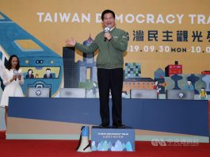

# Lin Chia-lung / Lin Jia-long (林佳龍)

**Lin Chia-lung / Lin Jia-long** (林佳龍) appears extensively in the [[sources/taiwanjustice-net||taiwanjustice.net]] archive (**68** article hits by title/topic extraction). This is a **thin A-tier** page for graph linking — not a full biography.

## Identity Snapshot

- **English:** Lin Chia-lung / Lin Jia-long
- **Chinese:** 林佳龍
- **Role (as covered):** DPP politician; former Mayor of Taichung / cabinet roles (as covered)
- **Echopedia scope:** Taiwan politics coverage via taiwanjustice.net; not a Taiwanese-American diaspora profile

## Network

Pages that link to **lin-jialong** (lin-jialong):

### People (2)

1. [[people/bi-khim-hsiao|bi-khim-hsiao]]
2. [[people/index|index]]

### Organizations (1)

1. [[organizations/taiwanjustice-net|taiwanjustice-net]]

### Articles (1)

1. [[articles/taiwanjustice-net/2024/20240425114253_root_f6ed9463245cb54e|20240425114253_root_f6ed9463245cb54e]]

### Sources (3)

1. [[sources/taiwandaily-net|taiwandaily-net]]
2. [[sources/taiwandaily-net|taiwandaily-net]]
3. [[sources/taiwanjustice-net|taiwanjustice-net]]

## Source Notes

- **Content priority A:** Article hit count (68) from `knowledge/research/taiwanjustice-net-entities.md` (title extraction)
- **Content priority B:** Public office / role labels from secondary knowledge used only for disambiguation — expand only with primary sources
- **Hub:** [[sources/taiwanjustice-net||taiwanjustice.net source hub]]
- **Primary org:** [[organizations/taiwanjustice-net||taiwanjustice.net (台灣公義網)]]
- **Do not invent:** No birth data, family, or private contact on this page

## Role in the Community (corpus coverage)

Coverage in our corpus is press coverage via the taiwanjustice.net archive, not diaspora-community memoirs. Representative hits:

- **Foreign minister (2025–):** as 外交部長 publicly criticized 傅崐萁's Hong Kong trip after a touring-industry member of the delegation was detained by Hong Kong police — [[articles/taiwanjustice-net/2026/20260124115014_傅崐萁2月赴港同團旅遊業者被拘捕-陸委會_留置至_814bfc56980f840e|訪港團旅遊業者遭拘捕 (2026/01)]] and [[articles/taiwanjustice-net/2026/20260124122923_訪港團旅遊業者遭拘捕-傅辦_傅崐萁不認識_ebd89f8d084660fe|傅辦回應 (2026/01)]].
- **Lobbying for the TAITO name change:** lunch meeting with 蓬佩奧 where the renaming of the Taiwan's representative office in the US was discussed — [[articles/taiwanjustice-net/2026/20260209103921_林佳龍與蓬佩奧午餐會_談及台灣駐美代表處更名_22ae00e21ec7b8e4|林佳龍與蓬佩奧午餐會 (2026/02)]].
- **Taichung mayor tenure (legacy cited later):** credited (前市長林佳龍編列經費) in school-infrastructure chronology — [[articles/taiwanjustice-net/2026/20260209113555_連2天同台出席-外界解讀盧秀燕蔡其昌互相較勁_c2a5c76345831246|盧秀燕蔡其昌同台 (2026/02)]].
- **Transport minister tenure (press coverage):** attended the 亞洲台灣商會聯合總會 27th president handover banquet at the Round Hotel (~500 guests) listed as 交通部長林佳龍 alongside 游錫堃, 蔡其昌, 蕭美琴 et al. — event predates his 2021/04 resignation; page archived as a Wayback snapshot: [[articles/taiwanjustice-net/2026/20260210065001_台商嘆紓困輪不到_總統_用行動給最實際協助游_20da423dd1e84a8b|台商嘆紓困輪不到 (存檔快照)]].
- **Cabinet resignation:** 蘇貞昌批准林佳龍辭呈，20日生效 (2021/04) — archived in tier2 at `knowledge/web-archives/taiwanjustice-net/tier2/2021/20210509165934_...md` (no wiki page for individual tier2 items).
- **HOLD:** the 68-hit count on this page is title/topic extraction (see Source Notes); actual body mentions are higher — not reconciled.

## Corpus re-check (slice 09150600-15, 2026-09-15)

- Full-text grep of `articles/` (body, not title extraction) now returns **212** article pages mentioning 林佳龍 — confirms the HOLD above: the 68 figure understates coverage. Newly-linked representative hits:
  - **太魯閣號事故 (2021/04) as transport minister:** 蘇貞昌鞠躬致歉、台鐵改革呼聲 — [[articles/taiwanjustice-net/2021/20210415110122_2021_04_07_太魯閣號事故_蘇貞昌鞠躬致歉_台鐵改革要加速_f1bc2171e3493c95|太魯閣號事故致歉 (2021/04)]]; 「辭職負責，也為喚起支持加速台鐵改革」— [[articles/taiwanjustice-net/2021/20210620131029_2021_04_12_林佳龍_辭職負責_也為喚起支持加速台鐵改革_b1f73ec77d8fd043|辭職負責評論 (2021/04)]]; 事故地點通車、搭首班車完成任內最後任務 — [[articles/taiwanjustice-net/2021/20210620133733_2021_04_18_太魯閣號事故地點通車_林佳龍搭首班車完成任內_602e8a54790ec6f5|首班車通車 (2021/04)]].
  - **Post-resignation cabinet coverage:** 新內閣分掌 — [[articles/taiwanjustice-net/2026/20260208203442_新內閣_李永得吳政忠分掌文化科技_陳時中徐國_4e0865d1a92dba52|新內閣內閣改組報導]].
  - **DPP 黨主席風波 (2022/11–2022/12):** 敗選後表態「黨主席改選和調整人事很重要」— [[articles/taiwanjustice-net/2023/20230129120426_2022_11_28_敗選警訊-林佳龍_黨主席改選和調整人事很重要_551953317fe73562|敗選警訊 (2022/11)]]; 賴清德參選黨主席、鄭文燦林佳龍表態力挺 — [[articles/taiwanjustice-net/2023/20230204025732_2022_12_08_賴清德參選黨主席-鄭文燦林佳龍表態力挺成關鍵_045f43655721d8d9|力挺賴清德 (2022/12)]].
- **Disambiguation note (works/):** the single `works/` grep hit [[works/taiwaneseamericanhistory-org/ourjourneys27-eng|27. 紐約台灣會館：在困境中更新]] matched only on author name "Chia-lung **Cheng**" — a different person; not absorbed. No diaspora-memoir (works/) material exists on this person; coverage remains press archive only.

## From the record

- **2024-05-27**（報導日；存檔 front-matter published 2024-05-27；美洲台灣日報「即時新聞」）— 美洲台灣日報刊出〈麥考爾︰台灣人民 像是美國人民〉：美國聯邦眾議院外交委員會主席麥考爾（Michael McCaul）於廿七日上午在台北賓館接受外交部長本人午宴前召開記者會，同日上午會見賴總統；表示美方將持續與台灣合作提升嚇阻力，強調「台灣人民就像美國人民」，因其人民、民主、自由及繁榮而深具重要性，美國永遠是台灣可信賴的盟友（*reported*：全文為報導轉述，引語為報導所載；**身份 HIT：林佳龍 見於本頁 `title: "Lin Chia-lung / Lin Jia-long (林佳龍)"`，為文中具名之外交部長與午宴主人；card 候選頁 prof-tsung-yi-lin 林宗義／tsung-ming-hsieh 謝聰敏／wudong-huang 黃武東／lin-baohua 林保華 於本檔 0× 命中 — prep-tag collision false, never-merge**；欄內被報導人物 麥考爾（美方官員，無本人頁）／賴清德／蕭美琴（各有本人頁，本檔不代筆添條，賴清德頁另記同檔會見側面）；**去重**：`grep -c "即時新聞/20690" 本頁` 寫入前 = 0）（存檔 `knowledge/web-archives/taiwandaily-net-20690-20690.md`）— [美洲台灣日報](https://taiwandaily.net/即時新聞/20690/)

- 2013-04-12 — 立法院表決民進黨「立即停建核四」提案，第二次表決贊成名單列有林佳龍（時任立委）（[[articles/taiwanjustice-net/2024/20240425114253_root_f6ed9463245cb54e|TJJ 轉載公督盟表決資料, 刊 2013-04-12 / 快照 2024-04-25]]）。
- 2025-09-14 — 時任外交部長林佳龍透過臉書就美國保守派意見領袖柯克（Charlie Kirk）校園演講遭槍擊身亡向柯克家人致哀，表示柯克年輕有為、勇於走入不同社群與持不同意見者交流對話、創辦「美國轉折點」（Turning Point USA）、過去曾公開支持台灣，其驟逝是民主社會的損失，外交部嚴正譴責任何形式的政治暴力，並相信民主制度的韌性將帶領美國社會度過艱難時刻（以上為本人臉書發言，屬被報導記錄）— [美洲台灣日報](https://taiwandaily.net/%e5%8d%b3%e6%99%82%e6%96%b0%e8%81%9e/99011/)（存檔 `knowledge/web-archives/taiwandaily-net-99011-99011.md`；原始來源 自由時報0914）
- 2026-02-16 — 時任外交部長林佳龍接受美國「福斯數位新聞」（Fox News Digital）獨家專訪，表示台灣不會升高衝突、也不會屈服於中國的威脅，稱中國顯然已成為麻煩製造者、企圖惡意破壞兩岸現狀並恐嚇愛好和平的國家；訪談中並稱遼寧號與山東號兩航艦去年6月首次同時駛出第二島鏈進入西太平洋、全球約90%最先進半導體在台灣生產、約50%全球商業航運經過台海，並論川普第一與第二任期政策存在明確戰略延續性、台灣將尋求「以價值為基礎、同盟及經濟外交」與美國協作（以上為專訪本人發言，屬被報導記錄）— [美洲台灣日報](https://taiwandaily.net/%e5%8d%b3%e6%99%82%e6%96%b0%e8%81%9e/122640/)（存檔 `knowledge/web-archives/taiwandaily-net-122640-122640.md`；原始來源 中央社0216）
- 2025-11-28 — 時任外交部長林佳龍就泰國、越南政府相繼公開表達對台海和平穩定高度關切一事表示肯定，強調台海安全攸關區域與全球穩定、國際社會的高度關注顯示維護台海和平已成為各國共識；外交部指出泰、越相繼表態除有中國近期對日本高壓脅迫的客觀因素，更代表台海和平穩定已成印太安全的重要議題，維持現狀是國際社會普遍期待，台灣將持續推動「總合外交」，與東南亞及全世界理念相近夥伴攜手合作，確保印太和平、穩定與繁榮（以上為本人發言，屬被報導記錄）— [美洲台灣日報](https://taiwandaily.net/%e5%8d%b3%e6%99%82%e6%96%b0%e8%81%9e/110539/)（存檔 `knowledge/web-archives/taiwandaily-net-110539-110539.md`；原始來源 自由時報1128）

- **2026-05-29**（報導日；正文末署「自由時報0529」，美洲台灣日報「即時新聞」轉載）— 〈反擊「中美共管台海」 林佳龍：是台灣和第一島鏈共管中共〉：時任外交部長林佳龍於 5 月 29 日舉行媒體茶敘，分享過去一年外交工作推動及展望（外交部政務次長吳志中、陳明祺、常務次長葛葆萱、發言人蕭光偉、國傳司長張秀禎與會）；就被問川普考慮對台軍售，林佳龍強調川普任內對台軍售是史上最多，「如果有人阻撓，那我們看這個阻撓的人，我們怎麼樣來管理他」，並認為習近平想塑造「中美共管台海」的錯誤假象，製造問題的是中國，因此台灣要跟美國、全世界尤其是第一島鏈國家共管中共，不要出現意外的行動；稱外交部每天都在打沒有煙硝的第一線戰爭、「我們就是雷達」，台灣在資安、假訊息、海纜破壞、無人機艦騷擾與灰色操弄上有很多能分享給全世界。談及川賴通話，林佳龍稱應已進入華府準備項目，但坦言「主動權是在川普」，台灣是接電話的一方、就是做好準備。被問總統出訪與過境美國，林佳龍表示我國在中南美洲有 7 個友邦、總統出訪是經常的事情，赴拉丁美洲需要過境，如同上次到太平洋過境關島跟夏威夷，是自然的事情（以上為該報導引述本人發言，屬被報導記錄）— [美洲台灣日報](https://taiwandaily.net/%e5%8d%b3%e6%99%82%e6%96%b0%e8%81%9e/139620/)（存檔 `knowledge/web-archives/taiwandaily-net-139620-139620.md`；原始來源 自由時報0529；吳志中、陳明祺、葛葆萱、蕭光偉、張秀禎、川普、習近平、賴清德等欄內被報導人物不代筆添條）
- **2026-09-04**（報導日；正文末署「自由時報0904」，美洲台灣日報「即時新聞」轉載）— 〈不甩戰狼場邊叫囂 林佳龍證實見美副卿〉：時任外交部長林佳龍本週參與在友邦帛琉舉行之第五十五屆「太平洋島國論壇（PIF）」峰會返台後受訪表示，PIF 由十八個會員國組成、各國才是決策核心，中國與台灣皆為受邀來賓，台灣早在一九九三年 PIF 聯合公報即被納入、自己亦非首位出席之外長；批中國未「客隨主便」反而「反客為主」、宣布帛琉為不安全旅遊目的地「極其荒謬」，並指中國日前無預警發射長程彈道飛彈，本次 PIF 領袖峰會通過決議譴責中國破壞和平；針對民間團體反映場邊遭操中國口音人士錄影蒐證，林佳龍證實我方在場邊確實觀察到中國間諜行為與中共派遣之便衣及安全人員，稱其侵犯他國主權與人權，並感謝帛琉政府加強維安；另稱台灣將持續推動「榮邦計畫」、率先響應「太平洋韌性基金」。是否與美國副國務卿藍道會面，林佳龍表示會場上相互問候互動是很自然的（以上為該報導引述本人發言，屬被報導記錄）— [美洲台灣日報](https://taiwandaily.net/%e5%8d%b3%e6%99%82%e6%96%b0%e8%81%9e/155696/)（存檔 `knowledge/web-archives/taiwandaily-net-155696-155696.md`；原始來源 自由時報0904；藍道（美國副國務卿）、帛琉政府、中國方面等欄內被報導人物／機構不代筆添條）

- **2026-07-18**（報導日；正文末署「自由時報0718」，美洲台灣日報「即時新聞」轉載）— 〈巴紐片面宣布關閉我駐處〉林佳龍受訪表示：巴紐外長特卡琴科 7 月 15 日無預警宣布「立即關閉」我駐巴紐代表處，時任外交部長林佳龍稱台灣政府不接受巴紐片面關閉我代表處、已表達抗議並進行交涉，外交部召開應變會議檢視台巴紐經濟往來，「包括我們對於巴紐天然氣的採購，會進行檢視後，採取必要的因應作為」；他強調巴紐是中共以政治施壓及經濟脅迫對台灣跟民主國家進行恐嚇的例證，台灣須跟友盟合作面對此新形態威脅，並駁斥巴紐部分官員「沒有任何經濟來往」之說法——台灣採購巴紐將近三分之一天然氣、每年超過 120 萬噸，占巴紐收入很大一部分；另述我今年申請在澳洲珀斯增設辦事處遭中國駐澳使館向澳方抗議施壓（以上為該報導引述本人發言，屬被報導記錄）（*reported*：美國務院「深感關切」聲明為美方被報導發言；巴紐外長特卡琴科、立陶宛新總理等欄內被報導人物不代筆添條；**去重**：寫入前 `grep 147562 content/people/lin-jialong.md` = 0）（存檔 `knowledge/web-archives/taiwandaily-net-147562-147562.md`）— [美洲台灣日報](https://taiwandaily.net/%e5%8d%b3%e6%99%82%e6%96%b0%e8%81%9e/147562/)

- **2025-07-19**（報導日；正文末署「自由時報0719」，美洲台灣日報「即時新聞」轉載）— 〈傳統基金會創辦人佛訥辭世 林佳龍悼「智庫外交」先驅〉：美國智庫傳統基金會（The Heritage Foundation）7 月 19 日發布聲明緬懷創辦人、歷任任期最久會長佛訥博士（Dr. Edwin Feulner）辭世；時任外交部長林佳龍透過社群平台 X 發聲悼念，稱「佛訥是台灣堅定的朋友，也是智庫外交的先驅。其貢獻將長存，持續啟發後人」，並表示當年才在三月於台北與佛訥再次會面；報導並記佛訥多年來支持台灣、長期關注台灣情勢，林佳龍曾稱與佛訥認識近 30 年，佛訥創辦傳統基金會之經驗啟發他自美完成學業返台後創立「台灣智庫」，兩人皆期盼智庫透過「智庫外交」深化政府間實質關係（以上為該報導引述本人發言與報導脈絡，屬被報導記錄）（*reported*：傳統基金會聲明讚辭為該基金會被報導發言；佛訥為foreign被報導人物，不代筆添條）（存檔 `knowledge/web-archives/taiwandaily-net-89251-89251.md`；去重：寫入前 `grep -c 89251` = 0）
<!-- TJJ-A10120902-12: verified 2026-10-13 — wave-2 link+deepen of slice 10120902-12 article 20240425114253_root_f6ed9463245cb54e (台灣擁核立委名單出爐 ◎公督盟資料): 林佳龍 列第二次表決贊成名單逐字確認見於正文; subject link added article-side (本頁原無此條), dated fact w/ article wikilink now in From the record. -->

## Related Pages

- [[sources/taiwanjustice-net||taiwanjustice.net source hub]]
- [[organizations/taiwanjustice-net||taiwanjustice.net (台灣公義網)]]
- [[articles/taiwanjustice-net/index||taiwanjustice.net Article Archive]]
- [[people/freeman-huang||Freeman Huang (黃樹人)]]

## 照片

📷 照片取自公開檔案（來源：taiwanjustice.net，Wayback 存檔 20191018065319）。圖說為原始來源所提供，Echo 未經人工逐張查證——若您認得圖中人，歡迎回報修正。
