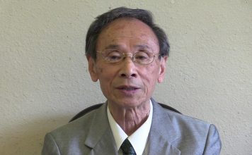

# Lung Chen (陳隆)

## Identity Snapshot
- **English:** Lung Chen
- **Chinese:** 陳隆
- **Era:** 1944
- **Geography:** Taipei, Taiwan
- **Core roles:** entrepreneur
- **Source:** TAH Foundation Who’s Who

3. President of Taiwanese Association of America / Los Angeles Chapter(洛杉磯台灣同鄉會會長) 1974

<!-- tah-tables:start -->
## Education
- B.A., Music
- M.A., Music

## Employment
- Coldwell Banker — Agent — Community — Taiwanese Association of America / Los Angeles Chapter (洛杉磯台灣同鄉會) — President
<!-- tah-tables:end -->

## Role in the Community

From the community record (memoirs outrank the TAH press-kit bio):

- 移居洛杉磯後定居洛杉磯；1976年底受聘到舊金山灣區「台灣人社區服務中心」擔任社區服務委員，不久出任社區發展中心主任，關照被子女接來美國定居的長輩並協助新移民安頓；直到1983年返回洛杉磯才卸下該職（[[works/taiwaneseamericanhistory-org/our-journeys-350|350. 美國舊金山灣區台灣基督教會史料簡介]]）。
- 1978年3月11日協助灣區長輩成立台灣長輩會，同年4月率二十幾位長輩赴南加州長途旅遊並與南加州台灣長輩會締結姊妹會；其父陳夢蘭為南加州長輩會創會會長（同上）。
- 1978年編輯出版「移民手冊」，多次舉辦移民生活座談，協助台灣人移民辦理手續、安定生活（同上）。
- 1978年自灣區回洛杉磯時帶回「Joint Committee of Taiwanese-Americans for 1980 U.S. Census」消息，促成南加州同鄉會關注普查（[[works/taiwaneseamericanhistory-org/ourjourneys253|253. 1990年美國人口普查-TACL的角色]]）。
- 1987年任「Joint Committee of Taiwanese American for 1990 U.S. Census」洛杉磯執行委員（與胡維剛、吳瑞信同列，总部設TACL辦公室）（同上）。
- 著有回顧文章記述台語教會與同鄉會相輔相成、信徒對台美人社團聯繫與台灣民主化運動的貢獻；本人即為該回顧的記述對象（[[works/taiwaneseamericanhistory-org/ourjourneys280|280. 那一夜，在紐約]]；另見 [[works/taiwaneseamericanhistory-org/our-journeys-357|357. 舊金山灣區臺灣人的社團活動與家國意識之形成]] 引用其「教會與同鄉會相輔相成」論述）。
- 1990年代與楊子清同為南加州「台灣名家演奏系列」（林衡哲主導，1992–1993洛杉磯）籌備會活躍委員；後楊子清為LA「大楊網路電視台」Producer，陳隆即該台「陳隆開講」節目主持人，並屢任台灣人夏令會司儀（含邀請石青如演出的場次）（[[works/taiwaneseamericanhistory-org/ourjourneys287|287. 台南善友樂團之後代首次在夏令會聚會 / 黃東昇 / 2017-05]]）——與TAH #408「海外第一名嘴陳隆」稱號互證。
- 著有自己的作品三篇：2002-12 自傳式散文「團圓——最佳的選擇」（[[works/taiwaneseamericanhistory-org/publications1226|1226. 團圓——最佳的選擇]]）、2012-08-12 於王敏昌追思禮拜訪談（[[works/taiwaneseamericanhistory-org/31-e9-99-b3-e9-9a-86-e5-9c-a8-e7-8e-8b-e6-95-8f-e6-98-8c-e8-bf-bd-e6-80-9d-e7-a6|31. 陳隆在王敏昌追思禮拜的訪談]]）、2016-05 主持甘苦談（[[works/taiwaneseamericanhistory-org/mystories439|439. 節目主持人甘苦談]]）；與 TAH #408 自述「海外第一名嘴陳隆」（[[works/taiwaneseamericanhistory-org/mystories408|408. 陳隆 / 海外第一名嘴陳隆]]）互證。
- 「陳隆開講」節目於 taiwanjustice.net 留有專題歸檔頁，內容含「2020台灣大選英德配勝選有感」等時事評論（[[articles/taiwanjustice-net/2025/20250915005023_tag_陳隆開講_fc80c42976d10639|陳隆開講（taiwanjustice.net）]]）；該站另有 2019-03-10「陳隆憶高俊明牧師【影音】」等「歷史必讀」条目（[[articles/taiwanjustice-net/2020/20200628115510_category_history_page_3_61442bcc611b8510|taiwanjustice.net 歷史必讀分類頁]]）。
- 吳木盛世台會第二、三屆年會報告（2017-04）記述：年會中「體會到金美齡女士那高超的急智與辯才與陳隆在藝術方面的才氣」，並記作者於會場與常在通信而未見過面的陳隆初次見面——與「海外第一名嘴」及音樂學術背景互證（[[works/taiwaneseamericanhistory-org/ourjourneys283|283. 世台會第二、三屆年會報告]]）。
- 洛杉磯台灣同鄉會早期由胞兄陳銓仁（已過世）主持聯絡與協調，後由許和瑞接棒（1967年會長）（[[works/taiwaneseamericanhistory-org/ourjourneys240|240. 半世紀前 UCLA的那些日子]]）——與本頁 1974 年陳隆任會長一節不相斥，屬前任兄長。
- HOLD: corpus 中另有「108. Prof. Lung-Chi Chen 陳隆志教授」與「1898. L. H. Chen 陳隆旭」為同名近似之不同人士，勿併入本頁；「陳隆豐律師」（紐約台灣會館創辦人，ourjourneys09/27/76/283/304 等）與「陳隆星」（聖保羅同鄉，ourjourneys249）亦為不同人士。

## Family

- **兄:** 陳銓仁（洛杉磯台灣同鄉會早期主持者，已過世）（[[works/taiwaneseamericanhistory-org/ourjourneys240|240. 半世紀前 UCLA的那些日子]]）
- **兄弟:** 陳堅（ourjourneys240 追述同鄉會早期時與陳隆並列為陳銓仁之弟；僅此一處提及，細節待證）（同上）
- **Wife:** 蔡玲理
- **Daughter:** [[people/joanna-chen-cham||陳怡玲]]
- **Son:** 陳怡隆

## Sources
- [TAH #168 encyclopedia: 168. Lung Chen 陳隆](https://taiwaneseamericanhistory.org/168-lung-chen/)
- [TAH #408 encyclopedia: 408. 陳隆 / 海外第一名嘴陳隆 / 03/2016](https://taiwaneseamericanhistory.org/mystories408/)
- [TAH #838 encyclopedia: 838. Lung Chen 陳隆](https://taiwaneseamericanhistory.org/whos-who-838-lung-chen/)
- [TAH Who’s Who](https://taiwaneseamericanhistory.org/person/lung-chen/)

## Related Pages
- [[organizations/tah-foundation||TAH Foundation]]
- [[sources/taiwaneseamericanhistory-org||taiwaneseamericanhistory.org]]
- SKIP note（deepen-x slice-09211400-5, re-grep 2026-09-22）：corpus hit set（ourjourneys280、our-journeys-350、ourjourneys253、our-journeys-357；108-prof-lung-chi-chen 陳隆志、whoswho1898 陳隆旭為同名近似不同人，已 HOLD）與已吸收連結完全一致 — 頁面包和，無新可吸收材料。
- Re-verify（deepen-x slice-09220800-15, 2026-09-22）：fresh grep 新增 hit ourjourneys27、our-journeys-381，內文實為「陳隆豐律師」（不同人士）及既有 backlink，非本人事跡；其餘 hit set 與已吸收一致 — 維持飽和。
- 覆核（deepen-x slice-09230317-12, 2026-09-24）：fresh grep 陳隆（content/works+content/articles）hit set 與已吸收一致（ourjourneys280、our-journeys-350、ourjourneys253、our-journeys-357；108 陳隆志、1898 陳隆旭、ourjourneys27 陳隆豐為不同人士，已 HOLD）；our-journeys-357「教會與同鄉會相輔相成」引文再確認已在庫 — 飽和，無新材料。
- 覆核（deepen-x slice-09250700-2, 2026-09-25）：fresh grep 陳隆 hit set 與已吸收一致（ourjourneys280、our-journeys-350、ourjourneys253、our-journeys-357、ourjourneys27、our-journeys-381；108 陳隆志、1898 陳隆旭為不同人士，已 HOLD）— 飽和，無新材料，SKIP。
- 深化（deepen-x slice-10100600-24, 2026-10-11）：fresh grep 新增可吸收材料 2 筆 — ourjourneys283 吳木盛世台會年會報告（陳隆藝術才氣、會場初見面）及 taiwanjustice.net 歷史必讀分類頁「陳隆憶高俊明牧師」影音条目，已併入 Role in the Community；ourjourneys155 內文屬陳隆豐（不同人士，HOLD 維持），其餘 backlink 與已吸收一致。
- 覆核（deepen-x slice-10110200-27, 2026-10-12）：fresh grep 陳隆／Lung Chen 遍掃 works+articles+sources+events+topics，hit set 與已吸收一致（280、our-journeys-350、253、our-journeys-357、287、283、240、1226、408、439、31、videos64 屬陳隆志、taiwanjustice 歷史必讀頁）；同名近似者（陳隆豐／陳隆豊、陳隆志、陳隆旭、陳隆星、Kuan-Lung Chen）續 HOLD。唯一新增：ourjourneys240 原文「陳銓仁（陳隆、陳堅的大哥）」顯示陳堅為其兄弟，已補入 Family（僅一處提及，細節待證）— 除此之外飽和。

## 照片

📷 照片取自公開檔案（來源：taiwanjustice.net，Wayback 存檔 20190626055929）。圖說為原始來源所提供，Echo 未經人工逐張查證——若您認得圖中人，歡迎回報修正。
