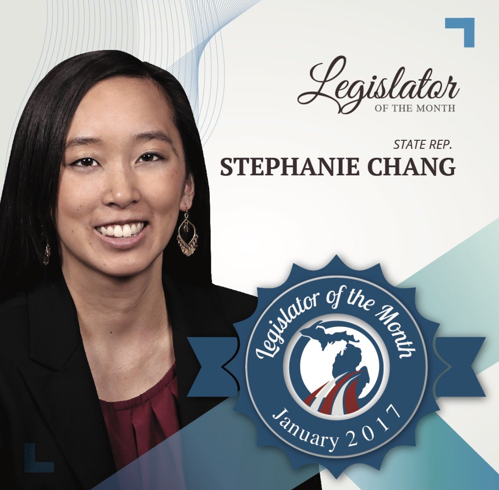

# Stephanie Chang (張理)

## Identity Snapshot
- **English:** Stephanie Chang
- **Chinese:** 張理
- **Era:** 1983
- **Geography:** Detroit, MI
- **Core roles:** educator, legislator
- **Source:** TAH Foundation Who’s Who

## Accomplishment
1. First Asian American woman and first Taiwanese American elected to the Michigan State Senate (2018–)

## Career Notes
*(absorbed from the page's own TAH tables — no external sourcing)*

Stephanie Chang began her career in community organizing in Detroit: assistant to social activist Grace Lee Boggs, mentor at the Detroit Asian Youth Project, organizer for Michigan United/One United Michigan (2006–), and Deputy Director of Campaign for Justice (2007–2012). She co-founded and formerly led APIAVote-Michigan, and served as Community Engagement Coordinator at the James and Grace Boggs School (2013–) and Alumni Engagement and Evaluation Coordinator at The Center for Progressive Leadership.

She represented Michigan House District 6 as State Representative for two terms (2015–2017), then became the first Asian American woman — and first Taiwanese American — elected to the Michigan State Senate in 2018.

## Education
- Univ. of Michigan — 2005 — B.A., Psychology with a minor in Asian Pacific Islander American Studies — 2014 — M.S., Public Policy & Social Work

## Employment
- Michigan State Representative for House District 6 — State Representative (First Term) — (2015-2017) — Michigan State Representative for House District 6 — State Representative (Second Term) — (2017-) — Assistant to social activist Grace Lee Boggs — Assistant — Detroit Asian Youth Project — Mentor — Michigan United/One United Michigan — Organizer — (2006-) — Campaign for Justice — Deputy Director — (2007-2012) — APIAVote-Michigan — Co-founder and former president — James and Grace Boggs School — Community Engagement Coordinator — (2013-) — The Center for Progressive Leadership — Alumni Engagement and Evaluation Coordinator — Community — APIAVote-Michigan — Co-founder and former president

## Family

- **Husband:** Sean Gray
- **Father:** 張連彰
- **Mother:** [[people/sarolina-chang||沈麗華]]

## Vault records (absorbed 2026-09-10; all four are this page's own cited works)
- [[works/taiwaneseamericanhistory-org/196-stephanie-chang|TAH #196 encyclopedia: Stephanie Chang 張理]]
- [[works/taiwaneseamericanhistory-org/whos-who-102-stephanie-chang|TAH #102 Who's Who encyclopedia: Stephanie Chang 張理]]
- [[works/taiwaneseamericanhistory-org/stephanie-chang|TAH vault: Stephanie Chang]]
- [[works/taiwaneseamerican-org/stephanie-chang-representing-detroit|TaiwaneseAmerican.org: Stephanie Chang representing Detroit]]
- Detroit-area network page in vault: [[organizations/taiwanese-association-of-america-detroit-tagd||TAG Detroit]] (her community-organizing geography; relationship not stated in the TAH profile)

## Vault cross-references (2026-09-10)
- Her own TAH encyclopedia records are held in-vault: [[works/taiwaneseamericanhistory-org/196-stephanie-chang|TAH #196]] · [[works/taiwaneseamericanhistory-org/whos-who-102-stephanie-chang|TAH #102 Who's Who]]
- Mother [[people/sarolina-chang||沈麗華]]'s page cross-lists her; Detroit community work ties to the chapter network [[organizations/taiwanese-association-of-america-detroit-tagd||TAA Detroit TAGD]]

## Sources
- [TAH #196 encyclopedia: 196. Stephanie Chang 張理](https://taiwaneseamericanhistory.org/196-stephanie-chang/)
- [TAH #102 encyclopedia: 102. Stephanie Chang 張理](https://taiwaneseamericanhistory.org/whos-who-102-stephanie-chang/)
- [TAH Who’s Who](https://taiwaneseamericanhistory.org/person/stephanie-chang/)

## Detroit network (in-vault pages, deepened 2026-09-14)
Her organizing geography and campus years both have vault pages: the Detroit-area Taiwanese women's network [[organizations/north-america-taiwanese-womens-association-detroit-chapter||NAWDET Detroit chapter]], the chapter network [[organizations/taiwanese-association-of-america-detroit-tagd||TAA Detroit TAGD]], and her undergrad campus groups [[organizations/taiwan-student-association-at-the-university-of-michigan||TSA at U-M]] and [[organizations/taiwanese-american-student-association-at-the-university-of-michigan||TASA at U-M]]. Her own coverage in the TaiwaneseAmerican.org corpus: [[works/taiwaneseamerican-org/stephanie-chang-representing-detroit||Stephanie Chang representing Detroit]].

## Movement record mentions (corpus, deepened 2026-10-10)
Her elections and district work are recorded in the taiwaneseamericanhistory.org story corpus:
- [[works/taiwaneseamericanhistory-org/important2016-12||Important 2016 #12: won second term as State Representative, Michigan House District 6 (2016)]]
- [[works/taiwaneseamericanhistory-org/photo-albums-activities-137||Photo Albums #137: First Taiwanese American State Senator Stephanie Chang, Michigan (2018)]]
- [[works/taiwaneseamericanhistory-org/mystories532||My Stories #532: State Rep. Stephanie Chang Knocked on Every Door in Her District—Twice (Mattie Kahn, 2017)]]

## Mother's memoir (corpus, deepened 2026-10-11)
Mother [[people/sarolina-chang||沈麗華]] (Sarlina Shen Chang) writes for the TAH story corpus; her essay **"女兒從政" (Daughter in Politics)** was published 2018-11-08 — days after the November 2018 midterms in which Stephanie won her State Senate seat — as the family's community record of her political career:
- [[works/taiwaneseamericanhistory-org/50875||658. 女兒從政 / 沈麗華 (思理) — 2018-11-08]]
Her other in-corpus essays (68. 投票日那天, 2014; 453. Duck prints in the April snow) do not name Stephanie in the bibliographic record — HOLD: relevance unconfirmed, not linked.

## Quotes

corpus attributed-speech scan 候選（2026-11-21 DEEPEN-X slice 11210929-29 查證，見條內 HOLD 說明）：

- 助教 Stephanie Chang 說明過去一年多來「臺灣模式」民主防疫經驗成為全球抗疫典範，我國政府也不斷以行動落實「Taiwan Can Help」、「Taiwan is Helping」，深獲國際社會肯定及讚揚，新冠肺炎(COVID-19)使國際社會認同我國爭取加入全球防疫合作機制的必要性，支持我國參與WHO聲量也持續增加（reported；報導原文具名「助教Stephanie Chang」，惟 2026-10-13 re-sweep 已記 HOLD：該文 FASCA-LA（洛杉磯、高中志工專案）助教之身分與本頁密西根州參議員 Stephanie Chang／張理 無可資認定之關聯，姓名相符不足以認定同一人，引述語保留於此、不據以添寫傳記事實）— [[articles/taiwanjustice-net/2021/20211207115423_2021_04_20_fasca-la四月線上會_推動臺灣參與wha_dd3b5046ab3b7212|FASCA-LA 2021-04-20 線上月會報導]]

## Network

Pages that link to **stephanie-chang** (stephanie-chang):

### Sources (1)

1. [[sources/taiwaneseamericanhistory-org|taiwaneseamericanhistory-org]]

### Other (7)

1. [[works/taiwaneseamerican-org/stephanie-chang-representing-detroit|stephanie-chang-representing-detroit]]
2. [[works/taiwaneseamericanhistory-org/196-stephanie-chang|196-stephanie-chang]]
3. [[works/taiwaneseamericanhistory-org/important2016-12|important2016-12]]
4. [[works/taiwaneseamericanhistory-org/mystories532|mystories532]]
5. [[works/taiwaneseamericanhistory-org/photo-albums-activities-137|photo-albums-activities-137]]
6. [[works/taiwaneseamericanhistory-org/stephanie-chang|stephanie-chang]]
7. [[works/taiwaneseamericanhistory-org/whos-who-102-stephanie-chang|whos-who-102-stephanie-chang]]

## Related Pages
- [[organizations/tah-foundation||TAH Foundation]]
- [[sources/taiwaneseamericanhistory-org||taiwaneseamericanhistory.org]]
- [[organizations/taiwan-student-association-at-the-university-of-michigan||Taiwan Student Association at the University of Michigan]] — her undergraduate campus (Univ. of Michigan, B.A. 2005)

## 照片

📷 照片取自公開檔案（來源：taiwanjustice.net，Wayback 存檔 20190729014004）。圖說為原始來源所提供，Echo 未經人工逐張查證——若您認得圖中人，歡迎回報修正。

## From the record

- 2025-05-01 — 密西根州參議院通過友台決議案，本州議會連續 4 年通過友台文件；張理以州參議員、友台連線共同主席身分與州參議員 Rosemary Bayer 輪番宣讀決議內容，獲全體議員鼓掌無異議通過（reported；報導另記拜爾譴責中國軍演及灰色作戰、重申美國六項保證，及州長 Gretchen Whitmer 兩度訪台、駐芝加哥辦事處長類延峰致謝 — 欄內被報導人物不代筆添條；自由時報0501 wire via 美洲台灣日報）— [美洲台灣日報](https://taiwandaily.net/%e5%8d%b3%e6%99%82%e6%96%b0%e8%81%9e/75740/)（存檔 `knowledge/web-archives/taiwandaily-net-75740-75740.md`）

- 2025-05-01 — 報導存檔於 美洲台灣日報 來源 hub（自由時報0501 wire；hub 的 202505 month-absorb 帳務記錄將 75740〈密西根州參議院連續 4 年挺台決議案〉判為 absorbed 並連線至本頁，本條補上本頁對該 hub 的回鏈；事件事實條已在下方 2025-05-01 條，此條不重複添寫事實、不併改任何日期。備註（非事實來源，hub 帳務回鏈）— [[sources/taiwandaily-net|美洲台灣日報]]
## 2026-10-13 re-sweep (DEEPEN-X slice 10121000-14)
Fresh grep (Stephanie Chang / 張理 / surname) across all five corpus dirs returned the same linked hit set already cited above (TAH #196, #102 Who's Who, vault record, Important 2016 #12, Photo Albums #137, My Stories #532, mother's memoir 女兒從政, TaiwaneseAmerican.org Detroit interview). No new community material found — page is corpus-saturated.

Name-collision disambiguation (matched on substring, NOT this person, not linked):
- 張理盈 (Li-Ying Chang, pianist — [[works/taiwaneseamericanhistory-org/whoswho1206||TAH #1206]], [[works/taiwaneseamericanhistory-org/musician353||TAH #353]])
- 張理美 (Beverly Chang — [[works/taiwaneseamericanhistory-org/whos-who-964-lii-mei-chang||TAH #964]], [[works/taiwaneseamericanhistory-org/ourjourneys305||Our Journeys #305]], Photo Albums #129)
- HOLD: a "Stephanie Chang" listed as FASCA-LA teaching assistant in a 2021 taiwanjustice.net article (LA, high-school program) — surname+given match only; no evidence this is the Michigan legislator. Not linked.
