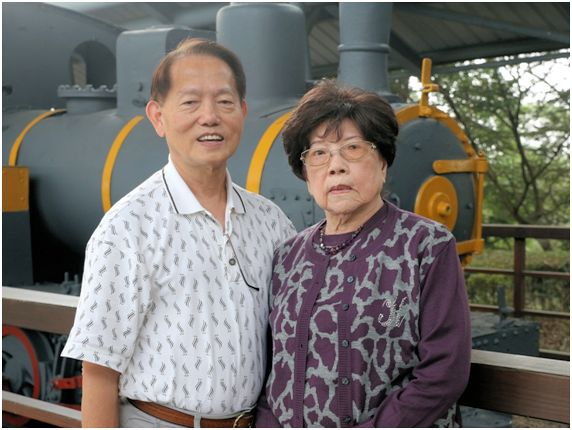

# Kenneth Wang (王克雄)

## Identity Snapshot
- **English:** Kenneth Wang
- **Also seen:** Wang Kexiong — pinyin. Ken Wang in Our Journeys 352. TAH #1127 is Kenneth Wang 王克雄. Same person as [[people/kenneth-wang|Kenneth Wang (王克雄博士)]]. Pages not merged.
- **Chinese:** 王克雄
- **Core roles:** Scientist, human rights advocate, 228 survivor
- **Geography:** Taiwanese American (Taipei / San Diego, CA)
- **Era:** 1940s–2020s

## Overview

**Kenneth Wang** (王克雄; also Wang Kexiong) is a Taiwanese American scientist and human rights advocate whose personal history is inseparable from the February 28th Incident of 1947. As the son of a victim of the massacre, he has spent decades advocating for historical justice, democratic reform, and Taiwan's international recognition.

### Family History & the 228 Incident
1. Born in 1947 in Taipei; his father Wang Yulin (王育霖) was a prosecutor who graduated from Tokyo Imperial University's Law School and passed the judicial examination in his third year.
2. His mother Wang Chen Xiancha (王陳仙槎) was 24 years old when the February 28th Incident began; she carried baby Wang and his three-month-old brother during the chaos.
3. On February 28, 1947, his father was abducted by Kuomintang forces and never returned; he was 27 years old.
4. His mother single-handedly raised two young children through the White Terror era, embodying the traditional Taiwanese virtues of the devoted wife and mother.
5. In 2004, Wang visited Japan's Yasukuni Shrine with his family, where he discovered his father's name listed among the war dead — killed when the SS Buenger was torpedoed by USS Hake on February 1, 1944.
6. Wang's father was likely targeted because his name appeared on a list compiled by the Kuomintang's Taiwan Provincial Party Department; the 228 massacre claimed the lives of prosecutors, lawyers, doctors, professors, teachers, pastors, artists, and other intellectuals.

### Education & Scientific Career
1. Graduated from Taipei First High School in 1963; enrolled in National Taiwan University's Electrical Engineering Department.
2. After graduation and two years of military service, moved to the United States in 1968 for graduate study.
3. Earned a Master's degree from the University of North Carolina at Chapel Hill, then a PhD in Electrical Engineering from the University of Florida in 1975.
4. Specialized in semiconductor detector research.
5. Worked at Philips in Chicago developing X-ray spectroscopy instruments, then at EMI Medical in Chicago developing X-ray computed tomography (CT) scanners.
6. In 1979, moved to San Diego to work at Hughes Aircraft Company, developing rocket and bomber detection instruments.
7. Later changed careers to establish a real estate company, focusing on commercial property investment and management.

## Career / Legacy

### Human Rights Advocacy
1. Founded the American Taiwan Research Institute, serving as its chair and researcher, dedicated to providing US think tanks with Taiwanese perspectives and data.
2. Organized and led multiple "American 228 Family Returnee Groups" to Taiwan, meeting with presidents, the Executive Yuan, Legislative Yuan, Judicial Yuan, Examination Yuan, and the Ministry of Justice to advocate for the 228 Incident Processing and Compensation Act.
3. Successfully lobbied for the designation of February 28th as a national holiday in Taiwan.
4. Arranged meetings between Dr. Tsai Ing-wen and US think tank representatives.
5. Served as chair of the FAPA (Formosan Association for the Promotion of Peace) San Diego chapter and as president of the San Diego National High School Alumni Association.
6. Managed the San Diego alumni scholarship fund for over 20 years, raising funds for 46 graduating seniors in 2022.

### Community Leadership
1. Served as chair of the San Diego Taiwanese American Foundation, which purchased and manages the San Diego Taiwan Center — a 13,000-square-foot facility with extensive programming for the local community.
2. Led the construction of the church building at San Diego Taiwan Christian Church, which sits on 3.78 acres with a 9,117-square-foot sanctuary, classrooms, library, and kitchen.
3. Co-founded the Bible study group at San Diego Taiwan Christian Church in 1979; has served in church ministry for over 30 years.
4. His wife Shuhui operates a Baskin-Robbins franchise for over 30 years; the couple has two children, both medical doctors.

### Political Engagement
1. Organized the "San Diego Small Apple Support Group" for the 2016 presidential election, bringing over 160 supporters from around the world to Taiwan for election campaigning.
2. Witnessed the Democratic Progressive Party's historic landslide victory in 2016, describing it as the happiest moment of his life.
3. Advocated for Taiwan's full international recognition, emphasizing that Taiwan's future is determined by its people's willingness to resist, not by foreign military intervention.

### Demands for Justice
Wang has publicly demanded that the Chinese Nationalist Party (KMT) fulfill four requirements for 228 victims:
1. Public apology to 228 victims, their families, and all Taiwanese people.
2. Publication of the KMT's list of targeted Taiwanese intellectuals.
3. Full assumption of compensation costs by the KMT, not Taiwanese taxpayers.
4. Conversion of the Chiang Kai-shek Memorial Hall into a Taiwan Martyrs' Shrine honoring 228 victims, White Terror victims, and future defenders of Taiwan.

## Network

Pages that link to **wang-kexiong** (wang-kexiong):

### People (2)

1. [[people/index|index]]
2. [[people/kenneth-wang|kenneth-wang]]

### Organizations (3)

1. [[organizations/institute-for-taiwanese-studies|institute-for-taiwanese-studies]]
2. [[organizations/san-diego-taiwanese-cultural-association|san-diego-taiwanese-cultural-association]]
3. [[organizations/san-diego-taiwanese-cultural-association|san-diego-taiwanese-cultural-association]]

### Sources (1)

1. [[sources/2023-tahs-publication|2023-tahs-publication]]

### Other (2)

1. [[works/taiwaneseamericanhistory-org/ourjourneys213|ourjourneys213]]
2. [[works/taiwaneseamericanhistory-org/ourjourneys352|ourjourneys352]]

## Source Notes and Confidence
- **Content priority A:** 2023 TAHS Publication (profile, "典範‧傷逝" section, ~2720 lines)
- **Hub:** [[sources/2023-tahs-publication||2023 TAHS Publication]]
- **Archive:** Section dump at `knowledge/research/tahs-2023-section-dumps/ye-siya-zhang-xinhui-xu-zongbang-li-mutong-chen-wenxue-wang-kexiong-...txt` (lines 2452–2719)
- Layout-limited extraction; not a full translation

## From the record

- **2022-02-27** — 以「二二八遺族代表」身分與立法院林靜儀委員、不當黨產委員會前專任委員羅承宗教授、東吳大學法律教授胡博硯並列為主講人，參加「大洛杉磯台灣會館」線上「二二八紀念會轉型正義研討會」（75 週年紀念系列活動，2022-02-27 下午四點線上舉行；原文稱其「王董事長」，並記其父親王育霖為台灣第一位檢察官、在二二八事件中失蹤）（[[sources/taiwanjustice-228-transformative-justice-seminar-frontier-11180842-36-2026-11-20]]）. 註：該文 Wayback 存檔時間為 2026-02-09，但 post_date 2022-02-25 及世界日報 2022-02-27、大紀元 2022-02-24/2022-03-05 同場報導（四位講者、WebEX 2554 456 6723 / 密碼 228tc、75 週年）證實活動為 2022 年 — 存檔日期僅為再抓取時間戳。sourced (re-read 2026-11-21)。
- **2026-11-20** — Identity cross-check: zh.wikipedia `list=search` 王克雄（top hit 王育霖）與 Wikidata `wbsearchentities` 王克雄（空結果）皆無本人條目；同場研討會講者胡博硯有 zh.wp 條目 (rev 2026-06-02) 與 Wikidata Q124163381（bare claims, 0 refs），僅作旁證，未吸收為身分主張（[[sources/taiwanjustice-228-transformative-justice-seminar-frontier-11180842-36-2026-11-20]]）— sourced。
- **2016-04-04** — Wang authored "一起建造聖殿" (Building the Temple Together), published as record 213 of the TAH Foundation "Our Journeys" story corpus, recounting the building history of 聖地雅歌台灣基督教會 (San Diego Taiwan Christian Church), including the 2000-01-10 purchase of the 3.78-acre Azuaga St. site in Rancho Peñasquitos for $930,000 and the 2002-04 development permit ([[works/taiwaneseamericanhistory-org/ourjourneys213|source]]).

## Sources
- [TAH #1127 encyclopedia: 1127. Kenneth Wang 王克雄/ 2016/07](https://taiwaneseamericanhistory.org/whos-dr-kenneth-wang/)

## Related Pages
- [[organizations/taiwanese-american-historical-society||TAHS]]
- [[sources/2023-tahs-publication||2023 TAHS Publication]]

## 照片

📷 照片取自公開檔案（來源：taiwanjustice.net，Wayback 存檔 20240905080056）。圖說為原始來源所提供，Echo 未經人工逐張查證——若您認得圖中人，歡迎回報修正。
