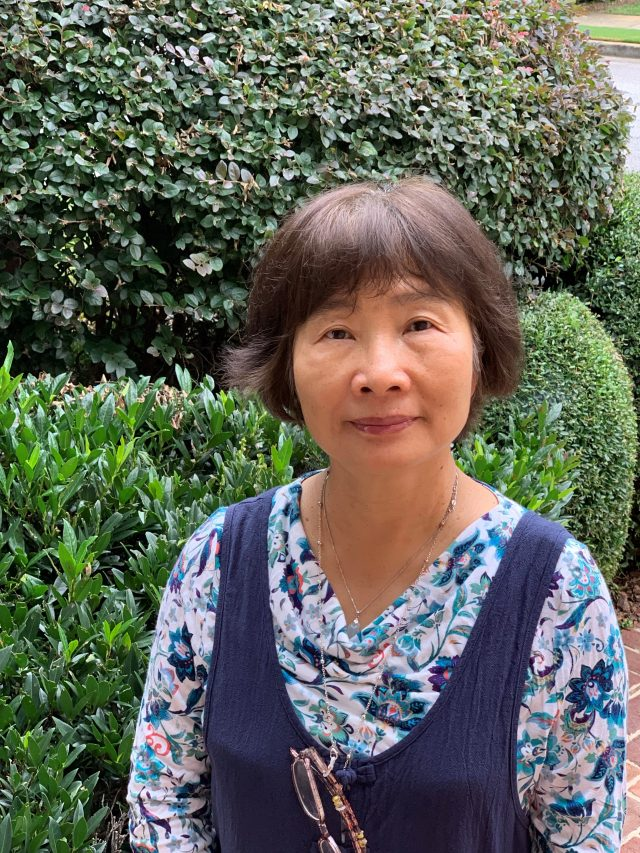

# Wang Shu-fen / 王淑芬

**Wang Shu-fen / 王淑芬** is mentioned as a contributor or subject in 2017/2023 [taiwanjustice.net](/organizations/taiwanjustice-net) publications and is listed in the TAH Foundation Who's Who as Sue-Fin Wang 王淑芬. She was added to the TAHS L1 priority roster for community engagement and archive scoring.

## Identity Snapshot

Facts copied from frontmatter only. Not a researched biography.

Related: [Taiwanese American Historical Society](/organizations/taiwanese-american-historical-society)

## Story

王淑芬在 1976 年自 National Taiwan Univ. 取得哲學學士，後於 Seattle Washington Univ. 取得經濟學碩士，職涯經歷聯合報記者與 AT&T（至 2007 年），TAH Foundation Who's Who 以 Sue-Fin Wang 收錄她，丈夫為李錦輝。她在台灣公論報長期撰寫「番婆部落格」與「辣媽心舫」專欄，並自命「辣媽」及「番婆」，2016 年 11 月獲李彥禎點名為太平洋時報及台灣公論報的知名作家，憑丈夫、兒子、女兒三個配角連續三、四年每週一篇登上公論報專欄並出版三本暢銷書。她於 2016 至 2017 年出任 North American Taiwanese Women's Association 會長，2021 年 12 月 26 日由賴慧娜交棒接任台美人筆會會長。自 2019 年 12 月起，她連年以中央社記者身分在高雄發稿，報導罷韓、挺韓遊行與高雄市長補選等事件。2022 年 1 月起她在 taiwanjustice.net 發表「回家，好難」、「回台住自己家」、「黃昏的故鄉」、「留在華沙的那顆心」等多篇專欄。

## TJ Citations

Top 10 articles from taiwanjustice.net mentioning wang-shufen:

1. **2022-06-22** — [[articles/taiwanjustice-net/2023/20231201225623_root_41b304eda05fa545||Covid-19 浩劫餘生錄]]
   - *野地的花 ◎ 楊遠薰...*
   - Score: 740
2. **2023-10-04** — [[articles/taiwanjustice-net/2023/20231201230251_root_3ab5b8dfba8018b5||藝文]]
   - *留在華沙的那顆心 ◎王淑芬...*
   - Score: 740
3. **2020-08-14** — [[articles/taiwanjustice-net/2025/20250515102312_高雄市長補選15日登場-雙鐵出現返鄉人潮_21a5534ecfeaf505||高雄市長補選15日登場 雙鐵出現返鄉人潮]]
   - *敬請支持‧歡迎訂閱本報newsletter...*
   - Score: 165
4. **2021-04-20** — [[articles/taiwanjustice-net/2025/20251108180838_榮獲廖述宗教授紀念獎_罷韓四君子_是肯定每個_d2e6e5b19ab4b452||榮獲廖述宗教授紀念獎，罷韓四君子：是肯定每個夥伴]]
   - *敬請支持‧歡迎訂閱本報newsletter...*
   - Score: 160
5. **2022-04-11** — [[articles/taiwanjustice-net/2022/20221127063405_2022_04_11_黃昏的故鄉-_-王淑芬_c9c0a1f75954a910||黃昏的故鄉 ◎ 王淑芬]]
   - *看到新聞報導，台灣一代歌王文夏去世，雖然不是震驚，但是心裡有種很傷感的痛，雖然我不認識他的人，但是他的歌聲，在很多台灣人的心中、耳邊，廻繞了快一世紀，失去這樣一個「有台灣味」「創台灣歌」的台灣人，我有一份說不出的失落感。...*
   - Score: 155
6. **2023-09-11** — [[articles/taiwanjustice-net/2023/20230923040117_2023_09_11_come-from-away-重回gander-憶911-_王淑芬_f730265b2ec61427||Come from away…重回Gander 憶911 ◎王淑芬]]
   - *有時候，我會不得不相信「命運捉弄人」這話，但是，很多沒有想到的事情發生時，你卻不得不相信，也許真的有隻命運的手，有時會喬些小驚訝給你。...*
   - Score: 140
7. **2020-01-10** — [[articles/taiwanjustice-net/2025/20250617075507_選前之夜-蔡總統_高雄人不能讓韓國瑜騙第二次_880e4017516d8998||選前之夜 蔡總統：高雄人不能讓韓國瑜騙第二次]]
   - *（中央社記者王淑芬、葉素萍高雄10日電）總統蔡英文今天在「光復高雄選前之夜」造勢晚會火力全開，指國民黨總統候選人韓國瑜「原來高雄人是他用完就丟到旁邊的工具」，還說「高雄人絕對不能讓他騙第二次」。...*
   - Score: 135
8. **2022-03-09** — [[articles/taiwanjustice-net/2022/20220519125824_2022_03_09_回台住自己家-_-王淑芬_30d6d3a92e583272||回台住自己家 ◎ 王淑芬]]
   - *昨天晚上，我正認真努力的在看日本片「Drive my car」，手機叮噹響，有一個email訊息，本來想電影正火熱進行，不想搭理，但是卻瞄到居然是台灣的衛生福利部來的訊息，我剛剛從台灣回來，有點擔心，會不會是我在台灣不小心踩到地雷，要被匡列了（我要離台前最怕的事），因此趕快看一下是怎麼回事，結果居然...*
   - Score: 130
9. **2022-03-09** — [[articles/taiwanjustice-net/2025/20250512060926_回台住自己家-_-王淑芬_ddffa8f6c7db0dbf||回台住自己家 ◎ 王淑芬]]
   - *昨天晚上，我正認真努力的在看日本片「Drive my car」，手機叮噹響，有一個email訊息，本來想電影正火熱進行，不想搭理，但是卻瞄到居然是台灣的衛生福利部來的訊息，我剛剛從台灣回來，有點擔心，會不會是我在台灣不小心踩到地雷，要被匡列了（我要離台前最怕的事），因此趕快看一下是怎麼回事，結果居然...*
   - Score: 130
10. **2022-01-09** — [[articles/taiwanjustice-net/2025/20250512062256_回家_好難-_-王淑芬_1a4e0748a60a78a4||回家，好難 ◎ 王淑芬]]
   - *2022-01-09...*
   - Score: 130

## Works

**王淑芬** — **9** title hits, **51** body mentions in the taiwanjustice.net harvest. Listed: last 5 years, up to 8/year. Full index: [[sources/taiwanjustice-net|taiwanjustice.net]].

### 2025 (3)

1. [[articles/taiwanjustice-net/2025/20250512062256_回家_好難-_-王淑芬_1a4e0748a60a78a4|回家，好難 ◎ 王淑芬]]
2. [[articles/taiwanjustice-net/2025/20250512060926_回台住自己家-_-王淑芬_ddffa8f6c7db0dbf|回台住自己家 ◎ 王淑芬]]
3. [[articles/taiwanjustice-net/2025/20250321223125_留在華沙的那顆心-_王淑芬_8931879637326dab|留在華沙的那顆心 ◎王淑芬]]

### 2023 (2)

1. [[articles/taiwanjustice-net/2023/20231208125116_root_a34d5afb351ffdd6|留在華沙的那顆心 ◎王淑芬]]
2. [[articles/taiwanjustice-net/2023/20230923040117_2023_09_11_come-from-away-重回gander-憶911-_王淑芬_f730265b2ec61427|Come from away…重回Gander 憶911 ◎王淑芬]]

### 2022 (4)

1. [[articles/taiwanjustice-net/2022/20221127063405_2022_04_11_黃昏的故鄉-_-王淑芬_c9c0a1f75954a910|黃昏的故鄉 ◎ 王淑芬]]
2. [[articles/taiwanjustice-net/2022/20220519125824_2022_03_09_回台住自己家-_-王淑芬_30d6d3a92e583272|回台住自己家 ◎ 王淑芬]]
3. [[articles/taiwanjustice-net/2022/20220517053449_2021_12_26_台美人筆會會長交接_賴慧娜交棒王淑芬_70a8a32d4cc3ca7a|台美人筆會會長交接，賴慧娜交棒王淑芬]]
4. [[articles/taiwanjustice-net/2022/20220127023112_2022_01_09_回家_好難-_-王淑芬_d26807f04426a0e8|回家，好難 ◎ 王淑芬]]

### Body mentions (51)

See the source hub. Top mentions:

1. [[articles/taiwanjustice-net/2023/20231201230251_root_3ab5b8dfba8018b5|藝文]]
2. [[articles/taiwanjustice-net/2023/20231201225623_root_41b304eda05fa545|Covid-19 浩劫餘生錄]]
3. [[articles/taiwanjustice-net/2025/20251108180838_榮獲廖述宗教授紀念獎_罷韓四君子_是肯定每個_d2e6e5b19ab4b452|榮獲廖述宗教授紀念獎，罷韓四君子：是肯定每個夥伴]]
4. [[articles/taiwanjustice-net/2025/20250515102312_高雄市長補選15日登場-雙鐵出現返鄉人潮_21a5534ecfeaf505|高雄市長補選15日登場 雙鐵出現返鄉人潮]]
5. [[articles/taiwanjustice-net/2020/20200623235826_2020_06_21_拚高市長補選-陳其邁_競總團隊22日公布_趙天麟_c3caed5fc249caa4|拚高市長補選，陳其邁競總團隊主委許立明出任，總幹事為立委趙天麟]]

## Timeline

- **2023-09-11** 🕯️ Come from away…重回Gander 憶911 ◎王淑芬
- **2023-10-04** 📰 藝文
- **2023-10-04** 📰 留在華沙的那顆心 ◎王淑芬

- **2022-01-09** 🎤 回家，好難 ◎ 王淑芬
- **2022-03-09** 🏥 回台住自己家 ◎ 王淑芬
- **2022-04-11** 🕯️ 黃昏的故鄉 ◎ 王淑芬
- **2022-06-22** 🏥 Covid-19 浩劫餘生錄

- **2021-01-13** 🏥 楊志良稱應開除染疫醫，總統：不需風涼話打擊士氣，醫師工會籲楊道歉
- **2021-01-27** 📰 黃捷籲反罷免，趙天麟：讓報復性歪風在鳳山停止
- **2021-02-06** 🗳️ 黃捷罷免案未通過，學者：罷免理由不充分難獲認同
- **2021-02-25** 🗳️ 中樞紀念二二八在高雄，陳其邁：有助撫平歷史傷口
- **2021-02-28** 📰 走訪鳳梨產銷班，蔡總統籲農民免驚，政府相挺[影]
- **2021-03-27** 📰 核四最後一批120束燃料棒抵基隆港 將運美國，蘇貞昌：核四當年沒完工建照過期
- **2021-04-03** 📰 林佳龍口頭請辭：會負起該負責任 不會迴避+府院同聲：目前不是談的時機
- **2021-04-20** 🕯️ 榮獲廖述宗教授紀念獎，罷韓四君子：是肯定每個夥伴
- **2021-04-28** 📰 安倍晉三推特PO照，大讚台灣鳳梨好吃
- **2021-11-25** 🏥 Covid-19 浩劫餘生錄
- **2021-12-26** 🤝 台美人筆會會長交接，賴慧娜交棒王淑芬

- **2020-01-04** 📰 選前之夜，藍綠總統候選人高雄尬場互別苗頭
- **2020-01-05** 🗳️ 蔡總統全台大掃街，車隊進入高市支持者熱迎
- **2020-01-10** 🗳️ 選前之夜 蔡總統：高雄人不能讓韓國瑜騙第二次
- **2020-02-05** 🏛️ 台灣基進：徐正文淚裡不是人情味 是滿滿中共味+切割!切割!國民黨：徐正文言行屬個人行為 與黨無關
- **2020-04-07** 📰 質疑罷韓連署「偷跑」 韓陣營將遞訴訟停止執行
- **2020-04-08** 🏛️ 高市綠議員指罷免成事實 籲依法勿遷調人事
- **2020-04-17** 🏛️ 尹立樂觀罷韓，韓營指不在暑假投票有利政權保衛
- **2020-04-27** 🏛️ 罷韓民調同意票破5成，江啟臣：平常心看待+罷免案6/6投票 幕僚：韓國瑜擬不參加電視說明會
- **2020-05-02** 🏛️ 談罷韓，徐永明籲市民行使公民權踴躍投票
- **2020-05-02** 📰 高雄市府透早拆罷韓看板，公民團體將展開「民主搶灘 三路轉進」行動+台灣基進推罷韓遍地開花計畫
- **2020-05-06** 📰 高雄罷韓倒數計時，民團啟動百大路口人體看板
- **2020-05-07** 🏥 傳要為反罷韓發聲，王金平說「要看態勢發展」
- **2020-05-10** 🏛️ 罷韓藍色憂鬱，高市藍議員盼韓國瑜安撫民心，處理好紓困振興最重要
- **2020-05-15** 🗳️ 罷韓投票／韓國瑜再提暫停執行罷韓，Wecare高雄批玩弄司法
- **2020-05-18** 🗳️ 高雄迪士尼夢碎 韓國瑜兩手一攤：這個政見我收回
- **2020-05-19** 📰 罷韓投票／趙天麟上街發罷韓文宣催票，黃光芹現身相挺
- **2020-05-21** 🗳️ 罷韓投票／韓國瑜再提暫停執行罷免投票 北高行駁回+陳其邁：6月6日天氣好 會回高雄投票行使公民權
- **2020-05-27** 📰 罷團批破億公帑反罷韓，高市府籲勿扭曲紓困+遭批罷韓先鋒，中選會：依法辦選務何錯之有
- **2020-05-31** 📰 罷韓決戰黃金週 罷團啟動掃街車隊
- **2020-06-04** 📰 罷韓遊行引六四天安門撐香港 放天燈祈願迎新高雄
- **2020-06-06** 📰 罷韓開票後 高雄市議會議長許崑源墜樓身亡享壽63歲
- **2020-06-21** 📰 拚高市長補選，陳其邁競總團隊主委許立明出任，總幹事為立委趙天麟
- **2020-06-23** 📰 吳益政接受民眾黨徵召補選高雄市長，保留親民黨籍
- **2020-07-26** 🗳️ 高市議長補選31日登場，藍綠陷茶壺風暴受關注
- **2020-08-14** 📰 高雄市長補選15日登場 雙鐵出現返鄉人潮
- **2020-08-14** 🗳️ 高雄市長補選 估15日晚間7時前揭曉新市長
- **2020-08-15** 🗳️ 陳其邁67萬票當選高雄市長 強調解決空污等4大優先
- **2020-08-20** 🗳️ 陳其邁3副手林欽榮、史哲、羅達生，女性局處長有亮點
- **2020-08-21** 🏥 台灣大旺漁船印尼漁工爆常被毆打威脅強迫勞動，美國海關扣押
- **2020-10-13** 🗳️ 李眉蓁碩論抄襲挨告未出庭請假，檢方將決定是否拘提
- **2020-10-13** 🏛️ 中山大學公告撤銷李眉蓁碩士學位、林德昌不得任碩專生導師．李眉蓁：作法令人失望，校方：她沒提申復
- **2020-10-20** 🏥 軍包機遭香港作梗被迫返航後，副參謀總長搭運輸機飛抵東沙+東沙立榮包機22日航班 恐因天候添變數
- **2020-10-31** 📰 Covid-19 浩劫餘生錄
- **2020-11-21** 🏥 藝文

- **2019-12-14** 📰 基層憂罷韓遊行衝突，尹立堅定舉辦：加強糾察
- **2019-12-15** 🗳️ 參加移工彌撒 陳副總統：移工是台灣一分子+新住民已超過50萬人 蔡競辦推廣告搶選票
- **2019-12-15** 📰 與總統拍片遭中方打壓，波特王：寧損失也不下跪
- **2019-12-20** 📰 Wecare罷韓鏡球榮耀高雄，挺韓遊行如國旗趴+維安考量？韓國瑜未領軍挺韓大遊行
- **2019-12-21** 🗳️ 高雄50萬人罷韓  35萬人挺韓遊行 ，群眾上街展意志
- **2019-12-26** 🗳️ 藍質疑募資掩飾非法收政治獻金，尹立批無知+韓營質疑罷韓提議書，中選會：連署期間並無規定

📰 檔案紀錄 — 4 則提及（2021–2023），去重後 4 條

- **2023-10-04** 📰 'Tag: 留在華沙的那顆心 ◎王淑芬'
- **2022-01-09** 📰 'Tag: 回家，好難'
- **2022-04-11** 📰 'Tag: 王淑芬'
- **2021-02-16** 📰 'Tag: 深夜的約會'

## Quotes

Notable quotes and mentions of **王淑芬** in Taiwan Justice articles:

### 2023 (9 quotes)

1. "est Featured posts Most popular 7 days popular By review score Random 留在華沙的那顆心 ◎王淑芬 October 4, 2023 鶼鰈情深, 寄語中秋 ◎袁智慧 出擊巴黎文化奧運 史哲：以科技為翅展現台灣精神 海外正體字書籍難覓 洛杉磯曬書節匯集精神食糧"
   — 藝文 (2023-10-04)
2. "智慧 出擊巴黎文化奧運 史哲：以科技為翅展現台灣精神 海外正體字書籍難覓 洛杉磯曬書節匯集精神食糧 Come from away…重回Gander 憶911 ◎王淑芬 台美人藝術界新秀陳君瑜作品入選法國秋季沙龍 藝文 September 2, 2023 「關於我和鬼變成家人的那件事」冥婚題材融同志情 代表台灣競逐奧斯卡 藝文"
   — 藝文 (2023-10-04)
3. "競逐奧斯卡 藝文 August 30, 2023 台美攝影學會9月9~10日舉行會員作品聯展 藝文 August 29, 2023 我搭的計程車…沒有運匠 ◎ 王淑芬 藝文 August 11, 2023 台法混血張婷雅（Estelle Perrault）躍法國爵士界新星：台灣是家，文化與歷史啟發我[影] 藝文 August"
   — 藝文 (2023-10-04)
4. "我的肥皂箱 週末漫談音樂 台語文天地 Covid-19 浩劫餘生錄 美股台股消息 美股 台股 銀髮心天地 台灣會館會訊 Home Tags 留在華沙的那顆心 ◎王淑芬 Tag: 留在華沙的那顆心 ◎王淑芬 藝文 留在華沙的那顆心 ◎王淑芬 October 4, 2023"
   — 'Tag: 留在華沙的那顆心 ◎王淑芬' (2023-10-04)
5. "Covid-19 浩劫餘生錄 美股台股消息 美股 台股 銀髮心天地 台灣會館會訊 Home Tags 留在華沙的那顆心 ◎王淑芬 Tag: 留在華沙的那顆心 ◎王淑芬 藝文 留在華沙的那顆心 ◎王淑芬 October 4, 2023"
   — 'Tag: 留在華沙的那顆心 ◎王淑芬' (2023-10-04)
6. "台股消息 美股 台股 銀髮心天地 台灣會館會訊 Home Tags 留在華沙的那顆心 ◎王淑芬 Tag: 留在華沙的那顆心 ◎王淑芬 藝文 留在華沙的那顆心 ◎王淑芬 October 4, 2023"
   — 'Tag: 留在華沙的那顆心 ◎王淑芬' (2023-10-04)
7. "世繪 我的肥皂箱 週末漫談音樂 台語文天地 Covid-19 浩劫餘生錄 美股台股消息 美股 台股 老郎(老人)心天地 Home Tags 留在華沙的那顆心 ◎王淑芬 Tag: 留在華沙的那顆心 ◎王淑芬 藝文 留在華沙的那顆心 ◎王淑芬 October 4, 2023"
   — 'Tag: 留在華沙的那顆心 ◎王淑芬' (2023-10-04)
8. "天地 Covid-19 浩劫餘生錄 美股台股消息 美股 台股 老郎(老人)心天地 Home Tags 留在華沙的那顆心 ◎王淑芬 Tag: 留在華沙的那顆心 ◎王淑芬 藝文 留在華沙的那顆心 ◎王淑芬 October 4, 2023"
   — 'Tag: 留在華沙的那顆心 ◎王淑芬' (2023-10-04)
9. "美股台股消息 美股 台股 老郎(老人)心天地 Home Tags 留在華沙的那顆心 ◎王淑芬 Tag: 留在華沙的那顆心 ◎王淑芬 藝文 留在華沙的那顆心 ◎王淑芬 October 4, 2023"
   — 'Tag: 留在華沙的那顆心 ◎王淑芬' (2023-10-04)

### 2022 (9 quotes)

1. "地 Covid-19 浩劫餘生錄 美股台股消息 美股 台股 Home Tags 回家，好難 Tag: 回家，好難 Covid-19 浩劫餘生錄 回家，好難 ◎ 王淑芬 January 9, 2022"
   — 'Tag: 回家，好難' (2022-01-09)
2. "灣會館 台灣會館會訊 台美人影音頻道 浮世繪 我的肥皂箱 週末漫談音樂 台語文天地 Covid-19 浩劫餘生錄 美股台股消息 美股 台股 Home Tags 王淑芬 Tag: 王淑芬 藝文 黃昏的故鄉 ◎ 王淑芬 April 11, 2022 藝文 回台住自己家 ◎ 王淑芬 March 9, 2022 Covid-19 浩"
   — 'Tag: 王淑芬' (2022-04-11)
3. "訊 台美人影音頻道 浮世繪 我的肥皂箱 週末漫談音樂 台語文天地 Covid-19 浩劫餘生錄 美股台股消息 美股 台股 Home Tags 王淑芬 Tag: 王淑芬 藝文 黃昏的故鄉 ◎ 王淑芬 April 11, 2022 藝文 回台住自己家 ◎ 王淑芬 March 9, 2022 Covid-19 浩劫餘生錄 回家，好"
   — 'Tag: 王淑芬' (2022-04-11)
4. "的肥皂箱 週末漫談音樂 台語文天地 Covid-19 浩劫餘生錄 美股台股消息 美股 台股 Home Tags 王淑芬 Tag: 王淑芬 藝文 黃昏的故鄉 ◎ 王淑芬 April 11, 2022 藝文 回台住自己家 ◎ 王淑芬 March 9, 2022 Covid-19 浩劫餘生錄 回家，好難 ◎ 王淑芬 January"
   — 'Tag: 王淑芬' (2022-04-11)
5. "錄 美股台股消息 美股 台股 Home Tags 王淑芬 Tag: 王淑芬 藝文 黃昏的故鄉 ◎ 王淑芬 April 11, 2022 藝文 回台住自己家 ◎ 王淑芬 March 9, 2022 Covid-19 浩劫餘生錄 回家，好難 ◎ 王淑芬 January 9, 2022 Covid-19 浩劫餘生錄 深夜的約會 ◎"
   — 'Tag: 王淑芬' (2022-04-11)
6. "黃昏的故鄉 ◎ 王淑芬 April 11, 2022 藝文 回台住自己家 ◎ 王淑芬 March 9, 2022 Covid-19 浩劫餘生錄 回家，好難 ◎ 王淑芬 January 9, 2022 Covid-19 浩劫餘生錄 深夜的約會 ◎ 王淑芬 February 16, 2021"
   — 'Tag: 王淑芬' (2022-04-11)
7. "March 9, 2022 Covid-19 浩劫餘生錄 回家，好難 ◎ 王淑芬 January 9, 2022 Covid-19 浩劫餘生錄 深夜的約會 ◎ 王淑芬 February 16, 2021"
   — 'Tag: 王淑芬' (2022-04-11)
8. "popular 7 days popular By review score Random 野地的花 ◎ 楊遠薰 June 22, 2022 回台住自己家 ◎ 王淑芬 回家，好難 ◎ 王淑芬 一閃一閃, 亮晶晶 ◎ 袁智慧 請不要吝嗇你的笑容 ◎ 袁智慧 懷念彭昕醫師 ◎ 楊遠薰 Covid-19 浩劫餘生錄 Septemb"
   — Covid-19 浩劫餘生錄 (2022-06-22)
9. "ys popular By review score Random 野地的花 ◎ 楊遠薰 June 22, 2022 回台住自己家 ◎ 王淑芬 回家，好難 ◎ 王淑芬 一閃一閃, 亮晶晶 ◎ 袁智慧 請不要吝嗇你的笑容 ◎ 袁智慧 懷念彭昕醫師 ◎ 楊遠薰 Covid-19 浩劫餘生錄 September 23, 2021"
   — Covid-19 浩劫餘生錄 (2022-06-22)

### 2021 (15 quotes)

1. "實戴口罩；陳時中表示，若有新的情況會進一步了解。（編輯：陳仁華）1100113 楊志良稱應開除染疫醫 醫師工會籲道歉 2021/01/13 （中央社記者陳昱婷、王淑芬台北13日電）台灣昨天再度發生武漢肺炎院內感染，前衛生署長楊志良在政論節目稱，應將染疫醫師開除。北市醫師職業工會今天表示，楊志良此番言論已引起負面效應，應道歉。"
   — 楊志良稱應開除染疫醫，總統：不需風涼話打擊士氣，醫師工會籲楊道歉 (2021-01-13)
2. "敬請支持‧歡迎訂閱本報newsletter 2021/01/28 （中央社記者王淑芬高雄28日電）高雄市2月6日要舉行無黨籍市議員罷免黃捷投票，民進黨高雄市黨部主委趙天麟今天一早陪同黃捷在路口宣傳反罷免投票，並呼籲市民用選票讓報復性歪風在鳳山停"
   — 黃捷籲反罷免，趙天麟：讓報復性歪風在鳳山停止 (2021-01-27)
3. "2021/02/06 （中央社記者王淑芬、侯文婷高雄6日電）公民團體罷免高雄市議員黃捷投票不僅未達罷免7萬2892票門檻，而且同意票比不同意票還少了1萬130票。學者分析罷免失敗的主因是罷免理由不充分"
   — 黃捷罷免案未通過，學者：罷免理由不充分難獲認同 (2021-02-06)
4. "地 Covid-19 浩劫餘生錄 美股台股消息 美股 台股 Home Tags 深夜的約會 Tag: 深夜的約會 Covid-19 浩劫餘生錄 深夜的約會 ◎ 王淑芬 February 16, 2021"
   — 'Tag: 深夜的約會' (2021-02-16)
5. "2021/02/25 （中央社記者王淑芬高雄25日電）二二八紀念日將到來，今年中樞紀念二二八事件74周年活動將移高雄舉辦，高雄市長陳其邁今天表示，高雄市於二二八是受傷嚴重的城市，在高雄舉辦紀念活動有助"
   — 中樞紀念二二八在高雄，陳其邁：有助撫平歷史傷口 (2021-02-25)
6. "2021/03/01 （中央社記者王淑芬高雄28日電）總統蔡英文今天走訪高雄市大樹區鳳梨產銷班，她向農民喊話表示，「免驚、免煩惱、政府挺你」，政府會打開鳳梨行銷通路，讓世界知道台灣人不僅會做晶片、也會"
   — 走訪鳳梨產銷班，蔡總統籲農民免驚，政府相挺[影] (2021-02-28)
7. "四燃料棒還有一小批，但是會在今年第1季送出去。（編輯：陳仁華）1100328 核四燃料棒送回美國 蘇貞昌：當年沒完工建照過期 2021/03/28 （中央社記者王淑芬高雄28日電）藻礁公投連署引發重啟核四議題再受關注，不過今晨核四最後一批120束燃料棒從廠區運出將送回美國。行政院長蘇貞昌指出，核四電廠當年就沒有完整完工，建照"
   — 核四最後一批120束燃料棒抵基隆港 將運美國，蘇貞昌：核四當年沒完工建照過期 (2021-03-27)
8. "敬請支持‧歡迎訂閱本報newsletter 2021/04/04 （中央社記者李先鳳、王淑芬花蓮4日電）台鐵太魯閣號意外事故造成重大死傷，傳交通部長林佳龍已經提出口頭請辭，他今天表示，「該負的責任絕對不會迴避，我現在要負責任把整個事故傷害降到最低」。"
   — 林佳龍口頭請辭：會負起該負責任 不會迴避+府院同聲：目前不是談的時機 (2021-04-03)
9. "敬請支持‧歡迎訂閱本報newsletter 2021/04/20 （中央社記者王淑芬高雄20日電）「廖述宗教授紀念獎」公布第7屆得獎者名單，其中「青年貢獻獎」獲獎人是罷韓四君子，今天他們透過「Wecare高雄」臉書發文感謝並說此肯定是給每個在罷"
   — 榮獲廖述宗教授紀念獎，罷韓四君子：是肯定每個夥伴 (2021-04-20)
10. "（譯者：顧荃/核稿：蔡佳敏）1100428 歡迎訂閱本報newsletter 安倍晉三貼文台灣鳳梨 高市：南友農合作社輸出 2021/04/28 （中央社記者王淑芬高雄28日電）日本前首相安倍晉三今天在推特發布自己與台灣鳳梨的合照片，並讚說看起來好好吃，獲得不少網友讚爆回應。高雄市農業局證實鳳梨由高雄市南友農青果生產合作社"
   — 安倍晉三推特PO照，大讚台灣鳳梨好吃 (2021-04-28)

### 2020 (38 quotes)

1. "敬請支持‧歡迎訂閱本報newsletter 2020/01/05 （中央社記者王淑芬高雄5日電）選前黃金週，各政黨及候選人衝刺選情，國民黨總統候選人韓國瑜10日的選前之夜選在高雄夢時代廣場，民進黨總統候選人蔡英文在鳳山競總重劃空地造勢，兩陣營尬"
   — 選前之夜，藍綠總統候選人高雄尬場互別苗頭 (2020-01-04)
2. "2020/01/06 （中央社記者王淑芬高雄6日電）總統蔡英文全台大掃街行動今天從屏東出發，車隊在中午進入高雄市，隨後在民進黨高雄市立委候選人車隊陪同下掃街拜票，沿途有支持者不斷加油打氣。 選戰倒數計"
   — 蔡總統全台大掃街，車隊進入高市支持者熱迎 (2020-01-05)
3. "2020/01/10 （中央社記者王淑芬、葉素萍高雄10日電）總統蔡英文今天在「光復高雄選前之夜」造勢晚會火力全開，指國民黨總統候選人韓國瑜「原來高雄人是他用完就丟到旁邊的工具」，還說「高雄人絕對不能"
   — 選前之夜 蔡總統：高雄人不能讓韓國瑜騙第二次 (2020-01-10)
4. "2020/02/05 （中央社記者王淑芬高雄5日電）武漢台商救援會長徐正文居間聯繫武漢台商包機返台，但疑有多人非台籍惹議，他今天召開記者會哽咽表示，盼大家多點人情味，台灣基進批評，「淚裡不是人情味，是"
   — 台灣基進：徐正文淚裡不是人情味 是滿滿中共味+切割!切割!國民黨：徐正文言行屬個人行為 與黨無關 (2020-02-05)
5. "2020/04/08 （中央社記者王淑芬高雄7日電）罷免高雄市長韓國瑜二階連署今天審議通過，但是韓國瑜陣營表示，公民團體連署罷韓有提前「偷跑」的嫌疑，明天將委任律師前往台北高等行政法院呈遞行政訴訟停止"
   — 質疑罷韓連署「偷跑」 韓陣營將遞訴訟停止執行 (2020-04-07)
6. "2020/04/09 （中央社記者王淑芬高雄9日電）民進黨高雄市議員高閔琳等人用罷免市長韓國瑜已成事實，看守市府依公務人員任用法已不能任意任用遷調人事，籲韓國瑜勿輕舉妄動。新聞局長鄭照新表示，相關規定"
   — 高市綠議員指罷免成事實 籲依法勿遷調人事 (2020-04-08)
7. "2020/04/17 （中央社記者王淑芬高雄17日電）罷韓成案，罷免市長韓國瑜的公民團體力拚「光復高雄」也對於罷免成功深具信心，不過韓國瑜幕僚透露只要罷免案不在暑假舉行投票，少了青年選票，有助於韓國瑜"
   — 尹立樂觀罷韓，韓營指不在暑假投票有利政權保衛 (2020-04-17)
8. "持平衡，找出對台灣最有利的條件及做法，他會在組織適當安排，但都還在計畫中，一旦確認會對外公布。（編輯：洪學廣）1090427 2020/04/27 （中央社記者王淑芬高雄27日電）罷免高雄市長韓國瑜投票將於6月6日舉行，韓國瑜近來除了忙於防疫，也整理罷免案答辯書，據親近韓國瑜幕僚指出，會在近日送件，不過韓國瑜擬不參加公辦電視"
   — 罷韓民調同意票破5成，江啟臣：平常心看待+罷免案6/6投票 幕僚：韓國瑜擬不參加電視說明會 (2020-04-27)
9. "2020/05/02 （中央社記者王淑芬高雄2日電）時代力量主席徐永明籲高市府勿用行政權干擾出借罷韓投開票所，盼從促進民主的角度出發，並向市民話喊話要大家踴躍投票。 徐永明偕秘書長陳志明等南下，先出席"
   — 談罷韓，徐永明籲市民行使公民權踴躍投票 (2020-05-02)
10. "展開「民主搶灘 三路轉進」行動，規劃街頭宣講，請民眾站出來一起參與行動看板，或者繫黃絲帶響應。（編輯：方沛清）1090503 2020/04/30 （中央社記者王淑芬高雄30日電）公民團體吊掛罷免市長韓國瑜的看板接連被拆除引發不滿，台灣基進推出「666罷韓遍地開花」計畫，首波提供300面罷韓布條供民眾索取，要讓罷韓的聲音充斥"
   — 高雄市府透早拆罷韓看板，公民團體將展開「民主搶灘 三路轉進」行動+台灣基進推罷韓遍地開花計畫 (2020-05-02)

### 2019 (6 quotes)

1. "敬請支持‧歡迎訂閱本報newsletter 2019/12/15 （中央社記者王淑芬高雄15日電）「Wecare高雄」等公民社團發起1221罷韓遊行，國民黨陣營也申請同天舉辦挺韓遊行，引發衝突疑慮，「Wecare高雄」發起人尹立說「堅定舉辦」會"
   — 基層憂罷韓遊行衝突，尹立堅定舉辦：加強糾察 (2019-12-14)
2. "2019/12/15 （中央社記者王淑芬高雄15日電）副總統陳建仁今天南下到楠梓區聖若瑟天主教堂與菲籍移工一同彌撒，他表示移工或移民都是台灣的一分子，允給予更多保障。 陳副總統由民進黨立委劉世芳等人陪"
   — 參加移工彌撒 陳副總統：移工是台灣一分子+新住民已超過50萬人 蔡競辦推廣告搶選票 (2019-12-15)
3. "敬請支持‧歡迎訂閱本報newsletter 2019/12/16 （中央社記者王淑芬、葉素萍高雄15日電）總統蔡英文日前與Youtuber波特王合作拍片，2天影片就創下高流量點閱；波特王臉書今天說中國合作方要求不能出現總統，同時擁有100多萬粉"
   — 與總統拍片遭中方打壓，波特王：寧損失也不下跪 (2019-12-15)
4. "起、高雄光榮週年慶大遊行」21日在北高雄登場，大批支持者在凹子底公園集結準備出發，現場揮舞旗幟，旗海飄揚。中央社記者張皓安攝 108年12月21日 （中央社記者王淑芬高雄21日電）今天高雄「1221Wecare台灣大遊行」罷韓活動亮點是在終點將升起一顆直徑約5公尺的「鏡球」；挺韓活動部分，集結凹子底公園的韓粉國旗裝及汽球出籠"
   — Wecare罷韓鏡球榮耀高雄，挺韓遊行如國旗趴+維安考量？韓國瑜未領軍挺韓大遊行 (2019-12-20)
5. "2019/12/21 （中央社記者王淑芬高雄21日電）罷韓、挺韓大遊行今天在不同路線登場，兩方共集結約85萬人走上街頭表達訴求，挺韓方就像造勢活動，凍蒜聲此起彼落；罷韓陣營說「遊行終點就是罷韓起點」，"
   — 高雄50萬人罷韓  35萬人挺韓遊行 ，群眾上街展意志 (2019-12-21)
6. "2019/12/26 （中央社記者王淑芬高雄26日電）Wecare台灣大遊行順利落幕，國民黨立委參選人陳麗娜等人批活動以公民運動掩飾非法收受政治獻金。Wecare高雄發起人尹立回應，所有募資平台規則都"
   — 藍質疑募資掩飾非法收政治獻金，尹立批無知+韓營質疑罷韓提議書，中選會：連署期間並無規定 (2019-12-26)

*...and 67 more quotes*

## From the record

- **2020-05-15** — 以中央社記者身分發稿〈罷韓投票／韓國瑜再提暫停執行罷韓，Wecare高雄批玩弄司法〉，報導韓國瑜陣營再度聲請暫停執行罷韓投票、台北高等行政法院收件分案（[[articles/taiwanjustice-net/2020/20200615122909_2020_05_15_罷韓投票_韓國瑜再提暫停執行罷韓_wecare高雄批玩_29bad782ca7467d3|存檔快照 2020-06-15]]）。
- **2021-01-13** — 與中央社記者陳昱婷合稿〈楊志良稱應開除染疫醫，總統：不需風涼話打擊士氣，醫師工會籲楊道歉〉，報導北市醫師職業工會要求前衛生署長楊志良為染疫醫師言論道歉（[[articles/taiwanjustice-net/2021/20210121181616_2021_01_13_楊志良稱應開除染疫醫_總統_不需風涼話打擊士_e334dc449101473f|存檔快照 2021-01-21]]）。
- **2021-01-27** — 發稿〈黃捷籲反罷免，趙天麟：讓報復性歪風在鳳山停止〉，報導趙天麟陪同黃捷於路口宣傳反罷免、呼籲市民用選票讓報復性歪風在鳳山停止（[[articles/taiwanjustice-net/2021/20210419130055_2021_01_27_黃捷籲反罷免_趙天麟_讓報復性歪風在鳳山停止_faac2f6da1a07b74|存檔快照 2021-04-19]]）。
- **2020-10-20** — 發稿報導東沙立榮包機 10 月 15 日被迫折返後，22 日航班須向民航局申請、若受颱風或天候影響可能取消（[[articles/taiwanjustice-net/2021/20210927013624_2020_10_20_軍包機遭香港作梗被迫返航後_副參謀總長搭運輸_30fbd9db48289aaa|存檔快照 2021-09-27]]）。
- **2020-08-20** — 與中央社記者侯文婷合稿報導高雄市長當選人陳其邁小內閣人事底定，三副市長林欽榮、史哲、羅達生，女性局處長約 10 名為亮點（[[articles/taiwanjustice-net/2024/20240301085659_root_1c675f9cc18d4ed3|存檔快照 2024-03-01]]）。
- **2020-05-18** — 發稿報導韓國瑜赴高雄市議會施政報告，承認「高雄設立迪士尼」政見因周邊人口須達一億而難以實現，「這點我願意收回」（[[articles/taiwanjustice-net/2025/20250420001121_高雄迪士尼夢碎-韓國瑜兩手一攤_這個政見我收回_43387ef8516fa76d|存檔快照 2025-04-20]]）。
- **2020-05-19** — 發稿報導韓國瑜赴議會施政報告備詢遭民進黨議員輪番批評違反誠信，韓國瑜反擊是扭曲抹黑的政治鬥爭（[[articles/taiwanjustice-net/2025/20250501001118_罷韓投票_趙天麟上街發罷韓文宣催票_黃光芹現_165cede3a3fedac4|存檔快照 2025-05-01]]）。
- **2020-05-31** — 發稿報導罷韓倒數 5 天 Wecare高雄啟動掃街車隊，自鳳山龍成宮出發搭配跳鍾馗驅魔表演，籲市民勇敢罷韓（[[articles/taiwanjustice-net/2025/20250515091555_罷韓決戰黃金週-罷團啟動掃街車隊_ec7e8a5fd508d7f0|存檔快照 2025-05-15]]）。
- **2019-12-15** — 以中央社記者身分發稿〈參加移工彌撒 陳副總統：移工是台灣一分子〉，報導副總統陳建仁南下楠梓區聖若瑟天主教堂與菲籍移工一同彌撒、稱移工與移民都是台灣的一分子並允給予更多保障（[[articles/taiwanjustice-net/2025/20250616221955_參加移工彌撒-陳副總統_移工是台灣一分子新住民_909d7aee49e83691|存檔快照 2025-06-16]]）。
- **2020-04-27** — 發稿報導韓國瑜整理罷免案答辯書、擬不參加公辦電視罷免說明會，中選會訂答辯期限 4 月 30 日、領銜人陳冠榮盼多辦幾場說明會（[[articles/taiwanjustice-net/2025/20250616224202_罷韓民調同意票破5成_江啟臣_平常心看待罷免案_c0a49b44995a6bb0|存檔快照 2025-06-16]]）。
- **2020-05-27** — 發稿報導罷韓領銜人陳冠榮指控高市府以市長韓國瑜署名發放現金商品卡、以行政資源撒幣逾 1 億元反罷韓，市府回應勿扭曲紓困、莫以高雄空轉為樂（[[articles/taiwanjustice-net/2025/20250518221414_罷團批破億公帑反罷韓_高市府籲勿扭曲紓困遭批_6bc793a6d1155b37|存檔快照 2025-05-18]]）。
- **2020-06-23** — 發稿報導親民黨高雄市議員吳益政在國民黨徵召李眉蓁後，同意接受民眾黨徵召代表該黨補選高雄市長並保留親民黨籍（[[articles/taiwanjustice-net/2025/20250515102225_吳益政接受民眾黨徵召補選高雄市長_保留親民黨_d30a94d593efd153|存檔快照 2025-05-15]]）。
- **2020-08-14** — 發稿報導高雄市長補選投票日，市選委會估計開票晚上 7 時前揭曉新市長，陳其邁 8 時搶頭香投票、吳益政 9 時、李眉蓁由黨主席江啟臣陪同 10 時投票（[[articles/taiwanjustice-net/2025/20250524165656_高雄市長補選-估15日晚間7時前揭曉新市長_462754718b085cf2|存檔快照 2025-05-24]]）。
- **2020-08-15** — 發稿報導陳其邁以逾 67 萬票當選高雄市長、補選當選最遲 8 月底宣誓就職，並分析其 2 年 4 個月任期「兩年拚四年」的續航挑戰（[[articles/taiwanjustice-net/2025/20250515092707_陳其邁67萬票當選高雄市長-強調解決空污等4大優先_602edf0b3bb1e9c1|存檔快照 2025-05-15]]）。
- **2020-08-21** — 與中央社記者楊淑閔合稿報導遠洋漁船「大旺號」遭控毆打威脅印尼漁工、美國海關扣押漁獲，漁業署指該船為台灣人經營之萬那杜籍「權宜船」、虐待漁工案 3 月已移地檢署調查（[[articles/taiwanjustice-net/2025/20250519021739_台灣大旺漁船印尼漁工爆常被毆打威脅強迫勞動_37795f58c8fd6d66|存檔快照 2025-05-19]]）。
- **2021-04-03** — 與中央社記者李先鳳合稿花蓮電，報導台鐵太魯閣號事故後傳交通部長林佳龍已提口頭請辭，林佳龍公開表示「該負的責任絕對不會迴避」（[[articles/taiwanjustice-net/2025/20250616001956_傳口頭請辭_林佳龍_會負起該負責任-不會迴避_82497db541610534|存檔快照 2025-06-16]]）。
- **2020-05-07** — 以中央社記者身分發稿報導傳王金平將為反罷韓發聲，王金平證實受邀至立委林文瑞雲林餐敘、韓國瑜同席，稱「支持韓國瑜選市長、當個好市長」是一貫原則，如何發聲「要看態勢發展」（[[articles/taiwanjustice-net/2025/20250618181109_傳要為反罷韓發聲_王金平說_要看態勢發展_bace428da1993ed2|存檔快照 2025-06-18]]）。
- **2021-03-28** — 發稿報導核四最後一批 120 束燃料棒清晨自廠區運出、經基隆港送回美國，蘇貞昌受訪指核四當年未完整完工、建照早已過期（[[articles/taiwanjustice-net/2025/20250620185729_核四最後一批120束燃料棒抵基隆港-將運美國_蘇貞_9bd5761f2824dcb6|存檔快照 2025-06-20]]）。
- **2019-12-15** — 與中央社記者葉素萍合稿報導網紅波特王與總統蔡英文合作拍片後，中國合作方要求不得出現「總統」二字、其百萬粉絲微博帳號被擅改密碼，波特王稱「寧損失也不下跪」（[[articles/taiwanjustice-net/2025/20250621165922_與總統拍片遭中方打壓_波特王_寧損失也不下跪_2d6de0cc677023bb|存檔快照 2025-06-21]]）。
- **2019-12-15** — 發稿報導 Wecare高雄等社團發起 1221 罷韓遊行、國民黨陣營同天申請挺韓遊行引發衝突疑慮，發起人尹立表態「堅定舉辦」並加強糾察、請警力協助維持秩序（[[articles/taiwanjustice-net/2025/20250621170858_基層憂罷韓遊行衝突_尹立堅定舉辦_加強糾察_240b486dca49b2ba|存檔快照 2025-06-21]]）。
- **2020-07-27** — 發稿報導高雄市議會議長補選 31 日登場，民進黨參選人推派過程一波三折，議員黃明太批評黨團失去自主性、表明退出黨團運作但仍支持黨團議長參選人（[[articles/taiwanjustice-net/2025/20250621180220_高市議長補選31日登場_藍綠陷茶壺風暴受關注_e4559bc38e016095|存檔快照 2025-06-21]]）。
- **2020-04-17** — 發稿報導中選會宣告罷韓成案後尹立對罷免成功深具信心，韓國瑜幕僚則稱投票若不在暑假舉行、少了青年選票有助於韓國瑜「政權保衛」（[[articles/taiwanjustice-net/2025/20251110170504_尹立樂觀罷韓_韓營指不在暑假投票有利政權保衛_65c64845e3536ac6|存檔快照 2025-11-10]]）。
- **2020-04-30** — 發稿報導公民團體罷韓看板接連遭拆引發不滿，台灣基進推出「666罷韓遍地開花」計畫首波提供 300 面布條，公民團體並規劃「民主搶灘 三路轉進」街頭宣講（[[articles/taiwanjustice-net/2025/20251110174921_高雄市府透早拆罷韓看板_公民團體將展開_民主_f5dc26ee3587aa3c|存檔快照 2025-11-10]]）。
- **2019-12-26** — 發稿報導 Wecare台灣大遊行落幕後國民黨立委參選人陳麗娜質疑活動以公民運動掩飾非法收受政治獻金，Wecare高雄發起人尹立批質疑者無知、稱各募資平台規則相同（[[articles/taiwanjustice-net/2025/20251115145356_藍質疑募資掩飾非法收政治獻金_尹立批無知韓營_a51ce7207411061e|存檔快照 2025-11-15]]）。
- **2020-01-05** — 以中央社記者身分發稿〈選前之夜，藍綠總統候選人高雄尬場互別苗頭〉，報導韓國瑜選前之夜選在高雄夢時代廣場、蔡英文「光復高雄之夜」選在鳳山競總重劃區空地，兩陣營尬場衝刺選情（[[articles/taiwanjustice-net/2025/20251115154240_選前之夜_藍綠總統候選人高雄尬場互別苗頭_bac9378b87af3612|存檔快照 2025-11-15]]）。
- **2020-01-06** — 發稿〈蔡總統全台大掃街，車隊進入高市支持者熱迎〉，報導蔡總統車隊自屏東出發於中午進入高雄市，抵許智傑競總掃街拜票、民眾爭相握手加油，隨後轉往北高雄陪同劉世芳車隊掃街（[[articles/taiwanjustice-net/2025/20251205032338_蔡總統全台大掃街_車隊進入高市支持者熱迎_facbe8911e44cb59|存檔快照 2025-12-05]]）。
- **2020-02-05** — 發稿報導武漢台商救援會長徐正文因包機返台爭議召開記者會哽咽呼籲「多點人情味」，台灣基進批評「淚裡不是人情味，是滿滿中共味」，國民黨則稱徐正文言行屬個人行為、與黨無關（[[articles/taiwanjustice-net/2025/20251205213239_台灣基進_徐正文淚裡不是人情味-是滿滿中共味切_780a58f258f3a615|存檔快照 2025-12-05]]）。
- **2020-04-07** — 發稿〈質疑罷韓連署「偷跑」 韓陣營將遞訴訟停止執行〉，報導罷韓二階連署審查通過、符合規定 37 萬 7,662 份達門檻，韓國瑜陣營指連署有提前「偷跑」之嫌、將委任律師向台北高等行政法院遞狀聲請停止罷免投票（[[articles/taiwanjustice-net/2025/20251115154440_質疑罷韓連署_偷跑_-韓陣營將遞訴訟停止執行_b08b42e196fc37d8|存檔快照 2025-11-15]]）。
- **2020-06-04** — 發稿〈罷韓遊行引六四天安門撐香港 放天燈祈願迎新高雄〉，報導六四 31 週年當日 Wecare 高雄等團體以「高雄撐香港」為題自中山大學隧道口遊行至駁二、施放百盞天燈，罷韓四君子在天燈寫下「高雄百年不韓而立」等字樣（[[articles/taiwanjustice-net/2025/20251207063119_罷韓遊行引六四天安門撐香港-放天燈祈願迎新高雄_ac4e8daad327e19b|存檔快照 2025-12-07]]）。
- **2020-06-22** — 發稿報導高雄市長補選參選人陳其邁公布競選團隊人事：前代理市長許立明任主委、立委趙天麟任總幹事，高雄全區劃為 8 大戰區由黨籍立委擔任區指揮官，黃捷未入列稱「可能是下一波名單」（[[articles/taiwanjustice-net/2025/20251205021632_拚高市長補選-陳其邁_競總團隊22日公布_趙天麟_25bdb3a5c5abc0b2|存檔快照 2025-12-05]]）。
- **2021-04-28** — 發稿報導日本前首相安倍晉三推特發布與台灣鳳梨合照讚「看起來好好吃」，高雄市農業局證實鳳梨由南友農青果生產合作社輸出金鑽鳳梨，市長陳其邁推文邀安倍來高雄品嚐（[[articles/taiwanjustice-net/2025/20251115183517_安倍晉三推特po照_大讚台灣鳳梨好吃_ea6e942badd28fd6|存檔快照 2025-11-15]]）。
- **2019-12-21** — 發稿報導「1221Wecare台灣大遊行」罷韓活動終點升起直徑約 5 公尺鏡球、升至 60 公尺高由民眾以光束點亮，挺韓集結凹子底公園如國旗趴，韓國瑜因維安建議未領軍遊行（[[articles/taiwanjustice-net/2025/20251205021846_wecare罷韓鏡球榮耀高雄_挺韓遊行如國旗趴維安考量_9bf5e92444dde203|存檔快照 2025-12-05]]）。
- **2019-12-21** — 以中央社記者身分發稿〈高雄50萬人罷韓 35萬人挺韓遊行，群眾上街展意志〉，報導罷韓、挺韓兩方共集結約 85 萬人上街、警方投入逾 3,000 名警力維安，主辦單位分別宣布 50 萬人響應罷韓、逾 35 萬人挺韓，尹立宣告「遊行終點就是罷韓起點」、1226 遞交第一階段連署提議書 3 萬份（[[articles/taiwanjustice-net/2025/20251210001040_高雄50萬人罷韓-35萬人挺韓遊行-_群眾上街展意志_64ca7af2d43b687d|存檔快照 2025-12-10]]）。
- **2020-04-08** — 發稿報導民進黨高雄市議員高閔琳、簡煥宗召開「罷免已成事實 市府進入看守」記者會，指韓國瑜市府依公務人員任用法第 26-1 條自罷免案宣告成立起不得遷調人員，並批評動用第二預備金大撒幣反罷韓；新聞局長鄭照新回應凍結規定自中選會認定後始生效（[[articles/taiwanjustice-net/2025/20251209235306_高市綠議員指罷免成事實-籲依法勿遷調人事_66a7669697aa20f9|存檔快照 2025-12-09]]）。
- **2020-05-02** — 發稿報導時代力量主席徐永明南下高雄籲高市府勿用行政權干擾罷韓投開票所借用、盼從促進民主角度出發並呼籲市民踴躍投票，並提及時力智庫民調顯示五成二高雄市民贊同罷韓、高於反對的三成五（[[articles/taiwanjustice-net/2025/20251210000703_談罷韓_徐永明籲市民行使公民權踴躍投票_4674618634b90e11|存檔快照 2025-12-10]]）。
- **2020-05-06** — 發稿報導高雄罷韓倒數計時 30 天，Wecare 高雄、台灣基進等公民團體啟動「民主搶灘」百大路口人體看板行動，「666投票罷」布條不到一小時索取一空、將備 1,000 條供民眾領取，「2020高雄人寫歷史」黃絲帶已發送逾 5,000 條，公民割草並發起「66讓我來罷」文宣（[[articles/taiwanjustice-net/2025/20251211222748_高雄罷韓倒數計時_民團啟動百大路口人體看板_5cbb8b7c6202b27b|存檔快照 2025-12-11]]）。
- **2020-05-10** — 與中央社記者程啟峰合稿報導罷韓聲勢高漲使韓國瑜基層支持者焦慮，國民黨市議員黃柏霖、黃紹庭盼韓國瑜出面安撫民心並說明罷免投票因應，國民黨中央「反罷韓因應小組」召集人李乾龍 11 日南下商討；國民黨團總召林為洲稱罷韓屬負面動員、當前最要緊是紓困振興（[[articles/taiwanjustice-net/2025/20251211205846_罷韓藍色憂鬱_高市藍議員盼韓國瑜安撫民心_處_c21ce37d18062be2|存檔快照 2025-12-11]]）。
- **2020-05-15** — 與中央社記者劉世怡合稿報導韓國瑜陣營 5 月 11 日以 4 月 17 日罷免成案為訴訟標的再度聲請暫停執行罷韓投票，台北高等行政法院證實收件分案、將傳喚韓國瑜、中選會及領銜人陳冠榮到庭說明，Wecare 高雄批評是「玩弄司法」、發起人尹立發表三點聲明籲江啟臣與韓國瑜向市民道歉（[[articles/taiwanjustice-net/2026/20260112163654_罷韓投票_韓國瑜再提暫停執行罷韓_wecare高雄批玩_6bd78a9ab92d1527|存檔快照 2026-01-12]]）。
- **2020-05-21** — 與中央社記者林長順合稿報導韓國瑜陣營再提暫停執行罷免投票經台北高等行政法院審理後裁定駁回、全案可抗告，高市府新聞局長鄭照新稱相關司法案件由律師說明；另報導行政院副院長陳其邁首次明確表態 6 月 6 日天氣好、將回高雄投票行使公民權（[[articles/taiwanjustice-net/2026/20260115091403_罷韓投票_韓國瑜再提暫停執行罷免投票-北高行駁_6328fcb594b9bf8f|存檔快照 2026-01-15]]）。
- **2020-06-06** — 與中央社記者陳朝福合稿報導高雄市議會議長許崑源於罷韓開票當晚自四維三路住宅大樓 17 樓墜樓身亡、享壽 63 歲，韓國瑜深夜由民政局長曹桓榮、新聞局長鄭照新陪同赴殯儀館探視、面對媒體不發一語，議會聲明哀悼並籌組治喪委員會（[[articles/taiwanjustice-net/2026/20260112173907_罷韓開票後-高雄市議會議長許崑源墜樓身亡享壽63_2fb4b6877344cca9|存檔快照 2026-01-12]]）。
- **2020-10-13** — 與中央社記者洪學廣合稿報導中山大學發文公告撤銷李眉蓁碩士學位、並報導李眉蓁因碩論抄襲違反著作權法遭告而未出庭、檢方將決定是否拘提（[[articles/taiwanjustice-net/2026/20260125062840_李眉蓁碩論抄襲挨告未出庭請假_檢方將決定是否_3b5bbb92e9870a6c|存檔快照 2026-01-25]]）。
- **2020-10-13** — 發稿報導中山大學依學位授予法第 17 條公告撤銷李眉蓁社會科學碩士學位、註銷證書（中（97）碩字第 2583 號），並報導指導教授林德昌被拔除亞太事務英語碩士學程主任職務、不得再擔任碩專班指導教授、據知將提早退休（[[articles/taiwanjustice-net/2026/20260125063953_中山大學公告撤銷李眉蓁碩士學位_林德昌不得任_41015e11279c5419|存檔快照 2026-01-25]]）。
- **2021-02-28** — 發稿報導蔡英文總統走訪高雄市大樹區鳳梨產銷班，向農民喊話「免驚、免煩惱、政府挺你」，中央提撥 10 億元行銷穩價、輸日量上看 3,500 公噸（[[articles/taiwanjustice-net/2026/20260209120153_走訪鳳梨產銷班_蔡總統籲農民免驚_政府相挺影_2016f598790d3f2e|存檔快照 2026-02-09]]）。
- **2021-02-25** — 發稿報導二二八事件 74 周年中樞紀念活動移高雄舉辦，市長陳其邁表示高雄於二二八是受傷嚴重的城市，在高雄舉辦紀念活動有助於撫平歷史傷口（[[articles/taiwanjustice-net/2026/20260209120742_中樞紀念二二八在高雄_陳其邁_有助撫平歷史傷_cba45ec7790910d8|存檔快照 2026-02-09]]）。
- **2021-02-06** — 與中央社記者侯文婷合稿報導高雄市議員黃捷罷免投票未達 7 萬 2,892 票門檻、同意票反比不同意票少 1 萬 130 票，學者分析主因是罷免理由不充分、缺乏正當性（[[articles/taiwanjustice-net/2026/20260211085546_黃捷罷免案未通過_學者_罷免理由不充分難獲認_5d6e49dd827bcbe7|存檔快照 2026-02-11]]）。
- **2002-02-19** — 以「Our Treasury的書出来了！」記述 ITASA 於基金會支持下完成的《Our Treasury – The Shaping of First Generation Taiwanese American》（陳世樸執筆、選錄十個台美人故事），原文刊於台灣公論報 Issues 1917，TAH 故事庫於 2017-01 收錄（[[works/taiwaneseamericanhistory-org/ourjourneys157|Our Treasury 記錄]]）。
- **2016-05-17** — 寫〈喜樂的人生之歌〉記述與西雅圖 McDonald 夫婦三十年來的往來與探視，原文自註「番婆部落格I / 王淑芬 03/2016」，TAH 故事庫收錄（[[works/taiwaneseamericanhistory-org/ourjourneys226|喜樂的人生之歌 記錄]]）。
- **2016-11-14** — 被李彥禎點名為太平洋時報及台灣公論報的知名作家：自命「辣媽」及「番婆」，憑丈夫、兒子、女兒三個配角連續三、四年每週一篇登上公論報專欄並出版三本暢銷書，文風如流水行雲（[[works/taiwaneseamericanhistory-org/ourjourneys264|請大家來寫作 記錄]]）。
- 2022-04-11 — 「王淑芬」標籤頁（Home > Tags > 王淑芬）收錄本人藝文專欄「黃昏的故鄉」（April 11, 2022）與「回台住自己家」（March 9, 2022）及 Covid-19 浩劫餘生錄「回家，好難」（January 9, 2022）、「深夜的約會」（February 16, 2021）四篇，本人並列名於該頁 frontmatter authors 清單（16 人：鄭炳全、李堅、楊遠薰、唐培理、獨傲村夫、李筱峰、金恆煒、廖清山、何清漣、黃帝穎、楊子清、范姜提昂、林保華、陳昭南、陳茂雄、陳破空），見於該頁之站內導覽（[[articles/taiwanjustice-net/2022/20220517045432_tag_王淑芬_5c84d27f7ad1fbc0.md|TJJ, 2022-05-17 快照]]）。

## Sources
- [TAH #242 encyclopedia: 242. Sue-Fin Wang 王淑芬](https://taiwaneseamericanhistory.org/ota-242/)
- [TAH #33 encyclopedia: 33. Sue-Fin Wang 王淑芬](https://taiwaneseamericanhistory.org/whos-who-33-sue-fin-wang/)
- [TAH Who’s Who](https://taiwaneseamericanhistory.org/person/sue-fin-wang/)

<!-- tah-tables:start -->
## Education
- National Taiwan Univ. — 1976 — B.S., Philosophy
- Seattle Washington Univ. — M.S., Economy

## Employment
- United Daily News (聯合報) — Reporter — AT&T — (-2007) — Community — North American Taiwanese Women's Association — President (2016-2017) — Taiwan Tribune (台灣公論報) — Columnist for 番婆部落格 and 辣媽心舫
<!-- tah-tables:end -->

## Family

- **Husband:** 李錦輝

## Network

Pages that link to **王淑芬** (wang-shufen):

### Sources (1)

1. [[sources/taiwaneseamericanhistory-org|taiwaneseamericanhistory-org]]

### Other (5)

1. [[works/taiwaneseamericanhistory-org/ourjourneys157|ourjourneys157]]
2. [[works/taiwaneseamericanhistory-org/ourjourneys157|ourjourneys157]]
3. [[works/taiwaneseamericanhistory-org/ourjourneys226|ourjourneys226]]
4. [[works/taiwaneseamericanhistory-org/ourjourneys226|ourjourneys226]]
5. [[works/taiwaneseamericanhistory-org/ourjourneys264|ourjourneys264]]

## Related Pages
- [[organizations/tah-foundation||TAH Foundation]]

- [[people/albert-s-lai||Dr. Albert S. Lai]]

## 照片

📷 照片取自公開檔案（來源：taiwanjustice.net，Wayback 存檔 20220123060619）。圖說為原始來源所提供，Echo 未經人工逐張查證——若您認得圖中人，歡迎回報修正。

## Revision History

- 2026-11-03 — P8 fix DESC_NO_TITLE_MENTION (t_82cf561f): first paragraph now names 王淑芬 / Wang Shu-fen; lead sentence rewritten from existing page facts only (taiwanjustice.net contributor line + TAH Who's Who Sue-Fin Wang 王淑芬 already in Sources). No new biography.
