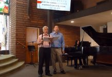

# Cliff Yang (楊子清)

**Cliff Yang** (楊子清) is a columnist for [[sources/taiwanjustice-net||taiwanjustice.net (台灣公義網)]], with 65 articles archived from the site's column section; see also [[organizations/taiwanjustice-net||台灣公義網]].

## Identity Snapshot

- **English:** Cliff Yang
- **Also seen:** Yang Zi-qing — Hanyu gloss. Archive bylines and TAH #269 use Cliff Yang.
- **Chinese:** 楊子清
- **Role:** Columnist
- **Source:** taiwanjustice.net column category
- **Articles:** 65

## Disambiguation

**楊子清** signs as Cliff Yang (楊子清 Cliff Yang 音樂教室). The earlier hedge that this might be a different person is closed: the bylines name him as conductor.

## From the record
- 2024-01-20 — 「楊子清 Cliff Yang 音樂教室」列為 TJJ「影音」區常設節目區塊，本人並列名於該頁 frontmatter authors 清單，該頁為「Tag: 宗像隆幸與彭明敏書信 密存銀行保險箱50年首度公開」標籤頁（Home > Tags > 宗像隆幸與彭明敏書信 密存銀行保險箱50年首度公開，標籤標題「Tag: 宗像隆幸與彭明敏書信 密存銀行保險箱50年首度公開」，列表唯一條目 「宗像隆幸與彭明敏書信 密存銀行保險箱50年首度公開」（January 20, 2024），post_date 2024-01-20，Wayback 20250417221408），見於該頁之站內導覽（[[articles/taiwanjustice-net/2025/20250417221408_tag_宗像隆幸與彭明敏書信-密存銀行保險箱50年首度公_b54c4e49f93b9c40.md|TJJ, 2025-04-17 快照]]）。
- 2021-07-20 — 「楊子清 Cliff Yang 音樂教室」列為 TJJ「影音」區常設節目區塊，本人並列名於該頁 frontmatter authors 清單，該頁為「Tag: Netflix獲利不如預期」標籤頁（Home > Tags > Netflix獲利不如預期，標籤標題「Tag: Netflix獲利不如預期」，列表唯一條目 股市亮點「Netflix獲利不如預期，進軍電玩刺激成長」（July 20, 2021），post_date 2021-07-20，Wayback 20211023202100），見於該頁之站內導覽（[[articles/taiwanjustice-net/2021/20211023202100_tag_netflix獲利不如預期_910fa41c823bd5ef.md|TJJ, 2021-10-23 快照]]）。
- 2021-02-22 — 「楊子清 Cliff Yang 音樂教室」列為 TJJ「影音」區常設節目區塊，本人並列名於該頁 frontmatter authors 清單，該頁為「Tag: 藍白合作引爭議」標籤頁（Home > Tags > 藍白合作引爭議，標籤標題「Tag: 藍白合作引爭議」，列表唯一條目 台灣頭條「藍白合作引爭議，藍營內部看法分歧恐先自傷」（February 22, 2021），post_date 2021-02-22，Wayback 20210419122518），見於該頁之站內導覽（[[articles/taiwanjustice-net/2021/20210419122518_tag_藍白合作引爭議_b107ed29fddc44f8.md|TJJ, 2021-04-19 快照]]）。
- 2021-11-28 — 「楊子清 Cliff Yang 音樂教室」列為 TJJ「影音」區常設節目區塊，本人並列名於該頁 frontmatter authors 清單（16 人：鄭炳全、李堅、楊遠薰、唐培理、獨傲村夫、李筱峰、金恆煒、廖清山、何清漣、黃帝穎、楊子清、范姜提昂、林保華、陳昭南、陳茂雄、陳破空），該頁為「游錫堃宴請翁啟惠」標籤頁（Home > Tags > 游錫堃宴請翁啟惠，標籤標題「Tag: 游錫堃宴請翁啟惠」，列表唯一條目 台灣頭條「游錫堃29日宴請翁啟惠，王金平蘇嘉全將到場」（November 28, 2021），post_date 2021-11-28，Wayback 20220521151554），見於該頁之站內導覽（[[articles/taiwanjustice-net/2022/20220521151554_tag_游錫堃宴請翁啟惠_d347f00234f697ca.md|TJJ, 2022-05-21 快照]]）。
- 2021-11-28 — 「楊子清 Cliff Yang 音樂教室」列為 TJJ「影音」區常設節目區塊，本人並列名於該頁 frontmatter authors 清單，該頁為「「捷克準外長 Jan Lipavýský」標籤頁（Home > Tags > 捷克準外長 Jan Lipavýský，标籤標題「Tag: 捷克準外長 Jan Lipavýský」，列表唯一條目 國際焦點「捷克準外長利巴斯夫斯基高度友台，能否順利上任有變數」November 28, 2021，post_date 2021-11-28，Wayback 20220521155514），見於該頁之站內導褪（[[articles/taiwanjustice-net/2022/20220521155514_tag_捷克準外長-jan-lipavsky_2e5251ee9e1e2982.md|TJJ, 2022-05-21 快照]]）。
- 2021-09-09 — 「楊子清 Cliff Yang 音樂教室」列為 TJJ「影音」區常設節目區塊，本人並列名於該頁 frontmatter authors 清單，該頁為「Tag: NASA黑客松台北場」標籤頁（Home > Tags > NASA黑客松台北場，列表載 NASA黑客松台北場10/2登場，孫曉雅拍影片鼓勵參與[影]（September 9, 2021）一篇），見於該頁之站內導覽（[[articles/taiwanjustice-net/2021/20211023211639_tag_nasa黑客松台北場_5e2cb860b7684c4e.md|TJJ, 2021-10-23 快照]]）。
- 2022-01-14 — 「楊子清 Cliff Yang 音樂教室」列為 TJJ「影音」區常設節目區塊，本人並列名於該頁 frontmatter authors 清單，該頁為「Tag: 海軍布雷中隊成軍」標籤頁（Home > Tags > 海軍布雷中隊成軍，列表載 海軍布雷中隊成軍 成為台灣不對稱作戰可恃戰力（January 14, 2022）一篇），見於該頁之站內導覽（[[articles/taiwanjustice-net/2022/20220517052157_tag_海軍布雷中隊成軍_2c8f9e6d0bdb1af8.md|TJJ, 2022-05-17 快照]]）。
- 2021-12-04 — 「楊子清 Cliff Yang 音樂教室」列為 TJJ「影音」區常設節目區塊，本人並列名於該頁 frontmatter authors 清單，該頁為「Tag: 政治受難者歷史」標籤頁（Home > Tags > 政治受難者歷史，列表載 台灣文化部長李永得：加速記錄政治受難者歷史 推廣人權教育（December 4, 2021）一篇），見於該頁之站內導覽（[[articles/taiwanjustice-net/2022/20220517053712_tag_政治受難者歷史_71818953866f45fe.md|TJJ, 2022-05-17 快照]]）。
- 2018-12-04 — 「楊子清 Cliff Yang 音樂教室」列為 TJJ「影音」區常設節目區塊，本人並列名於該頁 frontmatter authors 清單，該頁為「Tag: 台中市長」標籤頁（Home > Tags > 台中市長，列表載 54新觀點 20181204 準台中市長盧秀燕考驗！台中山手線是否該續蓋 房產專家分析：應學學台北”聯合開發”、鄭知道了 201801030 台中市長之爭 林佳龍與盧秀燕真的五五波?、國會最前線 20171212 霧霾圍城！中南部激戰空汙！2018台中市長將重見藍天？、政經看民視 20171028 台中市長林佳龍到訪 暢談台中願景!、新聞觀測站 20170708 改造大台中：台中市長 林佳龍專訪、新聞觀測站 20161224 就職兩週年：台中市長 林佳龍專訪、正晶限時批 20160212 台中市長來拜年! 林佳龍專訪 等 7 篇），見於該頁之站內導覽（[[articles/taiwanjustice-net/2023/20230130104630_tag_台中市長_7d392cb6acc7a796.md|TJJ, 2023-01-30 快照]]）。
- 2017-09-22 — 「楊子清 Cliff Yang 音樂教室」列為 TJJ「影音」區常設節目區塊，本人並列名於該頁 frontmatter authors 清單，該頁為「「汪傳浦犯罪所得」標籤頁為（Home > Tags > 汪傳浦犯罪所得，，列表載 「汪傳浦房產以3201萬元拍出，北檢追回犯罪所得」（May 4, 2021）一篇），見於該頁之站內導覽（[[articles/taiwanjustice-net/2021/20210620134608_tag_汪傳浦犯罪所得_1a388a612236ee45.md|TJJ, 2021-06-20 快照]]）。，「Tag: 梁文傑」標籤頁為（Home > Tags > 梁文傑），，（前進新台灣 20170922 為邱豐光與民進黨決裂? 柯P嘴上說沒事身體卻做不到? 梁文傑批不該拿陳嘉昌出氣（September 22, 2017）一篇，見於該頁站內導覽（[[articles/taiwanjustice-net/2023/20230530150956_tag_梁文傑_page_2_7ae51057f9262277.md|TJJ, 2023-05-30 快照]]。
- 2021-05-04 — 「楊子清 Cliff Yang 音樂教室」列為 TJJ「影音」區常設節目區塊，本人並列名於該頁 frontmatter authors 清單，該頁為「「汪傳浦犯罪所得」標籤頁為（Home > Tags > 汪傳浦犯罪所得，，列表載 「汪傳浦房產以3201萬元拍出，北檢追回犯罪所得」（May 4, 2021）一篇），見於該頁之站內導覽（[[articles/taiwanjustice-net/2021/20210620134608_tag_汪傳浦犯罪所得_1a388a612236ee45.md|TJJ, 2021-06-20 快照]]）。
- 2020-03-07 — 「楊子清 Cliff Yang 音樂教室」列為 TJJ「影音」區常設節目區塊，本人並列名於該頁 frontmatter authors 清單，該頁為「Tag: 法國著名女作曲家」標籤頁（列表載 【週末漫談音樂(6)】法國著名女作曲家 Boulanger 姊妹（March 7, 2020）），見於該頁之站內導覽（[[articles/taiwanjustice-net/2022/20220518163644_tag_法國著名女作曲家_51f06d537a9dc6d1.md|TJJ, 2022-05-18 快照]]）。
- 2021-04-10 — 「楊子清 Cliff Yang 音樂教室」列為 TJJ「影音」區常設節目區塊，本人並列名於該頁 frontmatter authors 清單，該頁為「Lieutenant Kijé (基傑中尉) 組曲」標籤頁（列表載 【週末漫談音樂 (62)】Prokofiev 傑作 「Lieutenant Kijé (基傑中尉) 組曲」◎ 信雅（April 10, 2021）），見於該頁之站內導覽（[[articles/taiwanjustice-net/2021/20210620133022_tag_lieutenant-kije-基傑中尉-組曲_4bfdc632b069c925.md|TJJ, 2021-06-20 快照]]）。
- 2023-11-30 — 「楊子清 Cliff Yang 音樂教室」列為 TJJ「影音」區常設節目區塊，本人並列名於該頁 frontmatter authors 清單，該頁為「義論」分類頁（列表載 金融遺址？港股一度被台股超越 ◎林保華（November 30, 2023）、為民眾黨把脈 ◎ 陳茂雄、東亞情勢的年終回顧 ◎楊甦棣（Stephen M. Young） 等各篇），見於該頁之站內導覽（[[articles/taiwanjustice-net/2023/20231201234526_root_a9a1852cff7aa014.md|TJJ, 2023-12-01 快照]]）。
- 2024-06-14 — 「楊子清 Cliff Yang 音樂教室」列為 TJJ「影音」區常設節目區塊，本人並列名於該頁 frontmatter authors 清單，該頁為「公視晚間新聞 20240614」每日新聞影音頁（列表載 公視晚間新聞 20240614（June 14, 2024），RELATED ARTICLES 載 雅琴看世界 20250426、公視晚間新聞 20250426 等各篇），見於該頁之站內導覽（[[articles/taiwanjustice-net/2025/20250426140935_公視晚間新聞-20240614_9309bfb16c99f2a4.md|TJJ, 2025-04-26 快照]]）。
- 2021-04-30 — 「楊子清 Cliff Yang 音樂教室」列為 TJJ「影音」區常設節目區塊，本人並列名於該頁 frontmatter authors 清單，該頁為「外交部長吳釗燮」標籤頁（列表載 外交部長吳釗燮：中共沒有統治台灣一天，如若犯台台灣將戰鬥到底[影]（April 30, 2021）、自由時報星期專訪》外交部長吳釗燮：17友邦穩定 台梵關係非常好 2018-09-25（September 24, 2018）），見於該頁之站內導覽（[[articles/taiwanjustice-net/2021/20210723163430_tag_外交部長吳釗燮_d64f9c9f6f170243.md|TJJ, 2021-07-23 快照]]）。
- 2024-05-21 — 「楊子清 Cliff Yang 音樂教室」列為 TJJ「影音」區常設節目區塊，本人並列名於該頁 frontmatter authors 清單，該頁為「台灣趴趴走」標籤頁 Page 1/32（列表載 台灣趴趴走 20240522 博愛大樓 日治台南圖書館（May 21, 2024）、台灣趴趴走 20240515 國立臺灣博物館 奇美博物館（May 14, 2024）、台灣趴趴走 20240508 台北放送局演奏所（May 7, 2024） 等各篇），見於該頁之站內導覽（[[articles/taiwanjustice-net/2024/20240523004804_root_6259a4190c85cebb.md|TJJ, 2024-05-23 快照]]）。
- 2021-05-01 — 「楊子清 Cliff Yang 音樂教室」列為 TJJ「影音」區常設節目區塊，本人並列名於該頁 frontmatter authors 清單，該頁為「加拿大人口普查 首列台灣族裔」標籤頁（列表載 I’m Taiwanese！加拿大五年一度人口普查 首列台灣族裔（May 1, 2021）），見於該頁之站內導覽（[[articles/taiwanjustice-net/2021/20210620130530_tag_加拿大人口普查-首列台灣族裔_571232d0cab12a8b.md|TJJ, 2021-06-20 快照]]）。
- 2021-11-25 — 「楊子清 Cliff Yang 音樂教室」列為 TJJ「影音」區常設節目區塊，本人並列名於該頁 frontmatter authors 清單，該頁為「Tag: 請不要吝嗇你的笑容」標籤頁（列表載 請不要吝嗇你的笑容 ◎ 袁智慧（November 25, 2021）一篇），見於該頁之站內導覽（[[articles/taiwanjustice-net/2022/20220521163430_tag_請不要吝嗇你的笑容_ae77fa8b89cf2e7d.md|TJJ, 2022-05-21 快照]]）。

- 2024-03-26 — 「楊子清 Cliff Yang 音樂教室」列為 TJJ「影音」區常設節目區塊，本人並列名於該頁 frontmatter authors 清單，該頁為「Elon Musk」標籤頁 Page 1/3（列表載 馬斯克旗下X挨轟仇恨言論激增 提告批評者遭駁回（March 26, 2024）、嚇壞投資人？馬斯克承認服用處方K他命 治療負面心態（March 18, 2024）等各篇），見於該頁之站內導覽（[[articles/taiwanjustice-net/2024/20240421185527_root_9dc57c40faabf220.md|TJJ, 2024-04-21 快照]]）。
- 2021-07-21 — 「楊子清 Cliff Yang 音樂教室」列為 TJJ「影音」區常設節目區塊，本人並列名於該頁 frontmatter authors 清單，該頁為「美國支持澳洲處理非市場行為」標籤頁（列表載 中澳貿易爭端，戴琪：美國支持澳洲處理非市場行為（July 21, 2021）），見於該頁之站內導覽（[[articles/taiwanjustice-net/2021/20210920135511_tag_美國支持澳洲處理非市場行為_9d274c3719a12a40.md|TJJ, 2021-09-20 快照]]）。
- 2021-09-14 — 「楊子清 Cliff Yang 音樂教室」列為 TJJ「影音」區常設節目區塊，本人並列名於該頁 frontmatter authors 清單，該頁為「印度警方逮捕6名策劃恐攻嫌犯」標籤頁（列表載 印度警方逮捕6名策劃恐攻嫌犯，搜出強力炸彈（September 14, 2021）），見於該頁之站內導覽（[[articles/taiwanjustice-net/2021/20211025205829_tag_印度警方逮捕6名策劃恐攻嫌犯_e60037f96e07d36d.md|TJJ, 2021-10-25 快照]]）。
- 2021-10-25 — 「楊子清 Cliff Yang 音樂教室」列為 TJJ「影音」區常設節目區塊，本人並列名於該頁 frontmatter authors 清單，該頁為「中國企圖以春苗行動統戰僑界」標籤頁（列表載 中國企圖以春苗行動統戰僑界，童振源：影響不大（October 25, 2021）），見於該頁之站內導覽（[[articles/taiwanjustice-net/2022/20220122105105_tag_中國企圖以春苗行動統戰僑界_4aab9d197c68c89d.md|TJJ, 2022-01-22 快照]]）。
- 2022-07-23 — 「楊子清 Cliff Yang 音樂教室」列為 TJJ「影音」區常設節目區塊，本人並列名於該頁 frontmatter authors 清單，該頁為「Daily Archives: July 23, 2022」每日彙整頁 Page 1/5（列表載 鄭知道了 20220723 北市選戰上演陳柯大戰（July 23, 2022）等各篇），見於該頁之站內導覽（[[articles/taiwanjustice-net/2022/20220724045254_2022_07_23_19cac61763d645fd.md|TJJ, 2022-07-24 快照]]）。
- 2018-09-23 — 「楊子清 Cliff Yang 音樂教室」列為 TJJ「影音」區常設節目區塊，本人並列名於該頁 frontmatter authors 清單，該頁為「海峽論談」分類頁 Page 28/28（Random 排序，列表載 海峽論談 20180923 中梵簽署主教任命協議，台梵關係是否可能受到影響?（September 23, 2018）等篇），見於該頁之站內導覽（[[articles/taiwanjustice-net/2022/20221127043105_category_videos_海峽論談_page_28_4e1bb14bbf0a6202.md|TJJ, 2022-11-27 快照]]）。
- 2022-01-14 — 「楊子清 Cliff Yang 音樂教室」列為 TJJ「影音」區常設節目區塊，本人並列名於該頁 frontmatter authors 清單，該頁為「德國建議冬奧選手別帶個人手機」標籤頁（列表載 憂資安風險，德國建議冬奧選手別帶個人手機（January 14, 2022）），見於該頁之站內導覽（[[articles/taiwanjustice-net/2022/20220517041927_tag_德國建議冬奧選手別帶個人手機_8eee50fc5598920f.md|TJJ, 2022-05-17 快照]]）。
- 2021-06-18 — 「楊子清 Cliff Yang 音樂教室」列為 TJJ「影音」區常設節目區塊，本人並列名於該頁 frontmatter authors 清單，該頁為「美國加強對華為中興設備禁令」標籤頁（列表載 美國傳播委員會通過 進一步加強對華為中興設備禁令（June 18, 2021）），見於該頁之站內導覽（[[articles/taiwanjustice-net/2021/20211023204322_tag_美國加強對華為中興設備禁令_f921de844a328b3a.md|TJJ, 2021-10-23 快照]]）。
- 2020-09-04 — 「楊子清 Cliff Yang 音樂教室」列為 TJJ「影音」區常設節目區塊，本人並列名於「鄭炳全專欄」分類頁 frontmatter authors 清單，該頁（Latest 排序）載「旅美五十周年 ◎ 鄭炳全」（2020-09-04 刊），見於該頁之站內導覽（[[articles/taiwanjustice-net/2020/20201121044417_category_taiwaneseamerican_鄭炳全專欄_87445646ff450c96|TJJ, 2020-11-21 快照]]）。
- 2021-09-18 — 「楊子清 Cliff Yang 音樂教室」列為 TJJ「影音」區常設節目區塊，該頁為「聯合國大會」標籤頁 Page 1/2（列表載 聯合國大會將登場，世界百位領導人無懼疫情堅訪美（September 18, 2021）等），本人並列名於該頁 frontmatter authors 清單（[[articles/taiwanjustice-net/2022/20220122104840_tag_聯合國大會_56ffc54b20cf0300.md|TJJ, 2022-01-22 快照]]）。
- 2023-12-29 — 「楊子清 Cliff Yang 音樂教室」列為 TJJ「影音」區常設節目區塊，本人並列名於該頁 frontmatter authors 清單，該頁為「大洛杉磯台灣會館會訊」標籤頁 Page 1/2（Page 1 of 2，列表載 大洛杉磯台灣會館12月2023年會訊（December 29, 2023）、大洛杉磯台灣會館10月2023年會訊（November 29, 2023）、2023年6月大洛杉磯台灣會館會訊（June 22, 2023） 等各篇），見於該頁之站內導覽（[[articles/taiwanjustice-net/2024/20240302030606_root_51e9717928aa0fbb.md|TJJ, 2024-03-02 快照]]）。
- 2022-01-19 — 「楊子清 Cliff Yang 音樂教室」列為 TJJ「影音」區常設節目區塊，本人並為該站專欄作者，見於「福爾摩沙音樂廳」標籤頁 Page 1（共 13 頁）之站內導覽（[[articles/taiwanjustice-net/2022/20220122104923_tag_福爾摩沙音樂廳_7f81bb88e07804e4|TJJ, 2022-01-22 快照]]）。
- 2021-06-17 — 「楊子清 Cliff Yang 音樂教室」列為 TJJ「影音」區常設節目區塊，見於「這！不是新聞」標籤頁 Page 1（共 45 頁）之站內導覽（[[articles/taiwanjustice-net/2021/20210620125810_tag_這_不是新聞_2ce995706706f2b4|TJJ, 2021-06-20 快照]]）。
- 2020-06-15 — 「楊子清 Cliff Yang 音樂教室」列為 TJJ「影音」區常設節目區塊，本人並為該站專欄作者，見於「中共濫用EB-5投資移民簽證項目」標籤頁之站內導覽（[[articles/taiwanjustice-net/2020/20200820021349_tag_中共濫用eb-5投資移民簽證項目_1ce8cdd1e9fc9435|TJJ, 2020-08-20 快照]]）。
- 2020-06-18 — 「楊子清 Cliff Yang 音樂教室」列為 TJJ「影音」區常設節目區塊，本人並為該站專欄作者，見於「美最高防疫專家Anthony Fauci」標籤頁之站內導覽（[[articles/taiwanjustice-net/2020/20200820021351_tag_美最高防疫專家anthony-fauci_40f567d48783cea1|TJJ, 2020-08-20 快照]]）。
- 2020-06-18 — 「楊子清 Cliff Yang 音樂教室」列為 TJJ「影音」區常設節目區塊，本人並為該站專欄作者，見於「美國最高院裁定 廢『追夢人』計畫違法」標籤頁之站內導覽（[[articles/taiwanjustice-net/2020/20200820212927_tag_美國最高院裁定-廢_追夢人_計畫違法_54008d796dfbb4e0|TJJ, 2020-08-20 快照]]）。
- 2020-06-15 — 「楊子清 Cliff Yang 音樂教室」列為 TJJ「影音」區常設節目區塊，本人並為該站專欄作者，見於「共產幽靈回西方」標籤頁之站內導覽（[[articles/taiwanjustice-net/2020/20200820224214_tag_共產幽靈回西方_002253524609cf99|TJJ, 2020-08-20 快照]]）。
- 2019-10-31 — 「楊子清 Cliff Yang 音樂教室」列為 TJJ「影音」區常設節目區塊，見於「鄭 知道了」分類頁 Page 1（Random 排序，138 頁）之站內導覽（[[articles/taiwanjustice-net/2022/20220122114344_category_videos_鄭-知道了_c5dffd56381240b3|TJJ, 2022-01-22 快照]]）。
- 2017-11-22 — 「楊子清 Cliff Yang 音樂教室」列為 TJJ「影音」區常設節目區塊；本人為該站專欄作者（65 篇），見於「新台灣加油」分類頁 Page 96（Most popular 排序）之站內導覽（[[articles/taiwanjustice-net/2021/20210619040352_category_videos_newtaiwan_page_96_37678f856a4f4bb5|TJJ, 2021-06-19 快照]]）。
- 2017-11-22 — 「楊子清 Cliff Yang 音樂教室」列為 TJJ「影音」區常設節目區塊；本人為該站專欄作者（65 篇），見於「新台灣加油」分類頁 Page 3 之站內導覽（[[articles/taiwanjustice-net/2021/20210621195425_category_videos_newtaiwan_page_3_31b7c6749559b4fe|TJJ, 2021-06-21 快照]]）。
- 2018-09-10 — 「楊子清 Cliff Yang 音樂教室」列為 TJJ「影音」區常設節目區塊；本人並為該站專欄作者，見於「新台灣加油」分類頁 Page 1 之站內導覽（[[articles/taiwanjustice-net/2021/20210518232913_category_videos_newtaiwan_2601ffa59b26db94|TJJ, 2021-05-18 快照]]）。
- 2021-01-15 — 「楊子清 Cliff Yang 音樂教室」列為 TJJ「影音」區常設節目區塊，見於「新聞面對面」分類頁（Featured posts 排序，Page 1/176）之站內導覽（[[articles/taiwanjustice-net/2021/20210117062350_category_videos_news-face_9455cd2ab40f2a36|TJJ, 2021-01-17 快照]]）。
- 2021-05-07 — 「楊子清 Cliff Yang 音樂教室」列為 TJJ「影音」區常設節目區塊，本人並為該站專欄作者，見於「新台灣加油」分類頁 Page 1（Featured posts 排序，237 頁）之站內導覽（[[articles/taiwanjustice-net/2021/20210509160323_category_videos_newtaiwan_8cb5849fecad69af|TJJ, 2021-05-09 快照]]）。
- 2021-06-18 — 「楊子清 Cliff Yang 音樂教室」列為 TJJ「影音」區常設節目區塊，見於「新台灣加油」分類頁 Page 2（Featured posts 排序，240 頁）之站內導覽（[[articles/taiwanjustice-net/2021/20210620131419_category_videos_newtaiwan_page_2_b0e379ca38fbc7f8|TJJ, 2021-06-20 快照]]）。
- 2021-06-18 — 「楊子清 Cliff Yang 音樂教室」列為 TJJ「影音」區常設節目區塊，見於「新台灣加油」分類頁 Page 3（Featured posts 排序，240 頁）之站內導覽（[[articles/taiwanjustice-net/2021/20210620121735_category_videos_newtaiwan_page_3_cca02409f921169d|TJJ, 2021-06-20 快照]]）。
- 2017-10-30 — 「楊子清 Cliff Yang 音樂教室」列為 TJJ「影音」區常設節目區塊，本人並為該站專欄作者，見於「川普時代」美國頭條分類頁（Most popular 排序，Page 1/450）之站內導覽（[[articles/taiwanjustice-net/2020/20201126154103_category_internatinal_usa_news_us_election_e40fa17f3ce9e6d1|TJJ, 2020-11-26 快照]]）。
- 2021-03-30 — 本人主講之「楊子清老師音樂短講」系列列為 TJJ「楊子清 Cliff Yang 音樂教室」分類頁（Most popular 排序，Page 1/3）之主要内容，該分類並見於站內導覽「影音」區（[[articles/taiwanjustice-net/2021/20210920150315_category_videos_cliffyang_f6f96ab7d79a9e86|TJJ, 2021-09-20 快照]]）。
- 2018-01-21 — 「楊子清 Cliff Yang 音樂教室」列為 TJJ「影音」區常設節目區塊，見於「台灣亮起來」影音分類頁 Page 1（Random 排序，共 30 頁）之站內導覽（[[articles/taiwanjustice-net/2024/20240221120558_root_62c6a8cb4efe3ba7|TJJ, 2024-02-21 快照]]）。
- 2020-09-30 — 本人主講之「楊子清老師音樂短講」系列與以立合唱團錄影列為 TJJ「楊子清 Cliff Yang 音樂教室」分類頁（Most popular 排序，Page 4/5）之主要内容，該分類並見於站內導覽「影音」區（[[articles/taiwanjustice-net/2025/20250521085355_category_videos_cliffyang_page_4_32588a79cc44c180|TJJ, 2025-05-21 快照]]）。
- 2018-02-11 — 「楊子清 Cliff Yang 音樂教室」列為 TJJ「影音」區常設節目區塊，見於「海峽論談」分類頁 Page 2（共 25 頁）之站內導覽（[[articles/taiwanjustice-net/2022/20220122120357_category_videos_海峽論談_page_2_b2c6fa40367ec3a0|TJJ, 2022-01-22 快照]]）。
- 2021-01-23 — 「楊子清 Cliff Yang 音樂教室」列為 TJJ「影音」區常設節目區塊，見於「週末漫談音樂」分類頁（Featured posts 排序，Page 1/5）之站內導覽（[[articles/taiwanjustice-net/2021/20210127222636_category_classicmusic_786dbf259eb94352|TJJ, 2021-01-27 快照]]）。
- 2020-02-29 — 「楊子清 Cliff Yang 音樂教室」列為 TJJ「影音」區常設節目區塊，見於「週末漫談音樂」分類頁（Most popular 排序，Page 1/5）之站內導覽（[[articles/taiwanjustice-net/2021/20210118131504_category_classicmusic_7ff64ed440b01118|TJJ, 2021-01-18 快照]]）。
- 2021-06-26 — 本人主講之「楊子清老師音樂短講」系列（第 5、6、7、9、10、11、13、16、17、23 集：美聲唱法技巧、appoggio 支持、共鳴、聲區、裝飾音、聲樂平衡）與「楊子清父子二重唱：直到祂再來」、「以立合唱團」演唱「我心中有一幅畫」（選自輕歌劇「森林王子」）列於 TJJ「楊子清 Cliff Yang 音樂教室」分類頁 Featured posts 排序 Page 1/3（快照 2021-09-20）（[[articles/taiwanjustice-net/2021/20210920131328_category_videos_cliffyang_7677c1db54708107|TJJ, 2021-09-20 快照]]）。
- 2017-10-30 — 「楊子清 Cliff Yang 音樂教室」列為 TJJ「影音」區常設節目區塊，本人並為該站專欄作者，見於「美國新聞」國際頭條分類頁（Most popular 排序，Page 1/741）之站內導覽（[[articles/taiwanjustice-net/2021/20210301091457_category_internatinal_usa_news_8f6c7e2800be2a0f|TJJ, 2021-03-01 快照]]）。
- 2017-10-30 — 「楊子清 Cliff Yang 音樂教室」列為 TJJ「影音」區常設節目區塊，本人並為該站專欄作者，見於「川普時代」美國頭條分類頁（Most popular 排序，Page 2/489）之站內導覽（[[articles/taiwanjustice-net/2021/20210118125613_category_internatinal_usa_news_us_election_page_2_575587de5f83dc29|TJJ, 2021-01-18 快照]]）。
- 2021-09-24 — 「楊子清 Cliff Yang 音樂教室」列為 TJJ「影音」區常設節目區塊，見於「錢進新世界」分類頁（Latest 排序，Page 1，載 20210906–20210924 各集）之站內導覽（[[articles/taiwanjustice-net/2021/20210927015306_category_videos_錢進新世界_5054d9326c2563a2|TJJ, 2021-09-27 快照]]）。
- 2021-09-24 — 「楊子清 Cliff Yang 音樂教室」列為 TJJ「影音」區常設節目區塊，見於「錢進新世界」分類頁（Latest 排序，Page 2/4，載 20210906–20210913 各集）之站內導覽（[[articles/taiwanjustice-net/2021/20210927015306_category_videos_錢進新世界_5054d9326c2563a2|TJJ, 2021-09-27 快照]]）。
- 2020-10-31 — 「楊子清 Cliff Yang 音樂教室」列為 TJJ「影音」區常設節目區塊，見於「週末漫談音樂」分類頁（Random 排序，Page 1/5）之站內導覽（[[articles/taiwanjustice-net/2021/20210118132656_category_classicmusic_bc1585610a729897|TJJ, 2021-01-18 快照]]）。
- 2017-11-22 — 「楊子清 Cliff Yang 音樂教室」列為 TJJ「影音」區常設節目區塊，見於「新聞面對面」分類頁 Page 1（共 85 頁，Most popular 排序）之站內導覽（[[articles/taiwanjustice-net/2021/20210118140954_category_videos_news-face_2a4385edf281e766|TJJ, 2021-01-18 快照]]）。
- 2016-10-12 — 「楊子清 Cliff Yang 音樂教室」列為 TJJ「影音」區常設節目區塊，見於「年代向錢看」分類頁（Random 排序，Page 1/191）之站內導覽（[[articles/taiwanjustice-net/2021/20211129032507_category_videos_niandai-money_f59ae29270714609|TJJ, 2021-11-29 快照]]）。
- 2020-08-22 — 「楊子清 Cliff Yang 音樂教室」列為 TJJ「影音」區常設節目區塊，見於「政經最前線」分類頁（Random 排序，Page 1/9）之站內導覽（[[articles/taiwanjustice-net/2021/20211023202914_category_videos_政經最前線_4b985e17fc9d08cd|TJJ, 2021-10-23 快照]]）。
- 2020-06-06 — 「楊子清 Cliff Yang 音樂教室」列為 TJJ「影音」區常設節目區塊，見於「政經最前線」分類頁（Most popular 排序，Page 1/9）之站內導覽（[[articles/taiwanjustice-net/2021/20211023193757_category_videos_政經最前線_fdf1eef8198ec5a7|TJJ, 2021-10-23 快照]]）。
- 2017-04-08 — 「楊子清 Cliff Yang 音樂教室」列為 TJJ「影音」區常設節目區塊，本人並為該站專欄作者，見於「川普時代」美國頭條分類頁 Page 2（Random 排序，共 616 頁）之站內導覽（[[articles/taiwanjustice-net/2021/20210118150130_category_internatinal_usa_news_us_election_page_2_58606bd4f6dcef5f|TJJ, 2021-01-18 快照]]）。
- 2021-01-17 — 「楊子清 Cliff Yang 音樂教室」列為 TJJ「影音」區常設節目區塊，見於「川普時代」美國頭條分類頁 Page 577（Featured posts 排序，共 616 頁）之站內導覽（[[articles/taiwanjustice-net/2021/20210118131309_category_internatinal_usa_news_us_election_page_577_b603937c4f496c9d|TJJ, 2021-01-18 快照]]）。
- 2019-10-20 — 「楊子清 Cliff Yang 音樂教室」列為 TJJ「影音」區常設節目區塊，見於「台灣向錢衝」分類頁 Page 1（Featured posts 排序，共 15 頁）之站內導覽（[[articles/taiwanjustice-net/2020/20201118143719_category_videos_台灣向錢衝_081fe347efe70f4e|TJJ, 2020-11-18 快照]]）。
- 2019-01-23 — 「楊子清 Cliff Yang 音樂教室」列為 TJJ「影音」區常設節目區塊，見於「川普時代」美國頭條分類頁 Page 3（Random 排序，共 617 頁）之站內導覽（[[articles/taiwanjustice-net/2021/20210126000935_category_internatinal_usa_news_us_election_page_3_72303d790bddcc66|TJJ, 2021-01-26 快照]]）。
- 2017-10-30 — 「楊子清 Cliff Yang 音樂教室」列為 TJJ「影音」區常設節目區塊，見於「川普時代」美國頭條分類頁 Page 450（Most popular 排序，共 489 頁）之站內導覽（[[articles/taiwanjustice-net/2021/20210118135224_category_internatinal_usa_news_us_election_page_450_c8c0449a89f5fca9|TJJ, 2021-01-18 快照]]）。
- 2021-06-13 — 「楊子清 Cliff Yang 音樂教室」列為 TJJ「影音」區常設節目區塊，見於「雅琴看世界」分類頁（Latest 排序）之站內導覽（[[articles/taiwanjustice-net/2021/20210619021519_category_videos_雅琴看世界_9ea747a5abdb6afa|TJJ, 2021-06-19 快照]]）。
- 2017-03-17 — 「楊子清 Cliff Yang 音樂教室」列為 TJJ「影音」區常設節目區塊，本人並列名該頁 frontmatter 作者清單，見於「獨傲村夫專欄」分類頁 Page 1/6（Random 排序）之站內導覽（[[articles/taiwanjustice-net/2024/20240228153541_root_32235648d405d5b1|TJJ, 2024-02-28 快照]]）。
- 2016-04-15 — 「楊子清 Cliff Yang 音樂教室」列為 TJJ「影音」區常設節目區塊，本人並列名該頁 frontmatter 作者清單，見於「政黨輪替與轉型正義」頭條分類頁 Page 1（Random 排序，共 292 頁）之站內導覽（[[articles/taiwanjustice-net/2024/20240225025037_root_699f2233935f825a.md|TJJ, 2024-02-25 快照]]）。
- 2020-11-21 — 「楊子清 Cliff Yang 音樂教室」列為 TJJ「影音」區常設節目區塊，本人並列名該頁 frontmatter 作者清單，見於「張忠謀」標籤頁 Page 1（共 5 頁）之站內導覽（[[articles/taiwanjustice-net/2021/20210128000626_tag_張忠謀_355aebe0c4e6550c.md|TJJ, 2021-01-28 快照]]）。
- 2025-04-12 — 「楊子清 Cliff Yang 音樂教室」列為 TJJ「影音」區常設節目區塊，本人並列名該頁 frontmatter 作者清單，見於「台灣人文藝術」分類頁 Page 85/87（Featured posts 排序）之站內導覽（[[articles/taiwanjustice-net/2025/20250514020624_category_taiwan-culture_page_85_ceb1df9bb1761594|TJJ, 2025-05-14 快照]]）。
- 2021-04-16 — 「楊子清 Cliff Yang 音樂教室」列為 TJJ「影音」區常設節目區塊，「前進新台灣」為同區節目，且本人列名於該頁 frontmatter 作者清單，見於「前進新台灣」標籤頁 Page 1/141 之站內導覽（[[articles/taiwanjustice-net/2021/20210419125323_tag_前進新台灣_ac7e63e7d47ac0c0|TJJ, 2021-04-19 快照]]）。
- 2024-05-04 — 「楊子清 Cliff Yang 音樂教室」列為 TJJ「影音」區常設節目區塊，本人並列名該頁 frontmatter 作者清單，見於「台灣亮起來」影音分類頁 Page 2/23（Random 排序）之站內導覽（[[articles/taiwanjustice-net/2025/20250328121708_category_videos_台灣亮起來_page_2_4bd9f45255bb5d2c.md|TJJ, 2025-03-28 快照]]）。
- 2022-08-07 — 「楊子清 Cliff Yang 音樂教室」列為 TJJ「影音」區常設節目區塊，本人並列名該頁 frontmatter 作者清單，見於「李四端的雲端世界」影音分類頁 Page 3/25（Featured posts 排序）之站內導覽（[[articles/taiwanjustice-net/2024/20240425084218_root_c41d9db6a42e8887|TJJ, 2024-04-25 快照]]）。
- 2017-10-15 — 「楊子清 Cliff Yang 音樂教室」列為 TJJ「影音」區常設節目區塊，見於「南海東海風雲」國際分類頁 Page 3/351（Most popular 排序）之站內導覽（[[articles/taiwanjustice-net/2022/20220927141521_category_internatinal_south-china-sea_page_3_c8f98dfa0e8234b5.md|TJJ, 2022-09-27 快照]]）。
- 2022-02-15 — 「楊子清 Cliff Yang 音樂教室」列為 TJJ「影音」區常設節目區塊，見於「[[organizations/taiwan-center||大洛杉磯台灣會館]]」分類頁 Page 2/38（Random 排序）之站內導覽（[[articles/taiwanjustice-net/2024/20240421182508_root_94aeb29f1ba5ceaa|TJJ, 2024-04-21 快照]]）。
- 2021-06-15 — 「楊子清 Cliff Yang 音樂教室」列為 TJJ「影音」區常設節目區塊，見於「陳昭南」標籤頁 Page 1/62 之站內導覽（[[articles/taiwanjustice-net/2021/20210616065432_tag_陳昭南_f32f755ed5216a76|TJJ, 2021-06-16 快照]]）。
- 2024-02-23 — 「楊子清 Cliff Yang 音樂教室」列為 TJJ「影音」區常設節目區塊，本人並列名於該頁 frontmatter authors 清單，見於「南海東海風雲」分類頁 Page 1/647（Featured posts 排序）之站內導覽（[[articles/taiwanjustice-net/2024/20240224191759_root_3f461ed87434fa4a|TJJ, 2024-02-24 快照]]）。
- 2025-02-09 — 「楊子清 Cliff Yang 音樂教室」列為 TJJ「影音」區常設節目區塊，本人並列名該頁 frontmatter 作者清單，見於「台灣頭條」分類頁 Page 1589/1682（Featured posts 排序）之站內導覽（[[articles/taiwanjustice-net/2025/20250210093207_category_taiwan_page_1589_4a4a310a3a841353.md|TJJ, 2025-02-10 快照]]）。
- 2020-07-20 — 「楊子清 Cliff Yang 音樂教室」列為 TJJ「影音」區常設節目區塊，本人並列名於該頁 frontmatter authors 清單，見於「民視新聞 20200720 綠廢考監釋善意 藍營上演「雙頭馬車」」每日新聞／影音文章之站內導覽（[[articles/taiwanjustice-net/2025/20250519023016_民視新聞-20200720-綠廢考監釋善意-藍營上演_雙頭馬車_e2e9370ccfe604b5.md|TJJ, 2025-05-19 快照]]）。
- 複核（TJJ-A10090401-30, 2026-10-10）：本 slice 文章 taiwanjustice-net/index（存檔索引頁）正文再驗證——本頁 subject 連結為真實提及，無錯鏈、無虛鏈；含該文 wikilink 的日期事實條目已在庫 — SKIP，已飽和。
- 複核（TJJ-A10030400-5, 2026-10-05）：本 slice 四篇（[[articles/taiwanjustice-net/2024/20240425081647_root_17835ad9519f9cfe|17835ad9]]／[[articles/taiwanjustice-net/2025/20250213030340_以立合唱團_演唱_末日之淚_-選自威爾第的_6ba229d2998bbfa4|6ba229d2]]／[[articles/taiwanjustice-net/2024/20240228151341_root_8c6aeada16c1e8ba|8c6aeada]]／[[articles/taiwanjustice-net/2023/20230202201307_2022_12_14_以立合唱團_演唱_末日之淚_-選自威爾第的_e7e0fe18037cc328|e7e0fe18]]）正文再驗證——涉本人各篇（以立指揮、末日之淚兩存檔副本 author/指揮）subject 連結為真，無錯鏈、無虛鏈；[[articles/taiwanjustice-net/2024/20240425081647_root_17835ad9519f9cfe|17835ad9]] 正文與 Subjects 均無涉本人；含各文 wikilink 的 2016-06-11 與 2022-10-01／10-08 條目均已在庫 — SKIP，已飽和。

- 複核（TJJ-A09260600-4, 2026-09-27）：本 slice 文章 [[articles/taiwanjustice-net/2024/20240622135632_root_54dd66fe454bf899|54dd66fe]] 正文再驗證——以立合唱團總指揮楊子清率團赴 Mayfield 交流並稱「國民外交」確認見於正文，subject 連結為真，無錯鏈、無虛鏈；含該文 wikilink 的 2024-05-13 條目已在庫 — SKIP，無新材料。

- 複核（TJJ-A09251500-1, 2026-09-26）：本 slice 文章 [[articles/taiwanjustice-net/2024/20240622135632_root_54dd66fe454bf899|54dd66fe]] 正文再驗證——以立合唱團總指揮楊子清率團赴 Mayfield 交流並稱「國民外交」確認見於正文，subject 連結為真，無錯鏈、無虛鏈；含該文 wikilink 的 2024-05-13 日期條目已在庫 — SKIP，無新材料。

- 複核（TJJ-A09251400-4, 2026-09-26）：本 slice 文章 9412105875987041（以立合唱團 Mayfield 校園文化交流） 正文再驗證——總指揮楊子清率團赴 Mayfield 交流並稱國民外交確認見於正文，subject 連結為真，無錯鏈、無虛鏈；對應日期事實條目（含該文 wikilink）已在庫 — SKIP，已飽和。

- 複核（TJJ-A09250400-18, 2026-09-25）：slice 文章 [[articles/taiwanjustice-net/2025/20250524200224_以立合唱團世界首演_希望之光_影音_025f6ed990dc9e2c|025f…]]（希望之光，作者楊子清提供）／[[articles/taiwanjustice-net/2024/20240302032241_root_f985012b1ed56ad0|f985…]]（末日之淚，楊子清指揮）正文再驗證——author/subject 連結為真，無錯鏈、無虛鏈；對應日期條目已在庫 — SKIP，已飽和。

- 複核（TJJ-A09250400-15, 2026-09-25）：本 slice 四篇（末日之淚 e7e0fe18、音樂短講第13集 4119cffe、學生王子 2b2e0ebc、拯救我 7214b273）正文再驗證——本人指揮（末日之淚、拯救我）、短講主講（4119cffe）確認見於正文，subject／author 連結為真，無錯鏈、無虛鏈；學生王子稿無涉本人；含該文 wikilink 日期條目均已在庫 — SKIP，無新材料。

- 複核（TJJ-A09250400-11, 2026-09-25）：本 slice 文章 taiwanjustice-net/index（存檔索引頁） 正文再驗證——本頁 subject 連結為真實提及，無錯鏈、無虛鏈；含該文 wikilink 的日期事實條目已在庫 — SKIP，無新材料。

- 複核（TJJ-A09250400-14, 2026-09-25）：本 slice 文章 6ba229d2／8c6aeada（以立合唱團末日之淚、致死的震怒近了存檔稿） 主體連結經正文再驗證為真實對應（無錯鏈、無虛鏈）；對應日期事實條目（含該文 wikilink）已在庫 — SKIP，無新材料；Subjects 連結 .md 後綴已修正為慣例格式。

- 複核（TJJ-A09240900-1, 2026-09-25）：本切片四篇（54dd66fe／2589c867／cc3bbdbf／6d16f9e3）正文再驗證——54dd66fe454bf899（以立合唱團 Mayfield 校園交流）本人以總指揮率團、稱「國民外交」確認見於正文，subject 連結為真、無錯鏈無虛鏈；另三篇無涉本人。2024-05-13 條目（已含該檔 wikilink）已在庫 — SKIP，無新材料。

- 複核（TJJ-A09240800-7, 2026-09-25）：本切片相關存檔稿正文再驗證——本頁 subject 連結為真實提及（無錯鏈、無虛鏈），含該文 wikilink 的日期事實條目已在庫 — SKIP，無新材料。

- 複核（TJJ-A09230900-10, 2026-09-25）：本切片兩存檔稿（「拯救我」80b33cf1846bc005、「希望之光」a40b37bc03b2b9cb）subject link （author 提供影音／拯救我：指揮） 經正文再驗證為真實對應（無錯鏈、無虛鏈），含本文 wikilink 的日期條目已在庫 — SKIP，無新材料；兩稿 Subjects 之 people/*.md 後綴連結已修正為慣例格式。

- 複核（TJJ-A09230900-2, 2026-09-25）：slice 文章 taiwanjustice-net/index（存檔索引頁）正文再驗證——本頁 subject 連結為真實提及，無錯鏈、無虛鏈；對應日期事實條目（含該文 wikilink）已在庫 — SKIP，無新材料。

- 覆核（TJJ-A09171100-8, 2026-09-24）：slice 文章 b7ec76fa6b673920／2b3d5a363a2935eb（以立合唱團「致死的震怒近了」同稿兩存檔副本） 主體連結對照正文再驗證——連結為真實提及（無錯鏈、無虛鏈），對應日期事實條目（含該文 wikilink）已在庫 — SKIP，無新材料。
- 複核（TJJ-A09171000-1, 2026-09-24）：本 slice 文章 index（TJJ 文章存檔索引頁）正文再驗證——索引頁列楊子清為專欄作者（65 篇），連結為真，subject 連結為真，無錯鏈、無虛鏈；對應日期事實已在庫，無新材料。
- 複核（TJJ-A09221400-8, 2026-09-23）：「希望之光」2025 存檔（[[articles/taiwanjustice-net/2025/20250524200224_以立合唱團世界首演_希望之光_影音_025f6ed990dc9e2c|025f6ed990dc9e2c]]）與「末日之淚」2024 存檔（[[articles/taiwanjustice-net/2024/20240302032241_root_f985012b1ed56ad0|f985012b1ed56ad0]]）author/subject link 經正文再驗證為真實對應（提供影音／指揮），引用条目已在庫 — SKIP，无新材料。
- 複核（TJJ-A09221400-6, 2026-09-23）：本切片四稿之 author/subject link（English Pages 目錄頁 2b4b26ff 無涉本人；半音錄影稿 de11e295 提供／指揮；「拯救我」526ee7d6＋7214b273 指揮）經正文再驗證為真實對應，2001-07-02 與 2022-10-01／10-08 條目已在庫 — SKIP，無新材料。
- 複核（TJJ-A09221400-5, 2026-09-23）：本切片兩稿（末日之淚 e7e0fe18 author/指揮、音樂短講第13集 4119cffe author/主講）link 經正文再驗證為真實對應，引用条目已在庫；Subjects 連結 .md 後綴已修正 — SKIP，無新材料。
- 複核（TJJ-A09221400-9, 2026-09-23）：本切片兩稿（「拯救我」2024-02-24 存檔副本 80b33cf1846bc005、「希望之光」2024-02-28 存檔副本 a40b37bc03b2b9cb）author/subject link 經正文再驗證為真實對應（提供影音／指揮），引用条目已在库（无错链、无虚链）— SKIP，无新材料。
- 複核（TJJ-A09221400-7, 2026-09-23）：音樂短講第13集稿（426d2811）與「希望之光」稿（e7e2a1e1）之 author link（楊子清）經原文正文再驗證為真實對應（主講／提供影音）；兩稿 Subjects 之 people/*.md 後綴壞鏈已修 — SKIP，無新材料。
- 複核（TJJ-A09220500-4／-6, 2026-09-22）：兩切片各稿（「末日之淚」「音樂短講第13集」「拯救我」2025 存檔重刊、「希望之光」2023 存檔）author/subject link 經原文正文再驗證為真實對應（指揮／主講／提供影音），引用条目已在库（无错链、无虚链）— SKIP，无新材料。
- 2022-12-02 — 提供以立合唱團世界首演「希望之光」（作曲、指揮[[people/lynn-huang||黃令先]]，鋼琴陳慧如，剪輯廖健榮；10/1 洛杉磯 Pasadena、10/8 紐約卡內基贊克爾廳）影音供台灣報報報導（[[articles/taiwanjustice-net/2023/20230202214624_2022_12_02_以立合唱團世界首演_希望之光_影音_e7e2a1e1a71524ce|TJJ, 2022-12-02]]；存檔副本 [[articles/taiwanjustice-net/2025/20250524200224_以立合唱團世界首演_希望之光_影音_025f6ed990dc9e2c|2025-05]]、[[articles/taiwanjustice-net/2024/20240228144919_root_a40b37bc03b2b9cb|2024-02]]）。
- 2026-07-28 — taiwanjustice.net 文章存檔索引（29,103 篇・2011–2026）以本人為關鍵人物條目收錄（[[articles/taiwanjustice-net/index||TJJ 文章存檔索引]]）。
- 2022-10-01／10-08 — 指揮以立合唱團演唱威爾第《安魂曲》選段「末日之淚」Lacrimosa，於洛杉磯 Pasadena（10/1）及紐約卡內基贊克爾廳（10/8）；鋼琴黃令先、次女高音獨唱溫玉妙、男高音吳渭榮、剪輯廖健榮（[[articles/taiwanjustice-net/2023/20230202201307_2022_12_14_以立合唱團_演唱_末日之淚_-選自威爾第的_e7e0fe18037cc328|TJJ, 2022-12-14]]；同稿另存 [[articles/taiwanjustice-net/2025/20250213030340_以立合唱團_演唱_末日之淚_-選自威爾第的_6ba229d2998bbfa4|2025 存檔副本]]、[[articles/taiwanjustice-net/2024/20240302032241_root_f985012b1ed56ad0|2024-03-02 存檔副本]]）。
- 2001-07-02 — 半音合唱團受[[organizations/professor-chen-wen-chen-memorial-foundation||陳文成博士紀念基金會]]之邀回台，於國家音樂廳「陳文成博士殉難20週年紀念音樂會」演唱並受[[people/chen-shuibian||陳水扁]]總統召見於總統府；楊子清指揮（伴奏[[people/quei-lih-chen||陳瑰麗]]、團長蕭淑慧），實況錄影由其提供存檔（[[articles/taiwanjustice-net/2017/20171107225317_2017_11_05_2001年7月2日半音合唱團受邀演唱於國家音樂廳實況錄_de11e29571f3dc86|TJJ, 2017-11-05 快照]]）。
- 2024-05-13 — 率以立合唱團（Elite Choir）應邀訪問 Pasadena Mayfield Junior High School 全校早禱會，向美國師生介紹台灣並演唱台語民謠「天烏烏」及改編曲〈Oh My Goodness〉；他表示這是以立合唱團第一次在美國學校進行此類文化交流，為故鄉台灣做了一次「國民外交」（[[articles/taiwanjustice-net/2025/20250617205127_一場獲滿堂彩的文化交流-以立合唱團為美國中學生_9412105875987041|TJJ, 2024-05-29]]）。
- 2017-09-15／09-07 — 其所屬「楊子清 Cliff Yang 音樂教室」提供之紀錄（以立合唱團與 LAKMA 於迪士尼音樂廳演唱莫札特 C 小調彌撒曲；2017-08-19 指揮合唱團與管弦樂團於同廳演唱「卡門」選曲）列於 TJJ「楊子清」標籤頁（[[articles/taiwanjustice-net/2021/20210117071954_tag_楊子清_11aa2dfa5f64d7e4|TJJ 楊子清 tag, 2020-09-30]]）。
- 2022-10-01／10-08 — 以立合唱團於洛杉磯 Pasadena（10/1）及紐約卡內基贊克爾廳（10/8）演唱威爾第《安魂曲》「拯救我」Libera me（戴安娜王妃葬禮版本），楊子清指揮、黃令先鋼琴、女高音獨唱李俊玲、廖健榮剪輯（[[articles/taiwanjustice-net/2025/20250209214700_以立合唱團_演唱_拯救我_-選自威爾第的_7214b273dfcb59ce|TJJ 存檔重刊]]；原稿 [[articles/taiwanjustice-net/2023/20230202203511_2022_12_16_以立合唱團_演唱_拯救我_-選自威爾第的_526ee7d662ebe432|2022-12-16]]；存檔副本 [[articles/taiwanjustice-net/2024/20240224201637_root_80b33cf1846bc005|2024-02-24]]）。
- 2020-12-13 — 「楊子清老師音樂短講」第13集講解美聲唱法的「快速音」（agilita）及其種類（legato、flautata、martellata、spezzata、sillabica），並與黃令先、王亦凡博士合講特別講座「泛音」（[[articles/taiwanjustice-net/2025/20250327205857_楊子清老師音樂短講第13集_美聲唱法的技巧-7-快速_4119cffe264101c6|TJJ 存檔重刊]]；原稿 [[articles/taiwanjustice-net/2021/20210128084700_2020_12_13_楊子清老師音樂短講第13集_美聲唱法的技巧-7-快速_426d2811d4065134|2021-01-28 存檔]]）。
- 2024-05-13 — 率以立合唱團首次赴美國校園（Pasadena Mayfield Junior High School 全校早禱會）向美國師生介紹台灣並演唱台語民謠「天烏烏」（含黃令先改編〈Oh My Goodness〉），楊子清稱此為以立團為故鄉台灣做的一次「國民外交」（公孫樂報導 [[articles/taiwanjustice-net/2024/20240622135632_root_54dd66fe454bf899|TJJ, 2024-05-29]]；同稿另見 [[articles/taiwanjustice-net/2025/20250617205127_一場獲滿堂彩的文化交流-以立合唱團為美國中學生_9412105875987041|2025 存檔]]）。
- 2022-10-01／10-08 — 指揮以立合唱團於洛杉磯 Pasadena（10/1）及紐約卡內基贊克爾廳（10/8）演唱威爾第《安魂曲》「末日之淚」Lacrimosa（鋼琴黃令先、次女高音溫玉妙、男高音吳渭榮；[[articles/taiwanjustice-net/2025/20250213030340_以立合唱團_演唱_末日之淚_-選自威爾第的_6ba229d2998bbfa4|TJJ 存檔副本]]）及《拿布果》合唱選曲「致死的震怒近了」（鋼琴黃令先、女高音李俊玲、次女高音溫玉妙；[[articles/taiwanjustice-net/2024/20240228151341_root_8c6aeada16c1e8ba|TJJ, 2023-02-03]]；同稿存檔副本另見 [[articles/taiwanjustice-net/2023/20230322183020_2023_02_03_以立合唱團_演唱威爾弟歌劇合唱選曲_致死的_b7ec76fa6b673920|2023 存檔]]、[[articles/taiwanjustice-net/2025/20250209202050_以立合唱團_演唱威爾弟歌劇合唱選曲_致死的_2b3d5a363a2935eb|2025 存檔重刊]]），與《希望之光》世界首演同系列。
- 2020-12-13 — 「楊子清老師音樂短講」第12集：解說腹式呼吸、胸式呼吸、控制呼吸與增加肺活量的練習方法，並解釋 Lutte vocale 的意義，至此 appoggio（支持）系列講解完成（[[articles/taiwanjustice-net/2021/20210128083831_2020_12_13_楊子清老師音樂短講第12集_美聲唱法的技巧-6-呼吸_0d9c0c4e7cfc7583|TJJ, 2020-12-13]]；快照 2021-01-28）。
- 2022-09-14 — 預告以立合唱團演唱會：10/1 於「帕薩迪納第一聯合衛理公會」、10/8 於「紐約卡內基贊克爾音樂廳」世界首演黃令先創作的「希望之光」；他將指揮威爾第「安魂曲」及歌劇選曲「遊唱詩人」「拿布果」「阿依達」（[[articles/taiwanjustice-net/2022/20220924225759_2022_09_14_以立合唱團elite-chorus10-1加州帕薩迪納_10-8-紐約卡內基音樂_496b462887da57f5|TJJ, 2022-09-14]]）。
- 2023-01-13 — 以立合唱團「鐵砧合唱」（選自威爾第歌劇「遊唱詩人」）影音刊出：於 2022-10-01 洛杉磯 Pasadena、10-08 紐約卡內基贊克爾音樂廳演唱，指揮楊子清、鋼琴黃令先（[[articles/taiwanjustice-net/2023/20230202205139_2023_01_13_以立合唱團演唱_鐵砧合唱_-選自歌劇_遊唱詩人_a341abd1b87ea1d8|TJJ, 2023-01-13]]）。
- 2023-01-13 — 「鐵砧合唱」同稿之 2024-02-24 Wayback 快照存檔副本，指揮楊子清、鋼琴黃令先記述與原稿一致（[[articles/taiwanjustice-net/2024/20240224185330_root_f5546299dea61d21|快照 2024-02-24]]；與上條為同一記錄之兩存檔，各檔連結依慣例分列）。
- 2021-07-09 — 「楊子清老師音樂短講」第24集：解說美聲唱法（Bel Canto）之 VIBRATO（振音、顫音），以鄧麗君與日本女歌星演唱「何日君再來」的 vibrato 差異作比較，並援引澳洲戲劇女高音 Joan Sutherland 的表演解說用與不用的效果（[[articles/taiwanjustice-net/2024/20240221123637_root_da162b30d967a28e|快照 2024-02-21]]；原文發文 2021-07-09）。
- 2021-03-30 — 「楊子清老師音樂短講」第20集：以英語 24 個「子音」Consonants 列表說明有聲／無聲子音的區別與唱法規則，並對照列舉華語與台語的類似子音（[[articles/taiwanjustice-net/2024/20240225024432_root_4fdeba567995dc74|快照 2024-02-25]]；原文發文 2021-03-30）。
- 2023-11-29 — 率以立合唱團「希望之光音樂會」台灣巡迴，11/8 於東吳大學松怡廳、11/11 於高雄衛武營國家藝術文化中心音樂廳演出；以首席指揮身分與彭廣林教授指導之台北弦樂團暨室內管弦樂團聯合演出，指揮威爾第《安魂曲》選曲及《遊唱詩人》（含以非樂器鐵片敲擊之「鐵砧合唱」）、《拿布果》、《阿依達》歌劇合唱選曲，男低音 Vahagn Hovents 獨唱（[[articles/taiwanjustice-net/2024/20240225151846_root_f16677acf5773f2b|TJJ, 2023-11-29]]）。
- 2021-05-14 — 「楊子清老師音樂短講」第21集：以 Daniel Jones「母音圖表」Vowel Diagram 說明聲樂母音 (i)(e)(a)(o)(u) 的位置、close/open/front/back/rounded/unrounded 與 vowel modification 術語，及合唱團為何必須使用純母音 pure vowels（[[articles/taiwanjustice-net/2024/20240301062407_root_2170478446b352c7|快照 2024-03-01]]；原文發文 2021-05-14）。
- 2021-07-09 — 「楊子清老師音樂短講」第23集：講解聲樂上「母音」與「聲區」平衡的重要性，以衛斯特敏斯特合唱學院創始人 Dr. John Finley Williamson 的 Choir Clinic 案例說明合唱團結構平衡，並解釋合唱團結構為何要像新英格蘭的教堂（[[articles/taiwanjustice-net/2024/20240301073809_root_8dc484d04dfdc0d2|音樂短講第23集，存檔 2024-03-01]]）。
- 2023-02-11 — 提供以立合唱團演唱威爾第歌劇「拿布果」第三幕「亞述女王」影音（正文記 2023-02-12 楊子清提供）：Cliff Yang 楊子清指揮、黃令先鋼琴、Sangyoun Park 定音鼓、廖健榮剪輯字幕；於 2022-10-01 洛杉磯 Pasadena、10-08 紐約卡內基贊克爾音樂廳演唱（[[articles/taiwanjustice-net/2024/20240301082501_root_9c000017f2d95e6c|亞述女王，存檔 2024-03-01]]）。
- 2023-12-28 — 提供以立合唱團 2023-11-11 高雄衛武營「希望之光」音樂會上韓美男高音 Wi Young Oh 演唱普契尼「杜蘭朵公主」詠嘆調「公主徹夜未眠」Nessun Dorma 的影音播出（之七）（[[articles/taiwanjustice-net/2024/20240412172251_root_f0f1dd358a38c0b8|公主徹夜未眠播出之七，存檔 2024-04-12]]）。
- 2024-02-14 — 提供以立合唱團演唱威爾第「拿布果」第二幕「致死的震怒近了」影音播出：2023-11-11 高雄衛武營國家藝術文化中心音樂廳演出，Cliff Yang 楊子清指揮，並附歌詞翻譯（[[articles/taiwanjustice-net/2024/20240412172711_root_31c66452046a149a|致死的震怒近了播出，存檔 2024-04-12]]）。
- 2024-01-02 — 提供以立合唱團演唱威爾第安魂曲「末日之淚」Lacrymosa 影音播出，並說明 Lacrimosa 之名源自 Our Lady of Sorrow（憂傷的聖母）、屬「震怒之日」Dies irae 一部分，附歌詞中譯（[[articles/taiwanjustice-net/2024/20240412180425_root_b46713b2c4c56f67|末日之淚播出，存檔 2024-04-12]]）。
- 2024-01-06 — 提供以立合唱團演唱威爾第歌劇「遊吟詩人」Il Trovatore「鐵砧合唱」（原名「吉普賽合唱」）影音播出，並說明該歌劇 1853 年完成、描寫西班牙吉普賽人黎明敲擊鐵砧的背景，附歌詞中譯（[[articles/taiwanjustice-net/2024/20240412180929_root_e4c081ebc493041a|鐵砧合唱播出，存檔 2024-04-12]]）。
- 2023-12-29 — 以立合唱團 2023-11-11 高雄衛武營音樂廳「音樂之光」演唱會（The Light of Hope Concert，台北室內管弦樂團伴奏）下半場由其指揮演唱威爾第安魂曲選曲「震怒之日」，提供影音與歌詞中譯播出（之八）（[[articles/taiwanjustice-net/2024/20240412185116_root_f4815355e5311803|震怒之日播出之八，存檔 2024-04-12]]）。
- 2023-12-16 — 洛杉磯以立合唱團 2023 年台灣巡迴「希望之光」演唱會（11/8 東吳大學松怡廳、11/11 高雄衛武營國家藝術文化中心音樂廳兩場）實況錄影播出（之一）：首席指揮楊子清領團，彭廣林教授指導之台北室內管弦樂團伴奏（[[articles/taiwanjustice-net/2024/20240425084910_root_3f720f7a8adb6107|台灣巡迴實況錄影之一，存檔 2024-04-25]]）。
- 2023-12-21 — 刊出以立合唱團 2023 台灣巡迴「希望之光」（The Light of Hope Concert）高雄衛武營站第一樂章「苦難」影音（之二）：首席指揮楊子清領團、作曲家黃令先自執其管弦樂伴奏三樂章大合唱、彭廣林教授指導台北室內管弦樂團伴奏；歌詞述及疫情與烏俄戰爭之苦難（[[articles/taiwanjustice-net/2024/20240519205154_root_dcdbe73c9f05e73c|希望之光第一樂章「苦難」播出之二，快照 2024-05-19]]）。
- 2017-03-21 — 存檔 1995-07-29 [[organizations/taiwanese-united-fund||TUF]] 台灣名家演奏系列「台灣民謠之夜，民謠與詩的對話」（CSULA Harriet and Charles Fine Arts Complex）節目紀錄：與黃瑞芬（聲樂）、葉綠娜（鋼琴）、弦樂四重奏（蘇顯達、黃維明、吳昭麗、陳建安）及朗誦劉昭惠共同演出（[[articles/taiwanjustice-net/2024/20240520022857_root_e1412ed957f76e0d|台灣民謠之夜 TUF 1995，快照 2024-05-20]]）。
- 2018-06-17 — 以「以立音樂基金會」理事長身分宣布以立合唱團 2018-06-23 於 Arcadia Community Church 舉行「以歌會友」免費免票音樂會，闡述基金會「走出自已的社區」宗旨，追述 2016 年與韓國校友合唱團聯合演出、為[[organizations/taiwan-center||大洛杉磯台灣會館]]籌劃 2017 首屆亞洲合唱節、以立室內合唱團 2018-04 獲亞美尼亞第十屆「文藝復興」國際音樂大賽合唱組第二名等「走出社區」成果（[[articles/taiwanjustice-net/2024/20240520034142_root_4d4b5d52a4f72c87|以立「以歌會友」音樂會公告，快照 2024-05-20]]）。
- 2018-04-11 — 任洛杉磯第二屆亞洲合唱節（2018-05-05 亞凱迪亞表演藝術中心）活動總召：以其 2017 年亞洲合唱節台灣團體指揮身分運用洛杉磯音樂界人脈邀日、韓、菲三國代表合唱團，並主導閉幕壓軸全團種族大合唱；文稱其活躍於台美社團、曾多次受邀擔任國際音樂大賽合唱組評審、現任以立合唱團指揮（[[articles/taiwanjustice-net/2024/20240530125049_root_fdc94baaa65e3026|台日韓菲四國合唱團亞洲合唱節登場，快照 2024-05-30]]）。
- 2024-01-02 — 以「Cliff Yang 楊子清提供」名義刊出以立合唱團高雄衛武營演唱「末日之淚」Lacrimosa 影音播出，說明 Lacrimosa 之名源自 Our Lady of Sorrow（憂傷的聖母）、屬「震怒之日」Dies irae 之一部分，並附歌詞中譯（[[articles/taiwanjustice-net/2025/20250209205051_以立合唱團在高雄衛武營音樂廳演唱的_末日之淚_660289b9a73f5f3a|末日之淚播出，快照 2025-02-09]]）。
- 2020-09-11 — 「楊子清老師音樂短講」第6集：以簡短影音講解「科學音名」Scientific pitch name 與男女聲樂分類 Vocal types，並解釋「舒適區」Tessitura 的重要性（[[articles/taiwanjustice-net/2025/20250209210603_楊子清老師音樂短講第6集-_科學音名_及_聲音_d0a6ad9e91ba0f21|音樂短講第6集，快照 2025-02-09]]）。
- 2023-12-29 — 以「美國以立合唱團」2023-11-11 高雄衛武營音樂廳「音樂之光」The Light of Hope 演唱會（台北室內管弦樂團伴奏）下半場由其指揮演唱威爾第安魂曲選曲之訊息，刊出第一首「震怒之日」影音與歌詞中譯（之八）（[[articles/taiwanjustice-net/2025/20250209213007_美國以立合唱團在高雄衛武營演唱的_威爾弟安魂_8ca578bc3155f211|震怒之日播出之八，快照 2025-02-09]]）。
- 2020-09-11 — 「楊子清老師音樂短講」第5集：以英國皇家歌劇院指揮 Antonio Pappano 與皇家音樂院教授合作之「THE PASSAGGIO—JONAS KAUFMANN AND ANTONIO PAPPANO」等影片為例，講解聲區 Registers（胸聲、中聲、頭聲）與 Passaggio（過渡音、橋樑、轉變點）的重要性，並引用 Cecilia Bartoli 影音（[[articles/taiwanjustice-net/2025/20250212063243_楊子清老師音樂短講第5集_聲區與轉變點-registers-passaggio_d8f3c099324369e0|音樂短講第5集，快照 2025-02-12]]）。
- 2023-01-13 — 以立合唱團演唱威爾第歌劇「遊唱詩人」Il trovatore 之「鐵砧合唱」Anvil Chorus 影音刊出（本人為 author）：於 2022-10-01 洛杉磯 Pasadena、10-08 紐約卡內基贊克爾音樂廳演唱，指揮楊子清、鋼琴黃令先、鐵鉆溫玉玲、定音鼓 Sangyoun Park、剪輯廖健榮（[[articles/taiwanjustice-net/2025/20250212065558_以立合唱團演唱_鐵砧合唱_-選自歌劇_遊唱詩人_4aa568090a0cdfc0|鐵砧合唱存檔，快照 2025-02-12]]）。
- 2021-07-09 — 「楊子清老師音樂短講」第23集：講解聲樂上「母音」與「聲區」平衡的重要性，以衛斯特敏斯特合唱學院創始人 Dr. John Finley Williamson 的 Choir Clinic 案例說明合唱團結構平衡，並解釋合唱團結構為何要像新英格蘭的教堂（[[articles/taiwanjustice-net/2025/20250213223900_楊子清老師音樂短講第-23-集_聲樂上_平衡_的重_7bc4ed32015e964e|音樂短講第23集存檔，快照 2025-02-13]]）。
- 2023-11-29 — 美國「以立合唱團」台灣兩場演唱會報導刊出（本人為 author）：11/8 東吳大學松怡廳、11/11 高雄衛武營國家藝術文化中心音樂廳「希望之光」The Light of Hope 巡迴，首席指揮楊子清領團與彭廣林教授指導之台北弦樂團暨室內管弦樂團聯合演出，威爾第《安魂曲》選曲及《遊唱詩人》《拿布果》《阿依達》歌劇合唱選曲，男低音 Vahagn Hovents 獨唱；文述以立合唱團 2013 年成立於洛杉磯、2018 年獲亞美尼亞國際合唱比賽銀牌獎（[[articles/taiwanjustice-net/2025/20250213224658_美國_以立合唱團_在台灣兩場演唱會精采有趣_77769314879e5af5|台灣兩場演唱會報導，快照 2025-02-13]]）。
- 2021-01-17 — 「楊子清老師音樂短講」第16集：補充「中音譜號」C clef 用法與「變更速度」tempo modification 種類、強調 rubato 自由速度之特殊規定，並進入新項目——「messa di voice」漸強漸弱（hairpin）與「suoni filato」長音技巧之練習（[[articles/taiwanjustice-net/2025/20250215233745_楊子清老師音樂短講第-16-集_美聲唱法的技巧_10_messa_5299572a92b812b3|音樂短講第16集存檔，快照 2025-02-15]]）。
- 2024-01-06 — 以「Cliff Yang 楊子清提供」名義刊出以立合唱團高雄衛武營音樂廳演唱威爾第「遊吟詩人」之「鐵砧合唱」影音播出：說明該合唱描寫西班牙吉普賽人黎明敲擊鐵砧背景並附歌詞中譯（[[articles/taiwanjustice-net/2025/20250216022839_美國以立合唱團在高雄衛武營音樂廳演唱的_鐵砧_1e7c9854173f5d30|鐵砧合唱播出，快照 2025-02-16]]）。
- 2023-02-11 — 以立合唱團演唱威爾第歌劇「拿布果」第三幕「亞述女王」影音刊出（正文記 2023-02-12 楊子清提供）：Cliff Yang 楊子清指揮、黃令先鋼琴、Sangyoun Park 定音鼓、廖健榮剪輯字幕；於 2022-10-01 洛杉磯 Pasadena、10-08 紐約卡內基贊克爾音樂廳演唱（[[articles/taiwanjustice-net/2025/20250216025957_以立合唱團演唱的_亞述女王_-選自歌劇_拿布_8a2e2e86a5949e96|亞述女王存檔，快照 2025-02-16]]）。
- 2020-12-13 — 「楊子清老師音樂短講」第12集：解說練習腹式呼吸、胸式呼吸、控制呼吸及增加肺活量之方法，並解釋 Lutte vocale 之意義；至此 appoggio（支持）系列講解完成（[[articles/taiwanjustice-net/2025/20250219145757_楊子清老師音樂短講第12集_美聲唱法的技巧-6-呼吸_e97825dc36a3907b|音樂短講第12集存檔，快照 2025-02-19]]）。
- 2023-12-21 — 以立合唱團 2023 台灣巡迴「希望之光」高雄衛武營站第一樂章「苦難」影音播出（之二）：首席指揮楊子清領團、彭廣林教授指導台北室內管弦樂團伴奏、作曲家黃令先自執其管弦樂伴奏三樂章大合唱；歌詞述及疫情與烏俄戰爭之苦難（[[articles/taiwanjustice-net/2025/20250219151911_以立合唱團在高雄衛武營演唱的_希望之光_第一_f37b3e67ceb4044c|希望之光第一樂章播出之二，快照 2025-02-19]]）。
- 2023-12-28 — 以「楊子清提供」名義刊出以立合唱團 2023-11-11 高雄衛武營「希望之光」音樂會（台北室內管弦樂團伴奏）男高音獨唱曲「公主徹夜未眠」Nessun Dorma（普契尼《杜蘭朵公主》詠嘆調）影音播出之七：上半場由黃令先指揮韓美男高音 Wi Young Oh 演唱（[[articles/taiwanjustice-net/2025/20250318113239_以立合唱團在高雄衛武營音樂廳演出的男高音獨唱_5a8e479e618222df|TJJ, 2023-12-28；快照 2025-03-18]]）。
- 2024-02-14 — 以「Cliff Yang 楊子清提供」名義刊出以立合唱團 2023-11-11 高雄衛武營音樂廳演唱威爾第《拿布果》第二幕「致死的震怒近了」影音播出：附歌詞翻譯及歌劇背景說明（猶太人被巴比倫王拿布果虜掠、阿比蓋爾奪位劇情），Conductor: Cliff Yang 指揮楊子清（[[articles/taiwanjustice-net/2025/20250317171449_美國以立合唱團在高雄衛武營音-樂廳演唱的_致死_93164bf411f5cedc|TJJ, 2024-02-14；快照 2025-03-17]]）。
- 2024-01-15 — 以「2024-01-16 楊子清 Cliff Yang 提供」名義刊出美國以立合唱團 2023-11-11 高雄衛武營音樂廳演出「希伯來奴隸之歌」Va, pensiero（威爾第《拿布果》合唱曲，歌詞靈感來自詩篇 137 篇）影音播出，附歌詞翻譯，Conductor: Cliff Yang 指揮楊子清（[[articles/taiwanjustice-net/2025/20250318113915_美國以立合唱團在高雄衛武營音樂廳演出的_希伯_8f1ba70bfa1483b1|TJJ, 2024-01-15；快照 2025-03-18]]）。
- 2021-12-18 — 「楊子清 Cliff Yang 音樂教室」列為 TJJ「影音」區常設節目區塊，見於「鄭 知道了」分類頁（Most popular 排序）之站內導覽（[[articles/taiwanjustice-net/2022/20220122114836_category_videos_鄭-知道了_142a4a214079f2d4|TJJ, 2022-01-22 快照]]）。
- 2021-07-09 — 本人主講之「楊子清老師音樂短講」第 12–24 集（美聲唱法技巧系列、VIBRATO 振音、聲樂平衡、[[people/zeng-daoxiong||曾道雄]]老師之師楊_波柏博士等）列於 TJJ「楊子清 Cliff Yang 音樂教室」分類頁 Featured posts 排序 Page 1/3（快照 2021-09-20）（[[articles/taiwanjustice-net/2021/20210920145114_category_videos_cliffyang_84332fef0a9cc62d|TJJ, 2021-09-20 快照]]）。
- 2021-09-14 — 「楊子清 Cliff Yang 音樂教室」列為 TJJ「影音」區常設節目區塊，見於「錢進新世界」分類頁（Random 排序，Page 1/4）之站內導覽（[[articles/taiwanjustice-net/2021/20211023214226_category_videos_錢進新世界_9204101204fd51b6|TJJ, 2021-10-23 快照]]）。
- 2018-04-26 — 「楊子清 Cliff Yang 音樂教室」列為 TJJ「影音」區常設節目區塊，見於「新聞面對面」分類頁（Random 排序，Page 1/176）之站內導覽（[[articles/taiwanjustice-net/2021/20210118145046_category_videos_news-face_9aeebaf118add7a1|TJJ, 2021-01-18 快照]]）。
- 2021-04-30 — 「楊子清 Cliff Yang 音樂教室」列為 TJJ「影音」區常設節目區塊，見於「攔截新聞」分類頁（Latest 排序，載 20210412–20210430 各集）之站內導覽（[[articles/taiwanjustice-net/2021/20210518233835_category_videos_攔截新聞_d40e4b1b6c12f5f8|TJJ, 2021-05-18 快照]]）。
- 2019-09-15 — 「楊子清 Cliff Yang 音樂教室」列為 TJJ「影音」區常設節目區塊，見於「海峽論談」分類頁 Page 3（共 25 頁）之站內導覽（[[articles/taiwanjustice-net/2022/20220122115551_category_videos_海峽論談_page_3_72d5604148007cfb|TJJ, 2022-01-22 快照]]）。
- 2019-09-08 — 「楊子清 Cliff Yang 音樂教室」列為 TJJ「影音」區常設節目區塊，見於「川普時代」美國頭條分類頁 Page 577（共 617 頁，Random 排序）之站內導覽（[[articles/taiwanjustice-net/2021/20210125231246_category_internatinal_usa_news_us_election_page_577_e8bf38c9a33de8d9|TJJ, 2021-01-25 快照]]）。
- 2017-11-12 — 「楊子清 Cliff Yang 音樂教室」列為 TJJ「影音」區常設節目區塊，見於「海峽論談」分類頁 Page 1（共 24 頁，Most popular 排序）之站內導覽（[[articles/taiwanjustice-net/2021/20211129030501_category_videos_海峽論談_3e779f1981ceb17d|TJJ, 2021-11-29 快照]]）。
- 2020-10-29 — 「楊子清 Cliff Yang 音樂教室」列為 TJJ「影音」區常設節目區塊，見於「川普時代」美國頭條分類頁 Page 1（共 577 頁，Random 排序）之站內導覽（[[articles/taiwanjustice-net/2020/20201126150301_category_internatinal_usa_news_us_election_94812074770cdc1e|TJJ, 2020-11-26 快照]]）。
- 2021-09-20 — 「楊子清 Cliff Yang 音樂教室」列為 TJJ「影音」區常設節目區塊，見於「錢進新世界」分類頁（Most popular 排序，Page 1/4）之站內導覽（[[articles/taiwanjustice-net/2021/20211023205622_category_videos_錢進新世界_9a95b5457ffd150a|TJJ, 2021-10-23 快照]]）。
- 2017-11-22 — 「楊子清 Cliff Yang 音樂教室」列為 TJJ「影音」區常設節目區塊，見於「新台灣加油」分類頁（Most popular 排序，Page 1/96）之站內導覽（[[articles/taiwanjustice-net/2021/20210518225210_category_videos_newtaiwan_5dda5e14356aa6af|TJJ, 2021-05-18 快照]]）。
- 2019-12-29 — 「楊子清 Cliff Yang 音樂教室」列為 TJJ「影音」區常設節目區塊，見於「MIT台灣誌」分類頁（Latest 排序，Page 1，載 20191006–20191229 各集）之站內導覽（[[articles/taiwanjustice-net/2021/20210210224607_category_videos_mit台灣誌_82428c43be17d259|TJJ, 2021-02-10 快照]]）。
- 2020-08-17 — 「楊子清 Cliff Yang 音樂教室」列為 TJJ「川普」標籤頁（Wayback 快照 2020-08-19）站內「影音」區常設節目區塊（[[articles/taiwanjustice-net/2020/20200819204353_tag_川普_96ab0dcef8146da4|TJJ, 2020-08-19 快照]]）。
- 2020-08-19 — 「楊子清 Cliff Yang 音樂教室」列為 TJJ「陳茂雄」標籤頁（Wayback 快照 2020-08-20）站內「影音」區常設節目區塊（[[articles/taiwanjustice-net/2020/20200820015335_tag_陳茂雄_b3fcb52344e4edde|TJJ, 2020-08-20 快照]]）。
- 2020-06-11 — 「楊子清 Cliff Yang 音樂教室」列為 TJJ「台灣通姦除罪化」標籤頁（Wayback 快照 2020-08-20）站內「影音」區常設節目區塊（[[articles/taiwanjustice-net/2020/20200820020312_tag_台灣通姦除罪化_66ff2381b07797e0|TJJ, 2020-08-20 快照]]）。
- 2020-06-13 — 「楊子清 Cliff Yang 音樂教室」列為 TJJ「民調顯示六成港人歸咎北京和港府打擊一國兩制信心」標籤頁（Wayback 快照 2020-08-20）站內「影音」區常設節目區塊（[[articles/taiwanjustice-net/2020/20200820021338_tag_民調顯示六成港人歸咎北京和港府打擊一國兩制信_89f110ecb408e3f4|TJJ, 2020-08-20 快照]]）。
- 2021-12-03 — 「楊子清 Cliff Yang 音樂教室」列為 TJJ「影音」區常設節目區塊，見於「年代向錢看」分類頁（Featured posts 排序，Page 1/192）之站內導覽（[[articles/taiwanjustice-net/2021/20211205052241_category_videos_niandai-money_88d028a02031a4d3|TJJ, 2021-12-05 快照]]）。
- 2017-10-30 — 「楊子清 Cliff Yang 音樂教室」列為 TJJ「影音」區常設節目區塊，見於「川普時代」美國頭條分類頁 Page 3（Most popular 排序，共 489 頁）之站內導覽（[[articles/taiwanjustice-net/2021/20210118130141_category_internatinal_usa_news_us_election_page_3_0cd9e9dee767ecb4|TJJ, 2021-01-18 快照]]）。
- 2018-02-14 — 「楊子清 Cliff Yang 音樂教室」列為 TJJ「影音」區常設節目區塊，見於「美國新聞」國際頭條分類頁 Page 1（Random 排序，共 868 頁）之站內導覽（[[articles/taiwanjustice-net/2021/20210301100440_category_internatinal_usa_news_5870877b0597f052|TJJ, 2021-03-01 快照]]）。
- 2021-10-22 — 「楊子清 Cliff Yang 音樂教室」列為 TJJ「影音」區常設節目區塊，見於「錢進新世界」分類頁（Featured posts 排序，Page 1/4）之站內導覽（[[articles/taiwanjustice-net/2021/20211023213343_category_videos_錢進新世界_ca23566c72785fa4|TJJ, 2021-10-23 快照]]）。
- 2021-10-23 — 「楊子清 Cliff Yang 音樂教室」列為 TJJ「影音」區常設節目區塊，見於「政經最前線」分類頁（Featured posts 排序，Page 1/9）之站內導覽（[[articles/taiwanjustice-net/2021/20211023201827_category_videos_政經最前線_21aedf62798adc78|TJJ, 2021-10-23 快照]]）。
- 2021-11-28 — 「楊子清 Cliff Yang 音樂教室」列為 TJJ「影音」區常設節目區塊，見於「海峽論談」分類頁（Featured posts 排序，Page 1/24）之站內導覽（[[articles/taiwanjustice-net/2021/20211205044237_category_videos_海峽論談_7d8c73164beb913a|TJJ, 2021-12-05 快照]]）。
- 2011-11-09 — 「楊子清 Cliff Yang 音樂教室」列為 TJJ「影音」區常設節目區塊，見於「兩岸關係」分類頁 Page 1（Most popular 排序，共 54 頁）之站內導覽（[[articles/taiwanjustice-net/2021/20210621195125_category_relationship_63d571e89454b402|TJJ, 2021-06-21 快照]]）。
- 2019-06-28 — 「楊子清 Cliff Yang 音樂教室」列為 TJJ「影音」區常設節目區塊，見於「辣新聞152」影音分類頁 Page 3（Random 排序，共 42 頁）之站內導覽（[[articles/taiwanjustice-net/2020/20200906103216_category_videos_辣新聞152-videos_page_3_be8451c572ede1a0|TJJ, 2020-09-06 快照]]）。
- 2021-06-21 — 「楊子清 Cliff Yang 音樂教室」列為 TJJ「影音」區常設節目區塊，見於「兩岸關係」分類頁 Page 1（Featured posts 排序，共 129 頁）之站內導覽（[[articles/taiwanjustice-net/2021/20210621194208_category_relationship_590778d68780521a|TJJ, 2021-06-21 快照]]）。
- 2021-03-25 — 「楊子清 Cliff Yang 音樂教室」列為 TJJ「影音」區常設節目區塊，見於「兩岸關係」分類頁 Page 1（Random 排序，共 129 頁）之站內導覽（[[articles/taiwanjustice-net/2021/20210620132833_category_relationship_9eb2aa567a467086|TJJ, 2021-06-20 快照]]）。
- 2020-04-11 — 「楊子清 Cliff Yang 音樂教室」列為 TJJ「影音」區常設節目區塊，見於「李四端的雲端世界」影音分類頁 Page 1（Most popular 排序，共 13 頁）之站內導覽（[[articles/taiwanjustice-net/2025/20250425131052_category_videos_李四端的雲端世界_d1c6dcf63d433d6c|TJJ, 2025-04-25 快照]]）。
- 2020-02-15 — 「楊子清 Cliff Yang 音樂教室」列為 TJJ「影音」區常設節目區塊，見於「李四端的雲端世界」影音分類頁 Page 4（Random 排序，共 13 頁）之站內導覽（[[articles/taiwanjustice-net/2025/20250210092902_category_videos_李四端的雲端世界_page_4_13b3bbbdacc57667|TJJ, 2025-02-10 快照]]）。
- 2018-02-19 — 「楊子清 Cliff Yang 音樂教室」列為 TJJ「影音」區常設節目區塊，見於「何清漣專欄」分類頁 Page 3（Latest 排序）之站內導覽（[[articles/taiwanjustice-net/2020/20200922031804_category_column_ho-colume_page_3_1e33f70a59015fa6|TJJ, 2020-09-22 快照]]）。
- 2021-01-20 — 「楊子清 Cliff Yang 音樂教室」列為 TJJ「影音」區常設節目區塊，見於「川普時代」分類頁 Page 2（Featured posts 排序，共 617 頁）之站內導覽（[[articles/taiwanjustice-net/2021/20210125225539_category_internatinal_usa_news_us_election_page_2_4c29b59ed536241e|TJJ, 2021-01-25 快照]]）。
- 2015-05-24 — 「楊子清 Cliff Yang 音樂教室」列為 TJJ「影音」區常設節目區塊，見於「何清漣專欄」分類頁 Page 1（Random 排序，共 30 頁）之站內導覽（[[articles/taiwanjustice-net/2020/20201120064807_category_column_ho-colume_7b90cbcaaeab1713|TJJ, 2020-11-20 快照]]）。
- 2019-12-01 — 「楊子清 Cliff Yang 音樂教室」列為 TJJ「影音」區常設節目區塊，見於「國際焦點」分類頁 Page 3（Random 排序，共 901 頁）之站內導覽（[[articles/taiwanjustice-net/2022/20220518160513_category_international_page_3_a86fcbd209b18cdd|TJJ, 2022-05-18 快照]]）。
- 2021-01-18 — 「楊子清 Cliff Yang 音樂教室」列為 TJJ「影音」區常設節目區塊，見於「拜登賀錦麗時代」分類頁（Latest 排序）之站內導覽（[[articles/taiwanjustice-net/2021/20210118223936_category_internatinal_usa_news_biden_era_27f03f3a181cb68d|TJJ, 2021-01-18 快照]]）。
- 2017-11-22 — 「楊子清 Cliff Yang 音樂教室」列為 TJJ「影音」區常設節目區塊，見於「年代向錢看」分類頁 Page 1（Most popular 排序，共 109 頁）之站內導覽（[[articles/taiwanjustice-net/2021/20211205050905_category_videos_niandai-money_331066e2ba709c00|TJJ, 2021-12-05 快照]]）。
- 2021-02-28 — 「楊子清 Cliff Yang 音樂教室」列為 TJJ「影音」區常設節目區塊，見於「美國新聞」分類頁 Page 1（Featured posts 排序，共 868 頁）之站內導覽（[[articles/taiwanjustice-net/2021/20210301110025_category_internatinal_usa_news_a163ff6d8b7a3989|TJJ, 2021-03-01 快照]]）。
- 2017-10-25 — 「楊子清 Cliff Yang 音樂教室」列為 TJJ「影音」區常設節目區塊，見於「科技新聞」分類頁 Page 1（Most popular 排序，共 113 頁）之站內導覽（[[articles/taiwanjustice-net/2021/20211205051124_category_tech-news_f28fc3da18f83a36|TJJ, 2021-12-05 快照]]）。
- 2021-01-17 — 「楊子清 Cliff Yang 音樂教室」列為 TJJ「影音」區常設節目區塊，見於「川普時代」分類頁 Page 3（Featured posts 排序，共 616 頁）之站內導覽（[[articles/taiwanjustice-net/2021/20210118133802_category_internatinal_usa_news_us_election_page_3_2390f55eb6abc097|TJJ, 2021-01-18 快照]]）。
- 2021-02-26 — 「楊子清 Cliff Yang 音樂教室」列為 TJJ「影音」區常設節目區塊，見於「新台灣加油」標籤頁 Page 1（共 176 頁）之站內導覽（[[articles/taiwanjustice-net/2021/20210227215719_tag_新台灣加油_8f5bc8329405df55|TJJ, 2021-02-27 快照]]）。
- 2019-06-16 — 「楊子清 Cliff Yang 音樂教室」列為 TJJ「影音」區常設節目區塊，見於「國際焦點」分類頁 Page 1（Most popular 排序，共 749 頁）之站內導覽（[[articles/taiwanjustice-net/2022/20220122110328_category_international_1a2404aad31f300f|TJJ, 2022-01-22 快照]]）。
- 2020-11-10 — 「楊子清 Cliff Yang 音樂教室」列為 TJJ「影音」區常設節目區塊，本人並列名該頁 frontmatter 作者清單，見於「美軍」標籤頁 Page 1（共 9 頁）之站內導覽（[[articles/taiwanjustice-net/2021/20210227211513_tag_美軍_b6845ed69bc4308e|TJJ, 2021-02-27 快照]]）。
- 2020-07-25 — 「楊子清 Cliff Yang 音樂教室」列為 TJJ「影音」區常設節目區塊，見於「李四端的雲端世界」影音分類頁 Page 1（Random 排序，共 13 頁）之站內導覽（[[articles/taiwanjustice-net/2025/20250419170901_category_videos_李四端的雲端世界_7b4eb98e6a2b8dc1|TJJ, 2025-04-19 快照]]）。
- 2020-08-20 — 「楊子清 Cliff Yang 音樂教室」列為 TJJ「影音」區常設節目區塊，本人並列名該頁 frontmatter 作者清單，見於「許常德」標籤頁 Page 1（共 4 頁）之站內導覽（[[articles/taiwanjustice-net/2020/20200820224505_tag_許常德_de752be1601ae181|TJJ, 2020-08-20 快照]]）。
- 2020-06-11 — 「楊子清 Cliff Yang 音樂教室」列為 TJJ「影音」區常設節目區塊，見於「偷情網站會員暴增 女比男多」標籤頁（載 2020-06-11「台灣通姦除罪化」一則）之站內導覽（[[articles/taiwanjustice-net/2020/20200821015401_tag_偷情網站會員暴增-女比男多_1008be2661dcb15b|TJJ, 2020-08-21 快照]]）。
- 2020-06-21 — 「楊子清 Cliff Yang 音樂教室」列為 TJJ「影音」區常設節目區塊，見於「M16步槍」標籤頁（載 2020-06-21「驚爆新聞線」一則）之站內導覽（[[articles/taiwanjustice-net/2020/20200821043518_tag_m16步槍_70abc389fe942c4d|TJJ, 2020-08-21 快照]]）。
- 2020-07-06 — 「楊子清 Cliff Yang 音樂教室」列為 TJJ「影音」區常設節目區塊，見於「伴護不足」標籤頁（載 2020-07-06「台灣頭條」一則）之站內導覽（[[articles/taiwanjustice-net/2020/20200821043638_tag_伴護不足_0e594b07b8600a14|TJJ, 2020-08-21 快照]]）。
- 2021-09-12 — 「楊子清 Cliff Yang 音樂教室」列為 TJJ「影音」區常設節目區塊，見於「台語文天地」分類頁 Page 1（Featured posts 排序，共 2 頁）之站內導覽（[[articles/taiwanjustice-net/2021/20210920150930_category_taigu_1286850325597385|TJJ, 2021-09-20 快照]]）。
- 2024-02-14 — 「楊子清 Cliff Yang 音樂教室」列為 TJJ「影音」區常設節目區塊，該頁即其影音分類頁 Page 1（Featured posts 排序，共 5 頁），載美國以立合唱團衛武營演出系列影片；見於該分類頁之站內導覽（[[articles/taiwanjustice-net/2024/20240221110515_root_483aaac0ee7e1669.md|TJJ, 2024-02-21 快照]]）。
- 2020-09-30 — 本人主講之「楊子清老師音樂短講」系列（第 5、6、7、10、11、12、20、21 集）與以立合唱團「亞述女王」「鐵砧合唱」等錄影列為 TJJ「楊子清 Cliff Yang 音樂教室」影音分類頁 Page 2（Most popular 排序，共 5 頁）之主要内容，該分類並見於站內導覽「影音」區（[[articles/taiwanjustice-net/2025/20250213041654_category_videos_cliffyang_page_2_b0995d490be41b40.md|TJJ, 2025-02-13 快照]]）。
- 2017-03-07 — 「楊子清 Cliff Yang 音樂教室」列為 TJJ「影音」區常設節目區塊，本人並為該站專欄作者，見於「余杰專欄」分類頁 Page 1（Most popular 排序，共 18 頁）之站內導覽（[[articles/taiwanjustice-net/2022/20220626180643_category_column_余杰專欄_0864a75867e84eb8|TJJ, 2022-06-26 快照]]）。
- 2017-11-22 — 「楊子清 Cliff Yang 音樂教室」列為 TJJ「影音」區常設節目區塊，見於「新台灣加油」分類頁 Page 171（Most popular 排序，共 175 頁）之站內導覽（[[articles/taiwanjustice-net/2024/20240425112113_root_5d511f24cedaab28.md|TJJ, 2024-04-25 快照]]）。
- 2019-01-30 — 「楊子清 Cliff Yang 音樂教室」列為 TJJ「影音」區常設節目區塊，本人並為該站專欄作者，見於「國際焦點」分類頁 Page 750（Random 排序，共 901 頁）之站內導覽（[[articles/taiwanjustice-net/2022/20220518163252_category_international_page_750_49821b69cb36cff2.md|TJJ, 2022-05-18 快照]]）。
- 2021-12-04 — 「楊子清 Cliff Yang 音樂教室」列為 TJJ「影音」區常設節目區塊，本人並為該站專欄作者（列名於該頁 frontmatter 作者清單），見於「科技新聞」分類頁 Page 1（Featured posts 排序，共 131 頁）之站內導覽（[[articles/taiwanjustice-net/2021/20211205054043_category_tech-news_3238696af6edb24d.md|TJJ, 2021-12-05 快照]]）。
- 2021-09-07 — 「楊子清 Cliff Yang 音樂教室」列為 TJJ「影音」區常設節目區塊，本人並為該站專欄作者，見於「台語文天地」分類頁 Page 1（Random 排序，共 2 頁）之站內導覽（[[articles/taiwanjustice-net/2021/20210920144905_category_taigu_fc011d0876b64c8f.md|TJJ, 2021-09-20 快照]]）。
- 2021-01-26 — 「楊子清 Cliff Yang 音樂教室」列為 TJJ「影音」區常設節目區塊，見於「鄭 知道了」影音分類頁 Page 153（Random 排序，共 157 頁）之站內導覽（[[articles/taiwanjustice-net/2022/20220809225041_category_videos_鄭-知道了_page_153_1684481c98d4986a.md|TJJ, 2022-08-09 快照]]）。
- 2021-02-24 — 「楊子清 Cliff Yang 音樂教室」列為 TJJ「影音」區常設節目區塊，本人並為該頁 frontmatter 作者清單列名作者，見於「民視台灣學堂」標籤頁 Page 1（共 334 頁）之站內導覽（[[articles/taiwanjustice-net/2021/20210227222931_tag_民視台灣學堂_97920d849a07618d.md|TJJ, 2021-02-27 快照]]）。
- 2021-06-29 — 「楊子清 Cliff Yang 音樂教室」列為 TJJ「影音」區常設節目區塊，本人並列名於該頁 frontmatter authors 清單，見於「台語文天地」分類頁 Page 1（Most popular 排序，共 2 頁）之站內導覽（[[articles/taiwanjustice-net/2021/20210927011238_category_taigu_f0405d7e66bb7e97|TJJ, 2021-09-27 快照]]）。
- 2022-05-14 — 「楊子清 Cliff Yang 音樂教室」列為 TJJ「影音」區常設節目區塊，本人並列名於該頁 frontmatter authors 清單，見於「李四端的雲端世界」標籤頁 Page 1（共 28 頁）之站內導覽（[[articles/taiwanjustice-net/2022/20220519112835_tag_李四端的雲端世界_bd013359277aadff|TJJ, 2022-05-19 快照]]）。
- 2019-05-02 — 「楊子清 Cliff Yang 音樂教室」列為 TJJ「影音」區常設節目區塊，見於「鄭 知道了」影音分類頁 Page 3（Random 排序，共 157 頁）之站內導覽（[[articles/taiwanjustice-net/2022/20220809222508_category_videos_鄭-知道了_page_3_513fe7f8c72daff6|TJJ, 2022-08-09 快照]]）。
- 2021-11-15 — 「楊子清 Cliff Yang 音樂教室」列為 TJJ「影音」區常設節目區塊，本人並列名於該頁 frontmatter authors 清單，見於「台灣頭條」分類頁 Page 1（Most popular 排序，共 987 頁）之站內導覽（[[articles/taiwanjustice-net/2022/20220518153953_category_taiwan_002712ae1acacfcb|TJJ, 2022-05-18 快照]]）。
- 2020-09-30 — 本人主講之「楊子清老師音樂短講」系列（第 3、6、7、12、17、18 集：美聲唱法技巧、呼吸練習、裝飾音、曾道雄老師之師們）與「楊子清父子二重唱：直到祂再來」及以立合唱團「亞述女王」「鐵砧合唱」「哥薩克人之歌」「希望之光」「末日之淚」「花田心事」等錄影列為 TJJ「楊子清 Cliff Yang 音樂教室」影音分類頁 Page 3（Most popular 排序，Page 3 of 5）之主要内容，該分類並見於站內導覽「影音」區（[[articles/taiwanjustice-net/2025/20250426152321_category_videos_cliffyang_page_3_a03d8a35cd860120|TJJ, 2025-04-26 快照]]）。
- 2021-03-30 — 「楊子清 Cliff Yang 音樂教室」列為 TJJ「影音」區常設節目區塊，本人為該頁主體（Random 排序，共 5 頁，列表載其音樂短講系列與以立合唱團錄影），本人並列名於該頁 frontmatter authors 清單，見於該影音分類頁之站內導覽（[[articles/taiwanjustice-net/2024/20240224202758_root_874c2f744e6b0568|TJJ, 2024-02-24 快照]]）。
- 2020-08-13 — 「楊子清 Cliff Yang 音樂教室」列為 TJJ「影音」區常設節目區塊，該頁即其分類頁（Page 3，Most popular 排序，共 5 頁），列表載其音樂短講系列與以立合唱團錄影，本人並列名於該頁 frontmatter authors 清單，見於站內導覽（[[articles/taiwanjustice-net/2024/20240421192021_root_84026621fb240f44|TJJ, 2024-04-21 快照]]）。
- 2020-04-17 — 「楊子清 Cliff Yang 音樂教室」列為 TJJ「影音」區常設節目區塊，見於「關鍵時刻」影音分類頁 Page 1（Most popular 排序，共 135 頁）之站內導覽（[[articles/taiwanjustice-net/2025/20250215231404_category_videos_關鍵時刻_d22b2bf915410f30.md|TJJ, 2025-02-15 快照]]）。
- 2022-01-21 — 「楊子清 Cliff Yang 音樂教室」列為 TJJ「影音」區常設節目區塊，本人並列名於該頁 frontmatter authors 清單，見於「國際焦點」分類頁 Page 1（Featured posts 排序，共 750 頁）之站內導覽（[[articles/taiwanjustice-net/2022/20220122112448_category_international_fd1f82ceb9f4d002.md|TJJ, 2022-01-22 快照]]）。
- 2021-01-16 — 「週末漫談音樂」列為 TJJ「海外台灣人」區常設專欄（列表載【週末漫談音樂(41)】–(50) 等信雅撰文之古典音樂系列），「楊子清 Cliff Yang 音樂教室」並見於站內導覽「影音」區（[[articles/taiwanjustice-net/2021/20210118232957_tag_週末漫談音樂_28a4fd0688188161.md|TJJ, 2021-01-18 快照]]）。
- 2021-06-19 — 「楊子清 Cliff Yang 音樂教室」列為 TJJ「影音」區常設節目區塊，見於「消失的國界」影音分類頁 Page 1（Random 排序，共 26 頁）之站內導覽（[[articles/taiwanjustice-net/2025/20250420104954_category_videos_消失的國界_ccd7fea3aac72a6e.md|TJJ, 2025-04-20 快照]]）。
- 2021-04-17 — 「楊子清 Cliff Yang 音樂教室」列為 TJJ「影音」區常設節目區塊，本人並為該站專欄作者，見於「台灣最前線」標籤頁 Page 1/88 之站內導覽（[[articles/taiwanjustice-net/2021/20210419132910_tag_台灣最前線_c7e178745c37f66f|TJJ, 2021-04-19 快照]]）。
- 2019-09-29 — 「楊子清 Cliff Yang 音樂教室」列為 TJJ「影音」區常設節目區塊，本人並列名於該站專欄作者清單，見於「國際焦點」分類頁 Page 2（Random 排序，共 901 頁）之站內導覽（[[articles/taiwanjustice-net/2022/20220518155452_category_international_page_2_0f0367b0943a4268|TJJ, 2022-05-18 快照]]）。
- 2017-11-22 — 「楊子清 Cliff Yang 音樂教室」列為 TJJ「影音」區常設節目區塊，「關鍵時刻」為同區節目，見於「關鍵時刻」影音分類頁 Page 1/143（Most popular 排序）之站內導覽（[[articles/taiwanjustice-net/2024/20240301073613_root_ac9f62bc2f44868e|TJJ, 2024-03-01 快照]]）。
- 2020-08-13 — 「楊子清 Cliff Yang 音樂教室」列為 TJJ「影音」區常設節目區塊，本人並列名於該站標籤頁 frontmatter 作者清單，見於「台灣向前行」標籤頁 Page 3（共 30 頁）之站內導覽（[[articles/taiwanjustice-net/2020/20200906082021_tag_台灣向前行_page_3_e0b38bfd89f07723|TJJ, 2020-09-06 快照]]）。
- 2021-12-18 — 「楊子清 Cliff Yang 音樂教室」列為 TJJ「影音」區常設節目區塊，「年代向錢看」為同區節目，見於「年代向錢看」影音分類頁 Page 138/140（Most popular 排序）之站內導覽（[[articles/taiwanjustice-net/2025/20250420091958_category_videos_niandai-money_page_138_620ae2bd8810fda7.md|TJJ, 2025-04-20 快照]]）。
- 2025-06-16 — 「楊子清 Cliff Yang 音樂教室」列為 TJJ「影音」區常設節目區塊，本人並列名於該頁 frontmatter authors 清單，見於「台海南海東海風雲」分類頁 Page 666/687（Featured posts 排序）之站內導覽（[[articles/taiwanjustice-net/2025/20250617094248_category_internatinal_south-china-sea_page_666_2fb633bca088e634.md|TJJ, 2025-06-17 快照]]）。
- 2020-03-15 — 「楊子清 Cliff Yang 音樂教室」列為 TJJ「影音」區常設節目區塊，「台灣亮起來」為同區節目，本人並列名於該頁 frontmatter authors 清單，見於「台灣亮起來」影音分類頁 Page 1/26（Most popular 排序）之站內導覽（[[articles/taiwanjustice-net/2024/20240301084731_root_6ec5b33287bc1b41|TJJ, 2024-03-01 快照]]）。
- 2021-05-23 — 「楊子清 Cliff Yang 音樂教室」列為 TJJ「影音」區常設節目區塊，且本人列名於該頁 frontmatter authors 清單，見於「台股」分類頁 Page 10/14（Random 排序）之站內導覽（[[articles/taiwanjustice-net/2021/20210621184027_category_stock_taiwanstock_page_10_2df1d73a184d8441|TJJ, 2021-06-21 快照]]）。
- 2021-02-28 — 「楊子清 Cliff Yang 音樂教室」列為 TJJ「影音」區常設節目區塊，本人並列名於該頁 frontmatter authors 清單，見於「公視晚間新聞」標籤頁 Page 1/183 之站內導覽（[[articles/taiwanjustice-net/2021/20210301093632_tag_公視晚間新聞_723fbc18693d31b4|TJJ, 2021-03-01 快照]]）。
- 2023-06-25 — 「楊子清 Cliff Yang 音樂教室」列為 TJJ「影音」區常設節目區塊，「驚爆新聞線」為同區節目，本人並列名於該頁 frontmatter authors 清單，見於「驚爆新聞線」影音分類頁 Page 54/55（Random 排序）之站內導覽（[[articles/taiwanjustice-net/2025/20250428212519_category_videos_newsline_page_54_1f327d4069d91914|TJJ, 2025-04-28 快照]]）。
- 2017-11-27 — 「楊子清 Cliff Yang 音樂教室」列為 TJJ「影音」區常設節目區塊，本人並列名於該頁 frontmatter authors 清單，見於「政黨輪替與轉型正義」頭條分類頁 Page 1/107（Most popular 排序）之站內導覽（[[articles/taiwanjustice-net/2024/20240221104756_root_687d0793fdc3a1d4|TJJ, 2024-02-21 快照]]）。
- 2017-05-15 — 「楊子清 Cliff Yang 音樂教室」列為 TJJ「影音」區常設節目區塊，本人並列名於該頁 frontmatter authors 清單，見於「科技新聞」分類頁 Page 1/130（Random 排序）之站內導覽（[[articles/taiwanjustice-net/2021/20211129024118_category_tech-news_12b77b43cacb7869|TJJ, 2021-11-29 快照]]）。
- 2021-01-19 — 「楊子清 Cliff Yang 音樂教室」列為 TJJ「影音」區常設節目區塊，本人並列名於該頁 frontmatter authors 清單，見於「科技新聞」分類頁（Latest 排序）之站內導覽（[[articles/taiwanjustice-net/2021/20210121165838_category_tech-news_29306b36b894b261|TJJ, 2021-01-21 快照]]）。
- 2020-11-21 — 「楊子清 Cliff Yang 音樂教室」列為 TJJ「影音」區常設節目區塊，「APEC」標籤頁列出張忠謀APEC同框川習、陳時中APEC企業領袖對話等影音，本人並列名於該頁 frontmatter authors 清單，見於「APEC」標籤頁 Page 1/5 之站內導覽（[[articles/taiwanjustice-net/2021/20210118124256_tag_apec_044c28030726c23b|TJJ, 2021-01-18 快照]]）。
- 2020-10-06 — 「楊子清 Cliff Yang 音樂教室」列為 TJJ「影音」區常設節目區塊，本人並列名於該頁 frontmatter authors 清單，見於「國際焦點」分類頁 Page 1/750（Random 排序）之站內導覽（[[articles/taiwanjustice-net/2022/20220122111641_category_international_71cfa2647ac7ffe2|TJJ, 2022-01-22 快照]]）。
- 2021-01-16 — 「楊子清 Cliff Yang 音樂教室」列為 TJJ「影音」區常設節目區塊，本人並列名於該頁 frontmatter authors 清單，見於「政經最前線」標籤頁 Page 12/15 之站內導覽（[[articles/taiwanjustice-net/2022/20220521143915_tag_政經最前線_page_12_15042419a2769f41|TJJ, 2022-05-21 快照]]）。
- 2021-01-09 — 「楊子清 Cliff Yang 音樂教室」列為 TJJ「影音」區常設節目區塊，見於「蓬佩奧」標籤頁 Page 1/6 之站內導覽（[[articles/taiwanjustice-net/2021/20210127220101_tag_蓬佩奧_1a0c82aa9a6b2564|TJJ, 2021-01-27 快照]]）。
- 2020-08-13 — 本人主講之「楊子清老師音樂短講」系列（第5、6、10、11、20集：聲區與轉變點、科學音名及聲音分類、美聲唱法技巧 appoggio 支持、舞台焦慮、子音的唱法）與「以立合唱團」演唱「拯救我」（威爾第「安魂曲」）、「公主徹夜未眠」Nessun Dorma、「我心中有一幅畫」（輕歌劇「森林王子」）、「希伯來奴隸之歌」、「致死的震怒近了」等錄影，及「楊子清 Cliff Yang 音樂教室」列為 TJJ「影音」區常設節目區塊，見於該分類頁（Most popular 排序，Page 1/5）之主要内容（[[articles/taiwanjustice-net/2024/20240301071312_root_2537698b6b19ace8|TJJ, 2024-03-01 快照]]）。
- 2020-07-13 — 「楊子清 Cliff Yang 音樂教室」列為 TJJ「影音」區常設節目區塊，本人並列名於該頁 frontmatter authors 清單，見於「漢光演習」標籤頁 Page 2/4 之站內導覽（[[articles/taiwanjustice-net/2021/20211205043736_tag_漢光演習_page_2_22c1ed87e7d3a8d9.md|TJJ, 2021-12-05 快照]]）。
- 2021-12-18 — 「楊子清 Cliff Yang 音樂教室」列為 TJJ「影音」區常設節目區塊，本人並列名於該頁 frontmatter authors 清單，見於「鄭 知道了」影音分類頁 Page 1/198（Most popular 排序）之站內導覽（[[articles/taiwanjustice-net/2024/20240225022644_root_bc925ef1737715f6|TJJ, 2024-02-25 快照]]）。
- 2017-07-16 — 「楊子清 Cliff Yang 音樂教室」列為 TJJ「影音」區常設節目區塊，「台灣亮起來」為同區節目且該頁即其分類頁（Most popular 排序，Page 3/26，列表載 20170716 阮劇團巡演70所國小 台語劇推向國際 等錄影），本人並列名於該頁 frontmatter authors 清單（[[articles/taiwanjustice-net/2024/20240425072707_root_2729efa949fe444a|TJJ, 2024-04-25 快照]]）。
- 2016-09-19 — 「楊子清 Cliff Yang 音樂教室」列為 TJJ「影音」區常設節目區塊，見於「正晶限時批」分類頁（Latest 排序）之站內導覽（[[articles/taiwanjustice-net/2024/20240716123133_root_4a0d1ba2b279424a|TJJ, 2024-07-16 快照]]）。
- 2017-11-22 — 「楊子清 Cliff Yang 音樂教室」列為 TJJ「影音」區常設節目區塊，見於「台灣新聞」分類頁 Page 1/5,177（Most popular 排序）之站內導覽（[[articles/taiwanjustice-net/2023/20231129221729_root_a69e1d08bb7dae70|TJJ, 2023-11-29 快照]]）。
- 2011-10-12 — 「楊子清 Cliff Yang 音樂教室」列為 TJJ「影音」區常設節目區塊，見於「賈伯斯專輯」科技新聞分類頁（Latest 排序）之站內導覽（[[articles/taiwanjustice-net/2021/20210121172918_category_tech-news_steve-jobs-tech-news_385acb12ddec328a.md|TJJ, 2021-01-21 快照]]）。
- 2021-07-07 — 「楊子清 Cliff Yang 音樂教室」列為 TJJ「影音」區常設節目區塊，本人並列名於該頁 frontmatter authors 清單，見於「台灣民主」標籤頁 Page 1/5 之站內導覽（[[articles/taiwanjustice-net/2021/20211023203417_tag_台灣民主_d552473a61973ed9.md|TJJ, 2021-10-23 快照]]）。
- 2021-06-20 — 「楊子清 Cliff Yang 音樂教室」列為 TJJ「影音」區常設節目區塊，本人並列名於該頁 frontmatter authors 清單，見於「台灣啟示錄」標籤頁 Page 1（共 21 頁）之站內導覽（[[articles/taiwanjustice-net/2021/20210621193324_tag_台灣啟示錄_99e31a2f8af32998|TJJ, 2021-06-21 快照]]）。
- 2021-09-26 — 「楊子清 Cliff Yang 音樂教室」列為 TJJ「影音」區常設節目區塊，見於「民視異言堂」分類頁 Page 3（Most popular 排序）之站內導覽（[[articles/taiwanjustice-net/2025/20250210092719_category_videos_民視異言堂_page_3_05e55f26012dbf47.md|TJJ, 2025-02-10 快照]]）。
- 2017-05-17 — 「楊子清 Cliff Yang 音樂教室」列為 TJJ「影音」區常設節目區塊，「前進新台灣」為同區節目，見於「前進新台灣」分類頁 Page 2/284（Random 排序）之站內導覽（[[articles/taiwanjustice-net/2024/20240425110840_root_a190f6f7ca9f0c53|TJJ, 2024-04-25 快照]]）。
- 2021-01-20 — 「楊子清 Cliff Yang 音樂教室」列為 TJJ「影音」區常設節目區塊，本人並列名於該頁 frontmatter authors 清單，見於「台股」美股台股消息分類頁（Latest 排序）之站內導覽（[[articles/taiwanjustice-net/2021/20210121190129_category_stock_taiwanstock_e7eabf04cb070641|TJJ, 2021-01-21 快照]]）。
- 2024-06-02 — 「楊子清 Cliff Yang 音樂教室」列為 TJJ「影音」區常設節目區塊，「台灣亮起來」為同區節目，見於「台灣亮起來」影音分類頁 Page 1/23（Random 排序）之站內導覽（[[articles/taiwanjustice-net/2025/20250219153344_category_videos_台灣亮起來_58c0fb84e5c11bba.md|TJJ, 2025-02-19 快照]]）。
- 2020-05-02 — 「楊子清 Cliff Yang 音樂教室」列為 TJJ「影音」區常設節目區塊，本人並列名於該頁 frontmatter authors 清單，見於「李四端的雲端世界」影音分類頁 Page 25/25（Random 排序）之站內導覽（[[articles/taiwanjustice-net/2024/20240520032209_root_6d93e065abd8b9cd|TJJ, 2024-05-20 快照]]）。
- 2021-09-18 — 「楊子清 Cliff Yang 音樂教室」列為 TJJ「影音」區常設節目區塊，「週末漫談音樂」為同區「藝文」常設區塊，見於「週末漫談音樂」標籤頁 Page 2（共 9 頁）之站內導覽（[[articles/taiwanjustice-net/2021/20211205051718_tag_週末漫談音樂_page_2_b34ebd8358a59bf8|TJJ, 2021-12-05 快照]]）。
- 2021-04-12 — 「楊子清 Cliff Yang 音樂教室」列為 TJJ「影音」區常設節目區塊，「年代向錢看」為同區節目，本人並列名於該頁 frontmatter authors 清單，見於「年代向錢看」影音分類頁 Page 2/139（Most popular 排序）之站內導覽（[[articles/taiwanjustice-net/2025/20250417211126_category_videos_niandai-money_page_2_3ab115c404789707.md|TJJ, 2025-04-17 快照]]）。
- 2021-05-17 — 「楊子清 Cliff Yang 音樂教室」列為 TJJ「影音」區常設節目區塊，本人並列名於該頁 frontmatter authors 清單，見於「台股」美股台股消息分類頁（Featured posts 排序，Page 1/11）之站內導覽（[[articles/taiwanjustice-net/2021/20210519000554_category_stock_taiwanstock_ab3a6c74d9f49d56|TJJ, 2021-05-19 快照]]）。
- 2021-02-16 — 「楊子清 Cliff Yang 音樂教室」列為 TJJ「影音」區常設節目區塊，「台股」為「美股台股消息」區常設分類，見於「台股」美股台股消息分類頁 Page 3/14（Random 排序）之站內導覽（[[articles/taiwanjustice-net/2021/20210620123926_category_stock_taiwanstock_page_3_c099427ed7343b54|TJJ, 2021-06-20 快照]]）。
- 2024-06-24 — 「楊子清 Cliff Yang 音樂教室」列為 TJJ「影音」區常設節目區塊，本人並列名於該頁 frontmatter authors 清單，見於「民視異言堂」影音分類頁 Page 2/24（Random 排序）之站內導覽（[[articles/taiwanjustice-net/2025/20250419185738_category_videos_民視異言堂_page_2_623c5de3a714646c.md|TJJ, 2025-04-19 快照]]）。
- 2020-05-05 — 「楊子清 Cliff Yang 音樂教室」列為 TJJ「影音」區常設節目區塊，「台灣人文藝術」為「台灣文化」區常設分類，本人並列名於該頁 frontmatter authors 清單，見於「台灣人文藝術」分類頁 Page 2/87（Most popular 排序）之站內導覽（[[articles/taiwanjustice-net/2025/20250425113200_category_taiwan-culture_page_2_1c4aabd0de76c7c9.md|TJJ, 2025-04-25 快照]]）。
- 2017-11-22 — 「楊子清 Cliff Yang 音樂教室」列為 TJJ「影音」區常設節目區塊，「台灣新聞」為該站頭條分類，見於「台灣新聞」分類頁 Page 1/5,010（Most popular 排序）之站內導覽（[[articles/taiwanjustice-net/2023/20230930230338_category_taiwan-news_a8655874af7eee60|TJJ, 2023-09-30 快照]]）。
- 2020-08-24 — 「楊子清 Cliff Yang 音樂教室」列為 TJJ「影音」區常設節目區塊，本人並列名於該頁 frontmatter authors 清單，見於「精闢專論」專欄列表頁 Page 2（Latest 排序）之站內導覽（[[articles/taiwanjustice-net/2020/20200825195801_category_column_sopt-light-article_page_2_8eb5898743763de0|TJJ, 2020-08-25 快照]]）。
- 2025-02-11 — 「楊子清 Cliff Yang 音樂教室」列為 TJJ「影音」區常設節目區塊，本人並列名於該頁 frontmatter authors 清單，見於「台海南海東海風雲」分類頁 Page 647/665（Featured posts 排序）之站內導覽（[[articles/taiwanjustice-net/2025/20250212080556_category_internatinal_south-china-sea_page_647_b22839d92053a787|TJJ, 2025-02-12 快照]]）。
- 2019-06-16 — 「楊子清 Cliff Yang 音樂教室」列為 TJJ「影音」區常設節目區塊，見於「中天調查報告」影音分類頁 Page 4/7（Featured posts 排序）之站內導覽（[[articles/taiwanjustice-net/2024/20240520021055_root_c3b8de9c8c8e6a4a|TJJ, 2024-05-20 快照]]）。
- 2020-03-15 — 「楊子清 Cliff Yang 音樂教室」列為 TJJ「影音」區常設節目區塊，且本人列名於該頁 frontmatter authors 清單，見於「台灣亮起來」影音分類頁 Page 1/23（Most popular 排序）之站內導覽（[[articles/taiwanjustice-net/2025/20250219161243_category_videos_台灣亮起來_be4ac5d8c2cf9e9d.md|TJJ, 2025-02-19 快照]]）。
- 2020-11-22 — 「楊子清 Cliff Yang 音樂教室」列為 TJJ「影音」區常設節目區塊，且本人列名於該頁 frontmatter authors 清單，見於「李四端的雲端世界」影音分類頁 Page 4/25（Random 排序）之站內導覽（[[articles/taiwanjustice-net/2024/20240519201511_root_34f1470146e29bd0|TJJ, 2024-05-19 快照]]）。
- 2022-06-06 — 「楊子清 Cliff Yang 音樂教室」列為 TJJ「影音」區常設節目區塊，且本人列名於該頁 frontmatter authors 清單，見於「年代高峰會」影音分類頁（Latest 排序）之站內導覽（[[articles/taiwanjustice-net/2023/20230129132936_category_videos_年代高峰會_93fb8523c634a5cc.md|TJJ, 2023-01-29 快照]]）。
- 2021-03-30 — 「楊子清 Cliff Yang 音樂教室」列為 TJJ「影音」區常設節目區塊，且本人列名於該頁 frontmatter authors 清單，見於「有話好說」標籤頁 Page 3/111 之站內導覽（[[articles/taiwanjustice-net/2021/20210509160232_tag_有話好說_page_3_ce0056fddfdfc6bf|TJJ, 2021-05-09 快照]]）。
- 2021-05-15 — 「楊子清 Cliff Yang 音樂教室」列為 TJJ「影音」區常設節目區塊，見於「封城」標籤頁 Page 1（共 3 頁）之站內導覽（[[articles/taiwanjustice-net/2021/20211205055536_tag_封城_5c2ded310aa1a3c2.md|TJJ, 2021-12-05 快照]]）。
- 2021-12-06 — 「楊子清 Cliff Yang 音樂教室」列為 TJJ「影音」區常設節目區塊，「突發琪想」為「影音」區常設節目分類，見於「突發琪想」影音分類頁 Page 1/134（Most popular 排序）之站內導覽（[[articles/taiwanjustice-net/2024/20240225025721_root_820c6600825e53d3|TJJ, 2024-02-25 快照]]）。
- 2021-10-31 — 「楊子清 Cliff Yang 音樂教室」列為 TJJ「影音」區常設節目區塊，「台灣啟示錄」為「影音」區常設節目分類，見於「台灣啟示錄」影音分類頁 Page 1/28（Random 排序）之站內導覽（[[articles/taiwanjustice-net/2024/20240225030852_root_38fa9958044783cc|TJJ, 2024-02-25 快照]]）。
- 2020-03-01 — 「楊子清 Cliff Yang 音樂教室」列為 TJJ「影音」區常設節目區塊，「台灣啟示錄」為「影音」區常設節目分類，見於「台灣啟示錄」影音分類頁 Page 1/22（Most popular 排序）之站內導覽（[[articles/taiwanjustice-net/2025/20250319164039_category_videos_台灣啟示錄_9fbc8fe51e0d039c.md|TJJ, 2025-03-19 快照]]）。
- 2021-06-21 — 「楊子清 Cliff Yang 音樂教室」列為 TJJ「影音」區常設節目區塊，本人並列名於該頁 frontmatter authors 清單，見於「聯合國」標籤頁 Page 1/8 之站內導覽（[[articles/taiwanjustice-net/2021/20211025211953_tag_聯合國_4d50eadb29f3799a.md|TJJ, 2021-10-25 快照]]）。
- 2021-05-01 — 「楊子清 Cliff Yang 音樂教室」列為 TJJ「影音」區常設節目區塊，本人並列名於該頁 frontmatter authors 清單，見於「安理會」標籤頁 Page 1/2 之站內導覽（[[articles/taiwanjustice-net/2021/20211023214417_tag_安理會_268261f1decce2ce|TJJ, 2021-10-23 快照]]）。
- 2020-05-05 — 「楊子清 Cliff Yang 音樂教室」列為 TJJ「影音」區常設節目區塊，本人並列名於該頁 frontmatter authors 清單，見於「台灣人文藝術」分類頁 Page 3/87（Most popular 排序）之站內導覽（[[articles/taiwanjustice-net/2025/20250425113336_category_taiwan-culture_page_3_018fd996c214d725.md|TJJ, 2025-04-25 快照]]）。
- 2011-10-06 — 「楊子清 Cliff Yang 音樂教室」列為 TJJ「影音」區常設節目區塊，「賈伯斯專輯」為「科技新聞」區常設分類，見於「賈伯斯專輯」分類頁 Page 1/2（Random 排序）之站內導覽（[[articles/taiwanjustice-net/2021/20211129014747_category_tech-news_steve-jobs-tech-news_1f801173a7f6bff3.md|TJJ, 2021-11-29 快照]]）。
- 2021-04-19 — 「楊子清 Cliff Yang 音樂教室」列為 TJJ「影音」區常設節目區塊，本人並列名於該頁 frontmatter authors 清單，見於「三立新聞」標籤頁 Page 1/116 之站內導覽（[[articles/taiwanjustice-net/2021/20210419132549_tag_三立新聞_2068e2a881107e90|TJJ, 2021-04-19 快照]]）。
- 2017-10-14 — 「楊子清 Cliff Yang 音樂教室」列為 TJJ「影音」區常設節目區塊，該頁為「李四端的雲端世界」影音分類頁 Page 1/25（Most popular 排序），列表載 李四端的雲端世界 20171014 加州大火肆虐（October 14, 2017）、李四端的雲端世界 20171104 神奈川分屍案 等各篇，本人並列名於該頁 frontmatter authors 清單，見於該頁之站內導覽（[[articles/taiwanjustice-net/2024/20240225014818_root_6ff0938c24a3c256.md|TJJ, 2024-02-25 快照]]）。
- 2023-07-18 — 「楊子清 Cliff Yang 音樂教室」列為 TJJ「影音」區常設節目區塊，「年代向錢看」為同區節目且該頁即其分類頁 Page 3/140（Random 排序），列表載 年代向錢看 20230718 716遊行大調查！性別比例失衡！（July 18, 2023）等各集，本人並列名於該頁 frontmatter authors 清單，見於該頁之站內導覽（[[articles/taiwanjustice-net/2025/20250428213136_category_videos_niandai-money_page_3_4b4fd1cf31f6a1a7.md|TJJ, 2025-04-28 快照]]）。
- 2017-02-19 — 「楊子清 Cliff Yang 音樂教室」列為 TJJ「影音」區常設節目區塊，該頁為「陳昭南」標籤頁 Page 68/71，列表載 陳昭南觀點：原來國民黨乃是志在國家主席大位/ 風傳媒/ 2017-2-18（February 19, 2017）等各篇，本人並列名於該頁 frontmatter authors 清單，見於該頁之站內導覽（[[articles/taiwanjustice-net/2021/20211025194504_tag_陳昭南_page_68_8aff258d59b942c6.md|TJJ, 2021-10-25 快照]]）。
- 2021-08-14 — 「楊子清 Cliff Yang 音樂教室」列為 TJJ「影音」區常設節目區塊，本人並列名該頁 frontmatter 作者清單，見於「政經最前線」標籤頁 Page 4/11 之站內導覽（[[articles/taiwanjustice-net/2021/20211205055429_tag_政經最前線_page_4_65c4e914b56d0d11.md|TJJ, 2021-12-05 快照]]）。
- 2020-09-01 — 「楊子清 Cliff Yang 音樂教室」列為 TJJ「影音」區常設節目區塊，本人並列名於該頁 frontmatter authors 清單，見於「精闢專論」專欄列表頁 Page 3（Latest 排序）之站內導覽（[[articles/taiwanjustice-net/2020/20200902114739_category_column_sopt-light-article_page_3_48ac999cced4636f.md|TJJ, 2020-09-02 快照]]）。
- 2022-05-14 — 「楊子清 Cliff Yang 音樂教室」列為 TJJ「影音」區常設節目區塊，「台灣亮起來」為同區節目且該頁即其標籤頁 Page 1/23（列表載 台灣亮起來 20220515 見證阿里山鐵路的繁榮 遊子返鄉打造全新鐵道村落!（May 14, 2022）等各集），本人並列名於該頁 frontmatter authors 清單，見於該頁之站內導覽（[[articles/taiwanjustice-net/2022/20220521165159_tag_台灣亮起來_e63e02e69ff00660.md|TJJ, 2022-05-21 快照]]）。
- 2020-08-14 — 「楊子清 Cliff Yang 音樂教室」列為 TJJ「影音」區常設節目區塊，「週末漫談音樂」為同區「藝文」常設區塊（本標籤頁即信雅撰文之該專欄列表頁 Page 3/5，載【週末漫談音樂 (29)】Paderewski – 他的心留在 Doylestown, PA ◎ 信雅（August 14, 2020）～(20)Mazurka（June 13, 2020）各篇），本人並列名於該頁 frontmatter authors 清單，見於「信雅」標籤頁 Page 3（共 5 頁）之站內導覽（[[articles/taiwanjustice-net/2021/20210227223945_tag_信雅_page_3_854a7274c2702544.md|TJJ, 2021-02-27 快照]]）。
- 2025-04-24 — 「楊子清 Cliff Yang 音樂教室」列為 TJJ「影音」區常設節目區塊，本人並列名於該頁 frontmatter authors 清單，該頁即「影音／新台派上線」分類頁 Page 1/29（Featured posts 排序），列表載 新台派上線 20250424 北檢抗告成功! 黃呂錦茹無保請回遭撤銷（April 24, 2025）等各集，見於該頁之站內導覽（[[articles/taiwanjustice-net/2025/20250425123029_category_videos_新台派上線_e4745bfdff4a53ec.md|TJJ, 2025-04-25 快照]]）。
- 2021-09-30 — 「楊子清 Cliff Yang 音樂教室」列為 TJJ「影音」區常設節目區塊，見於「陳昭南」標籤頁 Page 3（共 71 頁）之站內導覽（[[articles/taiwanjustice-net/2021/20211025211306_tag_陳昭南_page_3_0c230be33b874165.md|TJJ, 2021-10-25 快照]]）。
- 2015-12-03 — 「楊子清 Cliff Yang 音樂教室」列為 TJJ「影音」區常設節目區塊，本人並列名於該頁 frontmatter authors 清單，見於「恐怖攻擊」分類頁 Page 2/9（Random 排序）之站內導覽（[[articles/taiwanjustice-net/2023/20230130115207_category_恐怖攻擊_page_2_ef5ea75271f77e17.md|TJJ, 2023-01-30 快照]]）。
- 2016-12-02 — 「楊子清 Cliff Yang 音樂教室」列為 TJJ「影音」區常設節目區塊，本人並列名於該頁 frontmatter authors 清單，該頁為「兆豐銀洗錢案」標籤彙整頁（Latest 排序），列表載 北檢起訴蔡友才12年‧蔡友才、王起梆籌不到保金 先還押看守所（2016-12-03）～兆豐金案 蔡英文:司法機關要查明 有無涉及洗錢（2016-10-03）等各篇，見於該頁之站內導覽（[[articles/taiwanjustice-net/2024/20240522055241_root_5e9eede98c7ac924.md|TJJ, 2024-05-22 快照]]）。
- 2026-10-26 — 本頁 Subjects 之 TJJ「漢光演習」標籤頁 Page 3/4 連結（[[articles/taiwanjustice-net/2021/20211205043817_tag_漢光演習_page_3_1aaf596b4f427843.md|TJJ, 2021-12-05 快照]]）經本輪逐字複核：「楊子清 Cliff Yang 音樂教室」見於該頁「影音」區導覽、本人列名 frontmatter authors，連結屬實，無誤鏈/虛鏈。

- 2017-03-17 — 「楊子清 Cliff Yang 音樂教室」列為 TJJ「影音」區常設節目區塊，本人並列名於該頁 frontmatter authors 清單，見於「獨傲村夫專欄」分類頁 Page 3/6（Most popular 排序）之站內導覽（[[articles/taiwanjustice-net/2024/20240425120913_root_55e8d40874195408.md|TJJ, 2024-04-25 快照]]）。
- 2020-12-13 — 「楊子清 Cliff Yang 音樂教室」為 TJJ「影音」區常設節目區塊，該頁即其分類頁 Page 2/5（Most popular 排序），載「楊子清老師音樂短講第11集：美聲唱法的技巧（5）舞台焦慮」等集，本人並列名於該頁 frontmatter authors 清單（[[articles/taiwanjustice-net/2024/20240520035521_root_ebf851fd932db114|TJJ, 2024-05-20 快照]]）。
- 2019-06-16 — 「楊子清 Cliff Yang 音樂教室」列為 TJJ「影音」區常設節目區塊，見於「中天調查報告」影音分類頁 Page 1/7（Featured posts 排序）之站內導覽（[[articles/taiwanjustice-net/2024/20240301082159_root_a724c5c4da93f10e|TJJ, 2024-03-01 快照]]）。
- 2018-05-06 — 「楊子清 Cliff Yang 音樂教室」列為 TJJ「影音」區常設節目區塊，本人並列名於該頁 frontmatter authors 清單，見於「海峽論談」影音分類頁 Page 27/28（Random 排序）之站內導覽（[[articles/taiwanjustice-net/2022/20220927152545_category_videos_海峽論談_page_27_40324e730e58ef77.md|TJJ, 2022-09-27 快照]]）。
- 2017-03-07 — 「楊子清 Cliff Yang 音樂教室」列為 TJJ「影音」區常設節目區塊，本人並列名於該頁 frontmatter authors 清單，見於「中國史地」分類頁 Page 1/12（Most popular 排序）之站內導覽（[[articles/taiwanjustice-net/2024/20240225024102_root_007591e506ba808a.md|TJJ, 2024-02-25 快照]]）。
- 2021-11-08 — 「楊子清 Cliff Yang 音樂教室」列為 TJJ「影音」區常設節目區塊，本人並列名於該頁 frontmatter authors 清單，見於「政黨輪替與轉型正義」台灣新聞分類頁 Page 51/52（Random 排序）之站內導覽（[[articles/taiwanjustice-net/2025/20250425123548_category_taiwan-news_election_page_51_f3df395da0f31d55.md|TJJ, 2025-04-25 快照]]）。
- 2021-04-18 — 「楊子清 Cliff Yang 音樂教室」列為 TJJ「影音」區常設節目區塊，本人並列名於該頁 frontmatter authors 清單，見於「民視異言堂」影音分類頁 Page 1/33（Random 排序）之站內導覽（[[articles/taiwanjustice-net/2024/20240224194346_root_a21487ef19d41bc5.md|TJJ, 2024-02-24 快照]]）。
- 2021-07-21 — 「楊子清 Cliff Yang 音樂教室」列為 TJJ「影音」區常設節目區塊，本人並列名於該頁 frontmatter authors 清單，見於「東京奧運」標籤頁之站內導覽（[[articles/taiwanjustice-net/2021/20210920134645_tag_東京奧運_13bc5c8a8f7c697d.md|TJJ, 2021-09-20 快照]]）。
- 2021-01-20 — 「楊子清 Cliff Yang 音樂教室」列為 TJJ「影音」區常設節目區塊，本人並列名於該頁 frontmatter authors 清單，見於「台積電」標籤頁 Page 3/11 之站內導覽（[[articles/taiwanjustice-net/2021/20211025204117_tag_台積電_page_3_6cfcef1c7da799d4.md|TJJ, 2021-10-25 快照]]）。
- 2015-12-26 — 「楊子清 Cliff Yang 音樂教室」列為 TJJ「影音」區常設節目區塊，見於「黃帝穎專欄」分類頁 Page 3/12（Random 排序）之站內導覽（[[articles/taiwanjustice-net/2024/20240421171656_root_7213cc9794a4ac34|TJJ, 2024-04-21 快照]]）。
- 2021-09-18 — 「楊子清 Cliff Yang 音樂教室」列為 TJJ「影音」區常設節目區塊，本人並列名於該頁 frontmatter authors 清單，見於「政經最前線」標籤頁 Page 2/10（列表載 政經最前線 20210918 互相嚴重誤判 兩岸關係如何變局?（September 18, 2021）等集）之站內導覽（[[articles/taiwanjustice-net/2021/20211025202922_tag_政經最前線_page_2_a2fb11d04032767d.md|TJJ, 2021-10-25 快照]]）。
- 2020-06-21 — 「楊子清 Cliff Yang 音樂教室」列為 TJJ「影音」區常設節目區塊，且本人列名於該頁 frontmatter authors 清單，見於「台灣人文藝術」台灣文化分類頁 Page 3/87（Random 排序）之站內導覽（[[articles/taiwanjustice-net/2025/20250428215302_category_taiwan-culture_page_3_676243f14816a162.md|TJJ, 2025-04-28 快照]]）。
- 2017-11-22 — 「楊子清 Cliff Yang 音樂教室」列為 TJJ「影音」區常設節目區塊，見於「台灣新聞」分類頁 Page 3/5,401（Most popular 排序）之站內導覽（[[articles/taiwanjustice-net/2024/20240228171855_root_029ded669cefc86d.md|TJJ, 2024-02-28 快照]]）。
- 2021-12-18 — 「楊子清 Cliff Yang 音樂教室」列為 TJJ「影音」區常設節目區塊，本人並列名於該頁 frontmatter authors 清單，見於「中國新聞」分類頁 Page 776/782（Most popular 排序）之站內導覽（[[articles/taiwanjustice-net/2025/20250420092613_category_internatinal_china-news_page_776_3d14430e7320bc3f.md|TJJ, 2025-04-20 快照]]）。
- 2022-12-09 — 「楊子清 Cliff Yang 音樂教室」列為 TJJ「影音」區常設節目區塊，見於「新台灣加油」影音分類頁 Page 1/311（Random 排序）之站內導覽（[[articles/taiwanjustice-net/2024/20240228155141_root_0cd85a866a210f62.md|TJJ, 2024-02-28 快照]]）。
- 2019-04-22 — 「楊子清 Cliff Yang 音樂教室」列為 TJJ「影音」區常設節目區塊，見於「恐怖攻擊」分類頁（Latest 排序）之站內導覽（[[articles/taiwanjustice-net/2022/20220929021621_category_恐怖攻擊_cd91871b5a155f97|TJJ, 2022-09-29 快照]]）。
- 2016-12-07 — 「楊子清 Cliff Yang 音樂教室」列為 TJJ「影音」區常設節目區塊，該頁為「恐怖攻擊」分類頁 Page 9/9（Random 排序，列表載 Facebook、Twitter、微軟及YouTube共同向網絡恐怖主義宣傳說「不」◎德國之聲中文網 2016-12-07（December 7, 2016）等各篇），本人並列名於該頁 frontmatter authors 清單，見於該頁之站內導覽（[[articles/taiwanjustice-net/2023/20230130122813_category_恐怖攻擊_page_9_44737c33ed044994.md|TJJ, 2023-01-30 快照]]）。
- 2020-02-08 — 「楊子清 Cliff Yang 音樂教室」列為 TJJ「影音」區常設節目區塊，該頁為「李四端的雲端世界」影音分類頁 Page 3/25（Random 排序），列表載 李四端的雲端世界 20200208 武漢封城防堵17天後…湖北外確診數 連四日降（February 8, 2020）等各篇，本人並列名於該頁 frontmatter authors 清單，見於該頁之站內導覽（[[articles/taiwanjustice-net/2024/20240421180057_root_974da1374ef813d9.md|TJJ, 2024-04-21 快照]]）。
- 2017-10-30 — 「楊子清 Cliff Yang 音樂教室」列為 TJJ「影音」區常設節目區塊，且本人列名於該頁 frontmatter authors 清單，見於「台灣啟示錄」影音分類頁 Page 1/28（Most popular 排序）之站內導覽（[[articles/taiwanjustice-net/2024/20240225012624_root_b0a6e1a7ce52821a.md|TJJ, 2024-02-25 快照]]）。
- 2020-09-24 — 「楊子清 Cliff Yang 音樂教室」列為 TJJ「影音」區常設節目區塊，「突發琪想」為該區常設節目分類，見於「突發琪想」影音分類頁 Page 1/134（Random 排序）之站內導覽（[[articles/taiwanjustice-net/2024/20240225021049_root_124c701be71ac5cc|TJJ, 2024-02-25 快照]]）。
- 2015-06-15 — 「楊子清 Cliff Yang 音樂教室」列為 TJJ「影音」區常設節目區塊，本人並為該站專欄作者，見於「台灣新聞」分類頁（Random 排序，Page 1/7,676）之站內導覽（[[articles/taiwanjustice-net/2023/20231129222231_root_16e539d874463cec|TJJ, 2023-11-29 快照]]）。
- 2021-12-16 — 「楊子清 Cliff Yang 音樂教室」列為 TJJ「影音」區常設節目區塊，見於「國際要聞」國際分類頁 Page 3/3,629（Most popular 排序）之站內導覽（[[articles/taiwanjustice-net/2025/20250417215648_category_internatinal_page_3_cdbc10be842e67fb.md|TJJ, 2025-04-17 快照]]）。
- 2019-06-18 — 「楊子清 Cliff Yang 音樂教室」列為 TJJ「影音」區常設節目區塊，見於「余杰專欄」分類頁 Page 1/38（Random 排序）之站內導覽（[[articles/taiwanjustice-net/2022/20220630071452_category_column_余杰專欄_126bb58a88991dde.md|TJJ, 2022-06-30 快照]]）。
- 2021-12-18 — 「楊子清 Cliff Yang 音樂教室」列為 TJJ「影音」區常設節目區塊，本人並列名該頁 frontmatter 作者清單，見於「中國新聞」國際分類頁 Page 1/770（Most popular 排序）之站內導覽（[[articles/taiwanjustice-net/2025/20250209210726_category_internatinal_china-news_724191774ef0ffee.md|TJJ, 2025-02-09 快照]]）。
- 2021-06-20 — 「楊子清 Cliff Yang 音樂教室」列為 TJJ「影音」區常設節目區塊，本人並列名該頁 frontmatter 作者清單，見於「新聞觀測站」標籤頁 Page 1/22 之站內導覽（[[articles/taiwanjustice-net/2021/20210621194434_tag_新聞觀測站_e456d3a362692d64.md|TJJ, 2021-06-21 快照]]）。
- 2020-08-22 — 「楊子清 Cliff Yang 音樂教室」列為 TJJ「週末漫談音樂」古典音樂分類頁之站內導覽「影音」區常設節目區塊，該頁為 Page 3/10（Random 排序，載【週末漫談音樂 (30)】Marian Anderson（August 22, 2020）等篇），見於「週末漫談音樂」分類頁（[[articles/taiwanjustice-net/2022/20220626163125_category_classicmusic_page_3_27a1bc3ed9fad1e7.md|TJJ, 2022-06-26 快照]]）。
- 2021-04-22 — 「楊子清 Cliff Yang 音樂教室」列為 TJJ「影音」區常設節目區塊，見於「華爾街日報」標籤頁 Page 1/3（發文 2021-04-22 / Wayback 快照 20210616072844）之站內導覽（[[articles/taiwanjustice-net/2021/20210616072844_tag_華爾街日報_01d3e7e7ff4f61c5|TJJ, 2021-06-16 快照]]）。
- 2021-01-20 — 「楊子清 Cliff Yang 音樂教室」列為 TJJ「影音」區常設節目區塊，見於「美股」台股美股分類頁（Latest 排序，Page 1）之站內導覽（[[articles/taiwanjustice-net/2021/20210121184641_category_stock_usstock_52829b15cb72de0d.md|TJJ, 2021-01-21 快照]]）。
- 2021-03-07 — 「楊子清 Cliff Yang 音樂教室」列為 TJJ「影音」區常設節目區塊，見於「兩岸關係」台灣新聞分類頁 Page 3/98（Random 排序）之站內導覽（[[articles/taiwanjustice-net/2025/20250517154603_category_taiwan-news_relationship_page_3_88dab5d0e39c391e.md|TJJ, 2025-05-17 快照]]）。
- 2018-04-16 — 「楊子清 Cliff Yang 音樂教室」列為 TJJ「影音」區常設節目區塊，本人並列名於該頁 frontmatter authors 清單，見於「民視異言堂」影音分類頁 Page 32/34（Random 排序）之站內導覽（[[articles/taiwanjustice-net/2024/20240522051641_root_0237e20bb2da6d94.md|TJJ, 2024-05-22 快照]]）。
- 2020-05-30 — 「楊子清 Cliff Yang 音樂教室」列為 TJJ「影音」區常設節目區塊，「週末漫談音樂」為該站「浮世繪」區常設專欄（本頁即該分類頁 Page 2/10，Most popular 排序），見於站內導覽（[[articles/taiwanjustice-net/2022/20220626172730_category_classicmusic_page_2_8949080b5f0114f6.md|TJJ, 2022-06-26 快照]]）。
- 2024-11-24 — 「楊子清 Cliff Yang 音樂教室」列為 TJJ「影音」區常設節目區塊，本人並列名於該頁 frontmatter authors 清單，見於「狠狠抖內幕」影音分類頁 Page 1/40（Random 排序）之站內導覽（[[articles/taiwanjustice-net/2025/20250420104818_category_videos_狠狠抖內幕_6ef4e06b697c2df1.md|TJJ, 2025-04-20 快照]]）。
- 2021-12-01 — 「楊子清 Cliff Yang 音樂教室」列為 TJJ「影音」區常設節目區塊，本人並列名於該頁 frontmatter authors 清單，見於「福爾摩沙音樂廳」影音分類頁 Page 1（Featured posts 排序）之站內導覽（[[articles/taiwanjustice-net/2021/20211205044811_category_videos_福爾摩沙音樂廳_aafa4494842adf7f.md|TJJ, 2021-12-05 快照]]）。
- 2021-07-25 — 「楊子清 Cliff Yang 音樂教室」列為 TJJ「影音」區常設節目區塊，見於「台積電」標籤頁 Page 1/11 之站內導覽（[[articles/taiwanjustice-net/2021/20210927014310_tag_台積電_2c9511a633f4779b|TJJ, 2021-09-27 快照]]）。
- 2018-02-19 — 「楊子清 Cliff Yang 音樂教室」列為 TJJ「影音」區常設節目區塊，見於「何清漣專欄」分類頁 Page 1/30（Latest 排序）之站內導覽（[[articles/taiwanjustice-net/2023/20231208135054_root_b5e06dc98d763d79|TJJ, 2023-12-08 快照]]）。
- 2024-03-07 — 「楊子清 Cliff Yang 音樂教室」列為 TJJ「影音」區常設節目區塊，見於「有話好說」影音分類頁 Page 1/109（Most popular 排序）之站內導覽（[[articles/taiwanjustice-net/2025/20250420103644_category_videos_talk-videos_a9b53f585e399a29.md|TJJ, 2025-04-20 快照]]）。
- 2025-04-20 — 「楊子清 Cliff Yang 音樂教室」列為 TJJ「影音」區常設節目區塊，本人並列名於該頁 frontmatter authors 清單，見於「話時代人物」影音分類頁（Latest 排序）之站內導覽（[[articles/taiwanjustice-net/2025/20250423020554_category_videos_話時代人物_4f00419df1488ffc.md|TJJ, 2025-04-23 快照]]）。
- 2023-10-05 — 「楊子清 Cliff Yang 音樂教室」列為 TJJ「影音」區常設節目區塊，見於「世界人文」國際焦點分類頁 Page 1/121（Random 排序）之站內導覽（[[articles/taiwanjustice-net/2025/20250420091745_category_internatinal_world-culture_e8a406bd8ab7106b.md|TJJ, 2025-04-20 快照]]）。
- 2022-06-15 — 「楊子清 Cliff Yang 音樂教室」列為 TJJ「影音」區常設節目區塊，本人並列名於該頁 frontmatter authors 清單，見於「拜登賀錦麗時代」美國新聞分類頁 Page 375/403（Random 排序）之站內導覽（[[articles/taiwanjustice-net/2022/20220809224104_category_internatinal_usa_news_biden_era_page_375_394e582f37717fae.md|TJJ, 2022-08-09 快照]]）。
- 2017-03-07 — 「楊子清 Cliff Yang 音樂教室」列為 TJJ「影音」區常設節目區塊，本人並列名於該頁 frontmatter authors 清單，見於「余杰專欄」分類頁 Page 2/18（Most popular 排序，via filter_by=popular）之站內導覽（[[articles/taiwanjustice-net/2022/20221129014127_category_column_余杰專欄_page_2_68ff54fdabe71cb7.md|TJJ, 2022-11-29 快照]]）。
- 2021-12-18 — 「楊子清 Cliff Yang 音樂教室」列為 TJJ「影音」區常設節目區塊，本人並列名於該頁 frontmatter authors 清單，見於「國際焦點」分類頁 Page 2/1,560（Most popular 排序）之站內導覽（[[articles/taiwanjustice-net/2025/20250514015629_category_international_page_2_1b0e88a395e0f6f6.md|TJJ, 2025-05-14 快照]]）。
- 2017-09-17 — 「楊子清 Cliff Yang 音樂教室」列為 TJJ「影音」區常設節目區塊，且本人列名於該頁 frontmatter authors 清單，見於「何清漣專欄」分類頁 Page 1/2（Most popular 排序，via filter_by=popular）之站內導覽（[[articles/taiwanjustice-net/2024/20240301082330_root_c32e945f3efe63a6|TJJ, 2024-03-01 快照]]）。
- 2021-06-01 — 「楊子清 Cliff Yang 音樂教室」列為 TJJ「影音」區常設節目區塊，本人並列名於該頁 frontmatter authors 清單，見於「中國史地」國際分類頁 Page 3/6（Random 排序，via filter_by=random_posts）之站內導覽（[[articles/taiwanjustice-net/2025/20250328124249_category_internatinal_chinese-history_page_3_f333202f792eb790.md|TJJ, 2025-03-28 快照]]）。
- 2022-05-13 — 「楊子清 Cliff Yang 音樂教室」列為 TJJ「影音」區常設節目區塊，本人並為該站專欄作者，見於「大洛杉磯台灣會館」分類頁 Page 3（Random 排序，共 15 頁）之站內導覽（[[articles/taiwanjustice-net/2025/20250514013542_category_taiwancenter_page_3_df5ddf626338d791.md|TJJ, 2025-05-14 快照]]）。
- 2021-12-16 — 「楊子清 Cliff Yang 音樂教室」列為 TJJ「影音」區常設節目區塊，本人並為該站專欄作者，見於「國際要聞」國際分類頁 Page 3587/3629（Most popular 排序，filter_by=popular）之站內導覽（[[articles/taiwanjustice-net/2025/20250417204227_category_internatinal_page_3587_a5167711e40b5447.md|TJJ, 2025-04-17 快照]]）。
- 2020-10-11 — 「楊子清 Cliff Yang 音樂教室」列為 TJJ「影音」區常設節目區塊，本人並為該站專欄作者，見於「范姜提昂專欄」分類頁 Page 3/10（Featured posts 排序）之站內導覽（[[articles/taiwanjustice-net/2024/20240421174353_root_f79191f28b0a8c74.md|TJJ, 2024-04-21 快照]]）。
- 2021-04-13 — 「楊子清 Cliff Yang 音樂教室」列為 TJJ「影音」區常設節目區塊，見於「我們的島」標籤頁 Page 1/22 之站內導覽（[[articles/taiwanjustice-net/2021/20210419120341_tag_我們的島_db60da66d181252e.md|TJJ, 2021-04-19 快照]]）。
- 2023-03-01 — 「南海東海風雲」列為 TJJ「國際要聞」區常設分類，見於「南海東海風雲」分類頁（Random 排序，Page 1 of 647）之站內導覽（[[articles/taiwanjustice-net/2024/20240221111117_root_68bcdf3a75e32485.md|TJJ, 2024-02-21 快照]]）。
- 2021-12-16 — 「楊子清 Cliff Yang 音樂教室」列為 TJJ「影音」區常設節目區塊，見於「美國新聞」美國頭條分類頁 Page 1,628/1,712（Most popular 排序，via filter_by=popular）之站內導覽（[[articles/taiwanjustice-net/2023/20230922224132_category_internatinal_usa_news_page_1628_ed021e6e1f4edd80|TJJ, 2023-09-22 快照]]）。
- 2025-02-13 — 「楊子清 Cliff Yang 音樂教室」列為 TJJ「影音」區常設節目區塊，本人並為該站專欄作者，見於「中國新聞」國際分類頁 Page 1/770（Featured posts 排序）之站內導覽（[[articles/taiwanjustice-net/2025/20250216013917_category_internatinal_china-news_2fa07b78c4fafd47|TJJ, 2025-02-16 快照]]）。
- 2024-02-27 — 「楊子清 Cliff Yang 音樂教室」列為 TJJ「影音」區常設節目區塊，本人並為該站專欄作者，見於「政黨輪替與轉型正義」分類頁 Page 1/293（Featured posts 排序）之站內導覽（[[articles/taiwanjustice-net/2024/20240302044522_root_f4c1f50d02b0c703|TJJ, 2024-03-02 快照]]）。
- 2023-06-25 — 「楊子清 Cliff Yang 音樂教室」列為 TJJ「影音」區常設節目區塊，見於「台灣啟示錄」影音分類頁 Page 22/22（Random 排序 via filter_by=random_posts）之站內導覽（[[articles/taiwanjustice-net/2025/20250420100153_category_videos_台灣啟示錄_page_22_343f78a8fd392a62.md|TJJ, 2025-04-20 快照]]）。
- 2016-01-26 — 「楊子清 Cliff Yang 音樂教室」列為 TJJ「影音」區常設節目區塊，本人並為該站專欄作者，見於「有話好說」標籤頁 Page 126/132（列表載 有話好說 20160107–20160126 各集）之站內導覽（[[articles/taiwanjustice-net/2022/20220517043512_tag_有話好說_page_126_948a7547d1afd874.md|TJJ, 2022-05-17 快照]]）。
- 2020-10-31 — 「楊子清 Cliff Yang 音樂教室」列為 TJJ「影音」區常設節目區塊，本人並為該站專欄作者，見於「美國新聞」美國頭條分類頁 Page 2/1,462（Random 排序 via filter_by=random_posts）之站內導覽（[[articles/taiwanjustice-net/2022/20220809223327_category_internatinal_usa_news_page_2_4c58a6e68d706727.md|TJJ, 2022-08-09 快照]]）。
- 2017-11-22 — 「楊子清 Cliff Yang 音樂教室」列為 TJJ「影音」區常設節目區塊，見於「年代向錢看」影音分類頁 Page 2/172（Most popular 排序）之站內導覽（[[articles/taiwanjustice-net/2024/20240425100325_root_82469e504c4ad072.md|TJJ, 2024-04-25 快照]]）。
- 2021-11-13 — 「楊子清 Cliff Yang 音樂教室」列為 TJJ「影音」區常設節目區塊，見於「浮世繪」分類頁 Page 2/241（Most popular 排序）之站內導覽（[[articles/taiwanjustice-net/2024/20240520023459_root_81e15270c722758c.md|TJJ, 2024-05-20 快照]]）。
- 2017-11-22 — 「楊子清 Cliff Yang 音樂教室」列為 TJJ「影音」區常設節目區塊，「年代向錢看」為同區節目，見於「年代向錢看」影音分類頁 Page 1/168（Most popular 排序）之站內導覽（[[articles/taiwanjustice-net/2024/20240225011324_root_038f8735c712a727.md|TJJ, 2024-02-25 快照]]）。
- 2022-06-26 — 「楊子清 Cliff Yang 音樂教室」列為 TJJ「影音」區常設節目區塊，見於「拜登賀錦麗時代」美國頭條分類頁 Page 1/376（Featured posts 排序）之站內導覽（[[articles/taiwanjustice-net/2022/20220627111321_category_internatinal_usa_news_biden_era_d26e3aad9e330409.md|TJJ, 2022-06-27 快照]]）。
- 2022-11-16 — 「楊子清 Cliff Yang 音樂教室」列為 TJJ「影音」區常設節目區塊，見於「2022九合一選舉」台灣新聞分類頁（Most popular 排序，Page 1/55）之站內導覽（[[articles/taiwanjustice-net/2023/20230922220847_category_taiwan-news_2022九合一選舉_42f40d71bc8992f3|TJJ, 2023-09-22 快照]]）。
- 2017-11-07 — 「楊子清 Cliff Yang 音樂教室」列為 TJJ「影音」區常設節目區塊，本人並列名於該頁 frontmatter authors 清單，見於「我們的島」影音分類頁 Page 1/32（Most popular 排序，via filter_by=popular）之站內導覽（[[articles/taiwanjustice-net/2024/20240301083408_root_0a2a6d84deae2144.md|TJJ, 2024-03-01 快照]]）。
- 2021-06-07 — 「楊子清 Cliff Yang 音樂教室」列為 TJJ「影音」區常設節目區塊，本人並列名於該頁 frontmatter authors 清單，見於「蘇貞昌」標籤頁 Page 1（共 86 頁）之站內導覽（[[articles/taiwanjustice-net/2021/20210621202011_tag_蘇貞昌_c6bc952c807937e1.md|TJJ, 2021-06-21 快照]]）。
- 2020-02-05 — 「楊子清 Cliff Yang 音樂教室」列為 TJJ「影音」區常設節目區塊，且本人列名於該頁 frontmatter authors 清單，見於「每日新聞」分類頁 Page 492/498（Most popular 排序）之站內導覽（[[articles/taiwanjustice-net/2025/20250514021726_category_daily-news_page_492_54ad92b1ae46a4b5.md|TJJ, 2025-05-14 快照]]）。
- 2024-04-24 — 「楊子清 Cliff Yang 音樂教室」列為 TJJ「影音」區常設節目區塊，本人並列名於該頁 frontmatter authors 清單，見於「新台灣加油」影音分類頁 Page 3/315（Featured posts 排序 via filter_by=featured）之站內導覽（[[articles/taiwanjustice-net/2024/20240425083304_root_ef0ec5e114eb73bd.md|TJJ, 2024-04-25 快照]]）。
- 2020-05-23 — 「楊子清 Cliff Yang 音樂教室」列為 TJJ「影音」區常設節目區塊，見於「民視異言堂」影音分類頁 Page 34/34（Random 排序）之站內導覽（[[articles/taiwanjustice-net/2024/20240527033433_root_af1a2af12b41e1c0|TJJ, 2024-05-27 快照]]）。
- 2022-02-28 — 「楊子清 Cliff Yang 音樂教室」列為 TJJ「影音」區常設節目區塊，本人並列名該頁 frontmatter 作者清單，見於「拜登賀錦麗時代」美國新聞分類頁 Page 3/403（Random 排序）之站內導覽（[[articles/taiwanjustice-net/2022/20220809233824_category_internatinal_usa_news_biden_era_page_3_16837c77717e68fc.md|TJJ, 2022-08-09 快照]]）。
- 2022-06-09 — 「楊子清 Cliff Yang 音樂教室」列為 TJJ「影音」區常設節目區塊，本人並列名於該頁 frontmatter authors 清單，見於「新聞挖挖哇」影音分類頁 Page 138/139（Random 排序，filter_by=random_posts）之站內導覽（[[articles/taiwanjustice-net/2025/20250514014708_category_videos_dig-news_page_138_601db636928f7e78.md|TJJ, 2025-05-14 快照]]）。
- 2022-04-19 — 「楊子清 Cliff Yang 音樂教室」列為 TJJ「影音」區常設節目區塊，見於「我們的島」影音分類頁 Page 25/25（Random 排序，via filter_by=random_posts）之站內導覽（[[articles/taiwanjustice-net/2025/20250417210445_category_videos_我們的島_page_25_2fa8126517e95750.md|TJJ, 2025-04-17 快照]]）。
- 2020-03-01 — 「楊子清 Cliff Yang 音樂教室」列為 TJJ「影音」區常設節目區塊，見於「新聞觀測站」影音分類頁 Page 1/31（Random 排序）之站內導覽（[[articles/taiwanjustice-net/2023/20230322165534_category_videos_新聞觀測站_f4cf460deb299e6b.md|TJJ, 2023-03-22 快照]]）。
- 2017-10-31 — 「楊子清 Cliff Yang 音樂教室」列為 TJJ「影音」區常設節目區塊，見於「有話好說」影音分類頁 Page 1/133（Most popular 排序）之站內導覽（[[articles/taiwanjustice-net/2024/20240221111605_root_2aba7767c1924f85.md|TJJ, 2024-02-21 快照]]）。
- 2021-12-17 — 「楊子清 Cliff Yang 音樂教室」列為 TJJ「影音」區常設節目區塊，見於「每日新聞」分類頁 Page 2（Most popular 排序 via filter_by=popular，共 498 頁）之站內導覽（[[articles/taiwanjustice-net/2025/20250514021432_category_daily-news_page_2_19629fb2a801e276.md|TJJ, 2025-05-14 快照]]）。
- 2020-12-02 — 「楊子清 Cliff Yang 音樂教室」列為 TJJ「影音」區常設節目區塊，見於「陳破空縱論天下」標籤頁 Page 1/4 之站內導覽（[[articles/taiwanjustice-net/2021/20210127235722_tag_陳破空縱論天下_97ea987c803e8463.md|TJJ, 2021-01-27 快照]]）。
- 2018-12-05 — 「楊子清 Cliff Yang 音樂教室」列為 TJJ「影音」區常設節目區塊，見於「北醫附醫醫療團隊」標籤頁 Page 1/6（列表載 民視台灣學堂 20181206 樂活醫學堂:打造21世紀健康新紀元 —陳瑞杰暨北醫附醫醫療團隊 等集）之站內導覽（[[articles/taiwanjustice-net/2024/20240721100406_root_23c145adc698882f.md|TJJ, 2024-07-21 快照]]）。
- 2020-03-24 — 「楊子清 Cliff Yang 音樂教室」列為 TJJ「影音」區常設節目區塊，見於「台灣頭條」分類頁 Page 987/1,027（Most popular 排序）之站內導覽（[[articles/taiwanjustice-net/2022/20220626172416_category_taiwan_page_987_bdc096c0f175a07d.md|TJJ, 2022-06-26 快照]]）。
- 2024-02-28 — 「楊子清 Cliff Yang 音樂教室」列為 TJJ「影音」區常設節目區塊，見於「台灣新聞」分類頁（Featured posts 排序，Page 3）之站內導覽（[[articles/taiwanjustice-net/2024/20240228171523_root_78ae81fca0c35406.md|TJJ, 2024-02-28 快照]]）。
- 2023-12-04 — 「楊子清 Cliff Yang 音樂教室」列為 TJJ「影音」區常設節目區塊，見於「獨傲村夫專欄」分類頁（Latest 排序）之站內導覽（[[articles/taiwanjustice-net/2023/20231208133013_root_7a45934bfd75a8e8.md|TJJ, 2023-12-08 快照]]）。
- 2023-02-23 — 「楊子清 Cliff Yang 音樂教室」列為 TJJ「影音」區常設節目區塊，本人並為該站專欄作者，且本人列名於該頁 frontmatter authors 清單，見於「台灣頭條」分類頁 Page 1/1,588（Random 排序）之站內導覽（[[articles/taiwanjustice-net/2023/20231129211300_root_75206cdba195e8a5.md|TJJ, 2023-11-29 快照]]）。
- 2022-04-10 — 「楊子清 Cliff Yang 音樂教室」列為 TJJ「台灣公義報」站內導覽之常設專欄／影音區塊，見於「名醫妙方」標籤頁（Page 1 of 2）之站內導覽（[[articles/taiwanjustice-net/2022/20220517051709_tag_名醫妙方_a31fd0ea3cecc8f5.md|TJJ, 2022-05-17 快照]]）。
- 2021-12-17 — 「楊子清 Cliff Yang 音樂教室」列為 TJJ「影音」區常設節目區塊，本人並為該站專欄作者，見於「每日新聞」分類頁 Page 3（Most popular 排序，共 501 頁）之站內導覽（[[articles/taiwanjustice-net/2025/20250524201238_category_daily-news_page_3_4aa66d628c5d1c77.md|TJJ, 2025-05-24 快照]]）。
- 2021-11-15 — 「楊子清 Cliff Yang 音樂教室」列為 TJJ「影音」區常設節目區塊，本人並列名於該頁 frontmatter authors 清單，見於「台灣頭條」分類頁 Page 3/1,704（Most popular 排序，via filter_by=popular）之站內導覽（[[articles/taiwanjustice-net/2025/20250317183455_category_taiwan_page_3_2541559efe29d731.md|TJJ, 2025-03-17 快照]]）。
- 2017-11-06 — 「楊子清 Cliff Yang 音樂教室」列為 TJJ「影音」區常設節目區塊，見於「中天調查報告」影音分類頁 Page 1/7（Random 排序）之站內導覽（[[articles/taiwanjustice-net/2024/20240221115437_root_9c1bea4516e88285|TJJ, 2024-02-21 快照]]）。
- 2022-04-11 — 「楊子清 Cliff Yang 音樂教室」列為 TJJ「影音」區常設節目區塊，本人並為該站專欄作者，見於「國際焦點」國際分類頁 Page 749/948（Random 排序，via filter_by=random_posts）之站內導覽（[[articles/taiwanjustice-net/2022/20220626182514_category_international_page_749_2d19b8207637642c.md|TJJ, 2022-06-26 快照]]）。
- 2023-07-09 — 「楊子清 Cliff Yang 音樂教室」列為 TJJ「影音」區常設導覽，見於「影音」分類頁（Latest 排序）之站內導覽（[[articles/taiwanjustice-net/2023/20231201225920_root_3b2ce0e0274e5349.md|TJJ, 2023-12-01 快照]]）。
- 2020-10-11 — 「楊子清 Cliff Yang 音樂教室」列為 TJJ「影音」區常設節目區塊，見於「范姜提昂專欄」分類頁 Page 2/10（Featured posts 排序 via filter_by=featured）之站內導覽（[[articles/taiwanjustice-net/2024/20240520024807_root_ac9849dd4111a00f.md|TJJ, 2024-05-20 快照]]）。
- 2022-08-22 — 「楊子清 Cliff Yang 音樂教室」列為 TJJ「影音」區常設節目區塊，見於「余杰專欄」分類頁 Page 3/38（Featured posts 排序，filter_by=featured）之站內導覽（[[articles/taiwanjustice-net/2024/20240718231623_root_8e86bd421e714726.md|TJJ, 2024-07-18 快照]]）。
- 2016-09-14 — 「楊子清 Cliff Yang 音樂教室」列為 TJJ「影音」區常設節目區塊，見於「林保華專欄」分類頁 Page 1/56（Random 排序）之站內導覽（[[articles/taiwanjustice-net/2024/20240301084805_root_74daca2e0b5c6fa8.md|TJJ, 2024-03-01 快照]]）。
- 2025-03-21 — 「楊子清 Cliff Yang 音樂教室」列為 TJJ「影音」區常設節目區塊，本人並為該站專欄作者，見於「國際要聞」分類頁（Featured posts 排序，Page 1/3592）之站內導覽（[[articles/taiwanjustice-net/2025/20250321231442_category_internatinal_a0e515ff32f3430d|TJJ, 2025-03-21 快照]]）。
- 2022-06-25 — 「楊子清 Cliff Yang 音樂教室」列為 TJJ「台灣頭條」區常設作者/專欄，見於「台灣頭條」分類頁（Featured posts 排序，Page 3）之站內導覽（[[articles/taiwanjustice-net/2022/20220626162527_category_taiwan_page_3_aa2dcfc57a265f88.md|TJJ, 2022-06-26 快照]]）。
- 2024-04-19 — 「楊子清 Cliff Yang 音樂教室」列為 TJJ「影音」區常設節目區塊，本人並列名於該頁 frontmatter authors 清單，見於「台股」分類頁 Page 2/32（Featured posts 排序）之站內導覽（[[articles/taiwanjustice-net/2024/20240425080134_root_d77d5ca1c9322f5a.md|TJJ, 2024-04-25 快照]]）。
- 2024-04-22 — 「楊子清 Cliff Yang 音樂教室」列為 TJJ「我們的島」影音區常設導覽，見於「我們的島」分類頁（Featured posts 排序，Page 32）之站內導覽（[[articles/taiwanjustice-net/2024/20240425065956_root_027ae7b3b7924222.md|TJJ, 2024-04-25 快照]]）。
- 2022-08-07 — 「楊子清 Cliff Yang 音樂教室」列為 TJJ「影音」區常設節目區塊，見於「李四端的雲端世界」影音分類頁 Page 25/25（Featured posts 排序）之站內導覽（[[articles/taiwanjustice-net/2024/20240425082133_root_47b9df15ef68edca|TJJ, 2024-04-25 快照]]）。
- 2023-12-03 — 「楊子清 Cliff Yang 音樂教室」列為 TJJ「影音」區常設節目區塊，本人並列名於該頁 frontmatter authors 清單，見於「民視異言堂」分類頁（Latest 排序）之站內導覽（[[articles/taiwanjustice-net/2023/20231208113923_root_54202e073eb941ba.md|TJJ, 2023-12-08 快照]]）。
- 2022-02-23 — 「楊子清 Cliff Yang 音樂教室」列為 TJJ「影音」區常設節目區塊，見於「國際焦點」國際分類頁 Page 4/948（Random 排序）之站內導覽（[[articles/taiwanjustice-net/2022/20220626170557_category_international_page_4_ddf5c674f302c232.md|TJJ, 2022-06-26 快照]]）。
- 2021-12-30 — 「楊子清 Cliff Yang 音樂教室」列為 TJJ「影音」區常設節目區塊，見於「台股」分類頁 Page 31/33（Random 排序 via filter_by=random_posts）之站內導覽（[[articles/taiwanjustice-net/2025/20250426152103_category_stock_taiwanstock_page_31_8828318e47ae780f.md|TJJ, 2025-04-26 快照]]）。
- 2020-01-05 — 「楊子清 Cliff Yang 音樂教室」列為 TJJ「影音」區常設節目區塊，見於「賈伯斯」標籤頁 Page 1/3 之站內導覽（[[articles/taiwanjustice-net/2022/20220127032410_tag_賈伯斯_505b09c676afa126.md|TJJ, 2022-01-27 快照]]）。
- 2025-04-27 — 「楊子清 Cliff Yang 音樂教室」列為 TJJ「影音」區常設節目區塊，見於「94要客訴」分類頁（Featured posts 排序，Page 1 of 23）之站內導覽（[[articles/taiwanjustice-net/2025/20250428231002_category_videos_94要客訴_979a2cceb631d474.md|TJJ, 2025-04-28 快照]]）。
- 2023-12-02 — 「楊子清 Cliff Yang 音樂教室」列為 TJJ「影音」區常設節目區塊，見於「台灣亮起來」影音分類頁（Latest 排序，Page 1）之站內導覽（[[articles/taiwanjustice-net/2023/20231208115604_root_fc4395afef7ce009.md|TJJ, 2023-12-08 快照]]）。
- 2020-10-25 — 「楊子清 Cliff Yang 音樂教室」列為 TJJ「影音」區常設節目區塊，見於「李文儀」標籤頁 Page 1（共 3 頁）之站內導覽（[[articles/taiwanjustice-net/2023/20230607062658_tag_李文儀_a15fd0e84bd1e687.md|TJJ, 2023-06-07 快照]]）。
- 2017-02-05 — 「楊子清 Cliff Yang 音樂教室」列為 TJJ「影音」區常設節目區塊，本人並列名於該頁 frontmatter authors 清單，見於「我們的島」分類頁（Random 排序，via filter_by=random_posts，Page 1/32）之站內導覽（[[articles/taiwanjustice-net/2024/20240221115014_root_42952ce4ac58daf5.md|TJJ, 2024-02-21 快照]]）。
- 2025-04-13 — 「楊子清 Cliff Yang 音樂教室」列為 TJJ「影音」區常設節目區塊，見於「台灣啟示錄」影音分類頁 Page 22/22（Featured posts 排序）之站內導覽（[[articles/taiwanjustice-net/2025/20250420095505_category_videos_台灣啟示錄_page_22_f6ccb24a995d4408.md|TJJ, 2025-04-20 快照]]）。
- 2024-04-11 — 「楊子清 Cliff Yang 音樂教室」列為 TJJ「影音」區常設單元，見於「新台派上線」分類頁（Latest 排序，Page 1）之站內導覽（[[articles/taiwanjustice-net/2024/20240412181150_root_482079aae0dc9c2f.md|TJJ, 2024-04-12 快照]]）。
- 2023-09-21 — 「楊子清 Cliff Yang 音樂教室」列為 TJJ「影音」區常設節目區塊，本人並列名於該頁 frontmatter authors 清單，見於「狠狠抖內幕」影音分類頁（Latest 排序，Page 1）之站內導覽（[[articles/taiwanjustice-net/2023/20230923051349_category_videos_狠狠抖內幕_7e021001debbab27.md|TJJ, 2023-09-23 快照]]）。
- 2023-04-30 — 「楊子清 Cliff Yang 音樂教室」列為 TJJ「影音」區常設節目區塊，見於「台灣頭條」分類頁 Page 1752/1776（Random 排序）之站內導覽（[[articles/taiwanjustice-net/2024/20240718235546_root_09bbacd639a5924e.md|TJJ, 2024-07-18 快照]]）。
- 2020-10-11 — 「楊子清 Cliff Yang 音樂教室」列為 TJJ「影音」區常設節目區塊，本人並列名於該頁 frontmatter authors 清單，見於「范姜提昂專欄」分類頁 Page 10/10（Featured posts 排序 via filter_by=featured）之站內導覽（[[articles/taiwanjustice-net/2024/20240520022055_root_ea75633e1d2b70bd.md|TJJ, 2024-05-20 快照]]）。
- 2020-06-06 — 「楊子清 Cliff Yang 音樂教室」列為 TJJ「影音」區常設節目區塊，見於「公視晚間新聞 20200606 高市長罷免案通過 地方自治史上首例」每日新聞／影音頁之站內導覽（[[articles/taiwanjustice-net/2025/20250515083444_公視晚間新聞-20200606-高市長罷免案通過-地方自治史上首_8ed5b98c56254e6a.md|TJJ, 2025-05-15 快照]]）。
- 2024-03-01 — 「楊子清 Cliff Yang 音樂教室」列為 TJJ「影音」區常設節目區塊，本人並列名於該頁 frontmatter authors 清單，見於「年代晚報」影音分類頁（Latest 排序）之站內導覽（[[articles/taiwanjustice-net/2024/20240302025157_root_c4b34141816d233f.md|TJJ, 2024-03-02 快照]]）。
- 2018-12-06 — 「楊子清 Cliff Yang 音樂教室」列為 TJJ「影音」區常設節目區塊，本人並為該站專欄作者，見於「盧俊義」標籤頁 Page 1/45（載 20181126–20181207 各集）之站內導覽（[[articles/taiwanjustice-net/2024/20240527043524_root_e076d3e6927fae83.md|TJJ, 2024-05-27 快照]]）。
- 2020-06-05 — 「楊子清 Cliff Yang 音樂教室」列為 TJJ「影音」區常設節目區塊，見於「反罷韓」標籤頁之站內導覽（[[articles/taiwanjustice-net/2025/20250719110234_tag_反罷韓_734a063770127b46.md|TJJ, 2025-07-19 快照]]）。
- 2023-06-14 — 「楊子清 Cliff Yang 音樂教室」列為 TJJ「影音」區常設節目區塊，見於「海峽論壇」標籤頁 Page 1/3（載 20230614 北京大玩統戰分化邀請台灣五千人參加海峽論壇 至 20200915 年代晚報 各條）之站內導覽（[[articles/taiwanjustice-net/2025/20250419175550_tag_海峽論壇_827aa7857c2d6fd2.md|TJJ, 2025-04-19 快照]]）。
- 2012-01-19 — 「楊子清 Cliff Yang 音樂教室」列為 TJJ「影音」區常設節目區塊，見於「買票作票見聞錄」買票作票見聞錄分類頁（Random 排序，via filter_by=random_posts）之站內導覽（[[articles/taiwanjustice-net/2021/20210202025408_category_taiwan-news_voting-fraud_e2c5fee536dba9cc.md|TJJ, 2021-02-02 快照]]）。
- 2023-12-06 — 「楊子清 Cliff Yang 音樂教室」列為 TJJ「影音」區常設節目區塊，本人並列名於該頁 frontmatter authors 清單，見於「中國新聞」分類頁 Page 1（Latest 排序，快照 2023-12-08）之站內導覽（[[articles/taiwanjustice-net/2023/20231208114413_root_f6394c8a1600b973.md|TJJ, 2023-12-08 快照]]）。
- 2024-02-20 — 「楊子清 Cliff Yang 音樂教室」列為 TJJ「影音」區常設節目區塊，見於「兩岸關係」分類頁（Latest 排序，Page 1）之站內導覽（[[articles/taiwanjustice-net/2024/20240222074631_root_9a94d19cd9d3b781|TJJ, 2024-02-22 快照]]）。
- 2018-11-11 — 「楊子清 Cliff Yang 音樂教室」列為 TJJ「影音」區常設節目區塊，「T觀點」為同區節目，且本人列名於該頁 frontmatter authors 清單，見於「T觀點」分類頁 Page 1/10（Random 排序 via filter_by=random_posts）之站內導覽（[[articles/taiwanjustice-net/2024/20240221115943_root_4d3414899d6398f1.md|TJJ, 2024-02-21 快照]]）。
- 2021-06-02 — 「楊子清 Cliff Yang 音樂教室」列為 TJJ「影音」區常設節目區塊，見於「民視台灣學堂 20210603 台語講世事: 竹筍–陳豐惠、翁有繼」台灣新聞／影音文章之站內導覽（[[articles/taiwanjustice-net/2025/20250328063301_民視台灣學堂-20210603-台語講世事-竹筍-陳豐惠_翁有_268cfcd23d41042c.md|TJJ, 2025-03-28 快照]]）。
- 2025-05-16 — 「楊子清 Cliff Yang 音樂教室」列為 TJJ「影音」區常設節目區塊，見於「54陪審團」影音分類頁（Latest 排序）之站內導覽（[[articles/taiwanjustice-net/2025/20250518192054_category_videos_54陪審團_6a6d6c6bcd0f07b9.md|TJJ, 2025-05-18 快照]]）。
- 2023-12-04 — 「楊子清 Cliff Yang 音樂教室」列為 TJJ「影音」區常設節目區塊，見於「我們的島」影音分類頁（Latest 排序，Page 1）之站內導覽（[[articles/taiwanjustice-net/2023/20231208140049_root_1c2e3185e1d8bb3a.md|TJJ, 2023-12-08 快照]]）。
- 2020-05-11 — 「楊子清 Cliff Yang 音樂教室」列為 TJJ「影音」區常設節目區塊，見於「民視新聞 20200511 攻勢？守勢？ 藍營高層對救韓戰略沒共識」文章頁（每日新聞／影音 分類，發文 2020-05-11）之站內導覽（[[articles/taiwanjustice-net/2025/20250621175831_民視新聞-20200511-攻勢_守勢_-藍營高層對救韓戰略沒共_e59389ebf394df89.md|TJJ, 2025-06-21 快照]]）。
- 2024-05-28 — 「楊子清 Cliff Yang 音樂教室」列為 TJJ「影音」區常設節目區塊，見於「國會擴權法三讀過關 立院外聚集破2萬人齊喊:台灣加油」文章頁（台灣頭條／台灣新聞／影音 分類，發文 2024-05-28）之站內導覽（[[articles/taiwanjustice-net/2025/20250328013905_國會擴權法三讀過關-立院外聚集破2萬人齊喊台灣_9ddc50067686917b.md|TJJ, 2025-03-28 快照]]）。
- 2020-11-01 — 「楊子清 Cliff Yang 音樂教室」列為 TJJ「影音」區常設節目區塊，見於「蔡英文」標籤頁 Page 2/208 之站內導覽（[[articles/taiwanjustice-net/2023/20230204020723_tag_蔡英文_page_2_365993b95a025562.md|TJJ, 2023-02-04 快照]]）。
- 2021-05-14 — 「楊子清 Cliff Yang 音樂教室」列為 TJJ「影音」區常設節目區塊，見於「壹傳媒」標籤頁之站內導覽（[[articles/taiwanjustice-net/2021/20211205052428_tag_壹傳媒_bbcc423d35c929e2.md|TJJ, 2021-12-05 快照]]）。
- 2022-07-09 — 「楊子清 Cliff Yang 音樂教室」列為 TJJ「影音」區常設節目區塊，見於「大洛杉磯台灣會館哀悼日本前首相安倍晉三去世」文章頁之站內導覽（[[articles/taiwanjustice-net/2025/20250808011724_大洛杉磯台灣會館哀悼日本前首相安倍晉三去世_817d84c7f5ccc3ab.md|TJJ, 2025-08-08 快照]]）。
- 2021-04-30 — 「楊子清 Cliff Yang 音樂教室」列為 TJJ「影音」區常設節目區塊，見於「攔捷新聞」標籤頁 Page 1（共 3 頁）之站內導覽（[[articles/taiwanjustice-net/2025/20250710050347_tag_攔捷新聞_803ad537e3e864db.md|TJJ, 2025-07-10 快照]]）。
- 2020-12-13 — 「楊子清 Cliff Yang 音樂教室」列為 TJJ「影音」區常設節目區塊，見於「中國新聞」國際分類頁 Page 2/1,125（Random 排序）之站內導覽（[[articles/taiwanjustice-net/2024/20240425081252_root_202a42a129f186f7.md|TJJ, 2024-04-25 快照]]）。
- 2024-02-29 — 「楊子清 Cliff Yang 音樂教室」列為 TJJ「影音」區常設節目區塊，見於「國際要聞」分類頁 Page 1/4800（Featured posts 排序）之站內導覽（[[articles/taiwanjustice-net/2024/20240301084842_root_c245f0e9170775be.md|TJJ, 2024-03-01 快照]]）。
- 2020-05-07 — 「楊子清 Cliff Yang 音樂教室」列為 TJJ「影音」區常設節目區塊，見於「每日新聞／影音」文章頁「民視新聞 20200507 韓國瑜陷罷免危機 王金平傳將救韓」之站內導覽（[[articles/taiwanjustice-net/2025/20250616212548_民視新聞-20200507-韓國瑜陷罷免危機-王金平傳將救韓_edebf3c5d169ff35.md|TJJ, 2025-06-16 快照]]）。
- 2020-05-05 — 「楊子清 Cliff Yang 音樂教室」列為 TJJ「影音」區常設節目區塊、「鄭 知道了」見於同區導覽，見於「每日新聞／影音」文章頁之站內導覽（[[articles/taiwanjustice-net/2025/20250614205854_民視新聞-20200505_0_回來了無新增確診-344人解隔離_077e70d8b1373153.md|TJJ, 2025-06-14 快照]]）。
- 2024-02-24 — 「楊子清 Cliff Yang 音樂教室」列為 TJJ「美國頭條／2024美國大選」分類頁（cat=180481，Latest 排序）之站內導覽常設區塊，見於該分類頁快照（[[articles/taiwanjustice-net/2024/20240225162936_root_d568cf59e4d83abc.md|TJJ, 2024-02-25 快照]]）。
- 2020-05-16 — 「楊子清 Cliff Yang 音樂教室」列為 TJJ「影音」區常設節目區塊，見於「台灣大搜索 20200516 台出席WHA契機? 美喊聲沒提案有詭」台灣新聞／影音文章之站內導覽（[[articles/taiwanjustice-net/2025/20250614195132_台灣大搜索-20200516-台出席wha契機-美喊聲沒提案有詭_93573b2265a28407.md|TJJ, 2025-06-14 快照]]）。
- 2019-10-30 — 「楊子清 Cliff Yang 音樂教室」列為 TJJ「影音」區常設節目區塊，見於「兩岸一家親」標籤頁 Page 1/5 之站內導覽（[[articles/taiwanjustice-net/2024/20240719121105_root_598745232d407f43.md|TJJ, 2024-07-19 快照]]）。
- 2023-05-01 — 「楊子清 Cliff Yang 音樂教室」列為 TJJ「影音」區常設節目區塊，本人並為該站專欄作者，見於「T觀點」影音分類頁（Featured posts 排序 via filter_by=featured，Page 1/10）之站內導覽（[[articles/taiwanjustice-net/2024/20240225024351_root_50c371f9e145b3c9.md|TJJ, 2024-02-25 快照]]）。
- 2017-10-14 — 「楊子清 Cliff Yang 音樂教室」列為 TJJ「影音」區常設節目區塊，本人並為該站專欄作者，見於「陳破空專欄」分類頁（Most popular 排序 via filter_by=popular，Page 1/65）之站內導覽（[[articles/taiwanjustice-net/2024/20240225023931_root_eef88d7a75d52f7a.md|TJJ, 2024-02-25 快照]]）。
- 2025-07-07 — 「楊子清 Cliff Yang 音樂教室」列為 TJJ「影音」區常設節目區塊，見於「關鍵時刻 20250707 丹娜絲捲土重來橫掃嘉南平原！」台灣新聞／影音文章之站內導覽（[[articles/taiwanjustice-net/2025/20250804163050_關鍵時刻-20250707-丹娜絲捲土重來橫掃嘉南平原_7a42f73fba154f5f.md|TJJ, 2025-08-04 快照]]）。
- 2021-10-23 — 「楊子清 Cliff Yang 音樂教室」列為 TJJ「影音」區常設影音節目，見於民視新聞「陳柏惟向支持民眾大喊：我沒有輸」文章頁之站內導覽（[[articles/taiwanjustice-net/2025/20250708103044_民視新聞-20211023-_陳柏惟向支持民眾大喊_我沒有輸_74835d0ef58694df.md|TJJ, 2025-07-08 快照]]）。
- 2021-10-13 — 「楊子清 Cliff Yang 音樂教室」列為 TJJ「影音」區常設節目區塊，本人並為該站專欄作者，見於「李秉穎」標籤頁 Page 1/2（列表載 李秉穎：COVID-19輕症化跡象出現 3年後可望流感化（October 13, 2021）等）之站內導覽（[[articles/taiwanjustice-net/2026/20260120120131_tag_李秉穎_1960785314f6be5b.md|TJJ, 2026-01-20 快照]]）。
- 2024-03-15 — 「楊子清 Cliff Yang 音樂教室」列為 TJJ「影音」區常設節目區塊，該頁為「鄭 知道了」影音分類頁 Page 3/200（Featured posts 排序 via filter_by=featured），列表載 鄭知道了 20240315 柯文哲進總統府完成蔡壁如畢生心願?（March 15, 2024）等各篇，本人並列名於該頁 frontmatter authors 清單，見於該頁之站內導覽（[[articles/taiwanjustice-net/2024/20240425064227_root_1f0a834f1b897992.md|TJJ, 2024-04-25 快照]]）。
- 2021-07-30 — 「區塊名」列為 TJJ「楊子清 Cliff Yang 音樂教室」區常設導覽，見於「民視新聞 20210730 鏖戰三局苦勝依瑟儂 戴資穎闖女單四強」影音頁之站內導覽（[[articles/taiwanjustice-net/2025/20250915164418_民視新聞-20210730-鏖戰三局苦勝依瑟儂-戴資穎闖女單四強_14d51761639ea08b.md|TJJ, 2025-09-15 快照]]）。
- 2024-04-24 — 「楊子清 Cliff Yang 音樂教室」列為 TJJ「影音」區常設節目區塊，見於「有話好說」影音分類頁 Page 3/194（Featured posts 排序）之站內導覽（[[articles/taiwanjustice-net/2024/20240425113342_root_7498f399f7c94567.md|TJJ, 2024-04-25 快照]]）。
- 2022-01-08 — 「楊子清 Cliff Yang 音樂教室」列為 TJJ「影音」區常設節目區塊，見於「比特幣」標籤頁 Page 1/2 之站內導覽（[[articles/taiwanjustice-net/2022/20220521160751_tag_比特幣_a2c8ea0c495d9fa5.md|TJJ, 2022-05-21 快照]]）。
- 2021-12-18 — 「楊子清 Cliff Yang 音樂教室」列為 TJJ「影音」區常設節目區塊，本人並為該站藝文專欄作者，見於「義論」分類頁 Page 1/221（Most popular 排序）之站內導覽（[[articles/taiwanjustice-net/2025/20250417203056_category_editorial_d437ed27ea084743.md|TJJ, 2025-04-17 快照]]）。
- 2022-11-19 — 「楊子清 Cliff Yang 音樂教室」列為 TJJ「影音」區常設節目區塊，見於「決策者」影音分類頁 Page 1/16（Most popular 排序）之站內導覽（[[articles/taiwanjustice-net/2025/20251008101349_category_videos_決策者_044940e044a8fe07.md|TJJ, 2025-10-08 快照]]）。
- 2020-06-10 — 「楊子清 Cliff Yang 音樂教室」列為 TJJ「影音」區常設節目區塊，見於「解放軍」標籤頁 Page 5（共 6 頁）之站內導覽（[[articles/taiwanjustice-net/2025/20250804160309_tag_解放軍_page_5_5f46f08d251d3780.md|TJJ, 2025-08-04 快照]]）。
- 2023-11-26 — 「楊子清 Cliff Yang 音樂教室」列為 TJJ「影音」區常設節目區塊，本人並列名於該頁 frontmatter authors 清單，見於「台灣人文藝術」分類頁（Latest 排序）之站內導覽（[[articles/taiwanjustice-net/2023/20231208130334_root_a40468885c61bba2.md|TJJ, 2023-12-08 快照]]）。
- 2021-03-11 — 「區塊名」列為 TJJ「美股台股消息」區「台股」常設栏目，見於「台股」分類頁（Random 排序，Page 3）之站內導覽（[[articles/taiwanjustice-net/2024/20240425074323_root_1c41a6c944a2ec4f.md|TJJ, 2024-04-25 快照]]）。
- 2024-02-29 — 「楊子清 Cliff Yang 音樂教室」列為 TJJ「影音」區常設節目區塊，見於「台灣向前行」影音分類頁（Latest 排序，Page 1）之站內導覽（[[articles/taiwanjustice-net/2024/20240302022628_root_b0513bde3b9019d1.md|TJJ, 2024-03-02 快照]]）。
- 2023-12-01 — 「楊子清 Cliff Yang 音樂教室」列為 TJJ「影音」區常設節目區塊，且本人列名於該頁 frontmatter authors 清單，見於「國際焦點」國際分類頁 Page 1（Latest 排序）之站內導覽（[[articles/taiwanjustice-net/2023/20231201232119_root_8007e48a39513bbb.md|TJJ, 2023-12-01 快照]]）。
- 2020-01-30 — 「楊子清 Cliff Yang 音樂教室」列為 TJJ「影音」區常設節目區塊，見於「新聞面對面」標籤頁（Tag: 新聞面對面, Page 136 of 139）之站內導覽（[[articles/taiwanjustice-net/2025/20250430210405_tag_新聞面對面_page_136_86a8a8af5d29762e.md|TJJ, 2025-04-30 快照]]）。
- 2019-06-16 — 「楊子清 Cliff Yang 音樂教室」列為 TJJ「影音」區常設區塊，見於「中天調查報告」影音分類頁 Page 7/7（Featured posts 排序）之站內導覽（[[articles/taiwanjustice-net/2024/20240520032310_root_91cae05d5810e236.md|TJJ, 2024-05-20 快照]]）。
- 2021-04-15 — 「楊子清 Cliff Yang 音樂教室」列為 TJJ「影音」區常設節目區塊，見於「台股」標籤頁 Page 1（共 5 頁）之站內導覽（[[articles/taiwanjustice-net/2021/20210419125522_tag_台股_61e8f071294fed2f.md|TJJ, 2021-04-19 快照]]）。
- 2022-09-27 — 「楊子清 Cliff Yang 音樂教室」列為 TJJ「影音」區常設節目區塊，見於「美國頭條」美國頭條分類頁 Page 1/966（Featured posts 排序）之站內導覽（[[articles/taiwanjustice-net/2022/20220927220932_category_usa_21c878926683f288.md|TJJ, 2022-09-27 快照]]）。
- 2023-11-25 — 「楊子清 Cliff Yang 音樂教室」影音常設區塊列為 TJJ「消失的國界」區常設，見於「消失的國界」分類頁（Latest 排序，Page 1）之站內導覽（[[articles/taiwanjustice-net/2023/20231201220614_root_afc48def1bfb3ab6.md|TJJ, 2023-12-01 快照]]）。
- 2021-12-16 — 「楊子清 Cliff Yang 音樂教室」列為 TJJ「影音」區常設節目區塊，見於「美國頭條」美國分類頁 Page 1/966（Most popular 排序）之站內導覽（[[articles/taiwanjustice-net/2022/20220927211931_category_usa_397aaaf50d151c40.md|TJJ, 2022-09-27 快照]]）。
- 2021-02-10 — 「楊子清 Cliff Yang 音樂教室」列為 TJJ「影音」區常設節目區塊，本人並列名於該頁 frontmatter authors 清單，見於「這!不是新聞」標籤頁 Page 1/5 之站內導覽（[[articles/taiwanjustice-net/2024/20240715142242_root_6f601a869bf8d6fc.md|TJJ, 2024-07-15 快照]]）。
- 2020-04-13 — 「楊子清 Cliff Yang 音樂教室」列為 TJJ「影音」區常設節目區塊，本人並列名於該頁 frontmatter authors 清單，見於「王定宇」標籤頁 Page 3/4 之站內導覽（[[articles/taiwanjustice-net/2025/20250617100735_tag_王定宇_page_3_2756d8cdaf72d0ff.md|TJJ, 2025-06-17 快照]]）。
- 2020-04-22 — 「楊子清 Cliff Yang 音樂教室」列為 TJJ「影音」區常設節目區塊，本人並為該站專欄作者，見於「浮世繪」分類頁（Most popular 排序，Page 239/240）之站內導覽（[[articles/taiwanjustice-net/2024/20240421191226_root_d3694b55e4bed57b.md|TJJ, 2024-04-21 快照]]）。
- 2018-09-25 — 「楊子清 Cliff Yang 音樂教室」列為 TJJ「影音」區常設節目區塊，見於「吳音寧」標籤頁 Page 3（共 10 頁）之站內導覽（[[articles/taiwanjustice-net/2024/20240614143819_root_75b29dbd3fd2e72c.md|TJJ, 2024-06-14 快照]]）。
- 2020-08-16 — 「楊子清 Cliff Yang 音樂教室」列為 TJJ「影音」區常設節目區塊，見於「高雄人」標籤頁 Page 1/2（列表載 三立新聞 20200816 陳其邁啟動謝票行程！外界關注小內閣人選透露”高雄人”優先、前進新台灣 20200814 韓國瑜旋風回來助李眉蓁灌票還是成阻力？！網酸遭高雄人”退學”還想救駕… 等各篇），見於該頁之站內導覽（[[articles/taiwanjustice-net/2025/20250212073404_tag_高雄人_74f578550bd94ff0.md|TJJ, 2025-02-12 快照]]）。
- 2024-05-10 — 「楊子清 Cliff Yang 音樂教室」列為 TJJ「影音」區常設節目區塊，見於「美國」標籤頁 Page 1/55（列表載 美國今年第一季超越中國，成為德國最大貿易夥伴（May 10, 2024）、新台灣加油 20201103 國民黨高調”押寶”拜登抱大腿! 等各篇）之站內導覽（[[articles/taiwanjustice-net/2024/20240719130713_root_be2bd4b7662ac1bf.md|TJJ, 2024-07-19 快照]]）。
- 2025-03-20 — 「楊子清 Cliff Yang 音樂教室」列為 TJJ「影音」區常設節目區塊，本人並為該站專欄作者，見於「林保華專欄」分類頁（Featured posts 排序，Page 1/18）之站內導覽（[[articles/taiwanjustice-net/2025/20250328130828_category_column_lin-bao-hwa_fa702d51d4cfa482.md|TJJ, 2025-03-28 快照]]）。
- 2020-01-06 — 「楊子清 Cliff Yang 音樂教室」列為 TJJ「影音」區常設節目區塊，「鄭 知道了」見於同區節目導覽，見於「黑鷹失事」標籤頁 Page 1/2 之站內導覽（[[articles/taiwanjustice-net/2025/20250719114016_tag_黑鷹失事_8efa6175a3652227.md|TJJ, 2025-07-19 快照]]）。
- 2020-11-12 — 「楊子清 Cliff Yang 音樂教室」列為 TJJ「影音」區常設節目區塊，見於「習近平」標籤頁 Page 2/79 之站內導覽（[[articles/taiwanjustice-net/2022/20220813072102_tag_習近平_page_2_b3d9cced45102e73.md|TJJ, 2022-08-13 快照]]）。
- 2020-01-17 — 「楊子清 Cliff Yang 音樂教室」列為 TJJ「影音」區常設節目區塊，本人並列名於該頁 frontmatter authors 清單，見於「王小姐」標籤頁 Page 1/2 之站內導覽（[[articles/taiwanjustice-net/2026/20260113115725_tag_王小姐_b2e514872c44742e.md|TJJ, 2026-01-13 快照]]）。
- 2020-08-31 — 「楊子清 Cliff Yang 音樂教室」列為 TJJ「影音」區常設節目區塊，本人並列名於該頁 frontmatter authors 清單，見於「阿札爾」標籤頁 Page 1/2（列表載 年代晚報 20200831 謝龍介控阿札爾「專賣瘦肉精」 外交部打臉！等篇）之站內導覽（[[articles/taiwanjustice-net/2025/20250620200935_tag_阿札爾_9c67898bce0f508f.md|TJJ, 2025-06-20 快照]]）。
- 2020-10-22 — 「楊子清 Cliff Yang 音樂教室」列為 TJJ「影音」區常設節目區塊，「關鍵時刻」為同區常設節目分類（本標籤頁即姚惠珍標籤列表頁 Page 2/8，列表載 關鍵時刻 22221022–20200818 各集），本人並列名於該頁 frontmatter authors 清單，見於該頁之站內導覽（[[articles/taiwanjustice-net/2022/20221204224110_tag_姚惠珍_page_2_51860bc1569aff47.md|TJJ, 2022-12-04 快照]]）。
- 2020-03-09 — 「楊子清 Cliff Yang 音樂教室」列為 TJJ「影音」區常設節目區塊，本人並列名於該頁 frontmatter authors 清單，見於「KMT」標籤頁 Page 3/11 之站內導覽（[[articles/taiwanjustice-net/2024/20240713163948_root_650390759ca9ea8b.md|TJJ, 2024-07-13 快照]]）。
- 2019-05-30 — 「楊子清 Cliff Yang 音樂教室」列為 TJJ「影音」區常設節目區塊，本人並列名於該頁 frontmatter authors 清單，該頁為「突發琪想」標籤頁 Page 93/104（列表載 突發琪想 20190530–20190517 各篇），見於該頁之站內導覽（[[articles/taiwanjustice-net/2023/20230205133416_tag_突發琪想_page_93_ee5c0b2e6918b0b2.md|TJJ, 2023-02-05 快照]]）。
- 2020-11-11 — 「楊子清 Cliff Yang 音樂教室」列為 TJJ「影音」區常設節目區塊，見於「陳瑞杰」標籤頁 Page 1（共 5 頁）之站內導覽（[[articles/taiwanjustice-net/2025/20250518164115_tag_陳瑞杰_427c53c3a699d9c1.md|TJJ, 2025-05-18 快照]]）。
- 2023-05-06 — 「楊子清 Cliff Yang 音樂教室」列為 TJJ「影音」區常設節目區塊，本人並列名於該頁 frontmatter authors 清單，該頁為「王金平」標籤頁 Page 1/25（列表載 傳與宣明智一同幫郭台銘 王金平：不要扯到我（May 6, 2023）、新台灣加油 20200915 從王金平"求和"到林榮德"要飯"國民黨被羞辱的還不夠?（September 15, 2020）等各篇），見於該頁之站內導覽（[[articles/taiwanjustice-net/2024/20240522051937_root_36d104b712068978.md|TJJ, 2024-05-22 快照]]）。
- 2023-09-22 — 「楊子清 Cliff Yang 音樂教室」列為 TJJ「影音」區常設節目區塊，本人並列名於該頁 frontmatter authors 清單，該頁為「中國新聞」國際分類頁（Latest 排序）之站內導覽（[[articles/taiwanjustice-net/2023/20230923040539_category_internatinal_china-news_7570504b8e70274a.md|TJJ, 2023-09-23 快照]]）。
- 2020-06-24 — 「楊子清 Cliff Yang 音樂教室」列為 TJJ「影音」區常設節目區塊，本人並列名於該頁 frontmatter authors 清單，該頁為「高雄市民」標籤頁 Page 1/2（列表載 前進新台灣 20200624「藍白拖」破局演變廝殺戰、鄭知道了 20200613 國民黨想挽回高雄市民必須切割韓國瑜 等各篇），見於該頁之站內導覽（[[articles/taiwanjustice-net/2024/20240616122112_root_af435647b27ee44a.md|TJJ, 2024-06-16 快照]]）。
- 2011-10-12 — 「楊子清 Cliff Yang 音樂教室」列為 TJJ「影音」區常設節目區塊，見於「Apple Computer」標籤頁 Page 1/2（賈伯斯專輯科技新聞列表）之站內導覽（[[articles/taiwanjustice-net/2022/20220127032222_tag_apple-computer_d2dc6cef1d926e5e.md|TJJ, 2022-01-27 快照]]）。
- 2020-03-07 — 「楊子清 Cliff Yang 音樂教室」列為 TJJ「影音」區常設節目區塊，見於「民視新聞 20200307 我台灣我驕傲! 築防疫高牆遠勝中國」每日新聞／影音頁之站內導覽（[[articles/taiwanjustice-net/2025/20250420001712_民視新聞-20200307-我台灣我驕傲-築防疫高牆遠勝中國_0409e7b65c35b5e5.md|TJJ, 2025-04-20 快照]]）。
- 2020-10-29 — 「楊子清 Cliff Yang 音樂教室」列為 TJJ「影音」區常設節目區塊，本人並列名於該頁 frontmatter authors 清單，見於「國台辦」標籤頁 Page 1/2（列表載 台灣向前行 20201029 兩岸"準戰爭"？國台辦"當機"！怒！戰機墜海 共機還來亂！、突發琪想 20200924 馬跟國台辦唱雙簧？ 等各篇）之站內導覽（[[articles/taiwanjustice-net/2025/20250707201015_tag_國台辦_e5611308774d5123.md|TJJ, 2025-07-07 快照]]）。
- 2024-04-20 — 「楊子清 Cliff Yang 音樂教室」列為 TJJ「影音」區常設節目區塊，本人並列名於該頁 frontmatter authors 清單，見於「兩岸關係」分類頁 Page 1/195（Featured posts 排序）之站內導覽（[[articles/taiwanjustice-net/2024/20240421185234_root_ebe0a5621190b5b5.md|TJJ, 2024-04-21 快照]]）。
- 2025-04-30 — 「楊子清 Cliff Yang 音樂教室」列為 TJJ「影音」區常設節目區塊，本人並列名該頁 frontmatter authors 清單，見於「新聞挖挖哇」影音分類頁之站內導覽（[[articles/taiwanjustice-net/2025/20250518201506_新聞挖挖哇-20250429-新時代好老婆有多難當_e0659657fee15ed8.md|TJJ, 2025-05-18 快照]]）。
- 2020-11-12 — 「楊子清 Cliff Yang 音樂教室」列為 TJJ「影音」區常設節目區塊，本人並列名於該頁 frontmatter authors 清單，見於「吳子嘉」標籤頁 Page 1/14（列表載 關鍵時刻 20201112–20201021 各集）之站內導覽（[[articles/taiwanjustice-net/2022/20220927132448_tag_吳子嘉_b0e377e8d8a3ac69.md|TJJ, 2022-09-27 快照]]）。
- 2020-08-13 — 「楊子清 Cliff Yang 音樂教室」列為 TJJ「影音」區常設節目區塊，「關鍵時刻」為同區常設節目分類且該頁即其標籤頁 Page 3/8（列表載 關鍵時刻 20200813 紐時拋「中國高官買豪宅」震撼彈 美中大戰刀出鞘還是中南海內鬥！？、關鍵時刻 20200806「東風猛士」遭石頭擊穿？ 中印邊境衝突掀解放軍偷工減料貪汙醜聞！？ 等各篇），見於該頁之站內導覽（[[articles/taiwanjustice-net/2022/20221204214940_tag_姚惠珍_page_3_504851762f2b44b1.md|TJJ, 2022-12-04 快照]]）。
- 2020-11-13 — 「楊子清 Cliff Yang 音樂教室」列為 TJJ「影音」區常設節目區塊，見於「李正皓」標籤頁 Page 1/17 之站內導覽（[[articles/taiwanjustice-net/2022/20220927132651_tag_李正皓_6a129a8d858d8866.md|TJJ, 2022-09-27 快照]]）。
- 2020-10-19 — 「楊子清 Cliff Yang 音樂教室」列為 TJJ「影音」區常設節目區塊，「關鍵時刻」為同區常設節目分類且該頁即其標籤頁 Page 3/20（列表載 關鍵時刻 20201019–20201008 各集），本人並列名於該頁 frontmatter authors 清單，見於該頁之站內導覽（[[articles/taiwanjustice-net/2023/20230205130954_tag_劉寶傑_page_3_feb9f0f05e8ad1b1.md|TJJ, 2023-02-05 快照]]）。
- 2021-02-10 — 「楊子清 Cliff Yang 音樂教室」列為 TJJ「影音」區常設節目區塊，本人並列名於該頁 frontmatter authors 清單，見於「這!不是新聞」標籤頁 Page 1（共 5 頁）之站內導覽（[[articles/taiwanjustice-net/2022/20221127044404_tag_這不是新聞_5da1bbaf77042df6.md|TJJ, 2022-11-27 快照]]）。
- 2020-06-02 — 「楊子清 Cliff Yang 音樂教室」列為 TJJ「影音」區常設節目區塊，本人並列名於該頁 frontmatter authors 清單，見於「Daily Archives: June 2, 2020」每日彙整頁 Page 1/5 之站內導覽（[[articles/taiwanjustice-net/2025/20250726002608_2020_06_02_bab4d106ba4a1757.md|TJJ, 2025-07-26 快照]]）。
- 2020-08-27 — 「楊子清 Cliff Yang 音樂教室」列為 TJJ「影音」區常設節目區塊，見於「葉彥伯」標籤頁（列表載 年代晚報 20200827 血清報告「陽性率萬分之8.3」 葉彥伯:社區很安全（August 27, 2020）等各篇）之站內導覽（[[articles/taiwanjustice-net/2025/20250419175303_tag_葉彥伯_e79529afbf8ad81b.md|TJJ, 2025-04-19 快照]]）。
- 2024-02-23 — 「楊子清 Cliff Yang 音樂教室」列為 TJJ「影音」區常設節目區塊，本人並列名於該頁 frontmatter authors 清單，見於「股市亮點」分類頁（Featured posts 排序，Page 1/104）之站內導覽（[[articles/taiwanjustice-net/2024/20240301073322_root_3f77fad2c694b817.md|TJJ, 2024-03-01 快照]]）。
- 2011-10-06 — 「楊子清 Cliff Yang 音樂教室」列為 TJJ「影音」區常設節目區塊，見於「賈伯斯」標籤頁 Page 2/3（列表載 後賈伯斯時代 蘋果還可紅2年、大學逃兵 賈伯斯寫「i」傳奇、賈伯斯接班人庫克 等各篇）之站內導覽（[[articles/taiwanjustice-net/2022/20220517053419_tag_賈伯斯_page_2_94b63edb2581f218.md|TJJ, 2022-05-17 快照]]）。
- 2011-10-06 — 「楊子清 Cliff Yang 音樂教室」列為 TJJ「影音」區常設節目區塊，本人並列名於該頁 frontmatter authors 清單，見於「胰臟癌」標籤頁 Page 2/3（列表載 賈伯斯不是神 生涯也有7大突槌品 10-05-2011 等）之站內導覽（[[articles/taiwanjustice-net/2022/20220517034624_tag_胰臟癌_page_2_0ae9ebcf3ba40068.md|TJJ, 2022-05-17 快照]]）。
- 2020-11-13 — 「楊子清 Cliff Yang 音樂教室」列為 TJJ「影音」區常設節目區塊，該頁為「黃世聰」標籤頁 Page 1/16（列表載 關鍵時刻 20201113 落選才恐怖？川普決戰習近平先制裁31家中企 台灣、香港成最後籌碼！（November 13, 2020）等各集），本人並列名於該頁 frontmatter authors 清單，見於該頁之站內導覽（[[articles/taiwanjustice-net/2023/20230129112715_tag_黃世聰_84f874bc8b858cc9.md|TJJ, 2023-01-29 快照]]）。
- 2023-05-01 — 「楊子清 Cliff Yang 音樂教室」列為 TJJ「影音」區常設節目區塊，本人並列名於該頁 frontmatter authors 清單，該頁為「T觀點」影音分類頁 Page 1（Latest 排序，列表載 T觀點 20230429 銀行大到不能倒? 金融內部大揭密（May 1, 2023）等各篇），見於該頁之站內導覽（[[articles/taiwanjustice-net/2023/20231208114145_root_f3f0c8bfbf2b7ea6.md|TJJ, 2023-12-08 快照]]）。
- 2020-10-19 — 「楊子清 Cliff Yang 音樂教室」列為 TJJ「影音」區常設節目區塊，本人並列名於該頁 frontmatter authors 清單，該頁為「解放軍」標籤頁 Page 1/9（列表載 年代向錢看 20201019 杭特拜登代父深耕中國關係？！美國國安顧問揭攻台關鍵！、這!不是新聞 20200929 兩岸衝突升溫 解放軍「潛艇戰、奪外島、登本島」三劇本曝光！ 等各篇），見於該頁之站內導覽（[[articles/taiwanjustice-net/2022/20220626170006_tag_解放軍_1c0dc86bdf587708.md|TJJ, 2022-06-26 快照]]）。
- 2020-03-30 — 「楊子清 Cliff Yang 音樂教室」列為 TJJ「影音」區常設節目區塊，見於「院內感染」標籤頁 Page 1/2 之站內導覽（[[articles/taiwanjustice-net/2025/20250524200911_tag_院內感染_4cae052c3c734559.md|TJJ, 2025-05-24 快照]]）。
- 2020-05-14 — 「楊子清 Cliff Yang 音樂教室」列為 TJJ「影音」區常設節目區塊，見於「姚惠珍」標籤頁 Page 6/8（載 關鍵時刻 20200414–20200514 各集）之站內導覽（[[articles/taiwanjustice-net/2023/20230129120510_tag_姚惠珍_page_6_36e94598056c2934.md|TJJ, 2023-01-29 快照]]）。
- 2023-12-07 — 「楊子清 Cliff Yang 音樂教室」列為 TJJ「影音」區常設節目區塊，見於「新聞挖挖哇」分類頁 Page 1（Latest 排序）之站內導覽（[[articles/taiwanjustice-net/2023/20231208131039_root_16ab54f100ecb3c1.md|TJJ, 2023-12-08 快照]]）。
- 2023-12-04 — 「楊子清 Cliff Yang 音樂教室」列為 TJJ「影音」區常設節目區塊，見於「中國史地」國際分類頁（Latest 排序）之站內導覽（[[articles/taiwanjustice-net/2023/20231208130250_root_ba14a64491c1555a.md|TJJ, 2023-12-08 快照]]）。
- 2025-06-22 — 「楊子清 Cliff Yang 音樂教室」列為 TJJ「影音」區常設節目區塊，見於「話時代人物 20250622 翁立友用歌聲打動人心」影音頁之站內導覽（[[articles/taiwanjustice-net/2025/20250804161400_話時代人物-20250622-翁立友用歌聲打動人心_eeede296dd91d1f1.md|TJJ, 2025-08-04 快照]]）。
- 2020-05-25 — 「楊子清 Cliff Yang 音樂教室」列為 TJJ「影音」區常設節目區塊，見於「高雄人」標籤頁 Page 2/3 之站內導覽（列表載 突發琪想 20200525、台灣最前線 20200523 等各篇），本人並列名於該頁 frontmatter authors 清單，[[articles/taiwanjustice-net/2024/20240723021933_root_0d1e8049d51f935e.md|TJJ, 2024-07-23 快照]]。
- 2017-10-26 — 「楊子清 Cliff Yang 音樂教室」列為 TJJ「影音」區常設節目區塊，見於「張忠謀」標籤頁 Page 3/5 之站內導覽（列表載 國民大會 20171026、關鍵時刻 20171011 等各篇）（[[articles/taiwanjustice-net/2024/20240528141413_root_1a3f4f170c335745.md|TJJ, 2024-05-28 快照]]）。
- 2020-10-31 — 「楊子清 Cliff Yang 音樂教室」列為 TJJ「影音」區常設節目區塊，本人並列名於該頁 frontmatter authors 清單，該頁為「共產黨」標籤頁（列表載 政經最前線 20201031 三片硬碟揭習近平 拜登家族秘密協議 只有川普能治習近平?（October 31, 2020）、新台灣加油 20200914 國民黨不出席海峽論壇留伏筆？驚爆三大勢力阻王金平出訪（September 14, 2020）等各篇），見於該頁之站內導覽（[[articles/taiwanjustice-net/2025/20250715110130_tag_共產黨_dbb1651abf4e4e6a.md|TJJ, 2025-07-15 快照]]）。
- 2020-03-09 — 「楊子清 Cliff Yang 音樂教室」列為 TJJ「影音」區常設節目區塊，本人並為該站專欄作者，見於「KMT」標籤頁 Page 3/11 之站內導覽（[[articles/taiwanjustice-net/2023/20230205135730_tag_kmt_page_3_a389aeba2bf38f1f.md|TJJ, 2023-02-05 快照]]）。
- 2020-08-12 — 「楊子清 Cliff Yang 音樂教室」列為 TJJ「影音」區常設節目區塊，本人並列名於該頁 frontmatter authors 清單，該頁為「保健」分類頁 Page 4/201（Random 排序），列表載 民視台灣學堂 20200813 樂活醫學堂: 小心減肥減出一身病—陳瑞杰暨北醫醫療團隊（August 12, 2020）等各篇，見於該頁之站內導覽（[[articles/taiwanjustice-net/2024/20240616133434_root_74a62a1e66c1e411.md|TJJ, 2024-06-16 快照]]）。
- 2022-01-22 — 「楊子清 Cliff Yang 音樂教室」列為 TJJ「影音」區常設節目區塊，本人並列名於該頁 frontmatter authors 清單，見於「六都春秋」標籤頁 Page 1/11（列表載 陳昭南、余杰 等【六都春秋】各篇）之站內導覽（[[articles/taiwanjustice-net/2024/20240522051210_root_93b1489d358ba6f3.md|TJJ, 2024-05-22 快照]]）。
- 2017-11-14 — 「楊子清 Cliff Yang 音樂教室」列為 TJJ「影音」區常設節目區塊，本人並列名於該頁 frontmatter authors 清單，見於「廖清山專欄」分類頁（Latest 排序）之站內導覽（[[articles/taiwanjustice-net/2023/20231208121021_root_805f314dfbaf7d5e.md|TJJ, 2023-12-08 快照]]）。
- 2020-11-06 — 「楊子清 Cliff Yang 音樂教室」列為 TJJ「影音」區常設節目區塊，本人並列名於該頁 frontmatter authors 清單，見於「統戰」標籤頁 Page 1/4 之站內導覽（[[articles/taiwanjustice-net/2023/20230326060414_tag_統戰_5f070ffbae8b1460.md|TJJ, 2023-03-26 快照]]）。
- 2021-06-27 — 「楊子清 Cliff Yang 音樂教室」列為 TJJ「影音」區常設節目區塊，見於「居家檢疫」標籤頁 Page 1/2 之站內導覽（[[articles/taiwanjustice-net/2026/20260120115232_tag_居家檢疫_5e41962f1e80c770.md|TJJ, 2026-01-20 快照]]）。
- 2020-07-13 — 「楊子清 Cliff Yang 音樂教室」列為 TJJ「影音」區常設節目區塊，本人並列名於該頁 frontmatter authors 清單，見於「王定宇」標籤頁 Page 2/8 之站內導覽（[[articles/taiwanjustice-net/2024/20240721112724_root_315ff3f47cbf98d6.md|TJJ, 2024-07-21 快照]]）。
- 2020-09-30 — 「楊子清 Cliff Yang 音樂教室」列為 TJJ「影音」區常設節目區塊，本人並列名於該頁 frontmatter authors 清單，見於「Taiwanese American Archives」標籤頁之站內導覽（[[articles/taiwanjustice-net/2021/20210920142459_tag_taiwanese-american-archives_1d2a1adc7c67ab32.md|TJJ, 2021-09-20 快照]]）。
- 2017-01-25 — 「楊子清 Cliff Yang 音樂教室」列為 TJJ「影音」區常設節目區塊，本人並列名於該頁 frontmatter authors 清單，見於「特朗普」標籤頁 Page 6/11 之站內導覽（[[articles/taiwanjustice-net/2023/20230204020921_tag_特朗普_page_6_d63d763f5ed8ed93.md|TJJ, 2023-02-04 快照]]）。
- 2019-12-13 — 「楊子清 Cliff Yang 音樂教室」列為 TJJ「影音」區常設節目區塊，本人並列名於該頁 frontmatter authors 清單，見於「臉書」標籤頁 Page 2/17 之站內導覽（[[articles/taiwanjustice-net/2024/20240620194921_root_39cb40150b2d1e07.md|TJJ, 2024-06-20 快照]]）。
- 2020-08-16 — 「楊子清 Cliff Yang 音樂教室」列為 TJJ「影音」區常設節目區塊，本人並列名於該頁 frontmatter authors 清單，見於「高雄人」標籤頁 Page 1/3（列表載 三立新聞 20200816 陳其邁啟動謝票行程！外界關注小內閣人選透露”高雄人”優先、前進新台灣 20200814 韓國瑜旋風回來助李眉蓁灌票還是成阻力？！網酸遭高雄人”退學”還想救駕… 等各篇）之站內導覽（[[articles/taiwanjustice-net/2024/20240616121907_root_20d6f84bab0d3a66.md|TJJ, 2024-06-16 快照]]）。
- 2020-08-04 — 「楊子清 Cliff Yang 音樂教室」列為 TJJ「影音」區常設節目區塊，本人並列名於該頁 frontmatter authors 清單，見於「新聞挖挖哇 20200804 羅霈穎猝死，用錢看人性」台灣新聞／影音文章之站內導覽（[[articles/taiwanjustice-net/2025/20250514011212_新聞挖挖哇-20200804-羅霈穎猝死_用錢看人性_6928ca4f1dc66982.md|TJJ, 2025-05-14 快照]]）。
- 2020-07-20 — 「楊子清 Cliff Yang 音樂教室」列為 TJJ「影音」區常設節目區塊，本人並列名於該頁 frontmatter authors 清單，該頁為「鍾小平」標籤頁 Page 1/3（列表載 前進新台灣 20200720 韓國瑜將挾復仇力量…幫站台李眉蓁催出韓粉票？（July 20, 2020）、關鍵時刻 20200626 俄羅斯大閱兵 中印都來踢正步！粽子大外宣？中國強推「粽子國際標準」（June 26, 2020）等各篇），見於該頁之站內導覽（[[articles/taiwanjustice-net/2024/20240715154028_root_a407cfc627728014.md|TJJ, 2024-07-15 快照]]）。
- 2025-04-25 — 「楊子清 Cliff Yang 音樂教室」列為 TJJ「影音」區常設節目區塊，見於「新聞面對面 20250425 黃呂錦茹收押禁見！」影音文章（台灣新聞／影音／新聞面對面）之站內導覽（[[articles/taiwanjustice-net/2025/20250518193434_新聞面對面-20250425-黃呂錦茹收押禁見_0df43cc1cba895eb.md|TJJ, 2025-05-18 快照]]）。
- 2021-05-17 — 「楊子清 Cliff Yang 音樂教室」列為 TJJ「影音」區常設節目區塊，本人並列名於該頁 frontmatter authors 清單，見於「紐約時報」標籤頁 Page 1/7 之站內導覽（[[articles/taiwanjustice-net/2024/20240614144328_root_6087adaef663ebd4.md|TJJ, 2024-06-14 快照]]）。
- 2021-08-14 — 「楊子清 Cliff Yang 音樂教室」列為 TJJ「影音」區常設節目區塊，該頁為「莫德納疫苗」標籤頁（列表載 蘇貞昌：自購莫德納疫苗24.9萬劑 15日下午抵台（August 14, 2021）等各篇），本人並列名於該頁 frontmatter authors 清單，見於該頁之站內導覽（[[articles/taiwanjustice-net/2021/20210927013009_tag_莫德納疫苗_214501bed5037d2a.md|TJJ, 2021-09-27 快照]]）。
- 2021-09-29 — 「楊子清 Cliff Yang 音樂教室」列為 TJJ「影音」區常設節目區塊，本人並列名於該頁 frontmatter authors 清單，該頁為「民視台灣學堂」標籤頁 Page 1/341（列表載 民視台灣學堂 20210930 福爾摩沙音樂廳:豐富多采的台灣歌謠—簡上仁（September 29, 2021）等各篇），見於該頁之站內導覽（[[articles/taiwanjustice-net/2024/20240527031507_root_f7f350c4976fbde5.md|TJJ, 2024-05-27 快照]]）。
- 2020-11-13 — 「楊子清 Cliff Yang 音樂教室」列為 TJJ「影音」區常設節目區塊，該頁為「劉寶傑」標籤頁 Page 1/20（列表載 關鍵時刻 20201113 落選才恐怖？川普決戰習近平先制裁31家中企 台灣、香港成最後籌碼！（November 13, 2020）、關鍵時刻 20201112 血祭雙11！中國電商五巨頭市值3天蒸發8兆 習近平不只殺一個馬雲！（November 12, 2020）等各篇），本人並列名於該頁 frontmatter authors 清單，見於該頁之站內導覽（[[articles/taiwanjustice-net/2022/20220927140539_tag_劉寶傑_d99d50c4e0daa74a.md|TJJ, 2022-09-27 快照]]）。
- 2024-10-29 — 「楊子清 Cliff Yang 音樂教室」列為 TJJ「影音」區常設節目區塊，見於「民調」標籤頁 Page 1/2 之站內導覽（[[articles/taiwanjustice-net/2025/20250213021506_tag_民調_56cf70caa6f82c1c.md|TJJ, 2025-02-13 快照]]）。
- 2024-07-22 — 「楊子清 Cliff Yang 音樂教室」列為 TJJ「影音」區常設節目區塊，本人並列名於該頁 frontmatter authors 清單，見於「台灣演義」分類頁 Page 2/28（Random 排序 via filter_by=random_posts）之站內導覽（[[articles/taiwanjustice-net/2025/20250428222643_category_taiwan_history_page_2_3aef8019da9a60f0.md|TJJ, 2025-04-28 快照]]）。
- 2020-06-04 — 「楊子清 Cliff Yang 音樂教室」列為 TJJ「影音」區常設節目區塊，本人並列名於該頁 frontmatter authors 清單，該頁為「新加坡」標籤頁 Page 1/4（列表載 年代向錢看 20200604 美國怒斷中國航班？！英國護香港要斷中國經濟？！（June 4, 2020）等各篇），見於該頁之站內導覽（[[articles/taiwanjustice-net/2024/20240522060410_root_6923dfbd6df79750.md|TJJ, 2024-05-22 快照]]）。
- 2020-11-09 — 「楊子清 Cliff Yang 音樂教室」列為 TJJ「影音」區常設節目區塊，本人並列名於該頁 frontmatter authors 清單，該頁為「鍾年晃」標籤頁 Page 1/2（列表載 鄭知道了 20201109 拜登入主白宮習近平至今未祝賀 陸委會主委陳明通稱中共將加速”統一”進程？！（November 9, 2020）等各篇），見於該頁之站內導覽（[[articles/taiwanjustice-net/2023/20230322184037_tag_鍾年晃_e6ec98e2ddcd3af1.md|TJJ, 2023-03-22 快照]]）。
- 2024-04-19 — 「楊子清 Cliff Yang 音樂教室」列為 TJJ「影音」區常設節目區塊，本人並列名於該頁 frontmatter authors 清單，見於「台股」分類頁 Page 31/32（Featured posts 排序）之站內導覽（[[articles/taiwanjustice-net/2024/20240425081133_root_42d96caadb10be72.md|TJJ, 2024-04-25 快照]]）。
- 2022-06-06 — 「楊子清 Cliff Yang 音樂教室」列為 TJJ「影音」區常設節目區塊，「新聞面對面」為同區常設節目分類且該頁即其標籤頁 Page 3/176（列表載 新聞面對面 20220606 藍桃園之亂！羅智強要求比民調？張善政：向前看…？（June 6, 2022）等各篇），本人並列名於該頁 frontmatter authors 清單，見於該頁之站內導覽（[[articles/taiwanjustice-net/2022/20220706141835_tag_新聞面對面_page_3_4cb1f4105ee8d8d3.md|TJJ, 2022-07-06 快照]]）。
- 2021-11-28 — 「楊子清 Cliff Yang 音樂教室」列為 TJJ「影音」區常設節目區塊，見於「台海局勢」標籤頁之站內導覽（[[articles/taiwanjustice-net/2022/20220517053859_tag_台海局勢_1aadc0da251f0d72.md|TJJ, 2022-05-17 快照]]）。
- 2021-08-13 — 「楊子清 Cliff Yang 音樂教室」列為 TJJ「影音」區常設節目區塊，該頁為「台股」分類頁 Page 27/28（Most popular 排序 via filter_by=popular），列表載 台灣35檔基金投資中國軍火工業 金管會4點說明（August 13, 2021）、台股12日盤中崩跌1417點，收盤挫跌680.76點，留737點下影線，仍失守萬六（May 12, 2021）等各篇，本人並列名於該頁 frontmatter authors 清單，見於該頁之站內導覽（[[articles/taiwanjustice-net/2022/20220927152618_category_stock_taiwanstock_page_27_d5192e8b1bd13d73.md|TJJ, 2022-09-27 快照]]）。
- 2020-01-21 — 「楊子清 Cliff Yang 音樂教室」列為 TJJ「影音」區常設節目區塊，本人並列名於該頁 frontmatter authors 清單，見於「公視晚間新聞」標籤頁 Page 188/191（列表載 公視晚間新聞 20200121 武漢肺炎境外移入 國內出現確診首例、公視晚間新聞 20200119 蔡英文:我已是獨立國家 名為中華民國台灣 等各篇）之站內導覽（[[articles/taiwanjustice-net/2025/20250423021314_tag_公視晚間新聞_page_188_18c7c1fdc6d000a6.md|TJJ, 2025-04-23 快照]]）。
- 2020-05-03 — 「楊子清 Cliff Yang 音樂教室」列為 TJJ「影音」區常設節目區塊，本人並列名於該頁 frontmatter authors 清單，該頁為「敦睦艦隊」標籤頁 Page 1/2（列表載 公視晚間新聞 20200503 敦睦艦隊隔離期滿、三立新聞 20200503「敦睦艦隊」4人隔離期間檢驗轉陽性等），見於該頁之站內導覽（[[articles/taiwanjustice-net/2025/20250710052010_tag_敦睦艦隊_46a00145ae075cf8.md|TJJ, 2025-07-10 快照]]）。
- 2020-08-22 — 「楊子清 Cliff Yang 音樂教室」列為 TJJ「影音」區常設節目區塊，且本人列名於該頁 frontmatter authors 清單，該頁為「台灣國防部」標籤頁 Page 1/3（列表載 台灣國防部：戰到一兵一卒 絕不讓敵人越雷池一步[影]（August 22, 2020）、台灣國防部：配合檢疫疫調 啟動應變確保戰力（April 18, 2020）等各篇），見於該頁之站內導覽（[[articles/taiwanjustice-net/2022/20220626181750_tag_台灣國防部_2588c1f0ba06f668.md|TJJ, 2022-06-26 快照]]）。
- 2015-10-08 — 「楊子清 Cliff Yang 音樂教室」列為 TJJ「影音」區常設節目區塊，本人並列名於該頁 frontmatter authors 清單，該頁為「動畫」分類頁（Latest 排序，列表載 公孫樂政治動畫-茶壺裡面做颱風 10-08-2015、公孫樂政治動畫-柱子姊眠夢岳飛咧騎馬 10-07-2015 等各篇），見於該頁之站內導覽（[[articles/taiwanjustice-net/2023/20231201230105_root_613509a10916014b.md|TJJ, 2023-12-01 快照]]）。
- 2021-06-02 — 「楊子清 Cliff Yang 音樂教室」列為 TJJ「影音」區常設節目區塊，本人並列名於該頁 frontmatter authors 清單，該頁為「蔡英文」標籤頁 Page 1/208（列表載 蔡英文：暴力、言語羞辱無助防疫 病毒才是敵人[影]（June 2, 2021）、蔡英文：盤點問題 讓轉型正義更符合社會期待（February 24, 2021）等各篇），見於該頁之站內導覽（[[articles/taiwanjustice-net/2022/20220706123351_tag_蔡英文_594274c0c274be9f.md|TJJ, 2022-07-06 快照]]）。
- 2021-07-25 — 「楊子清 Cliff Yang 音樂教室」列為 TJJ「影音」區常設節目區塊，該頁為「洪秀柱」標籤頁 Page 1/16（列表載 政客為何不多讀一點書？ ◎ 陳茂雄（July 25, 2021）、鄭知道了 20201013 洪秀柱赴中謀政治紅利？前進青年論壇不甩台諜案高喊”兩岸統一”（October 13, 2020）等各篇），本人並列名於該頁 frontmatter authors 清單，見於該頁之站內導覽（[[articles/taiwanjustice-net/2023/20230130113305_tag_洪秀柱_700bb4cbec2d45e6.md|TJJ, 2023-01-30 快照]]）。
- 2020-07-13 — 「楊子清 Cliff Yang 音樂教室」列為 TJJ「影音」區常設節目區塊，本人並列名於該頁 frontmatter authors 清單，該頁為「高雄氣爆」標籤頁 Page 1/2（列表載 新台灣加油 20200713 高雄氣爆淪"提款機"？國民黨議員陳麗娜率隊再控善款弊端！（July 13, 2020）、公視晚間新聞 20200424 高雄氣爆二審大逆轉 前市府3官員負全責（April 24, 2020）等各篇），見於該頁之站內導覽（[[articles/taiwanjustice-net/2022/20220927145307_tag_高雄氣爆_eebd731849d09ed7.md|TJJ, 2022-09-27 快照]]）。
- 2020-01-30 — 「楊子清 Cliff Yang 音樂教室」列為 TJJ「影音」區常設節目區塊，見於「武漢肺炎」標籤頁 Page 27（共 30 頁）之站內導覽（[[articles/taiwanjustice-net/2025/20250811181446_tag_武漢肺炎_page_27_ec0fd714686fd2f1.md|TJJ, 2025-08-11 快照]]）。
- 2022-02-16 — 「楊子清 Cliff Yang 音樂教室」列為 TJJ「影音」區常設節目區塊，「台灣會館會訊」為同站「大洛杉磯台灣會館」區常設分類（本分類頁即該區 Page 2/4，Most popular 排序，via filter_by=popular，列表載 大洛杉磯台灣會館2022年2月會訊（February 16, 2022）、大洛杉磯台灣會館2023年4月會訊-台美人傳統週系列活動即將開跑 等各篇），本人並列名於該頁 frontmatter authors 清單，見於該頁之站內導覽（[[articles/taiwanjustice-net/2025/20250524193324_category_taiwancenter_newsletter_page_2_0808f369acf24818.md|TJJ, 2025-05-24 快照]]）。
- 2023-07-25 — 「楊子清 Cliff Yang 音樂教室」列為 TJJ「影音」區常設節目區塊，該頁為「大洛杉磯台灣會館」2023年7月份會訊文章頁（台美人台加人 分類，並列「大洛杉磯台灣會館」「台灣會館會訊」標籤，發文 2023-07-25），本人並列名於該頁 frontmatter authors 清單，見於該頁之站內導覽（[[articles/taiwanjustice-net/2025/20250327192351_大洛杉磯台灣會館2023年7月份會訊_cc9fb26f240b5ffc.md|TJJ, 2025-03-27 快照]]）。
- 2022-05-21 — 「楊子清 Cliff Yang 音樂教室」列為 TJJ「影音」區常設節目區塊，該頁即「看板人物」影音分類頁 Featured posts 排序 Page 3/8（列表載 看板人物 20220515 Selina接受所有不完美 我有我的位置（May 21, 2022）、看板人物 20181230 迎接2019舒適Out！新動力In！ 等各篇），本人並列名於該頁 frontmatter authors 清單，見於該頁之站內導覽（[[articles/taiwanjustice-net/2024/20240425074650_root_bcc57f3e0fdb9887.md|TJJ, 2024-04-25 快照]]）。
- 2018-08-19 — 「楊子清 Cliff Yang 音樂教室」列為 TJJ「影音」區常設節目區塊，本人並列名於該頁 frontmatter authors 清單，見於「85度C」標籤頁 Page 1/2（列表載 海峽論談 20180819 蔡英文過境喝85度C 燙傷了誰？ 等）之站內導覽（[[articles/taiwanjustice-net/2022/20220630070636_tag_85度c_950ec860f46a6912.md|TJJ, 2022-06-30 快照]]）。
- 2022-05-15 — 「楊子清 Cliff Yang 音樂教室」列為 TJJ「影音」區常設節目區塊，本人並列名於該頁 frontmatter authors 清單，該頁即「台灣演義」標籤頁 Page 1/30（列表載 台灣演義 20220515 創作鬼才 黃明志、台灣演義 20220508 江文也、台灣演義 20220501 疫苗之父 李慶雲 等各篇），見於該頁之站內導覽（[[articles/taiwanjustice-net/2022/20220517050829_tag_台灣演義_0f92a77e2098e933.md|TJJ, 2022-05-17 快照]]）。
- 2016-03-19 — 「楊子清 Cliff Yang 音樂教室」列為 TJJ「影音」區常設節目區塊，該頁即「陳破空」標籤頁 Page 52/56（列表載 臺灣民主指標，領先世界 －在紐約臺灣會館的演講 ◎ 陳破空 03-12-2016（March 19, 2016）等各篇），本人並列名於該頁 frontmatter authors 清單，見於該頁之站內導覽（[[articles/taiwanjustice-net/2023/20230601064221_tag_陳破空_page_52_0feef80a244532cd.md|TJJ, 2023-06-01 快照]]）。
- 2018-09-17 — 「楊子清 Cliff Yang 音樂教室」列為 TJJ「影音」區常設節目區塊，本人並列名於該頁 frontmatter authors 清單，該頁為「馬政府」標籤頁 Page 1/15（列表載 Online鍾點讚 20180917 蘇啟誠逝 藍批綠外交官政治任命 馬政府呢?（September 17, 2018）等各篇），見於該頁之站內導覽（[[articles/taiwanjustice-net/2023/20230130121056_tag_馬政府_05cb061cf174108e.md|TJJ, 2023-01-30 快照]]）。
- 2020-11-25 — 「楊子清 Cliff Yang 音樂教室」列為 TJJ「影音」區常設節目區塊，本人並列名於該頁 frontmatter authors 清單，該頁即「林鄭月娥再向中央表忠，施政方針全面配合北京」標籤頁（列表載 林鄭月娥再向中央表忠，施政方針全面配合北京（November 25, 2020）一篇），見於該頁之站內導覽（[[articles/taiwanjustice-net/2021/20210227212036_tag_林鄭月娥再向中央表忠_施政方針全面配合北京_c665fd54cecad5a4.md|TJJ, 2021-02-27 快照]]）。
- 2022-07-02 — 「楊子清 Cliff Yang 音樂教室」列為 TJJ「影音」區常設節目區塊，本人並列名於該頁 frontmatter authors 清單，見於「公視晚間新聞 20220702 雙颱低壓帶 致全台水氣增多」每日新聞／影音文章之站內導覽（[[articles/taiwanjustice-net/2025/20250808141532_公視晚間新聞-20220702-雙颱低壓帶-致全台水氣增多_f2e56869b40f3f6c.md|TJJ, 2025-08-08 快照]]）。
- 2024-04-29 — 「楊子清 Cliff Yang 音樂教室」列為 TJJ「影音」區常設節目區塊，「週末漫談音樂」為同區「藝文」常設區塊，本人並列名於該頁 frontmatter authors 清單，見於「大洛杉磯台灣會館」分類下「台灣會館會訊」之「大洛杉磯台灣會館2024年4月會訊」（April 29, 2024）文章頁之站內導覽（[[articles/taiwanjustice-net/2025/20250212062027_大洛杉磯台灣會館2024年4月會訊_ea648af3dadd0f8d.md|TJJ, 2025-02-12 快照]]）。
- 2022-06-24 — 「楊子清 Cliff Yang 音樂教室」列為 TJJ「影音」區常設節目區塊，本人並列名於該頁 frontmatter authors 清單，見於「美股」台股美股分類頁（Featured posts 排序，Page 1/47）之站內導覽（[[articles/taiwanjustice-net/2022/20220630065728_category_stock_usstock_0fae446531483272.md|TJJ, 2022-06-30 快照]]）。
- 2023-11-27 — 「楊子清 Cliff Yang 音樂教室」列為 TJJ「影音」區常設節目區塊，該頁即「新聞挖挖哇 20231127 背叛元配的代價！」影音文章頁（台灣新聞／影音／新聞挖挖哇 分類，發文 2023-11-27 / Wayback 快照 20250521213353），本人並列名於該頁 frontmatter authors 清單，見於該頁之站內導覽（[[articles/taiwanjustice-net/2025/20250521213353_新聞挖挖哇-20231127-背叛元配的代價_425b88dc8181ac45.md|TJJ, 2025-05-21 快照]]）。
- 2024-07-08 — 「楊子清 Cliff Yang 音樂教室」列為 TJJ「影音」區常設節目區塊，「台灣演義」為同區常設節目且該頁即其文章「台灣演義 20240706 後山宣教醫療史」（台灣新聞／台灣史地／台灣演義／影音 分類），本人並列名於該頁 frontmatter authors 清單，見於該頁之站內導覽（[[articles/taiwanjustice-net/2025/20250327201941_台灣演義-20240706-後山宣教醫療史_394faa81073485d2.md|TJJ, 2025-03-27 快照]]）。
- 2024-02-28 — 「楊子清 Cliff Yang 音樂教室」列為 TJJ「影音」區常設節目區塊，該頁即「新聞挖挖哇 20240228 熟人其實比較傷！」影音文章頁（台灣新聞／影音／新聞挖挖哇 分類，發文 2024-02-28 / Wayback 快照 20250216020949），本人並列名於該頁 frontmatter authors 清單，見於該頁之站內導覽（[[articles/taiwanjustice-net/2025/20250216020949_新聞挖挖哇-20240228-熟人其實比較傷_09eda025bb96a2d3.md|TJJ, 2025-02-16 快照]]）。
- 2016-08-25 — 「楊子清 Cliff Yang 音樂教室」列為 TJJ「影音」區常設節目區塊，「新聞面對面」「有話好說」為同區常設節目區塊且列表載其 20160822/20160823 各篇，本人並列名於該頁 frontmatter authors 清單，該頁為「兆豐銀」標籤頁 Page 2/3，列表載 新聞面對面 20160823 滾雪球？兆豐銀遭美重罰57億 有藏鏡人涉入？幕後…（August 23, 2016）等各篇，見於該頁之站內導覽（[[articles/taiwanjustice-net/2024/20240620180910_root_6dffffee122d9db0.md|TJJ, 2024-06-20 快照]]）。
- 2018-04-03 — 「楊子清 Cliff Yang 音樂教室」列為 TJJ「影音」區常設節目區塊，「看板人物」為同區常設節目且該頁即其分類頁 Page 7/8（Random 排序 via filter_by=random_posts），列表載 看板人物 20180401 張大春 見字如來‧美好在（April 3, 2018）等各篇，本人並列名於該頁 frontmatter authors 清單，見於該頁之站內導覽（[[articles/taiwanjustice-net/2024/20240528135559_root_d9469b0f2b4fe3a9.md|TJJ, 2024-05-28 快照]]）。
- 2024-07-10 — 「楊子清 Cliff Yang 音樂教室」列為 TJJ「影音」區常設節目區塊，本人並列名於該頁 frontmatter authors 清單，見於「新聞挖挖哇 20240710 恐怖房客奧房東！」台灣新聞／影音文章之站內導覽（[[articles/taiwanjustice-net/2025/20250215230317_新聞挖挖哇-20240710-恐怖房客奧房東_f447dcdee49c0cfa.md|TJJ, 2025-02-15 快照]]）。
- 2022-04-21 — 「楊子清 Cliff Yang 音樂教室」列為 TJJ「影音」區常設節目區塊，本人並列名於該頁 frontmatter authors 清單，見於「通膨」標籤頁之站內導覽（[[articles/taiwanjustice-net/2022/20220517051435_tag_通膨_036027770aed454d.md|TJJ, 2022-05-17 快照]]）
- 2022-11-20 — 「楊子清 Cliff Yang 音樂教室」列為 TJJ「影音」區常設節目區塊，本人並列名於該頁 frontmatter authors 清單，該頁為「台灣演義」影音節目單頁（台灣演義 20221120 大高雄四百年），見於該頁之站內導覽（[[articles/taiwanjustice-net/2025/20250420091147_台灣演義-20221120-大高雄四百年_2b8686e0e41946bb.md|TJJ, 2025-04-20 快照]]）。
- 2025-03-19 — 「楊子清 Cliff Yang 音樂教室」列為 TJJ「影音」區常設節目區塊，該頁即「新聞挖挖哇 20250319 幹譙罵人的藝術！」影音文章頁（台灣新聞／影音／新聞挖挖哇 分類），本人並列名於該頁 frontmatter authors 清單，見於該頁之站內導覽（[[articles/taiwanjustice-net/2025/20250418231718_新聞挖挖哇-20250319-幹譙罵人的藝術_b2f42fad1e675384.md|TJJ, 2025-04-18 快照]]）。
- 2020-05-15 — 「楊子清 Cliff Yang 音樂教室」列為 TJJ「影音」區常設節目區塊，本人並列名於該頁 frontmatter authors 清單，該頁為「Daily Archives: May 15, 2020」每日彙整頁 Page 1/4（列表載 罷韓投票／韓國瑜再提暫停執行罷韓、鄭知道了 20200515 台積電赴美國設廠背後動機多、國共內戰中，中共從蘇俄那裡得到多少武器裝備？◎ 余杰 等各篇）之站內導覽（[[articles/taiwanjustice-net/2025/20250722121543_2020_05_15_4b2d48376a13e1f0.md|TJJ, 2025-07-22 快照]]）。
- 2025-03-03 — 「楊子清 Cliff Yang 音樂教室」列為 TJJ「影音」區常設節目區塊，該頁即「新聞挖挖哇」影音節目文章頁「新聞挖挖哇 20250303 手足之間的糾葛！」（台灣新聞／影音／新聞挖挖哇 分類），本人並列名於該頁 frontmatter authors 清單，見於該頁之站內導覽（[[articles/taiwanjustice-net/2025/20250420094615_新聞挖挖哇-20250303-手足之間的糾葛_27add6b4d86accc6.md|TJJ, 2025-04-20 快照]]）。
- 2021-08-13 — 「楊子清 Cliff Yang 音樂教室」列為 TJJ「影音」區常設節目區塊，見於「台股」分類頁 Page 2/27（Most popular 排序）之站內導覽（[[articles/taiwanjustice-net/2022/20220809235248_category_stock_taiwanstock_page_2_e5c6cefb623dcb5e.md|TJJ, 2022-08-09 快照]]）。
- 2025-04-14 — 「楊子清 Cliff Yang 音樂教室」列為 TJJ「影音」區常設節目區塊，該頁為「陳茂雄專欄」分類頁 Page 1/76（Featured posts 排序，列表載 大罷免是台灣不可或缺的制衡機制 ◎ 陳茂雄（April 14, 2025）等各篇），見於該頁之站內導覽（[[articles/taiwanjustice-net/2025/20250419235148_category_column_chen-mao-xiong_65a3ef91c382e52c.md|TJJ, 2025-04-19 快照]]）。
- 2021-08-13 — 「楊子清 Cliff Yang 音樂教室」列為 TJJ「影音」區常設節目區塊，本人並列名於該頁 frontmatter authors 清單，該頁為「台股」分類頁 Page 25/28（Most popular 排序，列表載 台灣35檔基金投資中國軍火工業 金管會4點說明（August 13, 2021）等各篇），見於該頁之站內導覽（[[articles/taiwanjustice-net/2022/20220927152758_category_stock_taiwanstock_page_25_f9ac1a00f272242b.md|TJJ, 2022-09-27 快照]]）。
- 2024-05-05 — 「楊子清 Cliff Yang 音樂教室」列為 TJJ「影音」區常設節目區塊，該頁為「導讀台灣」分類頁（列表載 導讀台灣 20230505 尼加拉瓜奧蒂嘉兩度與台灣斷交的真相、導讀台灣 20240221 美媒讚宏碁施振榮亞洲英雄 等各篇），本人並列名於該頁 frontmatter authors 清單，見於該頁之站內導覽（[[articles/taiwanjustice-net/2024/20240523004406_root_8ba4b9d6f94b2276.md|TJJ, 2024-05-23 快照]]）。
- 2023-10-19 — 「楊子清 Cliff Yang 音樂教室」列為 TJJ「影音」區常設節目區塊，該頁為「羅致政」標籤頁 Page 1/2（列表載 馬文君提案凍結潛艦3億預算 羅致政嗆直球對決：over my dead body（October 19, 2023）及 波頓拜會民進黨談國防外交，羅致政：雙方有許多共識（April 28, 2023）等各篇），本人並列名於該頁 frontmatter authors 清單，見於該頁之站內導覽（[[articles/taiwanjustice-net/2024/20240528140739_root_2cbf26859eb20d3f.md|TJJ, 2024-05-28 快照]]）。
- 2019-11-21 — 「楊子清 Cliff Yang 音樂教室」列為 TJJ「影音」區常設節目區塊，本人並列名於該頁 frontmatter authors 清單，見於「黃帝穎」標籤頁 Page 1/5 之站內導覽（[[articles/taiwanjustice-net/2024/20240412191103_root_ecc58bee418cb625.md|TJJ, 2024-04-12 快照]]）。
- 2020-11-06 — 「楊子清 Cliff Yang 音樂教室」列為 TJJ「影音」區常設節目區塊，本人並列名於該頁 frontmatter authors 清單，見於「美國總統」標籤頁 Page 1/2（列表載 三立新聞 20201106 誰當美國總統都一樣！美國兩大黨都友台（November 6, 2020）等各篇）之站內導覽（[[articles/taiwanjustice-net/2022/20221202060208_tag_美國總統_582024730befdb09.md|TJJ, 2022-12-02 快照]]）。
- 2025-02-16 — 「楊子清 Cliff Yang 音樂教室」列為 TJJ「影音」區常設節目區塊，該頁即「台灣演義」節目 20250216 世界貿易戰史 一文的影音文章（發文 2025-02-16），本人並列名於該頁 frontmatter authors 清單，見於該頁之站內導覽（[[articles/taiwanjustice-net/2025/20250418224649_台灣演義-20250216-世界貿易戰史_0cc45d3be7c378f7.md|TJJ, 2025-04-18 快照]]）。
- 2019-09-11 — 「楊子清 Cliff Yang 音樂教室」列為 TJJ「影音」區常設節目區塊，該頁為「丁守中」標籤頁 Page 1/8（列表載 三立新聞 20190911 怕上演換瑜戲碼…韓國瑜竟向丁守中身上灑鹽 疑暗酸輔選不夠力？ 等），本人並列名於該頁 frontmatter authors 清單（[[articles/taiwanjustice-net/2024/20240522055511_root_b4d0388444302218.md|TJJ, 2024-05-22 快照]]）。
- 2016-01-01 — 「楊子清 Cliff Yang 音樂教室」列為 TJJ「影音」區常設節目區塊，「新聞面對面」為同區常設節目分類且該頁即其標籤頁 Page 179/186（列表載 新聞面對面 20160101 藍綠激戰! 蔡揮軍北上! 朱鞏固鐵票立防線? 守得住?（January 1, 2016）等各篇），見於該頁之站內導覽（[[articles/taiwanjustice-net/2022/20221204214404_tag_新聞面對面_page_179_b8b62ceec6a71058.md|TJJ, 2022-12-04 快照]]）。
- 2025-06-15 — 「楊子清 Cliff Yang 音樂教室」列為 TJJ「影音」區常設節目區塊，本人並列名於該頁 frontmatter authors 清單，該頁即「新聞觀測站 20250614 體育署長鄭世忠專訪」影音文章（台灣新聞／影音／新聞觀測站 分類，發文 2025-06-15 / Wayback 快照 20250811173513），見於該頁之站內導覽（[[articles/taiwanjustice-net/2025/20250811173513_新聞觀測站-20250614-體育署長鄭世忠專訪_dbdb6c4593b63d99.md|TJJ, 2025-08-11 快照]]）。
- 2024-07-16 — 「楊子清 Cliff Yang 音樂教室」列為 TJJ「影音」區常設節目區塊，本人並列名於該頁 frontmatter authors 清單，見於「立院榮譽顧問」標籤頁 Page 9/9（Page 9 of 9）之站內導覽（[[articles/taiwanjustice-net/2025/20250623223520_tag_立院榮譽顧問_page_9_28ef65a172d24f45.md|TJJ, 2025-06-23 快照]]）。
- 2020-07-12 — 「楊子清 Cliff Yang 音樂教室」列為 TJJ「影音」區常設節目區塊，「台灣演義」為同區常設節目且該頁即其分類頁（Most popular 排序，Page 4／28，快照 2025-04-26），本人並列名於該頁 frontmatter authors 清單，見於該頁之站內導覽（[[articles/taiwanjustice-net/2025/20250426135100_category_taiwan_history_page_4_1ac7c5b75b9d30fd.md|TJJ, 2025-04-26 快照]]）。
- 2020-04-25 — 「楊子清 Cliff Yang 音樂教室」列為 TJJ「影音」區常設節目區塊，見於「磐石艦」標籤頁 Page 1/2（Page 1 of 2）之站內導覽（[[articles/taiwanjustice-net/2025/20250710045948_tag_磐石艦_c0a9612bdc69a85f.md|TJJ, 2025-07-10 快照]]）。
- 2017-11-17 — 「楊子清 Cliff Yang 音樂教室」列為 TJJ「影音」區常設節目區塊，該頁為「大家講看嘜」標籤頁 Page 1/47（Page 1 of 47，列表載 大家講看嘜 20171117 幫吐瓦魯造船 慶富卻交不出船 還拿去借款3千萬（November 17, 2017）等各篇），本人並列名於該頁 frontmatter authors 清單，見於該頁之站內導覽（[[articles/taiwanjustice-net/2024/20240716131014_root_13976139a21cd743.md|TJJ, 2024-07-16 快照]]）。
- 2024-04-13 — 「楊子清 Cliff Yang 音樂教室」列為 TJJ「影音」區常設節目區塊，見於「國民黨」標籤頁 Page 1/110（Latest 排序，列表首篇 全台6鄉鎮市長民代補選 政黨版圖國民黨擁5席民進黨拿下麥寮（April 13, 2024））之站內導覽（[[articles/taiwanjustice-net/2024/20240523003955_root_cef4489e1786ea2a.md|TJJ, 2024-05-23 快照]]）。
- 2020-11-21 — 「楊子清 Cliff Yang 音樂教室」列為 TJJ「影音」區常設節目區塊，本人並列名於該頁 frontmatter authors 清單，見於「「英雄市長」朱利安尼淪為替川普叫賣陰謀」標籤頁之站內導覽（[[articles/taiwanjustice-net/2021/20210118222331_tag_英雄市長_朱利安尼淪為替川普叫賣陰謀_cd357699f813b752.md|TJJ, 2021-01-18 快照]]）。
- 2023-09-10 — 「楊子清 Cliff Yang 音樂教室」列為 TJJ「影音」區常設節目區塊，見於「陳茂雄專欄」分類頁 Page 1/202（Random 排序）之站內導覽（[[articles/taiwanjustice-net/2024/20240224205142_root_c7ce27c9de8946ca.md|TJJ, 2024-02-24 快照]]）。
- 2024-02-06 — 「楊子清 Cliff Yang 音樂教室」列為 TJJ「影音」區常設節目區塊，「台灣演義」為同區常設節目且該頁即其文章「台灣演義 20240203 台灣娛樂史」（台灣新聞／台灣史地／台灣演義／影音 分類），本人並列名於該頁 frontmatter authors 清單，見於該頁之站內導覽（[[articles/taiwanjustice-net/2025/20250420095953_台灣演義-20240203-台灣娛樂史_142949531793d373.md|TJJ, 2025-04-20 快照]]）。
- 2020-11-11 — 「楊子清 Cliff Yang 音樂教室」列為 TJJ「影音」區常設節目區塊，該頁為「台語講世事」標籤頁 Page 1/5 之站內導覽（[[articles/taiwanjustice-net/2026/20260124111452_tag_台語講世事_dc74b1f511016f52.md|TJJ, 2026-01-24 快照]]）。
- 2022-04-16 — 「楊子清 Cliff Yang 音樂教室」列為 TJJ「影音」區常設節目區塊，見於「吳澧培」標籤頁 Page 1/5（Page 1 of 5，列表載 一甲子的交陪，思念彭明敏 ◎ 吳澧培（April 16, 2022）等各篇）之站內導覽（[[articles/taiwanjustice-net/2023/20230607051302_tag_吳澧培_4290ff05f4f63884.md|TJJ, 2023-06-07 快照]]）。
- 2018-10-15 — 「楊子清 Cliff Yang 音樂教室」列為 TJJ「影音」區常設節目區塊，見於「世大運」標籤頁 Page 1/7 之站內導覽（[[articles/taiwanjustice-net/2024/20240528144805_root_e5e9f5068b174519.md|TJJ, 2024-05-28 快照]]）。
- 2014-02-22 — 「楊子清 Cliff Yang 音樂教室」列為 TJJ「影音」區常設節目區塊，見於「從台灣看全球」標籤頁之站內導覽（[[articles/taiwanjustice-net/2023/20230607051426_tag_從台灣看全球_1dd1220d24301525.md|TJJ, 2023-06-07 快照]]）。
- 2020-11-20 — 「楊子清 Cliff Yang 音樂教室」列為 TJJ「影音」區常設節目區塊，本人並列名於該頁 frontmatter authors 清單，該頁為「越來越多的美國人認為中國應賠償疫情損失」標籤頁（列表載 川普時代 民調：越來越多的美國人認為中國應賠償疫情損失（November 20, 2020）等各篇），見於該頁之站內導覽（[[articles/taiwanjustice-net/2021/20210117055427_tag_越來越多的美國人認為中國應賠償疫情損失_1aa6486f21a74431.md|TJJ, 2021-01-17 快照]]）。
- 2022-02-10 — 「楊子清 Cliff Yang 音樂教室」列為 TJJ「影音」區常設節目區塊，見於「Tag: 郝龍斌」標籤頁 Page 1/58 之站內導覽（[[articles/taiwanjustice-net/2024/20240719112715_root_d52c08d5b4d9c329.md|TJJ, 2024-07-19 快照]]）。
- 2020-07-30 — 「楊子清 Cliff Yang 音樂教室」列為 TJJ「影音」區常設節目區塊，本人並為該站專欄作者，見於「Tag: 病毒」標籤頁 Page 1（共 3 頁）之站內導覽（[[articles/taiwanjustice-net/2025/20251214084523_tag_病毒_8ca129d06b4cccd8.md|TJJ, 2025-12-14 快照]]）。
- 2020-01-26 — 「楊子清 Cliff Yang 音樂教室」列為 TJJ「影音」區常設節目區塊，該頁為「豬哥亮」標籤頁 Page 1/3（Page 1 of 3，列表載 驚爆新聞線 20200126 豬哥亮賀一航”師徒同命”?! 等各篇）之站內導覽（[[articles/taiwanjustice-net/2024/20240719115729_root_9077166d86be939d.md|TJJ, 2024-07-19 快照]]）。
- 2020-08-18 — 「楊子清 Cliff Yang 音樂教室」列為 TJJ「影音」區常設節目區塊，本人並列名於該頁 frontmatter authors 清單，該頁為「告別韓流」標籤頁，列表載 突發琪想 20200818 別想告別韓流?! 爆韓下一步瞄準北市長?（August 18, 2020）等各篇，見於該頁之站內導覽（[[articles/taiwanjustice-net/2025/20250623212303_tag_告別韓流_7b0a74fed64ffc8f.md|TJJ, 2025-06-23 快照]]）。
- 2023-10-08 — 「楊子清 Cliff Yang 音樂教室」列為 TJJ「影音」區常設節目區塊，見於「民視異言堂 20231008 健忘村裡的阿嬤」節目頁之站內導覽（[[articles/taiwanjustice-net/2025/20250328015423_民視異言堂-20231008-健忘村裡的阿嬤_fdb698ec05ef40fa.md|TJJ, 2025-03-28 快照]]）。
- 2020-10-26 — 「楊子清 Cliff Yang 音樂教室」列為 TJJ「影音」區常設節目區塊，該頁為「新聞挖挖哇 20201026 從小到大的傳說」節目頁，本人並列名於該頁 frontmatter authors 清單，見於該頁之站內導覽（[[articles/taiwanjustice-net/2025/20250617175824_新聞挖挖哇-20201026-從小到大的傳說_4f5ab2f598b0bd8a.md|TJJ, 2025-06-17 快照]]）。
- 2024-10-13 — 「楊子清 Cliff Yang 音樂教室」列為 TJJ「影音」區常設節目區塊，「民視異言堂」為同區常設節目，該頁即「民視異言堂 20241013 國旅熱點大洗牌」影音文章（台灣新聞／影音／民視異言堂 分類，發文 2024-10-13 / Wayback 快照 20250514013512），本人並列名於該頁 frontmatter authors 清單，見於該頁之站內導覽（[[articles/taiwanjustice-net/2025/20250514013512_民視異言堂-20241013-國旅熱點大洗牌_2aec66d04adc8058.md|TJJ, 2025-05-14 快照]]）。
- 2025-02-11 — 「楊子清 Cliff Yang 音樂教室」列為 TJJ「影音」區常設節目區塊，本人並列名於該頁 frontmatter authors 清單，見於「年代晚報 20250211 選罷法覆議案未通過！」影音文章頁之站內導覽（[[articles/taiwanjustice-net/2025/20250422130321_年代晚報-20250211-選罷法覆議案未通過_ddbc761bf33809d5|TJJ, 2025-04-22 快照]]）。
- 2020-09-13 — 「楊子清 Cliff Yang 音樂教室」列為 TJJ「影音」區常設節目區塊，該頁為「日本人」標籤頁 Page 1/2（Page 1 of 2，列表載 我們一家人 20200913 遊歷世界的峇厘島藝術家Mate 為愛妻居住台灣 重拾雕刻刀（September 13, 2020）、台灣人 日本人 中國人◎ 陳茂雄 2017-11-14（November 15, 2017）等各篇），本人並列名於該頁 frontmatter authors 清單，見於該頁之站內導覽（[[articles/taiwanjustice-net/2023/20230607063817_tag_日本人_a6b9ad51cae6aa0b.md|TJJ, 2023-06-07 快照]]）。
- 2020-06-07 — 「楊子清 Cliff Yang 音樂教室」列為 TJJ「影音」區常設節目區塊，本人並列名於該頁 frontmatter authors 清單，見於「台灣演義 20200607 台灣罷免史」影音文章（台灣新聞／台灣史地／台灣演義 分類）之站內導覽（[[articles/taiwanjustice-net/2025/20250515182653_台灣演義-20200607-台灣罷免史_d490be03e31380a5.md|TJJ, 2025-05-15 快照]]）。
- 2020-11-05 — 「楊子清 Cliff Yang 音樂教室」列為 TJJ「影音」區常設節目區塊，本人並為該站專欄作者，見於「民主國家」標籤頁 Page 1/2 之站內導覽（[[articles/taiwanjustice-net/2024/20240520024957_root_29dfd781e233e077.md|TJJ, 2024-05-20 快照]]）。
- 2020-05-19 — 「楊子清 Cliff Yang 音樂教室」列為 TJJ「影音」區常設節目區塊，本人並列名於該頁 frontmatter authors 清單，該頁為「李來希」標籤頁 Page 1/6（列表載 民視新聞 20200519 有完沒完? 李來希不雅字眼砲轟陳建仁、鄭知道了 20200517 韓國瑜就愛玩兩面手法？一邊溫情喊話又搞法律戰… 等各篇），見於該頁之站內導覽（[[articles/taiwanjustice-net/2023/20230130115154_tag_李來希_6ec79284ed5cea38.md|TJJ, 2023-01-30 快照]]）。
- 2022-11-17 — 「楊子清 Cliff Yang 音樂教室」列為 TJJ「影音」區常設節目區塊，本人並列名於該頁 frontmatter authors 清單，該頁為「突發琪想」標籤頁 Page 2/99（列表載 突發琪想 20221117「助理門」…火燒向民眾黨？高虹安踩到郭董紅線？幕後？、突發琪想 20221116 原本只想教訓 因高虹安推託 吹哨者炸鍋集結 要讓她垮？ 等各篇），見於該頁之站內導覽（[[articles/taiwanjustice-net/2022/20221204221607_tag_突發琪想_page_2_8915d4420628ed74.md|TJJ, 2022-12-04 快照]]）。
- 2024-05-05 — 「楊子清 Cliff Yang 音樂教室」列為 TJJ「影音」區常設節目區塊，「前進新台灣」為同區節目，本人並列名於該頁 frontmatter authors 清單，見於「前進新台灣 20240506 黃國昌瘋狂打綠盼藍禮讓新北?」影音文章之站內導覽（[[articles/taiwanjustice-net/2025/20250521092923_前進新台灣-20240506_fcb2070c26812b19.md|TJJ, 2025-05-21 快照]]）。
- 2021-08-21 — 「楊子清 Cliff Yang 音樂教室」列為 TJJ「影音」區常設節目區塊，見於「週末漫談音樂」標籤頁之站內導覽（[[articles/taiwanjustice-net/2021/20211025201714_tag_20世紀俄國最偉大音樂家-shostakovich-的生平_黑暗的一面_68ab0106037f81eb.md|TJJ, 2021-10-25 快照]]）。
- 2020-04-20 — 「楊子清 Cliff Yang 音樂教室」列為 TJJ「影音」區常設節目區塊，本人並列名於該頁 frontmatter authors 清單，該頁即「新聞挖挖哇 20200420 婚姻中的假象！」影音文章頁（台灣新聞／影音／新聞挖挖哇 分類，發文 2020-04-20 / Wayback 快照 20250621173945），見於該頁之站內導覽（[[articles/taiwanjustice-net/2025/20250621173945_新聞挖挖哇-20200420-婚姻中的假象_6eaa724dee3942d5.md|TJJ, 2025-06-21 快照]]）。
- 2022-08-03 — 「楊子清 Cliff Yang 音樂教室」列為 TJJ「影音」區常設節目區塊，本人並列名於該頁 frontmatter authors 清單，該頁為「新聞面對面」標籤頁 Page 5/182（Page 5 of 182，列表載 新聞面對面 20220803 中共軍演範圍更甚96台海危機！（August 3, 2022）、新聞面對面 20220802「不甩北京」美眾議長裴洛西今晚抵台！（August 2, 2022）等各篇），見於該頁之站內導覽（[[articles/taiwanjustice-net/2022/20220929014526_tag_新聞面對面_page_5_246861b234c34c23.md|TJJ, 2022-09-29 快照]]）。
- 2025-01-20 — 「楊子清 Cliff Yang 音樂教室」列為 TJJ「影音」區常設節目區塊，該頁即「台灣演義 20250119 台灣警政史」影音文章頁（台灣新聞／台灣史地／台灣演義／影音 分類，發文 2025-01-20 / Wayback 快照 20250418230130），本人並列名於該頁 frontmatter authors 清單，見於該頁之站內導覽（[[articles/taiwanjustice-net/2025/20250418230130_台灣演義-20250119-台灣警政史_f4d5903572c7bcd8.md|TJJ, 2025-04-18 快照]]）。
- 2021-09-12 — 「楊子清 Cliff Yang 音樂教室」列為 TJJ「影音」區常設節目區塊，本人並列名於該頁 frontmatter authors 清單，該頁為「台灣「總統文化獎」公布，李安、陳榮基、陳柏均獲獎」標籤頁（Page 1/1，列表載 台灣「總統文化獎」公布，李安、陳榮基、陳柏均、陳文成基金會獲獎（September 12, 2021）一篇），見於該頁之站內導覽（[[articles/taiwanjustice-net/2021/20211025212432_tag_台灣_總統文化獎_公布_李安_陳榮基_陳柏均_caa60e2f663e3d4e.md|TJJ, 2021-10-25 快照]]）。
- 2021-04-06 — 「楊子清 Cliff Yang 音樂教室」列為 TJJ「影音」區常設節目區塊，該頁為「我們的島 20210405 國產材進行式」影音文章頁（台灣新聞／台灣史地／影音／我們的島 分類，發文 2021-04-06 / Wayback 快照 20250430225945），本人並列名於該頁 frontmatter authors 清單，見於該頁之站內導覽（[[articles/taiwanjustice-net/2025/20250430225945_我們的島-20210405-國產材進行式_faf51e2e6dc4af9d.md|TJJ, 2025-04-30 快照]]）。
- 2025-02-24 — 「楊子清 Cliff Yang 音樂教室」列為 TJJ「影音」區常設節目區塊，見於「社論」分類頁 Page 1/4（Random 排序，列表載 社論：這一個月，美國的立國精神、自由世界捍衛者到哪去了？（February 24, 2025）等篇）之站內導覽（[[articles/taiwanjustice-net/2025/20250514023804_category_社論_9fe969ce2082dd49.md|TJJ, 2025-05-14 快照]]）。
- 2020-08-22 — 「楊子清 Cliff Yang 音樂教室」列為 TJJ「影音」區常設節目區塊，該頁為「武漢肺炎」標籤頁 Page 3/30（Page 3 of 30，列表載 全球武漢肺炎逾2300萬例確診 死亡數破80萬大關（August 22, 2020）、民視異言堂 20200822 防疫2.0─醫材大進擊 + PS 回收吧！保麗龍 + 中藥鉛中毒，誰來解？（August 22, 2020）等各篇），本人並列名於該頁 frontmatter authors 清單，見於該頁之站內導覽（[[articles/taiwanjustice-net/2023/20230130114453_tag_武漢肺炎_page_3_5f36945e01da4a8b.md|TJJ, 2023-01-30 快照]]）。
- 2020-11-13 — 「楊子清 Cliff Yang 音樂教室」列為 TJJ「影音」區常設節目區塊，本人並列名於該頁 frontmatter authors 清單，見於「狄志為」標籤頁 Page 1/3 之站內導覽（[[articles/taiwanjustice-net/2025/20250620201419_tag_狄志為_3ee1e66c3dfb4a0b.md|TJJ, 2025-06-20 快照]]）。
- 2017-12-03 — 「楊子清 Cliff Yang 音樂教室」列為 TJJ「影音」區常設節目區塊，本人並列名於該頁 frontmatter authors 清單，該頁為「中國事務委員會」標籤頁 Page 1/2（Page 1 of 2，列表載 蘇巧慧立委提案 陸委會變更為中國事務委員會 ◎中央社 2017-12-03（December 3, 2017）、民主進步黨中國事務委員會第二次會議新聞稿（April 9, 2015）等各篇），見於該頁之站內導覽（[[articles/taiwanjustice-net/2024/20240616115311_root_27c84b24556aac02.md|TJJ, 2024-06-16 快照]]）。
- 2025-02-26 — 「楊子清 Cliff Yang 音樂教室」列為 TJJ「影音」區常設節目區塊，該頁為「狠狠抖內幕」標籤頁 Page 3/39（Page 3 of 39，列表載 狠狠抖內幕 20250227 柯文哲拚解除禁見！鋪排解羈押三部曲？（February 26, 2025）、狠狠抖內幕 20250226 房仲夾道歡迎? 陳佩琪 開心下斡旋?（February 25, 2025）等各篇），見於該頁之站內導覽（[[articles/taiwanjustice-net/2025/20250328025849_tag_狠狠抖內幕_page_3_9961c8d1bf793d3a.md|TJJ, 2025-03-28 快照]]）。
- 2025-03-25 — 「楊子清 Cliff Yang 音樂教室」列為 TJJ「影音」區常設節目區塊，本人並列名於該頁 frontmatter authors 清單，見於「新台派上線」標籤頁 Page 3/29 之站內導覽（[[articles/taiwanjustice-net/2025/20250423025223_tag_新台派上線_page_3_23b6784805d5c4db.md|TJJ, 2025-04-23 快照]]）。
- 2023-09-25 — 「楊子清 Cliff Yang 音樂教室」列為 TJJ「影音」區常設節目區塊，見於「高虹安」標籤頁 Page 1/2（Page 1 of 2）之站內導覽（[[articles/taiwanjustice-net/2025/20250620203239_tag_高虹安_b03b62f1d38dc5c2.md|TJJ, 2025-06-20 快照]]）。
- 2024-05-29 — 「楊子清 Cliff Yang 音樂教室」列為 TJJ「影音」區常設節目區塊，本人並列名於該頁 frontmatter authors 清單，見於「狠狠抖內幕 20240530 藍白法案過一天就打起來？」影音文章頁之站內導覽（[[articles/taiwanjustice-net/2025/20250715101547_狠狠抖內幕-20240530_a4e27a22f159433c.md|TJJ, 2025-07-15 快照]]）。
- 2023-12-09 — 「楊子清 Cliff Yang 音樂教室」列為 TJJ「影音」區常設節目區塊，本人並列名於該頁 frontmatter authors 清單，見於「王定宇」標籤頁 Page 1/8 之站內導覽（列表載 王定宇「主權之夜-你的一票決定台灣的未來」宣講登場（December 9, 2023）、綠委批藍營企圖弱化國防，國民黨團譴責不實言論（February 26, 2022）等），見於該頁之站內導覽（[[articles/taiwanjustice-net/2024/20240616133214_root_6cbe3038b3738608.md|TJJ, 2024-06-16 快照]]）。
- 2024-05-06 — 「楊子清 Cliff Yang 音樂教室」列為 TJJ「影音」區常設節目區塊，本人並列名於該頁 frontmatter authors 清單，見於「狠狠抖內幕 20240507 柯文哲找好三大案替死鬼？」影音文章（發文 2024-05-06 / Wayback 快照 2025-07-15）之站內導覽（[[articles/taiwanjustice-net/2025/20250715095746_狠狠抖內幕-20240507_d4930743d03e7bb0.md|TJJ, 2025-07-15 快照]]）。
- 2022-09-12 — 「楊子清 Cliff Yang 音樂教室」列為 TJJ「影音」區常設節目區塊，本人並列名於該頁 frontmatter authors 清單，該頁即「台灣演義 20220911 大台北史」影音文章頁（台灣新聞／台灣史地／台灣演義／影音 分類，發文 2022-09-12 / Wayback 快照 20250428214206），見於該頁之站內導覽（[[articles/taiwanjustice-net/2025/20250428214206_台灣演義-20220911-大台北史_3d51f33e8298b9d1.md|TJJ, 2025-04-28 快照]]）。
- 2025-03-28 — 「楊子清 Cliff Yang 音樂教室」列為 TJJ「影音」區常設節目區塊，本人並列名於該頁 frontmatter authors 清單，該頁即「新聞挖挖哇 20250328 宮廟斂財騙很大」影音文章頁（台灣新聞／影音／新聞挖挖哇 分類，發文 2025-03-28 / Wayback 快照 20250418075241），見於該頁之站內導覽（[[articles/taiwanjustice-net/2025/20250418075241_新聞挖挖哇-20250328-宮廟斂財騙很大_188420810dc74517.md|TJJ, 2025-04-18 快照]]）。
- 2018-09-29 — 「楊子清 Cliff Yang 音樂教室」列為 TJJ「影音」區常設節目區塊，見於「全球進行式」標籤頁 Page 3/12（Page 3 of 12）之站內導覽（[[articles/taiwanjustice-net/2024/20240725005742_root_c903228c929b4274.md|TJJ, 2024-07-25 快照]]）。
- 2025-02-28 — 「楊子清 Cliff Yang 音樂教室」列為 TJJ「影音」區常設節目區塊，本人並列名於該頁 frontmatter authors 清單，該頁為「新加坡」標籤頁（列表載 追查輝達高端晶片出口漏洞有進展：新加坡以欺詐罪抓捕三人（February 28, 2025）、DeepSeek透過新加坡取得輝達晶片？ 彭博：美國要查（January 31, 2025）等各篇），見於該頁之站內導覽（[[articles/taiwanjustice-net/2026/20260124121855_tag_新加坡_00bc6ffdae89beee.md|TJJ, 2026-01-24 快照]]）。
- 2023-11-13 — 「楊子清 Cliff Yang 音樂教室」列為 TJJ「影音」區常設節目區塊，本人並列名於該頁 frontmatter authors 清單，該頁即「台灣演義 20231112 台灣潛艦史」影音文章頁（台灣新聞／台灣史地／台灣演義／影音 分類，發文 2023-11-13 / Wayback 快照 20250215235434），見於該頁之站內導覽（[[articles/taiwanjustice-net/2025/20250215235434_台灣演義-20231112-台灣潛艦史_f37b733416eb1d6a.md|TJJ, 2025-02-15 快照]]）。
- 2019-12-16 — 「楊子清 Cliff Yang 音樂教室」列為 TJJ「影音」區常設節目區塊，且本人列名於該頁 frontmatter authors 清單，該頁即「台灣演義 20191215 世界貿易戰史」影音文章頁（國際要聞／世界史地／台灣演義／影音 分類，發文 2019-12-16 / Wayback 快照 20250328115526），見於該頁之站內導覽（[[articles/taiwanjustice-net/2025/20250328115526_台灣演義-20191215-世界貿易戰史_3d8968620ad0d973.md|TJJ, 2025-03-28 快照]]）。
- 2020-03-21 — 「楊子清 Cliff Yang 音樂教室」列為 TJJ「影音」區常設節目區塊，本人並列名於該頁 frontmatter authors 清單，該頁即「終疾戰疫 武漢肺炎 特別報導 20200321」影音文章頁（台灣新聞／影音 分類，發文 2020-03-21 / Wayback 快照 20250420004153），見於該頁之站內導覽（[[articles/taiwanjustice-net/2025/20250420004153_終疾戰疫-武漢肺炎-特別報導-20200321_7a83b82d83f1a478.md|TJJ, 2025-04-20 快照]]）。
- 2021-09-25 — 「楊子清 Cliff Yang 音樂教室」列為 TJJ「影音」區常設節目區塊，本人並列名於該頁 frontmatter authors 清單，該頁為「林靜宜醫師在民進黨美西黨慶35周年黨慶專題演說」標籤頁（列表載 2021面對內憂外患的COVID挑戰- 林靜宜醫師在民進黨美西黨慶35周年黨慶專題演說 一篇），見於該頁之站內導覽（[[articles/taiwanjustice-net/2021/20211205052541_tag_林靜宜醫師在民進黨美西黨慶35周年黨慶專題演說_0acfb2d8c0675bd1.md|TJJ, 2021-12-05 快照]]）。
- 2019-12-16 — 「楊子清 Cliff Yang 音樂教室」列為 TJJ「影音」區常設節目區塊，本人並列名於該頁 frontmatter authors 清單，該頁即「新聞挖挖哇 20191216 你騙的我好苦」影音文章頁（台灣新聞／影音／新聞挖挖哇 分類，發文 2019-12-16 / Wayback 快照 20250621163909），見於該頁之站內導覽（[[articles/taiwanjustice-net/2025/20250621163909_新聞挖挖哇-20191216-你騙的我好苦_46e5545dbaaf20a0.md|TJJ, 2025-06-21 快照]]）。
- 2018-12-19 — 「楊子清 Cliff Yang 音樂教室」列為 TJJ「影音」區常設節目區塊，該頁即「醫師」標籤頁 Page 1 of 2（列表載 挑戰新聞 20181219 好大的官威? 韓國瑜就職未演先惹議 傳要醫師擺攤奉茶?（December 19, 2018）、台大資深校友、教授、醫師及中研院士痛批台大抗命（September 9, 2018）等各篇），見於該頁之站內導覽（[[articles/taiwanjustice-net/2024/20240520020400_root_e43694f3501e6f2c.md|TJJ, 2024-05-20 快照]]）。
- 2021-02-22 — 「楊子清 Cliff Yang 音樂教室」列為 TJJ「影音」區常設節目區塊，本人並列名於該頁 frontmatter authors 清單，該頁即「Tag: 美國武漢肺炎死亡數逾50萬，白宮降半旗拜登默哀紀念」標籤頁（列表載「焦點影音 美國武漢肺炎死亡數逾50萬，白宮降半旗拜登默哀紀念 February 22, 2021」），見於該頁之站內導覽（[[articles/taiwanjustice-net/2021/20210419122027_tag_美國武漢肺炎死亡數逾50萬_白宮降半旗拜登默哀紀_e2045acd874011ac.md|TJJ, 2021-04-19 快照]]）。
- 2023-05-21 — 「楊子清 Cliff Yang 音樂教室」列為 TJJ「影音」區常設節目區塊，本人並列名於該頁 frontmatter authors 清單，該頁即「台灣演義 20230521 WHO台灣叩關路」影音文章頁（台灣新聞／台灣史地／台灣演義／影音 分類，發文 2023-05-21 / Wayback 快照 20250417205012），見於該頁之站內導覽（[[articles/taiwanjustice-net/2025/20250417205012_台灣演義-20230521-who台灣叩關路_d078c3c0037f317e.md|TJJ, 2025-04-17 快照]]）。
- 2021-01-13 — 「楊子清 Cliff Yang 音樂教室」列為 TJJ「影音」區常設節目區塊，見於「我的肥皂箱」分類頁 Page 1/253（Random 排序）之站內導覽（[[articles/taiwanjustice-net/2024/20240221103614_root_e3c7f5e6fe545ddd.md|TJJ, 2024-02-21 快照]]）。
- 2023-11-25 — 「楊子清 Cliff Yang 音樂教室」列為 TJJ「影音」區常設節目區塊，本人並列名於該頁 frontmatter authors 清單，該頁為「週末漫談音樂」標籤頁 Page 1 of 11（列表載【週末漫談音樂 (117)】1906 年男高音 Caruso 在美國的遭遇 ◎ 信雅（November 25, 2023）等各篇），見於該頁之站內導覽（[[articles/taiwanjustice-net/2024/20240225150507_root_ded08d29377f0118.md|TJJ, 2024-02-25 快照]]）。
- 2023-12-03 — 「楊子清 Cliff Yang 音樂教室」列為 TJJ「影音」區常設節目區塊，本人並列名於該頁 frontmatter authors 清單，該頁即「台灣演義 20231203 奇美許文龍傳奇」影音文章頁（台灣新聞／台灣史地／台灣演義／影音 分類，發文 2023-12-03 / Wayback 快照 20250219143049），見於該頁之站內導覽（[[articles/taiwanjustice-net/2025/20250219143049_台灣演義-20231203-奇美許文龍傳奇_c570d7a2bc49d325.md|TJJ, 2025-02-19 快照]]）。
- 2020-08-17 — 「楊子清 Cliff Yang 音樂教室」列為 TJJ「影音」區常設節目區塊，該頁為「Tag: 貿易戰」標籤頁 Page 1 of 7（列表載 關鍵時刻 20200817 中美談判「無限延期」川普民調上升 「商人」川普不再談貿易戰！（August 17, 2020）、海峽論談 20200628 韓戰七十年 台灣得與失？中印衝突恐引爆貿易戰 習近平如何收場？（June 28, 2020）等各篇），見於該頁之站內導覽（[[articles/taiwanjustice-net/2022/20220701162729_tag_貿易戰_06c252d3adbc02e7.md|TJJ, 2022-07-01 快照]]）。
- 2025-06-22 — 「楊子清 Cliff Yang 音樂教室」列為 TJJ「影音」區常設節目區塊，該頁即「決策者 20250622 緯豆集團創辦人劉峻緯專訪」影音文章頁（台灣新聞／影音／決策者 分類，發文 2025-06-22 / Wayback 快照 20250808135925），本人並列名於該頁 frontmatter authors 清單，見於該頁之站內導覽（[[articles/taiwanjustice-net/2025/20250808135925_決策者-20250622-緯豆集團創辦人劉峻緯專訪_c36cf16ac84e009b.md|TJJ, 2025-08-08 快照]]）。
- 2025-04-20 — 「楊子清 Cliff Yang 音樂教室」列為 TJJ「影音」區常設節目區塊，本人並列名於該頁 frontmatter authors 清單，見於「話時代人物」標籤頁 Page 1/4（Latest 排序）之站內導覽（[[articles/taiwanjustice-net/2025/20250423020330_tag_話時代人物_6d0fbb808c4ed74f.md|TJJ, 2025-04-23 快照]]）。
- 2020-03-08 — 「楊子清 Cliff Yang 音樂教室」列為 TJJ「影音」區常設節目區塊，本人並列名於該頁 frontmatter authors 清單，該頁即「台灣演義」分類頁 Page 3/27（Most popular 排序 via filter_by=popular，列表載 台灣演義 20200308 SARS襲台風暴（March 8, 2020）、台灣演義 20241005 台灣地震史（October 8, 2024）等各篇），見於該頁之站內導覽（[[articles/taiwanjustice-net/2025/20250209213956_category_taiwan_history_page_3_e559cfb9294ca2bb.md|TJJ, 2025-02-09 快照]]）。
- 2025-07-29 — 「楊子清 Cliff Yang 音樂教室」列為 TJJ「影音」區常設節目區塊，本人並列名於該頁 frontmatter authors 清單，該頁為「印度」標籤頁 Page 1／2（列表載 川普揚言若貿易談不攏 將對印度加徵最高25%關稅（July 29, 2025）、鄭知道了 20201008 印媒報導台灣雙十國慶遭中施壓批"違反一中政策" 戰狼外交引國際從親中步向仇中？（October 8, 2020）等各篇），見於該頁之站內導覽（[[articles/taiwanjustice-net/2025/20251211124815_tag_印度_29bd48c22741cc7d.md|TJJ, 2025-12-11 快照]]）。
- 2021-02-01 — 「楊子清 Cliff Yang 音樂教室」列為 TJJ「影音」區常設節目區塊，該頁為「Daily Archives: February 1, 2021」每日彙整頁 Page 1/6（列表載 日本京都醍醐寺投資人造衛星，擬2023設宇宙寺院（February 1, 2021）、咱的故鄉 咱的故事-第六講：東瀛歲月 ◎ 楊嘉猷 等各篇），本人並列名於該頁 frontmatter authors 清單，見於該頁之站內導覽（[[articles/taiwanjustice-net/2025/20250721001751_2021_02_01_96952b9fdf12d52e.md|TJJ, 2025-07-21 快照]]）。
- 2020-08-22 — 「楊子清 Cliff Yang 音樂教室」列為 TJJ「影音」區常設節目區塊，「週末漫談音樂」為同區「藝文」常設區塊（本標籤頁即信雅撰文之該專欄列表頁，載【週末漫談音樂 (30)】二十世紀反抗人種歧視的先鋒 Marian Anderson ◎ 信雅），本人並列名於該頁 frontmatter authors 清單，見於該頁之站內導覽（[[articles/taiwanjustice-net/2021/20210227220736_tag_二十世紀反抗人種歧視的先鋒-marian-anderson_a16b472b7da4750e.md|TJJ, 2021-02-27 快照]]）。
- 2020-07-20 — 「楊子清 Cliff Yang 音樂教室」列為 TJJ「影音」區常設節目區塊，本人並列名於該頁 frontmatter authors 清單，見於「南海」標籤頁 Page 2／9（Page 2 of 9，列表載 年代向錢看 20200720 美國會修法？！預防中共武統台灣？！、關鍵時刻 20200715 川普對付習近平show time才開始！？中國抗洪祭最後殺招「保武漢、棄鄱陽」、鄭知道了 20200709 中美角力戰?美國軍機.船艦頻對南海施壓 要中國秤秤自己幾兩重? 等各篇）之站內導覽（[[articles/taiwanjustice-net/2023/20230129123937_tag_南海_page_2_9cba3d8b810c80d6.md|TJJ, 2023-01-29 快照]]）。
- 2016-10-04 — 「楊子清 Cliff Yang 音樂教室」列為 TJJ「影音」區常設節目區塊，本人並列名於該頁 frontmatter authors 清單，該頁為「特朗普」標籤頁 Page 9／11（列表載 特朗普選學徒（The Apprentice） 「乳房上牀掛嘴旁」◎BBC 10-04-2016 等 2016 年川普時代各篇），見於該頁之站內導覽（[[articles/taiwanjustice-net/2022/20221002085613_tag_特朗普_page_9_7662b88ab28491df.md|TJJ, 2022-10-02 快照]]）。
- 2020-11-11 — 本人列名於該頁 frontmatter authors 清單，該頁為「許慧盈」標籤頁 Page 1/5（列表載 民視台灣學堂 20201112 台語講世事: 玉山—許慧盈、陳豐惠、民視台灣學堂 20201105 台語講世事: 高雄發展簡史—許慧盈、陳豐惠、民視台灣學堂 20201029 台語講世事: 台灣新劇—許慧盈、陳豐惠 等各篇），見於該頁之站內導覽（[[articles/taiwanjustice-net/2026/20260113123806_tag_許慧盈_c0ccf79e624be498.md|TJJ, 2026-01-13 快照]]）。
- 2019-11-07 — 「楊子清 Cliff Yang 音樂教室」列為 TJJ「影音」區常設節目區塊，本人並列名於該頁 frontmatter authors 清單，該頁為「陸委會」標籤頁 Page 2/8（Page 2 of 8，列表載 陸委會：持中國一次性護照 仍會被註銷台灣戶籍（November 7, 2019）、陸委會：台灣從來就不是「中華人民共和國」的一部份（May 6, 2019）等各篇），見於該頁之站內導覽（[[articles/taiwanjustice-net/2024/20240721103307_root_8a21c3831db9caa3.md|TJJ, 2024-07-21 快照]]）。
- 2024-02-04 — 「楊子清 Cliff Yang 音樂教室」列為 TJJ「影音」區常設節目區塊，本人並列名於該頁 frontmatter authors 清單，見於「林保華專欄」分類頁 Page 1/56（Featured posts 排序）之站內導覽（[[articles/taiwanjustice-net/2024/20240301082033_root_9c5e30b3d17a6f35.md|TJJ, 2024-03-01 快照]]）。
- 2024-04-30 — 「楊子清 Cliff Yang 音樂教室」列為 TJJ「影音」區常設節目區塊，本人並列名於該頁 frontmatter authors 清單，該頁為「新台派上線」標籤頁 Page 27/30（列表載 新台派上線 20240430 助徐巧芯打選戰卻慘遭出賣 林家反咬全說了！、新台派上線 20240429 四叉貓幫徐巧芯家”3D建模”、新台派上線 20240426 傅崐萁丟下花蓮 “傅京趕烤”! 等各篇），見於該頁之站內導覽（[[articles/taiwanjustice-net/2025/20250430204921_tag_新台派上線_page_27_f59094e5f27f877c.md|TJJ, 2025-04-30 快照]]）。
- 2019-01-10 — 「楊子清 Cliff Yang 音樂教室」列為 TJJ「影音」區常設節目區塊，本人並列名於該頁 frontmatter authors 清單，該頁為「賴揆」標籤頁 Page 1/7（列表載 新聞面對面 20190110 三讀！賴揆「預算已經通過 時間已經到了」！蘇院長來了？、鄭知道了 20181231 民進黨慘敗未破立 蔡英文公開喊話留賴揆 為2020連任抓浮木？、公視晚間新聞 20181207 「之後會堅定離開」 學者：賴揆談話衝擊大 等各篇）（[[articles/taiwanjustice-net/2024/20240616112725_root_8d51adacf8269541.md|TJJ, 2024-06-16 快照]]）。
- 2025-03-28 — 「楊子清 Cliff Yang 音樂教室」列為 TJJ「影音」區常設節目區塊，本人並列名於該頁 frontmatter authors 清單，該頁為「言論自由」標籤頁（列表載 葉菊蘭：沒有主權獨立國家 談什麼言論自由（March 28, 2025）、「亞亞在台灣」居留許可廢止 劉世芳：言論自由不是武統藉口（March 11, 2025）、言論自由 蔣萬安問蔣介石：台灣戒嚴違憲了嗎？陳昭南（November 25, 2020）等 10 篇），見於該頁之站內導覽（[[articles/taiwanjustice-net/2025/20250417221442_tag_言論自由_57f58e78a4eeb8b9.md|TJJ, 2025-04-17 快照]]）。
- 2025-03-21 — 「楊子清 Cliff Yang 音樂教室」列為 TJJ「影音」區常設節目區塊，本人並列名於該頁 frontmatter authors 清單，該頁為「新台派上線」標籤頁 Page 1/27（列表載 新台派上線 20250321（March 21, 2025）、新台派上線 20250320 柯文哲傅崐萁都因”競選小物”被查（March 20, 2025）、新台派上線 20250319 追柯文哲大案同組檢查官赴花蓮辦案!（March 19, 2025）等 10 篇），見於該頁之站內導覽（[[articles/taiwanjustice-net/2025/20250321230742_tag_新台派上線_71a3224098df2eee.md|TJJ, 2025-03-21 快照]]）。
- 2020-05-23 — 「楊子清 Cliff Yang 音樂教室」列為 TJJ「影音」區常設節目區塊，本人並列名於該頁 frontmatter authors 清單，見於「新聞深呼吸 20200523 有我在 你OK」文章頁（分類 台灣新聞／影音／新聞深呼吸，發文 2020-05-23 / 快照 2025-02-18）之站內導覽（[[articles/taiwanjustice-net/2025/20250218101448_新聞深呼吸-20200523-有我在-你ok_7c343a22aaf1112f.md|TJJ, 2025-02-18 快照]]）。
- 2020-01-20 — 「楊子清 Cliff Yang 音樂教室」列為 TJJ「影音」區常設節目區塊，本人並列名於該頁 frontmatter authors 清單，該頁為「台灣演義 20200119 高雄市長點將錄」影音文章頁（分類 台灣新聞／台灣史地／台灣演義／影音，發文 2020-01-20 / 快照 2025-06-17）之站內導覽（[[articles/taiwanjustice-net/2025/20250617071213_台灣演義-20200119-高雄市長點將錄_cfee44679b6452b7.md|TJJ, 2025-06-17 快照]]）。
- 2023-01-06 — 「楊子清 Cliff Yang 音樂教室」列為 TJJ「影音」區常設節目區塊，本人並列名於該頁 frontmatter authors 清單，該頁為「蓬佩奧」標籤頁 Page 1/6（列表載 蓬佩奧最新影音：中國政府利用中美學術交流破壞學術自由[影]（January 6, 2023）、蓬佩奧：若台灣成為中國一部分那不是統一，而是摧毀一個主權獨立國家的侵略行動（March 16, 2022）等），見於該頁之站內導覽（[[articles/taiwanjustice-net/2024/20240723030929_root_a7244d74a4da5519.md|TJJ, 2024-07-23 快照]]）。
- 2023-12-25 — 「楊子清 Cliff Yang 音樂教室」列為 TJJ「影音」區常設節目區塊，本人並列名於該頁 frontmatter authors 清單，見於「陳佩琪」標籤頁 Page 1/2（Page 1 of 2，列表載 柯文哲農地違規 陳佩琪秀已繳納3.4萬元補稅單（December 25, 2023）、柯盈配民調居第三 陳佩琪：對柯文哲選情有信心（December 10, 2023）、民視新聞 20201011 陳佩琪酸林飛帆護美豬「拿人手短」 簡舒培轟雙標（October 11, 2020）等各篇）之站內導覽（[[articles/taiwanjustice-net/2024/20240530122433_root_167261ed73de4946.md|TJJ, 2024-05-30 快照]]）。
- 2022-09-27 — 「楊子清 Cliff Yang 音樂教室」列為 TJJ「影音」區常設節目區塊，本人並列名於該頁 frontmatter authors 清單，該頁為「台灣趴趴走」標籤頁 Page 1/24（Page 1 of 24，列表載 台灣趴趴走 20220927 宜蘭知名蒜味肉羹—魚夫、台灣趴趴走 20220921 幸福的台灣味 細說麵食料理傳入與演變—魚夫、台灣趴趴走 20220914 派出所內喝咖啡？永安老街的美濃文創中心—魚夫 等各篇），見於該頁之站內導覽（[[articles/taiwanjustice-net/2022/20221002091818_tag_台灣趴趴走_186cb46500a3d7fc.md|TJJ, 2022-10-02 快照]]）。
- 2018-02-19 — 「楊子清 Cliff Yang 音樂教室」列為 TJJ「影音」區常設節目區塊，本人並列名於該頁 frontmatter authors 清單，該頁為「/何清漣」標籤頁 Page 1/22（Page 1 of 22，列表載 何清漣專欄: 中國為了外匯維穩付出什麼代價/ 上報/ 2018-02-11（February 19, 2018）、何清漣專欄：川普入主白宮周年的優秀「成績單」◎上報 2018-01-29（January 28, 2018）、何清漣專欄：「洋垃圾」無處可去 中國彰顯「重要性」◎上報 2018-01-13（January 12, 2018）等各篇），見於該頁之站內導覽（[[articles/taiwanjustice-net/2024/20240527040617_root_6b27be90d7b5f6b0.md|TJJ, 2024-05-27 快照]]）。
- 2025-02-28 — 「楊子清 Cliff Yang 音樂教室」列為 TJJ「影音」區常設節目區塊，本人並列名於該頁 frontmatter authors 清單，該頁為「年代向錢看」標籤頁 Page 3/136（Page 3 of 136，列表載 年代向錢看 20250228 傅崐萁赴中領旨？！國民黨焦慮中！（February 28, 2025）、年代向錢看 20250227 川普不對媒體發表中國武力犯台評論!（February 27, 2025）、年代向錢看 20250226 罷免救台灣 !全力拚二階!（February 26, 2025）等各篇），見於該頁之站內導覽（[[articles/taiwanjustice-net/2025/20250328165128_tag_年代向錢看_page_3_7f6f98c85384444d.md|TJJ, 2025-03-28 快照]]）。
- 2017-02-27 — 「楊子清 Cliff Yang 音樂教室」列為 TJJ「影音」區常設節目區塊，本人並列名於該頁 frontmatter authors 清單，該頁為「特朗普」標籤頁 Page 5/11（Page 5 of 11，列表載 特朗普決心大幅提高軍費預算 尋求540億美元軍費增長 ◎德國之聲中文網+VOA 2017-02-27、從傑斐遜到特朗普 美國總統與媒體的愛恨情仇 ◎德國之聲中文網 2017-02-26、特朗普和媒體之間的「戰爭」白熱化 ◎德國之聲中文網 2017-02-25 等各篇），見於該頁之站內導覽（[[articles/taiwanjustice-net/2022/20221202063719_tag_特朗普_page_5_7cfb1840cca0dfab.md|TJJ, 2022-12-02 快照]]）。
- 2025-07-14 — 「楊子清 Cliff Yang 音樂教室」列為 TJJ「影音」區常設節目區塊，本人並列名於該頁 frontmatter authors 清單，該頁為「突發琪想 20250714 罷團貪食蛇嗅熱度！」影音文章頁（正文載 台灣新聞／影音／突發琪想 分類與 July 14, 2025 刊期），見於該頁之站內導覽（[[articles/taiwanjustice-net/2025/20250804120734_突發琪想-20250714-罷團貪食蛇嗅熱度_352b0605356b5413.md|TJJ, 2025-08-04 快照]]）。
- 2020-06-20 — 「楊子清 Cliff Yang 音樂教室」列為 TJJ「影音」區常設節目區塊，本人並列名於該頁 frontmatter authors 清單，見於「江澤民」標籤頁 Page 1/3（列表載 政經最前線 20200619 憂民眾信仰危政權 中國不分教別打壓 緊縮宗教信仰（June 20, 2020）、年代向錢看 20200129 江澤民悶聲發大財！意外成鄧小平接班人！（January 29, 2020）等篇）之站內導覽（[[articles/taiwanjustice-net/2024/20240715135055_root_b41e9e004a2724b1.md|TJJ, 2024-07-15 快照]]）。
- 2013-12-09 — 「楊子清 Cliff Yang 音樂教室」列為 TJJ「影音」區常設節目區塊，本人列名於該頁 frontmatter authors 清單，見於「有話好說」標籤頁 Page 135/137（列表載 20131001–20131209 有話好說 各集）之站內導覽（[[articles/taiwanjustice-net/2022/20220813063141_tag_有話好說_page_135_4550be7b06cfff23.md|TJJ, 2022-08-13 快照]]）。
- 2021-03-23 — 「楊子清 Cliff Yang 音樂教室」列為 TJJ「影音」區常設節目區塊，「新聞挖挖哇」為同區常設節目，該頁即「新聞挖挖哇 20210323 鮭魚的命運?」影音文章頁（台灣新聞／影音／新聞挖挖哇 分類，發文 2021-03-23 / Wayback 快照 20250419235453），本人並列名於該頁 frontmatter authors 清單，見於該頁之站內導覽（[[articles/taiwanjustice-net/2025/20250419235453_新聞挖挖哇-20210323-鮭魚的命運_67c4d84d2ceaa2e1.md|TJJ, 2025-04-19 快照]]）。
- 2024-05-13 — 「楊子清 Cliff Yang 音樂教室」列為 TJJ「影音」區常設節目區塊，該頁為「狠狠抖內幕 20240514 柯文哲北士科京華城撒謊？」影音文章頁（Home > 影音 麵包屑），本人並列名於該頁 frontmatter authors 清單（[[articles/taiwanjustice-net/2025/20250521211902_狠狠抖內幕-20240514_393507fc27ba77a6.md|TJJ, 2025-05-21 快照]]）。
- 2021-10-20 — 「楊子清 Cliff Yang 音樂教室」列為 TJJ「影音」區常設節目區塊，本人並列名於該頁 frontmatter authors 清單，見於「緬因州數名醫護提告疫苗強制接種令遭最高法院駁回」標籤頁之站內導覽（[[articles/taiwanjustice-net/2022/20220521154836_tag_緬因州數名醫護提告疫苗強制接種令遭最高法院駁_c2b899bfc9ac28b7.md|TJJ, 2022-05-21 快照]]）。
- 2020-07-18 — 「楊子清 Cliff Yang 音樂教室」列為 TJJ「影音」區常設節目區塊，本人並列名於該頁 frontmatter authors 清單，見於「三倍券」標籤頁 Page 1/2（列表載 台灣大搜索 20200718 三倍券3人搭遊艇 遊小威尼斯加夜釣 等）之站內導覽（[[articles/taiwanjustice-net/2025/20250620184712_tag_三倍券_be3effd5fdb59f44.md|TJJ, 2025-06-20 快照]]）。
- 2023-12-14 — 「楊子清 Cliff Yang 音樂教室」列為 TJJ「影音」區常設節目區塊，本人並列名於該頁 frontmatter authors 清單，見於「趙少康」標籤頁 Page 1/2（列表載 趙少康：侯康配落後賴蕭配約3個百分點 何來功高震主 等篇）之站內導覽（[[articles/taiwanjustice-net/2025/20250328061454_tag_趙少康_b3bbebc348383281.md|TJJ, 2025-03-28 快照]]）。
- 2021-06-15 — 「楊子清 Cliff Yang 音樂教室」列為 TJJ「影音」區常設節目區塊，本人並列名於該頁 frontmatter authors 清單，該頁為「美國應制裁中共官員直到武毒所調查不受阻礙」標籤頁（列表載 共和黨眾議員提《世界理應知道法案》：美國應制裁中共官員直到武毒所調查不受阻礙（June 15, 2021）），見於該頁之站內導覽（[[articles/taiwanjustice-net/2021/20210927011319_tag_美國應制裁中共官員直到武毒所調查不受阻礙_2d3a775355335abe.md|TJJ, 2021-09-27 快照]]）。
- 2020-03-03 — 「楊子清 Cliff Yang 音樂教室」列為 TJJ「影音」區常設節目區塊，本人並列名於該頁 frontmatter authors 清單，該頁即「新聞挖挖哇 20200303 防疫再升級」影音文章頁（台灣新聞／影音／新聞挖挖哇 分類，發文 2020-03-03 / Wayback 快照 20250420011249），見於該頁之站內導覽（[[articles/taiwanjustice-net/2025/20250420011249_新聞挖挖哇-20200303-防疫再升級_be3c74f21e348c18.md|TJJ, 2025-04-20 快照]]）。
- 2016-06-15 — 「楊子清 Cliff Yang 音樂教室」列為 TJJ「影音」區常設節目區塊，本人並列名於該頁 frontmatter authors 清單，該頁為「奧巴馬總統」標籤頁 Page 1 of 2（列表載 奧巴馬總統在白宮地圖室會晤達賴喇嘛 ◎VOA 06-15-2016、奧巴馬總統發表國情咨文 (譯文) 01-13-2016、奧巴馬總統就恐怖威脅向全美發表電視講話 ◎VOA+白宮 12-06-2015 等各篇），見於該頁之站內導覽（[[articles/taiwanjustice-net/2023/20230607064525_tag_奧巴馬總統_0b7eaaf66b8ec06c.md|TJJ, 2023-06-07 快照]]）。
- 2021-07-08 — 「楊子清 Cliff Yang 音樂教室」列為 TJJ「影音」區常設節目區塊，本人並列名於該頁 frontmatter authors 清單，該頁為「陳破空專欄」分類頁 Page 2/57（Most popular 排序 via filter_by=popular，列表載 陳破空縱論天下 0708、王毅向美國求和？但中共的語言需要"翻譯" ◎ 陳破空、陳破空縱論天下 0720 等各篇），見於該頁之站內導覽（[[articles/taiwanjustice-net/2025/20250428221500_category_column_po-kong-chen_page_2_134920562dd96d06.md|TJJ, 2025-04-28 快照]]）。
- 2023-10-04 — 「楊子清 Cliff Yang 音樂教室」列為 TJJ「影音」區常設節目區塊，本人並列名於該頁 frontmatter authors 清單，該頁為「藝文」分類頁（Latest 排序，列表載 留在華沙的那顆心 ◎王淑芬、Come from away…重回Gander 憶911 ◎王淑芬、「關於我和鬼變成家人的那件事」冥婚題材融同志情 代表台灣競逐奧斯卡 等各篇），見於該頁之站內導覽（[[articles/taiwanjustice-net/2023/20231201230251_root_3ab5b8dfba8018b5.md|TJJ, 2023-12-01 快照]]）。
- 2025-03-02 — 「楊子清 Cliff Yang 音樂教室」列為 TJJ「影音」區常設節目區塊，本人並列名於該頁 frontmatter authors 清單，該頁為「前進新台灣 20250303 扯！花蓮嗆聲民眾遭架出場」影音文章頁（發文 2025-03-02），見於該頁之站內導覽（[[articles/taiwanjustice-net/2025/20250420100722_前進新台灣-20250303_a71a72dcaf100f29.md|TJJ, 2025-04-20 快照]]）。
- 2023-06-17 — 「楊子清 Cliff Yang 音樂教室」列為 TJJ「影音」區常設節目區塊，本人並列名於該頁 frontmatter authors 清單，該頁為「大洛杉磯台灣會館台灣學校」標籤頁（列表載 大洛杉磯台灣會館台灣學校/台美攝影學會攝影初級班 招生中、大洛杉磯台灣會館台灣學校 日文J1入門基礎課接受報名、大洛杉磯台灣會館台灣學校2021年電腦及智慧型手機/iPad基礎班課程招生補充說明 等各篇），見於該頁之站內導覽（[[articles/taiwanjustice-net/2024/20240425135841_root_6b7b26b995dccbf9.md|TJJ, 2024-04-25 快照]]）。
- 2023-03-05 — 「楊子清 Cliff Yang 音樂教室」列為 TJJ「影音」區常設節目區塊，本人並列名於該頁 frontmatter authors 清單，該頁即「台灣演義 20230305 辜寬敏」影音文章頁（台灣新聞／台灣史地／台灣演義／影音 分類，發文 2023-03-05 / Wayback 快照 20250317173341），見於該頁之站內導覽（[[articles/taiwanjustice-net/2025/20250317173341_台灣演義-20230305-辜寬敏_1521407afab95399.md|TJJ, 2025-03-17 快照]]）。
- 2022-05-01 — 「楊子清 Cliff Yang 音樂教室」列為 TJJ「影音」區常設節目區塊，本人並列名於該頁 frontmatter authors 清單，該頁為「新聞觀測站」標籤頁 Page 3/28（列表載 新聞觀測站 20220430 本土疫情狂燒!高峰期還沒到?邁向與毒共存?、新聞觀測站 20220423 創廣效疫苗獨步全球! 前中研院長翁啟惠專訪、新聞觀測站 20220416 兩國論保台! 聯電榮譽董事長曹興誠專訪 等各篇），見於該頁之站內導覽（[[articles/taiwanjustice-net/2022/20221002102534_tag_新聞觀測站_page_3_9e3d54f80752b868.md|TJJ, 2022-10-02 快照]]）。
- 2013-05-07 — 「楊子清 Cliff Yang 音樂教室」列為 TJJ「影音」區常設節目區塊，見於「admin」作者頁 Page 12,604（13,078 頁中）之站內導覽（[[articles/taiwanjustice-net/2023/20230607051138_author_josephc_page_12604_7ee269e81441a3a2.md|TJJ, 2023-06-07 快照]]）。
- 2022-08-21 — 「楊子清 Cliff Yang 音樂教室」列為 TJJ「影音」區常設節目區塊，本人並列名於該頁 frontmatter authors 清單，見於「賈伯斯專輯」分類頁（Latest 排序）之站內導覽（[[articles/taiwanjustice-net/2023/20231201235711_root_4854cec3227866e1.md|TJJ, 2023-12-01 快照]]）。
- 2024-11-29 — 「楊子清 Cliff Yang 音樂教室」列為 TJJ「影音」區常設節目區塊，本人並列名於該頁 frontmatter authors 清單，該頁為「陳破空專欄」分類頁 Page 3／58（Featured posts 排序 via filter_by=featured，列表載 陳破空縱論天下 1129（November 29, 2024）、1989年，歷史的里程碑和轉捩點 — 寫在六四35周年 ◎陳破空（June 6, 2024）、陳破空縱論天下 0411（April 11, 2024）等各篇），見於該頁之站內導覽（[[articles/taiwanjustice-net/2025/20250514010312_category_column_chen-po-kong_page_3_7faa3a540b2e85c7.md|TJJ, 2025-05-14 快照]]）。
- 2020-11-23 — 「楊子清 Cliff Yang 音樂教室」列為 TJJ「影音」區常設節目區塊，「台灣演義」為同區常設節目分類且該頁即其文章頁，本人並列名於該頁 frontmatter authors 清單（[[articles/taiwanjustice-net/2025/20250428213422_台灣演義-20201122-陳淑芳_831ce6c0430745f8.md|TJJ, 2025-04-28 快照]]）。
- 2025-03-16 — 「楊子清 Cliff Yang 音樂教室」列為 TJJ「影音」區常設節目區塊，本人並列名於該頁 frontmatter authors 清單，見於「台灣演義 20250316 台灣稻米史」文章頁之站內導覽（[[articles/taiwanjustice-net/2025/20250418060919_台灣演義-20250316-台灣稻米史_e9761e4acc535c00.md|TJJ, 2025-04-18 快照]]）。
- 2019-12-22 — 「楊子清 Cliff Yang 音樂教室」列為 TJJ「影音」區常設節目區塊，本人並列名於該頁 frontmatter authors 清單，該頁為「洗錢」標籤頁 Page 1/4（Page 1 of 4，列表載 鄭知道了 20191222 開攻年輕票?! 韓辦內部調查韓國瑜"青年支持度"竟上升三成?!（December 22, 2019）、新台灣加油 20181106 利用地下匯兌洗錢到中國? 地下選舉賭盤竟也能賄選? 黃國昌怒批（November 6, 2018）、新聞大解讀 20180123 兆豐案連環爆不斷引爆!涉洗錢?又遭美罰8.7億!（January 23, 2018） 等各篇），見於該頁之站內導覽（[[articles/taiwanjustice-net/2024/20240718225040_root_a76440c7d6d1a41d.md|TJJ, 2024-07-18 快照]]）。
- 2025-03-24 — 「楊子清 Cliff Yang 音樂教室」列為 TJJ「影音」區常設節目區塊，該頁即「影音」區「新台派上線」節目之文章頁（「新台派上線 20250324 藍白搞宣講越講越落漆？」，March 24, 2025），本人並列名於該頁 frontmatter authors 清單，見於該頁之站內導覽（[[articles/taiwanjustice-net/2025/20250418221938_新台派上線-20250324_dd41a7b211e56dea.md|TJJ, 2025-04-18 快照]]）。
- 2020-07-27 — 「楊子清 Cliff Yang 音樂教室」列為 TJJ「影音」區常設節目區塊，本人並列名於該頁 frontmatter authors 清單，見於「接地氣」標籤頁 Page 1/2（列表載 突發琪想 20200727婆婆發誓「說假話胸部會變小」？蓁竟讚：幽默！接地氣？、新台灣加油 20200727 婆婆失言賴給高雄人？李眉蓁稱婆婆”胸部論”是因高雄人接地氣… 等篇）之站內導覽（[[articles/taiwanjustice-net/2024/20240616122626_root_d9245bd9012d2d86.md|TJJ, 2024-06-16 快照]]）。
- 2024-03-01 — 「楊子清 Cliff Yang 音樂教室」列為 TJJ「影音」區常設節目區塊，本人並列名於該頁 frontmatter authors 清單，該頁為「新台灣加油」標籤頁 Page 1/254（Page 1 of 254，列表載 新台灣加油 20240301 憨川鼓勵柯”民眾黨31縣市全提名全面開戰”！（March 1, 2024）、新台灣加油 20240229 民眾黨立院召委全支持國民黨人選（February 29, 2024）、新台灣加油 20240228 基市府兩標準救駕？綠議員突破盲點（February 28, 2024） 等各篇），見於該頁之站內導覽（[[articles/taiwanjustice-net/2024/20240302023902_root_d73fa5c8d81e782a.md|TJJ, 2024-03-01 快照]]）。
- 2020-05-26 — 「楊子清 Cliff Yang 音樂教室」列為 TJJ「影音」區常設節目區塊，本人並列名於該頁 frontmatter authors 清單，該頁為「薪水」標籤頁 Page 1/2（Page 1 of 2，列表載 新聞挖挖哇 20200526 三金影帝告別人生舞台&薪水小偷顧人怨、這！不是新聞 20190624 長榮罷工戰線1個月？薪水不如華航？罷工空服難回 等各篇），見於該頁之站內導覽（[[articles/taiwanjustice-net/2024/20240721103539_root_e91927dd391556e6.md|TJJ, 2024-07-21 快照]]）。
- 2022-07-09 — 「楊子清 Cliff Yang 音樂教室」列為 TJJ「影音」區常設節目區塊，本人並列名於該頁 frontmatter authors 清單，該頁為「安倍晉三」標籤頁 Page 1/3（Page 1 of 3，列表載 時代雜誌：安倍晉三重塑日本地位 政治影響力深遠（July 9, 2022）、安倍晉三遭槍擊搶救不治 享壽67歲（July 8, 2022）、【陳昭南專欄】安倍：台灣有事等同日本有事●進入新時代台日關係（December 2, 2021）等各篇），見於該頁之站內導覽（[[articles/taiwanjustice-net/2024/20240620194058_root_44caeb926ca11e04.md|TJJ, 2024-06-20 快照]]）。
- 2020-05-20 — 「楊子清 Cliff Yang 音樂教室」列為 TJJ「影音」區常設節目區塊，本人並列名於該頁 frontmatter authors 清單，該頁為「台灣總統」標籤頁 Page 1/3（列表載 突發琪想 20200520 防疫國家隊太厲害？英連任！41國狂賀「台灣總統」！（May 20, 2020）、民視台灣學堂 20200122 台灣民意: 2020台灣總統與立委選後的省思－游盈隆（January 21, 2020）、台灣總統蔡英文訪NASA 太空人讚嘆從太空看台灣很美 ◎中央社 2018-08-19（August 19, 2018）等各篇），見於該頁之站內導覽（[[articles/taiwanjustice-net/2022/20220809222426_tag_台灣總統_d807137e1546d8fa.md|TJJ, 2022-08-09 快照]]）。
- 2012-08-17 — 「楊子清 Cliff Yang 音樂教室」列為 TJJ「影音」區常設節目區塊，本人並列名於該頁 frontmatter authors 清單，該頁為「海外蔡英文後援會」標籤頁 Page 1/60（Page 1 of 60，列表載 台灣人之怒–「宇昌案」簽結 海外蔡英文後援會的嚴正聲明0816(動畫版)（August 17, 2012）、針對「宇昌案」不成案簽結 海外蔡英文後援會的嚴正聲明 08-16-2012（August 16, 2012）等各篇），見於該頁之站內導覽（[[articles/taiwanjustice-net/2024/20240719115134_root_0a4e0ba73a31666f.md|TJJ, 2024-07-19 快照]]）。
- 2020-07-15 — 「楊子清 Cliff Yang 音樂教室」列為 TJJ「影音」區常設節目區塊，本人並列名於該頁 frontmatter authors 清單，見於「蔣介石基督為用儒家和法西斯為體」標籤頁（列表載 余杰專欄「蔣介石：基督為用，儒家和法西斯為體 ◎ 余杰」（July 15, 2020））之站內導覽（[[articles/taiwanjustice-net/2021/20210117053653_tag_蔣介石基督為用儒家和法西斯為體_066d8fba7eb97d0e.md|TJJ, 2021-01-17 快照]]）。
- 2023-10-21 — 「楊子清 Cliff Yang 音樂教室」列為 TJJ「影音」區常設節目區塊，本人並列名於該頁 frontmatter authors 清單，該頁為「蔡英文」標籤頁 Page 1/208（列表載 憶找蘇貞昌任閣揆 蔡總統：他關鍵時刻曾助一臂之力（October 21, 2023）、蔡總統29日出訪過境美國，白宮：未安排官員會晤（March 28, 2023）、蔡英文宣布延長義務兵役至一年 背後的壓力（December 29, 2022） 等各篇），見於該頁之站內導覽（[[articles/taiwanjustice-net/2024/20240613103302_root_dc94f924d8161192.md|TJJ, 2024-06-13 快照]]）。
- 2018-01-22 — 「楊子清 Cliff Yang 音樂教室」列為 TJJ「影音」區常設節目區塊，且本人列名於該頁 frontmatter authors 清單，該頁為「統戰」標籤頁 Page 3/4（Page 3 of 4，列表載 我有沒有被統戰?◎林保華/ 自由時報/ 2018-01-22、前進新台灣 20180112「軍機、共諜、M503」中共佈天羅地網不放棄統戰 台灣做好反制準備？！、有話好說 20170306 統戰攻佔大學？一中承諾書爭議！ 等各篇），見於該頁之站內導覽（[[articles/taiwanjustice-net/2023/20230607063321_tag_統戰_page_3_9c509ae79c80e8e5.md|TJJ, 2023-06-07 快照]]）。
- 2019-12-12 — 「楊子清 Cliff Yang 音樂教室」列為 TJJ「影音」區常設節目區塊，本人並列名於該頁 frontmatter authors 清單，該頁為「民視台灣學堂」標籤頁 Page 49/49（Page 49 of 49，列表載 民視台灣學堂 20191213 哲學談淺淺地: 德希達與法國哲學教育－葉浩 來賓：蔡士瑋、民視台灣學堂 20191213 台灣憲法學: 台灣轉型未完成 社會公平正義未實現(一)－許慶雄、民視台灣學堂 20191213 邁向十字架之路: 如何知道災難來臨的預兆(二)—盧俊義 等各篇），見於該頁之站內導覽（[[articles/taiwanjustice-net/2025/20250327192259_tag_民視台灣學堂_page_49_344c2308897e135d.md|TJJ, 2025-03-27 快照]]）。
- 2021-09-14 — 「楊子清 Cliff Yang 音樂教室」列為 TJJ「影音」區常設節目區塊，本人並列名於該頁 frontmatter authors 清單，該頁為「台灣天燈時報廣場大螢幕升空，訴求參與聯合國」標籤頁，列表載「美國新聞 台灣天燈時報廣場大螢幕升空，訴求參與聯合國」（September 14, 2021）一篇，見於該頁之站內導覽（[[articles/taiwanjustice-net/2021/20211025210225_tag_台灣天燈時報廣場大螢幕升空_訴求參與聯合國_9c751bbdbef37db1.md|TJJ, 2021-10-25 快照]]）。
- 2014-08-02 — 「楊子清 Cliff Yang 音樂教室」列為 TJJ「影音」區常設節目區塊，本人並列名於該頁 frontmatter authors 清單，該頁為「貪腐」標籤頁 Page 2/3（列表載 越共要求「放棄社會主義，走出民主道路」◎民報 08-02-2014（August 2, 2014）、社論: (台灣) 貪腐的團隊怎麼以清廉為圖騰？/ 高雄台灣時報/ 2014-01-06（January 5, 2014）、2013.09.04【挑戰新聞】蔣潔敏貪腐落馬! 周永康.曾慶紅剉著等!? ◎民視（September 5, 2013） 等各篇），見於該頁之站內導覽（[[articles/taiwanjustice-net/2024/20240725001513_root_78d205643fd84845.md|TJJ, 2024-07-25 快照]]）。
- 2018-12-03 — 「楊子清 Cliff Yang 音樂教室」列為 TJJ「影音」區常設節目區塊，本人並列名於該頁 frontmatter authors 清單，該頁為「勞基法」標籤頁 Page 1/4（Page 1 of 4，列表載 54新觀點 20181204 恢復7天假有用? 勞基法修完薪水卻變少? 尚毅夫酸:要一年修一次嗎?（December 3, 2018）、年代向錢看 20180220 跨不過去? 投資採購.環評.勞基法 3大障礙拖垮經濟?!（February 20, 2018）、有話好說 20180109 黨意已決！勞基法今天二三讀！（January 9, 2018）等各篇），見於該頁之站內導覽（[[articles/taiwanjustice-net/2024/20240719114127_root_11eda8dc4da0faa1.md|TJJ, 2024-07-19 快照]]）。
- 2017-01-03 — 「楊子清 Cliff Yang 音樂教室」列為 TJJ「影音」區常設節目區塊，本人並列名於該頁 frontmatter authors 清單，見於「美河市案」標籤頁 Page 1/2（列表載 黃帝穎專欄（台北市) 美河市案 馬英九違憲確定（2017-01-03）、政經看民視 20170103 違憲又何妨?!（2017-01-03）等篇）之站內導覽（[[articles/taiwanjustice-net/2023/20230326052418_tag_美河市案_fb6dcf2b322d0e81.md|TJJ, 2023-03-26 快照]]）。
- 2013-12-26 — 「楊子清 Cliff Yang 音樂教室」列為 TJJ「影音」區常設節目區塊，且本人列名於該頁 frontmatter authors 清單，該頁為「新聞面對面」標籤頁 Page 178/182（Page 178 of 182，列表載 新聞面對面 20131226– 北市府損失百億 北捷官員互咬 誰在說謊?（December 26, 2013）、新聞面對面 20131224 –拼經濟跳票 馬政府只剩肅貪當政績?（December 24, 2013）、新聞面對面 20131223– 出了問題就推責任 宋批馬政府無能?（December 23, 2013） 等各篇），見於該頁之站內導覽（[[articles/taiwanjustice-net/2022/20220929025246_tag_新聞面對面_page_178_315bc3d13e03180c.md|TJJ, 2022-09-29 快照]]）。
- 2022-01-10 — 「楊子清 Cliff Yang 音樂教室」列為 TJJ「影音」區常設節目區塊，該頁為「中二選區檢調豈容裝睡●竊占國土罪徹查到底！」標籤頁（列表載【陳昭南專欄】中二選區檢調豈容裝睡●竊占國土罪徹查到底！（January 10, 2022）），本人並列名於該頁 frontmatter authors 清單，見於該頁之站內導覽（[[articles/taiwanjustice-net/2022/20220518155157_tag_中二選區檢調豈容裝睡_竊占國土罪徹查到底_4039c833be4b6c9e.md|TJJ, 2022-05-18 快照]]）。
- 2025-05-11 — 「楊子清 Cliff Yang 音樂教室」列為 TJJ「影音」區常設節目區塊，見於「狠狠抖內幕 20250512 新北超嗨 二階全壘打！」文章頁之站內導覽（[[articles/taiwanjustice-net/2025/20250623224125_狠狠抖內幕-20250512_ba6b1921931dbfe0.md|TJJ, 2025-06-23 快照]]）。
- 2022-01-03 — 「楊子清 Cliff Yang 音樂教室」列為 TJJ「影音」區常設節目區塊，見於「顏寬恒再一次嚴重失言●全國超商員工都怒了？」標籤頁之站內導覽，本人並列名於該頁 frontmatter authors 清單（[[articles/taiwanjustice-net/2022/20220518161511_tag_顏寬恒再一次嚴重失言_全國超商員工都怒了_d49f593f7fcac7bc.md|TJJ, 2022-05-18 快照]]）。
- 2017-11-22 — 「楊子清 Cliff Yang 音樂教室」列為 TJJ「影音」區常設節目區塊，本人並列名於該頁 frontmatter authors 清單，見於「陳茂雄專欄」分類頁 Page 3/108（Most popular 排序）之站內導覽（[[articles/taiwanjustice-net/2024/20240425072448_root_568a43819c5003a9.md|TJJ, 2024-04-25 快照]]）。
- 2015-01-19 — 「楊子清 Cliff Yang 音樂教室」列為 TJJ「影音」區常設節目區塊，本人並列名於該頁 frontmatter authors 清單，見於「清泉崗機場槍擊案」文章頁之站內導覽（[[articles/taiwanjustice-net/2022/20220129084556_2015_01_19_台中清泉崗機場槍擊案-釀1死2傷_內有影片_自_清泉崗機場槍擊案_a8f414d2a75e8069.md|TJJ, 2022-01-29 快照]]）。
- 2020-10-19 — 「楊子清 Cliff Yang 音樂教室」列為 TJJ「影音」區常設節目區塊，本人並列名於該頁 frontmatter authors 清單，該頁為「甘地給了龍應台一記響亮的耳光」標籤頁 Page 1/1（列表載 支持公義戰爭的甘地給了龍應台一記響亮的耳光（October 19, 2020）等），見於該頁之站內導覽（[[articles/taiwanjustice-net/2021/20210118150831_tag_甘地給了龍應台一記響亮的耳光_cc1ea47a59758b04.md|TJJ, 2021-01-18 快照]]）。
- 2025-05-11 — 「楊子清 Cliff Yang 音樂教室」列為 TJJ「影音」區常設節目區塊，本人並列名於該頁 frontmatter authors 清單，該頁為「民視異言堂 20250512 久坐的代價」文章頁（列表載 RELATED ARTICLES 前進新台灣 20250624、全國第一勇 20250624 等篇），見於該頁之站內導覽（[[articles/taiwanjustice-net/2025/20250624112128_民視異言堂-20250512-久坐的代價_eda9a5b5ee85fb89.md|TJJ, 2025-06-24 快照]]）。
- 2018-05-20 — 「楊子清 Cliff Yang 音樂教室」列為 TJJ「影音」區常設節目區塊，本人並列名於該頁 frontmatter authors 清單，該頁即「直播」標籤頁 Page 2/2（列表載 民視新聞 20180520 就職2週年 小英首開直播與網友互動（May 20, 2018）、前進新台灣 20171220 王炳忠高喊政治迫害…可以直播等律師還受訪吟詩 歌功頌德中共簡直是笑話？！（December 20, 2017）、台灣福衛五號美國加州即將升空 直播看這裡 ◎中央社 2017-08-24（August 24, 2017）等各篇），見於該頁之站內導覽（[[articles/taiwanjustice-net/2024/20240719210912_root_46c2f6da6a0b29b7.md|TJJ, 2024-07-19 快照]]）。
- 2021-05-09 — 「楊子清 Cliff Yang 音樂教室」列為 TJJ「影音」區常設節目區塊，本人並列名於該頁 frontmatter authors 清單，該頁為「小英總統應該公開聲明台灣不是中國的一部分」標籤頁（列表載 【陳昭南專欄】小英總統應該公開聲明台灣不是中國的一部分（May 9, 2021）等各篇），見於該頁之站內導覽（[[articles/taiwanjustice-net/2021/20210723161837_tag_小英總統應該公開聲明台灣不是中國的一部分_d1c7f2bbfebe5adc.md|TJJ, 2021-07-23 快照]]）。
- 2021-02-22 — 「楊子清 Cliff Yang 音樂教室」列為 TJJ「影音」區常設節目區塊，本人並列名於該頁 frontmatter authors 清單，該頁為「首個確診病例前 新冠病毒可能已在中國傳播」標籤頁（列表載 華爾街日報：世衛新證據顯示首個確診病例前 新冠病毒可能已在中國傳播（February 22, 2021）等各篇），見於該頁之站內導覽（[[articles/taiwanjustice-net/2021/20210415111904_tag_首個確診病例前-新冠病毒可能已在中國傳播_ab1a2c1719f8ecc0.md|TJJ, 2021-04-15 快照]]）。
- 2013-12-23 — 「楊子清 Cliff Yang 音樂教室」列為 TJJ「影音」區常設節目區塊，「新聞面對面」為同區常設節目分類且該頁即其標籤頁 Page 172/175（列表載 新聞面對面 20131223– 出了問題就推責任 宋批馬政府無能?（December 23, 2013）、新聞面對面 20131220– 裁定K7停工!地方施鐵腕 馬政府怎麼看?（December 20, 2013）、鬥?新聞面對面 20131219 –中央槓地方 大廠隔山笑看雙虎（December 19, 2013） 等各篇），見於該頁之站內導覽（[[articles/taiwanjustice-net/2022/20220701172008_tag_新聞面對面_page_172_09c168659e57e4d8.md|TJJ, 2022-07-01 快照]]）。
- 2022-11-22 — 「楊子清 Cliff Yang 音樂教室」列為 TJJ「影音」區常設節目區塊，本人並列名於該頁 frontmatter authors 清單，該頁為「鄭運鵬內壢勝選晚會」影音單篇頁（November 22, 2022，列表載 狠狠抖內幕 20250917 都是我的錢！柯文哲自爆黨庫通內庫！、前進新台灣 20250917 柯稱錢在選舉賸餘款裡 證明"橘子"重要性!、海軍：海鯤已完成水線下水密測試檢整 先浮測再潛航 等各篇），見於該頁之站內導覽（[[articles/taiwanjustice-net/2025/20250917082846_鄭運鵬內壢勝選晚會_acf8792a8becc018.md|TJJ, 2025-09-17 快照]]）。
- 2020-10-25 — 「楊子清 Cliff Yang 音樂教室」列為 TJJ「影音」區常設節目區塊，本人並列名於該頁 frontmatter authors 清單，該頁為「台南」標籤頁 Page 1（列表載 民視台灣學堂 20201026 台灣趴趴走:全台南第一家咖哩店 基隆必吃的阿華炒麵—魚夫、三立新聞 20201018 台南連三震！地牛翻身震撼白河區 鹽水平房天花板崩落險壓住戶、英國牛津市擬締結姊妹市，台中新竹台南3市將爭取．外交部樂意協助建立聯繫 等篇），見於該頁之站內導覽（[[articles/taiwanjustice-net/2025/20250210095050_tag_台南_f0b09b7e3aab07a8.md|TJJ, 2025-02-10 快照]]）。
- 2021-10-13 — 「楊子清 Cliff Yang 音樂教室」列為 TJJ「影音」區常設節目區塊，本人並列名於該頁 frontmatter authors 清單，該頁為「中天指稱「韓家軍手機都被掌握」，罰60萬確定」標籤頁（列表載 中天指稱「韓家軍手機都被掌握」，罰60萬確定（October 13, 2021） 等各篇），見於該頁之站內導覽（[[articles/taiwanjustice-net/2021/20211205045908_tag_中天指稱_韓家軍手機都被掌握_罰60萬確定_5607c97e393e2f2b.md|TJJ, 2021-12-05 快照]]）。
- 2021-09-14 — 「楊子清 Cliff Yang 音樂教室」列為 TJJ「影音」區常設節目區塊，本人並列名於該頁 frontmatter authors 清單，該頁為「英國大報登吳釗燮專文籲聯合國停止排除台灣」標籤頁（列表載 聯合國開議，英國大報登吳釗燮專文籲停止排除台灣（September 14, 2021） 等各篇），見於該頁之站內導覽（[[articles/taiwanjustice-net/2021/20211023201918_tag_英國大報登吳釗燮專文籲聯合國停止排除台灣_74d71473a55ad1e5.md|TJJ, 2021-10-23 快照]]）。
- 2021-09-13 — 「楊子清 Cliff Yang 音樂教室」列為 TJJ「影音」區常設節目區塊，本人並列名於該頁 frontmatter authors 清單，該頁為「張亞中多次言語攻擊朱立倫 移考紀會查明」標籤頁（列表載 國民黨：張亞中多次言語攻擊朱立倫 移考紀會查明+朱立倫說深感錯愕，盼黨中央收回成命（September 13, 2021） 等各篇），見於該頁之站內導覽（[[articles/taiwanjustice-net/2021/20211025204827_tag_張亞中多次言語攻擊朱立倫-移考紀會查明_a151f2a4cca7067c.md|TJJ, 2021-10-25 快照]]）。
- 2022-02-28 — 「楊子清 Cliff Yang 音樂教室」列為 TJJ「影音」區常設節目區塊，本人並列名於該頁 frontmatter authors 清單，該頁為「台灣演義 20220227 蔡焜霖」影音單篇頁（February 28, 2022，列表載 消失的國界 20250419 能登大地震一年 台醫震後急返日本救災醫療、台灣最前線 20250419 5萬人挺反共罷免! 罕見飄國旗海!、Catch大錢潮 20250419 3兆”中國貨”全球倒貨危機? 等各篇），見於該頁之站內導覽（[[articles/taiwanjustice-net/2025/20250420004849_台灣演義-20220227-蔡焜霖_b7ddb21e96a99dd6.md|TJJ, 2025-04-20 快照]]）。
- 2021-10-24 — 「楊子清 Cliff Yang 音樂教室」列為 TJJ「影音」區常設節目區塊，本人並列名於該頁 frontmatter authors 清單，該頁為「三立新聞 20211024 規模6.5地震撼全台」影音單篇頁（October 24, 2021，列表載 尖鋒對話 20250804 建商停工.預售解約 川普關稅再擊房市?、筱君台灣PLUS 20250804 楊斯棓：黃國昌拿台灣安全賭政治未來、有話鏡來講 20250804 民進黨赴災區救災！還要被檢討作秀？ 等各篇），見於該頁之站內導覽（[[articles/taiwanjustice-net/2025/20250804124358_三立新聞-20211024-規模6-5地震撼全台_351365566b1316ab.md|TJJ, 2025-08-04 快照]]）。
- 2021-02-22 — 「楊子清 Cliff Yang 音樂教室」列為 TJJ「影音」區常設節目區塊，本人並列名於該頁 frontmatter authors 清單，該頁為「加拿大國會通過動議稱中國對維吾爾種族滅絕」標籤頁（列表載 國際焦點：加拿大國會266：0通過動議，稱中國對維吾爾種族滅絕（February 22, 2021）一篇），見於該頁之站內導覽（[[articles/taiwanjustice-net/2021/20210419122149_tag_加拿大國會通過動議稱中國對維吾爾種族滅絕_75396db6a2d07211.md|TJJ, 2021-04-19 快照]]）。
- 2022-08-17 — 「楊子清 Cliff Yang 音樂教室」列為 TJJ「影音」區常設節目區塊，本人並列名於該頁 frontmatter authors 清單，該頁為「陳破空專欄」分類頁 Page 1/58（Random 排序 via filter_by=random_posts，列表載 陳破空縱論天下 0817、陳破空縱論天下 1110、陳破空縱論天下0426 等各篇），見於該頁之站內導覽（[[articles/taiwanjustice-net/2025/20250428225515_category_column_chen-po-kong_57137e5c10c1075d.md|TJJ, 2025-04-28 快照]]）。
- 2024-05-14 — 「楊子清 Cliff Yang 音樂教室」列為 TJJ「影音」區常設節目區塊，本人並列名於該頁 frontmatter authors 清單，該頁即「前進新台灣 20240515 中共懲戒台灣5名嘴」影音單篇頁（May 14, 2024，RELATED ARTICLES 載 綠阻藍白立委夜闖立院議場 兵分4路貼封條、多國觀摩防衛韌性演練 林飛帆：世界關心台灣安全、總統：台灣沒有分裂本錢 反制統戰滲透不是簡單工作 等各篇），見於該頁之站內導覽（[[articles/taiwanjustice-net/2025/20250327194131_前進新台灣-20240515_bbf8388bce521444.md|TJJ, 2025-03-27 快照]]）。
- 2022-05-22 — 「楊子清 Cliff Yang 音樂教室」列為 TJJ「影音」區常設節目區塊，本人並列名於該頁 frontmatter authors 清單，該頁為「WHO」標籤頁 Page 1/59（列表載 台灣頭條：結構性障礙難克服，專家稱台灣參與世界衛生組織前景黯淡（May 22, 2022）、國際焦點：WHO：國際專家下月赴中國 調查COVID-19疫情源頭（December 16, 2020）、台灣頭條：WHO很中國！世衛承認封鎖 已重新開放內含台灣等字眼留言（November 12, 2020） 等各篇），見於該頁之站內導覽（[[articles/taiwanjustice-net/2024/20240719114452_root_b05b47008db72f5c.md|TJJ, 2024-07-19 快照]]）。
- 2021-12-06 — 「楊子清 Cliff Yang 音樂教室」列為 TJJ「影音」區常設節目區塊，本人並列名於該頁 frontmatter authors 清單，該頁即「瓜地馬拉總統強調與美友好 與台邦交是首要證明」標籤頁（列表載 瓜地馬拉總統強調與美友好 與台邦交是首要證明（December 6, 2021）），見於該頁之站內導覽（[[articles/taiwanjustice-net/2022/20220517034938_tag_瓜地馬拉總統強調與美友好-與台邦交是首要證明_3709d9b24ccbf55d.md|TJJ, 2022-05-17 快照]]）。
- 2020-11-20 — 「楊子清 Cliff Yang 音樂教室」列為 TJJ「影音」區常設節目區塊，本人並列名於該頁 frontmatter authors 清單，該頁為「川普想扭轉拜登勝選結果連踢鐵板」標籤頁（列表載 川普想扭轉拜登勝選結果，一日連踢兩鐵板（November 20, 2020）），見於該頁之站內導覽（[[articles/taiwanjustice-net/2021/20210127225401_tag_川普想扭轉拜登勝選結果連踢鐵板_c1edb8886e569e62.md|TJJ, 2021-01-27 快照]]）。
- 2018-02-12 — 「楊子清 Cliff Yang 音樂教室」列為 TJJ「影音」區常設節目區塊，本人並列名於該頁 frontmatter authors 清單，該頁為「Tag: 王丹」標籤頁 Page 3/10（列表載 愚民政策下的愚民（February 12, 2018）、王丹專欄：川普是「規則的破壞者」嗎？（January 24, 2018）、中國民運領袖王丹洛杉磯演講會（January 10, 2018）等篇），見於該頁之站內導覽（[[articles/taiwanjustice-net/2022/20221127061121_tag_王丹_page_3_001c1eeca992ae7d.md|TJJ, 2022-11-27 快照]]）。
- 2020-09-23 — 「楊子清 Cliff Yang 音樂教室」列為 TJJ「影音」區常設節目區塊，本人並列名於該頁 frontmatter authors 清單，該頁為「兆豐」標籤頁 Page 1/4（列表載 富比世編輯出書爆：川普女婿向台灣兆豐銀密借5000萬美元．兆豐：非事實（September 23, 2020）、政經看民視 20180119 兆豐再被美罰近9億 行政院:是前年的舊案!（January 19, 2018）、政經看民視 20180118 再遭美國罰8.57億! 兆豐: 無涉洗錢（January 18, 2018） 等各篇），見於該頁之站內導覽（[[articles/taiwanjustice-net/2024/20240719113048_root_cd5eed7a06da99da.md|TJJ, 2024-07-19 快照]]）。
- 2022-06-20 — 「楊子清 Cliff Yang 音樂教室」列為 TJJ「影音」區常設節目區塊，本人並列名於該頁 frontmatter authors 清單，該頁即「公視晚間新聞 20220620」每日新聞／影音單篇頁（June 20, 2022，RELATED ARTICLES 載 前進新台灣 20250328 李孝亮媽媽揭”死亡連署”黑手?、狠狠抖內幕 20250328 你要確？朱主席叫你站後面不是「戰雅琴」！、全國第一勇 20250328 綠黨團占領主席台阻藍雙公投！ 等各篇），見於該頁之站內導覽（[[articles/taiwanjustice-net/2025/20250328070010_公視晚間新聞-20220620-_577ca1cd6226f161.md|TJJ, 2025-03-28 快照]]）。
- 2021-02-22 — 「楊子清 Cliff Yang 音樂教室」列為 TJJ「影音」區常設節目區塊，本人並列名於該頁 frontmatter authors 清單，該頁為「聯合國車隊在民主剛果遇襲，義大利大使身亡」標籤頁（列表載 聯合國車隊在民主剛果遇襲，義大利大使身亡（February 22, 2021）一篇），見於該頁之站內導覽（[[articles/taiwanjustice-net/2021/20210415111634_tag_聯合國車隊在民主剛果遇襲_義大利大使身亡_63ca0d18e01c1e08.md|TJJ, 2021-04-15 快照]]）。
- 2024-04-07 — 「楊子清 Cliff Yang 音樂教室」列為 TJJ「影音」區常設節目區塊，「台灣啟示錄」為「影音」區常設節目分類，本人並列名於該頁 frontmatter authors 清單，該頁為「台灣啟示錄」標籤頁 Page 1/32（列表載 台灣啟示錄 20240407 大甲媽鑾轎曾遭綁去「八卦山藏一天一夜」！、台灣啟示錄 20240331 白沙屯媽祖吸50萬香燈腳齊喊「進喔」！、台灣啟示錄 20240324 逆子喊殺父母卻淪白骨險成懸案？！ 等各篇），見於該頁之站內導覽（[[articles/taiwanjustice-net/2024/20240412183628_root_3f67e7ba21a2260f.md|TJJ, 2024-04-12 快照]]）。
- 2020-01-24 — 「楊子清 Cliff Yang 音樂教室」列為 TJJ「影音」區常設節目區塊，本人並列名於該頁 frontmatter authors 清單，該頁為「新聞挖挖哇 20200124 過年的滋味！」影音單篇頁（台灣新聞／影音／新聞挖挖哇 分類，發文 2020-01-24 / Wayback 快照 20250617081245），列表載 狠狠抖內幕 20250617、全國第一勇 20250617、94要客訴 20250617 幽靈連署黃呂錦茹&賴苡任要關多久？ 等各篇，見於該頁之站內導覽（[[articles/taiwanjustice-net/2025/20250617081245_新聞挖挖哇-20200124-過年的滋味_23ceffb9b6fcb1fd.md|TJJ, 2025-06-17 快照]]）。
- 2025-03-27 — 「楊子清 Cliff Yang 音樂教室」列為 TJJ「影音」區常設節目區塊，本人並列名於該頁 frontmatter authors 清單，見於「烏克蘭」標籤頁 Page 1/3（列表載 烏克蘭武裝部隊司令：俄軍加強準備試圖攻蘇米州（March 27, 2025）、烏克蘭同意與俄羅斯停火30天 協議內容為何？後續發展一次看（March 12, 2025）、波蘭為烏克蘭星鏈與馬斯克爭執 盧比歐斥不知感恩（March 9, 2025） 等各篇）之站內導覽（[[articles/taiwanjustice-net/2025/20250422121108_tag_烏克蘭_659540170782486d.md|TJJ, 2025-04-22 快照]]）。
- 2024-03-31 — 「楊子清 Cliff Yang 音樂教室」列為 TJJ「影音」區常設節目區塊，且本人列名於該頁 frontmatter authors 清單，該頁為「違憲」標籤頁 Page 1/4（列表載 柯建銘指在野國會改革法案違憲 藍籲跟上世界潮流（March 31, 2024）、眾院席位分配，川普擬藉人口普查排除無證移民，專家指違憲，民權組織與地方政府對聯邦政府興訟（July 26, 2020）、前進新台灣 20200317 "境外移入"確診數暴增 祭"明知故犯"條款重罰!（March 17, 2020） 等各篇），見於該頁之站內導覽（[[articles/taiwanjustice-net/2024/20240520022136_root_e4d9d0da1d05961d.md|TJJ, 2024-05-20 快照]]）。
- 2024-04-17 — 「楊子清 Cliff Yang 音樂教室」列為 TJJ「影音」區常設節目區塊，本人並列名於該頁 frontmatter authors 清單，該頁即「台灣演義 20240413 台灣半導體」影音單篇頁（April 17, 2024，台灣新聞／台灣史地／台灣演義／影音 分類，RELATED ARTICLES 載 公視晚間新聞 20250425、筱君台灣PLUS 20250425 黃呂錦茹遭羈押 北院:有滅證事實、民視晚間新聞 20250425 等各篇），見於該頁之站內導覽（[[articles/taiwanjustice-net/2025/20250425125950_台灣演義-20240413-台灣半導體_9cd04661d48a1538.md|TJJ, 2025-04-25 快照]]）。
- 2023-05-23 — 「楊子清 Cliff Yang 音樂教室」列為 TJJ「影音」區常設節目區塊，本人並列名於該頁 frontmatter authors 清單，該頁為「美中關係」標籤頁 Page 1/4（列表載 謝鋒就任中國駐美大使 美中關係能否”起死回生”？（May 23, 2023）、日經：美中無互信引發緊張 應設機制避免擦槍走火（April 8, 2023）等各篇），見於該頁之站內導覽（[[articles/taiwanjustice-net/2023/20230922223810_tag_美中關係_77484e6154a3aa98.md|TJJ, 2023-09-22 快照]]）。
- 2020-11-21 — 「楊子清 Cliff Yang 音樂教室」列為 TJJ「影音」區常設節目區塊，本人並列名於該頁 frontmatter authors 清單，該頁即「美台經濟對話」標籤頁（列表載 川普時代「蓬佩奧：美台經濟對話將進一步強化雙邊經濟關係」（November 21, 2020）、川普時代「史達偉：美台經濟對話為三公報及台灣關係法允許，北京不應有激烈反應」（September 2, 2020）、川普時代「美國務院次卿有望來台經濟對話，最快9月視訊會議」（September 2, 2020） 等各篇），見於該頁之站內導覽（[[articles/taiwanjustice-net/2021/20210118143329_tag_美台經濟對話_2f930b64902f95e9.md|TJJ, 2021-01-18 快照]]）。
- 2025-06-09 — 「楊子清 Cliff Yang 音樂教室」列為 TJJ「影音」區常設節目區塊，本人並列名於該頁 frontmatter authors 清單，該頁即「新台派上線 20250609 罷雙吳戲演完了狼狽收場!」影音單篇頁（June 9, 2025，影音／新台派上線／台灣新聞 分類，RELATED ARTICLES 載 前進新台灣 20250624、全國第一勇 20250624 罷綠全軍覆沒！國民黨爆抄連署書？、狠狠抖內幕 20250624 罷團環台護國大遶境起駕！、美眾院全票通過不歧視法案 力挺台灣入國際貨幣基金、94要客訴 20250624 罷免民進黨立委17案全軍覆沒！、有話鏡來講 20250624 護國大遶境選定花蓮首站 國民黨還在狀況外？ 等各篇），見於該頁之站內導覽（[[articles/taiwanjustice-net/2025/20250624105746_新台派上線-20250609_db29ff6267834a62.md|TJJ, 2025-06-24 快照]]）。
- 2021-09-13 — 「楊子清 Cliff Yang 音樂教室」列為 TJJ「影音」區常設節目區塊，本人並列名於該頁 frontmatter authors 清單，該頁為「台灣移民之女吳弭Michelle Wu可能成為波士頓市長」標籤頁 Page 1/1（列表載 台灣移民之女吳弭Michelle Wu民調居首，可能成為波士頓市長（September 13, 2021）一篇），見於該頁之站內導覽（[[articles/taiwanjustice-net/2021/20211023214533_tag_台灣移民之女吳弭michelle-wu可能成為波士頓市長_09ee9b97dc0e254c.md|TJJ, 2021-10-23 快照]]）。
- 2025-09-08 — 「楊子清 Cliff Yang 音樂教室」列為 TJJ「影音」區常設節目區塊，本人並列名於該頁 frontmatter authors 清單，該頁為「藍白合作」標籤頁（列表載 柯文哲交保 藍委：藍白合作目標不變（September 8, 2025）、立院召委選舉藍擬與白合作 黃國昌：不清楚國民黨團決定（February 25, 2024）、藍白合作？藍營：先觀察柯文哲訪美狀況（March 11, 2023）等各篇），見於該頁之站內導覽（[[articles/taiwanjustice-net/2026/20260120121341_tag_藍白合作_9f730516f9148811.md|TJJ, 2026-01-20 快照]]）。
- 2020-04-16 — 「楊子清 Cliff Yang 音樂教室」列為 TJJ「影音」區常設節目區塊，本人並列名於該頁 frontmatter authors 清單，該頁為「世界衛生組織」標籤頁 Page 1/54（Page 1 of 54，列表載 新台灣加油 20200416 WHO終於看見台灣！張上淳證實世界衛生組織曾致電（April 16, 2020）、民視台灣學堂 20200305 台語講世事: 世界衛生組織－許慧盈、陳豐惠（March 4, 2020）、世界衛生組織生病了! ◎ 羅榮光 牧師 05-17-2016（May 16, 2016） 等各篇），見於該頁之站內導覽（[[articles/taiwanjustice-net/2024/20240719110437_root_8e9dbc7944f62129.md|TJJ, 2024-07-19 快照]]）。
- 2023-05-31 — 「楊子清 Cliff Yang 音樂教室」列為 TJJ「影音」區常設節目區塊，本人並列名於該頁 frontmatter authors 清單，該頁為「全國第一勇」標籤頁 Page 1/12（Page 1 of 12，列表載 全國第一勇 20230531 “山盟海誓”夜會柯！郭台銘忘記？、全國第一勇 20230530 金門明星會！郭同框賴+握手柯？獨缺侯！？、全國第一勇 20230529 支持度 侯被柯超車？ 金門郭柯會 換侯近了？ 等各篇），見於該頁之站內導覽（[[articles/taiwanjustice-net/2023/20230601042800_tag_全國第一勇_013b9d739a1fdf7c.md|TJJ, 2023-06-01 快照]]）。
- 2024-11-05 — 「楊子清 Cliff Yang 音樂教室」列為 TJJ「影音」區常設節目區塊，本人並列名於該頁 frontmatter authors 清單，該頁為「美國大選」標籤頁 Page 1/5（Page 1 of 5，列表載 美國大選無論賀錦麗或川普當選都將改寫歷史（November 5, 2024）、美國大選 搖擺州官員估比2020年更快公布開票結果（November 5, 2024）、美國大選川普賀錦麗民調膠著 若選舉人票平手 新國會決定正副總統（November 4, 2024） 等各篇），見於該頁之站內導覽（[[articles/taiwanjustice-net/2025/20250422133403_tag_美國大選_105d9ce6fb2d3033.md|TJJ, 2025-04-22 快照]]）。
- 2024-05-21 — 「楊子清 Cliff Yang 音樂教室」列為 TJJ「影音」區常設節目區塊，本人並列名於該頁 frontmatter authors 清單，該頁即「狠狠抖內幕 20240522 三萬人上街怒吼藍白黑箱！」影音單篇頁（May 21, 2024，影音／狠狠抖內幕／台灣新聞 分類，RELATED ARTICLES 載 新聞挖挖哇 20250219 孫生母子大翻車！真誠道歉有多難?、台灣最前線 20250219 嗅？芯尪急請辭滅火？盧准辭！、新台派上線 20250219 等各篇），見於該頁之站內導覽（[[articles/taiwanjustice-net/2025/20250219143435_狠狠抖內幕-20240522_9abc5266ef241490.md|TJJ, 2025-02-19 快照]]）。
- 2012-09-30 — 「楊子清 Cliff Yang 音樂教室」列為 TJJ「影音」區常設節目區塊，本人並列名於該頁 frontmatter authors 清單，該頁為「習近平」標籤頁 Page 78/79（Page 78 of 79，列表載 (中共) 習近平政改，拿薄熙來祭旗 ◎陳破空/香港雜誌,2012年10月號（September 30, 2012）、中國政府應學習如何應對突發政治事件 ◎喬納森·芬比/紐約時報- 2012-09-22（September 22, 2012）、習近平仍未現身，中共鬥爭方殷，中國政治航船漂泊未定 ◎紐約時報 09-14-2012（September 14, 2012） 等各篇），見於該頁之站內導覽（[[articles/taiwanjustice-net/2022/20221002101725_tag_習近平_page_78_48181601aa995507.md|TJJ, 2022-10-02 快照]]）。
- 2020-08-04 — 「楊子清 Cliff Yang 音樂教室」列為 TJJ「影音」區常設節目區塊，本人並列名於該頁 frontmatter authors 清單，該頁為「台灣司法改革」標籤頁（列表載 民視台灣學堂 20200805 台灣民意: 二論台灣司法改革關鍵時刻的民意－游盈隆（August 4, 2020）等篇），見於該頁之站內導覽（[[articles/taiwanjustice-net/2024/20240719124428_root_8da411b342b3cd01.md|TJJ, 2024-07-19 快照]]）。
- 2016-08-11 — 「楊子清 Cliff Yang 音樂教室」列為 TJJ「影音」區常設節目區塊，本人並列名於該頁 frontmatter authors 清單，該頁為「特朗普」標籤頁 Page 10/11（Page 10 of 11，列表載 特朗普(川普)選戰「名言」集錦 ◎德國之聲 08-11-2016、180度轉彎 特朗普(川普)向黨內對手示好 ◎德國之聲中文網+VOA 08-06-2016、德外長批特朗普(川普)「散佈仇恨」 ◎德國之聲中文網 08-05-2016 等各篇），見於該頁之站內導覽（[[articles/taiwanjustice-net/2022/20221002091904_tag_特朗普_page_10_2a1435f97bffe138.md|TJJ, 2022-10-02 快照]]）。
- 2024-02-25 — 「楊子清 Cliff Yang 音樂教室」列為 TJJ「影音」區常設節目區塊，「台灣演義」為同區常設節目區塊（本頁即該節目之影音文章「台灣演義 20240224 二二八事件」），本人並列名於該頁 frontmatter authors 清單，見於該頁之站內導覽（[[articles/taiwanjustice-net/2025/20250324121520_台灣演義-20240224-二二八事件_81bbe8acdc9eddb8.md|TJJ, 2025-03-24 快照]]）。
- 2015-03-25 — 「楊子清 Cliff Yang 音樂教室」列為 TJJ「影音」區常設節目區塊，本人並列名於該頁 frontmatter authors 清單，該頁為「陳破空」標籤頁 Page 45/47（Page 45 of 47，列表載 李光耀不值得高捧 ◎ 陳破空 /自由亞洲電台 03-24-2015（March 25, 2015）、《不受歡迎的中國人》– 陳破空最新力作，春節上市（February 15, 2015）、法國廣播公司專訪‧陳破空：打擊「伊斯蘭國」武裝中國處於機會主義階段 10-16-2014（October 24, 2014） 等各篇），見於該頁之站內導覽（[[articles/taiwanjustice-net/2022/20220813054645_tag_陳破空_page_45_f4a79bb981bdd99e.md|TJJ, 2022-08-13 快照]]）。
- 2023-11-30 — 「楊子清 Cliff Yang 音樂教室」列為 TJJ「影音」區常設節目區塊，本人並列名於該頁 frontmatter authors 清單，該頁為「林保華專欄」分類頁（Latest 排序，列表載 金融遺址？港股一度被台股超越 ◎林保華（November 30, 2023）、習拜會：中國的戰略詐欺 ◎林保華、香港夜繽紛 難解金融困 ◎ 林保華 等各篇），見於該頁之站內導覽（[[articles/taiwanjustice-net/2023/20231208121200_root_b860086b11f6abd5.md|TJJ, 2023-12-08 快照]]）。
- 2020-03-15 — 「楊子清 Cliff Yang 音樂教室」列為 TJJ「影音」區常設節目區塊，本人並列名於該頁 frontmatter authors 清單，該頁為「埃及」標籤頁 Page 1／2（列表載 T觀點 202003014 埃及象徵 金字塔 黃金比例暗藏數字密碼！？（March 15, 2020）、民視台灣學堂 20180824 創世記的故事: 雅各家族進入埃及—盧俊義（August 23, 2018）、埃及西奈半島清真寺遇襲235人喪生 ◎BBC+德國之聲+中央社 2017-11-24（November 24, 2017） 等各篇），見於該頁之站內導覽（[[articles/taiwanjustice-net/2023/20230129183809_tag_埃及_192b5587b0bc95c6.md|TJJ, 2023-01-29 快照]]）。
- 2020-11-22 — 「楊子清 Cliff Yang 音樂教室」列為 TJJ「影音」區常設節目區塊，本人並列名於該頁 frontmatter authors 清單，該頁為「美官員預期12月中可開始接種疫苗」標籤頁（列表載 抗疫佳音！美官員預期12月中可開始接種疫苗（November 22, 2020）），見於該頁之站內導覽（[[articles/taiwanjustice-net/2021/20210118235533_tag_美官員預期12月中可開始接種疫苗_daa496da50f40628.md|TJJ, 2021-01-18 快照]]）。
- 2025-03-09 — 「楊子清 Cliff Yang 音樂教室」列為 TJJ「影音」區常設節目區塊，本人並列名於該頁 frontmatter authors 清單，該頁為「馬斯克」標籤頁 Page 2／3（Page 2 of 3，列表載 波蘭為烏克蘭星鏈與馬斯克爭執 盧比歐斥不知感恩（March 9, 2025）、英媒：馬斯克SpaceX等公司 中方秘密投資近10億元（March 9, 2025）、美國務院裁員未達標 馬斯克與盧比歐內閣會議起爭執（March 7, 2025） 等各篇），見於該頁之站內導覽（[[articles/taiwanjustice-net/2025/20250906043821_tag_馬斯克_page_2_9bc9509143cd3eb0.md|TJJ, 2025-09-06 快照]]）。
- 2020-04-17 — 「楊子清 Cliff Yang 音樂教室」列為 TJJ「影音」區常設節目區塊，本人並列名於該頁 frontmatter authors 清單，該頁為「看見台灣」標籤頁 Page 1／2（Page 1 of 2，列表載 台灣向前行 20200417 再次零確診！台灣可安心？看見台灣了！再躍國際版面！（April 17, 2020）、新台灣加油 20200416 WHO終於看見台灣！張上淳證實世界衛生組織曾致電（April 16, 2020）、政經看民視 20170831 世大運閉幕 郭婞淳.鄭兆村.戴資穎，讓世界看見台灣（August 31, 2017） 等各篇），見於該頁之站內導覽（[[articles/taiwanjustice-net/2024/20240523001511_root_11cff9d19a97d36d.md|TJJ, 2024-05-23 快照]]）。
- 2021-07-23 — 「楊子清 Cliff Yang 音樂教室」列為 TJJ「影音」區常設節目區塊，本人並列名於該頁 frontmatter authors 清單，該頁即「法美協同軍事突襲，馬利2名IS高階領袖遭擊殺」標籤頁（列表載 法美協同軍事突襲，馬利2名IS高階領袖遭擊殺（July 23, 2021）），見於該頁之站內導覽（[[articles/taiwanjustice-net/2021/20211023203251_tag_法美協同軍事突襲_馬利2名is高階領袖遭擊殺_bec31035ee5a0204.md|TJJ, 2021-10-23 快照]]）。
- 2016-07-25 — 「楊子清 Cliff Yang 音樂教室」列為 TJJ「影音」區常設節目區塊，「台灣啟示錄」為同區常設節目分類且該頁即其標籤頁，本人並列名於該頁 frontmatter authors 清單，見於「台灣啟示錄」標籤頁 Page 24/25（Page 24 of 25，列表載 台灣啟示錄 20160724 年輕女孩哲學系畢業，傳統市場賣豬肉！、台灣啟示錄 20160717 從戰火到炭火，中東貴婦逃難記！、台灣啟示錄 20160710 嬌小正妹瘋攀登，中亞冰河墜落記 等各篇）之站內導覽（[[articles/taiwanjustice-net/2022/20220706123306_tag_台灣啟示錄_page_24_386d9675c6a69c4f.md|TJJ, 2022-07-06 快照]]）。
- 2021-09-14 — 「楊子清 Cliff Yang 音樂教室」列為 TJJ「影音」區常設節目區塊，本人並列名於該頁 frontmatter authors 清單，該頁為「中國駐英大使被禁進入英國議會參加活動」標籤頁 Page 1/1（列表載 北京制裁英國議員有後果，中國駐英大使被禁進入英國議會參加活動（September 14, 2021）等各篇），見於該頁之站內導覽（[[articles/taiwanjustice-net/2021/20211023205220_tag_中國駐英大使被禁進入英國議會參加活動_5f70d550ba6f01dc.md|TJJ, 2021-10-23 快照]]）。
- 2024-05-21 — 「楊子清 Cliff Yang 音樂教室」列為 TJJ「影音」區常設節目區塊，本人並列名於該頁 frontmatter authors 清單，該頁即「前進新台灣 20240522 3萬人包圍立法院抗議!」影音單篇頁（May 21, 2024，台灣新聞／影音／前進新台灣 分類，RELATED ARTICLES 載 台灣向前行 20250328 阿亮幫藍擋子彈？不聽媽媽的話？、突發琪想 20250328 美智庫：藍服務中共20年…點名傅？、台灣最前線 20250328 藍白高雄瞎講? 鬧五大笑話!? 等各篇），見於該頁之站內導覽（[[articles/taiwanjustice-net/2025/20250328162822_前進新台灣-20240522_ab7b750f7d3b770b.md|TJJ, 2025-03-28 快照]]）。
- 2024-03-05 — 「楊子清 Cliff Yang 音樂教室」列為 TJJ「影音」區常設節目區塊，本人並列名於該頁 frontmatter authors 清單，該頁即「鄭知道了 20240305 基市府流行最低的得標」影音單篇頁（March 5, 2024，台灣新聞／影音／鄭 知道了 分類，RELATED ARTICLES 載 綠阻藍白立委夜闖立院議場 兵分4路貼封條、多國觀摩防衛韌性演練 林飛帆：世界關心台灣安全、總統：台灣沒有分裂本錢 反制統戰滲透不是簡單工作 等各篇），見於該頁之站內導覽（[[articles/taiwanjustice-net/2025/20250328024810_鄭知道了-20240305_251601e830279c1f.md|TJJ, 2025-03-28 快照]]）。
- 2015-01-26 — 「楊子清 Cliff Yang 音樂教室」列為 TJJ「影音」區常設節目區塊，本人並列名於該頁 frontmatter authors 清單，該頁為「馬英九親中」標籤頁 Page 1/145（列表載 〈社論〉改革不能只是空談/ 自由時報/ 2015-01-26（January 26, 2015）、再現台灣民主瑰麗氣勢 ◎民報觀點/2015-01-10（January 9, 2015）、馬政府的「戰國時代」 ◎民報觀點 01-09-2015（January 8, 2015） 等各篇），見於該頁之站內導覽（[[articles/taiwanjustice-net/2024/20240613093417_root_0ffcb998b7a36bc1.md|TJJ, 2024-06-13 快照]]）。
- 2024-03-01 — 「楊子清 Cliff Yang 音樂教室」列為 TJJ「影音」區常設節目區塊，本人並列名於該頁 frontmatter authors 清單，該頁為「年代晚報」標籤頁 Page 1/205（Page 1 of 205，列表載 年代晚報 20240301 小貨車衝撞八堵派出所！值班員警1死1傷、年代晚報 20240229 立院召委出爐！ 綠營泛藍各拿8席、年代晚報 20240228 誠實面對歷史 蔡英文：轉型正義非針對特定政黨 等各篇），見於該頁之站內導覽（[[articles/taiwanjustice-net/2024/20240302033841_root_1544434b46c8412b.md|TJJ, 2024-03-02 快照]]）。
- 2016-12-20 — 「楊子清 Cliff Yang 音樂教室」列為 TJJ「影音」區常設節目區塊，本人並列名於該頁 frontmatter authors 清單，該頁為「台積電」標籤頁 Page 11/11（Page 11 of 11，列表載 年代向錢看 20161220 科技部長洩商業機密!? 台積電全球布局受威脅?! 張忠謀氣炸…、關鍵時刻 20160218 半導體龍頭訂單保衛戰 台積電震後72小時黃金作戰!、留不住！台積電送件申請赴中國南京設12吋廠 ◎民報 12-07-2015 等各篇），見於該頁之站內導覽（[[articles/taiwanjustice-net/2021/20211025195800_tag_台積電_page_11_bdddc9c13cbead76.md|TJJ, 2021-10-25 快照]]）。
- 2021-09-14 — 「楊子清 Cliff Yang 音樂教室」列為 TJJ「影音」區常設節目區塊，本人並列名於該頁 frontmatter authors 清單，該頁為「臉書雙重標準，數百萬VIP用戶享受審查禮遇」標籤頁（列表載 華爾街日報：臉書雙重標準，數百萬VIP用戶享受審查禮遇 等各篇），見於該頁之站內導覽（[[articles/taiwanjustice-net/2021/20211023212946_tag_臉書雙重標準_數百萬vip用戶享受審查禮遇_007774b430fe7797.md|TJJ, 2021-10-23 快照]]）。
- 2025-06-15 — 「楊子清 Cliff Yang 音樂教室」列為 TJJ「影音」區常設節目區塊，本人並列名於該頁 frontmatter authors 清單，該頁為「挑戰新聞」標籤頁 Page 1/12（Page 1 of 12，列表載 挑戰新聞 20250615 “政黨對決”抗罷免？藍恐”弄巧成拙”？、挑戰新聞 20250608 “罷吳”失敗還有戲？藍全軍覆沒？、挑戰新聞 20250601 罷團好像”福壽螺”？馬文君幫添柴火？ 等各篇），見於該頁之站內導覽（[[articles/taiwanjustice-net/2025/20250617175510_tag_挑戰新聞_cee8eaa43faf828d.md|TJJ, 2025-06-17 快照]]）。
- 2021-10-30 — 「楊子清 Cliff Yang 音樂教室」列為 TJJ「影音」區常設節目區塊，本人並列名於該頁 frontmatter authors 清單，見於「G20峰會」標籤頁 Page 1/2（列表載 G20全球爆發疫情後首次實體峰會 聚焦議題一次看（October 30, 2021）、G20峰會 熱比婭、陳浩天大阪街頭示威（June 28, 2019）、G20峰會第一天特朗普習近平各有說辭．特朗普：特習會將會富有成效（June 28, 2019） 等各篇）之站內導覽（[[articles/taiwanjustice-net/2022/20220927210225_tag_g20峰會_1fc35cafa9290fe2.md|TJJ, 2022-09-27 快照]]）。
- 2024-06-16 — 「楊子清 Cliff Yang 音樂教室」列為 TJJ「影音」區常設節目區塊，本人並列名於該頁 frontmatter authors 清單，該頁為「公視晚間新聞 20240616」影音單篇頁（June 16, 2024，列表載 俄拒澤倫斯基交換失土提議 占領範圍差距、美方反應一次看、全國第一勇 20250213 “競選小物”成深水炸彈？傅崐萁”不妙”？、突發琪想 20250213 台中百貨氣爆意外! 廖偉翔衝現場直播遭轟作秀 等各篇），見於該頁之站內導覽（[[articles/taiwanjustice-net/2025/20250213213908_公視晚間新聞-20240616_7a8ad797073d14db.md|TJJ, 2025-02-13 快照]]）。
- 2024-04-12 — 「楊子清 Cliff Yang 音樂教室」列為 TJJ「影音」區常設節目區塊，本人並列名於該頁 frontmatter authors 清單，該頁為「筱君 台灣 PLUS」標籤頁 Page 1/64（Page 1 of 64，列表載 筱君 台灣 PLUS 20240412 馬英九中國行一路哽咽 習近平滿意、筱君 台灣 PLUS 20240411 統神踢館 苗博雅 被阿苗慘電、筱君 台灣 PLUS 2240410 新國安團隊首重知中.聯美.專業 等各篇），見於該頁之站內導覽（[[articles/taiwanjustice-net/2024/20240412172940_root_c3c561d14313e408.md|TJJ, 2024-04-12 快照]]）。
- 2020-04-21 — 「楊子清 Cliff Yang 音樂教室」列為 TJJ「影音」區常設節目區塊，本人並列名於該頁 frontmatter authors 清單，該頁為「敦睦艦隊」標籤頁 Page 2/2（Page 2 of 2，列表載 年代向錢看 20200421 敦睦艦隊肩負重要機密任務？！疫情國防要兼顧才能穩台海！、公視晚間新聞 20200421 敦睦艦隊感染再增3例 群聚感染已27人、有話好說 20200420 敦睦艦隊24人染疫 足跡遍台20萬人收簡訊 等各篇），見於該頁之站內導覽（[[articles/taiwanjustice-net/2025/20250804130654_tag_敦睦艦隊_page_2_0928f3dcaec95007.md|TJJ, 2025-08-04 快照]]）。
- 2021-05-03 — 「楊子清 Cliff Yang 音樂教室」列為 TJJ「影音」區常設節目區塊，該頁為「台積電6月底前能滿足汽車芯片市場最低需求」標籤頁（列表載 台積電稱預計6月底前能滿足汽車芯片市場最低需求 等各篇），本人並列名於該頁 frontmatter authors 清單，見於該頁之站內導覽（[[articles/taiwanjustice-net/2021/20210621192931_tag_台積電6月底前能滿足汽車芯片市場最低需求_44e46a2cb89089cc.md|TJJ, 2021-06-21 快照]]）。
- 2021-05-03 — 「楊子清 Cliff Yang 音樂教室」列為 TJJ「影音」區常設節目區塊，本人並列名於該頁 frontmatter authors 清單，該頁為「比爾蓋茲夫妻離異 財產分配牽涉複雜」標籤頁 Page 1/1（列表載 美國新聞 比爾蓋茲夫妻結縭27年離異，財產分配牽涉複雜（May 3, 2021）一篇），見於該頁之站內導覽（[[articles/taiwanjustice-net/2021/20210621190733_tag_比爾蓋茲夫妻離異-財產分配牽涉複雜_bbf672c955f9c5ef.md|TJJ, 2021-06-21 快照]]）。
- 2024-03-07 — 「楊子清 Cliff Yang 音樂教室」列為 TJJ「影音」區常設節目區塊，「鄭 知道了」為同區節目，本人並列名於該頁 frontmatter authors 清單，見於「鄭知道了 20240307 翁曉玲挑戰憲法成自走砲」影音單篇頁（March 7, 2024，列表載 新台灣加油 20250328、前進新台灣 20250328 李孝亮媽媽揭”死亡連署”黑手?、狠狠抖內幕 20250328 你要確？朱主席叫你站後面不是「戰雅琴」！ 等各篇）之站內導覽（[[articles/taiwanjustice-net/2025/20250328121247_鄭知道了-20240307_680632db2911dbcb.md|TJJ, 2025-03-28 快照]]）。
- 2023-06-06 — 「楊子清 Cliff Yang 音樂教室」列為 TJJ「影音」區常設節目區塊，本人並列名於該頁 frontmatter authors 清單，見於「admin 作者頁」Page 4/13,078（Page 4 of 13,078，列表載「顏志發撤告請辭總統府資政 稱性騷擾是莫須有」「性騷擾案須賠范雲8萬元，陳雪生：司法已死，范雲：國會之恥」「全國第一勇 20230606 侯友宜民調坐穩老三？將會見羅森柏格 最後口試？」等各篇）之站內導覽（[[articles/taiwanjustice-net/2023/20230607060041_author_josephc_page_4_3d6bab913567ae33|TJJ, 2023-06-07 快照]]）。
- 2022-07-16 — 「楊子清 Cliff Yang 音樂教室」列為 TJJ「影音」區常設節目區塊，「公視晚間新聞」為同區常設節目分類且該頁即其單篇頁（發文 2022-07-16），本人並列名於該頁 frontmatter authors 清單，該頁即「公視晚間新聞 20220716」影音單篇頁（Friday, August 8, 2025，每日新聞／影音 分類，RELATED ARTICLES 載 前進新台灣 20250808 “徐巧芯叫我認罪”! 大姑丈夫杜秉澄驚天吼、狠狠抖內幕 20250808 台積電再飆新高！藍白仍看衰局勢？、全國第一勇 20250808 巧芯又捲詐！涉洗錢遭重判！ 等各篇），見於該頁之站內導覽（[[articles/taiwanjustice-net/2025/20250808105734_公視晚間新聞-20220716-_401388d4075aae14.md|TJJ, 2025-08-08 快照]]）。
- 2022-07-19 — 「楊子清 Cliff Yang 音樂教室」列為 TJJ「影音」區常設節目區塊，本人並列名於該頁 frontmatter authors 清單，該頁即「公視晚間新聞 20220719」每日新聞／影音單篇頁（July 19, 2022，RELATED ARTICLES 載 前進新台灣 20250808 “徐巧芯叫我認罪”! 大姑丈夫杜秉澄驚天吼、狠狠抖內幕 20250808 台積電再飆新高！藍白仍看衰局勢？、全國第一勇 20250808 巧芯又捲詐！涉洗錢遭重判！ 等各篇），見於該頁之站內導覽（[[articles/taiwanjustice-net/2025/20250808103349_公視晚間新聞-20220719-_6c4428e13069e291.md|TJJ, 2025-08-08 快照]]）。
- 2017-10-05 — 「楊子清 Cliff Yang 音樂教室」列為 TJJ「影音」區常設節目區塊，本人並列名於該頁 frontmatter authors 清單，該頁即「Tag: 綠委」標籤頁 Page 3/9（列表載 民視新聞 20171005 賴揆與綠委便當會達共識 股利課稅可2擇1（October 5, 2017）、大家講看嘜 20170704 “兩岸一家親 命運共同體” 柯惹怒民黨？綠委嗆各自嫁娶（July 4, 2017）、中正紀念堂轉型 綠委：廢止指定古蹟 ◎民報 2017-03-17（March 16, 2017）等各篇），見於該頁之站內導覽（[[articles/taiwanjustice-net/2024/20240713172238_root_89d239f42e3240a1.md|TJJ, 2024-07-13 快照]]）。
- 2019-12-23 — 「楊子清 Cliff Yang 音樂教室」列為 TJJ「影音」區常設節目區塊，本人並列名於該頁 frontmatter authors 清單，該頁即「新聞挖挖哇 20191223 心臟問題多」影音單篇頁（December 23, 2019，台灣新聞／影音／新聞挖挖哇 分類，RELATED ARTICLES 載 狠狠抖內幕 20250617、全國第一勇 20250617、94要客訴 20250617 幽靈連署黃呂錦茹&賴苡任要關多久？ 等各篇），見於該頁之站內導覽（[[articles/taiwanjustice-net/2025/20250617065820_新聞挖挖哇-20191223-心臟問題多_1405fd63c92a89d0.md|TJJ, 2025-06-17 快照]]）。
- 2022-07-15 — 「楊子清 Cliff Yang 音樂教室」列為 TJJ「影音」區常設節目區塊，本人並列名於該頁 frontmatter authors 清單，該頁為「公視晚間新聞 20220715」影音單篇頁（每日新聞／影音，列表載 台灣亮起來 20250803「燒焦麵」美麗錯誤一燒而紅！、消失的國界 20250802 土耳其人愛貓成癡！人貓共存的夢幻城市、Catch大錢潮 20250802 美中台”三角棋局”貿易戰打到水下! 等 RELATED ARTICLES），見於該頁之站內導覽（[[articles/taiwanjustice-net/2025/20250803114615_公視晚間新聞-20220715-_ae7ada1d11e291b9.md|TJJ, 2025-08-03 快照]]）。
- 2023-03-21 — 「楊子清 Cliff Yang 音樂教室」列為 TJJ「影音」區常設節目區塊，本人並列名於該頁 frontmatter authors 清單，該頁為「國安局」標籤頁 Page 1/4（Page 1 of 4，列表載 國安局：美國及盟友形成「台海有事等同印太有事」共識（March 21, 2023）、陳菊盼歸還雷震文件，顧立雄：會向國安局了解（December 10, 2020）、三立新聞 20200810 阿札爾訪台!國安局領軍維安特勤待命（August 10, 2020） 等各篇），見於該頁之站內導覽（[[articles/taiwanjustice-net/2024/20240718224824_root_1a92e63126c2495b.md|TJJ, 2024-07-18 快照]]）。
- 2020-01-21 — 「楊子清 Cliff Yang 音樂教室」列為 TJJ「影音」區常設節目區塊，本人並列名於該頁 frontmatter authors 清單，該頁為「新聞挖挖哇 20200121 過年有多煩」影音單篇頁（台灣新聞／影音／新聞挖挖哇，發文 January 21, 2020，列表載 新聞挖挖哇 20250618 黃昏之戀行不行？（June 18, 2025）、新台派上線 20250618（June 18, 2025）、關鍵時刻 20250618 百年級復仇行動 伊朗最高領袖宣戰（June 18, 2025） 等各篇），見於該頁之站內導覽（[[articles/taiwanjustice-net/2025/20250618172023_新聞挖挖哇-20200121-過年有多煩_74569a1f4ca1a838.md|TJJ, 2025-06-18 快照]]）。
- 2021-07-21 — 「楊子清 Cliff Yang 音樂教室」列為 TJJ「影音」區常設節目區塊，本人並列名於該頁 frontmatter authors 清單，該頁為「美國第一夫人啟程前往東京率團出席奧運會」標籤頁（列表載 美國第一夫人啟程前往東京率團出席奧運會（July 21, 2021）一篇），見於該頁之站內導覽（[[articles/taiwanjustice-net/2021/20210920142416_tag_美國第一夫人啟程前往東京率團出席奧運會_54e131bf68bfefaa.md|TJJ, 2021-09-20 快照]]）。
- 2023-11-27 — 「楊子清 Cliff Yang 音樂教室」列為 TJJ「影音」區常設節目區塊，本人並列名於該頁 frontmatter authors 清單，該頁即「鄭知道了 20231127 藍白兩黨相愛相殺!」影音單篇頁（台灣新聞／影音／「鄭 知道了」，發文 November 27, 2023，列表載 Catch大錢潮 20250315、雅琴看世界 20250315、驚爆新聞線 20250315 等各篇），見於該頁之站內導覽（[[articles/taiwanjustice-net/2025/20250315145207_鄭知道了-20231127_dd8881c4d7747eee.md|TJJ, 2025-03-15 快照]]）。
- 2019-02-28 — 「楊子清 Cliff Yang 音樂教室」列為 TJJ「影音」區常設節目區塊，本人並列名於該頁 frontmatter authors 清單，該頁為「228事件」標籤頁 Page 1/2（Page 1 of 2，列表載 有話好說 20190228 228事件72周年！中正紀念堂與轉型正義？、有話好說 20180228 追真相.查元凶.去威權 228事件 天猶未光？、民視新聞 20180224 228事件71周年 47民間團體集結大遊行 等各篇），見於該頁之站內導覽（[[articles/taiwanjustice-net/2024/20240713160318_root_c43f4dc5772fdbd4.md|TJJ, 2024-07-13 快照]]）。
- 2025-03-16 — 「楊子清 Cliff Yang 音樂教室」列為 TJJ「影音」區常設節目區塊，本人並列名於該頁 frontmatter authors 清單，該頁即「民視晚間新聞 20250316」影音單篇頁（每日新聞／影音，發文 March 16, 2025，列表載 突發琪想 20250428 朱426後衝警局「自首」?怕罷免要「罷賴」?、台灣向前行 20250428 戰獨裁應去天安門！國民黨反綠反共？、台灣最前線 20250428 動員vs.自發！藍灌水426破25萬？ 等各篇），見於該頁之站內導覽（[[articles/taiwanjustice-net/2025/20250428225317_民視晚間新聞-20250316_9d1932913e6ff3a9.md|TJJ, 2025-04-28 快照]]）。
- 2025-03-17 — 「楊子清 Cliff Yang 音樂教室」列為 TJJ「影音」區常設節目區塊，本人並列名於該頁 frontmatter authors 清單，該頁為「民視晚間新聞 20250317」影音單篇頁（每日新聞／影音，發文 March 17, 2025，列表載 突發琪想 20250428 朱426後衝警局「自首」?怕罷免要「罷賴」?、台灣向前行 20250428 戰獨裁應去天安門！國民黨反綠反共？、台灣最前線 20250428 動員vs.自發！藍灌水426破25萬？ 等各篇），見於該頁之站內導覽（[[articles/taiwanjustice-net/2025/20250428224525_民視晚間新聞-20250317_fd0708fac6ddf535.md|TJJ, 2025-04-28 快照]]）。
- 2014-01-02 — 「楊子清 Cliff Yang 音樂教室」列為 TJJ「影音」區常設節目區塊，本人並列名於該頁 frontmatter authors 清單，該頁為「張成澤」標籤頁（列表載 平壤宮廷殺戮，血濺習近平(下) ◎ 陳破空 01-02-2014（January 2, 2014）、平壤宮廷殺戮，血濺習近平(上) ◎ 陳破空 01-02-2014（January 2, 2014）、媒體看中國– 躺著愛國，跪著造反？◎德國之聲 12-22-2013（December 22, 2013） 等各篇），見於該頁之站內導覽（[[articles/taiwanjustice-net/2023/20230322154832_tag_張成澤_08e24b2c915da1ea.md|TJJ, 2023-03-22 快照]]）。
- 2024-06-20 — 「楊子清 Cliff Yang 音樂教室」列為 TJJ「影音」區常設節目區塊，該頁為「Benjamin Netanyahu」標籤頁 Page 1 of 2（列表載 尼坦雅胡喊話白宮：以色列生存之戰需美國彈藥，華府聞訊表不滿（June 20, 2024）、以色列政壇分岐加深 總理尼坦雅胡解散戰時內閣[影]（June 17, 2024）、拜登再與尼坦雅胡通話 商討加薩情勢及援助措施（March 18, 2024） 等各篇），本人並列名於該頁 frontmatter authors 清單，見於該頁之站內導覽（[[articles/taiwanjustice-net/2025/20251205060931_tag_benjamin-netanyahu_224c8377bc55051c.md|TJJ, 2025-12-05 快照]]）。
- 2025-03-15 — 「楊子清 Cliff Yang 音樂教室」列為 TJJ「影音」區常設節目區塊，本人並列名於該頁 frontmatter authors 清單，該頁即「民視晚間新聞 20250315」影音單篇頁（每日新聞／影音，發文 March 15, 2025，列表載 突發琪想 20250428 朱426後衝警局「自首」?怕罷免要「罷賴」?、台灣向前行 20250428 戰獨裁應去天安門！國民黨反綠反共？、台灣最前線 20250428 動員vs.自發！藍灌水426破25萬？ 等各篇），見於該頁之站內導覽（[[articles/taiwanjustice-net/2025/20250428230330_民視晚間新聞-20250315_47e0216130593499.md|TJJ, 2025-04-28 快照]]）。
- 2023-11-26 — 「楊子清 Cliff Yang 音樂教室」列為 TJJ「影音」區常設節目區塊，本人並列名於該頁 frontmatter authors 清單，該頁為「導讀台灣」標籤頁 Page 3 of 11（列表載 導讀台灣 20231126 石門水庫前世今生!、導讀台灣 20231119 台灣籃壇歷史之最!、導讀台灣 20231112 世紀弊案拉法葉艦軍購! 海軍上校尹清楓陳屍外海 等各篇），見於該頁之站內導覽（[[articles/taiwanjustice-net/2025/20250426142753_tag_導讀台灣_page_3_544aeb8a56a01dae.md|TJJ, 2025-04-26 快照]]）。
- 2022-02-20 — 「楊子清 Cliff Yang 音樂教室」列為 TJJ「影音」區常設節目區塊，本人並列名於該頁 frontmatter authors 清單，該頁為「台灣」標籤頁 Page 1/350（Page 1 of 350，列表載 南海東海風雲 中國尊重各國主權說引熱議，網友大呼：台灣呢？（February 20, 2022）、南海東海風雲 美歐高層2日進行中國對話，台灣列入議程（December 1, 2021）、拜登賀錦麗時代 五角大廈提高對中國核彈頭估計，擔憂台灣壓力日增（November 3, 2021） 等各篇），見於該頁之站內導覽（[[articles/taiwanjustice-net/2022/20220809225116_tag_台灣_52f78ca04af03a7e.md|TJJ, 2022-08-09 快照]]）。
- 2022-07-21 — 「楊子清 Cliff Yang 音樂教室」列為 TJJ「影音」區常設節目區塊，本人並列名於該頁 frontmatter authors 清單，該頁即「公視晚間新聞 20220721」影音單篇頁（每日新聞／影音，發文 July 21, 2022，列表載 台灣亮起來 20250809 鏢旗魚 台東成功僅存、消失的國界 20250809 台灣人愛沙漠埃及客製行程竄紅！、台灣最前線 20250809 罷免第二波再戰！藍再打普發牌？ 等各篇），見於該頁之站內導覽（[[articles/taiwanjustice-net/2025/20250810100837_公視晚間新聞-20220721-_62dfb7716dbc954d.md|TJJ, 2025-08-10 快照]]）。
- 2023-11-21 — 「楊子清 Cliff Yang 音樂教室」列為 TJJ「影音」區常設節目區塊，本人並列名於該頁 frontmatter authors 清單，該頁即「民視晚間新聞 20231121」影音單篇頁（每日新聞／影音，發文 November 21, 2023，列表載 台灣向前行 20250327 公布台獨打手名單！國台辦淪笑柄？、突發琪想 20250327 病重? 腎結石? 陳佩琪又想要特權? 北所反駁?、台灣最前線 20250327 台獨打手名單 曝怕罷免.白染紅？ 等各篇），見於該頁之站內導覽（[[articles/taiwanjustice-net/2025/20250327203254_民視晚間新聞-20231121_67123ac91e5fa39e.md|TJJ, 2025-03-27 快照]]）。
- 2024-02-22 — 「楊子清 Cliff Yang 音樂教室」列為 TJJ「影音」區常設節目區塊，本人並列名於該頁 frontmatter authors 清單，該頁即「民視晚間新聞 20240222」影音單篇頁（每日新聞／影音，發文 February 22, 2024，列表載 台灣向前行 20250327 公布台獨打手名單！國台辦淪笑柄？、突發琪想 20250327 病重? 腎結石? 陳佩琪又想要特權? 北所反駁?、台灣最前線 20250327 台獨打手名單 曝怕罷免.白染紅？ 等各篇），見於該頁之站內導覽（[[articles/taiwanjustice-net/2025/20250327200235_民視晚間新聞-20240222_2e26454c18c9fb74.md|TJJ, 2025-03-27 快照]]）。
- 2023-11-23 — 「楊子清 Cliff Yang 音樂教室」列為 TJJ「影音」區常設節目區塊，本人並列名於該頁 frontmatter authors 清單，該頁即「公視晚間新聞 20231123」影音單篇頁（每日新聞／影音，發文 November 23, 2023，列表載 台灣向前行 20250327 公布台獨打手名單！國台辦淪笑柄？、突發琪想 20250327 病重? 腎結石? 陳佩琪又想要特權? 北所反駁?、新聞面對面 20250327 不是一般陸配？ 亞亞聊艦隊+軍演！ 等各篇），見於該頁之站內導覽（[[articles/taiwanjustice-net/2025/20250327194006_公視晚間新聞-20231123_50fbfdc7524b2b39.md|TJJ, 2025-03-27 快照]]）。
- 2021-09-20 — 「楊子清 Cliff Yang 音樂教室」列為 TJJ「影音」區常設節目區塊，該頁為「台灣演義」分類頁 Page 49/50（Random 排序，列表載 台灣演義 20210919 台灣小學沿革史、2013.09.29【台灣演義】林義雄傳 ◎民視、台灣演義 20220522 關係台灣的戰爭 等各篇），本人並列名於該頁 frontmatter authors 清單，見於該頁之站內導覽（[[articles/taiwanjustice-net/2024/20240425080018_root_89b69b247892dd47.md|TJJ, 2024-04-25 快照]]）。
- 2022-06-29 — 「楊子清 Cliff Yang 音樂教室」列為 TJJ「影音」區常設節目區塊，本人並列名於該頁 frontmatter authors 清單，該頁為「公視晚間新聞 20220629」影音單篇頁（每日新聞／影音，發文 June 29, 2022），見於該頁之站內導覽（[[articles/taiwanjustice-net/2025/20250522023216_公視晚間新聞-20220629-_660313333a95675f.md|TJJ, 2025-05-22 快照]]）。
- 2020-06-12 — 「楊子清 Cliff Yang 音樂教室」列為 TJJ「影音」區常設節目區塊，本人並列名於該頁 frontmatter authors 清單，該頁即「公視晚間新聞 20200612」影音單篇頁（每日新聞／影音，發文 June 12, 2020，列表載 台灣最前線 20250515 胡永融翻供？對話紀錄打臉？、台灣向前行 20250515 失言不道歉？林沛祥”自我感覺好”？、突發琪想 20250515 昨稱「聯繫不到朱」!李孝亮今鞠躬道歉 等各篇），見於該頁之站內導覽（[[articles/taiwanjustice-net/2025/20250515192508_公視晚間新聞-20200612_0a9b099875dc9015.md|TJJ, 2025-05-15 快照]]）。
- 2023-12-05 — 「楊子清 Cliff Yang 音樂教室」列為 TJJ「影音」區常設節目區塊，本人並列名於該頁 frontmatter authors 清單，該頁為「公視晚間新聞 20231205」影音單篇頁（每日新聞／影音，發文 December 5, 2023，列表載 台灣向前行 20250327 公布台獨打手名單！國台辦淪笑柄？、突發琪想 20250327 病重? 腎結石? 陳佩琪又想要特權? 北所反駁?、台灣最前線 20250327 台獨打手名單 曝怕罷免.白染紅？ 等各篇），見於該頁之站內導覽（[[articles/taiwanjustice-net/2025/20250327204553_公視晚間新聞-20231205_60b7dbf95102d4c4.md|TJJ, 2025-03-27 快照]]）。
- 2023-12-07 — 「楊子清 Cliff Yang 音樂教室」列為 TJJ「影音」區常設節目區塊，本人並列名於該頁 frontmatter authors 清單，該頁為「民視晚間新聞 20231207」影音單篇頁（每日新聞／影音，發文 December 7, 2023，列表載 台灣向前行 20250327 公布台獨打手名單！國台辦淪笑柄？、突發琪想 20250327 病重? 腎結石? 陳佩琪又想要特權? 北所反駁?、台灣最前線 20250327 台獨打手名單 曝怕罷免.白染紅？ 等各篇），見於該頁之站內導覽（[[articles/taiwanjustice-net/2025/20250327204405_民視晚間新聞-20231207_ff6596843df7b23d.md|TJJ, 2025-03-27 快照]]）。
- 2015-01-26 — 「楊子清 Cliff Yang 音樂教室」列為 TJJ「影音」區常設節目區塊，本人並列名於該頁 frontmatter authors 清單，該頁為「馬英九無能」標籤頁 Page 1/144（列表載 〈社論〉改革不能只是空談/ 自由時報/ 2015-01-26、再現台灣民主瑰麗氣勢 ◎民報觀點/2015-01-10、馬政府的「戰國時代」 ◎民報觀點 01-09-2015 等各篇），見於該頁之站內導覽（[[articles/taiwanjustice-net/2024/20240613102958_root_e16ef82d6fb84aed.md|TJJ, 2024-06-13 快照]]）。
- 2015-01-26 — 「楊子清 Cliff Yang 音樂教室」列為 TJJ「影音」區常設節目區塊，本人並列名於該頁 frontmatter authors 清單，該頁為「馬英九下台」標籤頁 Page 1/144（列表載 〈社論〉改革不能只是空談/ 自由時報/ 2015-01-26、再現台灣民主瑰麗氣勢 ◎民報觀點/2015-01-10、馬政府的「戰國時代」 ◎民報觀點 01-09-2015 等各篇），見於該頁之站內導覽（[[articles/taiwanjustice-net/2024/20240613093639_root_a067f79618f26748.md|TJJ, 2024-06-13 快照]]）。
- 2015-04-12 — 「楊子清 Cliff Yang 音樂教室」列為 TJJ「影音」區常設節目區塊，本人並列名於該頁 frontmatter authors 清單，該頁為「陳破空」標籤頁 Page 50／53（Page 50 of 53，列表載 央視主持調侃毛澤東 （陳破空/文昭）◎新唐人電視 04-12-2015（April 12, 2015）、恐懼之海中渡己渡人 —— 讀陳破空《不受歡迎的中國人》◎夏明（April 11, 2015）、新加坡掠影 ◎ 陳破空/開放雜誌 03-28-2015（March 27, 2015） 等各篇），見於該頁之站內導覽（[[articles/taiwanjustice-net/2023/20230130102753_tag_陳破空_page_50_891b04760dc5f914.md|TJJ, 2023-01-30 快照]]）。
- 2012-10-30 — 「楊子清 Cliff Yang 音樂教室」列為 TJJ「影音」區常設節目區塊，本人並列名於該頁 frontmatter authors 清單，見於「北京」標籤頁 Page 33/33（Page 33 of 33，列表載 國際保護記者委員會(CPJ)籲北京停止新聞封鎖 ◎法國國際廣播電台 10-30-2012、中國被遺忘的諾貝爾獎得主：劉曉波 ◎德國之聲 10-12-2012、許志永：”世上最無恥的(中國)勞教決定書” ◎德國之聲 10-04-2012 等各篇）之站內導覽（[[articles/taiwanjustice-net/2024/20240721100623_root_7f0926b2699c5d87.md|TJJ, 2024-07-21 快照]]）。
- 2019-01-28 — 「楊子清 Cliff Yang 音樂教室」列為 TJJ「影音」區常設節目區塊，本人並列名於該頁 frontmatter authors 清單，該頁為「桃機」標籤頁 Page 1/2（Page 1 of 2，列表載 公視晚間新聞 20190128 桃機一連兩起託運行李夾帶豬肉製品、國民大會 20180809 禁用空橋? 換時間帶? 反制外航更名 桃機1年少賺542萬?、政經看民視 20170807 扯! 國安門戶開! 國際慣竊兩分鐘闖桃機! 等各篇），見於該頁之站內導覽（[[articles/taiwanjustice-net/2024/20240522061134_root_527848d72b247d4d.md|TJJ, 2024-05-22 快照]]）。
- 2025-06-22 — 「楊子清 Cliff Yang 音樂教室」列為 TJJ「影音」區常設節目區塊，本人並列名於該頁 frontmatter authors 清單，該頁即「公視晚間新聞 20250622」影音單篇頁（June 22, 2025，每日新聞／影音 分類，RELATED ARTICLES 載 前進新台灣 20250716 徐榛蔚請假反罷 狠踩行政不中立?、狠狠抖內幕 20250716 傅崐萁裝麻吉遭民眾無情甩手！、全國第一勇 20250716 護國大遶境經北北基！7/19重返青島！ 等各篇），見於該頁之站內導覽（[[articles/taiwanjustice-net/2025/20250716114216_公視晚間新聞-20250622_cc8b686d31b8f1e5.md|TJJ, 2025-07-16 快照]]）。
- 2015-12-17 — 「楊子清 Cliff Yang 音樂教室」列為 TJJ「影音」區常設節目區塊，本人並列名於該頁 frontmatter authors 清單，見於「有話好說」標籤頁 Page 136/140（Page 136 of 140，列表載 有話好說 20151217 美國終於升息1碼!台灣逆勢降息半碼!、有話好說 20151216 全台霾害！再度紫爆！嚴肅思考空污假！、有話好說 20151216 男警太像女生？考績會決議：免職！ 等各篇）之站內導覽（[[articles/taiwanjustice-net/2022/20220927211949_tag_有話好說_page_136_412c92a638ce1e67.md|TJJ, 2022-09-27 快照]]）。
- 2022-06-09 — 「楊子清 Cliff Yang 音樂教室」列為 TJJ「影音」區常設節目區塊，本人並列名於該頁 frontmatter authors 清單，該頁為「中國國民黨」標籤頁 Page 1/135（Page 1 of 135，列表載 再現主流與非主流 ◎ 陳茂雄（June 9, 2022）、中國國民黨的結構崩解 ◎ 陳茂雄（July 25, 2019）、誰造就韓流？ 韓流又造就誰？ ◎ 陳茂雄 2018-11-09（November 8, 2018） 等各篇），見於該頁之站內導覽（[[articles/taiwanjustice-net/2024/20240613093733_root_2bdb311d90c0db7e.md|TJJ, 2024-06-13 快照]]）。
- 2021-06-23 — 「楊子清 Cliff Yang 音樂教室」列為 TJJ「影音」區常設節目區塊，本人並列名於該頁 frontmatter authors 清單，該頁為「疫情」標籤頁 Page 1/7（列表載 台灣6/23增104本土、24死，陳時中：疫情仍往好方向走[影]、台股能否續攻萬七或破底盤整 仍看疫情發展、公視晚間新聞 20201109 川普法律戰 疫情仍沉重 拜登挑戰不少 等各篇），見於該頁之站內導覽（[[articles/taiwanjustice-net/2023/20230130105344_tag_疫情_4c4d352b4195362e.md|TJJ, 2023-01-30 快照]]）。
- 2024-11-29 — 「楊子清 Cliff Yang 音樂教室」列為 TJJ「影音」區常設節目區塊，本人並列名於該頁 frontmatter authors 清單，該頁為「陳破空專欄」分類頁 Page 2/57（Featured posts 排序，Page 2 of 57，列表載 庸俗的實用主義，救不了中美關係 ◎陳破空（November 29, 2024）、陳破空縱論天下 1129、陳破空縱論天下 1122 等各篇），見於該頁之站內導覽（[[articles/taiwanjustice-net/2025/20250428223428_category_column_po-kong-chen_page_2_e74a71214b053e95.md|TJJ, 2025-04-28 快照]]）。
- 2024-05-09 — 「楊子清 Cliff Yang 音樂教室」列為 TJJ「影音」區常設節目區塊，本人並列名於該頁 frontmatter authors 清單，該頁即「民視晚間新聞 20240509」影音單篇頁（每日新聞／影音，發文 May 9, 2024，列表載 台灣向前行 20250327 公布台獨打手名單！國台辦淪笑柄？、突發琪想 20250327 病重? 腎結石? 陳佩琪又想要特權? 北所反駁?、台灣最前線 20250327 台獨打手名單 曝怕罷免.白染紅？ 等各篇），見於該頁之站內導覽（[[articles/taiwanjustice-net/2025/20250327194329_民視晚間新聞-20240509_822c5be20a1ee960.md|TJJ, 2025-03-27 快照]]）。
- 2023-06-07 — 「楊子清 Cliff Yang 音樂教室」列為 TJJ「影音」區常設節目區塊，本人並列名於該頁 frontmatter authors 清單，該頁為「CNN」標籤頁（列表載 CNN收視率下滑川普上節目惹議 總裁上任僅一年多閃電下台（June 7, 2023）、CNN：北京打壓香港民主 使台灣年輕人不信任中國（November 27, 2021）、關鍵時刻 20201110 開除國防部長艾斯培換上美軍大鷹派 CNN驚「川普瘋狂72天開始…」（November 10, 2020）等各篇），見於該頁之站內導覽（[[articles/taiwanjustice-net/2025/20250620203234_tag_cnn_8df48abbe825e1e1.md|TJJ, 2025-06-20 快照]]）。
- 2020-11-10 — 「楊子清 Cliff Yang 音樂教室」列為 TJJ「影音」區常設節目區塊，本人並列名於該頁 frontmatter authors 清單，該頁為「黃宥嘉」標籤頁 Page 1/5（Page 1 of 5，列表載 新聞挖挖哇 20201110 韓國千金淚訴渣夫忘恩負義！女人為婚姻犧牲一切，值得嗎 ？（November 10, 2020）、新聞挖挖哇 20201105 金馬導演病逝情史曝光！秘娶影后楊惠姍！（November 5, 2020）、新聞挖挖哇 20201028 有錢人煩惱得不一樣！（October 28, 2020）等各篇），見於該頁之站內導覽（[[articles/taiwanjustice-net/2025/20250512051709_tag_黃宥嘉_14cf26125b4e3b79.md|TJJ, 2025-05-12 快照]]）。
- 2015-06-20 — 「楊子清 Cliff Yang 音樂教室」列為 TJJ「影音」區常設節目區塊，本人並列名於該頁 frontmatter authors 清單，該頁為「陳破空」標籤頁 Page 48/51（Page 48 of 51，列表載 香港立法院戲劇性表決，天大的笑話 ◎美國之音/焦點對話 （陳破空、高文謙、程曉農、陳奎德）（June 20, 2015）、陳破空與郭寶勝談台美關係與蔡英文訪美（文字報導+video）◎博訊/2015-5-26（May 27, 2015）、新唐人電視台/熱點互動 -不受歡迎的中國人，根子何在？◎陳破空等（May 8, 2015） 等各篇），見於該頁之站內導覽（[[articles/taiwanjustice-net/2022/20221202073036_tag_陳破空_page_48_125b8d7195bc48fa.md|TJJ, 2022-12-02 快照]]）。
- 2022-01-01 — 「楊子清 Cliff Yang 音樂教室」列為 TJJ「影音」區常設節目區塊，該頁為「英媒推薦全球8大驚嘆耶誕樹 新北耶誕城上榜」標籤頁（列表載 英媒推薦全球8大驚嘆耶誕樹 新北耶誕城上榜（January 1, 2022）），本人並列名於該頁 frontmatter authors 清單，見於該頁之站內導覽（[[articles/taiwanjustice-net/2022/20220521152224_tag_英媒推薦全球8大驚嘆耶誕樹-新北耶誕城上榜_99aa3f02b65e8038.md|TJJ, 2022-05-21 快照]]）。
- 2024-06-16 — 「楊子清 Cliff Yang 音樂教室」列為 TJJ「影音」區常設節目區塊，本人並列名於該頁 frontmatter authors 清單，該頁為「決策者 20240616 啦啦隊女神跨界出擊！」影音單篇頁（June 16, 2024，列表載 狠狠抖內幕 20250212、台灣向前行 20250212、前進新台灣 20250212 等各篇），見於該頁之站內導覽（[[articles/taiwanjustice-net/2025/20250212075820_決策者-20240616-啦啦隊女神跨界出擊_04e54a308e76d7cf.md|TJJ, 2025-02-12 快照]]）。
- 2021-07-08 — 「楊子清 Cliff Yang 音樂教室」列為 TJJ「影音」區常設節目區塊，本人並列名於該頁 frontmatter authors 清單，該頁為「陳破空專欄」分類頁 Page 1/57（Most popular 排序 via filter_by=popular，列表載 陳破空縱論天下 0708（July 8, 2021）、陳破空縱論天下 0513、陳破空縱論天下 0720 等各篇），見於該頁之站內導覽（[[articles/taiwanjustice-net/2025/20250321232359_category_column_po-kong-chen_285c49284e3c7319.md|TJJ, 2025-03-21 快照]]）。
- 2023-03-21 — 「楊子清 Cliff Yang 音樂教室」列為 TJJ「影音」區常設節目區塊，本人並列名於該頁 frontmatter authors 清單，該頁為「馬英九」標籤頁 Page 1/237（列表載 北美洲臺灣人教授協會對馬前總統訪問中國的聲明（March 21, 2023）、國民黨與郭台銘組最強戰隊？馬英九：如果他能出來我們都很高興（January 15, 2023）等），見於該頁之站內導覽（[[articles/taiwanjustice-net/2023/20230322160517_tag_馬英九_5cc1550f24e8c156.md|TJJ, 2023-03-22 快照]]）。
- 2021-09-14 — 「楊子清 Cliff Yang 音樂教室」列為 TJJ「影音」區常設節目區塊，本人並列名於該頁 frontmatter authors 清單，該頁為「高端疫苗獲WHO贊助 將在哥倫比亞臨床試驗」標籤頁（列表載 高端疫苗獲WHO贊助 將在哥倫比亞進行4萬人臨床試驗（September 14, 2021）一篇），見於該頁之站內導覽（[[articles/taiwanjustice-net/2021/20211023205820_tag_高端疫苗獲who贊助-將在哥倫比亞臨床試驗_4267b0b6bbc621bd.md|TJJ, 2021-10-23 快照]]）。
- 2025-02-05 — 「楊子清 Cliff Yang 音樂教室」列為 TJJ「影音」區常設節目區塊，本人並列名於該頁 frontmatter authors 清單，該頁為「公視晚間新聞 20250205」影音單篇頁（February 5, 2025，列表載 白宮：川普政府正研究是否撤換聯準會主席、台灣向前行 20250418 市長變身街頭男孩？蔣萬安帶頭違法？、台灣最前線 20250418 藍再衝北院? 朱主席帶頭違法? 等各篇），見於該頁之站內導覽（[[articles/taiwanjustice-net/2025/20250418233916_公視晚間新聞-20250205_d1ce71cfbf09a976.md|TJJ, 2025-04-18 快照]]）。
- 2023-09-21 — 「楊子清 Cliff Yang 音樂教室」列為 TJJ「影音」區常設節目區塊，本人並列名於該頁 frontmatter authors 清單，該頁為「admin」作者頁 Page 5/13,495（Posts by admin，134946 posts，列表載 囤房稅2.0稅率最高達4.8% 逾百萬戶權益6關鍵一次看、談侯友宜訪美 柯文哲：誰去都一樣台美關係不會改變、侯友宜訪美返國：美方關心台海局勢、重視此行 等各篇），見於該頁之站內導覽（[[articles/taiwanjustice-net/2023/20230922224335_author_josephc_page_5_ace6a834c7d3d4ab.md|TJJ, 2023-09-22 快照]]）。
- 2025-03-17 — 「楊子清 Cliff Yang 音樂教室」列為 TJJ「影音」區常設節目區塊，本人並列名於該頁 frontmatter authors 清單，該頁為「公視晚間新聞 20250317」影音單篇頁（March 17, 2025，每日新聞／影音，列表載 白宮：川普政府正研究是否撤換聯準會主席、台灣向前行 20250418 市長變身街頭男孩？蔣萬安帶頭違法？、台灣最前線 20250418 藍再衝北院? 朱主席帶頭違法? 等各篇），見於該頁之站內導覽（[[articles/taiwanjustice-net/2025/20250418225705_公視晚間新聞-20250317_39cb070885e2edf6.md|TJJ, 2025-04-18 快照]]）。
- 2025-03-19 — 「楊子清 Cliff Yang 音樂教室」列為 TJJ「影音」區常設節目區塊，本人並列名於該頁 frontmatter authors 清單，該頁為「公視晚間新聞 20250319」影音單篇頁（每日新聞／影音，March 19, 2025，列表載 白宮：川普政府正研究是否撤換聯準會主席、台灣向前行 20250418 市長變身街頭男孩？蔣萬安帶頭違法？、台灣最前線 20250418 藍再衝北院? 朱主席帶頭違法? 等各篇），見於該頁之站內導覽（[[articles/taiwanjustice-net/2025/20250418223614_公視晚間新聞-20250319_1b9858571976910e.md|TJJ, 2025-04-18 快照]]）。
- 2023-08-16 — 「楊子清 Cliff Yang 音樂教室」列為 TJJ「影音」區常設節目區塊，本人並列名於該頁 frontmatter authors 清單，該頁為「Elon Musk」標籤頁 Page 2/3（Page 2 of 3，列表載 格鬥評論家Lawrence Kenshin為台灣發聲 支持祖克柏打贏馬斯克（August 16, 2023）、馬斯克：廣告收入下滑近50% 推特現金流仍為負（July 15, 2023）、國際焦點 馬克宏將在巴黎會馬斯克 爭取特斯拉在法國設廠（June 14, 2023） 等各篇），見於該頁之站內導覽（[[articles/taiwanjustice-net/2025/20250210104258_tag_elon-musk_page_2_e236c4568050ecfc.md|TJJ, 2025-02-10 快照]]）。
- 2024-04-07 — 「楊子清 Cliff Yang 音樂教室」列為 TJJ「影音」區常設節目區塊，「驚爆新聞線」為同區節目，本人並列名於該頁 frontmatter authors 清單，該頁為「驚爆新聞線」標籤頁 Page 1/92（Page 1 of 92，列表載 驚爆新聞線 20240407 互咬? 郝龍斌控柯文哲京華城圖利廠商百億、驚爆新聞線 20240406 馬英九當統戰樣板 二度訪中"聲量暴跌"!、驚爆新聞線 2024033 寶林案人體驗出米酵菌酸"食物卻驗不到" 等各篇），見於該頁之站內導覽（[[articles/taiwanjustice-net/2024/20240412180306_root_9f76a75bcc67b504.md|TJJ, 2024-04-12 快照]]）。
- 2020-08-23 — 「楊子清 Cliff Yang 音樂教室」列為 TJJ「影音」區常設節目區塊，本人並列名於該頁 frontmatter authors 清單，該頁為「台北銅鑼灣書店」標籤頁 Page 1/1（列表載 書枱不屈膝，思想不受困－－台北銅鑼灣書店 ◎ 余杰（August 23, 2020）、投資者遭受壓力‧林榮基的台北銅鑼灣書店計劃夭折 ◎RFA 2018-08-10（August 11, 2018） 等各篇），見於該頁之站內導覽（[[articles/taiwanjustice-net/2021/20210118134015_tag_台北銅鑼灣書店_cf5f23435531960b.md|TJJ, 2021-01-18 快照]]）。
- 2024-08-19 — 「楊子清 Cliff Yang 音樂教室」列為 TJJ「影音」區常設節目區塊，本人並列名於該頁 frontmatter authors 清單，該頁為「布林肯」標籤頁 Page 1/3（Page 1 of 3，列表載 布林肯：加薩談判來到決定性時刻 恐為最後停火機會（August 19, 2024）、布林肯到訪前 以色列稱擊中加薩南部30個敵對目標（January 8, 2024）、塔利班禁女性任職NGO，布林肯：恐致毀滅性打擊（December 25, 2022） 等各篇），見於該頁之站內導覽（[[articles/taiwanjustice-net/2025/20250713194457_tag_布林肯_71236adb10d7b164.md|TJJ, 2025-07-13 快照]]）。
- 2025-07-17 — 「楊子清 Cliff Yang 音樂教室」列為 TJJ「影音」區常設節目區塊，本人並列名於該頁 frontmatter authors 清單，該頁即「狠狠抖內幕 20250718 726看藍委大遷徙？」影音單篇頁（July 17, 2025，影音／台灣新聞 分類，列表載 新聞面對面 20250806 TSMC變川普ATM？吃人夠夠？、關鍵時刻 20250806 台積電機密外洩台灣「科技金穹」啟動查！？、新聞挖挖哇 20250806 跟小鮮肉交往代價多慘… 等各篇），見於該頁之站內導覽（[[articles/taiwanjustice-net/2025/20250806145304_狠狠抖內幕-20250718_ebc0a077ea49f6d0.md|TJJ, 2025-08-06 快照]]）。
- 2022-07-19 — 「楊子清 Cliff Yang 音樂教室」列為 TJJ「影音」區常設節目區塊，本人並列名於該頁 frontmatter authors 清單，該頁為「民視晚間新聞 20220719」每日新聞／影音單篇頁（July 19, 2022，列表載 備戰823第二波罷免 民進黨成立陸戰應援隊、台灣向前行 20250806 全球覬覦？台積電”內憂外患”？、台灣最前線 20250806 中暴動無差別鎮壓！藍白還嚮往？ 等各篇），見於該頁之站內導覽（[[articles/taiwanjustice-net/2025/20250807031418_民視晚間新聞-20220719_cd405edd19882b3c.md|TJJ, 2025-08-07 快照]]）。
- 2024-03-30 — 「楊子清 Cliff Yang 音樂教室」列為 TJJ「影音」區常設節目區塊，本人並列名於該頁 frontmatter authors 清單，該頁為「台灣亮起來」標籤頁 Page 1/32（Page 1 of 32，列表載 台灣亮起來 20240331 泰雅第四代獵人為部落年輕人找到回家的路!、台灣亮起來 20240324 歪頭枝仔冰 風城記憶 橫跨老中青、台灣亮起來 20240317 熱血理髮師開啟義剪之路! 等各篇），見於該頁之站內導覽（[[articles/taiwanjustice-net/2024/20240412174654_root_09d035f3b5e73fff.md|TJJ, 2024-04-12 快照]]）。
- 2020-08-23 — 「楊子清 Cliff Yang 音樂教室」列為 TJJ「影音」區常設節目區塊，本人並列名於該頁 frontmatter authors 清單，該頁為「書枱不屈膝，思想不受困」標籤頁 Page 1/1（列表載 書枱不屈膝，思想不受困－－台北銅鑼灣書店 ◎ 余杰（August 23, 2020）一篇），見於該頁之站內導覽（[[articles/taiwanjustice-net/2021/20210127225724_tag_書枱不屈膝_思想不受困_b6ac635bf88e5c2c.md|TJJ, 2021-01-27 快照]]）。
- 2020-11-18 — 「楊子清 Cliff Yang 音樂教室」列為 TJJ「影音」區常設節目區塊，本人並列名於該頁 frontmatter authors 清單，見於「柯文哲說不懂「一中原則」」標籤頁（列表載 陳昭南觀點「柯P又在裝瘋賣傻 他說不懂「一中原則」？」November 18, 2020）之站內導覽（[[articles/taiwanjustice-net/2021/20210127224033_tag_柯文哲說不懂_一中原則_964a6b8ee2d1d85c.md|TJJ, 2021-01-27 快照]]）。
- 2016-11-09 — 「楊子清 Cliff Yang 音樂教室」列為 TJJ「影音」區常設節目區塊，本人並列名於該頁 frontmatter authors 清單，該頁為「Tag: Obama」標籤頁 Page 1/2（Page 1 of 2，列表載 台美人台加人、Obama urge backers to accept Trump’s victory 歐巴馬賀川普當選總統並呼籲美國人團結(全文翻譯) ◎白宮 11-09-2016、奧巴馬開始對古巴進行歷史性訪問 ◎VOA 03-21-2016 等各篇），見於該頁之站內導覽（[[articles/taiwanjustice-net/2024/20240719205506_root_3da2f32c20845f5d.md|TJJ, 2024-07-19 快照]]）。
- 2021-09-09 — 「楊子清 Cliff Yang 音樂教室」列為 TJJ「影音」區常設節目區塊，本人並列名於該頁 frontmatter authors 清單，該頁為「美國百人企業員工須接種或定期檢測」標籤頁 Page 1/1（列表載 COVID-19疫情不止，拜登將要求聯邦員工打疫苗，百人企業員工須接種或定期檢測（September 9, 2021）），見於該頁之站內導覽（[[articles/taiwanjustice-net/2021/20211023203104_tag_美國百人企業員工須接種或定期檢測_ce374d54392e2435.md|TJJ, 2021-10-23 快照]]）。
- 2024-03-22 — 「楊子清 Cliff Yang 音樂教室」列為 TJJ「影音」區常設節目區塊，本人並列名於該頁 frontmatter authors 清單，該頁即「民視晚間新聞 20240322」影音單篇頁（March 22, 2024，列表載 狠狠抖內幕 20250521 絕沛差500份！林沛祥 加碼嗆”無聊人”！、全國第一勇 20250521 余翁下交流道繞三峽市區成全案調查重點！、前進新台灣 20250521 巧芯積極跑地方+掛布條 拚續命? 等各篇），見於該頁之站內導覽（[[articles/taiwanjustice-net/2025/20250521091055_民視晚間新聞-20240322_c8d7c5b9cbfc8ece.md|TJJ, 2025-05-21 快照]]）。
- 2024-04-08 — 「楊子清 Cliff Yang 音樂教室」列為 TJJ「影音」區常設節目區塊，本人並列名於該頁 frontmatter authors 清單，該頁為「狠狠抖內幕」標籤頁 Page 2/16（列表載 狠狠抖內幕 20240409 柯文哲暗示雲林有人買票？（April 8, 2024）、狠狠抖內幕 20240408 柯文哲驚爆選鄉長要１億？（April 7, 2024）、狠狠抖內幕 20240403 侯友宜幫柯文哲收拾爛攤？（April 3, 2024） 等各篇），見於該頁之站內導覽（[[articles/taiwanjustice-net/2024/20240423105100_root_c417403a5a9f907d.md|TJJ, 2024-04-23 快照]]）。
- 2024-07-10 — 「楊子清 Cliff Yang 音樂教室」列為 TJJ「影音」區常設節目區塊，本人並列名於該頁 frontmatter authors 清單，該頁即「公視晚間新聞 20240710」每日新聞／影音單篇頁（每日新聞／影音，發文 July 10, 2024，列表載 以伊衝突加劇川普敦促立即撤離 德黑蘭出現逃難潮[影]、台灣向前行 20250617 藍”偽造連署”破九成！起訴不冤枉？、新聞面對面 20250617 南→台北！「幽靈連署」起訴書重創藍？ 等各篇），見於該頁之站內導覽（[[articles/taiwanjustice-net/2025/20250617195843_公視晚間新聞-20240710_c28735241ba2aa42.md|TJJ, 2025-06-17 快照]]）。
- 2021-07-21 — 「楊子清 Cliff Yang 音樂教室」列為 TJJ「影音」區常設節目區塊，本人並列名於該頁 frontmatter authors 清單，該頁為「中國男子質疑中印衝突傷亡人數被通緝」標籤頁 Page 1/1（列表載 中國男子質疑中印衝突傷亡人數被通緝，抵荷蘭申請庇護中（July 21, 2021）一篇），見於該頁之站內導覽（[[articles/taiwanjustice-net/2021/20211025202310_tag_中國男子質疑中印衝突傷亡人數被通緝_a3a3f951ecfb2233.md|TJJ, 2021-10-25 快照]]）。
- 2022-06-17 — 「楊子清 Cliff Yang 音樂教室」列為 TJJ「影音」區常設節目區塊，本人並列名於該頁 frontmatter authors 清單，該頁為「年代晚報」標籤頁 Page 2/163（Page 2 of 163，列表載 年代晚報 20220617 本土新增55187例病歿154例 兒童重症添2例、年代晚報 20220616 新增2例MIS-C兒童及1腦炎 3童皆無慢性病史、年代晚報 20220615 富樂快篩混中製劣質品！ 食藥署被騙？ 等各篇），見於該頁之站內導覽（[[articles/taiwanjustice-net/2022/20220701160831_tag_年代晚報_page_2_60902abdc5973a28.md|TJJ, 2022-07-01 快照]]）。
- 2025-04-16 — 「楊子清 Cliff Yang 音樂教室」列為 TJJ「影音」區常設節目區塊，本人並列名於該頁 frontmatter authors 清單，該頁為「歐盟」標籤頁 Page 1/3（列表載 歐盟揚言若談判破局 約400項美國產品恐遭課關稅 等篇）之站內導覽（[[articles/taiwanjustice-net/2025/20250422121554_tag_歐盟_5b0af800fbe03fc4.md|TJJ, 2025-04-22 快照]]）。
- 2021-10-28 — 「楊子清 Cliff Yang 音樂教室」列為 TJJ「影音」區常設節目區塊，本人並列名於該頁 frontmatter authors 清單，該頁為「無國界記者反酸盧沙野：可請調去北韓」標籤頁（列表載 盧沙野撒野辱罵法媒，無國界記者反酸：可請調去北韓（October 28, 2021）一篇），見於該頁之站內導覽（[[articles/taiwanjustice-net/2022/20220122121814_tag_無國界記者反酸盧沙野_可請調去北韓_0cef69400a1b2e0d.md|TJJ, 2022-01-22 快照]]）。
- 2021-05-01 — 「楊子清 Cliff Yang 音樂教室」列為 TJJ「影音」區常設節目區塊，本人並列名於該頁 frontmatter authors 清單，該頁為「緬甸危機」標籤頁（列表載 緬甸危機加深，聯合國特使警告行政系統恐停擺＋安理會籲終結緬甸暴力，聲明淡化文字遷就中俄、東協峰會達5共識，成立特使團解決緬甸危機＋東協籲停止向平民施暴，馬國首相：緬甸軍方點頭、緬甸警方大舉鎮壓示威抗議 逮捕逾470人 緬甸危機誰能協助化解？BBC：外界施力點不多 等各篇），見於該頁之站內導覽（[[articles/taiwanjustice-net/2021/20211025192238_tag_緬甸危機_26129b6348448d4a.md|TJJ, 2021-10-25 快照]]）。
- 2022-01-14 — 「楊子清 Cliff Yang 音樂教室」列為 TJJ「影音」區常設節目區塊，本人並列名於該頁 frontmatter authors 清單，見於「Omicron+惡劣天氣打亂供應鏈 美國超市補不了貨」標籤頁之站內導覽（[[articles/taiwanjustice-net/2022/20220517050948_tag_omicron惡劣天氣打亂供應鏈-美國超市補不了貨_4528f3b9cc63e391.md|TJJ, 2022-05-17 快照]]）。
- 2021-05-02 — 「楊子清 Cliff Yang 音樂教室」列為 TJJ「影音」區常設節目區塊，本人並列名於該頁 frontmatter authors 清單，該頁為「加拿大人口普查，台僑社區籲填寫台灣人」標籤頁（列表載 加拿大人口普查，台僑社區籲填寫台灣人（May 2, 2021）一篇），見於該頁之站內導覽（[[articles/taiwanjustice-net/2021/20210620132140_tag_加拿大人口普查_台僑社區籲填寫台灣人_3c3bb6adbd022158.md|TJJ, 2021-06-20 快照]]）。
- 2025-04-26 — 「楊子清 Cliff Yang 音樂教室」列為 TJJ「影音」區常設節目區塊，本人並列名於該頁 frontmatter authors 清單，該頁即「民視晚間新聞 20250426」每日新聞／影音單篇頁（April 26, 2025，每日新聞／影音 分類，RELATED ARTICLES 載 Catch大錢潮 20250518 台北電腦展迎”仁”來瘋? 行情至少旺到5月底?、雅琴看世界 20250518 美烏礦產協議！美供重建資金換開發優先權！、話時代人物 20250518 高大成踏上法醫之路 屍毒.屍臭成”另類職災” 等各篇），見於該頁之站內導覽（[[articles/taiwanjustice-net/2025/20250518195015_民視晚間新聞-20250426_51ab11a862712933.md|TJJ, 2025-05-18 快照]]）。
- 2025-04-25 — 「楊子清 Cliff Yang 音樂教室」列為 TJJ「影音」區常設節目區塊，本人並列名於該頁 frontmatter authors 清單，該頁即「公視晚間新聞 20250425」每日新聞／影音單篇頁（April 25, 2025，每日新聞／影音 分類，RELATED ARTICLES 載 Catch大錢潮 20250518 台北電腦展迎”仁”來瘋? 行情至少旺到5月底?、雅琴看世界 20250518 美烏礦產協議！美供重建資金換開發優先權！、驚爆新聞線 20250518 藍罷綠委恐團滅？「罷雙吳」連署簽不出來 等各篇），見於該頁之站內導覽（[[articles/taiwanjustice-net/2025/20250518194304_公視晚間新聞-20250425_6123cd2a126005d5.md|TJJ, 2025-05-18 快照]]）。
- 2024-05-15 — 「楊子清 Cliff Yang 音樂教室」列為 TJJ「影音」區常設節目區塊，本人並列名於該頁 frontmatter authors 清單，該頁即「公視晚間新聞 20240515」每日新聞／影音單篇頁（May 15, 2024，列表載 川普集團越南蓋高球場 路透：次子艾瑞克出席動土、俄稱擊落232架烏克蘭無人機 莫斯科機場暫停航班起降、台灣向前行 20250521 大酸罷團再翻白眼！林沛祥嘴臉？ 等各篇），見於該頁之站內導覽（[[articles/taiwanjustice-net/2025/20250521215408_公視晚間新聞-20240515_c45ad8965627cfed.md|TJJ, 2025-05-21 快照]]）。
- 2021-05-04 — 「楊子清 Cliff Yang 音樂教室」列為 TJJ「影音」區常設節目區塊，本人並列名於該頁 frontmatter authors 清單，該頁為「比爾蓋茲、貝佐斯夫妻離婚後仍是朋友」標籤頁（列表載 比爾蓋茲、貝佐斯夫妻離婚後仍是朋友，建立好聚好散形象（May 4, 2021）一篇），見於該頁之站內導覽（[[articles/taiwanjustice-net/2021/20210621202348_tag_比爾蓋茲_貝佐斯夫妻離婚後仍是朋友_f1793302d8d0ef15.md|TJJ, 2021-06-21 快照]]）。
- 2020-07-02 — 「楊子清 Cliff Yang 音樂教室」列為 TJJ「影音」區常設節目區塊，本人並列名於該頁 frontmatter authors 清單，該頁為「公視晚間新聞 20200702」每日新聞／影音頁（RELATED ARTICLES 載 Catch大錢潮 20250518、雅琴看世界 20250518、驚爆新聞線 20250518 等各篇），見於該頁之站內導覽（[[articles/taiwanjustice-net/2025/20250518230932_公視晚間新聞-20200702_549a881cd23f4114.md|TJJ, 2025-05-18 快照]]）。
- 2025-05-09 — 「楊子清 Cliff Yang 音樂教室」列為 TJJ「影音」區常設節目區塊，本人並列名於該頁 frontmatter authors 清單，該頁為「公視晚間新聞 20250509」文章頁（每日新聞／影音 分類，RELATED ARTICLES 載 Catch大錢潮 20250518、雅琴看世界 20250518、話時代人物 20250518 等各篇），見於該頁之站內導覽（[[articles/taiwanjustice-net/2025/20250518201243_公視晚間新聞-20250509_3c91d88f9fb727a1.md|TJJ, 2025-05-18 快照]]）。
- 2022-05-28 — 「楊子清 Cliff Yang 音樂教室」列為 TJJ「影音」區常設節目區塊，本人並列名於該頁 frontmatter authors 清單，該頁為「拜登」標籤頁 Page 1/10（Page 1 of 10，列表載 拜登賀錦麗時代 俄侵烏和中國海上擴張，拜登告訴海軍學院畢業生: 你們是「民主的代表和捍衛者」（May 28, 2022）、烏克蘭危機升溫 拜登將對全國發表演說（February 22, 2022）、拜登警告：俄若攻擊烏克蘭，美對俄制裁將前所未見（December 8, 2021） 等各篇），見於該頁之站內導覽（[[articles/taiwanjustice-net/2022/20220630063247_tag_拜登_fd2c1ce35c5132ff.md|TJJ, 2022-06-30 快照]]）。
- 2025-04-18 — 「楊子清 Cliff Yang 音樂教室」列為 TJJ「影音」區常設節目區塊，本人並列名於該頁 frontmatter authors 清單，該頁為「94要客訴 20250418」每日新聞／影音單篇頁（April 17, 2025，RELATED ARTICLES 載 中正路是否改名 內政部：已委託研究政策方案、總預算遭刪 政院統刪地方補助款25% 苗栗縣衝擊較大、新教宗良十四世就職座車繞場掀旋風 陳建仁與150多國特使致賀[影] 等各篇），見於該頁之站內導覽（[[articles/taiwanjustice-net/2025/20250518192225_94要客訴-20250418_5c7c305ee138af68.md|TJJ, 2025-05-18 快照]]）。
- 2021-07-23 — 「楊子清 Cliff Yang 音樂教室」列為 TJJ「影音」區常設節目區塊，本人並列名於該頁 frontmatter authors 清單，該頁為「烟花颱風淹掉共軍對台作戰指揮中心」標籤頁（列表載 【陳昭南專欄】誰的黑魔法？●烟花颱風淹掉共軍對台作戰指揮中心（July 23, 2021）），見於該頁之站內導覽（[[articles/taiwanjustice-net/2021/20211023211755_tag_烟花颱風淹掉共軍對台作戰指揮中心_feba3487d0211572.md|TJJ, 2021-10-23 快照]]）。
- 2021-09-12 — 「楊子清 Cliff Yang 音樂教室」列為 TJJ「影音」區常設節目區塊，本人並列名於該頁 frontmatter authors 清單，該頁為「潘石屹」標籤頁 Page 1/1（列表載 SOHO中國與美國黑石集團交易告吹，潘石屹成網友嘲諷對象（September 12, 2021）、中國富商郭文貴vs黃艷、女星、債主、潘石屹、胡舒立、北大前高官……（31圖）◎VOA 2017-07-23（July 30, 2017）、美國之音/焦點對話：潘石屹張欣夫婦捐款哈佛，爲何挨罵？+阿里巴巴很風光，背後又是紅二代+陳雲之子無緣金磚行長，事關權鬥？ 07-25-2014（July 25, 2014） 等各篇），見於該頁之站內導覽（[[articles/taiwanjustice-net/2021/20211025203630_tag_潘石屹_df14973171ace7a0.md|TJJ, 2021-10-25 快照]]）。
- 2024-04-24 — 「楊子清 Cliff Yang 音樂教室」列為 TJJ「影音」區常設節目區塊，本人並列名於該頁 frontmatter authors 清單，該頁為「政經最前線」標籤頁 Page 1/35（Page 1 of 35，列表載 政經最前線 20240424 習近平親手解編戰略支援部..台灣小心!（April 24, 2024）、政經最前線 20240420 後蔡時代!習近平兩岸一國 內統恐成調?（April 20, 2024）、政經最前線 20240417 美台建交有可能?（April 17, 2024） 等各篇），見於該頁之站內導覽（[[articles/taiwanjustice-net/2024/20240425144426_root_b88b46e74bdf9377.md|TJJ, 2024-04-25 快照]]）。
- 2024-06-07 — 「楊子清 Cliff Yang 音樂教室」列為 TJJ「影音」區常設節目區塊，本人並列名於該頁 frontmatter authors 清單，該頁為「54陪審團 20240608 罷免浪潮藍綠對決!」影音單篇頁（June 7, 2024，RELATED ARTICLES 載 台灣向前行 20250811 選戰討位置？黃國昌想玩槓桿？、突發琪想 20250811 昌選新北！ 苗：藍小弟變勒索大野狼？、台灣最前線 20250811 楊柳近逼台！週三嚴防強風驟雨！ 等各篇），見於該頁之站內導覽（[[articles/taiwanjustice-net/2025/20250811171313_54陪審團-20240608_4990f9cd31cd5d8c.md|TJJ, 2025-08-11 快照]]）。
- 2025-03-24 — 「楊子清 Cliff Yang 音樂教室」列為 TJJ「影音」區常設節目區塊，本人並列名於該頁 frontmatter authors 清單，該頁即「公視晚間新聞 20250324」每日新聞／影音單篇頁（March 24, 2025，列表載 台灣向前行 20250422 幽靈連署曝內幕！藍欺青年軍？、突發琪想 20250422 黃呂聲押遭駁回…北檢提抗告！、台灣最前線 20250422 衝426！朱投懷送抱.昌背後捅刀？ 等各篇），見於該頁之站內導覽（[[articles/taiwanjustice-net/2025/20250423011611_公視晚間新聞-20250324_f91118d30ac8e378.md|TJJ, 2025-04-23 快照]]）。
- 2020-08-25 — 「楊子清 Cliff Yang 音樂教室」列為 TJJ「影音」區常設節目區塊，本人並列名於該頁 frontmatter authors 清單，該頁為「黎智英等人為何得以保釋？」標籤頁 Page 1/1（列表載 黎智英等人為何得以保釋？ ◎ 林保華（August 25, 2020）一篇），見於該頁之站內導覽（[[articles/taiwanjustice-net/2021/20210128002013_tag_黎智英等人為何得以保釋_a7c499deb9ce3c4c.md|TJJ, 2021-01-28 快照]]）。
- 2023-10-23 — 「楊子清 Cliff Yang 音樂教室」列為 TJJ「影音」區常設節目區塊，本人並列名於該頁 frontmatter authors 清單，該頁為「民視晚間新聞 20231023」每日新聞／影音單篇頁（October 23, 2023，RELATED ARTICLES 載 台灣最前線 20250905 法官心證已成？柯交保還要深思？、台灣向前行 20250905 裁定交保！阿北不想回家…配合演出？、突發琪想 20250905 柯今天不回家？！大演矯情戲！？耍法官？、新聞面對面 20250905 今不辦保…柯文哲「仍需再行深思」！、公視晚間新聞 20250905、關鍵時刻 20250905 北院裁定柯文哲7000萬交保 阿北卻不回家？ 等各篇），見於該頁之站內導覽（[[articles/taiwanjustice-net/2025/20250906050002_民視晚間新聞-20231023_9fdfe5c41fc7402c.md|TJJ, 2025-09-06 快照]]）。
- 2016-03-27 — 「楊子清 Cliff Yang 音樂教室」列為 TJJ「影音」區常設節目區塊，本人並列名於該頁 frontmatter authors 清單，見於「我們的島」標籤頁 Page 22/22（共 22 頁，列表載 我們的島 20160321 尋找秋天的聲音、我們的島 20160307 猴城恩仇錄、我們的島 20160229 火炬下的歲月 等各篇）之站內導覽（[[articles/taiwanjustice-net/2021/20210509170729_tag_我們的島_page_22_87820bb64730a9fb.md|TJJ, 2021-05-09 快照]]）。
- 2023-09-25 — 「楊子清 Cliff Yang 音樂教室」列為 TJJ「影音」區常設節目區塊，本人並列名於該頁 frontmatter authors 清單，該頁為「民視晚間新聞 20230925」每日新聞／影音單篇頁（September 25, 2023，每日新聞／影音 分類，RELATED ARTICLES 載 消失的國界 20250419 能登大地震一年 台醫震後急返日本救災醫療、台灣最前線 20250419 5萬人挺反共罷免! 罕見飄國旗海!、Catch大錢潮 20250419 3兆”中國貨”全球倒貨危機? 等各篇），見於該頁之站內導覽（[[articles/taiwanjustice-net/2025/20250419181743_民視晚間新聞-20230925_51895d3857e73b36.md|TJJ, 2025-04-19 快照]]）。
- 2022-07-04 — 「楊子清 Cliff Yang 音樂教室」列為 TJJ「影音」區常設節目區塊，本人並列名於該頁 frontmatter authors 清單，該頁為「民視晚間新聞 20220704」每日新聞／影音單篇頁（July 4, 2022，列表載 備戰823第二波罷免 民進黨成立陸戰應援隊、台灣向前行 20250806 全球覬覦？台積電”內憂外患”？、台灣最前線 20250806 中暴動無差別鎮壓！藍白還嚮往？ 等各篇），見於該頁之站內導覽（[[articles/taiwanjustice-net/2025/20250807025659_民視晚間新聞-20220704_ae5637336a274e2c.md|TJJ, 2025-08-07 快照]]）。
- 2014-06-08 — 「楊子清 Cliff Yang 音樂教室」列為 TJJ「影音」區常設節目區塊，本人並列名於該頁 frontmatter authors 清單，該頁為「Tag: 陳破空」標籤頁 Page 47/49（Page 47 of 49，列表載 陳破空與田原總一朗對談 ◎ 日本講談社主辦 06-08-2014（June 8, 2014）、金正恩拿下張成澤，北京驚悚 ◎陳破空 12-13-2013 自由亞洲電台（December 13, 2013）、中南海厚黑學與國民黨傾共集團–吳錦發v.s.陳破空(3影音) ◎南方快報（December 12, 2013） 等各篇），見於該頁之站內導覽（[[articles/taiwanjustice-net/2022/20220927132745_tag_陳破空_page_47_21d38cd34739e60a.md|TJJ, 2022-09-27 快照]]）。
- 2020-05-07 — 「楊子清 Cliff Yang 音樂教室」列為 TJJ「影音」區常設節目區塊，本人並列名於該頁 frontmatter authors 清單，該頁為「高雄市民」標籤頁 Page 2/2（Page 2 of 2，列表載 前進新台灣 20200507 高雄市民罷韓祭新招！”拆不掉的看板”超吸睛讓韓市府也沒輒（May 7, 2020）、鄭知道了 20200505 中國毒害全球..反中浪潮四起 恐加速新冷戰時代？（May 5, 2020）、前進新台灣 20200429 韓國瑜執政以來最高效率? 火速拆”罷韓看板”拒出席說明會惹怒高雄市民!（April 29, 2020） 等各篇），見於該頁之站內導覽（[[articles/taiwanjustice-net/2025/20250715104554_tag_高雄市民_page_2_39295b4e82ee6797.md|TJJ, 2025-07-15 快照]]）。
- 2020-10-08 — 「楊子清 Cliff Yang 音樂教室」列為 TJJ「影音」區常設節目區塊，本人並列名於該頁 frontmatter authors 清單，該頁為「期中考」標籤頁（列表載 有話好說 20201008 社會住宅期中考！一階已達標？弱勢族群沒幫「住」？（October 8, 2020）、海峽論談 20181111 鐘擺效應再現 美中台開新局？台灣九合一大選 蔡英文拼期中考（November 11, 2018）、年代向錢看 20181029 最後衝刺?! 決戰2018 藍綠白衝?! 綠期中考能過?! 拚?!（October 29, 2018） 等各篇），見於該頁之站內導覽（[[articles/taiwanjustice-net/2023/20230204014957_tag_期中考_3fd67854c89f6b2a.md|TJJ, 2023-02-04 快照]]）。
- 2021-08-14 — 「楊子清 Cliff Yang 音樂教室」列為 TJJ「影音」區常設節目區塊，本人並列名於該頁 frontmatter authors 清單，該頁為「反送中」標籤頁 Page 1/8（Page 1 of 8，列表載 香港民陣傳15日宣布解散，曾主辦反送中多場大遊行（August 14, 2021）、反送中案，黎智英等7人非法集結罪名成立 16日宣判（March 31, 2021）、公視晚間新聞 20201012 李孟居央視自白被騙去反送中 陸委會譴責中國政治炒作（October 12, 2020） 等各篇），見於該頁之站內導覽（[[articles/taiwanjustice-net/2022/20220701174527_tag_反送中_922e5e6ecfb1a035.md|TJJ, 2022-07-01 快照]]）。
- 2024-04-21 — 「楊子清 Cliff Yang 音樂教室」列為 TJJ「影音」區常設節目區塊，本人並列名於該頁 frontmatter authors 清單，該頁即「公視晚間新聞 20240421」每日新聞／影音單篇頁（April 21, 2024，每日新聞／影音 分類，RELATED ARTICLES 載 消失的國界 20250419 能登大地震一年 台醫震後急返日本救災醫療、台灣最前線 20250419 5萬人挺反共罷免! 罕見飄國旗海!、Catch大錢潮 20250419 3兆”中國貨”全球倒貨危機? 等各篇），見於該頁之站內導覽（[[articles/taiwanjustice-net/2025/20250419184133_公視晚間新聞-20240421_0155e24ab1ba8c2f.md|TJJ, 2025-04-19 快照]]）。
- 2022-09-22 — 「楊子清 Cliff Yang 音樂教室」列為 TJJ「影音」區常設節目區塊，本人並列名於該頁 frontmatter authors 清單，該頁為「林佳龍」標籤頁 Page 2/11（Page 2 of 11，列表載 藍營議員指政見空洞 林佳龍：3個月後就可質詢我 September 22, 2022、恩恩國賠案不成立 林佳龍：若當選市長重啟調查 September 7, 2022、林佳龍30日公布競選主視覺 陸空組織戰分進合擊 July 29, 2022 等各篇），見於該頁之站內導覽（[[articles/taiwanjustice-net/2022/20221204212429_tag_林佳龍_page_2_7631c62b5797fc01.md|TJJ, 2022-12-04 快照]]）。
- 2020-07-20 — 「楊子清 Cliff Yang 音樂教室」列為 TJJ「影音」區常設節目區塊，本人並列名於該頁 frontmatter authors 清單，該頁為「Tag: 鍾小平」標籤頁（列表載 前進新台灣 20200720 韓國瑜將挾復仇力量…幫站台李眉蓁催出韓粉票？（July 20, 2020）、關鍵時刻 20200626 俄羅斯大閱兵 中印都來踢正步！粽子大外宣？中國強推「粽子國際標準」（June 26, 2020）、關鍵時刻 20200610 韓國瑜的困獸之鬥？ 號召支持者身穿白衣全程靜默到高市府道別！（June 10, 2020） 等各篇），見於該頁之站內導覽（[[articles/taiwanjustice-net/2025/20250426153537_tag_鍾小平_d39af2caeedd0cb7.md|TJJ, 2025-04-26 快照]]）。
- 2020-11-20 — 「楊子清 Cliff Yang 音樂教室」列為 TJJ「影音」區常設節目區塊，本人並列名於該頁 frontmatter authors 清單，該頁為「中國華晨汽車集團破產」標籤頁（列表載 中國華晨汽車集團破產，近期至少3家國企違約，20家企業暫停債券發行計畫（November 20, 2020） 等各篇），見於該頁之站內導覽（[[articles/taiwanjustice-net/2021/20210118223024_tag_中國華晨汽車集團破產_39dd6fef402c1f16.md|TJJ, 2021-01-18 快照]]）。
- 2020-10-20 — 「楊子清 Cliff Yang 音樂教室」列為 TJJ「影音」區常設節目區塊，本人並列名於該頁 frontmatter authors 清單，該頁為「台語文天地」分類頁（Latest 排序，列表載 續談戰後台語的變化 ◎ 陳國彬（October 20, 2020）、趣談戰後台語的變化 ◎ 陳國彬、小六女兒「台語考試」拿滿分 老媽一看傻眼：我都不會 等各篇），見於該頁之站內導覽（[[articles/taiwanjustice-net/2020/20201119091800_category_taigu_9f3492e3a090b1a5.md|TJJ, 2020-11-19 快照]]）。
- 2021-02-22 — 「楊子清 Cliff Yang 音樂教室」列為 TJJ「影音」區常設節目區塊，本人並列名於該頁 frontmatter authors 清單，該頁為「墨西哥毒梟古茲曼妻子在美國遭逮捕」標籤頁（列表載 美國新聞〈涉跨國毒品走私，墨西哥毒梟古茲曼妻子在美國遭逮捕〉（February 22, 2021）一篇），見於該頁之站內導覽（[[articles/taiwanjustice-net/2021/20210415115300_tag_墨西哥毒梟古茲曼妻子在美國遭逮捕_9c5dca879d0c14e9.md|TJJ, 2021-04-15 快照]]）。
- 2022-09-22 — 「楊子清 Cliff Yang 音樂教室」列為 TJJ「影音」區常設節目區塊，本人並列名於該頁 frontmatter authors 清單，該頁為「Tag: 林佳龍」標籤頁 Page 1/10（Page 1 of 10，列表載 藍營議員指政見空洞 林佳龍：3個月後就可質詢我（September 22, 2022）、恩恩國賠案不成立 林佳龍：若當選市長重啟調查（September 7, 2022）、林佳龍30日公布競選主視覺 陸空組織戰分進合擊（July 29, 2022） 等各篇），見於該頁之站內導覽（[[articles/taiwanjustice-net/2022/20220929005815_tag_林佳龍_dc1703b80e518922.md|TJJ, 2022-09-29 快照]]）。
- 2023-08-04 — 「楊子清 Cliff Yang 音樂教室」列為 TJJ「影音」區常設節目區塊，本人並列名於該頁 frontmatter authors 清單，該頁為「Tag: Nancy Pelosi」標籤頁（列表載 美國頭條 佩洛西訪台一週年專訪：北京恫嚇台灣之行是「懦弱表現」（August 4, 2023）、美國頭條 Nancy Pelosi 訪烏克蘭一周年，呼籲“我們必須贏”（April 29, 2023）、美國頭條 中國入WTO後人權反惡化 裴洛西籲理念擺生意前（December 13, 2022） 等各篇），見於該頁之站內導覽（[[articles/taiwanjustice-net/2025/20250906043609_tag_nancy-pelosi_4b394df0038f0d76.md|TJJ, 2025-09-06 快照]]）。
- 2013-05-06 — 「楊子清 Cliff Yang 音樂教室」列為 TJJ「影音」區常設節目區塊，本人並列名於該頁 frontmatter authors 清單，該頁為「Tag: 陳破空」標籤頁 Page 53/54（Page 53 of 54，列表載 陳破空本週薈萃：中印爭端 新疆慘案 05-06-2013、陳破空本周電視show 04-19-2013、本周電視show ◎陳破空/ 2013-4-05 等各篇），見於該頁之站內導覽（[[articles/taiwanjustice-net/2023/20230326065455_tag_陳破空_page_53_8019d52256b6998f.md|TJJ, 2023-03-26 快照]]）。
- 2020-11-07 — 「楊子清 Cliff Yang 音樂教室」列為 TJJ「影音」區常設節目區塊，本人並列名於該頁 frontmatter authors 清單，該頁為「Tag: – 歐洲到美洲的 Antonin Dvorak」標籤頁 Page 1/1（列表載 【週末漫談音樂(40)】音樂家乘船渡過大西洋 – 歐洲到美洲 Antonin Dvorak ◎ 信雅（November 7, 2020）等各篇），見於該頁之站內導覽（[[articles/taiwanjustice-net/2021/20210117071231_tag_歐洲到美洲的-antonin-dvorak_8291de165618c965.md|TJJ, 2021-01-17 快照]]）。
- 2020-05-08 — 「楊子清 Cliff Yang 音樂教室」列為 TJJ「影音」區常設節目區塊，本人並列名於該頁 frontmatter authors 清單，該頁為「罷韓投票」標籤頁 Page 3/3（Page 3 of 3，列表載 三立新聞 20200508 政治操作?! “6/6罷韓投票日”高雄人返鄉投票不給假?!（May 8, 2020）、民視新聞 20200508 罷韓6月6日投票 中選會:設籍高雄且具投票權就給假（May 8, 2020）、鄭知道了 20200505 中國毒害全球..反中浪潮四起 恐加速新冷戰時代？（May 5, 2020） 等各篇），見於該頁之站內導覽（[[articles/taiwanjustice-net/2025/20250710044756_tag_罷韓投票_page_3_760ea89685c077c7.md|TJJ, 2025-07-10 快照]]）。
- 2022-01-14 — 「楊子清 Cliff Yang 音樂教室」列為 TJJ「影音」區常設節目區塊，本人並列名於該頁 frontmatter authors 清單，該頁為「美依煽動叛亂重罪 起訴涉國會遇襲案11人」標籤頁（列表載 美國新聞 美依煽動叛亂重罪 起訴涉國會遇襲案11人（January 14, 2022）一篇），見於該頁之站內導覽（[[articles/taiwanjustice-net/2022/20220521152912_tag_美依煽動叛亂重罪-起訴涉國會遇襲案11人_0e57da1833593464.md|TJJ, 2022-05-21 快照]]）。
- 2021-07-23 — 「楊子清 Cliff Yang 音樂教室」列為 TJJ「影音」區常設節目區塊，本人並列名於該頁 frontmatter authors 清單，該頁為「美國務院籲理念相近國家公開挺台灣」標籤頁 Page 1/1（列表載 反制中國打壓，美國務院籲理念相近國家公開挺台灣（July 23, 2021） 等各篇），見於該頁之站內導覽（[[articles/taiwanjustice-net/2021/20211023214113_tag_美國務院籲理念相近國家公開挺台灣_e70ab87438b5de57.md|TJJ, 2021-10-23 快照]]）。
- 2022-07-11 — 「楊子清 Cliff Yang 音樂教室」列為 TJJ「影音」區常設節目區塊，本人並列名於該頁 frontmatter authors 清單，該頁即「公視晚間新聞 20220711」每日新聞／影音單篇頁（July 11, 2022，列表載 Catch大錢潮 20250810 100%半導體關稅”台積”免驚?、雅琴看世界 20250810 台遭封鎖癱瘓全球晶片？兵推6大結論！、驚爆新聞線 20250810 中共侵台戰術改變? 本島上方”空投武器” 等各篇），見於該頁之站內導覽（[[articles/taiwanjustice-net/2025/20250811015226_公視晚間新聞-20220711_40a6001e727e659a.md|TJJ, 2025-08-11 快照]]）。
- 2021-05-14 — 「楊子清 Cliff Yang 音樂教室」列為 TJJ「影音」區常設節目區塊，本人並列名於該頁 frontmatter authors 清單，該頁即「楊子清老師音樂短講」標籤頁 Page 1/1（列表載 楊子清老師音樂短講第 22 集：如何「成為」或「栽培」一個「愛樂者」（May 14, 2021）、第 21 集：母音的唱法（May 14, 2021）、第 20 集：子音的唱法（March 30, 2021）等七篇），見於該頁之站內導覽（[[articles/taiwanjustice-net/2024/20240412185032_root_4a21c548b3f6fb52.md|TJJ, 2024-04-12 快照]]）。
- 2023-06-01 — 「楊子清 Cliff Yang 音樂教室」列為 TJJ「影音」區常設節目區塊，本人並列名於該頁 frontmatter authors 清單，該頁為「Elon Musk」標籤頁 Page 2/3（Page 2 of 3，列表載 專機飛離上海 馬斯克結束中國之行（June 1, 2023）、馬斯克從神壇掉入爛泥 變過街老鼠？（January 5, 2023）、為推特挹注資金 傳馬斯克尋找潛在投資人（December 17, 2022） 等各篇），見於該頁之站內導覽（[[articles/taiwanjustice-net/2024/20240523002911_root_9ca3e9e11816d885.md|TJJ, 2024-05-23 快照]]）。
- 2022-07-06 — 「楊子清 Cliff Yang 音樂教室」列為 TJJ「影音」區常設節目區塊，本人並列名於該頁 frontmatter authors 清單，該頁即「民視晚間新聞 20220706」每日新聞／影音單篇頁（July 6, 2022，每日新聞／影音 分類，RELATED ARTICLES 載 Catch大錢潮 20250810 100%半導體關稅”台積”免驚?、雅琴看世界 20250810 台遭封鎖癱瘓全球晶片？兵推6大結論！、驚爆新聞線 20250810 中共侵台戰術改變? 本島上方”空投武器” 等各篇），見於該頁之站內導覽（[[articles/taiwanjustice-net/2025/20250811022650_民視晚間新聞-20220706_d9b1379c7b6412e9.md|TJJ, 2025-08-11 快照]]）。
- 2021-09-10 — 「楊子清 Cliff Yang 音樂教室」列為 TJJ「影音」區常設節目區塊，本人並列名於該頁 frontmatter authors 清單，該頁為「2021年僑委會海外青年華語文研習班」標籤頁（Home > Tags > 2021年僑委會海外青年華語文研習班，列表載 「2021年僑委會海外青年華語文研習班(遠距視訊教學)」下半年課程招生 （September 10, 2021）一篇），見於該頁之站內導覽（[[articles/taiwanjustice-net/2021/20211025195705_tag_2021年僑委會海外青年華語文研習班_17039983086f6a0a.md|TJJ, 2021-10-25 快照]]）。
- 2024-06-18 — 「楊子清 Cliff Yang 音樂教室」列為 TJJ「影音」區常設節目區塊，本人並列名於該頁 frontmatter authors 清單，該頁為「公視晚間新聞 20240618」每日新聞／影音單篇頁（June 18, 2024，列表載 台灣向前行 20250814 衝法檯咆哮！陳佩琪救夫反害夫？、台灣最前線 20250814 揭京華城收賄證據？柯夫妻急了？、突發琪想 20250814 國昌挖玉山埋核廢…昌選假的？ 等各篇），見於該頁之站內導覽（[[articles/taiwanjustice-net/2025/20250814173459_公視晚間新聞-20240618_0b80d98be30a2e67.md|TJJ, 2025-08-14 快照]]）。
- 2024-06-12 — 「楊子清 Cliff Yang 音樂教室」列為 TJJ「影音」區常設節目區塊，本人並列名於該頁 frontmatter authors 清單，該頁為「公視晚間新聞 20240612」每日新聞／影音單篇頁（June 12, 2024，列表載 台灣向前行 20250814 衝法檯咆哮！陳佩琪救夫反害夫？、台灣最前線 20250814 揭京華城收賄證據？柯夫妻急了？、突發琪想 20250814 國昌挖玉山埋核廢…昌選假的？ 等各篇），見於該頁之站內導覽（[[articles/taiwanjustice-net/2025/20250814170237_公視晚間新聞-20240612_6ce58f9ae153c3e0.md|TJJ, 2025-08-14 快照]]）。
- 2020-04-14 — 「楊子清 Cliff Yang 音樂教室」列為 TJJ「影音」區常設節目區塊，本人並列名於該頁 frontmatter authors 清單，該頁為「華航」標籤頁 Page 1/1（列表載 「年代向錢看 20200414 台灣單日無新增確診！疫情順利守住？！」、「台灣走向世界 華航機身標示Taiwan Can Help ◎ 陳昭南」、「新台灣加油 20200407 清明連假全台11處”警點”共150萬人次…篩檢數量暴增！ 台灣社區感染風暴”這天揭曉”！」 等各篇），見於該頁之站內導覽（[[articles/taiwanjustice-net/2025/20250719113855_tag_華航_de06a4a4dcb6a96e.md|TJJ, 2025-07-19 快照]]）。
- 2025-06-21 — 「楊子清 Cliff Yang 音樂教室」列為 TJJ「影音」區常設節目區塊，本人並列名於該頁 frontmatter authors 清單，該頁為「公視晚間新聞 20250621」每日新聞／影音單篇頁（June 21, 2025，列表載 台灣向前行 20250708 藍白喊話救農損！沒忘自己惡搞事蹟？、突發琪想 20250708 爆「黃國昌vs.藍營那個人」暗盤交易？、公視晚間新聞 20250708 等各篇），見於該頁之站內導覽（[[articles/taiwanjustice-net/2025/20250708212207_公視晚間新聞-20250621_1d73a5fb98f342df.md|TJJ, 2025-07-08 快照]]）。
- 2025-05-24 — 「楊子清 Cliff Yang 音樂教室」列為 TJJ「影音」區常設節目區塊，本人並列名於該頁 frontmatter authors 清單，該頁即影音單篇「公視晚間新聞 20250524」（May 24, 2025，每日新聞／影音 分類，列表載 前進新台灣 20250624、全國第一勇 20250624 罷綠全軍覆沒！國民黨爆抄連署書？、狠狠抖內幕 20250624 罷團環台護國大遶境起駕！ 等 RELATED ARTICLES），見於該頁之站內導覽（[[articles/taiwanjustice-net/2025/20250624111903_公視晚間新聞-20250524_1003b090644570a6.md|TJJ, 2025-06-24 快照]]）。
- 2025-06-10 — 「楊子清 Cliff Yang 音樂教室」列為 TJJ「影音」區常設節目區塊，本人並列名於該頁 frontmatter authors 清單，該頁即「民視晚間新聞 20250610」每日新聞／影音單篇頁（June 10, 2025，列表載 前進新台灣 20250624、全國第一勇 20250624 罷綠全軍覆沒！國民黨爆抄連署書？、狠狠抖內幕 20250624 罷團環台護國大遶境起駕！ 等各篇），見於該頁之站內導覽（[[articles/taiwanjustice-net/2025/20250624104030_民視晚間新聞-20250610_704be2a5c3429881.md|TJJ, 2025-06-24 快照]]）。
- 2025-06-10 — 「楊子清 Cliff Yang 音樂教室」列為 TJJ「影音」區常設節目區塊，本人並列名於該頁 frontmatter authors 清單，該頁即「公視晚間新聞 20250610」每日新聞／影音單篇頁（June 10, 2025，列表載 前進新台灣 20250624、全國第一勇 20250624 罷綠全軍覆沒！國民黨爆抄連署書？、狠狠抖內幕 20250624 罷團環台護國大遶境起駕！ 等各篇），見於該頁之站內導覽（[[articles/taiwanjustice-net/2025/20250624101944_公視晚間新聞-20250610_c8aa8eccb10d0b26.md|TJJ, 2025-06-24 快照]]）。
- 2025-05-18 — 「楊子清 Cliff Yang 音樂教室」列為 TJJ「影音」區常設節目區塊，本人並列名於該頁 frontmatter authors 清單，該頁即「公視晚間新聞 20250518」每日新聞／影音單篇頁（May 18, 2025，列表載 前進新台灣 20250624、全國第一勇 20250624 罷綠全軍覆沒！國民黨爆抄連署書？、狠狠抖內幕 20250624 罷團環台護國大遶境起駕！ 等各篇），見於該頁之站內導覽（[[articles/taiwanjustice-net/2025/20250624095451_公視晚間新聞-20250518_3ad88dd36dd704c3.md|TJJ, 2025-06-24 快照]]）。
- 2025-03-20 — 「楊子清 Cliff Yang 音樂教室」列為 TJJ「影音」區常設節目區塊，本人並列名於該頁 frontmatter authors 清單，該頁為「柯文哲政治獻金案」標籤頁 Page 1/1（列表載 柯文哲政治獻金案出庭答辯：報帳很亂但沒有意圖侵占（March 20, 2025）、柯文哲政治獻金案 監院認定違法罰374萬沒入5579萬（March 19, 2025）、柯文哲政治獻金案 北檢傳喚吳欣盈作證 複訊1小時後請回（December 5, 2024） 等各篇），見於該頁之站內導覽（[[articles/taiwanjustice-net/2025/20250518165402_tag_柯文哲政治獻金案_7d2d9e4d560351a9.md|TJJ, 2025-05-18 快照]]）。
- 2024-07-13 — 「楊子清 Cliff Yang 音樂教室」列為 TJJ「影音」區常設節目區塊，本人並列名於該頁 frontmatter authors 清單，該頁為「Tag: 消失的國界」標籤頁 Page 1/43（Page 1 of 43，列表載 消失的國界 20240713 萬物皆有靈的印度! 化身萬物 神聖不可冒犯!（July 13, 2024）、消失的國界 20240706 衣索比亞 人類歷史的重要寶庫!（July 6, 2024）、消失的國界 20240629 菲公民用”非典型力量”抗中國（June 29, 2024）等各篇），見於該頁之站內導覽（[[articles/taiwanjustice-net/2024/20240719000720_root_b76cb75a6b7ee5b3.md|TJJ, 2024-07-19 快照]]）。
- 2022-11-25 — 「楊子清 Cliff Yang 音樂教室」列為 TJJ「影音」區常設節目區塊，本人並列名於該頁 frontmatter authors 清單，該頁為「公視晚間新聞 20221125」每日新聞／影音單篇頁（November 25, 2022，列表載 台灣向前行 20250811 選戰討位置？黃國昌想玩槓桿？、突發琪想 20250811 昌選新北！ 苗：藍小弟變勒索大野狼？、台灣最前線 20250811 楊柳近逼台！週三嚴防強風驟雨！ 等各篇），見於該頁之站內導覽（[[articles/taiwanjustice-net/2025/20250811171015_公視晚間新聞-20221125_57d906b3ffe8b5ca.md|TJJ, 2025-08-11 快照]]）。
- 2022-12-20 — 「楊子清 Cliff Yang 音樂教室」列為 TJJ「影音」區常設節目區塊，本人並列名於該頁 frontmatter authors 清單，該頁為「公視晚間新聞 20221220」每日新聞／影音單篇頁（December 20, 2022，列表載 台灣向前行 20250811 選戰討位置？黃國昌想玩槓桿？、突發琪想 20250811 昌選新北！ 苗：藍小弟變勒索大野狼？、台灣最前線 20250811 楊柳近逼台！週三嚴防強風驟雨！ 等各篇），見於該頁之站內導覽（[[articles/taiwanjustice-net/2025/20250811165626_公視晚間新聞-20221220_3088fd43b9ad74b9.md|TJJ, 2025-08-11 快照]]）。
- 2025-05-17 — 「楊子清 Cliff Yang 音樂教室」列為 TJJ「影音」區常設節目區塊，本人並列名於該頁 frontmatter authors 清單，該頁即「民視晚間新聞 20250517」每日新聞／影音單篇頁（May 17, 2025，列表載 前進新台灣 20250624、全國第一勇 20250624 罷綠全軍覆沒！國民黨爆抄連署書？、狠狠抖內幕 20250624 罷團環台護國大遶境起駕！ 等各篇），見於該頁之站內導覽（[[articles/taiwanjustice-net/2025/20250624103310_民視晚間新聞-20250517_73b1ecbb71deeb91.md|TJJ, 2025-06-24 快照]]）。
- 2025-05-17 — 「楊子清 Cliff Yang 音樂教室」列為 TJJ「影音」區常設節目區塊，本人並列名於該頁 frontmatter authors 清單，該頁為「公視晚間新聞 20250517」每日新聞／影音單篇頁（May 17, 2025，列表載 前進新台灣 20250624、全國第一勇 20250624 罷綠全軍覆沒！國民黨爆抄連署書？、狠狠抖內幕 20250624 罷團環台護國大遶境起駕！ 等各篇），見於該頁之站內導覽（[[articles/taiwanjustice-net/2025/20250624100528_公視晚間新聞-20250517_43a14853e734e7b1.md|TJJ, 2025-06-24 快照]]）。
- 2018-11-25 — 「楊子清 Cliff Yang 音樂教室」列為 TJJ「影音」區常設節目區塊，本人並列名於該頁 frontmatter authors 清單，該頁為「Tag: 東奧正名公投」標籤頁（Tag: 東奧正名公投，June 27, 2022，列表載 海峽論談 20181125 蔡英文辭黨主席 東奧正名公投失利 破解台灣統獨民意、東奧正名公投／劉敬文：申請改名不違反洛桑協議，中華奧會指控子虛烏有 ◎ 民報 2018-11-09、尊重東奧正名公投 台灣行政院：選手參賽權不應遭打壓 ◎中央社 2018-11-06 等各篇），見於該頁之站內導覽（[[articles/taiwanjustice-net/2022/20220627114947_tag_東奧正名公投_8a6449a5604d91f3.md|TJJ, 2022-06-27 快照]]）。
- 2022-01-01 — 「楊子清 Cliff Yang 音樂教室」列為 TJJ「影音」區常設節目區塊，本人並列名於該頁 frontmatter authors 清單，該頁為「華航「自行車遊台灣」獲大會國際獎」標籤頁 Page 1/1（列表載 玫瑰花車遊行重回美國新年，華航「自行車遊台灣」獲大會國際獎（January 1, 2022） 等各篇），見於該頁之站內導覽（[[articles/taiwanjustice-net/2022/20220521162205_tag_華航_自行車遊台灣_獲大會國際獎_6e80a919b5fa6d9a.md|TJJ, 2022-05-21 快照]]）。
- 2021-05-05 — 「楊子清 Cliff Yang 音樂教室」列為 TJJ「影音」區常設節目區塊，本人並列名於該頁 frontmatter authors 清單，該頁為「美國商務部促供更多汽車晶片」標籤頁 Page 1/1（列表載 美國商務部促供更多汽車晶片，台積電：首要支援產能＋亞利桑那州擴建6座晶圓廠？台積電：依原計畫執行（May 5, 2021） 等各篇），見於該頁之站內導覽（[[articles/taiwanjustice-net/2021/20210920152754_tag_美國商務部促供更多汽車晶片_b5da75d66e98d8d8.md|TJJ, 2021-09-20 快照]]）。
- 2020-04-21 — 「楊子清 Cliff Yang 音樂教室」列為 TJJ「影音」區常設節目區塊，本人並列名於該頁 frontmatter authors 清單，該頁為「Tag: 疫情延燒」標籤頁 列表載 疫情延燒，美參院再通過近5000億美元資助法案，新聞挖挖哇 20200401 疫情延燒網紅都失業？，疫情延燒，川普仍盼復活節前重新啟動美國經濟 等各篇），見於該頁之站內導覽（[[articles/taiwanjustice-net/2025/20251007213801_tag_疫情延燒_d300a0bb2d36c517.md|TJJ, 2025-10-07 快照]]）。
- 2025-02-09 — 「楊子清 Cliff Yang 音樂教室」列為 TJJ「影音」區常設節目區塊，本人並列名於該頁 frontmatter authors 清單，該頁為「Tag: 台灣演義」標籤頁 Page 2/28（Page 2 of 28，列表載 台灣演義 20250209 台灣流行病史，台灣演義 20250202 台灣西服之光 總統裁御用縫師 李萬進，台灣演義 20250126 北中南台灣怪奇地名 等各篇），見於該頁之站內導覽（[[articles/taiwanjustice-net/2025/20250422121349_tag_台灣演義_page_2_3ebd0426efc30c70.md|TJJ, 2025-04-22 快照]]）。
- 2022-03-20 — 「楊子清 Cliff Yang 音樂教室」列為 TJJ「影音」區常設節目區塊，「台灣演義」為同區常設節目分類且該頁即其文章頁，本人並列名於該頁 frontmatter authors 清單（台灣新聞／台灣史地／台灣演義／影音 分類，發文 2022-03-20 / Wayback 快照 20250425122713），見於該頁之站內導覽（[[articles/taiwanjustice-net/2025/20250425122713_台灣演義-20220320-蘇東啟_6546be0d45978671.md|TJJ, 2025-04-25 快照]]）。
- 2020-11-04 — 「楊子清 Cliff Yang 音樂教室」列為 TJJ「影音」區常設節目區塊，本人並列名於該頁 frontmatter authors 清單，「新聞挖挖哇」為同區常設節目且該頁列表即 新聞挖挖哇 20201104 錦雯淚崩爆離婚，扛父債怨夫不聞不問！（November 4, 2020）、新聞挖挖哇 20201103 馬來西亞留學生魂斷台灣！兇嫌無重大前科可教化？（November 3, 2020）、新聞挖挖哇 20200918 放手的藝術（September 18, 2020） 等各集，該頁為「馬在勤」標籤頁 Page 1/2（Page 1 of 2），見於該頁之站內導覽（[[articles/taiwanjustice-net/2025/20250317182122_tag_馬在勤_29f27dc48e15616e.md|TJJ, 2025-03-17 快照]]）。
- 2020-11-22 — 「楊子清 Cliff Yang 音樂教室」列為 TJJ「影音」區常設節目區塊，本人並列名於該頁 frontmatter authors 清單，該頁為「美海軍少將低調訪問」標籤頁 Page 1/1（列表載 美國行政專機抵台，路透：美海軍少將低調訪問，外交部：行程未公開不評論（November 22, 2020）一篇），見於該頁之站內導覽（[[articles/taiwanjustice-net/2021/20210117072133_tag_美海軍少將低調訪問_f0cfa146181d0463.md|TJJ, 2021-01-17 快照]]）。
- 2020-10-26 — 「楊子清 Cliff Yang 音樂教室」列為 TJJ「影音」區常設節目區塊，「楊老師音樂短講」為同區「楊子清 Cliff Yang 音樂教室」之系列短講且該頁即其標籤頁（列表載 楊子清老師音樂短講第 10 集：美聲唱法技巧（4）Appoggio (支持)（October 26, 2020）一篇），本人並列名於該頁 frontmatter authors 清單，見於該頁之站內導覽（[[articles/taiwanjustice-net/2021/20210117072855_tag_楊老師音樂短講第-10-集_48d8f08a1ab93a37.md|TJJ, 2021-01-17 快照]]）。
- 2024-07-09 — 「楊子清 Cliff Yang 音樂教室」列為 TJJ「影音」區常設節目區塊，本人並列名於該頁 frontmatter authors 清單，該頁即「民視晚間新聞 20240709」每日新聞／影音單篇頁（July 9, 2024，列表載 台灣向前行 20250811 選戰討位置？黃國昌想玩槓桿？、突發琪想 20250811 昌選新北！ 苗：藍小弟變勒索大野狼？、台灣最前線 20250811 楊柳近逼台！週三嚴防強風驟雨！ 等各篇），見於該頁之站內導覽（[[articles/taiwanjustice-net/2025/20250811164507_民視晚間新聞-20240709_9149e10d8faca9c3.md|TJJ, 2025-08-11 快照]]）。
- 2020-10-20 — 「楊子清 Cliff Yang 音樂教室」列為 TJJ「影音」區常設節目區塊，本人並列名於該頁 frontmatter authors 清單，該頁為「副參謀總長搭運輸機飛抵東沙」標籤頁（Home > Tags > 副參謀總長搭運輸機飛抵東沙，列表載 軍包機遭香港作梗被迫返航後，副參謀總長搭運輸機飛抵東沙+東沙立榮包機22日航班 恐因天候添變數（October 20, 2020） 一篇），見於該頁之站內導覽（[[articles/taiwanjustice-net/2021/20211025200241_tag_副參謀總長搭運輸機飛抵東沙_d95b6e7c5a5906b8.md|TJJ, 2021-10-25 快照]]）。
- 2021-12-16 — 「楊子清 Cliff Yang 音樂教室」列為 TJJ「影音」區常設節目區塊，本人並列名於該頁 frontmatter authors 清單，該頁為「台灣新文學史」標籤頁（列表載 「台灣新文學史」10週年，陳芳明：文學讓人和解（December 16, 2021）、民視台灣學堂 20200109 台灣新文學史: 1970年代台灣社會風起雲湧 翻轉文壇風景 —陳芳明（January 8, 2020）、民視台灣學堂 20200102 台灣新文學史: 70年代鄉土書寫興起 促台灣文壇風氣轉變 —陳芳明（January 1, 2020） 等各篇），見於該頁之站內導覽（[[articles/taiwanjustice-net/2025/20250719121455_tag_台灣新文學史_9bb9d90d8e5d41f8.md|TJJ, 2025-07-19 快照]]）。
- 2025-07-11 — 「楊子清 Cliff Yang 音樂教室」列為 TJJ「影音」區常設節目區塊，本人並列名於該頁 frontmatter authors 清單，該頁為「普發現金」標籤頁 Page 2/2（Page 2 of 2，列表載 行政院通過疫後特別預算案 普發現金、補助通勤月票（February 22, 2023）、上任近半月 陳建仁：聚焦特別預算規劃、普發現金（February 15, 2023）、普發現金、口罩令鬆綁，疫後復甦成陳建仁內閣首要挑戰（January 31, 2023） 等各篇），見於該頁之站內導覽（[[articles/taiwanjustice-net/2025/20251008101530_tag_普發現金_page_2_6dc5257d8bcab625.md|TJJ, 2025-10-08 快照]]）。
- 2025-09-14 — 「楊子清 Cliff Yang 音樂教室」列為 TJJ「影音」區常設節目區塊，本人並列名於該頁 frontmatter authors 清單，該頁為「決策者」標籤頁 Page 1/17（Page 1 of 17，列表載 決策者 20250914 中華民國糕餅全聯會理事長周子良專訪（September 14, 2025）、決策者 20250907 光陽集團董事長 柯俊斌專訪（September 7, 2025）、決策者 20250831 玉鼎財務規劃顧問總經理 許祐嘉專訪（August 31, 2025） 等各篇），見於該頁之站內導覽（[[articles/taiwanjustice-net/2025/20250917085139_tag_決策者_569d73256942fb4d.md|TJJ, 2025-09-17 快照]]）。
- 2025-07-05 — 「楊子清 Cliff Yang 音樂教室」列為 TJJ「影音」區常設節目區塊，本人並列名於該頁 frontmatter authors 清單，該頁為「公視晚間新聞 20250705」每日新聞／影音單篇頁（July 5, 2025，列表載 Catch大錢潮 20250713 關稅風暴台美拉鋸樂觀嗎?、雅琴看世界 20250713 中美對話再起？川普要訪中會習？、驚爆新聞線 20250713 國民黨先假發一萬再砍台電最後賴給別人? 等各篇），見於該頁之站內導覽（[[articles/taiwanjustice-net/2025/20250713211709_公視晚間新聞-20250705_fb00d6bdf0dc2716.md|TJJ, 2025-07-13 快照]]）。
- 2025-07-05 — 「楊子清 Cliff Yang 音樂教室」列為 TJJ「影音」區常設節目區塊，本人並列名於該頁 frontmatter authors 清單，該頁即「民視晚間新聞 20250705」每日新聞／影音單篇頁（July 5, 2025，列表載 Catch大錢潮 20250713 關稅風暴台美拉鋸樂觀嗎?、雅琴看世界 20250713 中美對話再起？川普要訪中會習？、驚爆新聞線 20250713 國民黨先假發一萬再砍台電最後賴給別人? 等各篇），見於該頁之站內導覽（[[articles/taiwanjustice-net/2025/20250713200011_民視晚間新聞-20250705_b573215c15b2170b.md|TJJ, 2025-07-13 快照]]）。
- 2025-06-15 — 「楊子清 Cliff Yang 音樂教室」列為 TJJ「影音」區常設節目區塊，本人並列名於該頁 frontmatter authors 清單，該頁即「民視晚間新聞 20250615」每日新聞／影音單篇頁（June 15, 2025，列表載 Catch大錢潮 20250713 關稅風暴台美拉鋸樂觀嗎?、雅琴看世界 20250713 中美對話再起？川普要訪中會習？、驚爆新聞線 20250713 國民黨先假發一萬再砍台電最後賴給別人? 等各篇），見於該頁之站內導覽（[[articles/taiwanjustice-net/2025/20250713195203_民視晚間新聞-20250615_9e931aa645bd8c0d.md|TJJ, 2025-07-13 快照]]）。
- 2024-07-10 — 「楊子清 Cliff Yang 音樂教室」列為 TJJ「影音」區常設節目區塊，本人並列名於該頁 frontmatter authors 清單，該頁即「民視晚間新聞 20240710」每日新聞／影音單篇頁（July 10, 2024，列表載 消失的國界 20250426 後院就是碼頭! 邁阿密水岸豪宅也下陷!、台灣最前線 20250426 426凱道遊行！藍白同床異夢？、Catch大錢潮 20250426 川普談判”踢鐵板”關稅戰拐點到? 等各篇），見於該頁之站內導覽（[[articles/taiwanjustice-net/2025/20250426153054_民視晚間新聞-20240710_048eea090ad3ba10.md|TJJ, 2025-04-26 快照]]）。
- 2021-10-25 — 「楊子清 Cliff Yang 音樂教室」列為 TJJ「影音」區常設節目區塊，本人並列名於該頁 frontmatter authors 清單，該頁為「喬丹菜鳥球季紅白戰鞋150萬美元落槌」標籤頁 Page 1/1（列表載 喬丹菜鳥球季紅白戰鞋飆出天價 150萬美元落槌（October 25, 2021）一篇），見於該頁之站內導覽（[[articles/taiwanjustice-net/2022/20220122123833_tag_喬丹菜鳥球季紅白戰鞋150萬美元落槌_95fa863a44c70310.md|TJJ, 2022-01-22 快照]]）。
- 2020-08-25 — 「楊子清 Cliff Yang 音樂教室」列為 TJJ「影音」區常設節目區塊，本人並列名於該頁 frontmatter authors 清單，該頁為「擴大千分之一的機率」標籤頁 Page 1/1（列表載 擴大千分之一的機率聲援中國「小明」◎ 林保華（August 25, 2020）一篇），見於該頁之站內導覽（[[articles/taiwanjustice-net/2021/20210117052538_tag_擴大千分之一的機率_03f7cd1be19b2871.md|TJJ, 2021-01-17 快照]]）。
- 2022-07-25 — 「楊子清 Cliff Yang 音樂教室」列為 TJJ「影音」區常設節目區塊，本人並列名於該頁 frontmatter authors 清單，該頁即「民視晚間新聞 20220725」每日新聞／影音單篇頁（July 25, 2022，列表載 台灣向前行 20250807 開庭大暴走！柯文哲演哪齣？、台灣最前線 20250807 台積電關稅豁免！藍白疑美翻車？、新聞面對面 20250807 川普「課100%晶片關稅」逼迫「回美製造」？ 等各篇），見於該頁之站內導覽（[[articles/taiwanjustice-net/2025/20250808021204_民視晚間新聞-20220725_22a85952d5e5ed31.md|TJJ, 2025-08-08 快照]]。
- 2022-07-13 — 「楊子清 Cliff Yang 音樂教室」列為 TJJ「影音」區常設節目區塊，本人並列名於該頁 frontmatter authors 清單，該頁即「民視晚間新聞 20220713」每日新聞／影音單篇頁（July 13, 2022，列表載 台灣向前行 20250807 開庭大暴走！柯文哲演哪齣？、台灣最前線 20250807 台積電關稅豁免！藍白疑美翻車？、新聞面對面 20250807 川普「課100%晶片關稅」逼迫「回美製造」？ 等各篇），見於該頁之站內導覽（[[articles/taiwanjustice-net/2025/20250808015626_民視晚間新聞-20220713_49c3f32cc0e09c94.md|TJJ, 2025-08-08 快照]]）。
- 2025-07-04 — 「楊子清 Cliff Yang 音樂教室」列為 TJJ「影音」區常設節目區塊，本人並列名於該頁 frontmatter authors 清單，該頁即「公視晚間新聞 20250704」每日新聞／影音單篇頁（July 4, 2025，列表載 Catch大錢潮 20250713 關稅風暴台美拉鋸樂觀嗎?、雅琴看世界 20250713 中美對話再起？川普要訪中會習？、驚爆新聞線 20250713 國民黨先假發一萬再砍台電最後賴給別人? 等各篇），見於該頁之站內導覽（[[articles/taiwanjustice-net/2025/20250713194706_公視晚間新聞-20250704_f7f0b497ab86b508.md|TJJ, 2025-07-13 快照]]）。
- 2022-01-14 — 「楊子清 Cliff Yang 音樂教室」列為 TJJ「影音」區常設節目區塊，本人並列名於該頁 frontmatter authors 清單，該頁為「喬科維奇沒打疫苗遭澳洲撤簽證風波」標籤頁 Page 1/1（列表載 喬科維奇力爭入境衛冕澳網，沒打疫苗遭撤簽證風波一次看（January 14, 2022）一篇），見於該頁之站內導覽（[[articles/taiwanjustice-net/2022/20220521153116_tag_喬科維奇沒打疫苗遭澳洲撤簽證風波_88ba45db7c3dcc78.md|TJJ, 2022-05-21 快照]]）。
- 2021-09-12 — 「楊子清 Cliff Yang 音樂教室」列為 TJJ「影音」區常設節目區塊，本人並列名於該頁 frontmatter authors 清單，該頁為「拜登為何要強制美國人接種新冠疫苗」標籤頁 Page 1/1（列表載 拜登為何要強制美國人接種新冠疫苗（September 12, 2021） 等各篇），見於該頁之站內導覽（[[articles/taiwanjustice-net/2021/20211025213630_tag_拜登為何要強制美國人接種新冠疫苗_7139f1b7a93a7824.md|TJJ, 2021-10-25 快照]]）。
- 2020-10-31 — 「楊子清 Cliff Yang 音樂教室」列為 TJJ「影音」區常設節目區塊，本人並列名於該頁 frontmatter authors 清單，該頁為「Mozart vs. Salieri 是敵？ 是友？」標籤頁 Page 1/1（列表載 【週末漫談音樂 (39)】Mozart vs. Salieri 是敵？ 是友？◎信雅（October 31, 2020）一篇），見於該頁之站內導覽（[[articles/taiwanjustice-net/2021/20210118131703_tag_mozart-vs-salieri-是敵_-是友_2cfcbf5872717f01.md|TJJ, 2021-01-18 快照]]）。
- 2022-07-01 — 「楊子清 Cliff Yang 音樂教室」列為 TJJ「影音」區常設節目區塊，本人並列名於該頁 frontmatter authors 清單，該頁即「民視晚間新聞 20220701」每日新聞／影音單篇頁（July 1, 2022，列表載 台灣向前行 20250807 開庭大暴走！柯文哲演哪齣？、台灣最前線 20250807 台積電關稅豁免！藍白疑美翻車？、新聞面對面 20250807 川普「課100%晶片關稅」逼迫「回美製造」？ 等各篇），見於該頁之站內導覽（[[articles/taiwanjustice-net/2025/20250808012822_民視晚間新聞-20220701_33b88f7ef4fe650e.md|TJJ, 2025-08-08 快照]]）。
- 2022-12-03 — 「楊子清 Cliff Yang 音樂教室」列為 TJJ「影音」區常設節目區塊，本人並列名於該頁 frontmatter authors 清單，該頁為「三立新聞 20221203」每日新聞／影音單篇頁（December 3, 2022，每日新聞／影音 分類，RELATED ARTICLES 載 川普集團越南蓋高球場 路透：次子艾瑞克出席動土、俄稱擊落232架烏克蘭無人機 莫斯科機場暫停航班起降、台灣向前行 20250521 大酸罷團再翻白眼！林沛祥嘴臉？ 等各篇），見於該頁之站內導覽（[[articles/taiwanjustice-net/2025/20250521215439_三立新聞-20221203_0e9f35fb91ca245b.md|TJJ, 2025-05-21 快照]]）。
- 2025-05-13 — 「楊子清 Cliff Yang 音樂教室」列為 TJJ「影音」區常設節目區塊，本人並列名於該頁 frontmatter authors 清單，該頁為「公視晚間新聞 20250513」每日新聞／影音單篇頁（May 13, 2025，每日新聞／影音 分類，RELATED ARTICLES 載 宏都拉斯可能與台灣恢復邦交？美專家：11月大選是契機、台灣向前行 20250811 選戰討位置？黃國昌想玩槓桿？、突發琪想 20250811 昌選新北！ 苗：藍小弟變勒索大野狼？ 等各篇），見於該頁之站內導覽（[[articles/taiwanjustice-net/2025/20250811175837_公視晚間新聞-20250513_d2f603b4878216d6.md|TJJ, 2025-08-11 快照]]）。
- 2018-07-28 — 「楊子清 Cliff Yang 音樂教室」列為 TJJ「影音」區常設節目區塊，本人並列名於該頁 frontmatter authors 清單，該頁為「希臘」標籤頁 Page 1/2（Page 1 of 2，列表載 國際要聞 全球進行式 20180728 美西.希臘野火奪命 觀光小鎮滅鎮釀80死（July 28, 2018）、國際要聞 挑戰新聞 20160526 希臘清空”伊多梅尼”難民營 遷移千人（May 27, 2016）、台灣新聞 台灣擔心步上希臘後塵 ◎吳燕玲/ BBC中文網/ 2015年 7月 16日（July 16, 2015）、影音 公孫樂笑虧漫畫-苗栗天空很希臘 07-16-2015（July 16, 2015）、國際要聞 希臘與歐盟達成一致，全球股市大振 ◎VOA 07-14-2015（July 13, 2015）、專欄 債務危機也是一種能力！◎ 南方朔/蘋果日報 07-14-2015（July 13, 2015）、國際要聞 歐元區與希臘就第三個拯救方案達成協議 ◎BBC 07-12-2015（July 13, 2015）、專欄 哀希臘: 希臘緣何成為奶瓶國家(2) ◎何清漣/VOA 07-11-2015（July 13, 2015）、專欄 何清漣：哀希臘：希臘緣何成為奶瓶國家（1）◎ VOA 07-11-2015（July 11, 2015）、專欄 希臘給台灣崩世代的借鏡 ◎民報社論/ 2015-07-06 05（July 5, 2015） 等各篇），見於該頁之站內導覽（[[articles/taiwanjustice-net/2024/20240522233237_root_f450be5a3e50a6a2.md|TJJ, 2024-05-22 快照]]）。
- 2021-09-14 — 「楊子清 Cliff Yang 音樂教室」列為 TJJ「影音」區常設節目區塊，本人並列名於該頁 frontmatter authors 清單，該頁為「波蘭駐台代表提台灣參與三海倡議」標籤頁（列表載 台灣強化和中東歐關係，波蘭駐台代表提參與三海倡議（September 14, 2021）一篇），見於該頁之站內導覽（[[articles/taiwanjustice-net/2021/20211025192740_tag_波蘭駐台代表提台灣參與三海倡議_6f704c8c032cb0f0.md|TJJ, 2021-10-25 快照]]）。
- 2021-09-04 — 「楊子清 Cliff Yang 音樂教室」列為 TJJ「影音」區常設節目區塊，「週末漫談音樂」為同區「藝文」常設區塊（本標籤頁即信雅撰文之該專欄列表頁），本人並列名於該頁 frontmatter authors 清單，該頁為「男高音 Pavarotti 首次在 United Kingdom 演歌劇」標籤頁（Home > Tags > 男高音 Pavarotti 首次在 United Kingdom 演歌劇，列表載 【週末漫談音樂 (83)】男高音 Pavarotti 首次在 United Kingdom 演歌劇 ◎ 信雅（September 4, 2021）一篇），見於該頁之站內導覽（[[articles/taiwanjustice-net/2021/20211025201802_tag_男高音-pavarotti-首次在-united-kingdom-演歌劇_062597d371eb13d0.md|TJJ, 2021-10-25 快照]]）。
- 2021-06-21 — 「楊子清 Cliff Yang 音樂教室」列為 TJJ「影音」區常設節目區塊，本人並列名於該頁 frontmatter authors 清單，該頁為「台灣三級警戒首見單日百病例以下」標籤頁（列表載 台灣三級警戒首見單日百病例以下，蘇貞昌：出遊再等等（June 21, 2021）一篇），見於該頁之站內導覽（[[articles/taiwanjustice-net/2021/20210920134306_tag_台灣三級警戒首見單日百病例以下_498ef744a7370848.md|TJJ, 2021-09-20 快照]]）。
- 2024-12-12 — 「楊子清 Cliff Yang 音樂教室」列為 TJJ「影音」區常設節目區塊，本人並列名於該頁 frontmatter authors 清單，該頁為「Tag: Lloyd Austin」標籤頁（Home > Tags > Lloyd Austin，Page 1 of 2，列表載 美防長：持續注意解放軍在台海行動，將竭力助台取得自衛能力（December 12, 2024）、伊朗：對以色列的飛彈攻擊已結束 奧斯汀: 美準備好對抗伊朗（October 2, 2024）、美防長奧斯汀：“只有亞洲安全，美國才能安全”（June 2, 2024）等各篇），見於該頁之站內導覽（[[articles/taiwanjustice-net/2025/20250804130620_tag_lloyd-austin_2ff5b44a992c7595.md|TJJ, 2025-08-04 快照]]）。
- 2020-04-10 — 「楊子清 Cliff Yang 音樂教室」列為 TJJ「影音」區常設節目區塊，本人並列名於該頁 frontmatter authors 清單，該頁為「Tag: 中研院」標籤頁（Home > Tags > 中研院，列表載 民視新聞 20200410 解藥現曙光? 中研院找到抑制病毒關鍵（April 10, 2020）、新台灣加油 20200323 吳斯懷稱”共機繞台不算挑釁” 張宇韶揭藍營名嘴配合”中國大外宣”是為了…（March 23, 2020）、有話好說 20200323 增26例4歲確診 境外本土夾攻 疫情更加嚴峻（March 23, 2020） 等各篇），見於該頁之站內導覽（[[articles/taiwanjustice-net/2025/20250512060958_tag_中研院_de7877b26532130e.md|TJJ, 2025-05-12 快照]]）。
- 2024-02-12 — 「楊子清 Cliff Yang 音樂教室」列為 TJJ「影音」區常設節目區塊，本人並列名於該頁 frontmatter authors 清單，該頁為「公視晚間新聞 20240212」每日新聞／影音單篇頁（February 12, 2024，每日新聞／影音 分類，RELATED ARTICLES 載 新聞挖挖哇 20250219 孫生母子大翻車！真誠道歉有多難?、台灣最前線 20250219 嗅？芯尪急請辭滅火？盧准辭！、新台派上線 20250219 等各篇），見於該頁之站內導覽（[[articles/taiwanjustice-net/2025/20250219144024_公視晚間新聞-20240212_6163c86142835026.md|TJJ, 2025-02-19 快照]]）。
- 2021-12-01 — 「楊子清 Cliff Yang 音樂教室」列為 TJJ「影音」區常設節目區塊，本人並列名於該頁 frontmatter authors 清單，該頁為「台灣第3季半導體設備市場全球第一大」標籤頁（Home > Tags > 台灣第3季半導體設備市場全球第一大，列表載 台灣第3季半導體設備市場73.3億美元，躍全球第一大（December 1, 2021）一篇），見於該頁之站內導覽（[[articles/taiwanjustice-net/2022/20220517052521_tag_台灣第3季半導體設備市場全球第一大_dd347338390b7468.md|TJJ, 2022-05-17 快照]]）。
- 2021-01-12 — 「楊子清 Cliff Yang 音樂教室」列為 TJJ「影音」區常設節目區塊，本人並列名於該頁 frontmatter authors 清單，該頁為「馬斯克推通訊軟體Signal」標籤頁（Home > Tags > 馬斯克推通訊軟體Signal，列表載 馬斯克推通訊軟體Signal 同名醫療股Signal Advance飆漲60多倍後大跌吐還（January 12, 2021）一篇），見於該頁之站內導覽（[[articles/taiwanjustice-net/2021/20210227210819_tag_馬斯克推通訊軟體signal_f26629e3f2769389.md|TJJ, 2021-02-27 快照]]）。
- 2020-11-16 — 「楊子清 Cliff Yang 音樂教室」列為 TJJ「影音」區常設節目區塊，本人並列名於該頁 frontmatter authors 清單，該頁為「Tag: 「台獨頑固份子」清單」標籤頁（Home > Tags > 「台獨頑固份子」清單，列表載 陳昭南觀點 「台獨頑固份子」清單即將出爐 你上榜了嗎？（November 16, 2020） 等各篇），見於該頁之站內導覽（[[articles/taiwanjustice-net/2021/20210118131103_tag_台獨頑固份子_清單_471b3782b416b2a1.md|TJJ, 2021-01-18 快照]]）。
- 2025-04-18 — 「楊子清 Cliff Yang 音樂教室」列為 TJJ「影音」區常設節目區塊，本人並列名於該頁 frontmatter authors 清單，該頁為「公視晚間新聞 20250418」每日新聞／影音單篇頁（April 18, 2025，每日新聞／影音 分類，RELATED ARTICLES 載 立院榮譽顧問 20250708 大罷免陸戰轉冷？恐對罷免不利？、新台灣加油 20250708、狠狠抖內幕 20250708 民調曝藍白崩盤？爆五人狙殺名單！、全國第一勇 20250708 丹娜絲重創嘉義、台南！、前進新台灣 20250708 “芯薇秀”北市3姊妹爭議多 黃國昌可救?、中午鏡來講 20250708 丹娜絲襲台成藍白照妖鏡？ 等各篇），見於該頁之站內導覽（[[articles/taiwanjustice-net/2025/20250708115153_公視晚間新聞-20250418_4fdcdcbeec70dd28.md|TJJ, 2025-07-08 快照]]）。
- 2020-10-11 — 「楊子清 Cliff Yang 音樂教室」列為 TJJ「影音」區常設節目區塊，本人並列名於該頁 frontmatter authors 清單，該頁為「Tag: 范姜提昂」標籤頁（Home > Tags > 范姜提昂，Page 1 of 4，列表載 小英應該制止修憲鬧劇 ◎ 范姜提昂（October 11, 2020）、舔共，台灣必成美軍頭號箭靶 ◎ 范姜提昂（August 25, 2020）、修憲？過不了「公民複決」！◎ 范姜提昂（July 23, 2020）、親中表態？ 小心老共垮台 ◎ 范姜提昂（March 8, 2020）、「不投匪」就對啦 ◎ 范姜提昂（October 23, 2019）等各篇），見於該頁之站內導覽（[[articles/taiwanjustice-net/2024/20240412192408_root_fa3738919a2f0926.md|TJJ, 2024-04-12 快照]]）。
- 2024-01-03 — 「楊子清 Cliff Yang 音樂教室」列為 TJJ「影音」區常設節目區塊，本人並列名於該頁 frontmatter authors 清單，該頁即「admin」作者彙整頁（Posts by admin，139080 posts，Page 1 of 13,908，列表載 中共3氣球再度逾越中線 1枚飄入台灣中部上空後消失、草包總該裝些草！ ◎ 陳茂雄、伊朗恐攻爆炸案下修至95死 官方控美以幕後黑手，美國務院否認 等 2024-01-03 發文各篇），見於該頁之站內導覽（[[articles/taiwanjustice-net/2024/20240104051147_root_73837ae672b5df88.md|TJJ, 2024-01-04 快照]]）。
- 2019-04-29 — 「楊子清 Cliff Yang 音樂教室」列為 TJJ「影音」區常設節目區塊，本人並列名於該頁 frontmatter authors 清單，該頁即「小額捐款」標籤頁（Home > Tags > 小額捐款，Page 1 of 58，列表載 新台灣加油 20190429 不敢公開選又說別人背後開槍 苦苓狠嗆韓國瑜:有臉說別人沒臉看自己（April 29, 2019）、Work for change in Taiwan ◎Andrew Chang（January 6, 2012）、中國又幫民進黨助選了？◎陳茂雄（January 6, 2012） 等各篇），見於該頁之站內導覽（[[articles/taiwanjustice-net/2024/20240719114633_root_b759c5fa9da2df4d.md|TJJ, 2024-07-19 快照]]）。
- 2021-07-21 — 「楊子清 Cliff Yang 音樂教室」列為 TJJ「影音」區常設節目區塊，本人並列名於該頁 frontmatter authors 清單，該頁為「河南常莊水庫洩洪14小時未發預警」標籤頁（列表載 河南常莊水庫洩洪14小時未發預警，中國民眾質疑鄭州洪災是人禍 一篇，post_date 2021-07-21），見於該頁之站內導覽（[[articles/taiwanjustice-net/2021/20210920135005_tag_河南常莊水庫洩洪14小時未發預警_2301a512a96f7c01.md|TJJ, 2021-09-20 快照]]）。
- 2023-11-20 — 「楊子清 Cliff Yang 音樂教室」列為 TJJ「影音」區常設節目區塊，本人並列名於該頁 frontmatter authors 清單，該頁為「拜習會」標籤頁（Home > Tags > 拜習會，Page 1 of 3，列表載 拜習會後 美財長：雙方在台灣地位議題分歧仍大（November 20, 2023）、拜習會後 美前官員：美中競爭本質不變缺乏互信（November 16, 2023）、拜習會15日登場 拜登：我的目標是恢復美中正常溝通（November 14, 2023） 等各篇），見於該頁之站內導覽（[[articles/taiwanjustice-net/2024/20240302031524_root_6525a58e9960c017.md|TJJ, 2024-03-02 快照]]）。
- 2024-05-05 — 「楊子清 Cliff Yang 音樂教室」列為 TJJ「影音」區常設節目區塊，本人並列名於該頁 frontmatter authors 清單，該頁為「導讀台灣」標籤頁（Home > Tags > 導讀台灣，Page 1 of 11，列表載 導讀台灣 20230505 尼加拉瓜奧蒂嘉兩度與台灣斷交的真相（May 5, 2024）、導讀台灣 20230428 解密大陳島撤退眾計畫（April 28, 2024）、導讀台灣 20240221 美媒讚宏碁施振榮亞洲英雄（April 21, 2024） 等各篇），見於該頁之站內導覽（[[articles/taiwanjustice-net/2025/20250328145621_tag_導讀台灣_2039ce007d0da613.md|TJJ, 2025-03-28 快照]]）。
- 2020-03-17 — 「楊子清 Cliff Yang 音樂教室」列為 TJJ「影音」區常設節目區塊，本人並列名於該頁 frontmatter authors 清單，該頁為「姚立明」標籤頁（Home > Tags > 姚立明，Page 3 of 3，列表載 台灣新聞 新台灣加油 20200317 台單日暴增10例”境外移入”確診個案驚見出國風險?（March 17, 2020）、新台灣加油 20200309 “義”情失控危及周邊國家全因”申根條約”!（March 9, 2020）、新台灣加油 20200225 南韓疫情大爆發！姚立明揭:新天地教會曾與武漢教會有往來（February 25, 2020） 等各篇），見於該頁之站內導覽（[[articles/taiwanjustice-net/2025/20250210093616_tag_姚立明_page_3_7d449cb78a9da3bf.md|TJJ, 2025-02-10 快照]]）。
- 2023-11-28 — 「楊子清 Cliff Yang 音樂教室」列為 TJJ「影音」區常設節目區塊，本人並列名於該頁 frontmatter authors 清單，該頁為「陳茂雄專欄」分類頁（Home > 專欄 > 陳茂雄專欄，Latest 排序，Page 1，列表載 為民眾黨把脈 ◎ 陳茂雄（November 28, 2023）、總統並不是皇帝 ◎ 陳茂雄、完全不了解對手的政黨 ◎ 陳茂雄 等各篇，post_date 2023-11-28），見於該頁之站內導覽（[[articles/taiwanjustice-net/2023/20231208122436_root_2a1dc951c35c7865.md|TJJ, 2023-12-08 快照]]）。
- 2025-03-28 — 「楊子清 Cliff Yang 音樂教室」列為 TJJ「影音」區常設節目區塊，本人並列名於該頁 frontmatter authors 清單，該頁為「民視晚間新聞 20250328」每日新聞／影音單篇頁（2025-03-28，RELATED ARTICLES 載 年代向錢看 20250422 朱立倫引黃國昌入關！鬥蔣萬安 ！、年代晚報 20250422 倒閣」變「倒賴」 朱立倫、黃國昌藍白高峰會、公視晚間新聞 20250422、筱君台灣PLUS 20250422 中共半年內動武? 台軍強化嚇阻成效顯著、立院榮譽顧問 20250422 藍白領袖峰會：黃國昌提盧秀燕！、民視晚間新聞 20250422 等各篇），見於該頁之站內導覽（[[articles/taiwanjustice-net/2025/20250422134432_民視晚間新聞-20250328_c1ff2c6103f40495.md|TJJ, 2025-04-22 快照]]）。
- 2021-05-03 — 「楊子清 Cliff Yang 音樂教室」列為 TJJ「影音」區常設節目區塊，本人並列名於該頁 frontmatter authors 清單，該頁為「阿波羅全球管理公司（Apollo Global Management）」標籤頁（Home > Tags > 阿波羅全球管理公司（Apollo Global Management），列表載 「美國新聞 阿波羅基金50億美元買下Verizon旗下的Yahoo、AOL」（May 3, 2021）一篇），見於該頁之站內導覽（[[articles/taiwanjustice-net/2021/20210621200851_tag_阿波羅全球管理公司_apollo-global-management_7762eef7329d976a.md|TJJ, 2021-06-21 快照]]）。
- 2021-12-28 — 「楊子清 Cliff Yang 音樂教室」列為 TJJ「影音」區常設節目區塊，本人並列名於該頁 frontmatter authors 清單，該頁為「唐鳳」標籤頁（Home > Tags > 唐鳳，Page 1 of 3，列表載 台灣頭條 數位發展部三讀，部長人選鎖定唐鳳、郭耀煌與吳政忠（December 28, 2021）、美國新聞 民主峰會國家聲明，唐鳳：台灣站在對抗威權主義最前線[影]（December 10, 2021）、台灣頭條 唐鳳辦公室：疫苗預約設計已完成，北市扭曲言論與事實不符（June 11, 2021） 等各篇），見於該頁之站內導覽（[[articles/taiwanjustice-net/2023/20230130120431_tag_唐鳳_f1b6f1cd6247f08f.md|TJJ, 2023-01-30 快照]]）。
- 2022-06-29 — 「楊子清 Cliff Yang 音樂教室」列為 TJJ「影音」區常設節目區塊，本人並列名於該頁 frontmatter authors 清單，該頁為「龔明鑫」標籤頁（Home > Tags > 龔明鑫，列表載 龔明鑫接受美媒專訪：台積電赴美設廠是義氣相挺，關切晶片法案（June 29, 2022）、立陶宛經創部：駐台經貿代表處目標今春開始運作+助立對抗中國打壓，龔明鑫：台灣「經驗非常豐富」（January 11, 2022）、回應現金紓困訴求，蘇貞昌：讓有需要的勞工領+龔明鑫：紓困階段一定發現金 給真正需要的民眾（April 15, 2020） 等各篇），見於該頁之站內導覽（[[articles/taiwanjustice-net/2022/20220701162614_tag_龔明鑫_706194eb9369b09e.md|TJJ, 2022-07-01 快照]]）。
- 2021-02-19 — 「楊子清 Cliff Yang 音樂教室」列為 TJJ「影音」區常設節目區塊，本人並列名於該頁 frontmatter authors 清單，該頁為「美致函台灣盼解決汽車晶片問題」標籤頁 Page 1/1（列表載 美國新聞 白宮證實 美致函台灣盼解決汽車晶片問題，感謝台灣出力協助解決（February 19, 2021）一篇），見於該頁之站內導覽（[[articles/taiwanjustice-net/2021/20210419132252_tag_美致函台灣盼解決汽車晶片問題_0609612c6bfebe23.md|TJJ, 2021-04-19 快照]]）。
- 2020-12-29 — 「楊子清 Cliff Yang 音樂教室」列為 TJJ「影音」區常設節目區塊，本人並列名於該頁 frontmatter authors 清單，該頁為「二二八的女兒如永不凋謝的花」標籤頁（Home > Tags > 二二八的女兒如永不凋謝的花，列表載 余杰專欄 二二八的女兒如永不凋謝的花，讀阮美姝《孤寂煎熬四十五年》（December 29, 2020） 等各篇），見於該頁之站內導覽（[[articles/taiwanjustice-net/2021/20210518225906_tag_二二八的女兒如永不凋謝的花_5055bfa168a58a86.md|TJJ, 2021-05-18 快照]]）。
- 2020-11-09 — 「楊子清 Cliff Yang 音樂教室」列為 TJJ「影音」區常設節目區塊，本人並列名於該頁 frontmatter authors 清單，該頁為「洪素卿」標籤頁 Page 1/2（Page 1 of 2，Home > Tags > 洪素卿，列表載 新聞挖挖哇 20201109 錦雯哽咽不捨母親！隔夜菜引發敗血症？婆媽必看的食安問題！（November 9, 2020）、新聞挖挖哇 20200901 館長中槍（September 1, 2020）、新聞挖挖哇 20200824 但求好活，直到好死（August 24, 2020） 等各篇），見於該頁之站內導覽（[[articles/taiwanjustice-net/2025/20250524202031_tag_洪素卿_e80d3a5b71a0e73f.md|TJJ, 2025-05-24 快照]]）。
- 2020-12-13 — 「楊子清 Cliff Yang 音樂教室」列為 TJJ「影音」區常設節目區塊，本人並列名於該頁 frontmatter authors 清單，該頁為「Appoggio (支持)」標籤頁（Home > Tags > Appoggio (支持)，列表載 楊子清 Cliff Yang 音樂教室 楊子清老師音樂短講第 10 集：美聲唱法技巧（4）Appoggio (支持)（December 13, 2020）、焦點影音 楊子清老師音樂短講第 10 集：美聲唱法技巧（4）Appoggio (支持)（October 26, 2020） 等各篇），見於該頁之站內導覽（[[articles/taiwanjustice-net/2021/20210118142423_tag_appoggio-支持_0548c0f4c857a709.md|TJJ, 2021-01-18 快照]]）。
- 2023-08-06 — 「楊子清 Cliff Yang 音樂教室」列為 TJJ「影音」區常設節目區塊，本人並列名於該頁 frontmatter authors 清單，該頁為「導讀台灣」標籤頁 Page 4/11（Home > Tags > 導讀台灣，Page 4 of 11，列表載 台灣人文藝術 導讀台灣 20230806 全台最老醫師謝春梅 為鄉為民守護一世紀!（August 6, 2023）、台灣史地 導讀台灣 20230730 “錢”進中共? 沈長聲吸金千億只關4年（July 30, 2023）、世界史地 導讀台灣 20230723 一揭馬雅古文明神秘面紗!（July 23, 2023） 等各篇），見於該頁之站內導覽（[[articles/taiwanjustice-net/2024/20240721101204_root_a7f56aaf1be6a051.md|TJJ, 2024-07-21 快照]]）。
- 2022-05-22 — 「楊子清 Cliff Yang 音樂教室」列為 TJJ「影音」區常設節目區塊，本人並列名於該頁 frontmatter authors 清單，該頁為「WHA」標籤頁 Page 1 of 8（列表載 結構性障礙難克服，專家稱台灣參與世界衛生組織前景黯淡（May 22, 2022）、WHA第2天 美加日英澳及8友邦發言支持台灣（May 25, 2021）、WHA將開幕，台灣藍鵲文宣前進聯合國廣場（May 20, 2021） 等各篇），見於該頁之站內導覽（[[articles/taiwanjustice-net/2022/20221127060020_tag_wha_1f2226b4949e129e.md|TJJ, 2022-11-27 快照]]）。
- 2025-04-14 — 「楊子清 Cliff Yang 音樂教室」列為 TJJ「影音」區常設節目區塊，本人並列名於該頁 frontmatter authors 清單，該頁為「關稅」標籤頁 Page 1 of 2（Home > Tags > 關稅，列表載 美國頭條 美國調查進口半導體與藥品 為加徵關稅鋪路（April 14, 2025）、美國頭條 川普：很快會對半導體與藥品課關稅（April 3, 2025）、美國頭條 川普「解放日」揮關稅刀 在野批經濟災難「毀滅日」（April 2, 2025） 等各篇），見於該頁之站內導覽（[[articles/taiwanjustice-net/2025/20250418221536_tag_關稅_06c77dc281aeac80.md|TJJ, 2025-04-18 快照]]）。
- 2021-06-05 — 「楊子清 Cliff Yang 音樂教室」列為 TJJ「影音」區常設節目區塊，本人並列名於該頁 frontmatter authors 清單，該頁為「武漢肺炎」標籤頁 Page 1/30（Home > Tags > 武漢肺炎，Page 1 of 30，列表載 焦點影音 6/5台灣增476例本土、35例校正回歸 37人染疫病逝[影]（June 5, 2021）、台灣頭條 武漢肺炎5/18台灣本土新增240確診2人死亡，本土累計個案超越境外移入[影]（May 18, 2021）、國際焦點 武漢肺炎全球逾1.24億例確診，超過273萬人病故（March 24, 2021） 等各篇），見於該頁之站內導覽（[[articles/taiwanjustice-net/2022/20221127060934_tag_武漢肺炎_d0ab1062ed8ee77a.md|TJJ, 2021-06-05 快照]]）。
- 2024-04-24 — 「楊子清 Cliff Yang 音樂教室」列為 TJJ「影音」區常設節目區塊，本人並列名於該頁 frontmatter authors 清單，該頁為「Catch大錢潮」標籤頁 Page 1 of 31（Home > Tags > Catch大錢潮，Page 1 of 31，列表載 Catch大錢潮 20240424 美禁令無效 “輝達AI晶片”隨便買?（April 24, 2024）、Catch大錢潮 20240423 花蓮震不停”餘震”恐一年?（April 23, 2024）、Catch大錢潮 20240422 布林肯再訪中”美中台”新角力戰?（April 22, 2024） 等各篇），見於該頁之站內導覽（[[articles/taiwanjustice-net/2024/20240425132628_root_dc1c931f65ee4584.md|TJJ, 2024-04-25 快照]]）。
- 2022-01-05 — 「楊子清 Cliff Yang 音樂教室」列為 TJJ「影音」區常設節目區塊，本人並列名於該頁 frontmatter authors 清單，該頁為「特斯拉為何不顧人權爭議在新疆開店」標籤頁（Home > Tags > 特斯拉為何不顧人權爭議在新疆開店，列表載 特斯拉為何不顧人權爭議在新疆開店？（January 5, 2022） 一篇），見於該頁之站內導覽（[[articles/taiwanjustice-net/2022/20220517035548_tag_特斯拉為何不顧人權爭議在新疆開店_9250ba740f8fdd35.md|TJJ, 2022-05-17 快照]]）。
- 2018-05-18 — 「楊子清 Cliff Yang 音樂教室」列為 TJJ「影音」區常設節目區塊，本人並列名於該頁 frontmatter authors 清單，該頁為「槍擊」標籤頁（Home > Tags > 槍擊，列表載 德州中學發生槍擊，多人傷亡【更新︰至少十死十傷】◎中央社+VOA 2018-05-18（May 18, 2018）、54新觀點 20170920 林國慶姪遭槍擊 背後藏鏡人恐與一輪槍擊案有關？（September 20, 2017）、新台灣加油 20170515 豬哥亮一生敗給”賭” ….遭槍擊 與謝金燕反目20年（May 15, 2017） 等各篇），見於該頁之站內導覽（[[articles/taiwanjustice-net/2024/20240723023338_root_3bc814c8bfa4170a.md|TJJ, 2024-07-23 快照]]）。
- 2020-01-14 — 「楊子清 Cliff Yang 音樂教室」列為 TJJ「影音」區常設節目區塊，本人並列名於該頁 frontmatter authors 清單，該頁為「黑鷹」標籤頁（Home > Tags > 黑鷹，列表載 公視晚間新聞 20200114 黑鷹殉職將士公奠 AIT處長亦現身公祭、民視新聞 20200114 “任務結束了” 黑鷹八將士公奠 總統.首長到場致意、公視晚間新聞 20200113 黑鷹殉職將士移靈 沿路致敬點供民眾致哀、驚爆新聞線 20200104 中共高層將領”搭直升機”恐懼也是因黑鷹?! 竟摔垮整軍區?!、公視晚間新聞 20200104 黑鷹黑盒子判讀完成 資料數據送交軍方 等各篇），見於該頁之站內導覽（[[articles/taiwanjustice-net/2026/20260124112409_tag_黑鷹_655bc31e999cb9fa.md|TJJ, 2026-01-24 快照]]）。
- 2024-02-23 — 「楊子清 Cliff Yang 音樂教室」列為 TJJ「影音」區常設節目區塊，本人並列名於該頁 frontmatter authors 清單，該頁為「精闢專論」分類頁（Home > 專欄 > 精闢專論，Latest 排序，列表載 是台灣人或是中國人？ ◎ 陳茂雄、陳破空縱論天下 0222、報應？ ◎ 陳茂雄 等各篇），見於該頁之站內導覽（[[articles/taiwanjustice-net/2024/20240225155554_root_f54263c749ace5af.md|TJJ, 2024-02-25 快照]]）。
- 2024-10-17 — 「楊子清 Cliff Yang 音樂教室」列為 TJJ「影音」區常設節目區塊，本人並列名於該頁 frontmatter authors 清單，該頁為飛彈 標籤頁（Home > Tags > 飛彈，列表載 金融時報：中國14日軍演朝內陸射2飛彈 25艦近台灣24浬鄰接區（October 17, 2024）、關鍵時刻 20200907 美國制裁中芯如對中國「按下核按鈕」？ 解放軍恐連飛彈都打不出去！（September 7, 2020）、年代向錢看 20200903 美國務院次卿將訪台？！CNN爆華府明確支持台灣！（September 3, 2020） 等各篇），見於該頁之站內導覽（[[articles/taiwanjustice-net/2025/20250707193840_tag_飛彈_1f9dd2d302827c2b.md|TJJ, 2025-07-07 快照]]）。
- 2021-01-17 — 「楊子清 Cliff Yang 音樂教室」列為 TJJ「影音」區常設節目區塊，本人並列名於該頁 frontmatter authors 清單，該頁為「Tag: 楊子清老師音樂短講第 15 集」標籤頁（Home > Tags > 楊子清老師音樂短講第 15 集，列表載 楊子清老師音樂短講第 15 集：美聲唱法的技巧（9）換氣 fiato，休止 pausa 與節奏 ritmo（January 17, 2021） 一篇），見於該頁之站內導覽（[[articles/taiwanjustice-net/2021/20210419130012_tag_楊子清老師音樂短講第-15-集_72788884ce0c01a4.md|TJJ, 2021-04-19 快照]]）。
- 2024-06-11 — 「楊子清 Cliff Yang 音樂教室」列為 TJJ「影音」區常設節目區塊，本人並列名於該頁 frontmatter authors 清單，該頁即「公視晚間新聞 20240611」每日新聞／影音單篇頁（June 11, 2024，每日新聞／影音 分類，RELATED ARTICLES 載 狠狠抖內幕 20250617、全國第一勇 20250617、94要客訴 20250617 幽靈連署黃呂錦茹&賴苡任要關多久？ 等各篇），見於該頁之站內導覽（[[articles/taiwanjustice-net/2025/20250617095113_公視晚間新聞-20240611_85d50b8bb33209c8.md|TJJ, 2025-06-17 快照]]）。
- 2021-11-15 — 「楊子清 Cliff Yang 音樂教室」列為 TJJ「影音」區常設節目區塊，本人並列名於該頁 frontmatter authors 清單，該頁為「拜習會」標籤頁 Page 3/3（Page 3 of 3，列表載 拜習會／習近平稱拜登「老朋友」，白宮：拜登不這麼認為（November 15, 2021）、拜習會登場，拜登：美中有責任避免公開衝突，期待直率坦誠對話（November 15, 2021）、拜習會美盼化解台灣議題緊張，但雙方均無意妥協（November 15, 2021） 等各篇），見於該頁之站內導覽（[[articles/taiwanjustice-net/2025/20250422134214_tag_拜習會_page_3_2b999adaa1821fd4.md|TJJ, 2025-04-22 快照]]）。
- 2022-11-14 — 「楊子清 Cliff Yang 音樂教室」列為 TJJ「影音」區常設節目區塊，本人並列名於該頁 frontmatter authors 清單，該頁為「柯建銘」標籤頁 Page 1/9（Home > Tags > 柯建銘，Page 1 of 9，列表載 高虹安助理費爭議，柯建銘：說法前後矛盾模糊焦點（November 14, 2022）、柯建銘：促轉及嚴懲中國經濟間諜法案 力拚本週三讀（May 15, 2022）、柯建銘秀證據 民進黨2002年提18歲公民權提案（March 26, 2022）等各篇）之站內導覽（[[articles/taiwanjustice-net/2023/20230205151913_tag_柯建銘_cc181f2c3c68bb53.md|TJJ, 2023-02-05 快照]]）。
- 2015-10-07 — 「楊子清 Cliff Yang 音樂教室」列為 TJJ「影音」區常設節目區塊，本人並列名於該頁 frontmatter authors 清單，該頁為「美軍」標籤頁 Page 9/9（Home > Tags > 美軍，Page 9 of 9，列表載 美軍警惕中國收購芯片製造商 ◎VOA 10-07-2015（October 7, 2015）、美軍續推太空行為準則 中俄另謀對策◎VOA 10-03-2015（October 3, 2015）、太平洋艦隊司令:美軍隨時準備應對南中國海緊急狀況 ◎VOA 07-18-2015（July 18, 2015） 等各篇），見於該頁之站內導覽（[[articles/taiwanjustice-net/2023/20230130122357_tag_美軍_page_9_877d7c3fd9582353.md|TJJ, 2023-01-30 快照]]）。
- 2024-11-18 — 「楊子清 Cliff Yang 音樂教室」列為 TJJ「影音」區常設節目區塊，本人並列名於該頁 frontmatter authors 清單，該頁為「人民幣」標籤頁（Home > Tags > 人民幣，列表載 2024美國大選 高盛：美國若提高中國產品20%關稅 人民幣恐貶至7.5（November 18, 2024）、台灣新聞 台灣最前線 20200929 台版木蘭？ 藍議員力挺徵女兵？ 人民幣很香？ 娜娜們跪唱祖國？（September 29, 2020）、台灣新聞 鄭知道了 20200928 人民幣太香? 歐陽娜娜淪統戰樣板 阿美族青年自稱”中國人”遭酸祖靈也哭泣…（September 28, 2020） 等各篇），見於該頁之站內導覽（[[articles/taiwanjustice-net/2025/20250514023401_tag_人民幣_4e77e7180b2ce791.md|TJJ, 2025-05-14 快照]]）。
- 2021-11-28 — 「楊子清 Cliff Yang 音樂教室」列為 TJJ「影音」區常設節目區塊，本人並列名於該頁 frontmatter authors 清單，該頁為「台灣中油PO空拍影片證實藻礁仍在」標籤頁（Home > Tags > 台灣中油PO空拍影片證實藻礁仍在，列表載 焦點影音 台灣中油PO空拍影片證實藻礁仍在，籲潘忠政不必噴口水[影]（November 28, 2021） 一篇），見於該頁之站內導覽（[[articles/taiwanjustice-net/2022/20220521161352_tag_台灣中油po空拍影片證實藻礁仍在_bae7159c8c606630.md|TJJ, 2022-05-21 快照]]）。
- 2022-01-14 — 「楊子清 Cliff Yang 音樂教室」列為 TJJ「影音」區常設節目區塊，本人並列名於該頁 frontmatter authors 清單，該頁為「美國共和黨候選人不參加總統辯論」標籤頁（Home > Tags > 美國共和黨候選人不參加總統辯論，列表載 美國新聞 美國共和黨擬顛覆傳統，候選人不參加總統辯論（January 14, 2022） 一篇），見於該頁之站內導覽（[[articles/taiwanjustice-net/2022/20220521153234_tag_美國共和黨候選人不參加總統辯論_d8adf21204e77192.md|TJJ, 2022-05-21 快照]]）。
- 2024-02-23 — 「楊子清 Cliff Yang 音樂教室」列為 TJJ「影音」區常設節目區塊，本人並列名於該頁 frontmatter authors 清單，該頁為「陳茂雄專欄」分類頁 Page 1/202（Home > 專欄 > 陳茂雄專欄，Featured posts 排序，Page 1 of 202，列表載 是台灣人或是中國人？ ◎ 陳茂雄（February 23, 2024）、報應？ ◎ 陳茂雄、國會議員該充分了解憲法 ◎ 陳茂雄 等各篇），見於該頁之站內導覽（[[articles/taiwanjustice-net/2024/20240225025156_root_cb3009b95b1598fa.md|TJJ, 2024-02-25 快照]]）。
- 2021-05-04 — 「楊子清 Cliff Yang 音樂教室」列為 TJJ「影音」區常設節目區塊，本人並列名於該頁 frontmatter authors 清單，該頁為「世衛發布中國國藥疫苗評估報告」標籤頁（Home > Tags > 世衛發布中國國藥疫苗評估報告，列表載 國際焦點 世衛發布中國國藥疫苗評估報告，曝效力安全不足（May 4, 2021） 等各篇），見於該頁之站內導覽（[[articles/taiwanjustice-net/2021/20210616084252_tag_世衛發布中國國藥疫苗評估報告_9af573619c13b87b.md|TJJ, 2021-06-16 快照]]）。
- 2021-07-07 — 「楊子清 Cliff Yang 音樂教室」列為 TJJ「影音」區常設節目區塊，本人並列名於該頁 frontmatter authors 清單，該頁為「「不在籍投票」就是引狼入室」標籤頁（Home > Tags > 「不在籍投票」就是引狼入室，列表載 【陳昭南專欄】「不在籍投票」就是引狼入室●必將摧毀台灣民主（July 7, 2021） 一篇），見於該頁之站內導覽（[[articles/taiwanjustice-net/2021/20211023204529_tag_不在籍投票_就是引狼入室_e102910276f85009.md|TJJ, 2021-10-23 快照]]）。
- 2022-01-14 — 「楊子清 Cliff Yang 音樂教室」列為 TJJ「影音」區常設節目區塊，本人並列名於該頁 frontmatter authors 清單，該頁為「美國務院呼籲中國放行郭飛雄奔喪」標籤頁（Home > Tags > 美國務院呼籲中國放行郭飛雄奔喪，列表載 美國新聞 郭飛雄妻在美病逝，美國務院呼籲中國放行奔喪（January 14, 2022） 一篇），見於該頁之站內導覽（[[articles/taiwanjustice-net/2022/20220517042250_tag_美國務院呼籲中國放行郭飛雄奔喪_faa7e248d105383c.md|TJJ, 2022-05-17 快照]]）。
- 2021-09-02 — 「楊子清 Cliff Yang 音樂教室」列為 TJJ「影音」區常設節目區塊，本人並列名於該頁 frontmatter authors 清單，該頁為「中國正在觸及每個人靈魂的變革」標籤頁（Home > Tags > 中國正在觸及每個人靈魂的變革，列表載 我的肥皂箱 中國正在觸及每個人靈魂的變革 ◎ 林保華（September 2, 2021） 一篇），見於該頁之站內導覽（[[articles/taiwanjustice-net/2021/20211025203154_tag_中國正在觸及每個人靈魂的變革_00ec0a15316f514a.md|TJJ, 2021-10-25 快照]]）。
- 2021-06-26 — 「楊子清 Cliff Yang 音樂教室」列為 TJJ「影音」區常設節目區塊，本人並列名於該頁 frontmatter authors 清單，該頁為「加拿大總理要求教宗親來道歉」標籤頁（Home > Tags > 加拿大總理要求教宗親來道歉，列表載 國際焦點 天主教寄宿學校舊址無名塚事件發酵，加拿大總理要求教宗親來道歉（June 26, 2021） 一篇），見於該頁之站內導覽（[[articles/taiwanjustice-net/2021/20211025204914_tag_加拿大總理要求教宗親來道歉_f9566c0d8c241dac.md|TJJ, 2021-10-25 快照]]）。
- 2021-08-18 — 「楊子清 Cliff Yang 音樂教室」列為 TJJ「影音」區常設節目區塊，本人並列名於該頁 frontmatter authors 清單，該頁為「台灣應從阿富汗接受什麼教訓？」標籤頁（Home > Tags > 台灣應從阿富汗接受什麼教訓？，列表載 我的肥皂箱 台灣應從阿富汗接受什麼教訓？ ◎ 林保華（August 18, 2021）），見於該頁之站內導覽（[[articles/taiwanjustice-net/2021/20211023204649_tag_台灣應從阿富汗接受什麼教訓_4c3419619ef64f9a.md|TJJ, 2021-10-23 快照]]）。
- 2012-01-26 — 「楊子清 Cliff Yang 音樂教室」列為 TJJ「影音」區常設節目區塊，本人並列名於該頁 frontmatter authors 清單，見於「買票作票見聞錄」台灣新聞分類頁（Most popular 排序，filter_by=popular）之站內導覽（[[articles/taiwanjustice-net/2021/20210129182735_category_taiwan-news_voting-fraud_057b3a3699323454.md|TJJ, 2021-01-29 快照]]）。
- 2024-02-23 — 「楊子清 Cliff Yang 音樂教室」列為 TJJ「影音」區常設節目區塊，本人並列名於該頁 frontmatter authors 清單，該頁為「專欄」分類頁 Page 1/1,415（Home > 專欄 > 專欄，Featured posts 排序，Page 1 of 1,415，列表載 是台灣人或是中國人？ ◎ 陳茂雄（February 23, 2024）、報應？ ◎ 陳茂雄、國會議員該充分了解憲法 ◎ 陳茂雄 等各篇），見於該頁之站內導覽（[[articles/taiwanjustice-net/2024/20240225015953_root_1c4e33765be059ef.md|TJJ, 2024-02-25 快照]]）。
- 2019-05-27 — 「楊子清 Cliff Yang 音樂教室」列為 TJJ「影音」區常設節目區塊，本人並列名於該頁 frontmatter authors 清單，該頁為「吳子嘉」標籤頁 Page 14（Page 14 of 14，列表載 年代晚報 20190527 吳子嘉爆夜宿王小姐家 韓國瑜怒批檢調成打手（May 27, 2019）、年代晚報 20190515 沒學到教訓? 吳子嘉稱韓國瑜拿1400萬（May 15, 2019）、新台灣加油 20171124 歷經三朝陳慶男開始反彈? 吳子嘉直指他是超級大"政治掮客"吳敦義急撇清?（November 24, 2017） 等各篇），見於該頁之站內導覽（[[articles/taiwanjustice-net/2022/20221204213843_tag_吳子嘉_page_14_a2e77d85637d7fcf.md|TJJ, 2022-12-04 快照]]）。
- 2021-07-21 — 「楊子清 Cliff Yang 音樂教室」列為 TJJ「影音」區常設節目區塊，本人並列名於該頁 frontmatter authors 清單，該頁為「中國民眾質疑鄭州洪災是人禍」標籤頁（Home > Tags > 該標籤，列表載 河南常莊水庫洩洪14小時未發預警，中國民眾質疑鄭州洪災是人禍（July 21, 2021）），見於該頁之站內導覽（[[articles/taiwanjustice-net/2021/20210920141731_tag_中國民眾質疑鄭州洪災是人禍_8e8c09e3c5beea80.md|TJJ, 2021-09-20 快照]]）。
- 2021-07-22 — 「楊子清 Cliff Yang 音樂教室」列為 TJJ「影音」區常設節目區塊，本人並列名於該頁 frontmatter authors 清單，該頁為「台經院上修今年經濟成長率至5.4%」標籤頁（Home > Tags > 台經院上修今年經濟成長率至5.4%，列表載 台灣頭條 台灣出口旺投資強，台經院上修今年經濟成長率至5.4%（July 22, 2021） 一篇），見於該頁之站內導覽（[[articles/taiwanjustice-net/2021/20211025210400_tag_台經院上修今年經濟成長率至5-4_009a4ba601945d06.md|TJJ, 2021-10-25 快照]]）。
- 2021-09-28 — 「楊子清 Cliff Yang 音樂教室」列為 TJJ「影音」區常設節目區塊，本人並列名於該頁 frontmatter authors 清單，該頁為「Tag: 台灣民團促落實國家語言發展法」標籤頁（Home > Tags > 台灣民團促落實國家語言發展法，列表載 政黨輪替與轉型正義 台灣民團促落實國家語言發展法，籲同步通譯制度化（September 28, 2021）），見於該頁之站內導覽（[[articles/taiwanjustice-net/2022/20220521154418_tag_台灣民團促落實國家語言發展法_59ea67b79ea5e698.md|TJJ, 2022-05-21 快照]]）。
- 2021-10-28 — 「楊子清 Cliff Yang 音樂教室」列為 TJJ「影音」區常設節目區塊，本人並列名於該頁 frontmatter authors 清單，該頁為「Tag: 台灣高階將領：美軍協訓逾20年」標籤頁（Home > Tags > 台灣高階將領：美軍協訓逾20年，列表載 南海東海風雲 台灣高階將領：美軍協訓逾20年 因區域情勢浮檯面（October 28, 2021）），見於該頁之站內導覽（[[articles/taiwanjustice-net/2022/20220122110453_tag_台灣高階將領_美軍協訓逾20年_79ef0136498d8d62.md|TJJ, 2022-01-22 快照]]）。
- 2011-08-21 — 「楊子清 Cliff Yang 音樂教室」列為 TJJ「影音」區常設節目區塊，本人並列名於該頁 frontmatter authors 清單，該頁為「Tag: 臉書」標籤頁（Home > Tags > 臉書，拜訪百歲人瑞 蔡英文：十年建構「社區照養」機制（August 21, 2011）、馬總統常失言外 數學也不好？（August 21, 2011）、司法服務 公權私用 ◎ 陳昭姿（August 21, 2011） 等各篇），見於該頁之站內導覽（[[articles/taiwanjustice-net/2024/20240725011654_root_83d19f664e534ac8.md|TJJ, 2024-07-25 快照]]）。
- 2017-06-13 — 「楊子清 Cliff Yang 音樂教室」列為 TJJ「影音」區常設節目區塊，本人並列名於該頁 frontmatter authors 清單，該頁為「五年內受中國重挫」標籤頁（Home > Tags > 五年內受中國重挫，列表載 南海東海風雲「美軍擔心投放軍力能力五年內受中國重挫◎VOA 2017-06-14（June 13, 2017）」一篇），見於該頁之站內導覽（[[articles/taiwanjustice-net/2021/20210227220824_tag_五年內受中國重挫_a79e5cd19f8889df.md|TJJ, 2021-02-27 快照]]）。
- 2022-05-21 — 「楊子清 Cliff Yang 音樂教室」列為 TJJ「影音」區常設節目區塊，本人並列名於該頁 frontmatter authors 清單，該頁為「看板人物」標籤頁（Home > Tags > 該標籤，Page 1 of 10，列表載 看板人物 20220515 Selina接受所有不完美 我有我的位置（May 21, 2022）、看板人物 20181230 迎接2019舒適Out！新動力In！（December 30, 2018）、看板人物 20181209 頂呱呱44年！史洪法攻進NY（December 9, 2018） 等各篇），見於該頁之站內導覽（[[articles/taiwanjustice-net/2024/20240527024650_root_cb182f8df780569d.md|TJJ, 2024-05-27 快照]]）。
- 2020-10-30 — 「楊子清 Cliff Yang 音樂教室」列為 TJJ「影音」區常設節目區塊，本人並列名於該頁 frontmatter authors 清單，該頁為「欣西亞」標籤頁 Page 1/2（Home > Tags > 欣西亞，Page 1 of 2，列表載 新聞挖挖哇 20201030 小鐘忍痛斷開正妹女友！黃金單身漢說不出口的分手理由！（October 30, 2020）、新聞挖挖哇 20201029 百萬網紅玩出火被仙人跳？正宮怒告直播主吳夢夢出軌人夫！（October 29, 2020）、新聞挖挖哇 20201007 烤肉以後說分手（October 7, 2020） 等各篇），見於該頁之站內導覽（[[articles/taiwanjustice-net/2025/20250620192501_tag_欣西亞_468dc9fe2f925aff.md|TJJ, 2025-06-20 快照]]）。
- 2021-04-28 — 「楊子清 Cliff Yang 音樂教室」列為 TJJ「影音」區常設節目區塊，本人並列名於該頁 frontmatter authors 清單，該頁為「從台積電回溯中共對企業的掠奪」標籤頁（Home > Tags > 從台積電回溯中共對企業的掠奪，列表載 我的肥皂箱 從台積電回溯中共對企業的掠奪 ◎ 林保華（April 28, 2021） 一篇），見於該頁之站內導覽（[[articles/taiwanjustice-net/2021/20210620120322_tag_從台積電回溯中共對企業的掠奪_76a54e846a8f2b65.md|TJJ, 2021-06-20 快照]]）。
- 2023-09-23 — 「楊子清 Cliff Yang 音樂教室」列為 TJJ「影音」區常設節目區塊，本人並列名於該頁 frontmatter authors 清單，該頁為「五眼聯盟」標籤頁（Home > Tags > 五眼聯盟，Page 1 of 1，列表載 國際焦點 加拿大控印度刺殺錫克教領袖 傳情報源自五眼聯盟（September 23, 2023）、國際焦點 五眼遮了一眼！紐西蘭國會認中國迫害維吾爾族卻避稱種族滅絕，五眼聯盟要瓦解了嗎？（May 5, 2021）、台灣新聞 前進新台灣 20201103 掌握五眼聯盟情資”甘安捏”? 吳斯懷談美選暴動遭酸幫”五毛聯盟”散播假訊息!（November 3, 2020） 等七篇），見於該頁之站內導覽（[[articles/taiwanjustice-net/2025/20250719122156_tag_五眼聯盟_bc6c844919a9336e.md|TJJ, 2025-07-19 快照]]）。
- 2021-01-01 — 「楊子清 Cliff Yang 音樂教室」列為 TJJ「影音」區常設節目區塊，本人並列名於該頁 frontmatter authors 清單，該頁為「台日開發6U立方衛星」標籤頁（Home > Tags > 台日開發6U立方衛星，Page 1 of 1，列表載 台灣頭條 台日開發6U立方衛星，拚2022年射上太空驗證技術（January 1, 2021））之站內導覽（[[articles/taiwanjustice-net/2021/20210227212516_tag_台日開發6u立方衛星_91b835be04cb2ad5.md|TJJ, 2021-02-27 快照]]）。
- 2021-04-07 — 「楊子清 Cliff Yang 音樂教室」列為 TJJ「影音」區常設節目區塊，本人並列名於該頁 frontmatter authors 清單，該頁為「緬甸安全部隊向反政變群眾開槍」標籤頁（國際焦點 緬甸安全部隊向反政變群眾開槍 至少13人喪命（April 7, 2021）一篇，Home > Tags > 緬甸安全部隊向反政變群眾開槍），見於該頁之站內導覽（[[articles/taiwanjustice-net/2021/20210509172423_tag_緬甸安全部隊向反政變群眾開槍_bc5741e03d30360d.md|TJJ, 2021-05-09 快照]]）。
- 2025-07-19 — 「楊子清 Cliff Yang 音樂教室」列為 TJJ「影音」區常設節目區塊，本人並列名於該頁 frontmatter authors 清單，該頁為「民視晚間新聞 20250719」每日新聞／影音單篇頁（2025-07-19，每日新聞／影音 分類，Home > 每日新聞 > 民視晚間新聞 20250719，RELATED ARTICLES 載 關鍵時刻 20250806 台積電機密外洩台灣「科技金穹」啟動查！？、新聞挖挖哇 20250806 跟小鮮肉交往代價多慘…、新台派上線 20250806、年代向錢看 20250806 川普 :下周公布藥品.半導體關稅 !、年代晚報 20250806 黃珊珊挺2年條款、6白委避談、公視晚間新聞 20250806 等各篇），見於該頁之站內導覽（[[articles/taiwanjustice-net/2025/20250806143651_民視晚間新聞-20250719_6f954f8887d22021.md|TJJ, 2025-08-06 快照]]）。
- 2020-09-15 — 「楊子清 Cliff Yang 音樂教室」列為 TJJ「影音」區常設節目區塊，本人並列名於該頁 frontmatter authors 清單，該頁為「許常德」標籤頁 Page 2 of 6（列表載 新聞挖挖哇 20200915 我在最紅的時候，為他犧牲、新聞挖挖哇 20200910 那些年，我在辦公室….、新聞挖挖哇 20200909 一個媳婦的犧牲 等各篇，Home > Tags > 許常德），見於該頁之站內導覽（[[articles/taiwanjustice-net/2025/20250617165507_tag_許常德_page_2_e0643c61d9b6267c.md|TJJ, 2025-06-17 快照]]）。
- 2021-07-23 — 「楊子清 Cliff Yang 音樂教室」列為 TJJ「影音」區常設節目區塊，本人並列名於該頁 frontmatter authors 清單，該頁為「《黑手》中文版在台灣出版」標籤頁（Home > Tags > 《黑手》中文版在台灣出版，Page 1 of 1，列表載 台灣頭條 不懼中共壓力 《黑手》中文版在台灣出版，梁文傑：台灣遭遇可作其他國家借鏡（July 23, 2021） 一篇），見於該頁之站內導覽（[[articles/taiwanjustice-net/2021/20211023210750_tag_黑手_中文版在台灣出版_5bafc93717e9a23a.md|TJJ, 2021-10-23 快照]]）。
- 2021-09-12 — 「楊子清 Cliff Yang 音樂教室」列為 TJJ「影音」區常設節目區塊，本人並列名於該頁 frontmatter authors 清單，該頁為「台灣社會肯定安寧療護與善終」標籤頁（Home > Tags > 台灣社會肯定安寧療護與善終，Page 1 of 1，列表載 台灣頭條 陳榮基獲總統文化獎，象徵台灣社會肯定安寧療護與善終（September 12, 2021） 一篇），見於該頁之站內導覽（[[articles/taiwanjustice-net/2021/20211025214500_tag_台灣社會肯定安寧療護與善終_605da75e9f452272.md|TJJ, 2021-10-25 快照]]）。
- 2020-04-30 — 「楊子清 Cliff Yang 音樂教室」列為 TJJ「影音」區常設節目區塊，本人並列名於該頁 frontmatter authors 清單，該頁為「瑞德西韋」標籤頁（Home > Tags > 瑞德西韋，列表載 台灣新聞 這！不是新聞 20200430 狂打臉WHO！瑞德西韋試驗達標…帶動美股飆漲（April 30, 2020）、年代向錢看 20200424 美中競爭海權！美軍艦跟著遼寧號從台海開到南海？！（April 24, 2020）、三立新聞 20200307 台灣本土博士率先合成出”瑞德西韋” 生計團隊拚技轉量產（March 7, 2020） 等各篇）之站內導覽（[[articles/taiwanjustice-net/2025/20250524192747_tag_瑞德西韋_4209f27a7be2cc2e.md|TJJ, 2025-05-24 快照]]）。
- 2021-04-21 — 「楊子清 Cliff Yang 音樂教室」列為 TJJ「影音」區常設節目區塊，本人並列名於該頁 frontmatter authors 清單，該頁為「太魯閣號事故」標籤頁（Home > Tags > 太魯閣號事故，列表載 太魯閣號事故，花蓮地院裁定李義祥、華文好續押3個月（April 21, 2021）、太魯閣號事故，蘇貞昌鞠躬致歉：台鐵改革要加速【談話全文】（April 7, 2021）、太魯閣號事故，林佳龍赴立院報告哽咽致歉（April 6, 2021） 等各篇），見於該頁之站內導覽（[[articles/taiwanjustice-net/2025/20250708204152_tag_太魯閣號事故_22eb8d66713a2245.md|TJJ, 2025-07-08 快照]]）。
- 2018-09-23 — 「楊子清 Cliff Yang 音樂教室」列為 TJJ「影音」區常設節目區塊，本人並列名於該頁 frontmatter authors 清單，該頁為「看板人物」標籤頁 Page 2/10（Home > Tags > 看板人物，Page 2 of 10，列表載 看板人物 20180923 中秋月圓 回甘生命路（September 23, 2018）、看板人物 20180916 阿爾卑斯山下 台灣太太 劉玫伶（September 16, 2018）、看板人物 20180909 小禎-40kg 力量.不止於此（September 9, 2018） 等各篇），見於該頁之站內導覽（[[articles/taiwanjustice-net/2024/20240614154041_root_9184430ce9bbaec0.md|TJJ, 2024-06-14 快照]]）。
- 2021-07-21 — 「楊子清 Cliff Yang 音樂教室」列為 TJJ「影音」區常設節目區塊，本人並列名於該頁 frontmatter authors 清單，該頁為「美國大捐疫苗 中國卻發疫苗橫財」標籤頁（Home > Tags > 美國大捐疫苗 中國卻發疫苗橫財，列表載 美國新聞 美國大捐疫苗 中國卻發疫苗橫財（July 21, 2021）），見於該頁之站內導覽（[[articles/taiwanjustice-net/2021/20210927011908_tag_美國大捐疫苗-中國卻發疫苗橫財_7fb7b6bf4770f7a6.md|TJJ, 2021-09-27 快照]]）。
- 2021-04-14 — 「楊子清 Cliff Yang 音樂教室」列為 TJJ「影音」區常設節目區塊，本人並列名於該頁 frontmatter authors 清單，該頁為「Tag: 美軍撤出阿富汗」標籤頁（Home > Tags > 美軍撤出阿富汗，列表載 拜登喪子之痛揮不去，感性說明美軍撤出阿富汗原因（April 14, 2021）一篇），見於該頁之站內導覽（[[articles/taiwanjustice-net/2021/20210620121140_tag_美軍撤出阿富汗_c91ccf33917e88c3.md|TJJ, 2021-06-20 快照]]）。
- 2021-07-25 — 「楊子清 Cliff Yang 音樂教室」列為 TJJ「影音」區常設節目區塊，本人並列名於該頁 frontmatter authors 清單，該頁為「Tag: TANLA 醫療講座系列」標籤頁（Home > Tags > TANLA 醫療講座系列，列表唯一條目 TANLA 醫療講座系列第一講: 疫情的劫數餘生[影]（July 25, 2021），post_date 2021-07-25，Wayback 20211025190521），見於該頁之站內導覽（[[articles/taiwanjustice-net/2021/20211025190521_tag_tanla-醫療講座系列_feb8fb1fdc8016a3.md|TJJ, 2021-10-25 快照]]）。
- 2021-05-18 — 「楊子清 Cliff Yang 音樂教室」列為 TJJ「影音」區常設節目區塊，本人並列名於該頁 frontmatter authors 清單，該頁為「「影音」」分類頁（列表載 「新台灣加油」（May 18, 2021）一篇），見於該頁之站內導覽（[[articles/taiwanjustice-net/2021/20210519000000_category_videos_newtaiwan_36aa8818ddc85291.md|TJJ, 2021-05-18 快照]]）。

<!-- TJJ-A10261500-32: verified 2026-10-26 — wave-2 link+deepen of slice 10261500-32 article 20250420103644_category_videos_talk-videos_a9b53f585e399a29（有話好說 影音分類頁 Page 1/109, Most popular 排序, 發文 2024-03-07 / Wayback 快照 20250420103644）read fresh this attempt: subject link 楊子清 re-checked vs 正文 —「楊子清 Cliff Yang 音樂教室」逐字確認見於站內導覽「影音」區, real, no wrong/spurious links; 本 slice 已於本頁 From the record 補上 2024-03-07 dated fact w/ article wikilink（1 new fact）; subject link 鄭炳全 re-checked —「鄭炳全專欄」逐字確認見於「海外台灣人／藝文」區導覽且「鄭 知道了」見於「影音」區導覽（本人為該節目主講）, real; 其頁另補 1 new fact. -->
<!-- TJJ-A10260300-31: verified 2026-10-26 — wave-2 link+deepen of slice 10260300-31 article 20240425120913_root_55e8d40874195408（獨傲村夫專欄 分類頁 Page 3/6, Most popular 排序, 發文 2017-03-17 / Wayback 快照 20240425120913）read fresh this attempt: subject link 楊子清 re-checked vs 正文 —「楊子清 Cliff Yang 音樂教室」逐字確認見於站內導覽「影音」區, 且本人列名於該頁 frontmatter authors 清單, real, no wrong/spurious links; 本 slice 已於 From the record 補上 2017-03-17 dated fact w/ article wikilink（1 new fact）; subject link 鄭炳全 re-checked —「鄭炳全專欄」逐字確認見於「海外台灣人／藝文」區導覽且「鄭 知道了」見於「影音」區導覽（本人為該節目主講）, 且本人列名於該頁 frontmatter authors 清單, real; 其頁另補 1 new fact. -->

<!-- TJJ-A10260300-17: verified 2026-10-26 — wave-2 link+deepen of slice 10260300-17 article e63e02e69ff00660（台灣亮起來 標籤頁 Page 1/23, 發文 2022-05-14 / Wayback 快照 20220521165159）read fresh this attempt: subject link 楊子清 re-checked vs 正文 —「楊子清 Cliff Yang 音樂教室」逐字確認見於站內導覽「影音」區, 且本人列名於該頁 frontmatter authors 清單, real, no wrong/spurious links; 本 slice 已於 From the record 補上 2022-05-14 dated fact w/ article wikilink（1 new fact）; subject link 鄭炳全 re-checked —「鄭炳全專欄」逐字確認見於「海外台灣人／藝文」區導覽且「鄭 知道了」見於「影音」區導覽（本人為該節目主講）, 且本人列名於該頁 frontmatter authors 清單, real; 其頁另補 1 new fact. -->
<!-- TJJ-A10260000-17: verified 2026-10-26 — wave-2 link+deepen of slice 10260000-17 article 99e31a2f8af32998（台灣啟示錄 標籤頁 Page 1/21, 發文 2021-06-20 / Wayback 快照 20210621193324）read fresh this attempt: subject link 楊子清 re-checked vs 正文 —「楊子清 Cliff Yang 音樂教室」逐字確認見於站內導覽「影音」區, 且本人列名於該頁 frontmatter authors 清單, real, no wrong/spurious links; 本 slice 已於 From the record 補上 2021-06-20 dated fact w/ article wikilink（1 new fact）; subject link 鄭炳全 re-checked —「鄭炳全專欄」逐字確認見於「藝文」區導覽且「鄭 知道了」見於「影音」區導覽（本人為該節目主講）, 其頁另補 1 new fact. -->

<!-- TJJ-A10252300-12: verified 2026-10-26 — wave-2 link+deepen of slice 10252300-12 article ac9f62bc2f44868e（關鍵時刻 影音分類頁 Page 1/143, Most popular 排序, 發文 2017-11-22 / Wayback 快照 20240301073613）read fresh this attempt: subject link 楊子清 re-checked vs 正文 —「楊子清 Cliff Yang 音樂教室」逐字確認見於站內導覽「影音」區, real, no wrong/spurious links; 本 slice 已於 From the record 補上 2017-11-22 dated fact w/ article wikilink（1 new fact）; subject link 鄭炳全 re-checked —「鄭炳全專欄」逐字確認見於「藝文」區導覽且「鄭 知道了」見於「影音」區導覽（本人為該節目主講）, 其頁另補 1 new fact. -->

<!-- TJJ-A10252300-20: verified 2026-10-26 — wave-2 link+deepen of slice 10252300-20 article 1f327d4069d91914（驚爆新聞線 影音分類頁 Page 54/55, Random 排序, 發文 2023-06-25 / Wayback 快照 20250428212519）read fresh this attempt: subject link 楊子清 re-checked vs 正文 —「楊子清 Cliff Yang 音樂教室」逐字確認見於站內導覽「影音」區, 且本人列名於該頁 frontmatter authors 清單, real, no wrong/spurious links; 本 slice 已於 From the record 補上 2023-06-25 dated fact w/ article wikilink（1 new fact）; subject link 鄭炳全 re-checked —「鄭炳全專欄」逐字確認見於「藝文」區導覽且「鄭 知道了」見於「影音」區導覽（本人為該節目主講）, 其頁另補 1 new fact. -->
- 2020-02-29 — 「楊子清 Cliff Yang 音樂教室」列為 TJJ「影音」區常設節目區塊，本人並列名於該頁 frontmatter authors 清單，見於「驚爆新聞線」影音分類頁 Page 1/66（Most popular 排序）之站內導覽（[[articles/taiwanjustice-net/2024/20240221111837_root_000a54b9032c5f5e.md|TJJ, 2024-02-21 快照]]）。
- 2021-03-29 — 「楊子清 Cliff Yang 音樂教室」列為 TJJ「影音」區常設節目區塊，且本人列名於該頁 frontmatter authors 清單，見於「兩岸關係」分類頁 Page 1/96（Most popular 排序）之站內導覽（[[articles/taiwanjustice-net/2025/20250323071018_category_taiwan-news_relationship_dbf709503b9ba95f.md|TJJ, 2025-03-23 快照]]）。
- 2021-01-09 — 「楊子清 Cliff Yang 音樂教室」列為 TJJ「影音」區常設節目區塊，「週末漫談音樂」為同區「藝文」常設區塊（本標籤頁即信雅撰文之該專欄列表頁，載(39)–(49)各篇），本人並列名於該頁 frontmatter authors 清單，見於「信雅」標籤頁 Page 1（共 5 頁）之站內導覽（[[articles/taiwanjustice-net/2021/20210118233822_tag_信雅_ca80829fa52e6e6f.md|TJJ, 2021-01-18 快照]]）。
- 2020-10-31 — 「楊子清 Cliff Yang 音樂教室」列為 TJJ「影音」區常設節目區塊，「週末漫談音樂」為同區「藝文」常設區塊（本標籤頁即信雅撰文之該專欄列表頁 Page 2/5，載【週末漫談音樂 (39)】Mozart vs. Salieri（2020-10-31）等篇），本人並列名於該頁 frontmatter authors 清單，見於「信雅」標籤頁 Page 2（共 5 頁）之站內導覽（[[articles/taiwanjustice-net/2021/20210225170408_tag_信雅_page_2_3a6409f789dc7fcf.md|TJJ, 2021-02-25 快照]]）。
- 2021-06-21 — 「楊子清 Cliff Yang 音樂教室」列為 TJJ「影音」區常設節目區塊，該頁為「影音／新台灣加油」分類頁 Page 237/240（Featured posts 排序，列表載 新台灣加油 20210621 柯文哲利用禾馨轉移好心肝焦點!禾馨曝光對話證明規定照冊（June 21, 2021）等），本人並列名於該頁 frontmatter authors 清單（[[articles/taiwanjustice-net/2021/20210621195803_category_videos_newtaiwan_page_237_7f6afe354f168dfe.md|TJJ, 2021-06-21 快照]]）。
- 2020-10-17 — 「週末漫談音樂」列為 TJJ「海外台灣人／藝文」區常設專欄區塊（本標籤頁即信雅撰文之該專欄列表頁 Page 7/10，載【週末漫談音樂(28)】取用音樂家名字的機場～(37)異想天開的游泳池音樂會各篇），「楊子清 Cliff Yang 音樂教室」見於「影音」區導覽，本人並列名於該頁 frontmatter authors 清單，見於「週末漫談音樂」標籤頁之站內導覽（[[articles/taiwanjustice-net/2022/20220122113513_tag_週末漫談音樂_page_7_62d109d138ef9926.md|TJJ, 2022-01-22 快照]]）。
- 2022-05-21 — 「楊子清 Cliff Yang 音樂教室」列為 TJJ「影音」區常設節目區塊，本人並列名於該頁 frontmatter authors 清單，見於「消失的國界」標籤頁 Page 1（共 32 頁）之站內導覽（[[articles/taiwanjustice-net/2022/20220521164938_tag_消失的國界_a88207aa6d9e353d.md|TJJ, 2022-05-21 快照]]）。
- 2020-08-08 — 「楊子清 Cliff Yang 音樂教室」列為 TJJ「影音」區常設節目區塊，該頁為「民視異言堂」影音分類頁 Page 4/24（Random 排序，列表載 民視異言堂 20200808 疫起站上世界舞台 + 疫情下的逆光使者 + 爸爸陪你疫起走過（August 8, 2020）等），本人並列名於該頁 frontmatter authors 清單，見於該頁之站內導覽（[[articles/taiwanjustice-net/2025/20250426151349_category_videos_民視異言堂_page_4_9b2365197f30c35e.md|TJJ, 2025-04-26 快照]]）。
- 2017-03-07 — 「楊子清 Cliff Yang 音樂教室」列為 TJJ「影音」區常設節目區塊，本人並列名於該頁 frontmatter authors 清單，見於「歷史必讀」分類頁 Page 1/44（Most popular 排序）之站內導覽（[[articles/taiwanjustice-net/2024/20240225005903_root_69f1e03c883fdd3b.md|TJJ, 2024-02-25 快照]]）。
- 2018-02-12 — 「楊子清 Cliff Yang 音樂教室」列為 TJJ「影音」區常設節目區塊，該頁為「鄭 知道了」影音分類頁 Page 1/198（Random 排序），列表載 鄭知道了 20180212 王定宇批傅崐萁夫婦假公濟私 等各集，見於該頁之站內導覽（[[articles/taiwanjustice-net/2024/20240221113143_root_f249fdd80c8c7244.md|TJJ, 2024-02-21 快照]]）。
- 2025-03-16 — 「楊子清 Cliff Yang 音樂教室」列為 TJJ「影音」區常設節目區塊，該頁即「影音／台灣啟示錄」分類頁 Page 1/22（Featured posts 排序），列表載 台灣啟示錄 20250317 開槍角頭老大 逃亡8年」竟敗在人質手稿？！（March 16, 2025）等各集，見於該頁之站內導覽（[[articles/taiwanjustice-net/2025/20250322001543_category_videos_台灣啟示錄_a2b32233a0fc235e.md|TJJ, 2025-03-22 快照]]）。
- 2022-08-07 — 「楊子清 Cliff Yang 音樂教室」列為 TJJ「影音」區常設節目區塊，該頁即「影音／李四端的雲端世界」分類頁 Page 1/25（Featured posts 排序），列表載 李四端的雲端世界 20220807 共軍圍而不打 練兵嗆美日（August 7, 2022）等各集，本人並列名於該頁 frontmatter authors 清單，見於該頁之站內導覽（[[articles/taiwanjustice-net/2024/20240301070743_root_92e6a4f74ade687a.md|TJJ, 2024-03-01 快照]]）。
- 2017-11-22 — 「楊子清 Cliff Yang 音樂教室」列為 TJJ「影音」區常設節目區塊，本人並列名於該頁 frontmatter authors 清單，該頁為「台灣新聞」分類頁 Page 5,177/5,401（Most popular 排序），列表載 新聞追追追 20171122 週刊爆: 獵雷聯貸關鍵期 簡太郎二度入府見吳敦義副總統（November 22, 2017）等各篇，見於該頁之站內導覽（[[articles/taiwanjustice-net/2024/20240228145549_root_94f64664a445496f.md|TJJ, 2024-02-28 快照]]）。
- 2021-08-14 — 「楊子清 Cliff Yang 音樂教室」列為 TJJ「影音」區常設節目區塊，本人並列名該頁 frontmatter 作者清單，見於「政經最前線」標籤頁 Page 3/10 之站內導覽（[[articles/taiwanjustice-net/2021/20211025205915_tag_政經最前線_page_3_160aaea79c1c3030.md|TJJ, 2021-10-25 快照]]）。
- 2021-06-16 — 「楊子清 Cliff Yang 音樂教室」列為 TJJ「影音」區常設節目區塊，本人並列名於該頁 frontmatter authors 清單，該頁為「國安法」標籤頁 Page 1/4，列表載 香港壹傳媒行政總裁張劍虹等5人遭捕，警方稱涉違國安法（June 16, 2021）、香港加強電影審查，違反國安法無法上映，對文化自由新打擊（June 11, 2021）等各篇，見於該頁之站內導覽（[[articles/taiwanjustice-net/2021/20211205054501_tag_國安法_fe830c7b144ac1c4.md|TJJ, 2021-12-05 快照]]）。
- 2022-03-13 — 「楊子清 Cliff Yang 音樂教室」列為 TJJ「影音」區常設節目區塊，本人並列名於該頁 frontmatter authors 清單，見於「海峽論談」影音分類頁 Page 4/28（Random 排序）之站內導覽（[[articles/taiwanjustice-net/2022/20220927143150_category_videos_海峽論談_page_4_e211044c7cfdfd03.md|TJJ, 2022-09-27 快照]]）。
- 2018-06-04 — 「楊子清 Cliff Yang 音樂教室」列為 TJJ「影音」區常設節目區塊，本人並列名於該頁 frontmatter authors 清單，該頁為「漢光演習」標籤頁 Page 3/4，列表載 新聞面對面 20180604 漢光演習! 空軍F-16基隆外海失聯! 又是東北角…（June 4, 2018）等篇，見於該頁之站內導覽（[[articles/taiwanjustice-net/2021/20211205043817_tag_漢光演習_page_3_1aaf596b4f427843.md|TJJ, 2021-12-05 快照]]）。
- 2021-09-25 — 「楊子清 Cliff Yang 音樂教室」列為 TJJ「影音」區常設節目區塊，本人並列名於該頁 frontmatter authors 清單，見於「政經最前線」標籤頁 Page 1/9（列表載 政經最前線 20210925 冷戰後首個真軍事同盟 AUKUS圍堵中共印太黑幫 等集）之站內導覽（[[articles/taiwanjustice-net/2021/20210927010915_tag_政經最前線_1f84a9c8b52a589a.md|TJJ, 2021-09-27 快照]]）。
- 2021-12-16 — 「楊子清 Cliff Yang 音樂教室」列為 TJJ「影音」區常設節目區塊，本人並列名於該頁 frontmatter authors 清單，見於「國際要聞」分類頁 Page 2/3,629（Most popular 排序）之站內導覽（[[articles/taiwanjustice-net/2025/20250417214346_category_internatinal_page_2_3104351f6ab6cc82.md|TJJ, 2025-04-17 快照]]）。
- 2017-10-15 — 「楊子清 Cliff Yang 音樂教室」列為 TJJ「影音」區常設節目區塊，本人並列名於該頁 frontmatter authors 清單，見於「南海東海風雲」分類頁 Page 2/351（Most popular 排序）之站內導覽（[[articles/taiwanjustice-net/2022/20220927135845_category_internatinal_south-china-sea_page_2_3fcaca6bed8dde7f|TJJ, 2022-09-27 快照]]）。
- 2021-04-16 — 「楊子清 Cliff Yang 音樂教室」列為 TJJ「影音」區常設節目區塊，見於「突發琪想」標籤頁 Page 1/56 之站內導覽（[[articles/taiwanjustice-net/2021/20210419125403_tag_突發琪想_7e1b7f43aee250c1.md|TJJ, 2021-04-19 快照]]）。
- 2021-10-25 — 「民視晚間新聞」列為 TJJ「每日新聞」區常設節目區塊，見於「民視晚間新聞」標籤頁 Page 1/5 之站內導覽（[[articles/taiwanjustice-net/2021/20211025194010_tag_民視晚間新聞_ace249f72c698b08.md|TJJ, 2021-10-25 快照]]）。
- 2020-08-01 — 「楊子清 Cliff Yang 音樂教室」列為 TJJ「影音」區常設節目區塊，「週末漫談音樂」為同站「藝文」區常設區塊（本標籤頁即信雅撰文之該專欄列表頁 Page 8/10，載【週末漫談音樂(18)】Beethoven 「月光奏鳴曲」小說即將上市～(27)19世紀鋼琴音樂發展最有貢獻的幕後鋼琴大師各篇），見於「週末漫談音樂」標籤頁之站內導覽（[[articles/taiwanjustice-net/2022/20220122115436_tag_週末漫談音樂_page_8_b57a0b8c2553e7d7.md|TJJ, 2022-01-22 快照]]）。
- 2018-09-25 — 「楊子清 Cliff Yang 音樂教室」列為 TJJ「影音」區常設節目區塊，見於「新聞面對面」影音分類頁 Page 2/261（Random 排序）之站內導覽（[[articles/taiwanjustice-net/2024/20240425121525_root_c01ee84e04c7a58b|TJJ, 2024-04-25 快照]]）。
- 2013-09-30 — 「楊子清 Cliff Yang 音樂教室」列為 TJJ「影音」區常設節目區塊，本人並列名於該頁 frontmatter authors 清單，見於「有話好說」標籤頁 Page 110/111 之站內導覽（[[articles/taiwanjustice-net/2021/20210509162109_tag_有話好說_page_110_777bdb7d44e85f29.md|TJJ, 2021-05-09 快照]]）。
- 2021-06-17 — 「楊子清 Cliff Yang 音樂教室」列為 TJJ「影音」區常設節目區塊，「關鍵時刻」為同區節目，本頁即該標籤頁 Page 1/114（列表載 關鍵時刻 20210603–20210617 各集），見於站內導覽（[[articles/taiwanjustice-net/2021/20210620134154_tag_關鍵時刻_f1cb9ba6bc997196.md|TJJ, 2021-06-20 快照]]）。
- 2024-05-10 — 「楊子清 Cliff Yang 音樂教室」列為 TJJ「影音」區常設節目區塊，本人並列名於該頁 frontmatter authors 清單，見於「大洛杉磯台灣會館」分類頁 Page 36/38（Featured posts 排序）之站內導覽（[[articles/taiwanjustice-net/2024/20240522043914_root_cbdc98ada329c042.md|TJJ, 2024-05-22 快照]]）。
- 2021-12-17 — 「楊子清 Cliff Yang 音樂教室」列為 TJJ「影音」區常設節目區塊，見於「每日新聞」分類頁 Page 1/492（Most popular 排序）之站內導覽（[[articles/taiwanjustice-net/2025/20250425113112_category_daily-news_795877171aae3df9.md|TJJ, 2025-04-25 快照]]）。
- 2021-12-11 — 「楊子清 Cliff Yang 音樂教室」列為 TJJ「影音」區常設節目區塊，見於「世界史地」國際分類頁 Page 1/1,110（Most popular 排序）之站內導覽（[[articles/taiwanjustice-net/2025/20250428225850_category_internatinal_world-history_7be6dbfcc00545b3.md|TJJ, 2025-04-28 快照]]）。
- 2021-12-11 — 「鄭炳全專欄」列為 TJJ「海外台灣人／藝文」區常設專欄，本人並為該站「影音」區「鄭 知道了」節目之主講，見於「世界史地」國際分類頁 Page 1/1,110（Most popular 排序）之站內導覽（[[articles/taiwanjustice-net/2025/20250428225850_category_internatinal_world-history_7be6dbfcc00545b3.md|TJJ, 2025-04-28 快照]]）。
- 2021-12-19 — 「楊子清 Cliff Yang 音樂教室」列為 TJJ「影音」區常設節目區塊，本人並列名於該頁 frontmatter authors 清單，見於「海峽論談」標籤頁 Page 3（共 38 頁）之站內導覽（[[articles/taiwanjustice-net/2022/20220517051150_tag_海峽論談_page_3_34a956b82946ac3b.md|TJJ, 2022-05-17 快照]]）。
- 2021-12-18 — 「楊子清 Cliff Yang 音樂教室」列為 TJJ「影音」區常設節目區塊，見於「中國新聞」國際分類頁 Page 3/777（Most popular 排序）之站內導覽（[[articles/taiwanjustice-net/2025/20250328125601_category_internatinal_china-news_page_3_1ccba7a09af010b5.md|TJJ, 2025-03-28 快照]]）。
- 2016-02-02 — 「楊子清 Cliff Yang 音樂教室」列為 TJJ「影音」區常設節目區塊，見於「公視晚間新聞」標籤頁 Page 183/188 之站內導覽（[[articles/taiwanjustice-net/2021/20210415100811_tag_公視晚間新聞_page_183_1d624c822d85d5f5.md|TJJ, 2021-04-15 快照]]）。
- 2021-11-13 — 「楊子清 Cliff Yang 音樂教室」列為 TJJ「影音」區常設節目區塊，且本人列名於該頁 frontmatter authors 清單，見於「南海東海風雲」國際分類頁 Page 1/314（Most popular 排序）之站內導覽（[[articles/taiwanjustice-net/2022/20220810015854_category_internatinal_south-china-sea_c522add327c6796b.md|TJJ, 2022-08-10 快照]]）。
- 2018-02-19 — 「楊子清 Cliff Yang 音樂教室」列為 TJJ「影音」區常設節目區塊，見於「何清漣專欄」分類頁（Featured posts 排序，Page 1/30）之站內導覽（[[articles/taiwanjustice-net/2024/20240301080154_root_66451b992bc87606|TJJ, 2024-03-01 快照]]）。
- 2021-10-25 — 「楊子清 Cliff Yang 音樂教室」列為 TJJ「影音」區常設節目區塊，見於「童振源」標籤頁之站內導覽（[[articles/taiwanjustice-net/2022/20220122104518_tag_童振源_59f2f8289259b059|TJJ, 2022-01-22 快照]]）。
- 2022-08-07 — 「楊子清 Cliff Yang 音樂教室」列為 TJJ「影音」區常設節目區塊，本人並列名於該頁 frontmatter authors 清單，該頁即「影音／李四端的雲端世界」分類頁 Page 1（Latest 排序，共 25 頁），列表載 李四端的雲端世界 20220807 共軍圍而不打 練兵嗆美日（August 7, 2022）等各集，見於該頁之站內導覽（[[articles/taiwanjustice-net/2023/20231208130307_root_7c19d912b4575e77|TJJ, 2023-12-08 快照]]）。
- 2025-02-09 — 「楊子清 Cliff Yang 音樂教室」列為 TJJ「影音」區常設節目區塊，本人並列名於該頁 frontmatter authors 清單，見於「台海南海東海風雲」國際分類頁 Page 2/665（Featured posts 排序）之站內導覽（[[articles/taiwanjustice-net/2025/20250209200703_category_internatinal_south-china-sea_page_2_2cf5bd5d1e0d826d.md|TJJ, 2025-02-09 快照]]）。
- 2019-06-01 — 「楊子清 Cliff Yang 音樂教室」列為 TJJ「影音」區常設節目區塊，見於「民視異言堂」影音分類頁 Random 排序 Page 4/34（列表載 民視異言堂 20190601 流亡台灣的異鄉人 等集）之站內導覽（[[articles/taiwanjustice-net/2024/20240522054028_root_e15f2001d3c3ba69.md|TJJ, 2024-05-22 快照]]）。
- 2021-02-09 — 「楊子清 Cliff Yang 音樂教室」列為 TJJ「影音」區常設節目區塊，本人並列名於該頁 frontmatter authors 清單，見於「我們的島」標籤頁 Page 2/22 之站內導覽（[[articles/taiwanjustice-net/2021/20210509160524_tag_我們的島_page_2_04f4d7927ac1b7e6.md|TJJ, 2021-05-09 快照]]）。
- 2021-11-25 — 「楊子清 Cliff Yang 音樂教室」列為 TJJ「影音」區常設節目區塊，見於「Covid-19 浩劫餘生錄」分類頁（Featured posts 排序，Page 1/3）之站內導覽（[[articles/taiwanjustice-net/2021/20211205042210_category_covid-19_007a2c2acbaa178b.md|TJJ, 2021-12-05 快照]]）。
- 2022-01-23 — 「楊子清 Cliff Yang 音樂教室」列為 TJJ「影音」區常設節目區塊，本人並列名於該頁 frontmatter authors 清單，見於「海峽論談」標籤頁 Page 1/36 之站內導覽（[[articles/taiwanjustice-net/2022/20220127033355_tag_海峽論談_271cbe9eb648d085.md|TJJ, 2022-01-27 快照]]）。
- 2017-04-22 — 「楊子清 Cliff Yang 音樂教室」列為 TJJ「影音」區常設節目區塊，本人並列名於該頁 frontmatter authors 清單，見於「李四端的雲端世界」影音分類頁 Page 1/25（Random 排序）之站內導覽（[[articles/taiwanjustice-net/2024/20240301064223_root_2b42d984cf1cc654.md|TJJ, 2024-03-01 快照]]）。
- 2019-06-16 — 「楊子清 Cliff Yang 音樂教室」列為 TJJ「影音」區常設節目區塊，見於「中天調查報告」影音分類頁（Latest 排序）之站內導覽（[[articles/taiwanjustice-net/2023/20231208140501_root_2bf4ead95711e197.md|TJJ, 2023-12-08 快照]]）。
- 2025-04-13 — 「楊子清 Cliff Yang 音樂教室」列為 TJJ「影音」區常設節目區塊，見於「台灣啟示錄」影音分類頁 Page 3/22（Featured posts 排序）之站內導覽（[[articles/taiwanjustice-net/2025/20250417202936_category_videos_台灣啟示錄_page_3_d151394503ff9fb8.md|TJJ, 2025-04-17 快照]]）。
- 2017-03-07 — 「楊子清 Cliff Yang 音樂教室」列為 TJJ「影音」區常設節目區塊，見於「余杰專欄」分類頁 Page 3/18（Most popular 排序）之站內導覽（[[articles/taiwanjustice-net/2022/20221129012749_category_column_余杰專欄_page_3_f81e1a93e077014a.md|TJJ, 2022-11-29 快照]]）。
- 2022-11-26 — 「楊子清 Cliff Yang 音樂教室」列為 TJJ「影音」區常設節目區塊，見於「2022九合一選舉」台灣新聞分類頁 Page 1/55（Random 排序）之站內導覽（[[articles/taiwanjustice-net/2023/20230922220534_category_taiwan-news_2022九合一選舉_39a52e42b8d7cf04.md|TJJ, 2023-09-22 快照]]）。
- 2021-04-16 — 「楊子清 Cliff Yang 音樂教室」列為 TJJ「影音」區常設節目區塊，見於「年代晚報」標籤頁 Page 1/133 之站內導覽（[[articles/taiwanjustice-net/2021/20210419114426_tag_年代晚報_89ff96872d764565.md|TJJ, 2021-04-19 快照]]）。
- 2023-10-03 — 「楊子清 Cliff Yang 音樂教室」列為 TJJ「影音」區常設節目區塊，見於「台灣新聞」分類頁 Page 3/4,384（Random 排序）之站內導覽（[[articles/taiwanjustice-net/2025/20250209202528_category_taiwan-news_page_3_cf3db479665b0cf7.md|TJJ, 2025-02-09 快照]]）。
- 2023-08-17 — 「楊子清 Cliff Yang 音樂教室」列為 TJJ「影音」區常設節目區塊，見於「筱君 台灣 PLUS」影音分類頁 Page 1/43（Random 排序）之站內導覽（[[articles/taiwanjustice-net/2023/20230930222155_category_videos_筱君-台灣-plus_82adffaf37c4069f.md|TJJ, 2023-09-30 快照]]）。
- 2016-07-21 — 「楊子清 Cliff Yang 音樂教室」列為 TJJ「影音」區常設節目區塊，本人並列名於該頁 frontmatter authors 清單，見於「黃帝穎專欄」分類頁（Random 排序，Page 4/12）之站內導覽（[[articles/taiwanjustice-net/2024/20240519214819_root_2716b9afb7b3bf1d.md|TJJ, 2024-05-19 快照]]）。
- 2021-11-24 — 「楊子清 Cliff Yang 音樂教室」列為 TJJ「影音」區常設節目區塊，本人並列名於該頁 frontmatter authors 清單，見於「福爾摩沙音樂廳」影音分類頁 Page 1（Random 排序）之站內導覽（[[articles/taiwanjustice-net/2021/20211207120811_category_videos_福爾摩沙音樂廳_6f0bd486291dd97f.md|TJJ, 2021-12-07 快照]]）。
- 2025-03-20 — 「楊子清 Cliff Yang 音樂教室」列為 TJJ「影音」區常設節目區塊，本人並列名於該頁 frontmatter authors 清單，該頁即「影音／新台派上線」分類頁 Page 1（Latest 排序），列表載 新台派上線 20250320 檢警調新布局清障礙 辦傅崐萁早有準備？（March 20, 2025）等各集，見於該頁之站內導覽（[[articles/taiwanjustice-net/2025/20250320205712_category_videos_新台派上線_aada82756fac56ca.md|TJJ, 2025-03-20 快照]]）。
- 2020-07-01 — 「楊子清 Cliff Yang 音樂教室」列為 TJJ「影音」區常設節目區塊，見於「有話好說」影音分類頁 Page 2/110（Random 排序）之站內導覽（[[articles/taiwanjustice-net/2025/20250514012756_category_videos_talk-videos_page_2_28bcf9f4283b0e87.md|TJJ, 2025-05-14 快照]]）。
- 2025-04-12 — 「楊子清 Cliff Yang 音樂教室」列為 TJJ「影音」區常設節目區塊，本人並列名該頁 frontmatter 作者清單，見於「台灣人文藝術」分類頁 Page 3/87（Featured posts 排序）之站內導覽（[[articles/taiwanjustice-net/2025/20250417211053_category_taiwan-culture_page_3_918f87a5183f30f9.md|TJJ, 2025-04-17 快照]]）。
- 2025-03-16 — 「楊子清 Cliff Yang 音樂教室」列為 TJJ「影音」區常設節目區塊，本人並列名該頁 frontmatter 作者清單，見於「台灣亮起來」影音分類頁 Page 1/23（Featured posts 排序）之站內導覽（[[articles/taiwanjustice-net/2025/20250318113126_category_videos_台灣亮起來_dbb3b57bf10931eb.md|TJJ, 2025-03-18 快照]]）。
- 2017-11-22 — 「楊子清 Cliff Yang 音樂教室」列為 TJJ「影音」區常設節目區塊，本人並列名於該頁 frontmatter authors 清單，見於「新聞面對面」影音分類頁 Page 1/165（Most popular 排序）之站內導覽（[[articles/taiwanjustice-net/2024/20240221125534_root_323cc879db148aad.md|TJJ, 2024-02-21 快照]]）。
- 2017-10-15 — 「楊子清 Cliff Yang 音樂教室」列為 TJJ「影音」區常設節目區塊，本人並列名該頁 frontmatter 作者清單，見於「南海東海風雲」國際分類頁 Page 314/351（Most popular 排序）之站內導覽（[[articles/taiwanjustice-net/2022/20220927131250_category_internatinal_south-china-sea_page_314_d7dc961757f570b9.md|TJJ, 2022-09-27 快照]]）。
- 2022-11-10 — 「楊子清 Cliff Yang 音樂教室」列為 TJJ「影音」區常設節目區塊，見於「挑戰新聞」影音分類頁 Page 1/11（Most popular 排序）之站內導覽（[[articles/taiwanjustice-net/2025/20250707195753_category_videos_挑戰新聞_d8c5dc48985f5ea9.md|TJJ, 2025-07-07 快照]]）。
- 2022-05-15 — 「楊子清 Cliff Yang 音樂教室」列為 TJJ「影音」區常設節目區塊，見於「兩岸關係」分類頁 Random 排序 Page 1/195 之站內導覽（[[articles/taiwanjustice-net/2024/20240421171539_root_1655d62765ede969.md|TJJ, 2024-04-21 快照]]）。
- 2025-08-06 — 「楊子清 Cliff Yang 音樂教室」列為 TJJ「影音」區常設節目區塊，見於「下班鏡來講」影音分類頁（Latest 排序，Page 1，載 20250717–20250806 各集）之站內導覽（[[articles/taiwanjustice-net/2025/20250806155206_category_videos_下班鏡來講_9a7a8f6a5ec56cd5.md|TJJ, 2025-08-06 快照]]）。
- 2022-02-26 — 「楊子清 Cliff Yang 音樂教室」列為 TJJ「影音」區常設節目區塊，見於「Daily Archives: February 26, 2022」每日彙整頁 Page 1/5 之站內導覽（[[articles/taiwanjustice-net/2022/20220227161302_2022_02_26_483a4b97c89781c3.md|TJJ, 2022-02-27 快照]]）。
- 2022-09-27 — 「楊子清 Cliff Yang 音樂教室」列為 TJJ「影音」區常設節目區塊，本人並列名於該頁 frontmatter authors 清單，見於「台灣趴趴走」影音分類頁 Page 1（Latest 排序，載 20220622–20220927 各集）之站內導覽（[[articles/taiwanjustice-net/2022/20221002092126_category_videos_台灣趴趴走_de2ea2001b1a544d.md|TJJ, 2022-10-02 快照]]）。
- 2022-03-06 — 「楊子清 Cliff Yang 音樂教室」列為 TJJ「影音」區常設節目區塊，本人並列名於該頁 frontmatter authors 清單，見於「海峽論談」標籤頁 Page 2/38（發文 2022-03-06 / Wayback 快照 2022-05-21）之站內導覽（[[articles/taiwanjustice-net/2022/20220521162244_tag_海峽論談_page_2_9d124e1b352b8123|TJJ, 2022-05-21 快照]]）。
- 2022-06-30 — 「楊子清 Cliff Yang 音樂教室」列為 TJJ「影音」區常設節目區塊，本人並列名於該頁 frontmatter authors 清單，見於「新聞面對面」影音分類頁 Random 排序 Page 1/257 之站內導覽（[[articles/taiwanjustice-net/2024/20240301080804_root_824f749df0259735.md|TJJ, 2024-03-01 快照]]）。
- 2021-10-23 — 「楊子清 Cliff Yang 音樂教室」列為 TJJ「影音」區常設節目區塊，本人並列名於該頁 frontmatter authors 清單，見於「民視新聞」標籤頁 Page 2/202（發文 2021-10-23 / Wayback 快照 2022-01-22，列表載 民視新聞 20211023 陳柏惟向支持民眾大喊：我沒有輸 等）之站內導覽（[[articles/taiwanjustice-net/2022/20220122123646_tag_民視新聞_page_2_26bc90f51a05bd6e|TJJ, 2022-01-22 快照]]）。
- 2020-09-10 — 「楊子清 Cliff Yang 音樂教室」列為 TJJ「影音」區常設節目區塊，本人並列名該頁 frontmatter 作者清單，見於「陳昭南觀點」分類頁 Page 1/63（Random 排序）之站內導覽（[[articles/taiwanjustice-net/2025/20250328125638_category_column_chen-view_036a6ca6ba071df2.md|TJJ, 2025-03-28 快照]]）。
- 2019-12-17 — 「楊子清 Cliff Yang 音樂教室」列為 TJJ「影音」區常設節目區塊，本人並列名該頁 frontmatter 作者清單，見於「台灣鄉情與文化」分類頁 Page 1/46（Random 排序）之站內導覽（[[articles/taiwanjustice-net/2025/20250420002507_category_culture_ce7dbeff7f1344f8.md|TJJ, 2025-04-20 快照]]）。
- 2017-11-22 — 「楊子清 Cliff Yang 音樂教室」列為 TJJ「影音」區常設節目區塊，本人並列名該頁 frontmatter 作者清單，見於「台灣新聞」分類頁 Page 2/5401（Most popular 排序）之站內導覽（[[articles/taiwanjustice-net/2024/20240228154842_root_59bcadb10121088c.md|TJJ, 2024-02-28 快照]]）。
- 2018-05-11 — 「楊子清 Cliff Yang 音樂教室」列為 TJJ「影音」區常設節目區塊，且本人列名於該頁 frontmatter authors 清單，見於「兩岸關係」分類頁 Page 2/199（Random 排序）之站內導覽（[[articles/taiwanjustice-net/2024/20240520020609_root_49bbba86f2299b6d|TJJ, 2024-05-20 快照]]）。
- 2018-02-28 — 「楊子清 Cliff Yang 音樂教室」列為 TJJ「影音」區常設節目區塊，見於「鄭知道了」標籤頁 Page 106/108（列表載 鄭知道了 20180228 如果再度禮讓柯文哲 民進黨恐失政權 等）之站內導覽（[[articles/taiwanjustice-net/2021/20210509171742_tag_鄭知道了_page_106_d7be99462d28f658|TJJ, 2021-05-09 快照]]）。
- 2021-10-23 — 「楊子清 Cliff Yang 音樂教室」列為 TJJ「影音」區常設節目區塊，見於「雅琴看世界」標籤頁 Page 1/8 之站內導覽（[[articles/taiwanjustice-net/2021/20211023195810_tag_雅琴看世界_f4a8e6f1ca1edc88.md|TJJ, 2021-10-23 快照]]）。
- 2022-09-07 — 「楊子清 Cliff Yang 音樂教室」列為 TJJ「影音」區常設節目區塊，且本人列名於該頁 frontmatter authors 清單，見於「有話好說」影音分類頁 Page 3/110（Random 排序）之站內導覽（[[articles/taiwanjustice-net/2025/20250514013035_category_videos_talk-videos_page_3_fd7d8588bd81c5a4.md|TJJ, 2025-05-14 快照]]）。
- 2024-04-08 — 「楊子清 Cliff Yang 音樂教室」列為 TJJ「影音」區常設節目區塊，本人並列名於該頁 frontmatter authors 清單，見於「新台派上線」影音分類頁 Page 1/28（Most popular 排序）之站內導覽（[[articles/taiwanjustice-net/2025/20250420100343_category_videos_新台派上線_3dfb082b215e574a.md|TJJ, 2025-04-20 快照]]）。
- 2017-11-22 — 「楊子清 Cliff Yang 音樂教室」列為 TJJ「影音」區常設節目區塊，且本人列名於該頁 frontmatter authors 清單，見於「中國新聞」國際分類頁 Page 1/832（Most popular 排序）之站內導覽（[[articles/taiwanjustice-net/2024/20240228161006_root_a59e06b106bfd29e.md|TJJ, 2024-02-28 快照]]）。
- 2025-04-19 — 「楊子清 Cliff Yang 音樂教室」列為 TJJ「影音」區常設節目區塊，本人並為該站專欄作者，見於「世界人文」國際分類頁 Page 1/121（Featured posts 排序）之站內導覽（[[articles/taiwanjustice-net/2025/20250420011634_category_internatinal_world-culture_117cca88680d2a3c.md|TJJ, 2025-04-20 快照]]）。
- 2021-10-06 — 「楊子清 Cliff Yang 音樂教室」列為 TJJ「影音」區常設節目區塊，且本人列名於該頁 frontmatter authors 清單，見於「福爾摩沙音樂廳」影音分類頁（Most popular 排序）之站內導覽（[[articles/taiwanjustice-net/2021/20211207115852_category_videos_福爾摩沙音樂廳_7f1bc491fd984f91.md|TJJ, 2021-12-07 快照]]）。
- 2017-11-22 — 「楊子清 Cliff Yang 音樂教室」列為 TJJ「影音」區常設節目區塊，本人並列名於該頁 frontmatter authors 清單，見於「影音」分類頁 Page 1/4,449（Most popular 排序）之站內導覽（[[articles/taiwanjustice-net/2024/20240301075557_root_c4c43038a9f484a2|TJJ, 2024-03-01 快照]]）。
- 2021-12-16 — 「楊子清 Cliff Yang 音樂教室」列為 TJJ「影音」區常設節目區塊，本人並列名於該頁 frontmatter authors 清單，見於「美國新聞」國際分類頁 Page 3/1,712（Most popular 排序）之站內導覽（[[articles/taiwanjustice-net/2023/20230922210021_category_internatinal_usa_news_page_3_f5c1c40bb76cea2b|TJJ, 2023-09-22 快照]]）。
- 2025-02-06 — 「楊子清 Cliff Yang 音樂教室」列為 TJJ「影音」區常設節目區塊，本人並列名於該頁 frontmatter authors 清單，見於「有話好說」影音分類頁 Page 3/105（Featured posts 排序）之站內導覽（[[articles/taiwanjustice-net/2025/20250210103345_category_videos_talk-videos_page_3_764437e17985f6f1|TJJ, 2025-02-10 快照]]）。
- 2015-12-31 — 「楊子清 Cliff Yang 音樂教室」列為 TJJ「影音」區常設節目區塊，本人並列名於該頁 frontmatter authors 清單，見於「有話好說」標籤頁 Page 109/114（列表載 有話好說 20151231 農業重大衝擊！中國農產品進軍台灣？ 至 20151217 美國終於升息1碼!台灣逆勢降息半碼! 各篇）之站內導覽（[[articles/taiwanjustice-net/2021/20210621192237_tag_有話好說_page_109_d90a68aa7eebe76a.md|TJJ, 2021-06-21 快照]]）。
- 2015-10-23 — 「楊子清 Cliff Yang 音樂教室」列為 TJJ「影音」區常設節目區塊，見於「中國史地」分類頁 Page 1/35（Random 排序）之站內導覽（[[articles/taiwanjustice-net/2024/20240225013436_root_b1752ed32e4a7230|TJJ, 2024-02-25 快照]]）。
- 2025-02-19 — 「楊子清 Cliff Yang 音樂教室」列為 TJJ「影音」區常設節目區塊，且本人列名於該頁 frontmatter authors 清單，見於「中國史地」國際分類頁 Page 1/6（Featured posts 排序）之站內導覽（[[articles/taiwanjustice-net/2025/20250318102426_category_internatinal_chinese-history_4dd004dc65fd97bc.md|TJJ, 2025-03-18 快照]]）。
- 2019-06-16 — 「楊子清 Cliff Yang 音樂教室」列為 TJJ「影音」區常設節目區塊，本人並列名於該頁 frontmatter authors 清單，見於「中天調查報告」影音分類頁 Page 5/7（Featured posts 排序）之站內導覽（[[articles/taiwanjustice-net/2024/20240616132832_root_87d1644a5d352994.md|TJJ, 2024-06-16 快照]]）。
- 2016-01-31 — 「楊子清 Cliff Yang 音樂教室」列為 TJJ「影音」區常設節目區塊，本人並列名於該頁 frontmatter authors 清單，見於「海峽論談」標籤頁 Page 36/38 之站內導覽（[[articles/taiwanjustice-net/2022/20220517044905_tag_海峽論談_page_36_cc95cd083fe0353a.md|TJJ, 2022-05-17 快照]]）。
- 2023-11-03 — 「楊子清 Cliff Yang 音樂教室」列為 TJJ「影音」區常設節目區塊，本人並列名於該頁 frontmatter authors 清單，見於「影音」分類頁 Page 6485/6581（Random 排序）之站內導覽（[[articles/taiwanjustice-net/2024/20240425071053_root_8c1dbe7e785ca630.md|TJJ, 2024-04-25 快照]]）。
- 2021-04-22 — 「楊子清 Cliff Yang 音樂教室」列為 TJJ「影音」區常設節目區塊，見於「科技新聞」分類頁 Page 3/240（Most popular 排序）之站內導覽（[[articles/taiwanjustice-net/2025/20250420092949_category_tech-news_page_3_b6928db55b48a680.md|TJJ, 2025-04-20 快照]]）。
- 2022-08-09 — 「楊子清 Cliff Yang 音樂教室」列為 TJJ「影音」區常設節目區塊，見於「拜登賀錦麗時代」美國新聞分類頁 Page 376/404（Featured posts 排序）之站內導覽（[[articles/taiwanjustice-net/2022/20220809234817_category_internatinal_usa_news_biden_era_page_376_ac893a86f5f5437a.md|TJJ, 2022-08-09 快照]]）。
- 2014-09-25 — 「楊子清 Cliff Yang 音樂教室」列為 TJJ「影音」區常設節目區塊，見於「台灣新聞」分類頁 Page 1/7,513（Random 排序，列表載 台灣來鴻：無法無天的夜店文化/ BBC/ 2014-9-25 等）之站內導覽（[[articles/taiwanjustice-net/2023/20230930234205_category_taiwan-news_03096fa670cef518.md|TJJ, 2023-09-30 快照]]）。
- 2022-11-10 — 「楊子清 Cliff Yang 音樂教室」列為 TJJ「影音」區常設節目區塊，見於「世界史地」國際分類頁 Page 1/1,101（Random 排序）之站內導覽（[[articles/taiwanjustice-net/2025/20250417203957_category_internatinal_world-history_000bc6b19650451f.md|TJJ, 2025-04-17 快照]]）。
- 2021-11-22 — 「楊子清 Cliff Yang 音樂教室」列為 TJJ「影音」區常設節目區塊，見於「中國史地」國際分類頁 Page 1/6（Most popular 排序）之站內導覽（[[articles/taiwanjustice-net/2025/20250318092444_category_internatinal_chinese-history_7a673ff315446c26.md|TJJ, 2025-03-18 快照]]）。
- 2021-06-12 — 「楊子清 Cliff Yang 音樂教室」列為 TJJ「影音」區常設節目區塊，本人並列名於該頁 frontmatter authors 清單，見於「科技新聞」分類頁 Page 239/241（Most popular 排序）之站內導覽（[[articles/taiwanjustice-net/2025/20250428220537_category_tech-news_page_239_b9b253ae55a36a8f|TJJ, 2025-04-28 快照]]）。
- 2017-03-17 — 「楊子清 Cliff Yang 音樂教室」列為 TJJ「影音」區常設節目區塊，見於「獨傲村夫專欄」分類頁 Page 1/6（Most popular 排序）之站內導覽（[[articles/taiwanjustice-net/2024/20240301080053_root_4c9e1292f7902732|TJJ, 2024-03-01 快照]]）。
- 2018-09-27 — 「楊子清 Cliff Yang 音樂教室」列為 TJJ「影音」區常設節目區塊，本人並為該站專欄作者，見於「台灣新聞」分類頁 Page 7676/7901（Random 排序）之站內導覽（[[articles/taiwanjustice-net/2024/20240228164955_root_8bf99a744fe3cbe6.md|TJJ, 2024-02-28 快照]]）。
- 2020-08-18 — 「楊子清 Cliff Yang 音樂教室」列為 TJJ「影音」區常設節目區塊，本人並列名於該頁 frontmatter authors 清單，見於「我們的島」標籤頁 Page 4/22 之站內導覽（[[articles/taiwanjustice-net/2021/20210621185304_tag_我們的島_page_4_575710f4e72da0f7.md|TJJ, 2021-06-21 快照]]）。
- 2021-06-19 — 「楊子清 Cliff Yang 音樂教室」列為 TJJ「影音」區常設節目區塊，見於「民視新聞」標籤頁 Page 1（共 192 頁，載 民視新聞 20210610–20210619 每日新聞）之站內導覽（[[articles/taiwanjustice-net/2021/20210620120623_tag_民視新聞_52a117b1aa94b8e0.md|TJJ, 2021-06-20 快照]]）。
- 2017-01-28 — 「楊子清 Cliff Yang 音樂教室」列為 TJJ「影音」區常設節目區塊，本人並列名於該頁 frontmatter authors 清單，見於「黃帝穎專欄」分類頁 Page 1/12（Random 排序）之站內導覽（[[articles/taiwanjustice-net/2024/20240301084251_root_a3d4819f84109af0|TJJ, 2024-03-01 快照]]）。
- 2024-12-28 — 「楊子清 Cliff Yang 音樂教室」列為 TJJ「影音」區常設節目區塊，見於「週末漫談音樂」分類頁 Page 13/13（Featured posts 排序，via filter_by=featured）之站內導覽（[[articles/taiwanjustice-net/2025/20250524190649_category_classicmusic_page_13_d7988066fbb8b276.md|TJJ, 2025-05-24 快照]]）。
- 2020-01-12 — 「楊子清 Cliff Yang 音樂教室」列為 TJJ「影音」區常設節目區塊，本人並列名於該頁 frontmatter authors 清單，見於「新一政經塾」標籤頁 Page 1/14 之站內導覽（[[articles/taiwanjustice-net/2024/20240716123033_root_cf4227ca49524b3f.md|TJJ, 2024-07-16 快照]]）。
- 2015-01-04 — 「楊子清 Cliff Yang 音樂教室」列為 TJJ「影音」區常設節目區塊，本人並列名於該頁 frontmatter authors 清單，見於「影音」分類頁 Page 3/6,581（Random 排序，via filter_by=random_posts）之站內導覽（[[articles/taiwanjustice-net/2024/20240425073040_root_237fed4b0c1051bc.md|TJJ, 2024-04-25 快照]]）。
- 2017-01-30 — 「楊子清 Cliff Yang 音樂教室」列為 TJJ「影音」區常設節目區塊，本人並列名於該頁 frontmatter authors 清單，見於「余杰專欄」分類頁 Page 1/38（Random 排序，via filter_by=random_posts）之站內導覽（[[articles/taiwanjustice-net/2024/20240616123010_root_e9a4d38b79b420ee|TJJ, 2024-06-16 快照]]）。
- 2021-12-11 — 「楊子清 Cliff Yang 音樂教室」列為 TJJ「影音」區常設節目區塊，本人並列名於該頁 frontmatter authors 清單，見於「Daily Archives: December 11, 2021」每日彙整頁 Page 1/4 之站內導覽（[[articles/taiwanjustice-net/2021/20211212130710_2021_12_11_90443dc51fdfb3b0.md|TJJ, 2021-12-12 快照]]）。
- 2025-02-05 — 「楊子清 Cliff Yang 音樂教室」列為 TJJ「影音」區常設節目區塊，本人並列名於該頁 frontmatter authors 清單，見於「兩岸關係」台灣新聞分類頁 Page 3/95（Featured posts 排序，via filter_by=featured）之站內導覽（[[articles/taiwanjustice-net/2025/20250209210223_category_taiwan-news_relationship_page_3_819ae489ce285c32.md|TJJ, 2025-02-09 快照]]）。
- 2021-11-28 — 「楊子清 Cliff Yang 音樂教室」列為 TJJ「影音」區常設節目區塊，本人並列名於該頁 frontmatter authors 清單，見於「疫苗」標籤頁 Page 1/5 之站內導覽（[[articles/taiwanjustice-net/2022/20220517040027_tag_疫苗_7c6eea0a74d053e8.md|TJJ, 2022-05-17 快照]]）。
- 2020-10-26 — 「楊子清 Cliff Yang 音樂教室」列為 TJJ「影音」區常設節目區塊，本人並列名於該頁 frontmatter authors 清單，該頁即本分類頁 Page 5/5（Most popular 排序 via filter_by=popular，載 楊子清老師音樂短講第9集、以立合唱團「希望之光」等）（[[articles/taiwanjustice-net/2024/20240425111407_root_a5cb94e2bfeff29e.md|TJJ, 2024-04-25 快照]]）。
- 2020-11-03 — 「楊子清 Cliff Yang 音樂教室」列為 TJJ「影音」區常設節目區塊，本人並列名於該頁 frontmatter authors 清單，見於「我們的島」標籤頁 Page 3/22 之站內導覽（[[articles/taiwanjustice-net/2021/20210509160719_tag_我們的島_page_3_cfd49401edfb3123.md|TJJ, 2021-05-09 快照]]）。
- 2024-03-11 — 「楊子清 Cliff Yang 音樂教室」列為 TJJ「影音」區常設節目區塊，本人並列名於該頁 frontmatter authors 清單，見於「台灣新聞」分類頁 Page 7,677（Random 排序）之站內導覽（[[articles/taiwanjustice-net/2024/20240425090825_root_306c92f926bb5bfe.md|TJJ, 2024-04-25 快照]]）。
- 2018-02-19 — 「楊子清 Cliff Yang 音樂教室」列為 TJJ「影音」區常設節目區塊，本人並列名於該頁 frontmatter authors 清單，見於「何清漣專欄」分類頁 Page 3/30（Featured posts 排序，via filter_by=featured）之站內導覽（[[articles/taiwanjustice-net/2024/20240425070615_root_e933843f0cf1194b.md|TJJ, 2024-04-25 快照]]）。
- 2022-12-19 — 「楊子清 Cliff Yang 音樂教室」列為 TJJ「影音」區常設節目區塊，本人並列名於該頁 frontmatter authors 清單，見於「挑戰新聞」影音分類頁 Page 1/11（Random 排序，via filter_by=random_posts）之站內導覽（[[articles/taiwanjustice-net/2025/20250719111358_category_videos_挑戰新聞_a450e3e59865471a.md|TJJ, 2025-07-19 快照]]）。
- 2017-11-13 — 「楊子清 Cliff Yang 音樂教室」列為 TJJ「影音」區常設節目區塊，本人並列名於該頁 frontmatter authors 清單，見於「南海東海風雲」國際分類頁 Page 1/601（Most popular 排序，via filter_by=popular）之站內導覽（[[articles/taiwanjustice-net/2024/20240228161443_root_a5cfdcb495da5e85.md|TJJ, 2024-02-28 快照]]）。
- 2025-04-27 — 「楊子清 Cliff Yang 音樂教室」列為 TJJ「影音」區常設節目區塊，本人並列名於該頁 frontmatter authors 清單，見於「狠狠抖內幕」影音分類頁 Page 1/41（Featured posts 排序，via filter_by=featured）之站內導覽（[[articles/taiwanjustice-net/2025/20250428214901_category_videos_狠狠抖內幕_22a15787b551a39b.md|TJJ, 2025-04-28 快照]]）。
- 2025-03-22 — 「楊子清 Cliff Yang 音樂教室」列為 TJJ「影音」區常設節目區塊，見於「兩岸關係」分類頁 Page 1/96（Featured posts 排序）之站內導覽（[[articles/taiwanjustice-net/2025/20250323072829_category_taiwan-news_relationship_39502160500c8eba.md|TJJ, 2025-03-23 快照]]）。
- 2018-01-17 — 「楊子清 Cliff Yang 音樂教室」列為 TJJ「影音」區常設節目區塊，見於「保健」分類頁 Page 5/201（Random 排序）之站內導覽（[[articles/taiwanjustice-net/2024/20240715154240_root_8c2a1bdcd593243c.md|TJJ, 2024-07-15 快照]]）。
- 2017-11-22 — 「楊子清 Cliff Yang 音樂教室」列為 TJJ「影音」區常設節目區塊，本人並列名於該頁 frontmatter authors 清單，見於「新台灣加油」影音分類頁 Page 1/171（Most popular 排序，via filter_by=popular）之站內導覽（[[articles/taiwanjustice-net/2024/20240301070415_root_e065ba81ed74fb0c.md|TJJ, 2024-03-01 快照]]）。
- 2017-06-13 — 「楊子清 Cliff Yang 音樂教室」列為 TJJ「影音」區常設節目區塊，本人並列名於該頁 frontmatter authors 清單，見於「南海東海風雲」國際分類頁 Page 351/399（Most popular 排序，via filter_by=popular）之站內導覽（[[articles/taiwanjustice-net/2022/20221127042314_category_internatinal_south-china-sea_page_351_62fc55a1173b4791.md|TJJ, 2022-11-27 快照]]）。
- 2025-08-07 — 「楊子清 Cliff Yang 音樂教室」列為 TJJ「影音」區常設節目區塊，見於「台灣頭條」分類頁 Page 1,733/1,786（Featured posts 排序，filter_by=featured）之站內導覽（[[articles/taiwanjustice-net/2025/20250808144052_category_taiwan_page_1733_0a962be27187b6ee.md|TJJ, 2025-08-08 快照]]）。
- 2021-12-17 — 「楊子清 Cliff Yang 音樂教室」列為 TJJ「影音」區常設節目區塊，本人並列名於該頁 frontmatter authors 清單，見於「世界人文」國際分類頁 Page 1/121（Most popular 排序，via filter_by=popular）之站內導覽（[[articles/taiwanjustice-net/2025/20250428230517_category_internatinal_world-culture_9de0ea03cb6c4aa4.md|TJJ, 2025-04-28 快照]]）。
- 2020-10-19 — 「楊子清 Cliff Yang 音樂教室」列為 TJJ「影音」區常設節目區塊，本人並列名於該頁 frontmatter authors 清單，見於「余杰」標籤頁 Page 1/24（列表載 支持公義戰爭的甘地給了龍應台一記響亮的耳光（October 19, 2020）等）之站內導覽（[[articles/taiwanjustice-net/2021/20210118230838_tag_余杰_501348ac463e58dd.md|TJJ, 2021-01-18 快照]]）。
- 2025-04-28 — 「楊子清 Cliff Yang 音樂教室」列為 TJJ「影音」區常設節目區塊，見於「中國新聞」國際分類頁 Page 776/784（Featured posts 排序，via filter_by=featured）之站內導覽（[[articles/taiwanjustice-net/2025/20250428224933_category_internatinal_china-news_page_776_d4895caae01e18b7|TJJ, 2025-04-28 快照]]）。
- 2025-03-07 — 「楊子清 Cliff Yang 音樂教室」列為 TJJ「影音」區常設節目區塊，見於「大洛杉磯台灣會館」分類頁（Featured posts 排序，Page 1/15）之站內導覽（[[articles/taiwanjustice-net/2025/20250425113425_category_taiwancenter_d51758fa51c548cc|TJJ, 2025-04-25 快照]]）。
- 2025-08-05 — 「楊子清 Cliff Yang 音樂教室」列為 TJJ「影音」區常設節目區塊，見於「中午鏡來講」影音分類頁（Latest 排序）之站內導覽（[[articles/taiwanjustice-net/2025/20250806151810_category_videos_中午鏡來講_b2c5096980963d1e|TJJ, 2025-08-06 快照]]）。
- 2021-03-29 — 「楊子清 Cliff Yang 音樂教室」列為 TJJ「影音」區常設節目區塊，本人並為該站專欄作者，見於「兩岸關係」分類頁（Most popular 排序，Page 1/125）之站內導覽（[[articles/taiwanjustice-net/2024/20240527043625_root_8bc607d123ac0a40.md|TJJ, 2024-05-27 快照]]）。
- 2025-04-28 — 「楊子清 Cliff Yang 音樂教室」列為 TJJ「影音」區常設節目區塊，且本人列名該頁 frontmatter authors 清單，見於「台灣史地」台灣新聞分類頁 Page 1/159（Featured posts 排序，via filter_by=featured）之站內導覽（[[articles/taiwanjustice-net/2025/20250428224126_category_taiwan-news_taiwan-history-geo_c6979694528ee4bd.md|TJJ, 2025-04-28 快照]]）。
- 2021-11-21 — 「楊子清 Cliff Yang 音樂教室」列為 TJJ「影音」區常設節目區塊，見於「美國新聞」美國頭條分類頁 Page 3/1,462（Random 排序，via filter_by=random_posts）之站內導覽（[[articles/taiwanjustice-net/2022/20220809222106_category_internatinal_usa_news_page_3_b60e31da8c22a1e2|TJJ, 2022-08-09 快照]]）。
- 2022-08-17 — 「楊子清 Cliff Yang 音樂教室」列為 TJJ「影音」區常設節目區塊，見於「筱君 台灣 PLUS」影音分類頁 Page 1/41（Most popular 排序，via filter_by=popular）之站內導覽（[[articles/taiwanjustice-net/2023/20230922215003_category_videos_筱君-台灣-plus_88571f593d610ea8.md|TJJ, 2023-09-22 快照]]）。
- 2017-03-28 — 「楊子清 Cliff Yang 音樂教室」列為 TJJ「影音」區常設節目區塊，見於「范姜提昂專欄」分類頁 Page 1/10（Random 排序 via filter_by=random_posts）之站內導覽（[[articles/taiwanjustice-net/2024/20240228161300_root_9cd5271e589391ba|TJJ, 2024-02-28 快照]]）。
- 2023-08-28 — 「楊子清 Cliff Yang 音樂教室」列為 TJJ「影音」區常設節目區塊，且本人列名於該頁 frontmatter authors 清單，見於「兩岸關係」分類頁（Random 排序 via filter_by=random_posts，Page 3/199）之站內導覽（[[articles/taiwanjustice-net/2024/20240519210730_root_b9f2d7ba3570e6a5.md|TJJ, 2024-05-19 快照]]）。
- 2020-12-04 — 「楊子清 Cliff Yang 音樂教室」列為 TJJ「影音」區常設節目區塊，見於「陳奕齊」標籤頁 Page 1/14（標籤列表載 焦點影音「全美台灣同鄉會 [最後一哩路]系列活動–陳奕齊:基進的台灣思考與前進」（December 4, 2020）等）之站內導覽（[[articles/taiwanjustice-net/2024/20240716124721_root_396da1efcdc3cfeb.md|TJJ, 2024-07-16 快照]]）。
- 2020-01-12 — 「楊子清 Cliff Yang 音樂教室」列為 TJJ「影音」區常設節目區塊，見於「新一政經塾」標籤頁 Page 1/14（列表載 民視台灣學堂 20200113 新一政經塾: 2020選戰核心：民生vs.主權？－李宗霖、 劉恆溦 等集）之站內導覽（[[articles/taiwanjustice-net/2023/20230130122956_tag_新一政經塾_800bac12d850562f.md|TJJ, 2023-01-30 快照]]）。
- 2020-10-10 — 「楊子清 Cliff Yang 音樂教室」列為 TJJ「影音」區常設節目區塊，見於「馬英九」標籤頁 Page 3/8 之站內導覽（[[articles/taiwanjustice-net/2025/20250422125121_tag_馬英九_page_3_9744db526452dc4a.md|TJJ, 2025-04-22 快照]]）。
- 2018-07-07 — 「楊子清 Cliff Yang 音樂教室」列為 TJJ「影音」區常設節目區塊，本人並為該站專欄作者，見於「黃帝穎專欄」分類頁 Page 1/12（Featured posts 排序）之站內導覽（[[articles/taiwanjustice-net/2024/20240221103454_root_bb732750621a8dc0|TJJ, 2024-02-21 快照]]）。
- 2019-04-11 — 「楊子清 Cliff Yang 音樂教室」列為 TJJ「影音」區常設節目區塊，本人並列名於該頁 frontmatter authors 清單，見於「有話好說」分類頁（Random 排序 via filter_by=random_posts，Page 192/196）之站內導覽（[[articles/taiwanjustice-net/2024/20240520034910_root_4facf0eb156eac2c|TJJ, 2024-05-20 快照]]）。
- 2025-07-13 — 「楊子清 Cliff Yang 音樂教室」列為 TJJ「影音」區常設節目區塊，見於「挑戰新聞」影音分類頁 Page 1/11（Featured posts 排序，via filter_by=featured）之站內導覽（[[articles/taiwanjustice-net/2025/20250719115647_category_videos_挑戰新聞_11d346deeee90d39|TJJ, 2025-07-19 快照]]）。
- 2025-04-10 — 「楊子清 Cliff Yang 音樂教室」列為 TJJ「影音」區常設節目區塊，見於「台股」分類頁 Page 3/33（Featured posts 排序 via filter_by=featured）之站內導覽（[[articles/taiwanjustice-net/2025/20250428223201_category_stock_taiwanstock_page_3_e165286d3c6ebda3.md|TJJ, 2025-04-28 快照]]）。
- 2023-01-06 — 「楊子清 Cliff Yang 音樂教室」列為 TJJ「影音」區常設節目區塊，本人並列名於該頁 frontmatter authors 清單，見於「國際要聞」分類頁 Page 1/4,786（Random 排序 via filter_by=random_posts）之站內導覽（[[articles/taiwanjustice-net/2024/20240221105603_root_7f811410f303ac59.md|TJJ, 2024-02-21 快照]]）。
- 2021-05-01 — 「楊子清 Cliff Yang 音樂教室」列為 TJJ「影音」區常設節目區塊，見於「台美史料中心」標籤頁 Page 1/2 之站內導覽（[[articles/taiwanjustice-net/2021/20210621185932_tag_台美史料中心_8b195d44479e56f0.md|TJJ, 2021-06-21 快照]]）。
- 2024-01-08 — 「楊子清 Cliff Yang 音樂教室」列為 TJJ「影音」區常設節目區塊，本人並列名於該頁 frontmatter authors 清單，見於「有話好說」標籤頁 Page 191/194（Random 排序 via filter_by=random_posts）之站內導覽（[[articles/taiwanjustice-net/2024/20240421172326_root_1277d01a467d39da.md|TJJ, 2024-04-21 快照]]）。
- 2021-11-11 — 「楊子清 Cliff Yang 音樂教室」列為 TJJ「影音」區常設節目區塊，本人並列名於該頁 frontmatter authors 清單，見於「拜登賀錦麗時代」美國頭條分類頁 Page 1/375（Random 排序）之站內導覽（[[articles/taiwanjustice-net/2022/20220626182327_category_internatinal_usa_news_biden_era_144a04c187b6e426.md|TJJ, 2022-06-26 快照]]）。
- 2025-03-26 — 「楊子清 Cliff Yang 音樂教室」列為 TJJ「影音」區常設節目區塊，本人並列名於該頁 frontmatter authors 清單，見於「有話好說」影音分類頁 Page 109/111（Random 排序 via filter_by=random_posts）之站內導覽（[[articles/taiwanjustice-net/2025/20250524193021_category_videos_talk-videos_page_109_ebc9331d91575ccf.md|TJJ, 2025-05-24 快照]]）。
- 2020-09-16 — 「楊子清 Cliff Yang 音樂教室」列為 TJJ「影音」區常設節目區塊，本人並列名於該頁 frontmatter authors 清單，見於「台灣頭條」分類頁 Page 987/1,027（Random 排序 via filter_by=random_posts）之站內導覽（[[articles/taiwanjustice-net/2022/20220626164514_category_taiwan_page_987_6db7869ef6ad34d3.md|TJJ, 2022-06-26 快照]]）。
- 2021-12-18 — 「楊子清 Cliff Yang 音樂教室」列為 TJJ「影音」區常設節目區塊，本人並列名於該頁 frontmatter authors 清單，見於「拜登賀錦麗時代」美國頭條分類頁 Page 1/375（Most popular 排序 via filter_by=popular）之站內導覽（[[articles/taiwanjustice-net/2022/20220626174425_category_internatinal_usa_news_biden_era_a176d2eae01969ec|TJJ, 2022-06-26 快照]]）。
- 2021-05-14 — 「楊子清 Cliff Yang 音樂教室」列為 TJJ「影音」區常設節目區塊，本人主講之「楊子清老師音樂短講」系列（第 9、17–22 集：美聲唱法技巧、母音與子音唱法、如何栽培愛樂者、曾道雄老師的老師們）為該標籤頁主要内容，見於「楊子清老師音樂短講」標籤頁之站內導覽（[[articles/taiwanjustice-net/2021/20211023214455_tag_楊子清老師音樂短講_7b916857d3e29426.md|TJJ, 2021-10-23 快照]]）。
- 2022-05-31 — 「楊子清 Cliff Yang 音樂教室」列為 TJJ「影音」區常設節目區塊，見於「南海東海風雲」國際頭條分類頁 Page 1（Random 排序，共 362 頁）之站內導覽（[[articles/taiwanjustice-net/2022/20220810014653_category_internatinal_south-china-sea_80ddcb2dbc9e58f9.md|TJJ, 2022-08-10 快照]]）。
- 2022-04-26 — 「楊子清 Cliff Yang 音樂教室」列為 TJJ「影音」區常設節目區塊，見於「美股重挫」標籤頁之站內導覽（[[articles/taiwanjustice-net/2022/20220518172756_tag_美股重挫_6774469e0ad67186.md|TJJ, 2022-05-18 快照]]）。
- 2021-03-24 — 「楊子清 Cliff Yang 音樂教室」列為 TJJ「影音」區常設節目區塊，見於「台積電」標籤頁 Page 2（共 11 頁）之站內導覽（[[articles/taiwanjustice-net/2021/20211025212950_tag_台積電_page_2_bb94dea94c44c56a.md|TJJ, 2021-10-25 快照]]）。
- 2024-03-15 — 「楊子清 Cliff Yang 音樂教室」列為 TJJ「影音」區常設節目區塊，見於「鄭 知道了」分類頁 Page 3/138（Featured posts 排序）之站內導覽（[[articles/taiwanjustice-net/2025/20250209195944_category_videos_鄭-知道了_page_3_23fbc947f8f2e132.md|TJJ, 2025-02-09 快照]]）。
- 2022-12-01 — 「楊子清 Cliff Yang 音樂教室」列為 TJJ「影音」區常設節目區塊，見於「有話好說」影音分類頁 Page 3/194（Random 排序 via filter_by=random_posts）之站內導覽（[[articles/taiwanjustice-net/2024/20240425103104_root_0f3def38cf6f8406|TJJ, 2024-04-25 快照]]）。
- 2021-11-13 — 「楊子清 Cliff Yang 音樂教室」列為 TJJ「影音」區常設節目區塊，見於「南海東海風雲」國際分類頁 Page 313/399（Most popular 排序）之站內導覽（[[articles/taiwanjustice-net/2022/20221129015303_category_internatinal_south-china-sea_page_313_8f1dda89b465f0b3|TJJ, 2022-11-29 快照]]）。
- 2017-06-13 — 「楊子清 Cliff Yang 音樂教室」列為 TJJ「影音」區常設節目區塊，見於「南海東海風雲」國際頭條分類頁 Page 315/399（Most popular 排序 via filter_by=popular）之站內導覽（[[articles/taiwanjustice-net/2022/20221129004922_category_internatinal_south-china-sea_page_315_de679eddd30c9adc.md|TJJ, 2022-11-29 快照]]）。
- 2023-12-04 — 「楊子清 Cliff Yang 音樂教室」列為 TJJ「影音」區常設節目區塊，本人並列名於該頁 frontmatter authors 清單，見於「獨傲村夫專欄」分類頁 Page 1/6（Featured posts 排序）之站內導覽（[[articles/taiwanjustice-net/2024/20240228160557_root_e1c5f05afe2a40cf.md|TJJ, 2024-02-28 快照]]）。
- 2020-09-12 — 「楊子清 Cliff Yang 音樂教室」列為 TJJ「影音」區常設節目區塊，見於「海峽論壇」標籤頁 Page 3/4 之站內導覽（[[articles/taiwanjustice-net/2024/20240721110053_root_6cacf451c1a1fb6f.md|TJJ, 2024-07-21 快照]]）。
- 2022-12-02 — 「楊子清 Cliff Yang 音樂教室」列為 TJJ「影音」區常設節目區塊，本人並為該站專欄作者，見於「挑戰新聞」影音分類頁（Latest 排序，Page 1，載 20221114–20221202 各集）之站內導覽（[[articles/taiwanjustice-net/2022/20221205033333_category_videos_挑戰新聞_f3c7535e260849e6.md|TJJ, 2022-12-05 快照]]）。
- 2020-09-22 — 「楊子清 Cliff Yang 音樂教室」列為 TJJ「影音」區常設節目區塊，本人並列名於該頁 frontmatter authors 清單，見於「中國新聞」國際分類頁 Page 1/776（Random 排序 via filter_by=random_posts）之站內導覽（[[articles/taiwanjustice-net/2025/20250319153406_category_internatinal_china-news_8095358ff63d56f0.md|TJJ, 2025-03-19 快照]]）。
- 2025-01-13 — 「楊子清 Cliff Yang 音樂教室」列為 TJJ「影音」區常設節目區塊，見於「2024美國大選」美國新聞分類頁（Latest 排序）之站內導覽（[[articles/taiwanjustice-net/2025/20250318113948_category_internatinal_usa_news_2024美國大選_525fed01cc61e7ce.md|TJJ, 2025-03-18 快照]]）。
- 2025-05-23 — 「楊子清 Cliff Yang 音樂教室」列為 TJJ「影音」區常設節目區塊，見於「國際要聞」分類頁 Page 3,641/3,679（Featured posts 排序）之站內導覽（[[articles/taiwanjustice-net/2025/20250524185842_category_internatinal_page_3641_ccfe8316f3d0c43d.md|TJJ, 2025-05-24 快照]]）。
- 2023-11-25 — 「週末漫談音樂」列為 TJJ「海外台灣人／藝文」區常設專欄、「楊子清 Cliff Yang 音樂教室」列為「影音」區常設節目區塊，「週末漫談音樂」為信雅撰文之古典音樂系列（本分類頁列表載【週末漫談音樂 (117)】1906 年男高音 Caruso 在美國的遭遇（November 25, 2023）～(103) 各篇），本人並列名於該頁 frontmatter authors 清單，見於「週末漫談音樂」分類頁（Latest 排序）之站內導覽（[[articles/taiwanjustice-net/2023/20231201222629_root_b783be4052c03e61.md|TJJ, 2023-12-01 快照]]）。
- 2021-02-21 — 「楊子清 Cliff Yang 音樂教室」列為 TJJ「影音」區常設節目區塊，見於「國際焦點」分類頁 Page 751/948（Random 排序 via filter_by=random_posts）之站內導覽（[[articles/taiwanjustice-net/2022/20220626164352_category_international_page_751_1ba04c0542945d43.md|TJJ, 2022-06-26 快照]]）。
- 2022-08-09 — 「楊子清 Cliff Yang 音樂教室」列為 TJJ「影音」區常設節目區塊，見於「拜登賀錦麗時代」美國新聞分類頁 Page 3/403（Featured posts 排序）之站內導覽（[[articles/taiwanjustice-net/2022/20220809230545_category_internatinal_usa_news_biden_era_page_3_14dd35d66d2d22b7.md|TJJ, 2022-08-09 快照]]）。
- 2022-09-23 — 「楊子清 Cliff Yang 音樂教室」列為 TJJ「影音」區常設節目區塊，見於「2022九合一選舉」台灣新聞分類頁（Latest 排序）之站內導覽（[[articles/taiwanjustice-net/2022/20220924223035_category_taiwan-news_2022九合一選舉_ec74d2b6c6d87975.md|TJJ, 2022-09-24 快照]]）。
- 2021-09-06 — 「楊子清 Cliff Yang 音樂教室」列為 TJJ「影音」區常設節目區塊，本人並列名於該頁 frontmatter authors 清單，見於「浮世繪」分類頁 Page 3/209（Most popular 排序 via filter_by=popular）之站內導覽（[[articles/taiwanjustice-net/2025/20250715093608_category_vanity_page_3_12af461b0baa5fcc.md|TJJ, 2025-07-15 快照]]）。
- 2020-12-04 — 「楊子清 Cliff Yang 音樂教室」列為 TJJ「影音」區常設節目區塊，本人並為該站專欄作者，見於「陳奕齊」標籤頁 Page 1（共 14 頁）之站內導覽（[[articles/taiwanjustice-net/2023/20230130120030_tag_陳奕齊_ea4afcfe733c7720|TJJ, 2023-01-30 快照]]）。
- 2018-09-06 — 「楊子清 Cliff Yang 音樂教室」列為 TJJ「影音」區常設節目區塊，見於「台灣政治運動史」標籤頁 Page 1/3（民視台灣學堂 台灣政治運動史 系列，陳芳明主講，2018-07-04 至 2018-09-06 各集）之站內導覽（[[articles/taiwanjustice-net/2024/20240719123319_root_e4ea76fa6cccdb77.md|TJJ, 2024-07-19 快照]]）。
- 2016-10-16 — 「楊子清 Cliff Yang 音樂教室」列為 TJJ「影音」區常設節目區塊，本人並列名於該頁 frontmatter authors 清單，見於「我們的島」標籤頁 Page 20/22（共 22 頁）之站內導覽（[[articles/taiwanjustice-net/2021/20210621192623_tag_我們的島_page_20_7542ad95c40bfbbc|TJJ, 2021-06-21 快照]]）。
- 2022-08-09 — 「楊子清 Cliff Yang 音樂教室」列為 TJJ「影音」區常設節目區塊，見於「拜登賀錦麗時代」美國新聞分類頁 Page 2/403（Featured posts 排序 via filter_by=featured）之站內導覽（[[articles/taiwanjustice-net/2022/20220809230401_category_internatinal_usa_news_biden_era_page_2_261f77ce1fda1f30.md|TJJ, 2022-08-09 快照]]）。
- 2017-11-06 — 「楊子清 Cliff Yang 音樂教室」列為 TJJ「影音」區常設節目區塊，見於「中天調查報告」影音分類頁 Page 1/7（Most popular 排序 via filter_by=popular）之站內導覽（[[articles/taiwanjustice-net/2024/20240221124429_root_9991e0e958e901ef.md|TJJ, 2024-02-21 快照]]）。
- 2022-02-18 — 「楊子清 Cliff Yang 音樂教室」列為 TJJ「影音」區常設節目區塊，見於「美國新聞」分類頁 Page 1406/1462（Random 排序 via filter_by=random_posts）之站內導覽（[[articles/taiwanjustice-net/2022/20220809231744_category_internatinal_usa_news_page_1406_3b41b6a8277c28df.md|TJJ, 2022-08-09 快照]]）。
- 2020-06-06 — 「楊子清 Cliff Yang 音樂教室」列為 TJJ「影音」區常設節目區塊，本人並列名於該頁 frontmatter authors 清單，見於「台灣頭條」分類頁 Page 4/1711（Most popular 排序，列表載 紙風車災後喊話 柯一正：我們還站著且會向前走！（June 6, 2020）等）之站內導覽（[[articles/taiwanjustice-net/2024/20240425102753_root_fc7ed789b07ae3c0|TJJ, 2024-04-25 快照]]）。
- 2020-10-20 — 「楊子清 Cliff Yang 音樂教室」列為 TJJ「影音」區常設節目區塊，見於「台語文天地」分類頁 Page 2/2（Most popular 排序）之站內導覽（[[articles/taiwanjustice-net/2021/20211023195227_category_taigu_page_2_6226340f014d1f32.md|TJJ, 2021-10-23 快照]]）。
- 2025-04-28 — 「楊子清 Cliff Yang 音樂教室」列為 TJJ「影音」區常設節目區塊，見於「世界史地」國際分類頁 Page 1/1,111（Featured posts 排序 via filter_by=featured）之站內導覽（[[articles/taiwanjustice-net/2025/20250428231446_category_internatinal_world-history_f1a69a793932e285.md|TJJ, 2025-04-28 快照]]）。
- 2020-11-05 — 「楊子清 Cliff Yang 音樂教室」列為 TJJ「影音」區常設節目區塊，本人並為該站專欄作者，該頁為「陳東豪」標籤頁 Page 1/5（列表載 關鍵時刻 20201105 拜登野望與川普逆襲！選後仍陷僵局 美國紅藍火拚全球緊張！？（November 5, 2020）等），見於該頁之站內導覽（[[articles/taiwanjustice-net/2025/20250512054856_tag_陳東豪_6a2583816d275dd6.md|TJJ, 2025-05-12 快照]]）。
- 2020-06-06 — 「楊子清 Cliff Yang 音樂教室」列為 TJJ「影音」區常設節目區塊，且本人列名於該頁 frontmatter authors 清單，見於「台灣頭條」分類頁 Page 2/1,668（Most popular 排序 via filter_by=popular）之站內導覽（[[articles/taiwanjustice-net/2024/20240225013814_root_2f8d29189b40730d.md|TJJ, 2024-02-25 快照]]）。
- 2024-02-28 — 「楊子清 Cliff Yang 音樂教室」列為 TJJ「影音」區常設節目區塊，本人並為該站專欄作者，見於「台灣新聞」分類頁 Page 2/7,901（Featured posts 排序 via filter_by=featured）之站內導覽（[[articles/taiwanjustice-net/2024/20240228172020_root_c923819cc7009680.md|TJJ, 2024-02-28 快照]]）。
- 2019-04-26 — 「楊子清 Cliff Yang 音樂教室」列為 TJJ「影音」區常設節目區塊，見於「尚毅夫」標籤頁 Page 1/2（列表載 新台灣加油 20190426 比八點檔還精彩?!驚爆「不是韓也不是郭」 藍「名字有四隻腳」的人將出線?（April 26, 2019）、鄭知道了 20181209 看不見「本質改變」 DPP檢討重點放在「白綠合」本末倒置？尚毅夫：民心已失（December 10, 2018）等篇），本人並列名於該頁 frontmatter authors 清單，見於該頁之站內導覽（[[articles/taiwanjustice-net/2024/20240530131821_root_28db8a0ba68a0a70.md|TJJ, 2024-05-30 快照]]）。
- 2022-01-08 — 「楊子清 Cliff Yang 音樂教室」列為 TJJ「影音」區常設節目區塊，見於「顏寬恒」標籤頁（列表載 陳昭南觀點【陳昭南專欄】黑金勢力的斂財秘笈●台灣年輕人怎能不炸鍋？（January 8, 2022）等篇）之站內導覽（[[articles/taiwanjustice-net/2022/20220518160800_tag_顏寬恒_a327b27c62370f47|TJJ, 2022-05-18 快照]]）。
- 2020-03-17 — 「楊子清 Cliff Yang 音樂教室」列為 TJJ「影音」區常設節目區塊，該頁為「姚立明」標籤頁 Page 3/11（列表載 新台灣加油 20200317 台單日暴增10例"境外移入"確診個案驚見出國風險?、新台灣加油 20200225 南韓疫情大爆發！姚立明揭:新天地教會曾與武漢教會有往來 等篇），本人並列名於該頁 frontmatter authors 清單，見於該頁之站內導覽（[[articles/taiwanjustice-net/2024/20240528132033_root_04305b4d5933dd6c.md|TJJ, 2024-05-28 快照]]）。
- 2024-03-01 — 「楊子清 Cliff Yang 音樂教室」列為 TJJ「影音」區常設節目區塊，本人並列名於該頁 frontmatter authors 清單，該頁為「拜登賀錦麗時代」美國頭條分類頁（Latest 排序，列表載 拜登：盼以哈齋戒月前達成停火協議（March 1, 2024）等各篇），見於該頁之站內導覽（[[articles/taiwanjustice-net/2024/20240302044804_root_c70c32a44dcf4094.md|TJJ, 2024-03-02 快照]]）。
- 2024-02-17 — 「楊子清 Cliff Yang 音樂教室」列為 TJJ「影音」區常設節目區塊，見於「台灣亮起來」分類頁 Page 1/30（Featured posts 排序，列表載 台灣亮起來 20240218 老礦工做"溫州年糕" 飄香金瓜石 等）之站內導覽（[[articles/taiwanjustice-net/2024/20240221123433_root_19759803cf8a5cef.md|TJJ, 2024-02-21 快照]]）。
- 2023-05-01 — 「楊子清 Cliff Yang 音樂教室」列為 TJJ「影音」區常設節目區塊，見於「T觀點」影音分類頁 Page 1/5（Featured posts 排序 via filter_by=featured，列表載 T觀點 20230429 銀行大到不能倒? 金融內部大揭密（May 1, 2023）等各篇）之站內導覽（[[articles/taiwanjustice-net/2025/20250428212747_category_videos_t觀點_2b386c0b816805c7.md|TJJ, 2025-04-28 快照]]）。
- 2019-01-23 — 「楊子清 Cliff Yang 音樂教室」列為 TJJ「影音」區常設節目區塊，本人並列名該頁 frontmatter 作者清單，見於「金恆煒專欄」分類頁（Latest 排序）之站內導覽（[[articles/taiwanjustice-net/2023/20231201232330_root_5983f6745fe29abb.md|TJJ, 2023-12-01 快照]]）。
- 2020-10-19 — 「楊子清 Cliff Yang 音樂教室」列為 TJJ「影音」區常設節目區塊，見於「中國」標籤頁 Page 3/15（載 20200918–20201019 各集）之站內導覽（[[articles/taiwanjustice-net/2025/20250328165431_tag_中國_page_3_1b43e08cbe2c32b8.md|TJJ, 2025-03-28 快照]]）。
- 2020-08-25 — 「楊子清 Cliff Yang 音樂教室」列為 TJJ「影音」區常設節目區塊，見於「解放軍」標籤頁 Page 3/6（列表載 年代向錢看 20200825 解放軍若打台灣？川普嗆中國知道我會怎麼做！等）之站內導覽（[[articles/taiwanjustice-net/2025/20250708112803_tag_解放軍_page_3_b38aba8e9a04708d|TJJ, 2025-07-08 快照]]）。
- 2020-04-28 — 「楊子清 Cliff Yang 音樂教室」列為 TJJ「影音」區常設節目區塊，見於「台灣新聞」分類頁 Page 2（Random 排序，共 4,386 頁）之站內導覽（[[articles/taiwanjustice-net/2025/20250210095338_category_taiwan-news_page_2_08cf032432e51a87.md|TJJ, 2025-02-10 快照]]）。
- 2022-08-09 — 「楊子清 Cliff Yang 音樂教室」列為 TJJ「影音」區常設節目區塊，本人並列名該頁 frontmatter 作者清單，見於「南海東海風雲」國際分類頁 Page 1/362（Featured posts 排序 via filter_by=featured，列表載 裴洛西為訪台之行辯護 稱不容中國孤立台灣[影]、跨國議員聯盟（IPAC）譴責中國軍事威脅 等各篇 2022-08-08/09）之站內導覽（[[articles/taiwanjustice-net/2022/20220810025445_category_internatinal_south-china-sea_2c1523ff407c73f7.md|TJJ, 2022-08-10 快照]]）。
- 2025-07-14 — 「楊子清 Cliff Yang 音樂教室」列為 TJJ「影音」區常設節目區塊，見於「台灣頭條」分類頁 Page 1734/1772（Featured posts 排序）之站內導覽（[[articles/taiwanjustice-net/2025/20250715102545_category_taiwan_page_1734_d395a96088fa840b|TJJ, 2025-07-15 快照]]）。
- 2021-10-20 — 「楊子清 Cliff Yang 音樂教室」列為 TJJ「影音」區常設節目區塊，見於「大洛杉磯台灣會館台灣學校」標籤頁（列表載 2021年電腦及智慧型手機/iPad基礎班課程招生補充說明（October 20, 2021）、2021海外台語文教師研習會（July 28, 2021）、2018海外台語文研習營（July 31, 2018）等各篇）之站內導覽（[[articles/taiwanjustice-net/2021/20211205044113_tag_大洛杉磯台灣會館台灣學校_15c4ee57553c365c.md|TJJ, 2021-12-05 快照]]）。
- 2020-02-27 — 「楊子清 Cliff Yang 音樂教室」列為 TJJ「影音」區常設節目區塊，見於「政治角力」標籤頁之站內導覽（[[articles/taiwanjustice-net/2021/20211023211358_tag_政治角力_c9e8ecd243c109bb.md|TJJ, 2021-10-23 快照]]）。
- 2020-06-06 — 「楊子清 Cliff Yang 音樂教室」列為 TJJ「影音」區常設節目區塊，見於「台灣頭條」分類頁 Page 1673（Most popular 排序，共 1,711 頁）之站內導覽（[[articles/taiwanjustice-net/2024/20240425073756_root_43f46b593fceaf7f.md|TJJ, 2024-04-25 快照]]）。
- 2025-02-15 — 「楊子清 Cliff Yang 音樂教室」列為 TJJ「影音」區常設節目區塊，見於「兩岸關係」兩岸新聞分類頁（Latest 排序）之站內導覽（[[articles/taiwanjustice-net/2025/20250216145841_category_taiwan-news_relationship_25cf0f7e563ce1f0.md|TJJ, 2025-02-16 快照]]）。
- 2023-09-21 — 「楊子清 Cliff Yang 音樂教室」列為 TJJ「影音」區常設節目區塊，見於「世界人文」國際焦點分類頁（Latest 排序）之站內導覽（[[articles/taiwanjustice-net/2023/20230923044617_category_internatinal_world-culture_e2db183a4d318fd5.md|TJJ, 2023-09-23 快照]]）。
- 2018-07-07 — 「楊子清 Cliff Yang 音樂教室」列為 TJJ「影音」區常設節目區塊，見於「黃帝穎專欄」分類頁（Latest 排序）之站內導覽（[[articles/taiwanjustice-net/2023/20231208123632_root_d9b0679336836e92|TJJ, 2023-12-08 快照]]）。
- 2025-08-08 — 「楊子清 Cliff Yang 音樂教室」列為 TJJ「台灣頭條」分類頁（Featured posts 排序，Page 1772/1,787）之站內導覽（[[articles/taiwanjustice-net/2025/20250810093156_category_taiwan_page_1772_7a41c533e485b211|TJJ, 2025-08-10 快照]]）。
- 2021-09-06 — 「楊子清 Cliff Yang 音樂教室」列為 TJJ「影音」區常設節目區塊，見於「浮世繪」分類頁 Page 2/208（Most popular 排序）之站內導覽（[[articles/taiwanjustice-net/2025/20250216020017_category_vanity_page_2_1eb5c037c585f36b.md|TJJ, 2025-02-16 快照]]）。
- 2016-07-14 — 「楊子清 Cliff Yang 音樂教室」列為 TJJ「影音」區常設節目區塊，見於「何清漣專欄」分類頁 Page 1/30（Random 排序）之站內導覽（[[articles/taiwanjustice-net/2024/20240224192225_root_b1f9654536287a1b.md|TJJ, 2024-02-24 快照]]）。
- 2020-09-03 — 「楊子清 Cliff Yang 音樂教室」列為 TJJ「影音」區常設節目區塊，見於「我是台灣人」標籤頁之站內導覽（[[articles/taiwanjustice-net/2025/20250915160600_tag_我是台灣人_de13c2483f6daf72.md|TJJ, 2025-09-15 快照]]）。
- 2021-11-13 — 「楊子清 Cliff Yang 音樂教室」列為 TJJ「影音」區常設節目區塊，本人並為該站專欄作者，且本人列名於該頁 frontmatter authors 清單，見於「浮世繪」分類頁 Page 4/241（Most popular 排序，載 20190616–20200615 各篇）之站內導覽（[[articles/taiwanjustice-net/2024/20240520035844_root_7db10ce9637fb768|TJJ, 2024-05-20 快照]]）。
- 2017-03-07 — 「楊子清 Cliff Yang 音樂教室」列為 TJJ「影音」區常設節目區塊，本人並為該站專欄作者，見於「余杰專欄」分類頁（Most popular 排序，Page 18/18）之站內導覽（[[articles/taiwanjustice-net/2022/20221129015222_category_column_余杰專欄_page_18_a1627cd5e4b753f1.md|TJJ, 2022-11-29 快照]]）。
- 2025-04-28 — 「楊子清 Cliff Yang 音樂教室」列為 TJJ「影音」區常設節目區塊，見於「國際要聞」分類頁 Page 3/3,644（Featured posts 排序 via filter_by=featured）之站內導覽（[[articles/taiwanjustice-net/2025/20250428224748_category_internatinal_page_3_c125dbca43b0abca.md|TJJ, 2025-04-28 快照]]）。
- 2020-11-13 — 「楊子清 Cliff Yang 音樂教室」列為 TJJ「影音」區常設節目區塊，本人並列名於該頁 frontmatter authors 清單，見於「王瑞德」標籤頁 Page 1/8 之站內導覽（[[articles/taiwanjustice-net/2025/20250624095745_tag_王瑞德_db34df4905b05ffa.md|TJJ, 2025-06-24 快照]]）。
- 2020-09-11 — 「楊子清 Cliff Yang 音樂教室」列為 TJJ「影音」區常設節目區塊，見於「王金平」標籤頁 Page 2/3 之站內導覽（[[articles/taiwanjustice-net/2025/20250512063709_tag_王金平_page_2_30f045c8d0754177.md|TJJ, 2025-05-12 快照]]）。
- 2022-06-27 — 「楊子清 Cliff Yang 音樂教室」列為 TJJ「影音」區常設節目區塊，本人並為該站專欄作者，見於「余杰專欄」分類頁 Page 3/38（Featured posts 排序）之站內導覽（[[articles/taiwanjustice-net/2022/20220809221614_category_column_余杰專欄_page_3_fc369d43233f97c6.md|TJJ, 2022-08-09 快照]]）。
- 2021-09-11 — 「楊子清 Cliff Yang 音樂教室」列為 TJJ「影音」區常設節目區塊，本人並列名於該頁 frontmatter authors 清單，見於「國際焦點」分類頁 Page 901/959（Random 排序）之站內導覽（[[articles/taiwanjustice-net/2022/20220705121320_category_international_page_901_1306b13086ff598d.md|TJJ, 2022-07-05 快照]]）。
- 2020-11-17 — 「楊子清 Cliff Yang 音樂教室」列為 TJJ「影音」區常設節目區塊，該頁為「股市亮點」標籤頁 Page 1/11（列表載 股市亮點（148）NVDA ( Nvidia Corp. )（November 6, 2020）至（157）CDNA ( CareDx Inc. )（November 17, 2020）等各篇），本人並列名於該頁 frontmatter authors 清單，見於該頁之站內導覽（[[articles/taiwanjustice-net/2020/20201118162541_tag_股市亮點_72dd5cd1905e45e8.md|TJJ, 2020-11-18 快照]]）。
- 2020-09-21 — 「楊子清 Cliff Yang 音樂教室」列為 TJJ「影音」區常設節目區塊，見於「徐永明」標籤頁 Page 1/2 之站內導覽（[[articles/taiwanjustice-net/2025/20250620202625_tag_徐永明_b7b56c0f1ff22fb2.md|TJJ, 2025-06-20 快照]]）。
- 2025-04-14 — 「楊子清 Cliff Yang 音樂教室」列為 TJJ「影音」區常設節目區塊，本人並列名於該頁 frontmatter authors 清單，見於「我們的島」影音分類頁 Page 25/25（Featured posts 排序，via filter_by=featured）之站內導覽（[[articles/taiwanjustice-net/2025/20250417205050_category_videos_我們的島_page_25_ffa67475e113c988.md|TJJ, 2025-04-17 快照]]）。
- 2015-01-15 — 「楊子清 Cliff Yang 音樂教室」列為 TJJ「影音」區常設節目區塊，且本人列名於該頁 frontmatter authors 清單，見於「有話好說」分類頁 Page 2/194（Random 排序，via filter_by=random_posts）之站內導覽（[[articles/taiwanjustice-net/2024/20240425073448_root_3c7990c8d263cd2a.md|TJJ, 2024-04-25 快照]]）。
- 2011-11-25 — 「楊子清 Cliff Yang 音樂教室」列為 TJJ「影音」區常設節目區塊，見於「中國新聞」國際分類頁 Page 1/1,104（Random 排序）之站內導覽（[[articles/taiwanjustice-net/2024/20240301080934_root_2b17eaf34a62ef57.md|TJJ, 2024-03-01 快照]]）。
- 2025-04-30 — 「楊子清 Cliff Yang 音樂教室」列為 TJJ「影音」區常設節目區塊，見於「台美人台加人」分類頁 Page 1/158（Featured posts 排序 via filter_by=featured）之站內導覽（[[articles/taiwanjustice-net/2025/20250430205239_category_taiwaneseamerican_e7674b1a449a6a61.md|TJJ, 2025-04-30 快照]]）。
- 2023-10-31 — 「楊子清 Cliff Yang 音樂教室」列為 TJJ「影音」區常設節目區塊，見於「政黨輪替與轉型正義」分類頁（Latest 排序）之站內導覽（[[articles/taiwanjustice-net/2023/20231208122520_root_3e5e4b3ea741e9e8.md|TJJ, 2023-12-08 快照]]）。
- 2025-04-28 — 「楊子清 Cliff Yang 音樂教室」列為 TJJ「影音」區常設節目區塊，且本人列名於該頁 frontmatter authors 清單，見於「國際要聞」國際分類頁 Page 2/3,644（Featured posts 排序 via filter_by=featured）之站內導覽（[[articles/taiwanjustice-net/2025/20250428223618_category_internatinal_page_2_c6b40d202e489df7.md|TJJ, 2025-04-28 快照]]）。
- 2020-02-25 — 「楊子清 Cliff Yang 音樂教室」列為 TJJ「影音」區常設節目欄，見於「我們的島」分類頁（Most popular 排序，Page 1/25）之站內導覽（[[articles/taiwanjustice-net/2025/20250323083419_category_videos_我們的島_184e8af2848c5a25.md|TJJ, 2025-03-23 快照]]）。
- 2021-06-12 — 「楊子清 Cliff Yang 音樂教室」列為 TJJ「影音」區常設節目區塊，見於「浮世繪」分類頁 Page 240/241（Most popular 排序）之站內導覽（[[articles/taiwanjustice-net/2024/20240527042924_root_af284d10ba1b46c7.md|TJJ, 2024-05-27 快照]]）。
- 2017-11-07 — 「楊子清 Cliff Yang 音樂教室」列為 TJJ「影音」區常設節目區塊，見於「我們的島」影音分類頁 Page 32/33（Most popular 排序）之站內導覽（[[articles/taiwanjustice-net/2024/20240425115557_root_ee46499a1f04b502|TJJ, 2024-04-25 快照]]）。
- 2020-09-14 — 「楊子清 Cliff Yang 音樂教室」列為 TJJ「影音」區常設節目區塊，本人並列名於該頁 frontmatter authors 清單，見於「海峽論壇」標籤頁 Page 2/13 之站內導覽（[[articles/taiwanjustice-net/2025/20250614235336_tag_海峽論壇_page_2_8bb484f52e4d6eb6.md|TJJ, 2025-06-14 快照]]）。
- 2020-11-01 — 「楊子清 Cliff Yang 音樂教室」列為 TJJ「影音」區常設節目區塊，見於「胰臟癌」標籤頁 Page 1/2 之站內導覽（[[articles/taiwanjustice-net/2022/20220127015329_tag_胰臟癌_4506cd61936484fb.md|TJJ, 2022-01-27 快照]]）。
- 2025-02-05 — 「楊子清 Cliff Yang 音樂教室」列為 TJJ「影音」區常設節目區塊，本人並為該站專欄作者，見於「浮世繪」分類頁（Featured posts 排序，Page 1/209）之站內導覽（[[articles/taiwanjustice-net/2025/20250212073930_category_vanity_5a72a3f274c7d08f.md|TJJ, 2025-02-12 快照]]）。
- 2023-11-29 — 「楊子清 Cliff Yang 音樂教室」列為 TJJ「影音」區常設節目區塊，見於「台灣新聞」分類頁（Featured posts 排序，Page 1/7,676）之站內導覽（[[articles/taiwanjustice-net/2023/20231129221602_root_0d4594ebfddd7cbc.md|TJJ, 2023-11-29 快照]]）。

- 2025-04-19 — 「楊子清 Cliff Yang 音樂教室」列為 TJJ「影音」區常設節目區塊，且本人列名於該頁 frontmatter authors 清單，見於「國際要聞」分類頁 Page 3,592/3,633（Featured posts 排序，filter_by=featured）之站內導覽（[[articles/taiwanjustice-net/2025/20250420093418_category_internatinal_page_3592_e7c3030265c14396.md|TJJ, 2025-04-20 快照]]）。
- 2023-12-07 — 「楊子清 Cliff Yang 音樂教室」列為 TJJ「突發琪想」分類頁站內導覽「影音」區常設區塊，本人並列名於該頁 frontmatter authors 清單，見於「突發琪想」分類頁（Latest 排序）之站內導覽（[[articles/taiwanjustice-net/2023/20231208140409_root_f1e345f834e51efa.md|TJJ, 2023-12-08 快照]]）。
- 2020-08-01 — 「楊子清 Cliff Yang 音樂教室」列為 TJJ「影音」區常設節目區塊，見於「政見會」標籤頁 Page 1/2（列表載 新台灣加油 20200801 高雄市長補選”政見會” 李眉蓁邀吳益政當副市長? 陳其邁承諾讓市民有感 （August 1, 2020）等各篇）之站內導覽（[[articles/taiwanjustice-net/2025/20250708214018_tag_政見會_0f74c940c3ded7e3.md|TJJ, 2025-07-08 快照]]）。
- 2017-01-20 — 「楊子清 Cliff Yang 音樂教室」列為 TJJ「影音」區常設節目區塊，本人並為該站專欄作者，見於「大洛杉磯台灣會館」標籤頁 Page 12/17（tag 頁）之站內導覽（[[articles/taiwanjustice-net/2023/20230326052326_tag_大洛杉磯台灣會館_page_12_870a8326f5dee149.md|TJJ, 2023-03-26 快照]]）。
- 2020-10-17 — 「楊子清 Cliff Yang 音樂教室」列為 TJJ「影音」區常設節目區塊，本人並列名於該頁 frontmatter authors 清單，見於「國民黨」標籤頁 Page 3（共 23 頁）之站內導覽（[[articles/taiwanjustice-net/2025/20250327211420_tag_國民黨_page_3_bbb9dfe9d378d497.md|TJJ, 2025-03-27 快照]]）。
- 2021-03-16 — 「楊子清 Cliff Yang 音樂教室」列為 TJJ「影音」區常設節目區塊，見於「Antony Blinken」標籤頁之站內導覽（列表載布林肯相關報導 9 篇，發文 2015-06-27～2021-03-16）（[[articles/taiwanjustice-net/2021/20210415105519_tag_antony-blinken_ddbb1c04be06ed73.md|TJJ, 2021-04-15 快照]]）。
- 2012-02-02 — 「楊子清 Cliff Yang 音樂教室」列為 TJJ「影音」區常設節目區塊，見於「買票作票見聞錄」台灣新聞分類頁（Featured posts 排序，filter_by=featured）之站內導覽（[[articles/taiwanjustice-net/2021/20210131075108_category_taiwan-news_voting-fraud_a4d9dccb9ff1351a.md|TJJ, 2021-01-31 快照]]）。
- 2020-06-04 — 「楊子清 Cliff Yang 音樂教室」列為 TJJ「影音」區常設節目區塊，見於「中國史地」國際要聞分類頁（Random 排序，Page 1/6）之站內導覽（[[articles/taiwanjustice-net/2025/20250219144209_category_internatinal_chinese-history_2a791281fc6a824c.md|TJJ, 2025-02-19 快照]]）。
- 2022-06-08 — 「楊子清 Cliff Yang 音樂教室」列為 TJJ「影音」區常設節目區塊，見於「保健」分類頁 Page 5/124（Random 排序，filter_by=random_posts）之站內導覽（[[articles/taiwanjustice-net/2025/20250814182718_category_health_page_5_eb3cc6db361f480c.md|TJJ, 2025-08-14 快照]]）。
- 2024-02-20 — 「楊子清 Cliff Yang 音樂教室」列為 TJJ「影音」區常設節目區塊，見於「前進新台灣」影音分類頁 Page 1/280（Featured posts 排序，filter_by=featured）之站內導覽（[[articles/taiwanjustice-net/2024/20240221124736_root_d4969f1a0334a234.md|TJJ, 2024-02-21 快照]]）。
- 2020-01-01 — 「楊子清 Cliff Yang 音樂教室」列為 TJJ「影音」區常設節目區塊，見於「保健」分類頁 Page 2/124（Random 排序，filter_by=random_posts）之站內導覽（[[articles/taiwanjustice-net/2025/20250419172021_category_health_page_2_f7fe736749fdd975.md|TJJ, 2025-04-19 快照]]）。
- 2023-09-22 — 「楊子清 Cliff Yang 音樂教室」列為 TJJ「影音」區常設節目區塊，見於「世界史地」國際要聞分類頁（Latest 排序）之站內導覽（[[articles/taiwanjustice-net/2023/20230923033305_category_internatinal_world-history_bf8488274f85cdea.md|TJJ, 2023-09-23 快照]]）。
- 2020-09-09 — 「楊子清 Cliff Yang 音樂教室」列為 TJJ「影音」區常設節目區塊，見於「韓國瑜」標籤頁 Page 2/161 之站內導覽（[[articles/taiwanjustice-net/2024/20240721103112_root_b2b161456304a22f.md|TJJ, 2024-07-21 快照]]）。
- 2023-09-21 — 「楊子清 Cliff Yang 音樂教室」列為 TJJ「影音」區常設節目區塊，見於「中國史地」國際要聞分類頁（Latest 排序）之站內導覽（[[articles/taiwanjustice-net/2023/20230923052207_category_internatinal_chinese-history_ff66d133259c36a0.md|TJJ, 2023-09-23 快照]]）。
- 2023-12-03 — 「楊子清 Cliff Yang 音樂教室」列為 TJJ「影音」區常設節目區塊，見於「驚爆新聞線」影音分類頁（Latest 排序）之站內導覽（[[articles/taiwanjustice-net/2023/20231208130459_root_48c0bd14d47403ae.md|TJJ, 2023-12-08 快照]]）。
- 2021-12-11 — 「楊子清 Cliff Yang 音樂教室」列為 TJJ「影音」區常設節目區塊，本人並列名於該頁 frontmatter authors 清單，見於「台股」美股台股消息分類頁 Page 32/33（Random 排序，via filter_by=random_posts）之站內導覽（[[articles/taiwanjustice-net/2025/20250417210919_category_stock_taiwanstock_page_32_43f3582c0a4a3879.md|TJJ, 2025-04-17 快照]]）。
- 2025-04-10 — 「楊子清 Cliff Yang 音樂教室」列為 TJJ「影音」區常設節目區塊，見於「台股」分類頁 Page 31/33（Featured posts 排序）之站內導覽（[[articles/taiwanjustice-net/2025/20250426150244_category_stock_taiwanstock_page_31_f0019ef5116c7e65.md|TJJ, 2025-04-26 快照]]）。
- 2020-07-05 — 「楊子清 Cliff Yang 音樂教室」列為 TJJ「影音」區常設節目區塊，見於「民視新聞 20200705 民進黨中常委選舉將登場 各派系展開廝殺」每日新聞／影音文章之站內導覽（[[articles/taiwanjustice-net/2025/20250515185116_民視新聞-20200705-民進黨中常委選舉將登場-各派系展開廝_0ccec1b55f1b46a5.md|TJJ, 2025-05-15 快照]]）。
- 2020-06-06 — 「楊子清 Cliff Yang 音樂教室」列為 TJJ「影音」區常設節目區塊，見於「台灣頭條」分類頁 Page 3/1,673（Most popular 排序）之站內導覽（[[articles/taiwanjustice-net/2024/20240301082714_root_f6f6d25af29372fd.md|TJJ, 2024-03-01 快照]]）。
- 2011-10-08 — 「楊子清 Cliff Yang 音樂教室」列為 TJJ「影音」區常設節目區塊，見於「科技新聞」國際分類頁 Page 1/245（Most popular 排序）之站內導覽（[[articles/taiwanjustice-net/2024/20240225020650_root_6201e05a365ef66c.md|TJJ, 2024-02-25 快照]]）。
- 2022-01-26 — 「楊子清 Cliff Yang 音樂教室」列為 TJJ「影音」區常設節目區塊，本人並為該站專欄作者，見於「余杰專欄」分類頁（Featured posts 排序，Page 1/38）之站內導覽（[[articles/taiwanjustice-net/2022/20220626172058_category_column_余杰專欄_8634628dd207ce17.md|TJJ, 2022-06-26 快照]]）。
- 2022-08-22 — 「楊子清 Cliff Yang 音樂教室」列為 TJJ「影音」區常設節目區塊，且本人列名於該頁 frontmatter authors 清單，見於「余杰專欄」分類頁 Page 1/38（Featured posts 排序，filter_by=featured）之站內導覽（[[articles/taiwanjustice-net/2024/20240619175142_root_e903f760568c0883.md|TJJ, 2024-06-19 快照]]）。
- 2020-09-03 — 「楊子清 Cliff Yang 音樂教室」列為 TJJ「我是台灣人」標籤頁常設條目，見於「我是台灣人」標籤頁（Page 1）之站內導覽（[[articles/taiwanjustice-net/2024/20240719115323_root_0c3158712bc24ef9.md|TJJ, 2024-07-19 快照]]）。
- 2024-04-24 — 「楊子清 Cliff Yang 音樂教室」列為 TJJ「影音」區常設節目區塊，見於「有話好說」分類頁（Featured posts 排序，Page 191/194）之站內導覽（[[articles/taiwanjustice-net/2024/20240425112039_root_63aff3f6f0168618.md|TJJ, 2024-04-25 快照]]）。
- 2020-05-27 — 「楊子清 Cliff Yang 音樂教室」列為 TJJ「影音」區常設節目區塊，見於「姚立明」標籤頁 Page 2/3 之站內導覽（[[articles/taiwanjustice-net/2025/20250216011451_tag_姚立明_page_2_80e9c7bd4d86c656.md|TJJ, 2025-02-16 快照]]）。
- 2024-02-23 — 「「楊子清 Cliff Yang 音樂教室」」列為 TJJ「突發琪想」區常設作者/專欄，見於「突發琪想」分類頁（Featured posts 排序，Page 1 of 134）之站內導覽（[[articles/taiwanjustice-net/2024/20240225023803_root_d152f0de2e2eebda.md|TJJ, 2024-02-25 快照]]）。
- 2025-05-10 — 「楊子清 Cliff Yang 音樂教室」列為 TJJ「影音」區常設節目區塊，見於「外交部」標籤頁 Page 1/2 之站內導覽（[[articles/taiwanjustice-net/2025/20250810094312_tag_外交部_c88bfc0d7a785e7c.md|TJJ, 2025-08-10 快照]]）。
- 2021-01-29 — 「楊子清 Cliff Yang 音樂教室」列為 TJJ「影音」區常設節目區塊，本人並列名於該頁 frontmatter authors 清單，見於「科技新聞」分類頁 Page 2/241（Most popular 排序）之站內導覽（[[articles/taiwanjustice-net/2025/20250425132310_category_tech-news_page_2_fe33fa865b3b8778|TJJ, 2025-04-25 快照]]）。
- 2024-06-05 — 「楊子清 Cliff Yang 音樂教室」列為 TJJ「影音」區常設節目區塊，見於「94要客訴」分類頁（Most popular 排序，Page 1/23）之站內導覽（[[articles/taiwanjustice-net/2025/20250425124957_category_videos_94要客訴_0e45072da5ad97cc.md|TJJ, 2025-04-25 快照]]）。
- 2020-11-13 — 「楊子清 Cliff Yang 音樂教室」列為 TJJ「影音」區常設節目區塊，見於「王瑞德」標籤頁 Page 1/10 之站內導覽（[[articles/taiwanjustice-net/2024/20240621163212_root_b6d8aa47debc5eba.md|TJJ, 2024-06-21 快照]]）。
- 2022-05-12 — 「楊子清 Cliff Yang 音樂教室」列為 TJJ「影音」區常設節目區塊，本人並列名於該頁 frontmatter authors 清單，見於「Jerome Powell」標籤頁之站內導覽（[[articles/taiwanjustice-net/2022/20220521152552_tag_jerome-powell_da4e2ab617e8c91e.md|TJJ, 2022-05-21 快照]]）。
- 2020-05-12 — 「楊子清 Cliff Yang 音樂教室」列為 TJJ「影音」區常設節目區塊，見於「民視新聞 20200512 18%投開票所變動 尹立籲增設網路查詢」文章頁之站內導覽（[[articles/taiwanjustice-net/2025/20250615082541_民視新聞-20200512-18投開票所變動-尹立籲增設網路查詢_440fe814f6c13930.md|TJJ, 2025-06-15 快照]]）。
- 2017-01-17 — 「楊子清 Cliff Yang 音樂教室」列為 TJJ「影音」區常設節目區塊，見於「新聞觀測站」分類頁（Most popular 排序，Page 1/31）之站內導覽（[[articles/taiwanjustice-net/2023/20230322160932_category_videos_新聞觀測站_890faf8d155c9b4d.md|TJJ, 2023-03-22 快照]]）。
- 2023-12-24 — 「楊子清 Cliff Yang 音樂教室」列為 TJJ「影音」區常設節目區塊，見於「決策者」影音分類頁 Page 1/16（Random 排序 via filter_by=random_posts）之站內導覽（[[articles/taiwanjustice-net/2025/20251008101856_category_videos_決策者_b3c3032f6f5ee366.md|TJJ, 2025-10-08 快照]]）。
- 2024-04-25 — 「楊子清 Cliff Yang 音樂教室」列為 TJJ「影音」區常設節目區塊，見於「關鍵時刻 20240425 柯「北士科案」向上延燒！」文章頁（post_date 2024-04-25 / Wayback 快照 20250614224347）之站內導覽（[[articles/taiwanjustice-net/2025/20250614224347_關鍵時刻-20240425-柯_北士科案_向上延燒_李四川_郝_9e88bd9e41feeafe.md|TJJ, 2025-06-14 快照]]）。
- 2021-06-21 — 「楊子清 Cliff Yang 音樂教室」列為 TJJ「影音」區常設節目區塊，見於「台股」分類頁 Page 30/33（Random 排序 via filter_by=random_posts）之站內導覽（[[articles/taiwanjustice-net/2025/20250514013213_category_stock_taiwanstock_page_30_54874c2186233436.md|TJJ, 2025-05-14 快照]]）。
- 2024-04-12 — 列為 TJJ「影音」區「全國第一勇」節目頁常設人物，見於該節目頁 Latest 排序之站內導覽（[[articles/taiwanjustice-net/2024/20240412165938_root_7f4425f31ac64c14.md|TJJ, 2024-04-12 快照]]）。
- 2015-10-12 — 「楊子清 Cliff Yang 音樂教室」列為 TJJ「影音」區常設節目區塊，本人並列名於該頁 frontmatter authors 清單，見於「專欄」分類頁（Random 排序，Page 1/1,416）之站內導覽（[[articles/taiwanjustice-net/2024/20240301081358_root_b3dc60c35a8ef225.md|TJJ, 2024-03-01 快照]]）。
- 2024-02-29 — 「楊子清 Cliff Yang 音樂教室」列為 TJJ「影音」區常設節目，見於「台灣頭條」分類頁（Featured posts 排序，Page 3）之站內導覽（[[articles/taiwanjustice-net/2024/20240301083525_root_b9e4958ab49228b4.md|TJJ, 2024-03-01 快照]]）。
- 2023-12-07 — 「楊子清 Cliff Yang 音樂教室」列為 TJJ「影音」區常設節目區塊，見於「南海東海風雲」國際分類頁（Latest 排序，Page 1/10，載 卡麥隆：中國不得以武力尋求「統一」台灣 等 2023-12-03～07 各則）之站內導覽（[[articles/taiwanjustice-net/2023/20231208132125_root_d343a9ce3d2cd25f.md|TJJ, 2023-12-08 快照]]）。
- 2023-12-01 — 「楊子清 Cliff Yang 音樂教室」列為 TJJ「影音」區常設節目區塊，見於「關鍵時刻」影音分類頁 Page 1（Latest 排序）之站內導覽（[[articles/taiwanjustice-net/2023/20231201231506_root_6138cb5fd120dca1.md|TJJ, 2023-12-01 快照]]）。
- 2020-10-25 — 「楊子清 Cliff Yang 音樂教室」列為 TJJ「影音」區常設節目區塊，本人並列名於該頁 frontmatter authors 清單，見於「習近平」標籤頁 Page 3/79 之站內導覽（[[articles/taiwanjustice-net/2022/20220813063242_tag_習近平_page_3_f1b4731cc9deb1dd.md|TJJ, 2022-08-13 快照]]）。
- 2023-12-07 — 「楊子清 Cliff Yang 音樂教室」列為 TJJ「影音」區常設節目區塊，見於「前進新台灣」影音分類頁（Latest 排序，Page 1）之站內導覽（[[articles/taiwanjustice-net/2023/20231208133502_root_3f768dc828515e6e.md|TJJ, 2023-12-08 快照]]）。
- 2025-04-10 — 「楊子清 Cliff Yang 音樂教室」列為 TJJ「影音」區常設節目區塊，本人並列名於該頁 frontmatter authors 清單，見於「台股」分類頁 Page 2/33（Featured posts 排序 via filter_by=featured）之站內導覽（[[articles/taiwanjustice-net/2025/20250417212113_category_stock_taiwanstock_page_2_7ea79aefd3bc70f9.md|TJJ, 2025-04-17 快照]]）。
- 2025-07-07 — 「楊子清 Cliff Yang 音樂教室」列為 TJJ「影音」區常設節目區塊，見於「新聞挖挖哇 20250707「荒唐婚禮」醜態百出扯到爆？」影音文章頁之站內導覽（[[articles/taiwanjustice-net/2025/20250804163225_新聞挖挖哇-20250707_荒唐婚禮_醜態百出扯到爆_e7041dd047132c4e.md|TJJ, 2025-08-04 快照]]）。
- 2024-05-06 — 「楊子清 Cliff Yang 音樂教室」列為 TJJ「影音」區常設節目區塊，本人並列名於該頁 frontmatter authors 清單，見於「有話好說」影音頁之站內導覽（[[articles/taiwanjustice-net/2025/20250218100221_有話好說-20240506-以哈談判再破局_永久停火是關鍵_e39f06180a8cf49e.md|TJJ, 2025-02-18 快照]]）。
- 2020-06-24 — 「楊子清 Cliff Yang 音樂教室」列為 TJJ「影音」區常設節目區塊，「前進新台灣」「鄭 知道了」為同區節目，且本人列名於該頁 frontmatter authors 清單，見於「高雄市民」標籤頁 Page 1/2 之站內導覽（[[articles/taiwanjustice-net/2025/20250324130330_tag_高雄市民_2471453923068298.md|TJJ, 2025-03-24 快照]]）。
- 2024-01-27 — 「楊子清 Cliff Yang 音樂教室」列為 TJJ「影音」區常設節目區塊，見於「中國史地」分類頁 Page 1/35（Featured posts 排序）之站內導覽（[[articles/taiwanjustice-net/2024/20240221104643_root_c709a9595ec88ef8|TJJ, 2024-02-21 快照]]）。
- 2020-10-01 — 「楊子清 Cliff Yang 音樂教室」列為 TJJ「影音」區常設節目區塊，該頁為「吳子嘉」標籤頁 Page 3/14（列表載 關鍵時刻 20200908–20201001 各集），見於站內導覽（[[articles/taiwanjustice-net/2022/20221204223535_tag_吳子嘉_page_3_f6014fc7d892ec35.md|TJJ, 2022-12-04 快照]]）。
- 2020-08-05 — 「楊子清 Cliff Yang 音樂教室」列為 TJJ「影音」區常設節目區塊，本人並列名於該頁 frontmatter authors 清單，見於「王瑞德」標籤頁 Page 3/8 之站內導覽（[[articles/taiwanjustice-net/2025/20250521080205_tag_王瑞德_page_3_9c226446bc91084e.md|TJJ, 2025-05-21 快照]]）。
- 2022-01-09 — 「楊子清 Cliff Yang 音樂教室」列為 TJJ「影音」區常設節目區塊，見於「每日新聞」分類頁 Page 1/493（Random 排序 via filter_by=random_posts）之站內導覽（[[articles/taiwanjustice-net/2025/20250425124534_category_daily-news_52238821efab29ef.md|TJJ, 2025-04-25 快照]]）。
- 2020-02-29 — 「楊子清 Cliff Yang 音樂教室」列為 TJJ「影音」區常設節目區塊，見於「馬英九」標籤頁 Page 8/8 之站內導覽（[[articles/taiwanjustice-net/2025/20250430210801_tag_馬英九_page_8_1963fff81167f62a.md|TJJ, 2025-04-30 快照]]）。
- 2018-09-23 — 「楊子清 Cliff Yang 音樂教室」列為 TJJ「影音」區常設節目區塊，見於「T觀點」分類頁（Most popular 排序，Page 1/10）之站內導覽（[[articles/taiwanjustice-net/2024/20240221124814_root_b6a8c7c1053723f7.md|TJJ, 2024-02-21 快照]]）。
- 2020-08-24 — 「楊子清 Cliff Yang 音樂教室」列為 TJJ「影音」區常設節目區塊，見於「蔡英文總統」標籤頁 Page 2/3 之站內導覽（[[articles/taiwanjustice-net/2025/20250811172558_tag_蔡英文總統_page_2_6a8a9db96b9137d6.md|TJJ, 2025-08-11 快照]]）。
- 2022-08-09 — 「楊子清 Cliff Yang 音樂教室」列為 TJJ「影音」區常設節目區塊，見於「美國新聞」國際分類頁 Page 2/1,462（Featured posts 排序 via filter_by=featured）之站內導覽（[[articles/taiwanjustice-net/2022/20220809235025_category_internatinal_usa_news_page_2_5484308bfaa0c3d9.md|TJJ, 2022-08-09 快照]]）。
- 2020-11-03 — 「楊子清 Cliff Yang 音樂教室」列為 TJJ「影音」區常設節目，見於「美國」標籤頁（Page 1，共 55 頁）之站內導覽（[[articles/taiwanjustice-net/2022/20221127054854_tag_美國_b0aab7a72500831f.md|TJJ, 2022-11-27 快照]]）。
- 2020-08-22 — 「楊子清 Cliff Yang 音樂教室」列為 TJJ「影音」區常設節目區塊，見於「王時齊」標籤頁 Page 1/2 之站內導覽（[[articles/taiwanjustice-net/2025/20250719120356_tag_王時齊_a7444f0c3785a7d5.md|TJJ, 2025-07-19 快照]]）。
- 2022-01-16 — 「楊子清 Cliff Yang 音樂教室」列為 TJJ「影音」區常設節目區塊，見於「名醫妙方」影音分類頁（Latest 排序）之站內導覽（[[articles/taiwanjustice-net/2022/20220122114234_category_videos_名醫妙方_8f1a6b41f9552fc5.md|TJJ, 2022-01-22 快照]]）。
- 2020-06-06 — 「楊子清 Cliff Yang 音樂教室」列為 TJJ「影音」區常設節目區塊、「鄭 知道了」見於同區導覽，見於「每日新聞」分類頁之站內導覽（[[articles/taiwanjustice-net/2025/20250518231336_民視新聞-20200606-罷免案通過-韓國瑜向89萬選民鞠躬致謝_e8227995790d3ef4.md|TJJ, 2025-05-18 快照]]）。
- 2021-12-18 — 「楊子清 Cliff Yang 音樂教室」列為 TJJ「浮世繪」區常設內容，見於「浮世繪」分類頁（Most popular 排序，Page 3/240）之站內導覽（[[articles/taiwanjustice-net/2024/20240421172745_root_bf7a240be59c2582.md|TJJ, 2024-04-21 快照]]）。
- 2024-02-15 — 「楊子清 Cliff Yang 音樂教室」列為 TJJ「浮世繪」區常設內容，見於「浮世繪」分類頁（Featured posts 排序，Page 1/239）之站內導覽（[[articles/taiwanjustice-net/2024/20240224193628_root_205b742ceb7f93bb.md|TJJ, 2024-02-24 快照]]）。
- 2020-08-27 — 「楊子清 Cliff Yang 音樂教室」列為 TJJ「影音」區常設節目區塊，見於「普篩」標籤頁之站內導覽（[[articles/taiwanjustice-net/2026/20260120124546_tag_普篩_28e79a9d7db12655.md|TJJ, 2026-01-20 快照]]）。
- 2025-04-10 — 「楊子清 Cliff Yang 音樂教室」列為 TJJ「影音」區常設節目區塊，見於「台股」分類頁 Page 32/33（Featured posts 排序）之站內導覽（[[articles/taiwanjustice-net/2025/20250417220226_category_stock_taiwanstock_page_32_79af0fe5585792a5.md|TJJ, 2025-04-17 快照]]）。
- 2022-07-28 — 「楊子清 Cliff Yang 音樂教室」列為 TJJ「影音」區常設節目區塊，見於「新聞挖挖哇」分類頁（發文 20220728 各集之文章頁）之站內導覽（[[articles/taiwanjustice-net/2025/20250808014241_新聞挖挖哇-20220728-廖輝英哽咽放手癌末尪心如刀割_0255b8241737f1ca.md|TJJ, 2025-08-08 快照]]）。
- 2022-05-14 — 「楊子清 Cliff Yang 音樂教室」列為 TJJ「影音」區常設節目區塊，見於「保健」分類頁 Page 4/124（Random 排序 via filter_by=random_posts）之站內導覽（[[articles/taiwanjustice-net/2025/20250216003113_category_health_page_4_4e87162bfb2070ac.md|TJJ, 2025-02-16 快照]]）。
- 2022-08-09 — 「楊子清 Cliff Yang 音樂教室」列為 TJJ「影音」區常設節目區塊，本人並為該站專欄作者，見於「美國新聞」國際分類頁（Featured posts 排序，Page 3/1,462）之站內導覽（[[articles/taiwanjustice-net/2022/20220809233136_category_internatinal_usa_news_page_3_edf4e89138640641.md|TJJ, 2022-08-09 快照]]）。
- 2016-11-15 — 「楊子清 Cliff Yang 音樂教室」列為 TJJ「影音」區常設節目區塊，「鄭 知道了」「鄭炳全專欄」並見於同頁站內導覽，見於「科技新聞」分類頁 Page 1/261（Random 排序 via filter_by=random_posts）之站內導覽（[[articles/taiwanjustice-net/2024/20240221104947_root_2fa810ee4629fecc.md|TJJ, 2024-02-21 快照]]）。
- 2022-02-08 — 「Cliff Yang」列為 TJJ「Omicron」標籤頁站內導覽常設人物，見於「Tag: Omicron」標籤頁（Page 1 of 4）之站內導覽（[[articles/taiwanjustice-net/2022/20220519115110_tag_omicron_65d452ac690198ee.md|TJJ, 2022-05-19 快照]]）。
- 2011-10-12 — 「楊子清 Cliff Yang 音樂教室」列為 TJJ「影音」區常設節目區塊，見於「蘋果電腦」標籤頁（Tag: 蘋果電腦, Page 1 of 2）之站內導覽（[[articles/taiwanjustice-net/2022/20220127013033_tag_蘋果電腦_d75f098f2b53b738.md|TJJ, 2022-01-27 快照]]）。
- 2021-05-19 — 「楊子清 Cliff Yang 音樂教室」列為 TJJ「影音」區常設節目區塊，見於「美國頭條」美國頭條分類頁 Page 1/966（Random 排序）之站內導覽（[[articles/taiwanjustice-net/2022/20220927203339_category_usa_bb7208c5f3bc1a6b.md|TJJ, 2022-09-27 快照]]）。
- 2021-04-14 — 「楊子清 Cliff Yang 音樂教室」列為 TJJ「影音」區常設節目區塊，本人並列名於該頁 frontmatter authors 清單，見於「美股」標籤頁（Tag: 美股, Page 1 of 6）之站內導覽（[[articles/taiwanjustice-net/2021/20210415115807_tag_美股_ae87ea6bb41c71a7.md|TJJ, 2021-04-15 快照]]）。
- 2025-07-07 — 「楊子清 Cliff Yang 音樂教室」列為 TJJ「影音」區常設站內導覽，見於「突發琪想 20250707 黃國昌「白色呂布」被諷變色龍？」文章頁之站內導覽（[[articles/taiwanjustice-net/2025/20250806154156_突發琪想-20250707-黃國昌_白色呂布_被諷變色龍_c590e53d41ee2a31.md|TJJ, 2025-08-06 快照]]）。
- 2017-11-14 — 「楊子清 Cliff Yang 音樂教室」列為 TJJ「廖清山專欄」分類頁（Featured posts 排序，Page 1/5）之站內導覽（[[articles/taiwanjustice-net/2024/20240225025907_root_79b942e5ccdc71ef.md|TJJ, 2024-02-25 快照]]）。
- 2020-08-09 — 「楊子清 Cliff Yang 音樂教室」列為 TJJ「影音」區常設節目區塊，見於「吳敦義」標籤頁（Tag: 吳敦義, Page 1 of 2）之站內導覽（[[articles/taiwanjustice-net/2025/20250708211927_tag_吳敦義_7e115c74e9ac8bd6.md|TJJ, 2025-07-08 快照]]）。
- 2025-05-12 — 「楊子清 Cliff Yang 音樂教室」列為 TJJ「影音」區常設節目區塊，本人並列名於該頁 frontmatter authors 清單，見於「社論」分類頁（Featured posts 排序，Page 1/4）之站內導覽（[[articles/taiwanjustice-net/2025/20250524183537_category_社論_b4aeb1408a28cfb5.md|TJJ, 2025-05-24 快照]]）。
- 2020-05-27 — 「楊子清 Cliff Yang 音樂教室」列為 TJJ「影音」區常設節目區塊，本人並列名於該頁 frontmatter authors 清單，該頁為「姚立明」標籤頁 Page 2/11（列表載 新台灣加油 20200512 罷韓實際投票率恐偏低？姚立明秀法定門檻"關鍵數字"、新台灣加油 20200417 罷韓案正式成立！姚立明稱 以法律控訴罷韓成反效果？！ 等篇），見於該頁之站內導覽（[[articles/taiwanjustice-net/2024/20240522225518_root_c1412359f6aee2db.md|TJJ, 2024-05-22 快照]]）。
- 2024-01-06 — 「楊子清 Cliff Yang 音樂教室」列為 TJJ「影音」區常設節目區塊，本人並列名於該頁 frontmatter authors 清單，見於「歷史必讀」分類頁（Featured posts 排序，Page 1/89）之站內導覽（[[articles/taiwanjustice-net/2024/20240228171553_root_efc7cdfc074ed952.md|TJJ, 2024-02-28 快照]]）。
- 2025-09-28 — 「楊子清 Cliff Yang 音樂教室」列為 TJJ「影音」區常設節目區塊，見於「決策者」影音分類頁 Page 1（共 16 頁，Featured posts 排序 via filter_by=featured）之站內導覽（[[articles/taiwanjustice-net/2025/20251008095611_category_videos_決策者_33d3011c33a40e6b.md|TJJ, 2025-10-08 快照]]）。
- 2025-07-31 — 「楊子清 Cliff Yang 音樂教室」列為 TJJ「影音」區常設節目區塊，本人並列名於該頁 frontmatter authors 清單，見於「關鍵時刻」節目頁（發文 2025-07-31，Wayback 快照 2025-08-06）之站內導覽（[[articles/taiwanjustice-net/2025/20250806151742_關鍵時刻-20250731-中南部淪水鄉澤國-災後復原指揮所甫成_d21ba70b0fd72585.md|TJJ, 2025-08-06 快照]]）。
- 2021-04-08 — 「楊子清 Cliff Yang 音樂教室」列為 TJJ「影音」區常設節目區塊，本人並列名於該頁 frontmatter authors 清單，該頁為「央視」標籤頁 Page 1/5（列表載 反擊惡霸暴政！被電視認罪5年後，Peter Dahlin讓央視在全球丟執照、被調查（April 8, 2021）、鄭知道了 20201012 李孟居"被認罪"全是中共自導自演?（October 12, 2020）等篇），見於該頁之站內導覽（[[articles/taiwanjustice-net/2024/20240718230735_root_7ca72e25b7ce648c.md|TJJ, 2024-07-18 快照]]）。
- 2021-05-08 — 「楊子清 Cliff Yang 音樂教室」列為 TJJ「影音」區常設節目區塊，本人並列名於該頁 frontmatter authors 清單，見於「馬英九」標籤頁 Page 2（共 8 頁）之站內導覽（[[articles/taiwanjustice-net/2025/20250423024149_tag_馬英九_page_2_b2cd3fba068f209c.md|TJJ, 2025-04-23 快照]]）。
- 2023-12-01 — 「楊子清 Cliff Yang 音樂教室」列為 TJJ「影音」區常設節目區塊，本人並列名於該頁 frontmatter authors 清單，該頁為「美國頭條」分類頁（Latest 排序）之站內導覽（[[articles/taiwanjustice-net/2023/20231201235606_root_6396e786f76a0dea.md|TJJ, 2023-12-01 快照]]）。
- 2024-02-26 — 「楊子清 Cliff Yang 音樂教室」列為 TJJ「影音」區常設節目區塊，本人並列名於該頁 frontmatter authors 清單，見於「我們的島」影音分類頁 Page 1/32（Featured posts 排序）之站內導覽（[[articles/taiwanjustice-net/2024/20240301081501_root_42787d56a2202edc.md|TJJ, 2024-03-01 快照]]）。
- 2023-12-01 — 「楊子清 Cliff Yang 音樂教室」列為 TJJ「影音」區常設節目區塊，見於「世界史地」分類頁（Latest 排序）之站內導覽（[[articles/taiwanjustice-net/2023/20231201224644_root_0a8b30a9e4f0e109.md|TJJ, 2023-12-01 快照]]）。
- 2020-10-30 — 「楊子清 Cliff Yang 音樂教室」列為 TJJ「影音」區常設節目區塊，「關鍵時刻」為同區常設節目分類且本頁即「劉寶傑」標籤頁 Page 2/20（列表載 關鍵時刻 20201030「習近平確定沒有接班人 「吸金大法、以商逼政」IPO大計和美國賭生死！」至 關鍵時刻 20201020「錢與權的終戰！中國市場讓華爾街流口水 三股勢力撼動美大選！」各集），本人並列名於該頁 frontmatter authors 清單，見於該頁之站內導覽（[[articles/taiwanjustice-net/2022/20221202060926_tag_劉寶傑_page_2_93dbe8b2c60806dc.md|TJJ, 2022-12-02 快照]]）。
- 2021-02-28 — 「楊子清 Cliff Yang 音樂教室」列為 TJJ「影音」區常設節目區塊，本人並列名於該頁 frontmatter authors 清單，見於「臉書」標籤頁 Page 1/2 之站內導覽（[[articles/taiwanjustice-net/2025/20250216001802_tag_臉書_800511b009e5f28f.md|TJJ, 2025-02-16 快照]]）。
- 2020-01-02 — 「楊子清 Cliff Yang 音樂教室」列為 TJJ「影音」區常設節目區塊，本人並列名於該頁 frontmatter authors 清單，該頁為「邁向十字架之路」標籤頁 Page 1/7（列表載 民視台灣學堂 20200103 邁向十字架之路: 耶穌與門徒的最後晚餐—盧俊義 等各篇），見於該頁之站內導覽（[[articles/taiwanjustice-net/2024/20240620182447_root_6d3d8aae4bd605f5.md|TJJ, 2024-06-20 快照]]）。
- 2023-05-06 — 「楊子清 Cliff Yang 音樂教室」列為 TJJ「影音」區常設節目區塊，本人並列名於該頁 frontmatter authors 清單，該頁為「王金平」標籤頁（Page 1/25）之站內導覽（[[articles/taiwanjustice-net/2023/20230601054019_tag_王金平_0e2e4a2ee71da263.md|TJJ, 2023-06-01 快照]]）。
- 2018-08-25 — 「楊子清 Cliff Yang 音樂教室」列為 TJJ「影音」區常設節目區塊，本人並列名於該頁 frontmatter authors 清單，該頁為「台灣會館」標籤頁 Page 1/2（列表載 洛僑中心攜手台灣會館 8月31日首度舉辦「台灣藝術講座」◎ 洛僑中心 2018-08-25（August 25, 2018）等各篇），見於該頁之站內導覽（[[articles/taiwanjustice-net/2024/20240613092732_root_98bf2134223017ad.md|TJJ, 2024-06-13 快照]]）。
- 2022-07-24 — 「楊子清 Cliff Yang 音樂教室」列為 TJJ「影音」區常設節目區塊，本人並列名於該頁 frontmatter authors 清單，該頁為「保健」分類頁 Page 3/201（Random 排序 via filter_by=random_posts）之站內導覽（[[articles/taiwanjustice-net/2024/20240530120754_root_79d0c09842c4d1af.md|TJJ, 2024-05-30 快照]]）。
- 2025-03-03 — 「楊子清 Cliff Yang 音樂教室」列為 TJJ「影音」區常設節目區塊，本人並列名於該頁 frontmatter authors 清單，該頁為「年代晚報」影音節目頁（標題：年代晚報 20250303 葉霸嗆傅「通匪」被架出畫面曝，發文 2025-03-03，Wayback 快照 20250518），見於該頁之站內導覽（[[articles/taiwanjustice-net/2025/20250518164957_年代晚報-20250303-葉霸嗆傅_通匪_被架出畫面曝_f7da8fb7d8e78efd.md|TJJ, 2025-05-18 快照]]）。
- 2020-10-23 — 「楊子清 Cliff Yang 音樂教室」列為 TJJ「影音」區常設節目區塊，見於「中國人」標籤頁 Page 1（共 7 頁）之站內導覽（[[articles/taiwanjustice-net/2022/20221129005213_tag_中國人_b624b5fe56a21697.md|TJJ, 2022-11-29 快照]]）。
- 2020-10-05 — 「楊子清 Cliff Yang 音樂教室」列為 TJJ「影音」區常設節目區塊，且本人列名於該頁 frontmatter authors 清單，見於「陳破空專欄」分類頁 Page 1/94（Random 排序 via filter_by=random_posts）之站內導覽（[[articles/taiwanjustice-net/2024/20240228153807_root_f5e0b90633a842a0.md|TJJ, 2024-02-28 快照]]）。
- 2020-11-11 — 「楊子清 Cliff Yang 音樂教室」列為 TJJ「影音」區常設節目區塊、「鄭 知道了」見於同區節目導覽，本人並列名於該頁 frontmatter authors 清單，見於「吳斯懷」標籤頁 Page 1/8（列表載 前進新台灣 20201111 吳斯懷再蹭美選熱度幫"祖國"發言! 稱川普開除美國國防部長暗示"台灣隱憂"、三立新聞 20201022 吳斯懷曾向國防部索取資料遭疑與共諜案有關 等各篇）之站內導覽（[[articles/taiwanjustice-net/2023/20230129121208_tag_吳斯懷_8531c1785c5f8703.md|TJJ, 2023-01-29 快照]]）。
- 2020-08-07 — 「楊子清 Cliff Yang 音樂教室」列為 TJJ「影音」區常設節目區塊，見於「解放軍」標籤頁 Page 4/6（列表載 年代向錢看 20200807 美國軍售台灣「海上衛士」MQ-9無人機？！蔡英文為訪美做準備？！（August 7, 2020）、關鍵時刻 20200806「東風猛士」遭石頭擊穿？ 中印邊境衝突掀解放軍偷工減料貪汙醜聞！？（August 6, 2020）等各篇）之站內導覽（[[articles/taiwanjustice-net/2025/20250804150208_tag_解放軍_page_4_c9b2d37e007467bf.md|TJJ, 2025-08-04 快照]]）。
- 2025-04-13 — 「楊子清 Cliff Yang 音樂教室」列為 TJJ「影音」區常設節目區塊，見於「台灣演義」分類頁 Page 2/28（Featured posts 排序）之站內導覽（[[articles/taiwanjustice-net/2025/20250420101552_category_taiwan_history_page_2_4a88ddb8fc1436e5.md|TJJ, 2025-04-20 快照]]）。
- 2021-04-26 — 「楊子清 Cliff Yang 音樂教室」列為 TJJ「影音」區常設節目區塊，本人並列名於該頁 frontmatter authors 清單，見於「國民黨」標籤頁 Page 2/23（列表載 核四封存7週年，綠批馬英九跟國民黨無視危險響應推動重啟公投（April 26, 2021）、鄭知道了 20201109 拜登入主白宮習近平至今未祝賀 陸委會主委陳明通稱中共將加速"統一"進程？！（November 9, 2020）等各篇）之站內導覽（[[articles/taiwanjustice-net/2025/20250328060900_tag_國民黨_page_2_31b9417112ba39dc.md|TJJ, 2025-03-28 快照]]）。
- 2023-12-01 — 「楊子清 Cliff Yang 音樂教室」列為 TJJ「影音」區常設節目區塊、「鄭 知道了」見於同區節目導覽，本人並列名於該頁 frontmatter authors 清單，見於「美國新聞」分類頁（Latest 排序）之站內導覽（[[articles/taiwanjustice-net/2023/20231201234720_root_f197a5c8e3c1ed8a.md|TJJ, 2023-12-01 快照]]）。
- 2020-09-30 — 「楊子清 Cliff Yang 音樂教室」列為 TJJ「影音」區常設節目區塊，本人並列名於該頁 frontmatter authors 清單，見於「蔡英文」標籤頁 Page 3/208（列表載 前進新台灣 20200930、鄭知道了 20200926、民視新聞 20200926 等篇）之站內導覽（[[articles/taiwanjustice-net/2023/20230205145748_tag_蔡英文_page_3_338badb81174cfec.md|TJJ, 2023-02-05 快照]]）。
- 2021-04-21 — 「楊子清 Cliff Yang 音樂教室」列為 TJJ「影音」區常設節目區塊，見於「張忠謀」標籤頁 Page 1（共 5 頁）之站內導覽（[[articles/taiwanjustice-net/2024/20240421181549_root_ab8f7b74966caff9.md|TJJ, 2024-04-21 快照]]）。
- 2018-12-22 — 「楊子清 Cliff Yang 音樂教室」列為 TJJ「影音」區常設節目區塊，本人並列名於該頁 frontmatter authors 清單，見於「三中案」標籤頁 Page 1/6 之站內導覽（[[articles/taiwanjustice-net/2024/20240621182822_root_ec60a7ed7f872f50.md|TJJ, 2024-06-21 快照]]）。
- 2020-11-13 — 「楊子清 Cliff Yang 音樂教室」列為 TJJ「影音」區常設節目區塊，見於「姚惠珍」標籤頁 Page 1（共 8 頁）之站內導覽（[[articles/taiwanjustice-net/2022/20220927150239_tag_姚惠珍_506b71876ba2675e.md|TJJ, 2022-09-27 快照]]）。
- 2024-02-29 — 「楊子清 Cliff Yang 音樂教室」列為 TJJ「影音」區常設節目區塊，「有話好說」為同區常設節目分類且該頁即其標籤頁 Page 1/191（Featured posts 排序 via filter_by=featured，列表載 有話好說 20240229 立法院召委選舉 白挺藍!三黨各有盤算?（February 29, 2024）等各篇），本人並列名於該頁 frontmatter authors 清單，見於該頁之站內導覽（[[articles/taiwanjustice-net/2024/20240301064924_root_e426f646b147d37b.md|TJJ, 2024-03-01 快照]]）。
- 2020-05-15 — 「楊子清 Cliff Yang 音樂教室」列為 TJJ「影音」區常設節目區塊，「公視晚間新聞」為該頁所屬「每日新聞」分類且該頁即其單頁（發文 2020-05-15，Wayback 快照 2025-06-17），本人並列名於該頁 frontmatter authors 清單，見於該頁之站內導覽（[[articles/taiwanjustice-net/2025/20250617080015_公視晚間新聞-20200515-台積電宣布赴美設廠-落腳亞利桑那_3f68a4937a3f98a3.md|TJJ, 2025-06-17 快照]]）。
- 2023-06-17 — 「楊子清 Cliff Yang 音樂教室」列為 TJJ「影音」區常設節目區塊，見於「大洛杉磯台灣會館台灣學校/縫紉班 招生中」文章頁之站內導覽（[[articles/taiwanjustice-net/2025/20250327193601_大洛杉磯台灣會館台灣學校-縫紉班-招生中_5ef925cf16531b07.md|TJJ, 2025-03-27 快照]]）。
- 2016-06-23 — 「楊子清 Cliff Yang 音樂教室」列為 TJJ「影音」區常設節目區塊，見於「大洛杉磯台灣會館」標籤頁 Page 14/16（列表載 大洛杉磯台灣會館六月份及七月份園藝講座（June 23, 2016）等各篇）之站內導覽（[[articles/taiwanjustice-net/2022/20221202064912_tag_大洛杉磯台灣會館_page_14_48e9bb158d2a9b98.md|TJJ, 2022-12-02 快照]]）。
- 2021-07-07 — 「楊子清 Cliff Yang 音樂教室」列為 TJJ「影音」區常設節目區塊，見於「台灣最前線 20210707 連3天！不明感染源剩個位數」文章頁（台灣新聞／影音／台灣最前線, 發文 2021-07-07）之站內導覽（[[articles/taiwanjustice-net/2025/20250713103607_台灣最前線-20210707-連3天_不明感染源剩個位數_3fb640300815a398.md|TJJ, 2025-07-13 快照]]）。
- 2020-05-07 — 「楊子清 Cliff Yang 音樂教室」列為 TJJ「影音」區常設節目區塊，本人並列名於該頁 frontmatter authors 清單，見於「這！不是新聞 20200507 紓困把人民當賊？挨罵後再「髮夾彎」！」文章頁（台灣新聞／影音, 發文 2020-05-07）之站內導覽（[[articles/taiwanjustice-net/2025/20250617081705_這_不是新聞-20200507-紓困把人民當賊_挨罵後再_髮夾_ef1e6521f495a83b.md|TJJ, 2025-06-17 快照]]）。
- 2020-08-05 — 「楊子清 Cliff Yang 音樂教室」列為 TJJ「影音」區常設節目區塊，本人並列名於該頁 frontmatter authors 清單，見於「民視新聞 20200805 黃郁芬.林穎孟宣布退出時代力量」每日新聞／影音文章之站內導覽（[[articles/taiwanjustice-net/2025/20250518232731_民視新聞-20200805-黃郁芬-林穎孟宣布退出時代力量_4b6a2a94fc54406e.md|TJJ, 2025-05-18 快照]]）。
- 2024-02-29 — 「楊子清 Cliff Yang 音樂教室」列為 TJJ「影音」區常設節目區塊，見於「狠狠抖內幕」影音分類頁之站內導覽（[[articles/taiwanjustice-net/2024/20240302030939_root_516a2a6bf698afd4.md|TJJ, 2024-03-02 快照]]）。
- 2020-06-25 — 「楊子清 Cliff Yang 音樂教室」列為 TJJ「影音」區常設節目區塊，見於「李佳芬」標籤頁 Page 1/8（列表載 前進新台灣 20200625 傳李佳芬極力促成李眉蓁出線參戰? “藍白”分進合擊瓜分選票高雄民調陷”五五波”!（June 25, 2020）等各篇）之站內導覽（[[articles/taiwanjustice-net/2024/20240719120413_root_ea5b7856f09176b9.md|TJJ, 2024-07-19 快照]]）。
- 2022-01-22 — 「楊子清 Cliff Yang 音樂教室」列為 TJJ「影音」區常設節目區塊，見於「六都春秋」標籤頁 Page 1/11（列表載 陳昭南觀點、余杰專欄 等【六都春秋】各篇）之站內導覽（[[articles/taiwanjustice-net/2022/20220626164837_tag_六都春秋_0cc594c316131b0b.md|TJJ, 2022-06-26 快照]]）。
- 2019-08-19 — 「楊子清 Cliff Yang 音樂教室」列為 TJJ「影音」區常設節目區塊，見於「浮世繪」分類頁 Page 1/239（Random 排序，filter_by=random_posts）之站內導覽（[[articles/taiwanjustice-net/2024/20240225012034_root_f8fdbf2ada1ce8f9.md|TJJ, 2024-02-25 快照]]）。
- 2020-11-09 — 「楊子清 Cliff Yang 音樂教室」列為 TJJ「影音」區常設節目區塊，「關鍵時刻」為同區常設節目分類且該頁即其標籤頁 Page 1/3（列表載 關鍵時刻 20201109 接受拜登當選全球股市大漲！ 川普急籌17億打訴訟力拚敗部復活！ 等各集），本人並列名於該頁 frontmatter authors 清單，見於該頁之站內導覽（[[articles/taiwanjustice-net/2023/20230130110638_tag_林廷輝_564155bd049b8688.md|TJJ, 2023-01-30 快照]]）。
- 2020-10-14 — 「楊子清 Cliff Yang 音樂教室」列為 TJJ「影音」區常設節目區塊，見於「習近平」標籤頁 Page 4/79（列表載 年代向錢看 20201014 日媒曝光中國攻台X-Day？！習近平視察海軍陸戰隊！蔡英文視察樂山雷達站！（October 14, 2020）等各篇）之站內導覽（[[articles/taiwanjustice-net/2022/20220927202139_tag_習近平_page_4_692a4620d1418441.md|TJJ, 2022-09-27 快照]]）。
- 2021-11-08 — 「楊子清 Cliff Yang 音樂教室」列為 TJJ「影音」區常設節目區塊，見於「台股」分類頁 Page 31/32（Random 排序 via filter_by=random_posts）之站內導覽（[[articles/taiwanjustice-net/2024/20240421191940_root_ce43a5d9d8090fe8.md|TJJ, 2024-04-21 快照]]）。
- 2020-11-13 — 「楊子清 Cliff Yang 音樂教室」列為 TJJ「影音」區常設節目區塊，該頁為「劉寶傑」標籤頁 Page 1/20（列表載 關鍵時刻 20201113 落選才恐怖？川普決戰習近平先制裁31家中企 台灣、香港成最後籌碼！（November 13, 2020）等各集），見於該頁之站內導覽（[[articles/taiwanjustice-net/2024/20240719001417_root_b81552fae4a73509.md|TJJ, 2024-07-19 快照]]）。
- 2020-08-25 — 「楊子清 Cliff Yang 音樂教室」列為 TJJ「影音」區常設節目區塊，本人並列名於該頁 frontmatter authors 清單，該頁為「指揮中心」標籤頁 Page 1/2（列表載 新台灣加油 20200825 各界入境普篩聲聲喚!政治口水淹向中央? 楊志良籲蔡政府召開全國防疫會議 等各篇），見於該頁之站內導覽（[[articles/taiwanjustice-net/2025/20250719113614_tag_指揮中心_6ce99cbab6b3a65d.md|TJJ, 2025-07-19 快照]]）。
- 2020-11-12 — 「楊子清 Cliff Yang 音樂教室」列為 TJJ「影音」區常設節目區塊，本人並列名於該頁 frontmatter authors 清單，該頁為「國家機器」標籤頁 Page 1/2（列表載 這!不是新聞 20201112 反萊豬「生死線」剩45天！美豬查廠「卡關」…還能翻案？、前進新台灣 20200727 李眉蓁自豪一身"負評"增加知名度? 國民黨狂"噴墨"轉移焦點… 等各篇），見於該頁之站內導覽（[[articles/taiwanjustice-net/2022/20221129021159_tag_國家機器_a2141a7037b1cfcb.md|TJJ, 2022-11-29 快照]]）。
- 2020-10-05 — 「楊子清 Cliff Yang 音樂教室」列為 TJJ「影音」區常設節目區塊，見於「新冠肺炎」標籤頁 Page 1/2 之站內導覽（[[articles/taiwanjustice-net/2025/20251016232304_tag_新冠肺炎_7445fd2483c5f4bd.md|TJJ, 2025-10-16 快照]]）。
- 2012-11-20 — 「楊子清 Cliff Yang 音樂教室」列為 TJJ「影音」區常設節目區塊，本人並列名於該頁 frontmatter authors 清單，該頁為「Steve Jobs」標籤頁 Page 1/2（列表載 幽默懷念 Steve Jobs (六幅精彩作品) 2012-11-20、中國為何出不了喬布斯? ◎陳破空/RFA/2011-10-11 等各篇），見於該頁之站內導覽（[[articles/taiwanjustice-net/2022/20220127025425_tag_steve-jobs_33e0114befce499e.md|TJJ, 2022-01-27 快照]]）。
- 2021-06-13 — 「楊子清 Cliff Yang 音樂教室」列為 TJJ「影音」區常設節目區塊，見於「中國」標籤頁 Page 2（共 15 頁）之站內導覽（[[articles/taiwanjustice-net/2025/20250328064500_tag_中國_page_2_c180d6f03e04a1e2.md|TJJ, 2025-03-28 快照]]）。
- 2023-12-07 — 「楊子清 Cliff Yang 音樂教室」列為 TJJ「影音」區常設節目區塊，見於「浮世繪」分類頁之站內導覽（Latest 排序，Page 1）（[[articles/taiwanjustice-net/2023/20231208122224_root_2c17a345266e4a01.md|TJJ, 2023-12-08 快照]]）。
- 2025-06-23 — 「楊子清 Cliff Yang 音樂教室」列為 TJJ「影音」區常設節目區塊，「年代向錢看」為同區節目，本人並列名於該頁 frontmatter authors 清單，見於「年代向錢看 20250623 川普：已摧毀伊朗核設施！」影音文章之站內導覽（[[articles/taiwanjustice-net/2025/20250811180635_年代向錢看-20250623-川普_已摧毀伊朗核設施_e66717f28612735c.md|TJJ, 2025-08-11 快照]]）。
- 2018-09-18 — 「楊子清 Cliff Yang 音樂教室」列為 TJJ「影音」區常設節目區塊，本人並列名於該頁 frontmatter authors 清單，該頁為「紐約時報」標籤頁 Page 2/7（列表載 紐約時報專欄直指中國是個「殘酷人民共和國」（The People’s Republic of Cruelty）◎ 民報 2018-09-18（September 18, 2018）、川普曾想推文撤駐韓軍眷 嚇壞五角大廈+紐約時報刊登抨擊川普的匿名投書，伍德華︰是我就不登 ◎中央社 2018-09-10（September 9, 2018）等各篇），見於該頁之站內導覽（[[articles/taiwanjustice-net/2024/20240723021746_root_dad2f12c1961f3c9.md|TJJ, 2024-07-23 快照]]）。
- 2017-11-06 — 「楊子清 Cliff Yang 音樂教室」列為 TJJ「影音」區常設節目區塊，見於「巴拿馬文件」標籤頁 Page 1/4（列表載 新台灣加油 20171106 巴拿馬文件2.0″天堂文件”震撼曝光！ 驚見”美俄英”領導人在列…？！（November 6, 2017）等各篇），見於該頁之站內導覽（[[articles/taiwanjustice-net/2024/20240719122733_root_54c6ddad07a5af57.md|TJJ, 2024-07-19 快照]]）。
- 2024-05-15 — 「楊子清 Cliff Yang 音樂教室」列為 TJJ「影音」區常設節目區塊，「有話好說」為同區節目，且本人列名於該頁 frontmatter authors 清單，見於「有話好說 20240515 抗中成美國總統選戰共識！」影音文章之站內導覽（[[articles/taiwanjustice-net/2025/20250708114828_有話好說-20240515-抗中成美國總統選戰共識_1e20aab5491bbaef.md|TJJ, 2025-07-08 快照]]）。
- 2021-09-29 — 「楊子清 Cliff Yang 音樂教室」列為 TJJ「影音」區常設節目區塊，本人並列名於該頁 frontmatter authors 清單，見於「反滲透法」標籤頁 Page 1/3 之站內導覽（[[articles/taiwanjustice-net/2025/20250521204744_tag_反滲透法_675fad13e3bb5c80.md|TJJ, 2025-05-21 快照]]）。
- 2020-08-22 — 「楊子清 Cliff Yang 音樂教室」列為 TJJ「影音」區常設節目區塊，本人並列名於該頁 frontmatter authors 清單，該頁為「王時齊」標籤頁 Page 1/3（列表載 鄭知道了 20200822 黨內傳2024年"侯盧配"？為力保江啟臣還可排朱立倫防韓國瑜？（August 22, 2020）、前進新台灣 20200805 徐永明自砸反貪招牌重創時代力量形象! 黨內"雙標"連自己人都看不下去?（August 5, 2020）等各篇），見於該頁之站內導覽（[[articles/taiwanjustice-net/2024/20240716133510_root_9c3daeef4f70d44d.md|TJJ, 2024-07-16 快照]]）。
- 2012-08-13 — 「楊子清 Cliff Yang 音樂教室」列為 TJJ「影音」區常設節目區塊，本人並列名於該頁 frontmatter authors 清單，該頁為「林保華專欄」分類頁 Page 2/57（Random 排序，列表載 撲朔迷離的中國政經局勢 ◎ 林保華 08-13-2012（August 13, 2012）、台灣協助日本半導體復興 ◎林保華（March 1, 2024）等各篇），見於該頁之站內導覽（[[articles/taiwanjustice-net/2024/20240425075113_root_47bf06b41b4de3fe.md|TJJ, 2024-04-25 快照]]）。
- 2020-12-05 — 「楊子清 Cliff Yang 音樂教室」列為 TJJ「影音」區常設節目區塊，本人並列名於該頁 frontmatter authors 清單，該頁為「台灣大搜索」標籤頁 Page 1/17（列表載 台灣大搜索 20201205 史上最扯！騙13銀行詐472億 公主婚紗變囚衣掀”小王”風波、台灣大搜索 20201128 F-16戰機20秒急墜海 驚悚”空間迷向”?! 飛官曝”魔的呼喚” 等各篇），見於該頁之站內導覽（[[articles/taiwanjustice-net/2022/20220927143623_tag_台灣大搜索_4e9211c11184cfd6.md|TJJ, 2022-09-27 快照]]）。
- 2018-03-09 — 「楊子清 Cliff Yang 音樂教室」列為 TJJ「影音」區常設節目區塊，本人並列名於該頁 frontmatter authors 清單，該頁為「國會最前線」標籤頁 Page 1/31（列表載 國會最前線 20180309 為台灣獨立奮戰 好友齊聚懷念"蔡公投"! 嘉縣綠初選怒火難落幕?（March 9, 2018）、國會最前線 20180308 台南綠營黃偉哲41%勝出！蘇貞昌+鄭麗君 破柯外溢效應？（March 8, 2018）等各篇），見於該頁之站內導覽（[[articles/taiwanjustice-net/2024/20240719112801_root_936e209d5e7dfc06.md|TJJ, 2024-07-19 快照]]）。
- 2020-08-10 — 「楊子清 Cliff Yang 音樂教室」列為 TJJ「影音」區常設節目區塊，本人並列名於該頁 frontmatter authors 清單，該頁為「港版國安法」標籤頁 Page 1/6（列表載 這！不是新聞 20200810 國「賄」案急轉彎！郭克銘轉污點證人…下個風暴燒向誰？（August 10, 2020）等），見於該頁站內導覽（[[articles/taiwanjustice-net/2025/20250328133829_tag_港版國安法_287e1f162ff29f0e.md|TJJ, 2025-03-28 快照]]）。
- 2023-10-27 — 「楊子清 Cliff Yang 音樂教室」列為 TJJ「影音」區常設節目區塊，本人並列名於該頁 frontmatter authors 清單，該頁為「李克強」標籤頁 Page 1/1（列表載 中國前總理猝死 中共官場無寧日？ 20231027、李克強：中國面臨挑戰超預期，經濟遇新下行壓力 20211122、鄭知道了 20200710 李克強”一月一爆”動作頻頻！習近平權力不穩了？！曝反習派最在意”這點” 等各篇），見於該頁之站內導覽（[[articles/taiwanjustice-net/2025/20250916163452_tag_李克強_408b6aaaf7c5158d.md|TJJ, 2025-09-16 快照]]）。
- 2020-10-23 — 「楊子清 Cliff Yang 音樂教室」列為 TJJ「影音」區常設節目區塊，見於「韓國」標籤頁 Page 1/6 之站內導覽（[[articles/taiwanjustice-net/2023/20230930235706_tag_韓國_8d13e8e69922e1d8.md|TJJ, 2023-09-30 快照]]）。
- 2021-07-26 — 「楊子清 Cliff Yang 音樂教室」列為 TJJ「影音」區常設節目區塊，本人並列名於該頁 frontmatter authors 清單，該頁為「三立新聞 20210726 連兩天”0死亡”個案…疫情趨緩!」每日新聞／影音文章之站內導覽（[[articles/taiwanjustice-net/2025/20250914114834_三立新聞-20210726-連兩天0死亡個案-疫情趨緩_a7d7983b85e23d88.md|TJJ, 2025-09-14 快照]]）。
- 2020-10-15 — 「楊子清 Cliff Yang 音樂教室」列為 TJJ「影音」區常設節目區塊，見於「蘋果」標籤頁 Page 1（共 1 頁，載 前進新台灣 20201015 等 2020 年各集）之站內導覽（[[articles/taiwanjustice-net/2025/20250914113918_tag_蘋果_ac2aadf4d88867d6.md|TJJ, 2025-09-14 快照]]）。
- 2022-02-18 — 「楊子清 Cliff Yang 音樂教室」列為 TJJ「影音」區常設節目區塊，本人並列名於該頁 frontmatter authors 清單，該頁為「一個中國」標籤頁 Page 1/4（列表載 VOA:《上海公報》確立“一個中國”，為何半世紀後台海兩岸漸行漸遠（February 18, 2022）、民視台灣學堂 20191001 台灣建國學: 「一個中國」的正確意義(四)－許慶雄（September 30, 2019）等各篇），見於該頁之站內導覽（[[articles/taiwanjustice-net/2024/20240719001859_root_5e26c962691ff157.md|TJJ, 2024-07-19 快照]]）。
- 2025-07-14 — 「楊子清 Cliff Yang 音樂教室」列為 TJJ「影音」區常設節目區塊，本人並列名於該頁 frontmatter authors 清單，見於「新聞挖挖哇 20250714 吳念真傾吐家族禁忌！」影音文章頁之站內導覽（[[articles/taiwanjustice-net/2025/20250804163332_新聞挖挖哇-20250714-吳念真傾吐家族禁忌_13631e6aecb47c8a.md|TJJ, 2025-08-04 快照]]）。
- 2021-03-26 — 「楊子清 Cliff Yang 音樂教室」列為 TJJ「影音」區常設節目區塊，本人並列名於該頁 frontmatter authors 清單，見於「三立新聞 20210326 台美簽備忘錄! “海巡合作制度化”」每日新聞／影音文章之站內導覽（[[articles/taiwanjustice-net/2025/20250620200049_三立新聞-20210326-台美簽備忘錄-海巡合作制度化_5fcf7c3acd0a632f.md|TJJ, 2025-06-20 快照]]）。
- 2020-10-15 — 「楊子清 Cliff Yang 音樂教室」列為 TJJ「影音」區常設節目區塊，見於「上海」標籤頁 Page 1/2 之站內導覽（[[articles/taiwanjustice-net/2025/20250525052415_tag_上海_ebfec4896bdae3b9.md|TJJ, 2025-05-25 快照]]）。
- 2022-07-08 — 「楊子清 Cliff Yang 音樂教室」列為 TJJ「影音」區常設節目區塊，本人並列名於該頁 frontmatter authors 清單，見於「新聞挖挖哇 20220708 手足親人也要明算帳？」影音文章頁之站內導覽（[[articles/taiwanjustice-net/2025/20250804165212_新聞挖挖哇-20220708-手足親人也要明算帳_ed5ca6787b00da14.md|TJJ, 2025-08-04 快照]]）。
- 2024-04-12 — 「楊子清 Cliff Yang 音樂教室」列為 TJJ「影音」區常設節目區塊，本人並列名於該頁 frontmatter authors 清單，見於「新聞面對面 20240412 馬「信習論」助攻二會？」影音文章頁之站內導覽（[[articles/taiwanjustice-net/2025/20250216012713_新聞面對面-20240412-馬_信習論_助攻二會_39115fe0bb368a5e.md|TJJ, 2025-02-16 快照]]）。
- 2023-12-06 — 「楊子清 Cliff Yang 音樂教室」列為 TJJ「影音」區常設節目區塊，「科技新聞」為該站「國際焦點」區常設分類（本分類頁即該區 Latest 排序列表頁），列表載 台積電與亞利桑那州工會達成協議 數月勞資爭議落幕（December 6, 2023）、輝達與美國政府合作 確保供中國新晶片符合出口限制 等，本人並列名於該頁 frontmatter authors 清單，見於該頁之站內導覽（[[articles/taiwanjustice-net/2023/20231208123756_root_6a64a531f07071f4.md|TJJ, 2023-12-08 快照]]）。
- 2022-11-18 — 「楊子清 Cliff Yang 音樂教室」列為 TJJ「影音」區常設節目區塊，本人並列名於該頁 frontmatter authors 清單，見於「盧秀燕」標籤頁 Page 1/3 之站內導覽（[[articles/taiwanjustice-net/2023/20230130121306_tag_盧秀燕_f01ff9c9fba58b89.md|TJJ, 2023-01-30 快照]]）。
- 2023-05-01 — 「楊子清 Cliff Yang 音樂教室」列為 TJJ「影音」區常設節目區塊，本人並列名於該頁 frontmatter authors 清單，見於「T觀點 20230429 銀行大到不能倒? 金融內部大揭密」（May 1, 2023）文章頁之站內導覽（[[articles/taiwanjustice-net/2025/20250218095520_t觀點-20230429-銀行大到不能倒-金融內部大揭密_d815a66a9d8e4a2e.md|TJJ, 2025-02-18 快照]]）。
- 2020-11-13 — 「楊子清 Cliff Yang 音樂教室」列為 TJJ「影音」區常設節目區塊，本人並列名於該頁 frontmatter authors 清單，見於「龐皮歐」標籤頁 Page 1/2 之站內導覽（[[articles/taiwanjustice-net/2022/20220927143817_tag_龐皮歐_b2077707dff7c6ee.md|TJJ, 2022-09-27 快照]]）。
- 2020-10-31 — 「楊子清 Cliff Yang 音樂教室」列為 TJJ「影音」區常設節目區塊，本人並列名於該頁 frontmatter authors 清單，見於「KMT」標籤頁 Page 1/11 之站內導覽（[[articles/taiwanjustice-net/2024/20240621164134_root_d65e23c17e1fe561.md|TJJ, 2024-06-21 快照]]）。
- 2025-05-15 — 「楊子清 Cliff Yang 音樂教室」列為 TJJ「影音」區常設節目區塊，見於「台灣最前線 20250515 胡永融翻供？對話紀錄打臉？」影音文章頁（台灣新聞／影音／台灣最前線, 發文 2025-05-15）之站內導覽（[[articles/taiwanjustice-net/2025/20250624104136_台灣最前線-20250515-胡永融翻供_對話紀錄打臉_87a0c6120a84b8cf.md|TJJ, 2025-06-24 快照]]）。
- 2025-03-06 — 「楊子清 Cliff Yang 音樂教室」列為 TJJ「影音」區常設節目區塊，「年代向錢看」為同區節目，本人並列名於該頁 frontmatter authors 清單，見於「年代向錢看 20250306 中共對台灣加大統戰力道!」影音文章頁（台灣新聞／影音／年代向錢看, 發文 2025-03-06）之站內導覽（[[articles/taiwanjustice-net/2025/20250430191609_年代向錢看-20250306-中共對台灣加大統戰力道_62db91273128b2bb.md|TJJ, 2025-04-30 快照]]）。
- 2020-09-08 — 「楊子清 Cliff Yang 音樂教室」列為 TJJ「影音」區常設節目區塊，本人並列名於該頁 frontmatter authors 清單，見於「普丁」標籤頁 Page 1/1 之站內導覽（[[articles/taiwanjustice-net/2025/20250620202737_tag_普丁_78d7aad31c1a3f11.md|TJJ, 2025-06-20 快照]]）。
- 2024-05-28 — 「楊子清 Cliff Yang 音樂教室」列為 TJJ「影音」區常設節目區塊，見於「有話好說 20240528 三讀後 覆議？釋憲？暫時處分？」影音文章頁（台灣新聞／影音／有話好說, 發文 2024-05-28）之站內導覽（[[articles/taiwanjustice-net/2025/20250219150050_有話好說-20240528-三讀後-覆議_釋憲_暫時處分_d97f040cad4880b6.md|TJJ, 2025-02-19 快照]]）。
- 2016-08-17 — 「楊子清 Cliff Yang 音樂教室」列為 TJJ「影音」區常設節目區塊，見於「不當黨產條例」標籤頁 Page 1/3 之站內導覽（[[articles/taiwanjustice-net/2024/20240716121412_root_d0efe44aaaa9df86.md|TJJ, 2024-07-16 快照]]）。
- 2020-06-25 — 「楊子清 Cliff Yang 音樂教室」列為 TJJ「影音」區常設節目區塊，見於「社區感染」標籤頁 Page 1/2 之站內導覽（[[articles/taiwanjustice-net/2025/20251016222054_tag_社區感染_799307ae850ed5a6.md|TJJ, 2025-10-16 快照]]）。
- 2025-03-11 — 「楊子清 Cliff Yang 音樂教室」列為 TJJ「影音」區常設節目區塊，本人並列名於該頁 frontmatter authors 清單，見於「新聞面對面 20250311 大罷免潮藍營危機四伏？」影音文章頁（台灣新聞／影音／新聞面對面, 發文 2025-03-11）之站內導覽（[[articles/taiwanjustice-net/2025/20250418225440_新聞面對面-20250311-大罷免潮藍營危機四伏_c07bafd405b2ee78.md|TJJ, 2025-04-18 快照]]）。
- 2020-06-10 — 「楊子清 Cliff Yang 音樂教室」列為 TJJ「影音」區常設節目區塊，見於「高市府」標籤頁 Page 1/2 之站內導覽（[[articles/taiwanjustice-net/2024/20240715150406_root_ddf609a6cb84a63f.md|TJJ, 2024-07-15 快照]]）。
- 2019-01-15 — 「楊子清 Cliff Yang 音樂教室」列為 TJJ「影音」區常設節目區塊，本人並列名於該頁 frontmatter authors 清單，見於「臉書」標籤頁 Page 3/17 之站內導覽（[[articles/taiwanjustice-net/2024/20240620191133_root_720f697b9d720730.md|TJJ, 2024-06-20 快照]]）。
- 2025-08-31 — 「楊子清 Cliff Yang 音樂教室」列為 TJJ「影音」區常設節目區塊，本人並列名於該頁 frontmatter authors 清單，見於「決策者」影音分類頁 Page 1（Latest 排序，列表載 決策者 20250831 玉鼎財務規劃顧問總經理 許祐嘉專訪 等各篇）之站內導覽（[[articles/taiwanjustice-net/2025/20250906032108_category_videos_決策者_037f118e3558c9c5.md|TJJ, 2025-09-06 快照]]）。
<!-- TJJ-A10271300-18: verified 2026-10-27 — wave-2 link+deepen of slice 10271300-18 article 20240221124814_root_b6a8c7c1053723f7（T觀點 分類頁 Page 1/10, Most popular 排序, 發文 2018-09-23 / Wayback 快照 20240221124814）read fresh this attempt: subject links re-checked vs 正文 —「楊子清 Cliff Yang 音樂教室」逐字確認見於站內導覽「影音」區、「鄭炳全專欄」逐字確認見於「海外台灣人／藝文」區導覽且「鄭 知道了」見於「影音」區導覽（本人為該節目主講）, 且兩人均列名於該頁 frontmatter authors 清單, 兩連結均為真, 無錯鏈、無虛鏈; 本 slice 已於兩頁 From the record 各補上 2018-09-23 dated fact w/ article wikilink（2 new facts）. -->
<!-- TJJ-A10270100-12: verified 2026-10-27 — wave-2 link+deepen of slice 10270100-12 article 20240421172326_root_1277d01a467d39da（有話好說 標籤頁 Page 191/194, Random 排序 via filter_by=random_posts, 發文 2024-01-08 / Wayback 快照 20240421172326）read fresh this attempt: subject links re-checked vs 正文 —「楊子清 Cliff Yang 音樂教室」逐字確認見於站內導覽「影音」區、「鄭炳全專欄」逐字確認見於「海外台灣人／藝文」區導覽且「鄭 知道了」見於「影音」區導覽（本人為該節目主講）, 且兩人均列名於該頁 frontmatter authors 清單, 兩連結均為真, 無錯鏈、無虛鏈; 本 slice 已於兩頁 From the record 各補上 2024-01-08 dated fact w/ article wikilink（2 new facts）. -->
- 2025-05-09 — 「楊子清 Cliff Yang 音樂教室」列為 TJJ「影音」區常設節目區塊，本人並列名於該頁 frontmatter authors 清單，見於「新聞面對面 20250509 各路檢調大搜索、大羈押…」影音文章頁（台灣新聞／影音／新聞面對面, 發文 2025-05-09）之站內導覽（[[articles/taiwanjustice-net/2025/20250522040635_新聞面對面-20250509-各路檢調大搜索_大羈押_086762e0550edd8a.md|TJJ, 2025-05-22 快照]]）。
- 2022-08-14 — 「楊子清 Cliff Yang 音樂教室」列為 TJJ「影音」區常設節目區塊，本人並列名於該頁 frontmatter authors 清單，見於「名醫妙方 20220815 認識癌症新藥臨床試驗」影音文章頁（影音／名醫妙方／保健, 發文 2022-08-14）之站內導覽（[[articles/taiwanjustice-net/2025/20250614232445_名醫妙方-20220815-認識癌症新藥臨床試驗-_5faa8824e89a85e4.md|TJJ, 2025-06-14 快照]]）。
- 2020-11-10 — 「楊子清 Cliff Yang 音樂教室」列為 TJJ「影音」區常設節目區塊，本人並列名於該頁 frontmatter authors 清單，見於「台灣民意」標籤頁 Page 1/5 之站內導覽（[[articles/taiwanjustice-net/2025/20250513231651_tag_台灣民意_2c37626bd087a345.md|TJJ, 2025-05-13 快照]]）。
- 2020-10-22 — 「楊子清 Cliff Yang 音樂教室」列為 TJJ「影音」區常設節目區塊，本人並列名於該頁 frontmatter authors 清單，見於「葉元之」標籤頁 Page 1/2 之站內導覽（[[articles/taiwanjustice-net/2022/20220927135238_tag_葉元之_bb807d5e7fbb1793.md|TJJ, 2022-09-27 快照]]）。
- 2020-10-10 — 「楊子清 Cliff Yang 音樂教室」列為 TJJ「影音」區常設節目區塊，本人並列名於該頁 frontmatter authors 清單，見於「黨主席」標籤頁 Page 1/6 之站內導覽（[[articles/taiwanjustice-net/2022/20220626174243_tag_黨主席_f91bd64c55c54750.md|TJJ, 2022-06-26 快照]]）。
- 2024-04-21 — 「楊子清 Cliff Yang 音樂教室」列為 TJJ「影音」區常設節目區塊，見於「台灣演義 20240421 雙金歌王 沈文程」影音文章（台灣新聞／台灣史地／台灣演義／影音 分類）之站內導覽（[[articles/taiwanjustice-net/2025/20250617103458_台灣演義-20240421-專輯勇奪金曲-登事業高峰-雙金歌王-沈_aa91a7bcfdb87f4a.md|TJJ, 2025-06-17 快照]]）。
- 2020-07-12 — 「楊子清 Cliff Yang 音樂教室」列為 TJJ「影音」區常設節目區塊，本人並列名於該頁 frontmatter authors 清單，見於「武肺」標籤頁 Page 1/2 之站內導覽（[[articles/taiwanjustice-net/2025/20250524193517_tag_武肺_840dd6747e5bdf53.md|TJJ, 2025-05-24 快照]]）。
- 2025-05-08 — 「楊子清 Cliff Yang 音樂教室」列為 TJJ「影音」區常設節目區塊，本人並列名於該頁 frontmatter authors 清單，見於「前進新台灣 20250509 台南幽靈連署37人認罪」影音文章（台灣新聞／影音／前進新台灣, 發文 2025-05-08）之站內導覽（[[articles/taiwanjustice-net/2025/20250518193639_前進新台灣-20250509-台南幽靈連署37人認罪_e0e2367f42fd7ee4.md|TJJ, 2025-05-18 快照]]）。
- 2025-04-20 — 「楊子清 Cliff Yang 音樂教室」列為 TJJ「影音」區常設節目區塊，「台灣演義」為同區常設節目且該頁即其分類頁 Page 3/28（Featured posts 排序，列表載 台灣演義 20250420 台灣八景 清水斷崖震懾世界 太魯閣史（April 20, 2025）、台灣演義 20250413 寶島經濟動脈 沿路工廠林立 台一線 等），本人並列名於該頁 frontmatter authors 清單，見於「台灣演義」分類頁之站內導覽（[[articles/taiwanjustice-net/2025/20250425123822_category_taiwan_history_page_3_0eef842cd3860047.md|TJJ, 2025-04-25 快照]]）。
- 2011-10-06 — 「楊子清 Cliff Yang 音樂教室」列為 TJJ「影音」區常設節目區塊，本人並列名於該頁 frontmatter authors 清單，見於「Steve Jobs」標籤頁 Page 2/2 之站內導覽（[[articles/taiwanjustice-net/2022/20220517033615_tag_steve-jobs_page_2_9ea541d706972639.md|TJJ, 2022-05-17 快照]]）。
- 2020-08-14 — 「楊子清 Cliff Yang 音樂教室」列為 TJJ「影音」區常設節目區塊，「週末漫談音樂」為「藝文」區常設區塊且本頁即該專欄列表頁 Page 10/10（Random 排序，載 (29)(72)(92)(21)(96)(56)(43)(74)(48)(32)(94)(89) 各篇），本人並列名於該頁 frontmatter authors 清單，見於「週末漫談音樂」分類頁（Random 排序，Page 10）之站內導覽（[[articles/taiwanjustice-net/2022/20220626182350_category_classicmusic_page_10_7235a8420221a558.md|TJJ, 2022-06-26 快照]]）。
- 2023-08-30 — 「楊子清 Cliff Yang 音樂教室」列為 TJJ「影音」區常設節目區塊，本人並列名於該頁 frontmatter authors 清單，見於「洛杉磯聖東台灣同鄉會9/9主辦蔬果秋收嘉年華會」文章頁（美國頭條／台美人台加人／園藝 分類, 發文 2023-08-30）之站內導覽（[[articles/taiwanjustice-net/2025/20250430210601_洛杉磯聖東台灣同鄉會9-9主辦蔬果秋收嘉年華會_3833efeb1960a1a5.md|TJJ, 2025-04-30 快照]]）。
- 2024-06-10 — 「楊子清 Cliff Yang 音樂教室」列為 TJJ「影音」區常設節目區塊、「關鍵時刻」為同區節目，見於「關鍵時刻 20240610 中國男從福州偷渡直衝淡水河口」台灣新聞／影音文章之站內導覽（[[articles/taiwanjustice-net/2025/20250814182024_關鍵時刻-20240610-中國男從福州偷渡直衝淡水河口_fc6ec53003d22567.md|TJJ, 2025-08-14 快照]]）。
- 2022-07-17 — 「楊子清 Cliff Yang 音樂教室」列為 TJJ「影音」區常設節目區塊，見於「名醫妙方 20220718 認識大腸癌與其預防篩檢」影音文章之站內導覽（[[articles/taiwanjustice-net/2025/20250808112819_名醫妙方-20220718-認識大腸癌與其預防篩檢-_4ddd875636486ccb.md|TJJ, 2025-08-08 快照]]）。
- 2024-06-08 — 「楊子清 Cliff Yang 音樂教室」列為 TJJ「影音」區常設節目區塊，本人並列名於該頁 frontmatter authors 清單，見於「台灣向前行 20240608 輝達投資台！創AI大未來！」台灣新聞／影音文章之站內導覽（[[articles/taiwanjustice-net/2025/20250811180353_台灣向前行-20240608-輝達投資台_創ai大未來_5b074fec56f242c3.md|TJJ, 2025-08-11 快照]]）。
- 2020-04-22 — 「楊子清 Cliff Yang 音樂教室」列為 TJJ「影音」區常設節目區塊，本人並列名於該頁 frontmatter authors 清單，見於「浮世繪」分類頁 Page 1/239（Most popular 排序）之站內導覽（[[articles/taiwanjustice-net/2024/20240301075913_root_02d66c594e0698a5.md|TJJ, 2024-03-01 快照]]）。
- 2011-10-12 — 「楊子清 Cliff Yang 音樂教室」列為 TJJ「影音」區常設節目區塊，本人並列名於該頁 frontmatter authors 清單，見於「iSad」標籤頁 Page 1/2（列表載 中國為何出不了喬布斯? ◎陳破空/RFA/2011-10-11、賈伯斯一生 私生活不曝光 ◎中央社 10072011 等各篇）之站內導覽（[[articles/taiwanjustice-net/2022/20220127030859_tag_isad_284279b978d7d4c8.md|TJJ, 2022-01-27 快照]]）。
- 2025-08-09 — 「楊子清 Cliff Yang 音樂教室」列為 TJJ「影音」區常設節目區塊，見於「台灣亮起來 20250809 鏢旗魚 台東成功僅存」影音文章之站內導覽（[[articles/taiwanjustice-net/2025/20250917080821_台灣亮起來-20250809-鏢旗魚-台東成功僅存_d941be2da4627f81.md|TJJ, 2025-09-17 快照]]）。
- 2023-09-17 — 「楊子清 Cliff Yang 音樂教室」列為 TJJ「影音」區常設節目區塊，且本人列名於該頁 frontmatter authors 清單，見於「川普時代」美國頭條分類頁（Latest 排序）之站內導覽（[[articles/taiwanjustice-net/2023/20231201231707_root_2baec8e85d7449f5.md|TJJ, 2023-12-01 快照]]）。
- 2018-06-20 — 「楊子清 Cliff Yang 音樂教室」列為 TJJ「影音」區常設節目區塊，該頁為「包租公」標籤頁（列表載 政經看民視 20180620 當侯包租公遇上侯副市長 大鑽法律漏洞?!（June 20, 2018）等各篇），本人並列名於該頁 frontmatter authors 清單，見於該頁之站內導覽（[[articles/taiwanjustice-net/2022/20220323114708_tag_包租公_28ecab92a708573d.md|TJJ, 2022-03-23 快照]]）。
- 2020-05-03 — 「楊子清 Cliff Yang 音樂教室」列為 TJJ「影音」區常設節目區塊，本人並列名於該頁 frontmatter authors 清單，見於「民視新聞 20200503 金正恩現身遭疑替身 觀察家:應該是真的」每日新聞／影音文章之站內導覽（[[articles/taiwanjustice-net/2025/20250618184526_民視新聞-20200503-金正恩現身遭疑替身-觀察家應該是真_9b580f0e697c5fce.md|TJJ, 2025-06-18 快照]]）。
- 2025-03-16 — 「楊子清 Cliff Yang 音樂教室」列為 TJJ「影音」區常設節目區塊，見於「台灣演義」分類頁（Featured posts 排序，Page 1/28）之站內導覽（[[articles/taiwanjustice-net/2025/20250321225233_category_taiwan_history_2ab09322aba36e35.md|TJJ, 2025-03-21 快照]]）。
- 2020-01-30 — 「楊子清 Cliff Yang 音樂教室」列為 TJJ「影音」區常設節目區塊，本人並列名於該頁 frontmatter authors 清單，見於「新聞挖挖哇 20200130 媳婦也是別人的千金」影音文章頁之站內導覽（[[articles/taiwanjustice-net/2025/20250615021946_新聞挖挖哇-20200130-媳婦也是別人的千金_7eca168c5c8a5466.md|TJJ, 2025-06-15 快照]]）。
- 2024-07-18 — 「楊子清 Cliff Yang 音樂教室」列為 TJJ「影音」區常設節目區塊，本人並列名於該頁 frontmatter authors 清單，見於「新聞挖挖哇 20240718 家人間難以相處的習慣」影音文章頁之站內導覽（[[articles/taiwanjustice-net/2025/20250514011055_新聞挖挖哇-20240718-家人間難以相處的習慣_7edf6fc8957233ac.md|TJJ, 2025-05-14 快照]]）。
- 2024-06-14 — 「楊子清 Cliff Yang 音樂教室」列為 TJJ「影音」區常設節目區塊，本人並列名於該頁 frontmatter authors 清單，見於「新聞挖挖哇 20240614 器官捐贈最缺什麼器官？」影音文章頁之站內導覽（[[articles/taiwanjustice-net/2025/20250513224527_新聞挖挖哇-20240614-器官捐贈最缺什麼器官_c1ee343a072f4ab8.md|TJJ, 2025-05-13 快照]]）。
- 2020-03-31 — 「楊子清 Cliff Yang 音樂教室」列為 TJJ「影音」區常設節目區塊，本人並列名於該頁 frontmatter authors 清單，見於「王定宇」標籤頁 Page 3/8 之站內導覽（[[articles/taiwanjustice-net/2024/20240719204655_root_4bd08c7e1c799f72.md|TJJ, 2024-07-19 快照]]）。
- 2023-12-13 — 「楊子清 Cliff Yang 音樂教室」列為 TJJ「影音」區常設節目區塊，該頁為「南海」標籤頁 Page 1/9（發文 2023-12-13 / Wayback 快照 20240718233322），列表載 菲律賓駐美大使：一觸即發的衝突將在南中國海而不是台灣爆發（December 13, 2023）等，本人並列名於該頁 frontmatter authors 清單，見於該頁之站內導覽（[[articles/taiwanjustice-net/2024/20240718233322_root_a345d72de5cc1823.md|TJJ, 2024-07-18 快照]]）。
- 2022-07-04 — 「楊子清 Cliff Yang 音樂教室」列為 TJJ「影音」區常設節目區塊，本人並列名於該頁 frontmatter authors 清單，見於「台北市長」標籤頁 Page 1/3 之站內導覽（[[articles/taiwanjustice-net/2022/20220927202001_tag_台北市長_a7f45f6295250475.md|TJJ, 2022-09-27 快照]]）。
- 2022-07-24 — 「楊子清 Cliff Yang 音樂教室」列為 TJJ「影音」區常設節目區塊，本人並列名於該頁 frontmatter authors 清單，見於「名醫妙方 20220725 大腸癌的分期與其治療方式」影音文章頁（影音／名醫妙方／保健, 發文 2022-07-24）之站內導覽（[[articles/taiwanjustice-net/2025/20250419173329_名醫妙方-20220725-大腸癌的分期與其治療方式_bad5cd70c86a73de.md|TJJ, 2025-04-19 快照]]）。
- 2024-05-31 — 「楊子清 Cliff Yang 音樂教室」列為 TJJ「影音」區常設節目區塊，本人並列名於該頁 frontmatter authors 清單，該頁為「大洛杉磯台灣會館2024年5月份會訊」文章頁（台美人台加人／大洛杉磯台灣會館／台灣會館會訊 分類，發文 2024-05-31 / Wayback 快照 20250213215923），見於該頁之站內導覽（[[articles/taiwanjustice-net/2025/20250213215923_大洛杉磯台灣會館2024年5月份會訊_e954d0eb4a268852.md|TJJ, 2025-02-13 快照]]）。
- 2017-12-03 — 「楊子清 Cliff Yang 音樂教室」列為 TJJ「影音」區常設節目區塊，本人並列名於該頁 frontmatter authors 清單，見於「看板人物」分類頁 Page 3/8（Random 排序）之站內導覽（[[articles/taiwanjustice-net/2024/20240713105601_root_da8d6e56d536ef9f.md|TJJ, 2024-07-13 快照]]）。
- 2017-06-12 — 「楊子清 Cliff Yang 音樂教室」列為 TJJ「影音」區常設節目區塊，本人並列名於該頁 frontmatter authors 清單，見於「台灣趴趴走」標籤頁 Page 24/25（列表載 民視台灣學堂 20170612 台灣趴趴走:月夜愁”月色照在三線路” 三線路到底在哪?—魚夫 等）之站內導覽（[[articles/taiwanjustice-net/2022/20221204224036_tag_台灣趴趴走_page_24_a7e6393704f090b3.md|TJJ, 2022-12-04 快照]]）。
- 2025-06-16 — 「楊子清 Cliff Yang 音樂教室」列為 TJJ「影音」區常設節目區塊，本人並列名於該頁 frontmatter authors 清單，見於「黃健庭」標籤頁 Page 1/2（列表載 黃健庭：不接受國安簡報全程不公開 持續協商 等）之站內導覽（[[articles/taiwanjustice-net/2025/20250624110937_tag_黃健庭_b9c11f94545b703c.md|TJJ, 2025-06-24 快照]]）。
- 2023-09-21 — 「楊子清 Cliff Yang 音樂教室」列為 TJJ「影音」區常設節目區塊，本人並列名於該頁 frontmatter authors 清單，見於「歷史必讀」分類頁（Latest 排序）之站內導覽（[[articles/taiwanjustice-net/2023/20231208122012_root_6df2c04788f9010b.md|TJJ, 2023-12-08 快照]]）。
- 2016-07-13 — 「楊子清 Cliff Yang 音樂教室」列為 TJJ「影音」區常設節目區塊，本人並列名於該頁 frontmatter authors 清單，該頁為「南海仲裁」標籤頁 Page 3/4（發文 2016-07-13 / Wayback 快照 20240621180655），列表載 頭家來開講 20160713 南海仲裁 牽拖台灣?! 漁權主權怎麼護?!（July 13, 2016）等，見於該頁之站內導覽（[[articles/taiwanjustice-net/2024/20240621180655_root_ccede66bee57cbee.md|TJJ, 2024-06-21 快照]]）。
- 2021-08-13 — 「楊子清 Cliff Yang 音樂教室」列為 TJJ「影音」區常設節目區塊，本人並列名於該頁 frontmatter authors 清單，該頁為「台股」分類頁 Page 3/27（Most popular 排序，發文 2021-08-13 / Wayback 快照 20220809234729），列表載 台灣35檔基金投資中國軍火工業 金管會4點說明（August 13, 2021）等，見於該頁之站內導覽（[[articles/taiwanjustice-net/2022/20220809234729_category_stock_taiwanstock_page_3_921b5ce85effce2f.md|TJJ, 2022-08-09 快照]]）。
- 2025-06-10 — 「楊子清 Cliff Yang 音樂教室」列為 TJJ「影音」區常設節目區塊，本人並列名於該頁 frontmatter authors 清單，該頁為「新聞面對面 20250610 罷綠翻頁？朱立倫沒道歉！」影音文章頁（台灣新聞／影音／新聞面對面 分類，發文 2025-06-10 / Wayback 快照 20250624095249），見於該頁之站內導覽（[[articles/taiwanjustice-net/2025/20250624095249_新聞面對面-20250610-罷綠翻頁_朱立倫沒道歉_bc5ceb6209c42c98.md|TJJ, 2025-06-24 快照]]）。
- 2023-03-20 — 「楊子清 Cliff Yang 音樂教室」列為 TJJ「影音」區常設節目區塊，見於「王世堅」標籤頁 Page 1（共 7 頁）之站內導覽（[[articles/taiwanjustice-net/2024/20240719000440_root_ea5391c88dc9317b.md|TJJ, 2024-07-19 快照]]）。
- 2021-02-28 — 「楊子清 Cliff Yang 音樂教室」列為 TJJ「影音」區常設節目區塊，見於「臉書」標籤頁 Page 1（共 17 頁）之站內導覽（[[articles/taiwanjustice-net/2024/20240530134729_root_9ba1197ab0eea028.md|TJJ, 2024-05-30 快照]]）。
- 2019-05-20 — 「楊子清 Cliff Yang 音樂教室」列為 TJJ「影音」區常設節目區塊，見於「大洛杉磯台灣會館」標籤頁 Page 3/16 之站內導覽（[[articles/taiwanjustice-net/2022/20220927212401_tag_大洛杉磯台灣會館_page_3_303dd70dde5e17e8.md|TJJ, 2022-09-27 快照]]）。
- 2019-10-31 — 「楊子清 Cliff Yang 音樂教室」列為 TJJ「影音」區常設節目區塊，見於「北農」標籤頁 Page 1（共 3 頁）之站內導覽（列表載 前進新台灣 20191031 韓國瑜喊提告「酒瓶刺人」說！陳東豪問當年在北農算不算「吃香喝辣」（October 31, 2019）等）（[[articles/taiwanjustice-net/2022/20220927204856_tag_北農_595e00402275e702.md|TJJ, 2022-09-27 快照]]）。
- 2021-09-17 — 「楊子清 Cliff Yang 音樂教室」列為 TJJ「影音」區常設節目區塊，本人並列名於該頁 frontmatter authors 清單，該頁為「Mark Milley」標籤頁（列表載 美參謀首長承認致電解放軍：這合乎我職責（September 17, 2021）等各篇），見於該頁之站內導覽（[[articles/taiwanjustice-net/2021/20211020132539_tag_mark-milley_6879b4f2d2184abe.md|TJJ, 2021-10-20 快照]]）。
- 2020-08-21 — 「楊子清 Cliff Yang 音樂教室」列為 TJJ「影音」區常設節目區塊，該頁為「美軍」標籤頁 Page 2/9（列表載 年代向錢看 20200821 民主黨黨綱刪掉一中政策？！川普、拜登打台灣牌？！（August 21, 2020）、這！不是新聞 20200811 馬英九唱和習？共軍攻台「首戰即終戰」…美軍不可能來？（August 11, 2020）等各篇），本人並列名於該頁 frontmatter authors 清單，見於該頁之站內導覽（[[articles/taiwanjustice-net/2023/20230204023435_tag_美軍_page_2_65416e68f08d9612.md|TJJ, 2023-02-04 快照]]）。
- 2019-09-13 — 「楊子清 Cliff Yang 音樂教室」列為 TJJ「影音」區常設節目區塊，該頁為「2點說新聞」標籤頁 Page 1/10（列表載 2點說新聞 20190913 郭董退黨 藍轟演戲！ 連署準備中 柯Ｐ撩下去？（September 13, 2019）等各篇），見於該頁之站內導覽（[[articles/taiwanjustice-net/2024/20240723014735_root_e24cd094d3595b61.md|TJJ, 2024-07-23 快照]]）。
- 2024-02-14 — 「楊子清 Cliff Yang 音樂教室」列為 TJJ「影音」區常設節目區塊，本人並列名於該頁 frontmatter authors 清單，該頁為「台股」分類頁 Page 1/31（Featured posts 排序 via filter_by=featured，列表載 龍年開紅盤台積電創709元天價 市值攀至新台幣18.38兆元（February 14, 2024）、台積電開盤股價攀至590元 重演秒填息（July 18, 2023）等各篇），見於該頁之站內導覽（[[articles/taiwanjustice-net/2024/20240301075254_root_5b25e106bad5b0e4.md|TJJ, 2024-03-01 快照]]）。
- 2025-04-27 — 「楊子清 Cliff Yang 音樂教室」列為 TJJ「影音」區常設節目區塊，本人並列名於該頁 frontmatter authors 清單，該頁為「社論」分類頁（Latest 排序，列表載 社論：川普大砍菁英大學經費 正摧毀美國科研與教育根基（April 27, 2025）等各篇），見於該頁之站內導覽（[[articles/taiwanjustice-net/2025/20250430193329_category_社論_cd9fcef4ea3c1f77.md|TJJ, 2025-04-30 快照]]）。
- 2011-10-06 — 「楊子清 Cliff Yang 音樂教室」列為 TJJ「影音」區常設節目區塊，本人並列名於該頁 frontmatter authors 清單，該頁為「蘋果電腦」標籤頁 Page 2/2（Page 2 of 2，列表載 唯一授權賈伯斯傳 刊未曝光照、告別賈伯斯 蘋果勁敵環伺、蘋果創始人喬布斯去世享年56歲 等各篇），見於該頁之站內導覽（[[articles/taiwanjustice-net/2022/20220517052448_tag_蘋果電腦_page_2_45fe74b6a6501a4a.md|TJJ, 2022-05-17 快照]]）。
- 2022-06-19 — 「楊子清 Cliff Yang 音樂教室」列為 TJJ「影音」區常設節目區塊，本人並列名於該頁 frontmatter authors 清單，該頁為「台灣演義 20220619 那年我們在關子嶺」影音文章頁（台灣新聞／台灣史地／台灣演義／影音 分類，發文 2022-06-19 / Wayback 快照 2025-09-17），見於該頁之站內導覽（[[articles/taiwanjustice-net/2025/20250917080747_台灣演義-20220619-那年我們在關子嶺_0f4f98568d49d4f6.md|TJJ, 2025-09-17 快照]]）。
- 2018-12-02 — 「楊子清 Cliff Yang 音樂教室」列為 TJJ「影音」區常設節目區塊，本人並列名於該頁 frontmatter authors 清單，該頁為「看板人物」影音分類頁 Page 1/8（Random 排序 via filter_by=random_posts，列表載 看板人物 20181202 不只‧三個兒子史丹福 陳美齡、看板人物 20170423 碩士吳寶春 星國苦學記！博士小麥 馬聿安故事！等各篇），見於該頁之站內導覽（[[articles/taiwanjustice-net/2024/20240225023718_root_78b19c4a1aa1f9ac.md|TJJ, 2024-02-25 快照]]）。
- 2025-03-17 — 「楊子清 Cliff Yang 音樂教室」列為 TJJ「影音」區常設節目區塊，且本人列名於該頁 frontmatter authors 清單，該頁為「新聞挖挖哇 20250317 註定失敗的婚姻徵兆？」影音文章頁（台灣新聞／影音／新聞挖挖哇 分類，發文 2025-03-17 / Wayback 快照 20250428220842），見於該頁之站內導覽（[[articles/taiwanjustice-net/2025/20250428220842_新聞挖挖哇-20250317-註定失敗的婚姻徵兆_8d88076c88f61847.md|TJJ, 2025-04-28 快照]]）。
- 2021-05-12 — 「楊子清 Cliff Yang 音樂教室」列為 TJJ「影音」區常設節目區塊，「民視台灣學堂」為同站常設標籤且該頁即其標籤頁 Page 3/341（列表載 民視台灣學堂 20210512 福爾摩沙音樂廳: 唱ua, ue, ui, iau韻母歌，學台語—簡上仁、民視台灣學堂 20210506 台語講世事: 台灣鐵路—許慧盈、陳豐惠 等各篇），本人並列名於該頁 frontmatter authors 清單，見於該頁之站內導覽（[[articles/taiwanjustice-net/2023/20230129113951_tag_民視台灣學堂_page_3_98520ff76ff4a3ab.md|TJJ, 2023-01-29 快照]]）。
- 2020-10-30 — 「楊子清 Cliff Yang 音樂教室」列為 TJJ「影音」區常設節目區塊，本人並列名於該頁 frontmatter authors 清單，該頁為「接班人」標籤頁 Page 1/2（Page 1 of 2，列表載 關鍵時刻 20201030 習近平確定沒有接班人 「吸金大法、以商逼政」IPO大計和美國賭生死！、驚爆新聞線 20190421 鴻海大帝國誰接手?培養多年的”接班人”意外過世嚴重打擊郭台銘! 等各篇），見於該頁之站內導覽（[[articles/taiwanjustice-net/2023/20230322161547_tag_接班人_6fdadb1e8f71d98e.md|TJJ, 2023-03-22 快照]]）。
- 2024-09-19 — 「楊子清 Cliff Yang 音樂教室」列為 TJJ「影音」區常設節目區塊，本人並列名於該頁 frontmatter authors 清單，見於「立院榮譽顧問」標籤頁 Page 8/10（列表載 立院榮譽顧問 20240919 藍白立委聽到「2758」走敢若飛！、立院榮譽顧問 20240912 傳柯保險箱發現「冷錢包」？ 等各篇）之站內導覽（[[articles/taiwanjustice-net/2025/20250716104855_tag_立院榮譽顧問_page_8_0a30d4e2eee17e07.md|TJJ, 2025-07-16 快照]]）。
- 2025-04-15 — 「楊子清 Cliff Yang 音樂教室」列為 TJJ「影音」區常設節目區塊，且本人列名於該頁 frontmatter authors 清單，該頁為「新聞挖挖哇 20250415 冥冥之中擋不住的牽引？」影音文章頁（台灣新聞／影音／新聞挖挖哇 分類，發文 2025-04-15 / Wayback 快照 20250418062435），見於該頁之站內導覽（[[articles/taiwanjustice-net/2025/20250418062435_新聞挖挖哇-20250415-冥冥之中擋不住的牽引_bee7e9250a80eed7.md|TJJ, 2025-04-18 快照]]）。
- 2020-04-29 — 「楊子清 Cliff Yang 音樂教室」列為 TJJ「影音」區常設節目區塊，本人並列名於該頁 frontmatter authors 清單，該頁為「雙重標準」標籤頁 Page 1/2（Page 1 of 2，列表載 國際焦點 中國官方說"武漢肺炎"是地域歧視，卻直呼 "非洲馬瘟"，網友：這就是雙重標準（April 29, 2020）等各篇），見於該頁之站內導覽（[[articles/taiwanjustice-net/2024/20240528125050_root_b7fa925a77f7e7b6.md|TJJ, 2024-05-28 快照]]）。
- 2020-11-09 — 「楊子清 Cliff Yang 音樂教室」列為 TJJ「影音」區常設節目區塊，見於「總統」標籤頁 Page 1/2（Page 1 of 2，列表載 這!不是新聞 20201109 拜登「重中輕台」？拜登勝選…習近平未祝賀？台海恐爆失控危機？（November 9, 2020）等各篇）之站內導覽（[[articles/taiwanjustice-net/2025/20250419171144_tag_總統_68918a8d04e35ffb.md|TJJ, 2025-04-19 快照]]）。
- 2022-10-30 — 「楊子清 Cliff Yang 音樂教室」列為 TJJ「影音」區常設節目區塊，本人並列名於該頁 frontmatter authors 清單，該頁為「兩岸關係」標籤頁 Page 1/10（Page 1 of 10，列表載 探視病重大熊貓"團團"，中國擬派專家到台北，解凍兩岸關係？想多了！（October 30, 2022）、新台灣加油 20200520 蔡英文總統就職典禮"八字箴言"處理兩岸關係！中國兩會緊接著登場?!（May 20, 2020）等各篇），見於該頁之站內導覽（[[articles/taiwanjustice-net/2023/20230607062250_tag_兩岸關係_db60047c0455d77e.md|TJJ, 2023-06-07 快照]]）。
- 2020-11-16 — 「楊子清 Cliff Yang 音樂教室」列為 TJJ「影音」區常設節目區塊，本人並列名於該頁 frontmatter authors 清單，該頁為「拜登」標籤頁 Page 3/10（Page 3 of 10，列表載 拜登：川普拒絕合作，美國新冠死亡人數恐續高漲， 籲立刻開始協調（November 16, 2020）、鄭知道了 20201113 美選再爆”作票門”？ 川普法律戰拚逆轉！美國參議員：可望勝訴！（November 13, 2020）等各篇），見於該頁之站內導覽（[[articles/taiwanjustice-net/2023/20230204022329_tag_拜登_page_3_d17f0e06785d2992.md|TJJ, 2023-02-04 快照]]）。
- 2015-06-25 — 「楊子清 Cliff Yang 音樂教室」列為 TJJ「影音」區常設節目區塊，本人並列名於該頁 frontmatter authors 清單，該頁為「蓬萊島雜誌」分類頁 Page 1/6（Random 排序 via filter_by=random_posts，列表載 第174期【蓬萊島雜誌 Formosa】電子報 06-25-2015（June 25, 2015）、第171期【蓬萊島雜誌 Formosa】電子報、第187期【蓬萊島雜誌 Formosa】電子報 12-28-2015（December 28, 2015）等各篇），見於該頁之站內導覽（[[articles/taiwanjustice-net/2024/20240221123954_root_0ea45513794583a3.md|TJJ, 2024-02-21 快照]]）。
- 2024-08-01 — 「楊子清 Cliff Yang 音樂教室」列為 TJJ「影音」區常設節目區塊，本人並列名於該頁 frontmatter authors 清單，該頁為「新聞挖挖哇 20240801 三代同堂真的幸福嗎？」影音文章頁（台灣新聞／影音／新聞挖挖哇 分類），見於該頁之站內導覽（[[articles/taiwanjustice-net/2025/20250514012235_新聞挖挖哇-20240801-三代同堂真的幸福嗎_83ec462de2c3459b.md|TJJ, 2025-05-14 快照]]）。
- 2025-04-14 — 「楊子清 Cliff Yang 音樂教室」列為 TJJ「影音」區常設節目區塊，本人並列名於該頁 frontmatter authors 清單，見於「我的肥皂箱」分類頁 Page 2/235（Featured posts 排序，via filter_by=featured）之站內導覽（[[articles/taiwanjustice-net/2025/20250419174553_category_opinion_page_2_18eaa531669435e8.md|TJJ, 2025-04-19 快照]]）。
- 2019-03-04 — 「楊子清 Cliff Yang 音樂教室」列為 TJJ「影音」區常設節目區塊，本人並列名於該頁 frontmatter authors 清單，見於「突發琪想」標籤頁 Page 99/104（列表載 突發琪想 20190304–20190212 各篇）之站內導覽（[[articles/taiwanjustice-net/2023/20230204031354_tag_突發琪想_page_99_7c9f243541f5ef8b.md|TJJ, 2023-02-04 快照]]）。
- 2020-10-31 — 「楊子清 Cliff Yang 音樂教室」列為 TJJ「影音」區常設節目區塊，本人並列名於該頁 frontmatter authors 清單，該頁為「KMT」標籤頁 Page 1/11（Page 1 of 11，列表載 鄭知道了 20201031 國民黨陷精神分裂？！喊參加同婚遊行卻遭黨內保守派嗆票多（October 31, 2020）、台灣向前行 20201007 中國攻台！美國將出手？KMT盤算！美中通吃？（October 7, 2020）等各篇），見於該頁之站內導覽（[[articles/taiwanjustice-net/2022/20221202064007_tag_kmt_fc9b08e63d3ccd80.md|TJJ, 2022-12-02 快照]]）。
- 2023-03-16 — 「楊子清 Cliff Yang 音樂教室」列為 TJJ「影音」區常設節目區塊，本人並列名於該頁 frontmatter authors 清單，該頁為「保健」分類頁 Page 1/201（Featured posts 排序，列表載 睡眠呼吸中止症纏身 逾40歲每5人有1人睡不飽（March 16, 2023）、禮來下調胰島素藥物價格7成 拜登籲其他廠跟進、COVID-19維持全球最高警戒，譚德塞：中國死亡數絕對比通報高 等各篇），見於該頁之站內導覽（[[articles/taiwanjustice-net/2024/20240224191450_root_78b5b1d929041f51.md|TJJ, 2024-02-24 快照]]）。
- 2019-03-06 — 「楊子清 Cliff Yang 音樂教室」列為 TJJ「影音」區常設節目區塊，本人並列名於該頁 frontmatter authors 清單，見於「突發琪想」標籤頁 Page 94/99（列表載 突發琪想 20190306–20190215 各篇）之站內導覽（[[articles/taiwanjustice-net/2022/20221202054958_tag_突發琪想_page_94_21b73bc43137e27b.md|TJJ, 2022-12-02 快照]]）。
- 2025-05-16 — 「楊子清 Cliff Yang 音樂教室」列為 TJJ「影音」區常設節目區塊，本人並列名於該頁 frontmatter authors 清單，該頁為「54陪審團」影音文章頁（台灣新聞／影音／54陪審團 分類，標題 54陪審團 20250517 世壯運狂出包！螺絲要多鬆？），見於該頁之站內導覽（[[articles/taiwanjustice-net/2025/20250624102551_54陪審團-20250517-世壯運狂出包_螺絲要多鬆_56c61f95526d5b47.md|TJJ, 2025-06-24 快照]]）。
- 2020-10-24 — 「楊子清 Cliff Yang 音樂教室」列為 TJJ「影音」區常設節目區塊，本人並列名於該頁 frontmatter authors 清單，該頁為「南韓」標籤頁 Page 1/6（列表載 李四端的雲端世界 20201024 南韓流感疫苗大出包？習嗆美「侵略者」稱中國惹不得（October 24, 2020）等各篇），見於該頁之站內導覽（[[articles/taiwanjustice-net/2023/20230322154045_tag_南韓_7200fbf57045c988.md|TJJ, 2023-03-22 快照]]）。
- 2023-11-30 — 「楊子清 Cliff Yang 音樂教室」列為 TJJ「影音」區常設節目區塊，見於「選總統」標籤頁 Page 1/6 之站內導覽（[[articles/taiwanjustice-net/2024/20240723020309_root_e38182d7ecaaa5ae.md|TJJ, 2024-07-23 快照]]）。
- 2022-02-09 — 「楊子清 Cliff Yang 音樂教室」列為 TJJ「影音」區常設節目區塊，且本人列名於該頁 frontmatter authors 清單，該頁為「陳破空專欄」分類頁 Page 3/89（Random 排序 via filter_by=random_posts，列表載 自由亞洲電臺採訪陳破空和胡平：《客觀評價習近平》為何廣為流傳（February 9, 2022）、陳破空縱論天下 0606 等各篇），見於該頁之站內導覽（[[articles/taiwanjustice-net/2024/20240715150935_root_381c41cc0d0733ac.md|TJJ, 2024-07-15 快照]]）。
- 2020-08-27 — 「楊子清 Cliff Yang 音樂教室」列為 TJJ「影音」區常設節目區塊，且本人列名於該頁 frontmatter authors 清單，見於「葉彥伯」標籤頁（列表載 年代晚報 20200827 血清報告「陽性率萬分之8.3」 葉彥伯:社區很安全（August 27, 2020）等各篇）之站內導覽（[[articles/taiwanjustice-net/2024/20240621171309_root_a6d3ca28169775af.md|TJJ, 2024-06-21 快照]]）。
- 2018-11-02 — 「楊子清 Cliff Yang 音樂教室」列為 TJJ「影音」區常設節目區塊，本人並列名於該頁 frontmatter authors 清單，該頁為「蓬萊島雜誌」分類頁 Page 1/6（Featured posts 排序 via filter_by=featured，列表載 第232期【蓬萊島雜誌 Formosa】電子報 2018-11-03、第228期【蓬萊島雜誌 Formosa】電子報 2018-06-22 等各篇），見於該頁之站內導覽（[[articles/taiwanjustice-net/2024/20240221130415_root_0ce8336f4acf2894.md|TJJ, 2024-02-21 快照]]）。
- 2024-05-30 — 「楊子清 Cliff Yang 音樂教室」列為 TJJ「影音」區常設節目區塊，本人並列名於該頁 frontmatter authors 清單，該頁為「有話好說」節目頁「有話好說 20240530 晴空匯惡火！如何補強高樓安全！」（May 30, 2024，快照 2025-03-15，列表載 雅琴看世界 20250315、驚爆新聞線 20250315、民視晚間新聞 20250315 等 RELATED ARTICLES），見於該頁之站內導覽（[[articles/taiwanjustice-net/2025/20250315142933_有話好說-20240530-晴空匯惡火_如何補強高樓安全_d8c70183e4b144f6.md|TJJ, 2025-03-15 快照]]）。
- 2019-06-01 — 「楊子清 Cliff Yang 音樂教室」列為 TJJ「影音」區常設節目區塊，且本人列名於該頁 frontmatter authors 清單，該頁為「年金改革」標籤頁 Page 1/16（列表載 三立新聞 20190601 郭台銘批韓國瑜”年金改革”是空頭支票（June 1, 2019）、民進黨年金改革廣告 近幾任總統扁馬蔡入鏡[影]（July 14, 2018）、年金改革的水庫理論 ◎ 陳茂雄/自由時報（August 24, 2017）等各篇），見於該頁之站內導覽（[[articles/taiwanjustice-net/2024/20240522061438_root_2e0938da00e2a49d.md|TJJ, 2024-05-22 快照]]）。
- 2019-05-02 — 「楊子清 Cliff Yang 音樂教室」列為 TJJ「影音」區常設節目區塊，本人並為該站專欄作者，見於「突發琪想」標籤頁 Page 95/104（列表載 突發琪想 20190502 生人請迴避!深夜法器聲響起…百年習俗「送肉粽」揭密!（May 2, 2019）、突發琪想 20190501 兄弟登山!各自努力?郭韓各有各的強項與罩門?!誰能勝出?（May 1, 2019）、突發琪想 20190430 終於表態！不參加現行初選！但韓說…尊重黨各種安排！包括民調？（April 30, 2019）等各篇）之站內導覽（[[articles/taiwanjustice-net/2023/20230205140133_tag_突發琪想_page_95_f6a0f1d587f57643.md|TJJ, 2023-02-05 快照]]）。
- 2020-11-12 — 「楊子清 Cliff Yang 音樂教室」列為 TJJ「影音」區常設節目區塊，且本人列名於該頁 frontmatter authors 清單，該頁為「WHA主席欲喊卡，台灣友邦聖文森堅持挺台發言到底」標籤頁（列表載 WHA主席欲喊卡，台灣友邦聖文森堅持挺台發言到底（November 12, 2020） 各篇），見於該頁之站內導覽（[[articles/taiwanjustice-net/2021/20210227215351_tag_wha主席欲喊卡_台灣友邦聖文森堅持挺台發言到底_10b5fd4a538ff987.md|TJJ, 2021-02-27 快照]]）。
- 2020-06-16 — 「楊子清 Cliff Yang 音樂教室」列為 TJJ「影音」區常設節目區塊，本人並列名於該頁 frontmatter authors 清單，見於「群聚感染」標籤頁 Page 1/2 之站內導覽（[[articles/taiwanjustice-net/2022/20221129003836_tag_群聚感染_4197886bc676631d.md|TJJ, 2022-11-29 快照]]）。
- 2017-09-10 — 「楊子清 Cliff Yang 音樂教室」列為 TJJ「影音」區常設節目區塊，本人並為該站專欄作者，見於「獨傲村夫」標籤頁 Page 2/3 之站內導覽（[[articles/taiwanjustice-net/2024/20240613095935_root_aae10817f7e93673.md|TJJ, 2024-06-13 快照]]）。
- 2025-03-05 — 「楊子清 Cliff Yang 音樂教室」列為 TJJ「影音」區常設節目區塊，本人並列名於該頁 frontmatter authors 清單，該頁為「新聞挖挖哇 20250305 回歸自然環保葬驚悚疑慮？」影音文章頁（台灣新聞／影音／新聞挖挖哇 分類，發文 2025-03-05 / Wayback 快照 20250425115731），見於該頁之站內導覽（[[articles/taiwanjustice-net/2025/20250425115731_新聞挖挖哇-20250305-回歸自然環保葬驚悚疑慮_ae08332ac7335210.md|TJJ, 2025-04-25 快照]]）。
- 2016-07-24 — 「楊子清 Cliff Yang 音樂教室」列為 TJJ「影音」區常設節目區塊，本人並列名於該頁 frontmatter authors 清單，見於「我們的島」標籤頁 Page 21/22（共 22 頁）之站內導覽（[[articles/taiwanjustice-net/2021/20210621193404_tag_我們的島_page_21_edd9611c38611ab5.md|TJJ, 2021-06-21 快照]]）。
- 2025-04-25 — 「楊子清 Cliff Yang 音樂教室」列為 TJJ「影音」區常設節目區塊，本人並列名於該站文章「新聞挖挖哇 20250425 逆轉糖尿病解方！」frontmatter authors 清單，見於該文之站內導覽（[[articles/taiwanjustice-net/2025/20250518193203_新聞挖挖哇-20250425-逆轉糖尿病解方_732b92077e9a5512.md|TJJ, 2025-05-18 快照]]）。
- 2024-05-02 — 「楊子清 Cliff Yang 音樂教室」列為 TJJ「影音」區常設節目區塊，本人並列名於該頁 frontmatter authors 清單，該頁為「有話好說 20240502 搶救血汗醫護 保障平均點值？」影音文章頁（台灣新聞／影音／有話好說 分類，發文 2024-05-02 / Wayback 快照 20250209215752），見於該頁之站內導覽（[[articles/taiwanjustice-net/2025/20250209215752_有話好說-20240502-搶救血汗醫護-保障平均點值_5107e499e66d0406.md|TJJ, 2025-02-09 快照]]）。
- 2021-11-08 — 「楊子清 Cliff Yang 音樂教室」列為 TJJ「影音」區常設節目區塊，本人並列名於該頁 frontmatter authors 清單，該頁為「台股」分類頁 Page 1/31（Random 排序），列表載 美商務部：台積電等晶片商自願交出關鍵資料，台積電強調未揭露客戶資料（November 8, 2021）等各篇，見於該頁之站內導覽（[[articles/taiwanjustice-net/2024/20240224184823_root_526515fc34a8494b.md|TJJ, 2024-02-24 快照]]）。
- 2020-06-17 — 「楊子清 Cliff Yang 音樂教室」列為 TJJ「影音」區常設節目區塊，本人並列名於該頁 frontmatter authors 清單，該頁為「新聞挖挖哇 20200617 兄弟姊妹又怎樣？」影音文章頁（台灣新聞／影音／新聞挖挖哇 分類，發文 2020-06-17 / Wayback 快照 20250518220954），見於該頁之站內導覽（[[articles/taiwanjustice-net/2025/20250518220954_新聞挖挖哇-20200617-兄弟姊妹又怎樣_c2bd425e49aa58b9.md|TJJ, 2025-05-18 快照]]）。
- 2024-04-11 — 「楊子清 Cliff Yang 音樂教室」列為 TJJ「影音」區常設節目區塊，「新聞挖挖哇」為同區常設節目分類，本人並列名於該站文章「新聞挖挖哇 20240411 虐童背後的關鍵是什麼？」frontmatter authors 清單，見於該文之站內導覽（[[articles/taiwanjustice-net/2025/20250426153845_新聞挖挖哇-20240411-虐童背後的關鍵是什麼_c1ec54ced5a47dbd.md|TJJ, 2025-04-26 快照]]）。
- 2024-02-23 — 「楊子清 Cliff Yang 音樂教室」列為 TJJ「影音」區常設節目區塊，本人並列名於該頁 frontmatter authors 清單，該頁為「新聞挖挖哇」分類頁 Page 1/251（Featured posts 排序，filter_by=featured，列表載 新聞挖挖哇 20240223 分手藝術 相愛靠機會 別離靠智慧（February 23, 2024）、新聞挖挖哇 20240222 退休遺產花不完？、新聞挖挖哇 20240221 黃越綏精闢「洞悉人性」受用一生！等各篇）之站內導覽（[[articles/taiwanjustice-net/2024/20240225011842_root_06b9ed502fa9c2f3.md|TJJ, 2024-02-25 快照]]）。
- 2022-04-10 — 「楊子清 Cliff Yang 音樂教室」列為 TJJ「影音」區常設節目區塊，本人並列名於該頁 frontmatter authors 清單，該頁為「民視異言堂」標籤頁 Page 2/31（列表載 民視異言堂 20220410「蟲」啟未來? + 種下‧未來 + 兵役延長Yes or No？、民視異言堂 20220327 校園午餐新食驗 + 柑仔店不敗+ 天際線的守護者 等各篇），見於該頁之站內導覽（[[articles/taiwanjustice-net/2022/20220706133238_tag_民視異言堂_page_2_fef07977e2ab2089.md|TJJ, 2022-07-06 快照]]）。
- 2024-06-13 — 「楊子清 Cliff Yang 音樂教室」列為 TJJ「影音」區常設節目區塊，本人並列名於該站文章「立院榮譽顧問 20240613 財劃法吵什麼？」frontmatter authors 清單，該文為台灣新聞／影音／立院榮譽顧問 分類之影音文章頁（發文 2024-06-13 / Wayback 快照 20250708104100），見於該文之站內導覽（[[articles/taiwanjustice-net/2025/20250708104100_立院榮譽顧問-20240613-財劃法吵什麼_4ee3fa9d37d6801e.md|TJJ, 2025-07-08 快照]]）。
- 2024-06-20 — 「楊子清 Cliff Yang 音樂教室」列為 TJJ「影音」區常設節目區塊，「有話好說」為同區常設節目分類，該頁即「有話好說 20240620 俄朝簽約戰時相互軍援！」影音文章頁（台灣新聞／影音／有話好說 分類，發文 2024-06-20 / Wayback 快照 20250906045119），本人並列名於該頁 frontmatter authors 清單，見於該頁之站內導覽（[[articles/taiwanjustice-net/2025/20250906045119_有話好說-20240620-俄朝簽約戰時相互軍援_338a97167f3eb565.md|TJJ, 2025-09-06 快照]]）。
- 2020-05-07 — 「楊子清 Cliff Yang 音樂教室」列為 TJJ「影音」區常設節目區塊，本人並列名於該頁 frontmatter authors 清單，該頁為「高雄市民」標籤頁 Page 2/2（列表載 前進新台灣 20200507 高雄市民罷韓祭新招！"拆不掉的看板"超吸睛讓韓市府也沒輒、鄭知道了 20200505 中國毒害全球..反中浪潮四起 恐加速新冷戰時代？ 等各篇），見於該頁之站內導覽（[[articles/taiwanjustice-net/2024/20240725012318_root_0e5beac977109b7f.md|TJJ, 2024-07-25 快照]]）。
- 2022-07-18 — 「楊子清 Cliff Yang 音樂教室」列為 TJJ「影音」區常設節目區塊，「新聞挖挖哇」為同區常設節目分類，該頁即「新聞挖挖哇 20220718 確診之後的身體保健！」影音文章頁（台灣新聞／影音／新聞挖挖哇 分類，發文 2022-07-18 / Wayback 快照 20250807071158），本人並列名於該頁 frontmatter authors 清單，見於該頁之站內導覽（[[articles/taiwanjustice-net/2025/20250807071158_新聞挖挖哇-20220718-確診之後的身體保健_6bba56b5da364519.md|TJJ, 2025-08-07 快照]]）。
- 2020-12-07 — 「楊子清 Cliff Yang 音樂教室」列為 TJJ「影音」區常設節目區塊，本人並列名於該頁 frontmatter authors 清單，見於「我的肥皂箱」分類頁 Page 1/236（Random 排序，via filter_by=random_posts）之站內導覽（[[articles/taiwanjustice-net/2025/20250428214119_category_opinion_3a4175a37b396749.md|TJJ, 2025-04-28 快照]]）。
- 2020-01-06 — 「楊子清 Cliff Yang 音樂教室」列為 TJJ「影音」區常設節目區塊，本人並列名於該站文章「2020海外小英後援會返台助選圖集」frontmatter authors 清單，該文為台灣新聞／台美人台加人 分類之圖集文章（發文 2020-01-06 / Wayback 快照 20250616213920），見於該文之站內導覽（[[articles/taiwanjustice-net/2025/20250616213920_2020海外小英後援會返台助選圖集_28e99b03eec0b0f1.md|TJJ, 2025-06-16 快照]]）。
- 2020-03-25 — 「楊子清 Cliff Yang 音樂教室」列為 TJJ「影音」區常設節目區塊，見於「徐正文」標籤頁之站內導覽（[[articles/taiwanjustice-net/2025/20250328024033_tag_徐正文_eb974ba5313888c6.md|TJJ, 2025-03-28 快照]]）。
- 2020-10-22 — 「楊子清 Cliff Yang 音樂教室」列為 TJJ「影音」區常設節目區塊，本人並列名於該頁 frontmatter authors 清單，見於「習大大」標籤頁 Page 1/3 之站內導覽（[[articles/taiwanjustice-net/2023/20230602122947_tag_習大大_1a1783bf3b49fba4.md|TJJ, 2023-06-02 快照]]）。
- 2021-03-02 — 「楊子清 Cliff Yang 音樂教室」列為 TJJ「影音」區常設節目區塊，見於「南海」標籤頁 Page 1/9（列表載 德國官員：將派巡防艦行經南海，2002年以來首次（March 2, 2021）等篇）之站內導覽（[[articles/taiwanjustice-net/2022/20221129004139_tag_南海_8ad90cfa5da5f5d1.md|TJJ, 2022-11-29 快照]]）。
- 2022-07-03 — 「楊子清 Cliff Yang 音樂教室」列為 TJJ「影音」區常設節目區塊，本人並列名於該頁 frontmatter authors 清單，該頁即「雅琴看世界 20220703 環太登場中俄挑釁？」影音文章頁（台灣新聞／影音／雅琴看世界 分類，發文 2022-07-03 / Wayback 快照 20250807030820），見於該頁之站內導覽（[[articles/taiwanjustice-net/2025/20250807030820_雅琴看世界-20220703-環太登場中俄挑釁_d82b470ede69f66d.md|TJJ, 2025-08-07 快照]]）。
- 2025-05-18 — 「楊子清 Cliff Yang 音樂教室」列為 TJJ「影音」區常設節目區塊，該頁即「決策者 20250518 臺灣碳權交易所總經理 田建中」影音文章頁（台灣新聞／影音／決策者 分類，發文 2025-05-18 / Wayback 快照 20250624102154），本人並列名於該頁 frontmatter authors 清單，見於該頁之站內導覽（[[articles/taiwanjustice-net/2025/20250624102154_決策者-20250518-臺灣碳權交易所總經理-田建中_c589e31993fa0e8f.md|TJJ, 2025-06-24 快照]]）。
- 2017-11-22 — 「楊子清 Cliff Yang 音樂教室」列為 TJJ「影音」區常設節目區塊，「新聞挖挖哇」為同區常設節目分類，該頁即「新聞挖挖哇」影音分類頁 Page 1/169（Most popular 排序，via filter_by=popular，列表載 新聞挖挖哇 20171122 訪傅達仁談瑞士行（November 22, 2017）等篇），本人並列名於該頁 frontmatter authors 清單，見於該頁之站內導覽（[[articles/taiwanjustice-net/2024/20240221123309_root_15dc6e645f95eb42.md|TJJ, 2024-02-21 快照]]）。
- 2019-08-09 — 「楊子清 Cliff Yang 音樂教室」列為 TJJ「影音」區常設節目區塊，本人並列名於該頁 frontmatter authors 清單，該頁即「54新觀點」標籤頁 Page 1/95（列表載 54新觀點 20190809 凍蒜聲都沒停過….！ 韓國瑜參加88紀念晚會 秒成造勢大會？！（August 9, 2019）、54新觀點 20190808 找不到支持韓國瑜的理由? 吳敦義下指令澄清韓負面訊息…這意味著?（August 8, 2019）等各篇），見於該頁之站內導覽（[[articles/taiwanjustice-net/2022/20220927201228_tag_54新觀點_587ac4975d86b793.md|TJJ, 2022-09-27 快照]]）。
- 2020-11-19 — 「楊子清 Cliff Yang 音樂教室」列為 TJJ「影音」區常設節目區塊，該頁即「南加州林榮松僑務諮詢委員獲聘行政院政務顧問」標籤頁（台美人台加人 分類，列表載 南加州林榮松僑務諮詢委員獲聘行政院政務顧問（November 19, 2020）），本人並列名於該頁 frontmatter authors 清單，見於該頁之站內導覽（[[articles/taiwanjustice-net/2021/20210127230644_tag_南加州林榮松僑務諮詢委員獲聘行政院政務顧問_46ae004a2dd0f46c.md|TJJ, 2021-01-27 快照]]）。
- 2025-01-12 — 「楊子清 Cliff Yang 音樂教室」列為 TJJ「影音」區常設節目區塊，本人並列名於該頁 frontmatter authors 清單，該頁即「新聞觀測站 20250113 內政部長劉世芳專訪」影音文章頁（台灣新聞／影音／新聞觀測站 分類，發文 2025-01-12），見於該頁之站內導覽（[[articles/taiwanjustice-net/2025/20250319150943_新聞觀測站-20250113-內政部長劉世芳專訪_9319b3696fb45e57.md|TJJ, 2025-03-19 快照]]）。
- 2021-07-27 — 「楊子清 Cliff Yang 音樂教室」列為 TJJ「影音」區常設節目區塊，本人並列名於該頁 frontmatter authors 清單，該頁即「股市亮點」分類頁 Page 1/104（Most popular 排序，via filter_by=popular，列表載 中概股危機「跌破眼鏡」，顯示中美「冷戰」信號？（July 27, 2021）、馬斯克又脫手逾93萬特斯拉持股，價值9.065億美元 等各篇），見於該頁之站內導覽（[[articles/taiwanjustice-net/2024/20240221114731_root_74fd2957ca9d21d8.md|TJJ, 2024-02-21 快照]]）。
- 2020-08-28 — 「楊子清 Cliff Yang 音樂教室」列為 TJJ「影音」區常設節目區塊，見於「直播」標籤頁 Page 1/2（列表載 辣新聞152 20200828 館長中3槍直播哀號！ 預謀性騷照劇本演？（August 28, 2020）等）之站內導覽（[[articles/taiwanjustice-net/2024/20240616120810_root_e0f448254b1ccfc8.md|TJJ, 2024-06-16 快照]]）。
- 2017-11-06 — 「楊子清 Cliff Yang 音樂教室」列為 TJJ「影音」區常設節目區塊，本人並列名於該頁 frontmatter authors 清單，該頁即「廖清山專欄」分類頁 Page 1/2（Most popular 排序，via cat=58531&filter_by=popular，列表載 〈洛杉磯看台〉時代變了嗎？◎ 廖清山 2017-11-07、死要錢和要死錢 ◎廖清山 2017-01-23 等各篇），見於該頁之站內導覽（[[articles/taiwanjustice-net/2024/20240301085804_root_3405f38ab9607d1e.md|TJJ, 2024-03-01 快照]]）。
- 2024-06-11 — 「楊子清 Cliff Yang 音樂教室」列為 TJJ「影音」區常設節目區塊，本人並列名於該頁 frontmatter authors 清單，見於「台灣演義 20240608 故宮世紀遷移史」影音文章頁（「台灣新聞／台灣史地／台灣演義／影音」分類）之站內導覽（[[articles/taiwanjustice-net/2025/20250420092803_台灣演義-20240608-故宮世紀遷移史_6def68bdb6e3ca38.md|TJJ, 2025-04-20 快照]]）。
- 2020-04-16 — 「楊子清 Cliff Yang 音樂教室」列為 TJJ「影音」區常設節目區塊，本人並為該站專欄作者，見於「台灣確診」標籤頁 Page 1/2 之站內導覽（[[articles/taiwanjustice-net/2025/20250328051614_tag_台灣確診_92b08f291383d00a.md|TJJ, 2025-03-28 快照]]）。
- 2025-01-30 — 「楊子清 Cliff Yang 音樂教室」列為 TJJ「影音」區常設節目區塊，本人並列名於該頁 frontmatter authors 清單，見於「新聞挖挖哇 20250130 媳婦過年多餘的？」影音文章頁（「台灣新聞／影音／新聞挖挖哇」分類）之站內導覽（[[articles/taiwanjustice-net/2025/20250328114829_新聞挖挖哇-20250130-媳婦過年多餘的_da161e8b83204dd3.md|TJJ, 2025-03-28 快照]]）。
- 2021-08-13 — 「楊子清 Cliff Yang 音樂教室」列為 TJJ「影音」區常設節目區塊，本人並列名於該頁 frontmatter authors 清單，該頁即「台股」分類頁 Page 1/31（Most popular 排序，via cat=138389&filter_by=popular，列表載 台灣35檔基金投資中國軍火工業 金管會4點說明（August 13, 2021）、台積電再助攻，台股飆漲347點收16153點寫新高 等各篇），見於該頁之站內導覽（[[articles/taiwanjustice-net/2024/20240221120654_root_32f3bf31656897c1.md|TJJ, 2024-02-21 快照]]）。
- 2021-01-12 — 「楊子清 Cliff Yang 音樂教室」列為 TJJ「影音」區常設節目區塊，本人並列名於該頁 frontmatter authors 清單，見於「美國五大台灣會館評萊豬，反對科學議題政治化」標籤頁之站內導覽（[[articles/taiwanjustice-net/2021/20210225161350_tag_美國五大台灣會館評萊豬_反對科學議題政治化_e509e587385c009d.md|TJJ, 2021-02-25 快照]]）。
- 2025-03-06 — 「楊子清 Cliff Yang 音樂教室」列為 TJJ「影音」區常設節目區塊，本人並列名於該頁 frontmatter authors 清單，該頁即「香港」標籤頁 Page 1/4（列表載 香港涉國安法案件首例 終審法院撤銷對鄒幸彤等三人的定罪（March 6, 2025）、關鍵時刻 20201113 落選才恐怖？川普決戰習近平先制裁31家中企 台灣、香港成最後籌碼！（November 13, 2020）等各篇），見於該頁之站內導覽（[[articles/taiwanjustice-net/2025/20250617174404_tag_香港_fcdfb94f46d28573.md|TJJ, 2025-06-17 快照]]）。
- 2021-05-30 — 「楊子清 Cliff Yang 音樂教室」列為 TJJ「影音」區常設節目區塊，本人並列名於該頁 frontmatter authors 清單，見於「民視台灣學堂」標籤頁 Page 2/341（列表載 民視台灣學堂 20210531 台灣趴趴走: 巨無霸燒賣創始店 出發美食一級戰區—魚夫 等各篇）之站內導覽（[[articles/taiwanjustice-net/2022/20221202072122_tag_民視台灣學堂_page_2_c6a2f30cf5093b5c.md|TJJ, 2022-12-02 快照]]）。
- 2022-04-17 — 「楊子清 Cliff Yang 音樂教室」列為 TJJ「影音」區常設節目區塊，本人並列名於該頁 frontmatter authors 清單，見於「台灣啟示錄」標籤頁 Page 2/25（列表載 台灣啟示錄 20220417 索千萬遮羞費釀一家三口慘死！凶手竟是國中老師？、台灣啟示錄 20220123 夜遊華燈初上的林森北路 揭開條通文化的神祕面紗（January 23, 2022）等各篇）之站內導覽（[[articles/taiwanjustice-net/2022/20220706130210_tag_台灣啟示錄_page_2_ef0432f0027624c2.md|TJJ, 2022-07-06 快照]]）。
- 2021-06-26 — 「楊子清 Cliff Yang 音樂教室」列為 TJJ「影音」區常設節目區塊，「週末漫談音樂」為「海外台灣人／藝文」區常設區塊，見於「週末漫談音樂」標籤頁 Page 4（共 10 頁）之站內導覽（[[articles/taiwanjustice-net/2023/20230922225212_tag_週末漫談音樂_page_4_2bc27ababd089281.md|TJJ, 2023-09-22 快照]]）。
- 2020-10-23 — 「楊子清 Cliff Yang 音樂教室」列為 TJJ「影音」區常設節目區塊，見於「無人機」標籤頁 Page 1/2（列表載 突發琪想 20201023 終極爆料來了！美媒將公布「拜登家族貪腐影帶」？（October 23, 2020）、三立新聞 20200917 美國出售7項軍武打造"刺蝟台灣"! "台灣堡壘"計畫捍衛台海安全…（September 17, 2020）等各篇）之站內導覽（[[articles/taiwanjustice-net/2023/20230130105801_tag_無人機_698ecc718c028745.md|TJJ, 2023-01-30 快照]]）。
- 2022-12-18 — 「楊子清 Cliff Yang 音樂教室」列為 TJJ「影音」區常設節目區塊，本人並列名於該頁 frontmatter authors 清單，見於「名醫妙方」影音分類頁（Latest 排序）之站內導覽（[[articles/taiwanjustice-net/2024/20240425142714_root_0ba5412d1f487e5c.md|TJJ, 2024-04-25 快照]]）。
- 2022-09-18 — 「楊子清 Cliff Yang 音樂教室」列為 TJJ「影音」區常設節目區塊，本人並列名於該頁 frontmatter authors 清單，見於「名醫妙方 20220919 認識痔瘡及其預防」影音文章頁之站內導覽（[[articles/taiwanjustice-net/2025/20250213232103_名醫妙方-20220919-認識痔瘡及其預防_4dd72032ee79d27b.md|TJJ, 2025-02-13 快照]]）。
- 2025-06-22 — 「楊子清 Cliff Yang 音樂教室」列為 TJJ「影音」區常設節目區塊，本人並列名於該頁 frontmatter authors 清單，該頁即「新聞觀測站 20250621 經濟部長郭智輝專訪」影音文章頁（台灣新聞／影音／新聞觀測站 分類，發文 2025-06-22），見於該頁之站內導覽（[[articles/taiwanjustice-net/2025/20250804160200_新聞觀測站-20250621-經濟部長郭智輝專訪_509853c9883ca252.md|TJJ, 2025-08-04 快照]]）。
- 2025-05-31 — 「楊子清 Cliff Yang 音樂教室」列為 TJJ「影音」區常設節目區塊，本人並列名於該頁 frontmatter authors 清單，見於「南加州台灣客家會6/21舉辦2025年會聚餐」文章頁（「美國頭條／台美人台加人」分類）之站內導覽（[[articles/taiwanjustice-net/2025/20250624111210_南加州台灣客家會6-21舉辦2025年會聚餐_c30c038d395fbd62.md|TJJ, 2025-06-24 快照]]）。
- 2025-03-12 — 「楊子清 Cliff Yang 音樂教室」列為 TJJ「影音」區常設節目區塊，本人並列名於該頁 frontmatter authors 清單，該頁即「新聞挖挖哇 20250312 遠距婚姻終破局？」影音文章頁（台灣新聞／影音／新聞挖挖哇 分類，發文 2025-03-12），見於該頁之站內導覽（[[articles/taiwanjustice-net/2025/20250320214712_新聞挖挖哇-20250312-遠距婚姻終破局_eceee658428f2a7b.md|TJJ, 2025-03-20 快照]]）。
- 2018-07-22 — 「楊子清 Cliff Yang 音樂教室」列為 TJJ「影音」區常設節目區塊，見於「看板人物」影音分類頁 Page 6/8（Random 排序，filter_by=random_posts）之站內導覽（[[articles/taiwanjustice-net/2024/20240523001218_root_a88f761242f919ed.md|TJJ, 2024-05-23 快照]]）。
- 2021-01-13 — 「楊子清 Cliff Yang 音樂教室」列為 TJJ「影音」區常設節目區塊，本人並列名於該頁 frontmatter authors 清單，見於「新聞挖挖哇」影音分類頁 Page 1/251（Random 排序，filter_by=random_posts）之站內導覽（[[articles/taiwanjustice-net/2024/20240228154925_root_977e2087cd79c99a.md|TJJ, 2024-02-28 快照]]）。
- 2017-11-13 — 「楊子清 Cliff Yang 音樂教室」列為 TJJ「影音」區常設節目區塊，本人並列名於該頁 frontmatter authors 清單，該頁為「看板人物」影音分類頁 Page 1/8（Most popular 排序，filter_by=popular，列表載 看板人物 20171112 45秒！累15年 金鞍馬李智凱、看板人物 20170716 把世界引來台灣 江振誠、看板人物 20180819 永遠忠誠！電視女兵：劉香慈 等各篇），見於該頁之站內導覽（[[articles/taiwanjustice-net/2024/20240221102813_root_db600eada7092879.md|TJJ, 2024-02-21 快照]]）。
- 2020-05-24 — 「楊子清 Cliff Yang 音樂教室」列為 TJJ「影音」區常設節目區塊，見於「台灣演義 20200524 台灣防疫全紀錄」影音文章之站內導覽（[[articles/taiwanjustice-net/2025/20250519013626_台灣演義-20200524-台灣防疫全紀錄_a2abe715d30a7e67.md|TJJ, 2025-05-19 快照]]）。
- 2022-05-21 — 「楊子清 Cliff Yang 音樂教室」列為 TJJ「影音」區常設節目區塊，本人並列名於該頁 frontmatter authors 清單，該頁為「看板人物」影音分類頁 Page 6/8（Featured posts 排序，filter_by=featured，列表載 看板人物 20220515 Selina接受所有不完美 我有我的位置、看板人物 20170903 瓊瑤 最愛最痛．人生課、看板人物 20170618 「機器人Pepper」AI時代 郭台銘鴻海布局 等各篇），見於該頁之站內導覽（[[articles/taiwanjustice-net/2024/20240613115128_root_56076460b9f17b7f.md|TJJ, 2024-06-13 快照]]）。
- 2024-05-21 — 「楊子清 Cliff Yang 音樂教室」列為 TJJ「影音」區常設節目區塊，本人並列名於該頁 frontmatter authors 清單，該頁為「台灣趴趴走」分類頁（cat=148742，Latest 排序，列表載 台灣趴趴走 20240522 博愛大樓 日治台南圖書館、台灣趴趴走 20240515 國立臺灣博物館 奇美博物館 等各篇），見於該頁之站內導覽（[[articles/taiwanjustice-net/2024/20240522233720_root_dc038135ff4ff198.md|TJJ, 2024-05-22 快照]]）。
- 2016-11-28 — 「楊子清 Cliff Yang 音樂教室」列為 TJJ「影音」區常設節目區塊，見於「國會」標籤頁 Page 3/7 之站內導覽（[[articles/taiwanjustice-net/2023/20230130111550_tag_國會_page_3_e2fe9e5585524226.md|TJJ, 2023-01-30 快照]]）。
- 2025-05-15 — 「楊子清 Cliff Yang 音樂教室」列為 TJJ「影音」區常設節目區塊，本人並為該站專欄作者，見於「立院榮譽顧問」標籤頁 Page 2/9 之站內導覽（[[articles/taiwanjustice-net/2025/20250623215759_tag_立院榮譽顧問_page_2_df9218f072d28546.md|TJJ, 2025-06-23 快照]]）。
- 2020-01-31 — 「楊子清 Cliff Yang 音樂教室」列為 TJJ「影音」區常設節目區塊，見於「新聞挖挖哇 20200131 養妻防老這哪招」影音文章頁之站內導覽（[[articles/taiwanjustice-net/2025/20250616230847_新聞挖挖哇-20200131-養妻防老這哪招_f564aa2e2374219c.md|TJJ, 2025-06-16 快照]]）。
- 2019-06-16 — 「楊子清 Cliff Yang 音樂教室」列為 TJJ「影音」區常設節目區塊，「中天調查報告」為「影音」區常設節目區塊且該頁即其標籤頁（Page 1/9），見於「Tag: 中天調查報告」標籤頁之站內導覽（[[articles/taiwanjustice-net/2024/20240412170629_root_2e412ea3cf6db47a.md|TJJ, 2024-04-12 快照]]）。
- 2020-10-25 — 「楊子清 Cliff Yang 音樂教室」列為 TJJ「影音」區常設節目區塊，本人並列名於該頁 frontmatter authors 清單，該頁為「台南」標籤頁 Page 1/6，列表載 民視台灣學堂 20201026 台灣趴趴走:全台南第一家咖哩店 基隆必吃的阿華炒麵—魚夫（October 25, 2020）、三立新聞 20201018 台南連三震！地牛翻身震撼白河區 鹽水平房天花板崩落險壓住戶（October 18, 2020）等各篇，見於該頁之站內導覽（[[articles/taiwanjustice-net/2024/20240528133214_root_33acc26f49659ca0.md|TJJ, 2024-05-28 快照]]）。
- 2020-05-14 — 「楊子清 Cliff Yang 音樂教室」列為 TJJ「影音」區常設節目區塊，本人並列名於該頁 frontmatter authors 清單，該頁為「美軍」標籤頁 Page 3/9（列表載 公視晚間新聞 20181004 美軍11月擬在台灣海峽、南海 軍演1週（October 4, 2018）等各篇），見於該頁之站內導覽（[[articles/taiwanjustice-net/2023/20230204024348_tag_美軍_page_3_4fae413a3644773c.md|TJJ, 2023-02-04 快照]]）。
- 2020-08-12 — 「楊子清 Cliff Yang 音樂教室」列為 TJJ「影音」區常設節目區塊，「新聞挖挖哇」為同區常設節目，該頁即「新聞挖挖哇 20200812人脈有多重要？」影音文章頁（台灣新聞／影音／新聞挖挖哇 分類，發文 2020-08-12 / Wayback 快照 20250614233322），本人並列名於該頁 frontmatter authors 清單，見於該頁之站內導覽（[[articles/taiwanjustice-net/2025/20250614233322_新聞挖挖哇-20200812人脈有多重要_055ab1679379e4b3.md|TJJ, 2025-06-14 快照]]）。
- 2024-12-01 — 「楊子清 Cliff Yang 音樂教室」列為 TJJ「影音」區常設節目區塊，「台灣演義」為同區常設節目且該頁即其文章「台灣演義 20241202 台灣棒球百年史」（台灣新聞／台灣史地／台灣演義／影音 分類），本人並列名於該頁 frontmatter authors 清單，見於該頁之站內導覽（[[articles/taiwanjustice-net/2025/20250418221451_台灣演義-20241202-台灣棒球百年史_fa74f5d7e71d452e.md|TJJ, 2025-04-18 快照]]）。
- 2024-06-30 — 「楊子清 Cliff Yang 音樂教室」列為 TJJ「影音」區常設節目區塊，本人並列名於該頁 frontmatter authors 清單，該頁即「台灣演義 20240630 金曲歌王 阿吉仔」影音文章頁（藝文／台灣新聞／台灣史地／台灣演義／影音 分類，發文 2024-06-30 / Wayback 快照 20250317172906），見於該頁之站內導覽（[[articles/taiwanjustice-net/2025/20250317172906_台灣演義-20240630-金曲歌王-阿吉仔_ca08f27efb6fc858.md|TJJ, 2025-03-17 快照]]）。
- 2020-08-11 — 「楊子清 Cliff Yang 音樂教室」列為 TJJ「影音」區常設節目區塊，「我們的島」為同區常設節目且該頁即其文章「我們的島 20200810 尋找親水的台灣」（台灣新聞／台灣史地／影音／我們的島 分類），本人並列名於該頁 frontmatter authors 清單，見於該頁之站內導覽（[[articles/taiwanjustice-net/2025/20250515184933_我們的島-20200810-尋找親水的台灣_66c30d8ca734d331.md|TJJ, 2025-05-15 快照]]）。
- 2020-06-07 — 「楊子清 Cliff Yang 音樂教室」列為 TJJ「影音」區常設節目區塊，本人並列名於該頁 frontmatter authors 清單，該頁為「美示威潮」標籤頁 Page 1/2（列表載 美示威潮／非裔男之死掀怒，明尼阿波利斯市警局將打掉重建（June 7, 2020）等各篇），見於該頁之站內導覽（[[articles/taiwanjustice-net/2025/20250623221333_tag_美示威潮_c64c7fd0d4ee7af6.md|TJJ, 2025-06-23 快照]]）。
- 2024-04-04 — 「楊子清 Cliff Yang 音樂教室」列為 TJJ「影音」區常設節目區塊，「新聞挖挖哇」為同區常設節目，該頁即「新聞挖挖哇 20240404 清明掃墓要看時辰？」影音文章頁（台灣新聞／影音／新聞挖挖哇 分類，發文 2024-04-04 / Wayback 快照 20250419173132），本人並列名於該頁 frontmatter authors 清單，見於該頁之站內導覽（[[articles/taiwanjustice-net/2025/20250419173132_新聞挖挖哇-20240404-清明掃墓要看時辰_571fa588b5f76435.md|TJJ, 2025-04-19 快照]]）。
- 2020-01-12 — 「楊子清 Cliff Yang 音樂教室」列為 TJJ「影音」區常設節目區塊，本人並列名於該頁 frontmatter authors 清單，該頁為「台灣的覺醒」標籤頁 Page 1/15（列表載 民視台灣學堂 20200113 台灣的覺醒: 法國沃邦系統發展與傳播－杜正勝（January 12, 2020）等各篇），見於該頁之站內導覽（[[articles/taiwanjustice-net/2024/20240719004257_root_1ac5a507b4719e10.md|TJJ, 2024-07-19 快照]]）。
- 2024-07-07 — 「楊子清 Cliff Yang 音樂教室」列為 TJJ「影音」區常設節目區塊，「台灣演義」為同區常設節目且該頁即其文章「台灣演義 20240707 世紀諧星 豬哥亮」（藝文／台灣新聞／台灣史地／台灣演義／影音 分類，發文 2024-07-07 / Wayback 快照 20250317175024），本人並列名於該頁 frontmatter authors 清單，見於該頁之站內導覽（[[articles/taiwanjustice-net/2025/20250317175024_台灣演義-20240707-世紀諧星-豬哥亮_afae145e1e892a80.md|TJJ, 2025-03-17 快照]]）。
- 2020-09-27 — 「楊子清 Cliff Yang 音樂教室」列為 TJJ「影音」區常設節目區塊，見於「國際組織」標籤頁 Page 1/2（列表載 三立新聞 20200927 國際組織"市長聯盟"將我國六都全標示為"中國籍"惹議? 台灣硬起來"不更名就退出"（September 27, 2020）、年代向錢看 20200810 台美簽署衛生合作備忘錄!討論成立新國際組織「取代WHO」?!（August 10, 2020）等各篇）之站內導覽（[[articles/taiwanjustice-net/2022/20221129000718_tag_國際組織_1ed0cbfded83a894.md|TJJ, 2022-11-29 快照]]）。
- 2024-06-25 — 「楊子清 Cliff Yang 音樂教室」列為 TJJ「影音」區常設節目區塊，「我們的島」為同區常設節目，該頁即「我們的島 20240624 竹東徵收又來臨」影音文章頁（台灣新聞／台灣史地／影音／我們的島 分類，發文 2024-06-25 / Wayback 快照 20250428231038），本人並列名於該頁 frontmatter authors 清單，見於該頁之站內導覽（[[articles/taiwanjustice-net/2025/20250428231038_我們的島-20240624-竹東徵收又來臨_2d7cc3b0b1de6507.md|TJJ, 2025-04-28 快照]]）。
- 2025-06-10 — 「楊子清 Cliff Yang 音樂教室」列為 TJJ「影音」區常設節目區塊，「新聞挖挖哇」為同區常設節目，該頁即「新聞挖挖哇 20250610 子女不孝該怪父母嗎？」影音文章頁（台灣新聞／影音／新聞挖挖哇 分類，發文 2025-06-10 / Wayback 快照 20250624100227），本人並列名於該頁 frontmatter authors 清單，見於該頁之站內導覽（[[articles/taiwanjustice-net/2025/20250624100227_新聞挖挖哇-20250610-子女不孝該怪父母嗎_5cb70221ca72948c.md|TJJ, 2025-06-24 快照]]）。
- 2020-05-02 — 「楊子清 Cliff Yang 音樂教室」列為 TJJ「影音」區常設節目區塊，「政經最前線」為同站常設標籤且該頁即其標籤頁 Page 45/46（列表載 政經最前線 20200502 中國對抗武漢肺炎有進展?再度對國際隱匿?（May 2, 2020）等），本人並列名於該頁 frontmatter authors 清單，見於該頁之站內導覽（[[articles/taiwanjustice-net/2025/20250521213318_tag_政經最前線_page_45_33cf6509742338ee.md|TJJ, 2025-05-21 快照]]）。
- 2024-07-10 — 「楊子清 Cliff Yang 音樂教室」列為 TJJ「影音」區常設節目區塊，且本人列名於該頁 frontmatter authors 清單，見於「年代晚報 20240710 鄭文燦桃園招待所曝光」台灣新聞／影音文章之站內導覽（[[articles/taiwanjustice-net/2025/20250315150723_年代晚報-20240710-鄭文燦桃園招待所曝光_c6ef1c3e9021e1b1.md|TJJ, 2025-03-15 快照]]）。
- 2022-05-21 — 「楊子清 Cliff Yang 音樂教室」列為 TJJ「影音」區常設節目區塊，本人並列名於該頁 frontmatter authors 清單，該頁為「看板人物」影音分類頁 Page 2/8（Featured posts 排序，filter_by=featured，列表載 看板人物 20220515 Selina接受所有不完美 我有我的位置（May 21, 2022）、看板人物 20181230 迎接2019舒適Out！新動力In！、看板人物 20180617 人生萬般滋味 盡付予你 等各篇），見於該頁之站內導覽（[[articles/taiwanjustice-net/2024/20240421184236_root_293d985c868afe32.md|TJJ, 2024-04-21 快照]]）。
- 2021-12-13 — 「楊子清 Cliff Yang 音樂教室」列為 TJJ「影音」區常設節目區塊，見於「美股」台股美股消息分類頁 Page 1/47（Most popular 排序）之站內導覽（[[articles/taiwanjustice-net/2022/20220630063602_category_stock_usstock_57c2f9b5105206a5.md|TJJ, 2022-06-30 快照]]）。
- 2020-05-26 — 「楊子清 Cliff Yang 音樂教室」列為 TJJ「影音」區常設節目區塊，「鄭 知道了」為同區常設節目，且本人列名於該頁 frontmatter authors 清單，該頁為「王定宇」標籤頁 Page 2/8（列表載 鄭知道了 202000526 號召韓粉6月6號全面監票”全程錄影”？！王定宇怒轟”違法”喊話韓國瑜負起責任（May 26, 2020）、新台灣加油 20200525 好不容易顛覆高雄藍綠結構！韓國瑜從意氣風發至今淪落被罷免（May 25, 2020）等），見於該頁之站內導覽（[[articles/taiwanjustice-net/2022/20221204223025_tag_王定宇_page_2_add004c7bf3a7437.md|TJJ, 2022-12-04 快照]]）。
- 2020-10-11 — 「楊子清 Cliff Yang 音樂教室」列為 TJJ「影音」區常設節目區塊，「肺炎疫情」為同站常設標籤且該頁即其標籤頁 Page 1/2（列表載 肺炎疫情：中國宣布加入全球新冠疫苗保障機制，態度轉變背後有何考量（October 11, 2020）、新台灣加油 20201002 肺炎疫情襲捲美國大選川普確診!（October 2, 2020）等各篇），本人並列名於該頁 frontmatter authors 清單，見於該頁之站內導覽（[[articles/taiwanjustice-net/2025/20251012111236_tag_肺炎疫情_ced8f7964ef6af23.md|TJJ, 2025-10-12 快照]]）。
- 2020-11-06 — 「楊子清 Cliff Yang 音樂教室」列為 TJJ「影音」區常設節目區塊，該頁即其標籤頁 Page 1/3（列表載 新聞挖挖哇 20201106 李艷秋喪母挨告爆家醜！身後事毀了一家人！手足情值多少？（November 6, 2020）等各篇），本人並列名於該頁 frontmatter authors 清單，見於該頁之站內導覽（[[articles/taiwanjustice-net/2025/20250719121032_tag_周映君_99b9d98a22492285.md|TJJ, 2025-07-19 快照]]）。
- 2018-12-11 — 「楊子清 Cliff Yang 音樂教室」列為 TJJ「影音」區常設節目區塊，「姚文智」為同站常設標籤且該頁即其標籤頁 Page 1/17（列表載 鄭知道了 20181211 白綠合作對得起姚文智？柯文哲已經把局擺好了只想叫民進黨就範？（December 11, 2018）、民視新聞 20181206 姚文智立委缺額 王世堅、簡余晏被點名（December 6, 2018）等各篇），本人並列名於該頁 frontmatter authors 清單，見於該頁之站內導覽（[[articles/taiwanjustice-net/2024/20240719113945_root_da946f6a0e1dc19d.md|TJJ, 2024-07-19 快照]]）。
- 2023-10-22 — 「楊子清 Cliff Yang 音樂教室」列為 TJJ「影音」區常設節目區塊，見於「台股」台股美股消息分類頁（Latest 排序）之站內導覽（[[articles/taiwanjustice-net/2023/20231208122643_root_2e857a420751d0af.md|TJJ, 2023-12-08 快照]]）。
- 2022-12-22 — 「楊子清 Cliff Yang 音樂教室」列為 TJJ「影音」區常設節目區塊，見於「台灣會館會訊」大洛杉磯台灣會館分類頁 Page 3（Most popular 排序）之站內導覽（[[articles/taiwanjustice-net/2025/20250524200809_category_taiwancenter_newsletter_page_3_7bb57600daa5b0b1.md|TJJ, 2025-05-24 快照]]）。
- 2020-04-10 — 「楊子清 Cliff Yang 音樂教室」列為 TJJ「影音」區常設節目區塊，「關鍵時刻」為同區常設節目分類且該頁列表即 關鍵時刻 20200319–20200410 各集，本人並列名於該頁 frontmatter authors 清單，該頁為「姚惠珍」標籤頁 Page 7/8，見於該頁之站內導覽（[[articles/taiwanjustice-net/2023/20230129132618_tag_姚惠珍_page_7_a40969bd1a631c0a.md|TJJ, 2023-01-29 快照]]）。
- 2020-11-13 — 「楊子清 Cliff Yang 音樂教室」列為 TJJ「影音」區常設節目區塊，該頁為「英國連環殺人魔殘殺13婦女，染武漢肺炎後病故」標籤頁（列表首篇即該報導，November 13, 2020），本人並列名於該頁 frontmatter authors 清單，見於該頁之站內導覽（[[articles/taiwanjustice-net/2021/20210127235051_tag_英國連環殺人魔殘殺13婦女_染武漢肺炎後病故_1309428241e41cb4.md|TJJ, 2021-01-27 快照]]）。
- 2022-05-03 — 「楊子清 Cliff Yang 音樂教室」列為 TJJ「影音」區常設節目區塊，見於「Elon Musk」標籤頁之站內導覽（[[articles/taiwanjustice-net/2022/20220518170308_tag_elon-musk_86556148fb8c9b19.md|TJJ, 2022-05-18 快照]]）。
- 2022-02-24 — 「楊子清 Cliff Yang 音樂教室」列為 TJJ「影音」區常設節目區塊，該頁為「楊月清」標籤頁 Page 1/3（列表首篇即 焦點影音 台灣青年反共救國團十周年紀念活動─主持人 楊月清〈真心集)（February 24, 2022），本人並列名於該頁 frontmatter authors 清單，見於該頁之站內導覽（[[articles/taiwanjustice-net/2023/20230322145747_tag_楊月清_ff02350d7eca5ef5.md|TJJ, 2023-03-22 快照]]）。
- 2021-08-15 — 「楊子清 Cliff Yang 音樂教室」列為 TJJ「影音」區常設節目區塊，見於「台灣演義 20210815 飛躍羚羊 紀政」文章頁之站內導覽（[[articles/taiwanjustice-net/2025/20250614230719_台灣演義-20210815-飛躍羚羊-紀政_1b07bcf49a99b115.md|TJJ, 2025-06-14 快照]]）
- 2020-11-18 — 「楊子清 Cliff Yang 音樂教室」列為 TJJ「影音」區常設節目區塊，本人並列名於該頁 frontmatter authors 清單，見於「美亞利桑那州鳳凰城批准與台積電開發協議」標籤頁之站內導覽（列表載 美亞利桑那州鳳凰城批准與台積電開發協議 年底簽約，將撥2.05億美元助設廠（November 18, 2020））（[[articles/taiwanjustice-net/2021/20210118141150_tag_美亞利桑那州鳳凰城批准與台積電開發協議_63c6964b8cbe925f|TJJ, 2021-01-18 快照]]）。
- 2024-04-30 — 「楊子清 Cliff Yang 音樂教室」列為 TJJ「影音」區常設節目區塊，本人並列名於該頁 frontmatter authors 清單，該頁為「有話好說」影音節目單頁（20240430 美物價再起 Fed鴿轉鷹？），見於該頁之站內導覽（[[articles/taiwanjustice-net/2025/20250419171737_有話好說-20240430-美物價再起-fed鴿轉鷹_d3f07e5f8860b49e.md|TJJ, 2025-04-19 快照]]）。
- 2024-07-18 — 「楊子清 Cliff Yang 音樂教室」列為 TJJ「影音」區常設節目區塊，本人並列名於該頁 frontmatter authors 清單，見於「立院榮譽顧問」標籤頁 Page 10/11（列表載 立院榮譽顧問 20240718 楊文科該改名楊文「坑」？、立院榮譽顧問 20240618 就是比你大-憲法之母翁曉玲 等各篇）之站內導覽（[[articles/taiwanjustice-net/2025/20250804134015_tag_立院榮譽顧問_page_10_f02c0386bd216dae.md|TJJ, 2025-08-04 快照]]）。
- 2020-02-29 — 「楊子清 Cliff Yang 音樂教室」列為 TJJ「影音」區常設節目區塊，「週末漫談音樂」為同站「藝文」區常設區塊（信雅撰文），本標籤頁即「信雅」標籤列表頁 Page 5/5（載【週末漫談音樂 （5）】樂壇奇才Rossini ◎ 信雅（February 29, 2020）等五篇），見於該頁之站內導覽（[[articles/taiwanjustice-net/2021/20210225155427_tag_信雅_page_5_44145a5480ed8afd.md|TJJ, 2021-02-25 快照]]）。
- 2020-12-27 — 「楊子清 Cliff Yang 音樂教室」列為 TJJ「影音」區常設節目區塊，「台灣演義」為同區常設節目且該頁即其文章「台灣演義 20201227 台灣豬萊時路」（台灣新聞／台灣史地／台灣演義／影音 分類），本人並列名於該頁 frontmatter authors 清單，見於該頁之站內導覽（[[articles/taiwanjustice-net/2025/20250420103718_台灣演義-20201227-台灣豬萊時路_6951bcccabf28d12.md|TJJ, 2025-04-20 快照]]）。
- 2020-01-10 — 「楊子清 Cliff Yang 音樂教室」列為 TJJ「影音」區常設節目區塊，見於「蔡正元」標籤頁 Page 1/7（列表載 台灣向前行 20200110 共諜案威逼利誘？蔡正元被爆給王立強三個承諾？（January 10, 2020）、辣新聞152 20200109 蔡正元收買王立強？國民黨奧步被破梗？（January 9, 2020）等各篇），本人並列名於該頁 frontmatter authors 清單，見於該頁之站內導覽（[[articles/taiwanjustice-net/2024/20240620184627_root_7135267a6b5e0745.md|TJJ, 2024-06-20 快照]]）。
- 2020-09-30 — 「楊子清 Cliff Yang 音樂教室」列為 TJJ「影音」區常設節目區塊，本人並列名於該頁 frontmatter authors 清單，本頁即「直球對決」標籤列表頁 Page 1/2（列表載 這！不是新聞 20200930 川普、拜登「直球對決」…辯論成一場「咆哮鬧劇」？、年代向錢看 20200506 韓國瑜直球對決蔡英文！520對罷韓正式表態？！ 等各篇），見於該頁之站內導覽（[[articles/taiwanjustice-net/2023/20230130121203_tag_直球對決_d30e5f2bf72de6e0.md|TJJ, 2023-01-30 快照]]）。
- 2024-06-25 — 「楊子清 Cliff Yang 音樂教室」列為 TJJ「影音」區常設節目區塊，「台灣演義」為同區常設節目且該頁即其文章「台灣演義 20240622 關係台灣的戰爭」（台灣新聞／台灣史地／台灣演義／影音 分類），本人並列名於該頁 frontmatter authors 清單，見於該頁之站內導覽（[[articles/taiwanjustice-net/2025/20250521214324_台灣演義-20240622-關係台灣的戰爭_3eec5bddaeaa6d66.md|TJJ, 2025-05-21 快照]]）。
- 2025-02-05 — 「楊子清 Cliff Yang 音樂教室」列為 TJJ「影音」區常設節目區塊，「新聞挖挖哇」為同區常設節目，該頁即「新聞挖挖哇 20250205 安心退休攻略！」影音文章頁（台灣新聞／影音／新聞挖挖哇 分類，發文 2025-02-05 / Wayback 快照 20250328063448），本人並列名於該頁 frontmatter authors 清單，見於該頁之站內導覽（[[articles/taiwanjustice-net/2025/20250328063448_新聞挖挖哇-20250205-安心退休攻略_6aaa45afa8cdd431.md|TJJ, 2025-03-28 快照]]）。
- 2024-04-22 — 「楊子清 Cliff Yang 音樂教室」列為 TJJ「影音」區常設節目區塊，本人並列名於該頁 frontmatter authors 清單，見於「我的肥皂箱」分類頁 Page 253/256（Featured posts 排序，via filter_by=featured）之站內導覽（[[articles/taiwanjustice-net/2024/20240425081352_root_3ba4ca2e3a4c9504.md|TJJ, 2024-04-25 快照]]）。
- 2018-02-19 — 「楊子清 Cliff Yang 音樂教室」列為 TJJ「影音」區常設節目區塊，該頁為「何清漣」標籤頁 Page 1/22（列表載 何清漣專欄: 中國為了外匯維穩付出什麼代價/ 上報/ 2018-02-11（February 19, 2018）等各篇），本人並列名於該頁 frontmatter authors 清單，見於該頁之站內導覽（[[articles/taiwanjustice-net/2023/20230607052112_tag_何清漣_d524452b2fcf26f2.md|TJJ, 2023-06-07 快照]]）。
- 2011-10-06 — 「楊子清 Cliff Yang 音樂教室」列為 TJJ「影音」區常設節目區塊，本人並列名於該頁 frontmatter authors 清單，見於「賈伯斯專輯」科技新聞分類頁（Most popular 排序）之站內導覽（[[articles/taiwanjustice-net/2021/20211205055710_category_tech-news_steve-jobs-tech-news_1eaf1f8e08e7cb72.md|TJJ, 2021-12-05 快照]]）。
- 2016-05-21 — 「楊子清 Cliff Yang 音樂教室」列為 TJJ「影音」區常設節目區塊，本人並列名於該頁 frontmatter authors 清單，該頁為「陳破空」標籤頁 Page 42/47（列表載 陳破空專欄: 中國文革50年：一個失去了反省能力的國家 ◎陳破空/自由亞洲電台 2016-05-16（May 21, 2016）等各篇），見於該頁之站內導覽（[[articles/taiwanjustice-net/2022/20220809224249_tag_陳破空_page_42_07467c0658b77358.md|TJJ, 2022-08-09 快照]]）。
- 2023-12-08 — 「楊子清 Cliff Yang 音樂教室」列為 TJJ「影音」區常設節目區塊，本人並列名於該頁 frontmatter authors 清單，該頁為「陳吉仲」標籤頁 Page 1/2（列表載 Linbay好油案林裕紘、許哲賓起訴，學校復用液蛋 陳吉仲有感風雨停暖陽照（December 8, 2023）等各篇），見於該頁之站內導覽（[[articles/taiwanjustice-net/2026/20260120112806_tag_陳吉仲_3a29efd3ea010601.md|TJJ, 2026-01-20 快照]]）。
- 2016-07-14 — 「楊子清 Cliff Yang 音樂教室」列為 TJJ「影音」區常設節目區塊，該頁為「南海仲裁」標籤頁 Page 2/4（列表載 南海仲裁下的台灣錯亂 ◎曹長青/ 自由亞洲電台/ 2016-7-13（July 14, 2016）、新聞挖挖哇 20160713 南海仲裁結果 居然指島為礁?（July 13, 2016）等各篇），見於該頁之站內導覽（[[articles/taiwanjustice-net/2024/20240621180311_root_ce65f2ae1979b33a.md|TJJ, 2024-06-21 快照]]）。
- 2020-05-15 — 「楊子清 Cliff Yang 音樂教室」列為 TJJ「影音」區常設節目區塊，本人並列名於該頁 frontmatter authors 清單，該頁為「Daily Archives: May 15, 2020」每日存檔頁 Page 1/4（列表載 罷韓投票／韓國瑜再提暫停執行罷韓，Wecare高雄批玩弄司法、鄭知道了 20200515 台積電赴美國設廠背後動機多？恐加劇中美科技戰脫鉤… 等各篇），見於該頁之站內導覽（[[articles/taiwanjustice-net/2025/20250722012529_2020_05_15_020215d43f3d00ad.md|TJJ, 2025-07-22 快照]]）。
- 2020-10-31 — 「楊子清 Cliff Yang 音樂教室」列為 TJJ「影音」區常設節目區塊，本人並列名於該頁 frontmatter authors 清單，該頁為「同婚」標籤頁 Page 1/2（列表載 鄭知道了 20201031 國民黨陷精神分裂？！喊參加同婚遊行卻遭黨內保守派嗆票多（October 31, 2020）等篇），見於該頁之站內導覽（[[articles/taiwanjustice-net/2024/20240718231131_root_41c92b7643a0b2de.md|TJJ, 2024-07-18 快照]]）。
- 2025-03-18 — 「楊子清 Cliff Yang 音樂教室」列為 TJJ「影音」區常設節目區塊，「新聞挖挖哇」見於同區常設節目區塊，該頁為「新聞挖挖哇 20250318 金秀賢崩壞風暴！」影音文章（發文 2025-03-18），見於該頁之站內導覽（[[articles/taiwanjustice-net/2025/20250428224714_新聞挖挖哇-20250318-金秀賢崩壞風暴_9b92711235f51681.md|TJJ, 2025-04-28 快照]]）。
- 2016-01-18 — 「楊子清 Cliff Yang 音樂教室」列為 TJJ「影音」區常設節目區塊，「新聞面對面」為同區常設節目分類且該頁即其標籤頁 Page 177/186（列表載 新聞面對面 20160118 藍總統立委雙輸！綠完全執政！2016政治翻轉！？（January 18, 2016）等各篇），見於該頁之站內導覽（[[articles/taiwanjustice-net/2022/20221127054330_tag_新聞面對面_page_177_c81aceded7acc340.md|TJJ, 2022-11-27 快照]]）。
- 2020-03-31 — 「楊子清 Cliff Yang 音樂教室」列為 TJJ「影音」區常設節目區塊，該頁為「包機」標籤頁（列表載 突發琪想 20200331 見縫插「珍」又來了？猛吵包機！陳玉珍：台灣不是國家？（March 31, 2020）等各篇），見於該頁之站內導覽（[[articles/taiwanjustice-net/2025/20251013095808_tag_包機_8c7948ad1c94055d.md|TJJ, 2025-10-13 快照]]）。
- 2021-06-09 — 「楊子清 Cliff Yang 音樂教室」列為 TJJ「影音」區常設節目區塊，該頁為三立新聞 20210609 今新增274例本土個案與25例死亡！影音文章（發文 2021-06-09），本人並列名於該頁 frontmatter authors 清單，見於該頁之站內導覽（[[articles/taiwanjustice-net/2025/20250719141028_三立新聞-20210609-今新增274例本土個案與25例死亡_b845efadda48444c.md|TJJ, 2025-07-19 快照]]）。
- 2020-10-26 — 「楊子清 Cliff Yang 音樂教室」列為 TJJ「影音」區常設節目區塊，本人並列名於該頁 frontmatter authors 清單，見於「北京」標籤頁 Page 1/33 之站內導覽（[[articles/taiwanjustice-net/2024/20240616125635_root_fb3698116058e8cc.md|TJJ, 2024-06-16 快照]]）。
- 2022-01-16 — 「楊子清 Cliff Yang 音樂教室」列為 TJJ「影音」區常設節目區塊，見於「民視異言堂」標籤頁 Page 3/31 之站內導覽（[[articles/taiwanjustice-net/2022/20220706141223_tag_民視異言堂_page_3_2b8e07a855cadfa0.md|TJJ, 2022-07-06 快照]]）。
- 2016-01-25 — 「楊子清 Cliff Yang 音樂教室」列為 TJJ「影音」區常設節目區塊，「新聞面對面」為同區常設節目區塊（本標籤頁即該節目列表頁 Page 181/190，列表載 新聞面對面 20160125 泛藍整合震撼彈?! 藍黨魁大戰…..郁慕明來插花!（January 25, 2016）等各篇），本人並列名於該頁 frontmatter authors 清單，見於該頁之站內導覽（[[articles/taiwanjustice-net/2023/20230129130740_tag_新聞面對面_page_181_e893bea24e766c47.md|TJJ, 2023-01-29 快照]]）。
- 2022-01-12 — 「楊子清 Cliff Yang 音樂教室」列為 TJJ「影音」區常設節目區塊，本人並列名於該頁 frontmatter authors 清單，見於「戴口罩」標籤頁之站內導覽（列表載 新冠病毒暴露空氣5分鐘失大部分感染力，英國專家：戴口罩非常有效（January 12, 2022）及 鄭知道了 20200403 白宮爆中國確診數據造假官方還裝傻! 全球將集體跟中國算帳…（April 3, 2020）等各篇）（[[articles/taiwanjustice-net/2022/20220518152243_tag_戴口罩_b944dc2d5f9c72a9.md|TJJ, 2022-05-18 快照]]）。
- 2024-10-10 — 「楊子清 Cliff Yang 音樂教室」列為 TJJ「影音」區常設節目區塊，「新聞挖挖哇」為同區常設節目，該頁即「新聞挖挖哇 20241010 熟男減肥不是夢！」影音文章（台灣新聞／影音／新聞挖挖哇 分類，發文 2024-10-10 / Wayback 快照 20250514012150），本人並列名於該頁 frontmatter authors 清單，見於該頁之站內導覽（[[articles/taiwanjustice-net/2025/20250514012150_新聞挖挖哇-20241010-熟男減肥不是夢_2052cb4f82022cd9.md|TJJ, 2025-05-14 快照]]）。
- 2018-11-04 — 「楊子清 Cliff Yang 音樂教室」列為 TJJ「影音」區常設節目區塊，該頁為「特朗普」標籤頁 Page 2/11（列表載 美國國會選舉投票在即，特朗普和奧巴馬站台對壘，都對移民大軍發表看法 ◎VOA 2018-11-05（November 4, 2018）等各篇），本人並列名於該頁 frontmatter authors 清單，見於該頁之站內導覽（[[articles/taiwanjustice-net/2022/20220813065617_tag_特朗普_page_2_2d46d3079d374462.md|TJJ, 2022-08-13 快照]]）。
- 2018-10-09 — 「楊子清 Cliff Yang 音樂教室」列為 TJJ「影音」區常設節目區塊，見於「胡志強」標籤頁 Page 1（共 55 頁）之站內導覽（[[articles/taiwanjustice-net/2024/20240719124337_root_21f4966b7ae36e56.md|TJJ, 2024-07-19 快照]]）。
- 2022-06-30 — 「楊子清 Cliff Yang 音樂教室」列為 TJJ「影音」區常設節目區塊，「新聞面對面」為同區常設節目分類且該頁即其標籤頁 Page 4/178（列表載 新聞面對面 20220630 鳴戰鼓！蔣萬安、黃珊珊正等著！綠營上演「龍中對」？（June 30, 2022）等各篇），本人並列名於該頁 frontmatter authors 清單，見於該頁之站內導覽（[[articles/taiwanjustice-net/2022/20220813055255_tag_新聞面對面_page_4_a040cbdc1c3150e0.md|TJJ, 2022-08-13 快照]]）。
- 2020-12-13 — 「楊子清 Cliff Yang 音樂教室」列為 TJJ「影音」區常設節目區塊，該區並收錄本人主講「楊子清老師音樂短講」第 9、10 集（美聲唱法技巧（3）共鳴、美聲唱法技巧（4）Appoggio (支持)），見於「美聲唱法技巧」標籤頁之站內導覽（[[articles/taiwanjustice-net/2021/20210128002922_tag_美聲唱法技巧_9822f0e861f4c575.md|TJJ, 2021-01-28 快照]]）。
- 2020-05-30 — 「楊子清 Cliff Yang 音樂教室」列為 TJJ「影音」區常設節目區塊，本人並列名於該頁 frontmatter authors 清單，該頁為「罷韓投票」標籤頁 Page 2/3（列表載 罷韓投票／對罷韓表態，韓國瑜呼籲支持者不投票[影]．尹立：妨害秘密投票（May 17, 2020）及 罷韓投票／韓國瑜再提暫停執行罷韓，Wecare高雄批玩弄司法（May 15, 2020）等各篇），見於該頁之站內導覽（[[articles/taiwanjustice-net/2025/20250710051312_tag_罷韓投票_page_2_c86984a848aa8ebc.md|TJJ, 2025-07-10 快照]]）。
- 2021-03-09 — 「楊子清 Cliff Yang 音樂教室」列為 TJJ「影音」區常設節目區塊，「新聞挖挖哇」為同區常設節目，該頁即「新聞挖挖哇 20210309 婚約管不住的事」影音文章（台灣新聞／影音／新聞挖挖哇 分類，發文 2021-03-09 / Wayback 快照 20250429235908），本人並列名於該頁 frontmatter authors 清單，見於該頁之站內導覽（[[articles/taiwanjustice-net/2025/20250429235908_新聞挖挖哇-20210309-婚約管不住的事_46df0eb14e9237d0.md|TJJ, 2025-04-29 快照]]）。
- 2021-08-23 — 「楊子清 Cliff Yang 音樂教室」列為 TJJ「影音」區常設節目區塊，見於「江啟臣」標籤頁 Page 1/8 之站內導覽（[[articles/taiwanjustice-net/2023/20230322151609_tag_江啟臣_1bfd2117068bef62.md|TJJ, 2023-03-22 快照]]）。
- 2023-10-31 — 「楊子清 Cliff Yang 音樂教室」列為 TJJ「影音」區常設節目區塊，「台灣演義」為同區常設節目且該頁即其文章「台灣演義 20231028 台灣人類源起」（台灣新聞／台灣史地／台灣演義／影音 分類，發文 2023-10-31 / Wayback 快照 20250213035504），本人並列名於該頁 frontmatter authors 清單，見於該頁之站內導覽（[[articles/taiwanjustice-net/2025/20250213035504_台灣演義-20231028-台灣人類源起_90ef9c59e04e561a.md|TJJ, 2025-02-13 快照]]）。
- 2025-02-07 — 「楊子清 Cliff Yang 音樂教室」列為 TJJ「影音」區常設節目區塊，「新聞挖挖哇」為同區常設節目，該頁即「新聞挖挖哇 20250207 酒鬼的醉後懺悔錄？」影音文章頁（台灣新聞／影音／新聞挖挖哇 分類，發文 2025-02-07 / Wayback 快照 20250328154612），本人並列名於該頁 frontmatter authors 清單，見於該頁之站內導覽（[[articles/taiwanjustice-net/2025/20250328154612_新聞挖挖哇-20250207-酒鬼的醉後懺悔錄_345e9bf12c3d3281.md|TJJ, 2025-03-28 快照]]）。
- 2025-04-08 — 「楊子清 Cliff Yang 音樂教室」列為 TJJ「影音」區常設節目區塊，本人並列名於該頁 frontmatter authors 清單，見於「年代晚報 20250408 朝野迫協商關稅專報!」影音文章頁之站內導覽（[[articles/taiwanjustice-net/2025/20250514013346_年代晚報-20250408-朝野迫協商關稅專報_dc2c103896132885.md|TJJ, 2025-05-14 快照]]）。
- 2020-11-11 — 「楊子清 Cliff Yang 音樂教室」列為 TJJ「影音」區常設節目區塊，見於「民調」標籤頁 Page 1/27（Latest 排序，列表載 公視晚間新聞 20201111 路透社民調：近八成美國人認定拜登為白宮新主人（November 11, 2020）等各篇）之站內導覽（[[articles/taiwanjustice-net/2024/20240716115301_root_8ff8673aea3114b5.md|TJJ, 2024-07-16 快照]]）。
- 2024-02-28 — 「楊子清 Cliff Yang 音樂教室」列為 TJJ「影音」區常設節目區塊，該頁即「影音」分類頁 Page 1/6,491（Featured posts 排序，列表載 台灣最前線 20240228、鄭知道了 20240228、關鍵時刻 20240228 等各篇），本人並列名於該頁 frontmatter authors 清單，見於該頁之站內導覽（[[articles/taiwanjustice-net/2024/20240228152221_root_ea40a88ae9952824.md|TJJ, 2024-02-28 快照]]）。
- 2016-01-08 — 「楊子清 Cliff Yang 音樂教室」列為 TJJ「影音」區常設節目區塊，「新聞面對面」為同區常設節目（本標籤頁即該節目文章列表頁 Page 183/191，載 新聞面對面 20160108 大選倒數8天! 陸空齊發 藍綠橘激戰! 誰拋勝利彩帶?（January 8, 2016）等各篇），見於該頁之站內導覽（[[articles/taiwanjustice-net/2023/20230204023827_tag_新聞面對面_page_183_508b7f5c6e39ecab.md|TJJ, 2023-02-04 快照]]）。
- 2022-04-19 — 「楊子清 Cliff Yang 音樂教室」列為 TJJ「影音」區常設節目區塊，見於「口罩」標籤頁 Page 1/4（Page 1 of 4，列表載 口罩在美國象徵約束與不自由（April 19, 2022）等）之站內導覽（[[articles/taiwanjustice-net/2022/20221204214043_tag_口罩_0dce2ed42b2c4e58.md|TJJ, 2022-12-04 快照]]）。
- 2021-04-27 — 「楊子清 Cliff Yang 音樂教室」列為 TJJ「影音」區常設節目區塊，本人並列名於該頁 frontmatter authors 清單，見於「主權」標籤頁 Page 1/4（Page 1 of 4，列表載 中國發布釣魚台地貌調查報告 藉機重申主權，日本抗議（April 27, 2021）等）之站內導覽（[[articles/taiwanjustice-net/2024/20240719113527_root_e4b51fa05c76f7f8.md|TJJ, 2024-07-19 快照]]）。
- 2019-12-19 — 「楊子清 Cliff Yang 音樂教室」列為 TJJ「影音」區常設節目區塊，見於「新聞挖挖哇 20191219 不受教的孩子」文章頁（發文 2019-12-19）之站內導覽（[[articles/taiwanjustice-net/2025/20250616220339_新聞挖挖哇-20191219-不受教的孩子_8eab529e6ba1ace5.md|TJJ, 2025-06-16 快照]]）。
- 2021-07-06 — 「楊子清 Cliff Yang 音樂教室」列為 TJJ「影音」區常設節目區塊，本人並列名於該頁 frontmatter authors 清單，見於「民進黨」標籤頁 Page 1/169（Page 1 of 169）之站內導覽（[[articles/taiwanjustice-net/2022/20220706134820_tag_民進黨_2d916a92d48084a0.md|TJJ, 2022-07-06 快照]]）。
- 2021-03-29 — 「楊子清 Cliff Yang 音樂教室」列為 TJJ「影音」區常設節目區塊，本人並列名於該頁 frontmatter authors 清單，見於「新聞挖挖哇 20210329 到底是真還是假？」文章頁（發文 2021-03-29）之站內導覽（[[articles/taiwanjustice-net/2025/20250710053306_新聞挖挖哇-20210329-到底是真還是假_c8bfb1d61ba59e39.md|TJJ, 2025-07-10 快照]]）。
- 2020-06-30 — 「楊子清 Cliff Yang 音樂教室」列為 TJJ「影音」區常設節目區塊，本人並列名於該頁 frontmatter authors 清單，該頁即「新聞挖挖哇 20200630 送不送安養院」影音文章（台灣新聞／影音／新聞挖挖哇 分類，發文 2020-06-30 / Wayback 快照 20250518230040），見於該頁之站內導覽（[[articles/taiwanjustice-net/2025/20250518230040_新聞挖挖哇-20200630-送不送安養院_f7d67fb20d5c5249.md|TJJ, 2025-05-18 快照]]）。
- 2025-02-09 — 「楊子清 Cliff Yang 音樂教室」列為 TJJ「影音」區常設節目區塊，本人並列名該頁 frontmatter 作者清單，見於「台灣演義 20250209 台灣流行病史」文章頁之站內導覽（[[articles/taiwanjustice-net/2025/20250418232128_台灣演義-20250209-台灣流行病史_19eff4b95ebe6dd6.md|TJJ, 2025-04-18 快照]]）。
- 2018-02-19 — 「楊子清 Cliff Yang 音樂教室」列為 TJJ「影音」區常設節目區塊，本人並列名於該頁 frontmatter authors 清單，該頁為「紐約時報」標籤頁 Page 3/7（列表載 紐時：不承認是中國人 台灣人在澳洲被解僱 ◎中央社+Youtube 2018-02-19（February 19, 2018）、紐約時報披露FBI捉拿「中國間諜」內幕●前同事爆料 李春興與中國往來甚密 ◎法廣+中央社 2018-01-19（January 18, 2018）等各篇），見於該頁之站內導覽（[[articles/taiwanjustice-net/2024/20240719212408_root_7d45aca623e16d59.md|TJJ, 2024-07-19 快照]]）。
- 2013-08-07 — 「楊子清 Cliff Yang 音樂教室」列為 TJJ「影音」區常設節目區塊，見於「中共十八大」標籤頁 Page 1/5（Page 1 of 5）之站內導覽（[[articles/taiwanjustice-net/2024/20240530124637_root_17efc4edbe1772e7.md|TJJ, 2024-05-30 快照]]）。
- 2020-05-11 — 「楊子清 Cliff Yang 音樂教室」列為 TJJ「影音」區常設節目區塊，本人並列名於該頁 frontmatter authors 清單，見於「新聞挖挖哇 20200511 看不見的聽力問題」文章頁之站內導覽（[[articles/taiwanjustice-net/2025/20250621170340_新聞挖挖哇-20200511-看不見的聽力問題_6266c3944c113edf.md|TJJ, 2025-06-21 快照]]）。
- 2025-04-08 — 「楊子清 Cliff Yang 音樂教室」列為 TJJ「影音」區常設節目區塊，本人並列名於該頁 frontmatter authors 清單，見於「新台派上線」標籤頁 Page 2/29 之站內導覽（[[articles/taiwanjustice-net/2025/20250423023030_tag_新台派上線_page_2_76efe2242d46479e.md|TJJ, 2025-04-23 快照]]）。
- 2024-04-19 — 「楊子清 Cliff Yang 音樂教室」列為 TJJ「影音」區常設節目區塊，見於「股市亮點」分類頁（Featured posts 排序，Page 104/106）之站內導覽（[[articles/taiwanjustice-net/2024/20240425080209_root_1da9539f686330b1.md|TJJ, 2024-04-25 快照]]）。
- 2025-06-17 — 「楊子清 Cliff Yang 音樂教室」列為 TJJ「影音」區常設節目區塊，本人並列名於該頁 frontmatter authors 清單，該頁即「有話鏡來講 20250618 罷雙吳假連署續押！黃呂改口+崩潰更慘？」每日新聞文章頁（發文 2025-06-17 / Wayback 快照 20250811174836），見於該頁之站內導覽（[[articles/taiwanjustice-net/2025/20250811174836_有話鏡來講-20250618-罷雙吳假連署續押_黃呂改口崩潰更_358080b7c713e473.md|TJJ, 2025-08-11 快照]]）。
- 2021-04-24 — 「楊子清 Cliff Yang 音樂教室」列為 TJJ「影音」區常設節目區塊，見於「雅琴看世界」標籤頁 Page 41/43 之站內導覽（[[articles/taiwanjustice-net/2025/20250422134907_tag_雅琴看世界_page_41_fda580c77e7c661e.md|TJJ, 2025-04-22 快照]]）。
- 2021-05-17 — 「楊子清 Cliff Yang 音樂教室」列為 TJJ「影音」區常設節目區塊，該頁為「馬雲」標籤頁 Page 1/3（Page 1 of 3，列表載 馬雲創辦「湖畔大學」命運多舛，校名遭抹去並改名「湖畔創研中心」，校方：避免誤解（May 17, 2021）等），本人並列名於該頁 frontmatter authors 清單，見於該頁之站內導覽（[[articles/taiwanjustice-net/2022/20220927132219_tag_馬雲_0e3e41d2b9a9dd50.md|TJJ, 2022-09-27 快照]]）。
- 2020-09-09 — 「楊子清 Cliff Yang 音樂教室」列為 TJJ「影音」區常設節目區塊，見於「統一」標籤頁 Page 1/3（Page 1 of 3）之站內導覽（[[articles/taiwanjustice-net/2023/20230602122549_tag_統一_5a40eca626ac24fc.md|TJJ, 2023-06-02 快照]]）。
- 2021-09-11 — 「楊子清 Cliff Yang 音樂教室」列為 TJJ「影音」區常設節目區塊，本人並列名於該頁 frontmatter authors 清單，該頁為「俞宗明（Alan Yu）20年前在洛杉磯創立珍珠奶茶品牌樂立杯（Lollicup）」標籤頁（Page 1，列表載 靠波霸奶茶發跡洛杉磯，飲料小店做到美股上市（September 11, 2021）），見於該頁之站內導覽（[[articles/taiwanjustice-net/2021/20211023194329_tag_俞宗明_alan-yu_20年前在洛杉磯創立珍珠奶茶品牌樂立_0dae8a96b2e3dae2.md|TJJ, 2021-10-23 快照]]）。
- 2020-10-04 — 「楊子清 Cliff Yang 音樂教室」列為 TJJ「影音」區常設節目區塊，見於「台灣演義 20201004 民主鬥士 黃崑虎」文章頁之站內導覽（[[articles/taiwanjustice-net/2025/20250417215250_台灣演義-20201004-民主鬥士-黃崑虎_8a05095fe4e1d65a.md|TJJ, 2025-04-17 快照]]）。
- 2024-03-11 — 「楊子清 Cliff Yang 音樂教室」列為 TJJ「影音」區常設節目區塊，「年代向錢看」為同區節目（本頁即該節目 20240311 國民黨強推親中法案 影音文章），本人並列名於該頁 frontmatter authors 清單，見於該文之站內導覽（[[articles/taiwanjustice-net/2025/20250425131208_年代向錢看-20240311-國民黨強推親中法案_fe328fb9be895505.md|TJJ, 2025-04-25 快照]]）。
- 2018-11-02 — 「楊子清 Cliff Yang 音樂教室」列為 TJJ「影音」區常設節目區塊，本人並列名於該頁 frontmatter authors 清單，該頁為「蓬萊島雜誌」分類頁（Latest 排序，Page 1/2，列表載 第232期【蓬萊島雜誌 Formosa】電子報 2018-11-03（November 2, 2018）等各篇），見於該頁之站內導覽（[[articles/taiwanjustice-net/2023/20231208122851_root_b76dbe006e4aebd9.md|TJJ, 2023-12-08 快照]]）。
- 2020-10-02 — 「楊子清 Cliff Yang 音樂教室」列為 TJJ「影音」區常設節目區塊，本人並列名於該頁 frontmatter authors 清單，該頁為「Daily Archives: October 2, 2020」每日彙整頁 Page 1/4（列表載 陳玉珍是惡但不笨 ◎ 陳茂雄、鄭知道了 20201002 川普確診武漢肺炎反成主導美選關鍵？、股市亮點 （139）AMD ( Advanced Micro Devices, Inc. ) 等各篇），見於該頁之站內導覽（[[articles/taiwanjustice-net/2025/20250723014207_2020_10_02_dbb2ba9769758280.md|TJJ, 2025-07-23 快照]]）。
- 2025-03-21 — 「楊子清 Cliff Yang 音樂教室」列為 TJJ「影音」區常設節目區塊，該頁即「新聞挖挖哇 20250321 高CP值出國多好玩？」影音文章頁（台灣新聞／影音／新聞挖挖哇 分類，發文 2025-03-21 / Wayback 快照 20250418075227），本人並列名於該頁 frontmatter authors 清單，見於該頁之站內導覽（[[articles/taiwanjustice-net/2025/20250418075227_新聞挖挖哇-20250321-高cp值出國多好玩_4dd09e437984f784.md|TJJ, 2025-04-18 快照]]）。
- 2020-11-09 — 「楊子清 Cliff Yang 音樂教室」列為 TJJ「影音」區常設節目區塊，本人並列名於該頁 frontmatter authors 清單，該頁為「總統」標籤頁 Page 1/13（列表載 這!不是新聞 20201109 拜登「重中輕台」？拜登勝選…習近平未祝賀？台海恐爆失控危機？（November 9, 2020）等各篇），見於該頁之站內導覽（[[articles/taiwanjustice-net/2024/20240522042437_root_26942f696f22b48f.md|TJJ, 2024-05-22 快照]]）。
- 2023-03-16 — 「楊子清 Cliff Yang 音樂教室」列為 TJJ「影音」區常設節目區塊，本人並列名於該頁 frontmatter authors 清單，見於「保健」分類頁（Latest 排序，Page 1）之站內導覽（[[articles/taiwanjustice-net/2023/20231208134446_root_5b9ab3f4b6da69a1.md|TJJ, 2023-12-08 快照]]）。
- 2020-06-27 — 「楊子清 Cliff Yang 音樂教室」列為 TJJ「影音」區常設節目區塊，本人並列名於該頁 frontmatter authors 清單，該頁為「週末漫談音樂」分類頁 Page 10/10（Most popular 排序 via filter_by=popular，列表載 【週末漫談音樂 （22）】Bach 眼睛被江湖醫師開刀 ◎ 信雅（June 27, 2020）等篇），見於該頁之站內導覽（[[articles/taiwanjustice-net/2022/20220626174207_category_classicmusic_page_10_4e591c8aa892b256.md|TJJ, 2022-06-26 快照]]）。
- 2021-09-25 — 「楊子清 Cliff Yang 音樂教室」列為 TJJ「影音」區常設節目區塊，本人並列名於該頁 frontmatter authors 清單，該頁為「陳東榮」標籤頁（列表載 從一首舊詩回首1990年代的台灣、國民黨連最後的一根稻草都抓錯了、一趟豐盛的報復性旅遊 等篇），見於該頁之站內導覽（[[articles/taiwanjustice-net/2021/20211207111543_tag_陳東榮_17bb901b1b1edba6.md|TJJ, 2021-12-07 快照]]）。
- 2023-12-26 — 「楊子清 Cliff Yang 音樂教室」列為 TJJ「影音」區常設節目區塊，本人並列名於該頁 frontmatter authors 清單，該頁為「台灣大選」標籤頁 Page 1/2（列表載 台灣大選進入倒數計時，激烈選戰令多國評估選後影響、台灣大選臨近 中國軍事活動頻仍、台灣大選，蔡英文穩定領先，還有什麼變數？ ◎陳破空 等篇），見於該頁之站內導覽（[[articles/taiwanjustice-net/2025/20250327205515_tag_台灣大選_5d79d2e1d4a3fa32.md|TJJ, 2025-03-27 快照]]）。
- 2025-02-10 — 「楊子清 Cliff Yang 音樂教室」列為 TJJ「影音」區常設節目區塊，本人並列名於該頁 frontmatter authors 清單，該頁即「我們的島 20250210 未來的那一天」影音文章頁（台灣新聞／台灣史地／影音／我們的島 分類，發文 2025-02-10 / Wayback 快照 20250418230545），見於該頁之站內導覽（[[articles/taiwanjustice-net/2025/20250418230545_我們的島-20250210-未來的那一天_bd0a3f968ffabe8e.md|TJJ, 2025-04-18 快照]]）。
- 2024-03-17 — 「楊子清 Cliff Yang 音樂教室」列為 TJJ「影音」區常設節目區塊，本人並列名於該頁 frontmatter authors 清單，見於「導讀台灣 20240317 太陽花學運十周年!」文章頁之站內導覽（[[articles/taiwanjustice-net/2025/20250328123932_導讀台灣-20240317-太陽花學運十周年_c1c35cda1c14d54e.md|TJJ, 2025-03-28 快照]]）。
- 2024-09-29 — 「楊子清 Cliff Yang 音樂教室」列為 TJJ「影音」區常設節目區塊，本人並列名於該頁 frontmatter authors 清單，見於「大洛杉磯台灣會館2024年9月會訊」文章頁之站內導覽（[[articles/taiwanjustice-net/2025/20250320212038_大洛杉磯台灣會館2024年9月會訊_b487a069202bf615.md|TJJ, 2025-03-20 快照]]）。
- 2020-04-12 — 「楊子清 Cliff Yang 音樂教室」列為 TJJ「影音」區常設節目區塊，該頁為「WHO」標籤頁 Page 3/59（列表載 關鍵時刻 聚焦關鍵 20200411「內行人講外行話」！陳時中重批WHO：這不是警訊 什麼才是警訊！（April 12, 2020）等各篇），本人並列名於該頁 frontmatter authors 清單，見於該頁之站內導覽（[[articles/taiwanjustice-net/2022/20220929014601_tag_who_page_3_e5e0f91c72125433.md|TJJ, 2022-09-29 快照]]）。
- 2025-09-30 — 「楊子清 Cliff Yang 音樂教室」列為 TJJ「影音」區常設節目區塊，本人並列名於該頁 frontmatter authors 清單，該頁即「有話鏡來講」標籤頁 Page 1/11（Page 1 of 11，列表載 有話鏡來講 20250930 認了謝幸恩！黃國昌力挺"優良調查記者"（September 30, 2025）等各篇），見於該頁之站內導覽（[[articles/taiwanjustice-net/2026/20260113133314_tag_有話鏡來講_1ca2463773be1ef2.md|TJJ, 2026-01-13 快照]]）。
- 2020-09-21 — 「楊子清 Cliff Yang 音樂教室」列為 TJJ「影音」區常設節目區塊，本人並列名於該頁 frontmatter authors 清單，見於「北檢」標籤頁 Page 1/9（列表載 三立新聞 20200921 立委集體涉貪案偵結！北檢起訴蘇震清.陳超明.廖國棟.徐永明等12人 等，快照 2024-05-27）之站內導覽（[[articles/taiwanjustice-net/2024/20240527025516_root_b32460d12f893e9f.md|TJJ, 2024-05-27 快照]]）。
- 2020-05-14 — 「楊子清 Cliff Yang 音樂教室」列為 TJJ「影音」區常設節目區塊，本人並列名於該頁 frontmatter authors 清單，該頁為「兩岸」標籤頁 Page 1/6（Page 1 of 6，列表載 年代向錢看 20200514 蔡英文520就職！美中決戰台海？！台灣對美國好感度比中國高兩倍！（May 14, 2020）等各篇），見於該頁之站內導覽（[[articles/taiwanjustice-net/2024/20240719111910_root_08d3cd692034cdc1.md|TJJ, 2024-07-19 快照]]）。
- 2021-01-14 — 「楊子清 Cliff Yang 音樂教室」列為 TJJ「影音」區常設節目區塊，本人並列名於該頁 frontmatter authors 清單，該頁為「國民黨黨產」標籤頁 Page 1/4（Page 1 of 4，列表載 江啟臣質疑 轉型正義為何要扯到國民黨黨產（January 14, 2021）等各篇），見於該頁之站內導覽（[[articles/taiwanjustice-net/2022/20220927204238_tag_國民黨黨產_4daba4b183e89ab0.md|TJJ, 2022-09-27 快照]]）。
- 2022-11-25 — 「楊子清 Cliff Yang 音樂教室」列為 TJJ「影音」區常設節目區塊，見於「翻轉大台中! 蔡其昌”選前之夜全城行動”」影音文章頁（發文 2022-11-25 / 快照 2025-08-11）之站內導覽（[[articles/taiwanjustice-net/2025/20250811174048_翻轉大台中-蔡其昌選前之夜全城行動_7bd450e37da827ca.md|TJJ, 2025-08-11 快照]]）。
- 2025-04-01 — 「楊子清 Cliff Yang 音樂教室」列為 TJJ「影音」區常設節目區塊，本人並列名於該頁 frontmatter authors 清單，該頁為「立院榮譽顧問」標籤頁 Page 3/9（Page 3 of 9，列表載 立院榮譽顧問 20250401 中共選在大罷免時軍演…為什麼？（April 1, 2025）等各篇），見於該頁之站內導覽（[[articles/taiwanjustice-net/2025/20250617164802_tag_立院榮譽顧問_page_3_93b10b333a481a4b.md|TJJ, 2025-06-17 快照]]）。
- 2022-05-21 — 「楊子清 Cliff Yang 音樂教室」列為 TJJ「影音」區常設節目區塊，本人並列名於該頁 frontmatter authors 清單，該頁為「看板人物」影音分類頁（Latest 排序，列表載 看板人物 20220515 Selina接受所有不完美 我有我的位置 等各篇），見於該頁之站內導覽（[[articles/taiwanjustice-net/2023/20231208121338_root_d9de365730347978.md|TJJ, 2023-12-08 快照]]）。
- 2022-06-27 — 「楊子清 Cliff Yang 音樂教室」列為 TJJ「影音」區常設節目區塊，本人並列名於該頁 frontmatter authors 清單，該頁為「余杰專欄」分類頁 Page 38/38（Featured posts 排序 via filter_by=featured，Page 38 of 38，列表載 唐山打人事件顯示中國已淪為「蠅國」◎ 余杰（June 27, 2022）等各篇），見於該頁之站內導覽（[[articles/taiwanjustice-net/2022/20220809224406_category_column_余杰專欄_page_38_c1427b115d39108c.md|TJJ, 2022-08-09 快照]]）。
- 2018-12-11 — 「楊子清 Cliff Yang 音樂教室」列為 TJJ「影音」區常設節目區塊，該頁為「姚文智」標籤頁 Page 1/17（Page 1 of 17，列表載 鄭知道了 20181211 白綠合作對得起姚文智？柯文哲已經把局擺好了只想叫民進黨就範？（December 11, 2018）等各篇），本人並列名於該頁 frontmatter authors 清單，見於該頁之站內導覽（[[articles/taiwanjustice-net/2022/20220927213125_tag_姚文智_e1d61319e81e9701.md|TJJ, 2022-09-27 快照]]）。
- 2023-11-01 — 「楊子清 Cliff Yang 音樂教室」列為 TJJ「影音」區常設節目區塊，本人並列名於該頁 frontmatter authors 清單，該頁為「吳音寧」標籤頁 Page 1/10（Page 1 of 10，列表載 憶柯文哲8年前參觀彰化農鄉 吳音寧：他從來沒把農民放在眼裡（November 1, 2023）等各篇），見於該頁之站內導覽（[[articles/taiwanjustice-net/2024/20240530134614_root_729b11770f76ce1f.md|TJJ, 2024-05-30 快照]]）。
- 2018-02-19 — 「楊子清 Cliff Yang 音樂教室」列為 TJJ「影音」區常設節目區塊，本人並列名於該頁 frontmatter authors 清單，該頁為「何清漣專欄」分類頁 Page 30/30（Featured posts 排序 via filter_by=featured，Page 30 of 30，列表載 何清漣專欄: 中國為了外匯維穩付出什麼代價/ 上報/ 2018-02-11（February 19, 2018）等各篇），見於該頁之站內導覽（[[articles/taiwanjustice-net/2024/20240425084344_root_eef4d37d2db59047.md|TJJ, 2024-04-25 快照]]）。
- 2021-03-17 — 「楊子清 Cliff Yang 音樂教室」列為 TJJ「影音」區常設節目區塊，本人並列名於該頁 frontmatter authors 清單，見於「新聞挖挖哇 20210317 婚姻中理不清的事」節目頁之站內導覽（[[articles/taiwanjustice-net/2025/20250620195523_新聞挖挖哇-20210317-婚姻中理不清的事_7dfa34613edd06ac.md|TJJ, 2025-06-20 快照]]）。
- 2017-03-28 — 「楊子清 Cliff Yang 音樂教室」列為 TJJ「影音」區常設節目區塊，本人並列名於該頁 frontmatter authors 清單，該頁為「黨產條例」標籤頁 Page 1/2（Page 1 of 2，列表載 監察院就黨產條例提釋憲 黨產會抗議：違反權力分立（March 28, 2017）等各篇），見於該頁之站內導覽（[[articles/taiwanjustice-net/2024/20240528142402_root_abc92a025f70852f.md|TJJ, 2024-05-28 快照]]）。
- 2022-01-16 — 「楊子清 Cliff Yang 音樂教室」列為 TJJ「影音」區常設節目區塊，「台灣啟示錄」並見於該區導覽，見於「台灣啟示錄」標籤頁 Page 3/25 之站內導覽（[[articles/taiwanjustice-net/2022/20220706133622_tag_台灣啟示錄_page_3_1c89d7e1706b97f4.md|TJJ, 2022-07-06 快照]]）。
- 2020-07-09 — 「楊子清 Cliff Yang 音樂教室」列為 TJJ「影音」區常設節目區塊，本人並列名於該頁 frontmatter authors 清單，該頁為「新聞挖挖哇 20200709 三倍券放大了」節目頁，見於該頁之站內導覽（[[articles/taiwanjustice-net/2025/20250519024406_新聞挖挖哇-20200709-三倍券放大了_f5f15326f00abdcd.md|TJJ, 2025-05-19 快照]]）。
- 2020-01-26 — 「楊子清 Cliff Yang 音樂教室」列為 TJJ「影音」區常設節目區塊，本人並列名於該頁 frontmatter authors 清單，該頁為「中國」標籤頁 Page 14/15（Page 14 of 15，列表載 中國應對武漢肺炎疫情：封城與封口同步（January 26, 2020）等各篇），見於該頁之站內導覽（[[articles/taiwanjustice-net/2025/20250328070316_tag_中國_page_14_d0174c9af415ce09.md|TJJ, 2025-03-28 快照]]）。
- 2018-01-18 — 「楊子清 Cliff Yang 音樂教室」列為 TJJ「影音」區常設節目區塊，本人並列名於該頁 frontmatter authors 清單，該頁為「兆豐銀」標籤頁 Page 1/3，列表載 公視晚間新聞 20180118 反洗錢改善不力 美再重罰兆豐銀8·57億（January 18, 2018）等各篇，見於該頁之站內導覽（[[articles/taiwanjustice-net/2024/20240530121757_root_e30a4ba321ff4aa7.md|TJJ, 2024-05-30 快照]]）。
- 2016-09-07 — 「楊子清 Cliff Yang 音樂教室」列為 TJJ「影音」區常設節目區塊，本人並列名於該頁 frontmatter authors 清單，見於「陳昭南」標籤頁 Page 78（共 79 頁）之站內導覽（[[articles/taiwanjustice-net/2022/20220706140617_tag_陳昭南_page_78_f41397485d684a34.md|TJJ, 2022-07-06 快照]]）。
- 2020-08-05 — 「楊子清 Cliff Yang 音樂教室」列為 TJJ「影音」區常設節目區塊，本人並列名於該頁 frontmatter authors 清單，該頁為「貪汙」標籤頁 Page 1/2（Page 1 of 2，列表載 這！不是新聞 20200805 3立委遭羈押「低頭、癱軟」步上囚車…貪汙難逃？（August 5, 2020）等各篇），見於該頁之站內導覽（[[articles/taiwanjustice-net/2023/20230322155952_tag_貪汙_e509e1f4141f5c8a.md|TJJ, 2023-03-22 快照]]）。
- 2023-12-25 — 「楊子清 Cliff Yang 音樂教室」列為 TJJ「影音」區常設節目區塊，見於「政治犯」標籤頁 Page 1/2（Page 1 of 2，列表載 中國留學生及異議人士全球集會要求中共停止迫害牛騰宇、釋放所有政治犯（December 25, 2023）等各篇）之站內導覽（[[articles/taiwanjustice-net/2024/20240620183733_root_5fcf4311245330ee.md|TJJ, 2024-06-20 快照]]）。
- 2025-04-13 — 「楊子清 Cliff Yang 音樂教室」列為 TJJ「影音」區常設節目區塊，該頁為「伊朗」標籤頁 Page 1/2（Page 1 of 2，列表載 美防長：確保伊朗無法擁有核彈 美軍準備好了（April 13, 2025）等各篇），見於該頁之站內導覽（[[articles/taiwanjustice-net/2025/20250524185728_tag_伊朗_f1b2be6095d93405.md|TJJ, 2025-05-24 快照]]）。
- 2023-11-26 — 「楊子清 Cliff Yang 音樂教室」列為 TJJ「影音」區常設節目區塊，「台灣演義」為同區常設節目且該頁即其節目頁「台灣演義 20231125 台灣糖的故事」（November 26, 2023），本人並列名於該頁 frontmatter authors 清單，見於該頁之站內導覽（[[articles/taiwanjustice-net/2025/20250216001113_台灣演義-20231125-台灣糖的故事_cc1fcef51416528a.md|TJJ, 2025-02-16 快照]]）。
- 2021-03-31 — 「楊子清 Cliff Yang 音樂教室」列為 TJJ「影音」區常設節目區塊，該頁為「境外移入」標籤頁 Page 1/7（Page 1 of 7，列表載 台灣增6例境外移入，本國籍男性自美返台2個多月確診（March 31, 2021）、公視晚間新聞 20201114 國內新增3例境外移入 指揮中心下週公布秋冬防疫專案 等各篇），見於該頁之站內導覽（[[articles/taiwanjustice-net/2025/20250328050444_tag_境外移入_49dd3298cb5f8dfd.md|TJJ, 2025-03-28 快照]]）。
- 2022-07-03 — 「楊子清 Cliff Yang 音樂教室」列為 TJJ「影音」區常設節目區塊，該頁為「我們一家人」標籤頁 Page 1/10（Page 1 of 10，列表載 我們一家人 20220703 越南新住民阮清水六年送5萬個獨老便當（July 3, 2022）、我們一家人 20220626 南非新住民James Miller推廣"蓋爾足球"（June 26, 2022）等各篇），本人並列名於該頁 frontmatter authors 清單，見於該頁之站內導覽（[[articles/taiwanjustice-net/2023/20230607053142_tag_我們一家人_955f5983b9a2c3d0.md|TJJ, 2023-06-07 快照]]）。
- 2021-07-21 — 「楊子清 Cliff Yang 音樂教室」列為 TJJ「影音」區常設節目區塊，本人並列名於該頁 frontmatter authors 清單，該頁為「《中國網絡威脅概述與建議》（China Cyber Threat Overview and Advisories）」標籤頁 Page 1/1（列表載 美CICA 公布《中國網絡威脅概述與建議》：中國駭客入侵範圍和危害超出想像（July 21, 2021）等各篇），見於該頁之站內導覽（[[articles/taiwanjustice-net/2021/20210927003445_tag_中國網絡威脅概述與建議_china-cyber-threat-overview-and-advisories_1b27081c91f0cc8e.md|TJJ, 2021-09-27 快照]]）。
- 2020-01-23 — 「楊子清 Cliff Yang 音樂教室」列為 TJJ「影音」區常設節目區塊，該頁即「新聞挖挖哇 20200123 職場豬隊友」影音文章頁（台灣新聞／影音／新聞挖挖哇 分類，發文 2020-01-23 / Wayback 快照 20250614205749），本人並列名於該頁 frontmatter authors 清單，見於該頁之站內導覽（[[articles/taiwanjustice-net/2025/20250614205749_新聞挖挖哇-20200123-職場豬隊友_431c4aa50bcd6e23.md|TJJ, 2025-06-14 快照]]）。
- 2022-06-30 — 「楊子清 Cliff Yang 音樂教室」列為 TJJ「影音」區常設節目區塊，該頁即「新聞挖挖哇 20220630 婚前要說好的事」影音文章頁（台灣新聞／影音／新聞挖挖哇 分類，發文 2022-06-30 / Wayback 快照 20250514015806），本人並列名於該頁 frontmatter authors 清單，見於該頁之站內導覽（[[articles/taiwanjustice-net/2025/20250514015806_新聞挖挖哇-20220630-婚前要說好的事_3332fa3143a6153a.md|TJJ, 2025-05-14 快照]]）。
- 2020-02-17 — 「楊子清 Cliff Yang 音樂教室」列為 TJJ「影音」區常設節目區塊，該頁即「吳音寧」標籤頁 Page 1/10（Page 1 of 10，列表載 書摘／現代版官場現形記 還原吳音寧的北農風雲（February 17, 2020）等各篇）之站內導覽（[[articles/taiwanjustice-net/2022/20220927212951_tag_吳音寧_a9688a0bd28895a5.md|TJJ, 2022-09-27 快照]]）。
- 2022-06-21 — 「楊子清 Cliff Yang 音樂教室」列為 TJJ「影音」區常設節目區塊，本人並列名於該頁 frontmatter authors 清單，該頁為「新聞面對面」標籤頁 Page 2/176（Page 2 of 176，列表載 新聞面對面 20220621 恩恩案「消失的81分鐘」音檔曝！（June 21, 2022）等各篇）之站內導覽（[[articles/taiwanjustice-net/2022/20220706134003_tag_新聞面對面_page_2_ec11a9104045cc0d.md|TJJ, 2022-07-06 快照]]）。
- 2020-07-26 — 「楊子清 Cliff Yang 音樂教室」列為 TJJ「影音」區常設節目區塊，本人並為該站專欄作者，見於「國會」標籤頁 Page 1（共 7 頁）之站內導覽（[[articles/taiwanjustice-net/2022/20221202052610_tag_國會_973d6ab685b8ea13.md|TJJ, 2022-12-02 快照]]）。
- 2020-04-14 — 「楊子清 Cliff Yang 音樂教室」列為 TJJ「影音」區常設節目區塊，本人並列名於該頁 frontmatter authors 清單，該頁為「台灣正名」標籤頁 Page 1/2（Page 1 of 2，列表載 鄭知道了 20200414 China Airlines易被混淆!?蘇貞昌院長:機身應明顯標示台灣!（April 14, 2020）等各篇）之站內導覽（[[articles/taiwanjustice-net/2022/20221127061821_tag_台灣正名_511581b698bdb679.md|TJJ, 2022-11-27 快照]]）。
- 2020-01-24 — 「楊子清 Cliff Yang 音樂教室」列為 TJJ「影音」區常設節目區塊，本人並列名於該頁 frontmatter authors 清單，該頁即「黑色洋紫荊‧香港民主戰場 20200124 第二集」影音文章頁（國際要聞／影音 分類，發文 2020-01-24 / Wayback 快照 20250328130121），見於該頁之站內導覽（[[articles/taiwanjustice-net/2025/20250328130121_黑色洋紫荊_香港民主戰場-20200124-第二集_9ef7c1a91ad4b095.md|TJJ, 2025-03-28 快照]]）。
- 2013-03-18 — 「楊子清 Cliff Yang 音樂教室」列為 TJJ「影音」區常設節目區塊，本人並列名於該頁 frontmatter authors 清單，該頁即「admin」作者頁 Page 13,078/13,495（134946 篇，列表載 綠委：來台陸勞子女竟可免試讀明星學校、民營電廠聯合壟斷 台聯：台電自導自演！、《前進新台灣》2013.03.18、外國的月亮真的比較圓嗎？◎陳茂雄、《1400新台灣加油》2013.03.18 等各篇，發文 2013-03-18 / Wayback 快照 20230922214610），見於該頁之站內導覽（[[articles/taiwanjustice-net/2023/20230922214610_author_josephc_page_13078_60b28f0c450f909a.md|TJJ, 2023-09-22 快照]]）。
- 2021-01-31 — 「楊子清 Cliff Yang 音樂教室」列為 TJJ「影音」區常設節目區塊，本人並列名於該頁 frontmatter authors 清單，該頁為「聚焦關鍵」標籤頁 Page 1/4（列表載 關鍵時刻 聚焦關鍵 20210130 搶疫苗！英國歐盟鬧翻.日本自己設廠 台灣的AZ在哪！？、聚焦關鍵 20210123 桃醫群聚再擴！牙痛染疫翁三女兒也中 確診長女曾赴桃園仲平黃昏市場 等各篇），見於該頁之站內導覽（[[articles/taiwanjustice-net/2023/20230129132315_tag_聚焦關鍵_abb55ebca58f69e6.md|TJJ, 2023-01-29 快照]]）。
- 2019-09-13 — 「楊子清 Cliff Yang 音樂教室」列為 TJJ「影音」區常設節目區塊，本人並列名於該頁 frontmatter authors 清單，該頁為「新聞大解讀」標籤頁 Page 1/39（列表載 新聞大解讀 20190913 記憶的戰爭 烽火無情！台灣戰爭世代的故事、新聞大解讀 20190912 “馬照跑.舞照跳.50年不變”是笑話 香港被紅色入侵？ 等各篇），見於該頁之站內導覽（[[articles/taiwanjustice-net/2022/20220809222345_tag_新聞大解讀_371090ede20bc6ed.md|TJJ, 2022-08-09 快照]]）。
- 2021-09-14 — 「楊子清 Cliff Yang 音樂教室」列為 TJJ「影音」區常設節目區塊，本人並列名於該頁 frontmatter authors 清單，該頁為「德州心跳法未被攔下，民眾赴保守派大法官卡瓦諾家外抗議」標籤頁，列表載 德州心跳法未被攔下，民眾赴保守派大法官卡瓦諾家外抗議（September 14, 2021），見於該頁之站內導覽（[[articles/taiwanjustice-net/2021/20211023214954_tag_德州心跳法未被攔下_民眾赴保守派大法官卡瓦諾_eb3788ee867c2a64.md|TJJ, 2021-10-23 快照]]）。
- 2017-01-22 — 「楊子清 Cliff Yang 音樂教室」列為 TJJ「影音」區常設節目區塊，本人並列名於該頁 frontmatter authors 清單，該頁為「廖清山專欄」分類頁 Page 1/5（Random 排序，列表載 死要錢和要死錢、幫辜嚴倬雲複習、令人側目的胡話 等各篇），見於該頁之站內導覽（[[articles/taiwanjustice-net/2024/20240221121854_root_9a4714efebb43943.md|TJJ, 2024-02-21 快照]]）。
- 2022-07-03 — 「楊子清 Cliff Yang 音樂教室」列為 TJJ「影音」區常設節目區塊，「台灣演義」為同區常設節目且該頁即其文章「台灣演義 20220703 金曲台語歌王 許富凱」（台灣人文藝術／台灣演義／影音 分類，發文 2022-07-03 / Wayback 快照 20250719145704），本人並列名於該頁 frontmatter authors 清單，見於該頁之站內導覽（[[articles/taiwanjustice-net/2025/20250719145704_台灣演義-20220703-金曲台語歌王-許富凱_d7735ac21a9db3e6.md|TJJ, 2025-07-19 快照]]）。
- 2019-12-24 — 「楊子清 Cliff Yang 音樂教室」列為 TJJ「影音」區常設節目區塊，本人並列名於該頁 frontmatter authors 清單，該頁即「新聞挖挖哇 20191224 火燒四面佛」影音文章頁（台灣新聞／影音／新聞挖挖哇 分類，發文 2019-12-24 / Wayback 快照 20250616215020），見於該頁之站內導覽（[[articles/taiwanjustice-net/2025/20250616215020_新聞挖挖哇-20191224-火燒四面佛_5393b62f8eaadfb7.md|TJJ, 2025-06-16 快照]]）。
- 2020-09-22 — 「楊子清 Cliff Yang 音樂教室」列為 TJJ「影音」區常設節目區塊，本人並列名於該頁 frontmatter authors 清單，該頁為「Tag: 紐約」標籤頁 Page 1/4（列表載 民視台灣學堂 20200923 福爾摩沙音樂廳: 來去紐約唱台灣歌—簡上仁、關鍵時刻 20200513 長征五B火箭橫過紐約掉落大西洋 背後是美中太空爭霸戰！？ 等各篇，發文 2020-09-22 / Wayback 快照 20230130102851），見於該頁之站內導覽（[[articles/taiwanjustice-net/2023/20230130102851_tag_紐約_9f8ac50d17e881d0.md|TJJ, 2023-01-30 快照]]）。
- 2021-10-19 — 「楊子清 Cliff Yang 音樂教室」列為 TJJ「影音」區常設節目區塊，見於「美參院外委會通過《南中國海和東中國海制裁法案》」標籤頁之站內導覽（[[articles/taiwanjustice-net/2022/20220122115513_tag_美參院外委會通過_南中國海和東中國海制裁法案_f63923b10b314087.md|TJJ, 2022-01-22 快照]]）。
- 2019-12-18 — 「楊子清 Cliff Yang 音樂教室」列為 TJJ「影音」區常設節目區塊，本人並列名於該頁 frontmatter authors 清單，該頁即「新聞挖挖哇 20191218 失控假期」影音文章頁（台灣新聞／影音／新聞挖挖哇 分類，發文 2019-12-18 / Wayback 快照 20250615091407），見於該頁之站內導覽（[[articles/taiwanjustice-net/2025/20250615091407_新聞挖挖哇-20191218-失控假期_42b21f7a85a19fc5.md|TJJ, 2025-06-15 快照]]）。
- 2021-03-24 — 「楊子清 Cliff Yang 音樂教室」列為 TJJ「影音」區常設節目區塊，見於「越南」標籤頁 Page 1/4（Latest 排序，Page 1 of 4，列表載 陳時中旅遊泡泡點名越南，防疫模範生守成不易[影]（March 24, 2021）、我們一家人 20201101 皮酥肉嫩的”越南烤乳豬”（November 1, 2020）等各篇）之站內導覽（[[articles/taiwanjustice-net/2022/20220927200326_tag_越南_f46fa128abcc2ac8.md|TJJ, 2022-09-27 快照]]）。
- 2025-07-14 — 「楊子清 Cliff Yang 音樂教室」列為 TJJ「影音」區常設節目區塊，「我們的島」為同區常設節目，該頁即「我們的島 20250714 核三公投前的Ｎ個提問」影音文章頁（台灣新聞／台灣史地／影音／我們的島 分類，發文 2025-07-14 / Wayback 快照 20250806142325），本人並列名於該頁 frontmatter authors 清單，見於該頁之站內導覽（[[articles/taiwanjustice-net/2025/20250806142325_我們的島-20250714-核三公投前的_個提問_49390236043199f6.md|TJJ, 2025-08-06 快照]]）。
- 2018-10-10 — 「楊子清 Cliff Yang 音樂教室」列為 TJJ「影音」區常設節目區塊，本人並列名於該頁 frontmatter authors 清單，該頁為「遍地開花」標籤頁 Page 1/2（Latest 排序，Page 1 of 2，列表載 新聞大解讀 20181010 青年參政遍地開花 + 自己的政治自己搞!（October 10, 2018）、川普頻加徵關稅 貿易戰遍地開花（June 22, 2018）等各篇），見於該頁之站內導覽（[[articles/taiwanjustice-net/2024/20240621175935_root_61881f11894fde74.md|TJJ, 2024-06-21 快照]]）。
- 2017-11-22 — 「楊子清 Cliff Yang 音樂教室」列為 TJJ「影音」區常設節目區塊，本人並列名於該頁 frontmatter authors 清單，該頁為「陳茂雄專欄」分類頁 Page 107/108（Most popular 排序 via filter_by=popular，列表載 監察權的謬誤 ◎ 陳茂雄 2017-11-22、台灣人在背中國國民黨的十字架 ◎ 陳茂雄 2017-10-24 等各篇），見於該頁之站內導覽（[[articles/taiwanjustice-net/2024/20240425071922_root_0e9efa8a09f7d7d9.md|TJJ, 2024-04-25 快照]]）。
- 2021-02-19 — 「楊子清 Cliff Yang 音樂教室」列為 TJJ「影音」區常設節目區塊，本人並列名於該頁 frontmatter authors 清單，該頁為「巴西總統說93歲老母接種英國疫苗卻遭換為中國疫苗接種卡」標籤頁（列表載 巴西總統說93歲老母接種英國疫苗卻遭換為中國疫苗接種卡（February 19, 2021）），見於該頁之站內導覽（[[articles/taiwanjustice-net/2021/20210419124324_tag_巴西總統說93歲老母接種英國疫苗卻遭換為中國疫苗_5adb556b4b1737db.md|TJJ, 2021-04-19 快照]]）。
- 2018-01-23 — 「楊子清 Cliff Yang 音樂教室」列為 TJJ「影音」區常設節目區塊，本人並列名於該頁 frontmatter authors 清單，該頁為「兆豐案」標籤頁 Page 1/5（列表載 新聞大解讀 20180123 兆豐案連環爆不斷引爆!涉洗錢?又遭美罰8.7億!（January 23, 2018）等各篇），見於該頁之站內導覽（[[articles/taiwanjustice-net/2024/20240719001018_root_6ea74e173a2ef334.md|TJJ, 2024-07-19 快照]]）。
- 2011-10-06 — 「楊子清 Cliff Yang 音樂教室」列為 TJJ「影音」區常設節目區塊，本人並列名於該頁 frontmatter authors 清單，該頁為「去世」標籤頁 Page 2/2（Page 2 of 2，列表載 後賈伯斯時代 蘋果還可紅2年、唯一授權賈伯斯傳 刊未曝光照、蘋果創始人喬布斯去世享年56歲 等各篇），見於該頁之站內導覽（[[articles/taiwanjustice-net/2022/20220517053518_tag_去世_page_2_767ada1758a69152.md|TJJ, 2022-05-17 快照]]）。
- 2024-01-21 — 「楊子清 Cliff Yang 音樂教室」列為 TJJ「影音」區常設節目區塊，本人並列名於該頁 frontmatter authors 清單，該頁為「決策者 20240121 維科生技董事長 呂世博專訪」影音文章頁（台灣新聞／影音／決策者 分類，發文 2024-01-21 / Wayback 快照 20250617111043），見於該頁之站內導覽（[[articles/taiwanjustice-net/2025/20250617111043_決策者-20240121-維科生技董事長-呂世博專訪_3fa268ecd0d93108.md|TJJ, 2025-06-17 快照]]）。
- 2020-08-07 — 「楊子清 Cliff Yang 音樂教室」列為 TJJ「影音」區常設節目區塊，本人並列名於該頁 frontmatter authors 清單，該頁即「新聞挖挖哇 20200807 要不要撩下去？」影音文章頁（台灣新聞／影音／新聞挖挖哇 分類，發文 2020-08-07 / Wayback 快照 20250515095207），見於該頁之站內導覽（[[articles/taiwanjustice-net/2025/20250515095207_新聞挖挖哇-20200807-要不要撩下去_c9ede307b7f4d7e7.md|TJJ, 2025-05-15 快照]]）。
- 2024-04-10 — 「楊子清 Cliff Yang 音樂教室」列為 TJJ「影音」區常設節目區塊，本人並列名於該頁 frontmatter authors 清單，該頁為「林保華專欄」分類頁 Page 2 of 57（Featured posts 排序，列表載 23條火速立法 香港淪為「驅帝城」◎ 林保華（April 10, 2024）等各篇），見於該頁之站內導覽（[[articles/taiwanjustice-net/2024/20240425063841_root_ef303ae3b3025efb.md|TJJ, 2024-04-25 快照]]）。
- 2020-11-19 — 「楊子清 Cliff Yang 音樂教室」列為 TJJ「影音」區常設節目區塊，本人並列名於該頁 frontmatter authors 清單，該頁為「武漢肺炎」標籤頁 Page 2/30（Page 2 of 30，列表載 武漢肺炎全球確診逾5600萬，超過135萬人病故（November 19, 2020）、鄭知道了 20201018 習近平演說狂咳遭疑染武漢肺炎（October 18, 2020）等各篇），見於該頁之站內導覽（[[articles/taiwanjustice-net/2023/20230204025551_tag_武漢肺炎_page_2_b34da5b1e8383d77.md|TJJ, 2023-02-04 快照]]）。
- 2021-09-13 — 「楊子清 Cliff Yang 音樂教室」列為 TJJ「影音」區常設節目區塊，見於「投資者到「中國恆大」深圳總部要求兌付逾期理財產品」標籤頁之站內導覽（[[articles/taiwanjustice-net/2021/20211023210948_tag_投資者到_中國恆大_深圳總部要求兌付逾期理財_9762ed9a3f088f3c.md|TJJ, 2021-10-23 快照]]）。
- 2020-11-25 — 「楊子清 Cliff Yang 音樂教室」列為 TJJ「影音」區常設節目區塊，本人並列名於該頁 frontmatter authors 清單，見於「強制字節跳動出售TikTok令 川普政府同意延7天」標籤頁之站內導覽（[[articles/taiwanjustice-net/2021/20210225161722_tag_強制字節跳動出售tiktok令-川普政府同意延7天_150b1126a3f8c087.md|TJJ, 2021-02-25 快照]]）。
- 2021-10-28 — 「楊子清 Cliff Yang 音樂教室」列為 TJJ「影音」區常設節目區塊，本人並列名於該頁 frontmatter authors 清單，該頁為「蔡英文證實美軍在台灣協訓並稱願與習「坐下來談」」標籤頁，列表即載 蔡英文證實美軍在台灣協訓並稱願與習「坐下來談」 釋放了何種信息（October 28, 2021），見於該頁之站內導覽（[[articles/taiwanjustice-net/2022/20220122121325_tag_蔡英文證實美軍在台灣協訓並稱願與習_坐下來談_55942741abd53a37.md|TJJ, 2022-01-22 快照]]）。
- 2023-10-26 — 「楊子清 Cliff Yang 音樂教室」列為 TJJ「影音」區常設節目區塊，本人並列名於該頁 frontmatter authors 清單，該頁為「狠狠抖內幕」標籤頁 Page 36/39（Page 36 of 39，列表載 狠狠抖內幕 20231027 柯文哲 侯友宜 朱立倫 三和尚沒水喝？（October 26, 2023）、狠狠抖內幕 20231026 柯文哲政治仙人跳 上演拒婚三部曲？（October 25, 2023）等各篇），見於該頁之站內導覽（[[articles/taiwanjustice-net/2025/20250328064722_tag_狠狠抖內幕_page_36_0e75085a5e79550a.md|TJJ, 2025-03-28 快照]]）。
- 2024-06-12 — 「楊子清 Cliff Yang 音樂教室」列為 TJJ「影音」區常設節目區塊，該頁為「狠狠抖內幕」影音文章頁「狠狠抖內幕 20240613 柯文哲失去青鳥變笨鳥了？」（Home／影音／狠狠抖內幕 分類，發文 2024-06-12 / Wayback 快照 2025-05-21），本人並列名於該頁 frontmatter authors 清單，見於該頁之站內導覽（[[articles/taiwanjustice-net/2025/20250521091307_狠狠抖內幕-20240613_7994f32e99b50de5.md|TJJ, 2025-05-21 快照]]）。
- 2023-04-23 — 「楊子清 Cliff Yang 音樂教室」列為 TJJ「影音」區常設節目區塊，該頁為「義大利」標籤頁 Page 1/2（Page 1 of 2，列表載 義媒：若不續一帶一路 將為義大利帶來雙重機會（April 23, 2023）等各篇），見於該頁之站內導覽（[[articles/taiwanjustice-net/2025/20250512054218_tag_義大利_e0d855c3e70e4c42.md|TJJ, 2025-05-12 快照]]）。
- 2022-10-16 — 「楊子清 Cliff Yang 音樂教室」列為 TJJ「台灣公義報」站內導覽之常設專欄／影音區塊，見於「國安危機」標籤頁（Page 1 of 2）之站內導覽（[[articles/taiwanjustice-net/2024/20240723022832_root_a9454e387d42d167.md|TJJ, 2024-07-23 快照]]）。
- 2017-11-12 — 「楊子清 Cliff Yang 音樂教室」列為 TJJ「影音」區常設節目區塊，本人並列名於該頁 frontmatter authors 清單，該頁為「特朗普」標籤頁 Page 3/11（Page 3 of 11，列表載 特朗普：我與普京在APEC「聊得愉快」◎ BBC 2017-11-12（November 12, 2017）、特朗普：對朝鮮「只有一種方法管用」◎BBC 2017-10-08（October 8, 2017）等各篇），見於該頁之站內導覽（[[articles/taiwanjustice-net/2022/20220813061701_tag_特朗普_page_3_704ef5f365f18b07.md|TJJ, 2022-08-13 快照]]）。
- 2020-09-24 — 「楊子清 Cliff Yang 音樂教室」列為 TJJ「影音」區常設節目區塊，本人並列名於該頁 frontmatter authors 清單，該頁為「戰機」標籤頁 Page 1/2（Page 1 of 2，列表載 這!不是新聞 20200924 藍白聯手！蔣萬安搶下「衛環召委」…美豬攻防前哨戰？（September 24, 2020）、新聞面對面 20200924 免驚！清晨戰機「轟隆」嚇醒大家！國防部：國慶預演啦…（September 24, 2020）等各篇），見於該頁之站內導覽（[[articles/taiwanjustice-net/2023/20230129184522_tag_戰機_035cf394316b4dbd.md|TJJ, 2023-01-29 快照]]）。
- 2025-03-09 — 「楊子清 Cliff Yang 音樂教室」列為 TJJ「影音」區常設節目區塊，本人並列名於該頁 frontmatter authors 清單，該頁為「台灣演義」影音節目頁（發文 2025-03-09 / Wayback 快照 2025-04-18，標題 台灣演義 20250309 台灣百年婚嫁史），見於該頁之站內導覽（[[articles/taiwanjustice-net/2025/20250418063727_台灣演義-20250309-台灣百年婚嫁史_3b5baab0f791735c.md|TJJ, 2025-04-18 快照]]）。
- 2013-10-06 — 「楊子清 Cliff Yang 音樂教室」列為 TJJ「影音」區常設節目區塊，本人並列名於該頁 frontmatter authors 清單，該頁為「奧巴馬總統」標籤頁 Page 2/2（Page 2 of 2，列表載 美國政府關閉進入第六天 僵局看不到盡頭 ◎VOA 10-06-2013、奧巴馬對敘政策轉向，開明或軟弱？ ◎Peter Baker/紐約時報 2013-09-13 等各篇），見於該頁之站內導覽（[[articles/taiwanjustice-net/2023/20230922222440_tag_奧巴馬總統_page_2_b1d8fe340a9a9614.md|TJJ, 2023-09-22 快照]]）。
- 2025-04-29 — 「楊子清 Cliff Yang 音樂教室」列為 TJJ「影音」區常設節目區塊，本人並列名於該頁 frontmatter authors 清單，該頁為「關鍵時刻」影音節目頁（發文 2025-04-29 / Wayback 快照 2025-05-18，標題 關鍵時刻 20250429 川普不斷施壓…中國反習近平正遍地烽火？），見於該頁之站內導覽（[[articles/taiwanjustice-net/2025/20250518191132_關鍵時刻-20250429-川普關稅戰中國絕對_不跪_0875572fd29f2b11.md|TJJ, 2025-05-18 快照]]）。
- 2024-03-18 — 「楊子清 Cliff Yang 音樂教室」列為 TJJ「影音」區常設節目區塊，「台灣演義」為同區常設節目且該頁即其文章「台灣演義 20240316 大高雄四百年」（台灣新聞／台灣史地／台灣演義／影音 分類），本人並列名於該頁 frontmatter authors 清單，見於該頁之站內導覽（[[articles/taiwanjustice-net/2025/20250417205159_台灣演義-20240316-大高雄四百年_9d2a3035d32791b3.md|TJJ, 2025-04-17 快照]]）。
- 2016-01-26 — 「楊子清 Cliff Yang 音樂教室」列為 TJJ「影音」區常設節目區塊，見於「關鍵時刻」標籤頁 Page 137（共 140 頁）之站內導覽（[[articles/taiwanjustice-net/2022/20220701163248_tag_關鍵時刻_page_137_77f671cc54cb9ffd.md|TJJ, 2022-07-01 快照]]）。
- 2025-04-14 — 「楊子清 Cliff Yang 音樂教室」列為 TJJ「影音」區常設節目區塊，該頁為「義論」分類頁 Page 1/222（Featured posts 排序 via filter_by=featured），列表載 大罷免是台灣不可或缺的制衡機制 ◎ 陳茂雄（April 14, 2025）、國民黨只有黨工，哪有公民運動？ ◎ 林保華 等各篇，見於該頁之站內導覽（[[articles/taiwanjustice-net/2025/20250417205852_category_editorial_6308797959e5f7cb.md|TJJ, 2025-04-17 快照]]）。
- 2020-09-24 — 「楊子清 Cliff Yang 音樂教室」列為 TJJ「影音」區常設節目區塊，本人並列名於該頁 frontmatter authors 清單，該頁即「新聞挖挖哇 20200924 分手的爛理由」影音文章頁（台灣新聞／影音／新聞挖挖哇 分類，發文 2020-09-24 / Wayback 快照 20250623221508），見於該頁之站內導覽（[[articles/taiwanjustice-net/2025/20250623221508_新聞挖挖哇-20200924-分手的爛理由_3feb1ea159ecbc3e.md|TJJ, 2025-06-23 快照]]）。
- 2021-07-20 — 「楊子清 Cliff Yang 音樂教室」列為 TJJ「影音」區常設節目區塊，且本人列名於該頁 frontmatter authors 清單，見於「任外國代理人卻未據實登記，川普密友巴瑞克遭逮捕起訴」標籤頁之站內導覽（[[articles/taiwanjustice-net/2021/20211023214614_tag_任外國代理人卻未據實登記_川普密友巴瑞克遭逮_fc9fc66f8c2b1274.md|TJJ, 2021-10-23 快照]]）。
- 2022-11-20 — 「楊子清 Cliff Yang 音樂教室」列為 TJJ「影音」區常設節目區塊，該頁即「名醫妙方 20221121 認識兒童癌症與其治療」影音文章頁（影音／名醫妙方／保健 分類，發文 2022-11-20 / Wayback 快照 20250517151357），見於該頁之站內導覽（[[articles/taiwanjustice-net/2025/20250517151357_名醫妙方-20221121-認識兒童癌症與其治療_4963fe39af60c0a3.md|TJJ, 2025-05-17 快照]]）。
- 2024-01-20 — 「楊子清 Cliff Yang 音樂教室」列為 TJJ「影音」區常設節目區塊，本人並列名於該頁 frontmatter authors 清單，該頁為「中國」標籤頁 Page 1 of 299（列表載 中國”三反”打臺獨 臺灣陸委會示警”危邦莫入”（January 20, 2024）、突發琪想 20201113 邊打港人叫板？邊賀拜登上任？中國玩哪招？（November 13, 2020）等各篇），見於該頁之站內導覽（[[articles/taiwanjustice-net/2024/20240423121725_root_2932861e74a326fd.md|TJJ, 2024-04-23 快照]]）。
- 2020-11-21 — 「楊子清 Cliff Yang 音樂教室」列為 TJJ「影音」區常設節目區塊，本人並列名於該頁 frontmatter authors 清單，該頁為「川普想翻轉大選結果，賓州法官駁回訴訟」標籤頁（列表載 川普想翻轉大選結果再踢鐵板，賓州法官駁回訴訟（November 21, 2020）），見於該頁之站內導覽（[[articles/taiwanjustice-net/2021/20210118233748_tag_川普想翻轉大選結果_賓州法官駁回訴訟_901bca887b821ad4.md|TJJ, 2021-01-18 快照]]）。
- 2024-05-11 — 「楊子清 Cliff Yang 音樂教室」列為 TJJ「影音」區常設節目區塊，本人並列名於該頁 frontmatter authors 清單，該頁為「華為」標籤頁 Page 1 of 8（列表載 美國再出招封殺華為等中企，觀察人士:這一棒「太軟」恐無效（May 11, 2024）、泰晤士報：華為滲透劍橋大學，研究中心代表領中國津貼（September 14, 2021）等各篇），見於該頁之站內導覽（[[articles/taiwanjustice-net/2024/20240528134244_root_4eea406794f62406.md|TJJ, 2024-05-28 快照]]）。
- 2020-10-26 — 「楊子清 Cliff Yang 音樂教室」列為 TJJ「影音」區常設節目區塊，本人並列名於該頁 frontmatter authors 清單，該頁為「北京」標籤頁 Page 1 of 33（列表載 這!不是新聞 20201026 流感疫苗「賽諾菲」致命？51歲台男「打完10天」命危（October 26, 2020）、突發琪想 20201016 確診？政變？暗殺？習突返回北京幕後？（October 16, 2020）等各篇），見於該頁之站內導覽（[[articles/taiwanjustice-net/2022/20220630070303_tag_北京_9e395a6e3acc870b.md|TJJ, 2022-06-30 快照]]）。
- 2020-11-16 — 「楊子清 Cliff Yang 音樂教室」列為 TJJ「影音」區常設節目區塊，本人並列名於該頁 frontmatter authors 清單，該頁為「2020美國大選」標籤頁 Page 1 of 8,337（列表載 美國安顧問：若確定拜登勝選而「顯然目前情況看來是這樣」，保證專業化交接（November 16, 2020）、2020美國大選：川普當總統四年來改變了什麼（October 27, 2020）等各篇），見於該頁之站內導覽（[[articles/taiwanjustice-net/2025/20250617180133_tag_2020美國大選_1df188c0fce0c7f1.md|TJJ, 2025-06-17 快照]]）。
- 2020-04-16 — 「楊子清 Cliff Yang 音樂教室」列為 TJJ「影音」區常設節目區塊，見於「台灣確診」標籤頁 Page 1/2 之站內導覽（[[articles/taiwanjustice-net/2024/20240721092730_root_c69171275e02c927.md|TJJ, 2024-07-21 快照]]）。
- 2025-07-14 — 「楊子清 Cliff Yang 音樂教室」列為 TJJ「影音」區常設節目區塊，本人並列名於該頁 frontmatter authors 清單，見於「尖鋒對話 20250714 高雄鋰電池廠火警15傷!」影音文章頁之站內導覽（[[articles/taiwanjustice-net/2025/20250804125343_尖鋒對話-20250714-高雄鋰電池廠火警15傷_2a74c82c9f9bd732.md|TJJ, 2025-08-04 快照]]）。
- 2021-05-25 — 「楊子清 Cliff Yang 音樂教室」列為 TJJ「影音」區常設節目區塊，本人並列名於該頁 frontmatter authors 清單，見於「股市亮點」分類頁 Page 1/104（Random 排序）之站內導覽（[[articles/taiwanjustice-net/2024/20240225010015_root_98c2db4fe9f79102.md|TJJ, 2024-02-25 快照]]）。
- 2021-08-13 — 「楊子清 Cliff Yang 音樂教室」列為 TJJ「影音」區常設節目區塊，本人並列名於該頁 frontmatter authors 清單，該頁為「台股」分類頁 Page 26/27（Most popular 排序 via filter_by=popular），列表載 台灣35檔基金投資中國軍火工業 金管會4點說明（August 13, 2021）、台股22日創高拉回震盪逾360點，爆歷史新天量6448億元（January 25, 2021）等各篇，見於該頁之站內導覽（[[articles/taiwanjustice-net/2022/20220809224707_category_stock_taiwanstock_page_26_cc280fba0a407e0b.md|TJJ, 2022-08-09 快照]]）。
- 2019-08-04 — 「楊子清 Cliff Yang 音樂教室」列為 TJJ「影音」區常設節目區塊，本人並列名於該頁 frontmatter authors 清單，該頁即「新聞深呼吸」影音區分類頁 Page 1 of 2（Random 排序 via filter_by=random_posts，列表載 新聞深呼吸 20190803 永續家園（August 4, 2019）、新聞深呼吸 20171028 台灣電力革命系列報導 等各篇），見於該頁之站內導覽（[[articles/taiwanjustice-net/2024/20240221121429_root_36ef6b109ec8bc0a.md|TJJ, 2024-02-21 快照]]）。
- 2024-03-04 — 「楊子清 Cliff Yang 音樂教室」列為 TJJ「影音」區常設節目區塊，本人並列名於該頁 frontmatter authors 清單，該頁即「台灣演義 20240302 台灣地位未定論」影音文章頁（台灣新聞／台灣史地／台灣演義／影音 分類，發文 2024-03-04 / Wayback 快照 20250426152732），見於該頁之站內導覽（[[articles/taiwanjustice-net/2025/20250426152732_台灣演義-20240302-台灣地位未定論_b61ac98d2eb7a13a.md|TJJ, 2025-04-26 快照]]）。
- 2021-08-08 — 「楊子清 Cliff Yang 音樂教室」列為 TJJ「影音」區常設節目區塊，本人並列名於該頁 frontmatter authors 清單，該頁即「Tag: 國產疫苗」標籤頁（列表載 總統：緊盯供貨並搭配國產疫苗 讓民眾接種持續＋蘇貞昌：台灣逾910萬人施打疫苗 在亞洲名列前茅（August 8, 2021）、【陳昭南專欄】高端疫苗解盲心不茫●國產疫苗=台獨疫苗（June 11, 2021）等各篇），見於該頁之站內導覽（[[articles/taiwanjustice-net/2025/20250811173159_tag_國產疫苗_0d6caeec5ba1cc74.md|TJJ, 2025-08-11 快照]]）。
- 2021-09-26 — 「楊子清 Cliff Yang 音樂教室」列為 TJJ「影音」區常設節目區塊，本人並列名於該頁 frontmatter authors 清單，見於「民視新聞」標籤頁 Page 3/8,336（發文 2021-09-26 / Wayback 快照 2025-06-17，列表載 民視新聞 20210926 斯洛伐克16萬劑+日本50萬劑AZ 10/3開打 至 20210824 太魯閣事故 等每日新聞）之站內導覽（[[articles/taiwanjustice-net/2025/20250617172629_tag_民視新聞_page_3_e8653fa7eceb1412.md|TJJ, 2025-06-17 快照]]）。
- 2024-04-08 — 「楊子清 Cliff Yang 音樂教室」列為 TJJ「影音」區常設節目區塊，本人並列名於該頁 frontmatter authors 清單，該頁即「台灣演義 20240406 台灣獨立建國聯盟」影音文章頁（台灣新聞／台灣史地／台灣演義／影音 分類，發文 2024-04-08 / Wayback 快照 20250617103421），見於該頁之站內導覽（[[articles/taiwanjustice-net/2025/20250617103421_台灣演義-20240406-台灣獨立建國聯盟_f902f30a47202d50.md|TJJ, 2025-06-17 快照]]）。
- 2021-09-14 — 「楊子清 Cliff Yang 音樂教室」列為 TJJ「影音」區常設節目區塊，本人並列名於該頁 frontmatter authors 清單，該頁即「Tag: 工黨主席鄭昭明父子共諜案 最高法院判緩刑確定」標籤頁（列表載 工黨主席鄭昭明父子共諜案 最高法院判緩刑確定，法律界驚訝輕視對國家安全的危害（September 14, 2021）），見於該頁之站內導覽（[[articles/taiwanjustice-net/2021/20211025204612_tag_工黨主席鄭昭明父子共諜案-最高法院判緩刑確定_0434f56637bd54af.md|TJJ, 2021-10-25 快照]]）。
- 2024-04-05 — 「楊子清 Cliff Yang 音樂教室」列為 TJJ「影音」區常設節目區塊，本人並列名於該頁 frontmatter authors 清單，該頁即「新聞挖挖哇 20240405 父母不偏心都是假的？」影音文章頁（台灣新聞／影音／新聞挖挖哇 分類，發文 2024-04-05 / Wayback 快照 20250315132204），見於該頁之站內導覽（[[articles/taiwanjustice-net/2025/20250315132204_新聞挖挖哇-20240405-父母不偏心都是假的_043260c630da5e48.md|TJJ, 2025-03-15 快照]]）。
- 2021-05-04 — 「楊子清 Cliff Yang 音樂教室」列為 TJJ「影音」區常設節目區塊，本人並列名於該頁 frontmatter authors 清單，見於「輝瑞疫苗」標籤頁之站內導覽（[[articles/taiwanjustice-net/2021/20210616080906_tag_輝瑞疫苗_213b3115cacea8bb.md|TJJ, 2021-06-16 快照]]）。
- 2020-07-17 — 「楊子清 Cliff Yang 音樂教室」列為 TJJ「影音」區常設節目區塊，見於「投票」標籤頁（列表載 這！不是新聞 20200717 717決戰立院！藍撕票後大鬧要投票…荒謬現形？（July 17, 2020）等各篇）之站內導覽（[[articles/taiwanjustice-net/2025/20250620201514_tag_投票_1ec6e9b2dd0f7e3d.md|TJJ, 2025-06-20 快照]]）。
- 2022-02-26 — 「楊子清 Cliff Yang 音樂教室」列為 TJJ「影音」區常設節目區塊，本人並列名於該頁 frontmatter authors 清單，該頁即「Tag: 王定宇」標籤頁（列表載 綠委批藍營企圖弱化國防，國民黨團譴責不實言論（February 26, 2022）、陷租屋風暴 王定宇：不再租了太太都清楚（March 14, 2021）等各篇，Page 1 of 8），見於該頁之站內導覽（[[articles/taiwanjustice-net/2022/20220927144844_tag_王定宇_e536f9c74da16b1e.md|TJJ, 2022-09-27 快照]]）。
- 2025-04-20 — 「楊子清 Cliff Yang 音樂教室」列為 TJJ「影音」區常設節目區塊，該頁即「台灣演義」分類頁 Page 28/28（Featured posts 排序，列表載 台灣演義 20250420 台灣八景 清水斷崖震懾世界 太魯閣史（April 20, 2025）、台灣演義 20191215 世界貿易戰史（December 16, 2019）等各篇），本人並列名於該頁 frontmatter authors 清單，見於該頁之站內導覽（[[articles/taiwanjustice-net/2025/20250425115204_category_taiwan_history_page_28_84b3936fbe455dd4.md|TJJ, 2025-04-25 快照]]）。
- 2023-12-04 — 「楊子清 Cliff Yang 音樂教室」列為 TJJ「影音」區常設節目區塊，本人並列名於該頁 frontmatter authors 清單，該頁即「台灣演義 20231202 蘇花公路」影音文章頁（台灣新聞／台灣史地／台灣演義／影音 分類，發文 2023-12-04 / Wayback 快照 20250218095046），見於該頁之站內導覽（[[articles/taiwanjustice-net/2025/20250218095046_台灣演義-20231202-蘇花公路_92c77a7af14c9016.md|TJJ, 2025-02-18 快照]]）。
- 2018-07-17 — 「楊子清 Cliff Yang 音樂教室」列為 TJJ「影音」區常設節目區塊，本人並列名於該頁 frontmatter authors 清單，該頁即「Tag: Ed Royce」標籤頁 Page 1 of 2（列表載 台灣朝野立委訪美 拜會美國眾議院外委會主席（July 17, 2018）、蔡英文：台灣會和美國有更多互訪和交流（March 27, 2018）等各篇），見於該頁之站內導覽（[[articles/taiwanjustice-net/2024/20240530133708_root_a20cd02ae9dd2ef8.md|TJJ, 2024-05-30 快照]]）。
- 2019-06-29 — 「楊子清 Cliff Yang 音樂教室」列為 TJJ「影音」區常設節目區塊，見於「川習會」標籤頁 Page 1（共 5 頁）之站內導覽（[[articles/taiwanjustice-net/2023/20230607051836_tag_川習會_dc81060bb609d42a.md|TJJ, 2023-06-07 快照]]）。
- 2021-03-12 — 「楊子清 Cliff Yang 音樂教室」列為 TJJ「影音」區常設節目區塊，本人並列名於該頁 frontmatter authors 清單，該頁即「新聞挖挖哇 20210312 關你什麼事？」影音文章頁（台灣新聞／影音／新聞挖挖哇 分類，發文 2021-03-12 / Wayback 快照 20250622002007），見於該頁之站內導覽（[[articles/taiwanjustice-net/2025/20250622002007_新聞挖挖哇-20210312-關你什麼事_4fad8e5a7ceab6a5.md|TJJ, 2025-06-22 快照]]）。
- 2024-04-09 — 「楊子清 Cliff Yang 音樂教室」列為 TJJ「影音」區常設節目區塊，本人並列名於該頁 frontmatter authors 清單，該頁為「韓國瑜」標籤頁（Page 1 of 161 排序），見於該頁之站內導覽（[[articles/taiwanjustice-net/2024/20240616123614_root_c9ceef476288eeef.md|TJJ, 2024-06-16 快照]]）。
- 2020-01-09 — 「楊子清 Cliff Yang 音樂教室」列為 TJJ「影音」區常設節目區塊，本人並列名於該頁 frontmatter authors 清單，該頁為「王立強」標籤頁 Page 1 of 2（列表載 辣新聞152 20200109 蔡正元收買王立強？國民黨奧步被破梗？、新台灣加油 20200109 國共合作搶救向心!?澳媒爆料王立強遭脅迫逼翻供! 等各篇），見於該頁之站內導覽（[[articles/taiwanjustice-net/2022/20220927135630_tag_王立強_ee815cfd614914e4.md|TJJ, 2022-09-27 快照]]）。
- 2020-11-12 — 「楊子清 Cliff Yang 音樂教室」列為 TJJ「影音」區常設節目區塊，本人並列名於該頁 frontmatter authors 清單，該頁為「稀有粉紅鑽石「玫瑰花魂」 2660萬美元落槌」標籤頁 Page 1/1（列表載 稀有粉紅鑽石「玫瑰花魂」 2660萬美元落槌（November 12, 2020）一篇），見於該頁之站內導覽（[[articles/taiwanjustice-net/2021/20210118225320_tag_稀有粉紅鑽石_玫瑰花魂_-2660萬美元落槌_9b6f88c5564bea3e.md|TJJ, 2021-01-18 快照]]）。
- 2025-07-31 — 「楊子清 Cliff Yang 音樂教室」列為 TJJ「影音」區常設節目區塊，該頁為「年代晚報 20250731 王世堅喊撤罷免挨轟!」影音文章頁，本人並列名於該頁 frontmatter authors 清單，見於該頁之站內導覽（[[articles/taiwanjustice-net/2025/20250806145356_年代晚報-20250731-王世堅喊撤罷免挨轟_88f59efba13aee0a.md|TJJ, 2025-08-06 快照]]）。
- 2017-11-22 — 「楊子清 Cliff Yang 音樂教室」列為 TJJ「影音」區常設節目區塊，本人並列名於該頁 frontmatter authors 清單，該頁為「馬總統」標籤頁 Page 1/3（列表載 新台灣加油 20171122 陳慶男:2015年12月9日見熊光華 想邀馬總統幫海科館剪彩 時間兜的攏?、民視新聞 20160513 520前圈選中研院長？ 馬總統:不會貿然決定 等各篇），見於該頁之站內導覽（[[articles/taiwanjustice-net/2024/20240718235558_root_541656bd1a9a648e.md|TJJ, 2024-07-18 快照]]）。
- 2019-12-31 — 「楊子清 Cliff Yang 音樂教室」列為 TJJ「影音」區常設節目區塊，見於「我們的島 20191230 顧好每座橋」文章頁之站內導覽（[[articles/taiwanjustice-net/2025/20250617074916_我們的島-20191230-顧好每座橋_f1d19be17a4068ba.md|TJJ, 2025-06-17 快照]]）。
- 2024-11-29 — 「楊子清 Cliff Yang 音樂教室」列為 TJJ「影音」區常設節目區塊，本人並列名於該頁 frontmatter authors 清單，該頁為「陳破空專欄」分類頁 Page 3/57（Featured posts 排序 via filter_by=featured，列表載 庸俗的實用主義，救不了中美關係 ◎陳破空、陳破空縱論天下 1129 等各篇），見於該頁之站內導覽（[[articles/taiwanjustice-net/2025/20250420093702_category_column_po-kong-chen_page_3_dff7b588f14bea11.md|TJJ, 2025-04-20 快照]]）。
- 2018-05-28 — 「楊子清 Cliff Yang 音樂教室」列為 TJJ「影音」區常設節目區塊，本人並列名於該頁 frontmatter authors 清單，該頁為「自由」標籤頁 Page 1/3（列表載 新聞大解讀 20180528 美朝韓三方高峰會 + 68學運50周年 改變世界的風暴!、民主一課●群眾高喊：自由、獨立的亞美尼亞！◎陳昭南【六都春秋】 等各篇），見於該頁之站內導覽（[[articles/taiwanjustice-net/2024/20240718233220_root_fd6c1458ff4af068.md|TJJ, 2024-07-18 快照]]）。
- 2016-11-08 — 「楊子清 Cliff Yang 音樂教室」列為 TJJ「影音」區常設節目區塊，本人並列名於該頁 frontmatter authors 清單，該頁為「違法監聽」標籤頁 Page 1/2（Tag 頁，列表載 公視晚間新聞 20161108 被控涉洩密、違法監聽 馬被告身分出庭 等各篇），見於該頁之站內導覽（[[articles/taiwanjustice-net/2024/20240715145549_root_9727ca622881d776.md|TJJ, 2024-07-15 快照]]）。
- 2022-08-07 — 「楊子清 Cliff Yang 音樂教室」列為 TJJ「影音」區常設節目區塊，本人並列名於該頁 frontmatter authors 清單，見於「李四端的雲端世界」標籤頁 Page 1（共 29 頁）之站內導覽（[[articles/taiwanjustice-net/2024/20240412171642_root_fa1d4337cbd72149.md|TJJ, 2024-04-12 快照]]）。
- 2021-09-14 — 「楊子清 Cliff Yang 音樂教室」列為 TJJ「影音」區常設節目區塊，本人並列名於該頁 frontmatter authors 清單，該頁即「Tag: 習陣營炒作第三份歷史決議，為習近平連任造勢？」標籤頁（列表載 陳破空專欄「習陣營炒作第三份歷史決議，為習近平連任造勢？」（September 14, 2021）），見於該頁之站內導覽（[[articles/taiwanjustice-net/2021/20211025201227_tag_習陣營炒作第三份歷史決議_為習近平連任造勢_2e20a4d405a26258.md|TJJ, 2021-10-25 快照]]）。
- 2025-07-14 — 「楊子清 Cliff Yang 音樂教室」列為 TJJ「影音」區常設節目區塊，本人並列名於該頁 frontmatter authors 清單，該頁為「全國第一勇 20250715 葉元之"刻薄語錄"曝光！」影音文章頁（台灣新聞／影音／全國第一勇 分類，發文 2025-07-14 / Wayback 快照 20250804165111），見於該頁之站內導覽（[[articles/taiwanjustice-net/2025/20250804165111_全國第一勇-20250715_9163151ed6ec3658.md|TJJ, 2025-08-04 快照]]）。
- 2025-04-25 — 「楊子清 Cliff Yang 音樂教室」列為 TJJ「影音」區常設節目區塊，本人並列名於該頁 frontmatter authors 清單，該頁為「突發琪想 20250425 大逆轉！死亡連署案黃呂遭羈押！」每日新聞文章頁（發文 2025-04-25），見於該頁之站內導覽（[[articles/taiwanjustice-net/2025/20250518195122_突發琪想-20250425-大逆轉_死亡連署案黃呂遭羈押_c707da2884e59115.md|TJJ, 2025-05-18 快照]]）。
- 2022-01-09 — 「楊子清 Cliff Yang 音樂教室」列為 TJJ「影音」區常設節目區塊，本人並列名於該頁 frontmatter authors 清單，見於「長堤-桃園姊妹市捐贈醫療物資給美國柬埔寨醫療專業協會」標籤頁之站內導覽（[[articles/taiwanjustice-net/2022/20220517042605_tag_長堤-桃園姊妹市捐贈醫療物資給美國柬埔寨醫療專_3c0ccc852cfa3180.md|TJJ, 2022-05-17 快照]]）。
- 2020-11-20 — 「楊子清 Cliff Yang 音樂教室」列為 TJJ「影音」區常設節目區塊，本人並列名於該頁 frontmatter authors 清單，該頁即「台美經濟對話確認半導體優先戰略合作」標籤頁（列表載 川普時代「台美經濟對話確認半導體優先戰略合作，9項事實清單全文」（November 20, 2020）），見於該頁之站內導覽（[[articles/taiwanjustice-net/2021/20210117053450_tag_台美經濟對話確認半導體優先戰略合作_e5280c9358ac8c1a.md|TJJ, 2021-01-17 快照]]）。
- 2013-05-09 — 「楊子清 Cliff Yang 音樂教室」列為 TJJ「影音」區常設節目區塊，本人並列名於該頁 frontmatter authors 清單，該頁即「admin」作者彙整頁 Page 12,602／13,078（列表載 (中國)朱令案折射的正義與民意、寶島台灣系列(4~6)、台灣漁船遭菲公務船射擊 一漁民身亡 等 2013-05-09 發文各篇），見於該頁之站內導覽（[[articles/taiwanjustice-net/2023/20230607064911_author_josephc_page_12602_fe34f8717ed9a31d.md|TJJ, 2023-06-07 快照]]）。
- 2020-11-14 — 「楊子清 Cliff Yang 音樂教室」列為 TJJ「影音」區常設節目區塊，「週末漫談音樂」為同區「藝文」常設區塊（本標籤頁即信雅撰文之該專欄列表頁，載【週末漫談音樂(41)】音樂家乘船渡過大西洋 – 美洲到歐洲 Benjamin Britten/Peter Pears（November 14, 2020）～(40) Antonin Dvorak（November 7, 2020）各篇），本人並列名於該頁 frontmatter authors 清單，見於該頁之站內導覽（[[articles/taiwanjustice-net/2021/20210118221302_tag_音樂家乘船渡過大西洋_9d6834afefa49bb1.md|TJJ, 2021-01-18 快照]]）。
- 2020-10-25 — 「楊子清 Cliff Yang 音樂教室」列為 TJJ「影音」區常設節目區塊，本人並列名於該頁 frontmatter authors 清單，該頁即「Tag: 蔡總統」標籤頁 Page 1／2（列表載 台北客家義民嘉年華，蔡總統：推動客語復振（October 25, 2020）、三倍券7/15上路（July 3, 2020）、蔡總統：捐一千萬片口罩給疫情嚴重國家【談話全文】（March 31, 2020）等），見於該頁之站內導覽（[[articles/taiwanjustice-net/2026/20260112174424_tag_蔡總統_6d7cdf7d3ec9ffe7.md|TJJ, 2026-01-12 快照]]）。
- 2020-03-11 — 「楊子清 Cliff Yang 音樂教室」列為 TJJ「影音」區常設節目區塊，本人並列名於該頁 frontmatter authors 清單，該頁即「Tag: 武漢包機」標籤頁 Page 1／2（列表載 武漢包機劇本早寫定，科學防疫阻擊病毒非對人、武漢包機一波三折，總統：沒有政治只有防疫考量、鄭知道了 20200311、新聞挖挖哇 20200311、有話好說 20200311、年代向錢看 20200311、新台灣加油 20200310 等 2020-03-10～11 各篇），見於該頁之站內導覽（[[articles/taiwanjustice-net/2025/20250512055647_tag_武漢包機_fd408ccece71c2eb.md|TJJ, 2025-05-12 快照]]）。
- 2017-01-19 — 「楊子清 Cliff Yang 音樂教室」列為 TJJ「影音」區常設節目區塊，「週末漫談音樂」為同區「藝文」常設區塊，見於「獨立媒體」標籤頁 Page 1/60（共 60 頁）之站內導覽（[[articles/taiwanjustice-net/2024/20240719113451_root_1327e4f23346861f.md|TJJ, 2024-07-19 快照]]）。
- 2018-11-18 — 「楊子清 Cliff Yang 音樂教室」列為 TJJ「影音」區常設節目區塊，本人並列名於該頁 frontmatter authors 清單，該頁即「Tag: 張忠謀」標籤頁 Page 2／5（列表載 海峽論談 20181118 彭斯APEC會張忠謀 不給習近平面子？、APEC峰會登場 聚焦張忠謀與彭斯習近平互動、張忠謀赴APEC 總統盼國際了解台灣努力、民視新聞 20181111 出席APEC前夕 蔡英文邀張忠謀臉書直播 等各篇），見於該頁之站內導覽（[[articles/taiwanjustice-net/2024/20240522234631_root_5b21bfb90847f523.md|TJJ, 2024-05-22 快照]]）。
- 2023-10-23 — 「楊子清 Cliff Yang 音樂教室」列為 TJJ「影音」區常設節目區塊，本人並列名於該頁 frontmatter authors 清單，該頁即「我們的島 20231023 失落的櫟林王國」影音文章頁（台灣新聞／台灣史地／影音／我們的島 分類，發文 2023-10-23 / Wayback 快照 20250219154802），見於該頁之站內導覽（[[articles/taiwanjustice-net/2025/20250219154802_我們的島-20231023-失落的櫟林王國_559df4198fc6c4d4.md|TJJ, 2025-02-19 快照]]）。
- 2020-07-24 — 「楊子清 Cliff Yang 音樂教室」列為 TJJ「影音」區常設節目區塊，本人並列名於該頁 frontmatter authors 清單，該頁即「Tag: 疫情失控」標籤頁（列表載 年代向錢看 20200724 美中互關雙方領事館！中共軍機夜闖台海？！美台軍機齊飛護台？！、突發琪想 20200211 防疫！罷韓卻沒降溫？T台民調：會去投票57%！投罷韓53%！ 等各篇），見於該頁之站內導覽（[[articles/taiwanjustice-net/2025/20250524193249_tag_疫情失控_60dea3b0575c12b0.md|TJJ, 2025-05-24 快照]]）。
- 2024-01-15 — 「楊子清 Cliff Yang 音樂教室」列為 TJJ「影音」區常設節目區塊，本人並列名於該頁 frontmatter authors 清單，見於「台灣最前線 20240115 英賴接棒成功！交替面臨2大挑戰！」每日新聞文章頁（每日新聞, 發文 2024-01-15）之站內導覽（[[articles/taiwanjustice-net/2025/20250328163835_台灣最前線-20240115-英賴接棒成功_交替面臨2大挑戰_22a43a6ae6854a24.md|TJJ, 2025-03-28 快照]]）。
- 2025-03-13 — 「楊子清 Cliff Yang 音樂教室」列為 TJJ「影音」區常設節目區塊，本人並列名於該頁 frontmatter authors 清單，該頁為「華為」標籤頁 Page 1/3（列表載 中國華為涉賄15名歐洲議會議員 比利時當局展開調查（March 13, 2025）、美智庫：華為利用空殼公司下單台積電 獲逾200萬顆AI晶片（March 8, 2025）等各篇），見於該頁之站內導覽（[[articles/taiwanjustice-net/2025/20250324125513_tag_華為_2bd25dcc7937244c.md|TJJ, 2025-03-24 快照]]）。
- 2021-04-16 — 「楊子清 Cliff Yang 音樂教室」列為 TJJ「影音」區常設節目區塊，本人並列名於該頁 frontmatter authors 清單，該頁為「陳破空」標籤頁 Page 1/25（列表載 陳破空縱論天下0416、習近平加速折騰，無法實現的幻想 ◎ 陳破空、陳破空縱論天下0414 等各篇），見於該頁之站內導覽（[[articles/taiwanjustice-net/2021/20210419113044_tag_陳破空_ce5649f454294677.md|TJJ, 2021-04-19 快照]]）。
- 2018-02-23 — 「楊子清 Cliff Yang 音樂教室」列為 TJJ「影音」區常設節目區塊，本人並列名於該頁 frontmatter authors 清單，該頁為「19大」標籤頁 Page 1/2（列表載 年代向錢看 20180223 打2018? 因應19大? 英賴定調內閣小改國安大換血? 等各篇），見於該頁之站內導覽（[[articles/taiwanjustice-net/2023/20230204034445_tag_19大_dc61be33c7db6b25.md|TJJ, 2023-02-04 快照]]）。
- 2020-11-22 — 「楊子清 Cliff Yang 音樂教室」列為 TJJ「影音」區常設節目區塊，本人並列名於該頁 frontmatter authors 清單，見於「共和黨促密州延後認證選舉結果以驗票」標籤頁之站內導覽（[[articles/taiwanjustice-net/2021/20210118221552_tag_共和黨促密州延後認證選舉結果以驗票_50fae52b3f7bae4d.md|TJJ, 2021-01-18 快照]]）。
- 2019-10-22 — 「楊子清 Cliff Yang 音樂教室」列為 TJJ「影音」區常設節目區塊，本人並列名於該頁 frontmatter authors 清單，見於「蔡政府」標籤頁 Page 1/6（列表載 陳同佳案 蔡政府早備3套劇本應變（October 22, 2019）、民視新聞 20190605 蔡政府拒維吾爾主席入境 扁嗆：失望（June 5, 2019）、年代向錢看 20190101 2019新希望? 中國逢九必亂!習近平挫咧等?! 正式告別22K!蔡政府有感政績?!（January 1, 2019）等各篇）之站內導覽（[[articles/taiwanjustice-net/2024/20240616114711_root_119edb7843aa35cf.md|TJJ, 2024-06-16 快照]]）。
- 2021-09-14 — 「楊子清 Cliff Yang 音樂教室」列為 TJJ「影音」區常設節目區塊，本人並列名於該頁 frontmatter authors 清單，該頁為「新書揭美參謀首長致電共軍防開戰，川普痛罵叛國」標籤頁（列表載 新書揭美參謀首長致電共軍防開戰，川普痛罵叛國（September 14, 2021）），見於該頁之站內導覽（[[articles/taiwanjustice-net/2021/20211025205959_tag_新書揭美參謀首長致電共軍防開戰_川普痛罵叛國_cde31f9e74b7a4d0.md|TJJ, 2021-10-25 快照]]）。
- 2023-12-03 — 「楊子清 Cliff Yang 音樂教室」列為 TJJ「影音」區常設節目區塊，本人並列名於該頁 frontmatter authors 清單，見於「緬甸」標籤頁 Page 1/2（列表載 泰國外長：若緬甸局勢升溫 已做好準備收容難民（December 3, 2023）等）之站內導覽（[[articles/taiwanjustice-net/2025/20250513225942_tag_緬甸_7131b545d39af40b.md|TJJ, 2025-05-13 快照]]）。
- 2016-10-01 — 「楊子清 Cliff Yang 音樂教室」列為 TJJ「影音」區常設節目區塊，本人並列名於該頁 frontmatter authors 清單，見於「頭家來開講」標籤頁 Page 1/26（列表載 頭家來開講 20160930 不再委曲求全? 面對中國打壓 蔡英文:堅守價值 等篇）之站內導覽（[[articles/taiwanjustice-net/2024/20240718230448_root_68d5fc47579955ba.md|TJJ, 2024-07-18 快照]]）。
- 2025-02-16 — 「楊子清 Cliff Yang 音樂教室」列為 TJJ「影音」區常設節目區塊，本人並列名於該頁 frontmatter authors 清單，見於「Tag: 鴻海」標籤頁（列表載 金融時報：中國管制科技人才設備離境 鴻海傳受影響（February 16, 2025）等 9 篇）之站內導覽（[[articles/taiwanjustice-net/2025/20250707203918_tag_鴻海_122fa0ae211d4a99.md|TJJ, 2025-07-07 快照]]）。
- 2018-12-22 — 「楊子清 Cliff Yang 音樂教室」列為 TJJ「影音」區常設節目區塊，本人並列名於該頁 frontmatter authors 清單，該頁為「台聯」標籤頁 Page 1/6（列表載 民視新聞 20181222 台聯與政治受難者 出面力挺促轉會、反制中國侵門踏戶 台聯籲民進黨支持東奧正名公投 ◎民報+中央社 2018-07-31、台聯真寂寞 ◎ 陳茂雄/高雄台灣時報社論 08-25-2016 等各篇），見於該頁之站內導覽（[[articles/taiwanjustice-net/2023/20230601054204_tag_台聯_931361cb96810867.md|TJJ, 2023-06-01 快照]]）。
- 2021-03-15 — 「楊子清 Cliff Yang 音樂教室」列為 TJJ「影音」區常設節目區塊，本人並列名於該頁 frontmatter authors 清單，該頁為「北韓」標籤頁 Page 1/11（列表載 白宮：美國多管道接觸北韓 仍無回應（March 15, 2021）、松田康博: 中國發射導彈是"偷襲"，跟北韓一樣（August 28, 2020）等篇）之站內導覽（[[articles/taiwanjustice-net/2022/20221129021422_tag_北韓_5ef3f92520113c3d.md|TJJ, 2022-11-29 快照]]）。
- 2022-01-05 — 「楊子清 Cliff Yang 音樂教室」列為 TJJ「影音」區常設節目區塊，本人並列名於該頁 frontmatter authors 清單，該頁為「罷免」標籤頁 Page 1/5（列表載 林昶佐電視說明會秀政績 批罷免理由荒謬，鄭大平：絕對會成功[影]（January 5, 2022）、突發琪想 20200811 台美好他眼紅！馬英九：中共若攻台「首戰即終戰」？（August 11, 2020）、突發琪想 20200624 她真是來替韓復仇的？談罷免就哽咽？（June 24, 2020） 等各篇），見於該頁之站內導覽（[[articles/taiwanjustice-net/2022/20220630064932_tag_罷免_d8d7689f5e1e882a.md|TJJ, 2022-06-30 快照]]）。
- 2020-05-11 — 「楊子清 Cliff Yang 音樂教室」列為 TJJ「影音」區常設節目區塊，本人並列名於該頁 frontmatter authors 清單，見於「Taiwan」標籤頁 Page 1/4（列表載 鄭知道了 20200511 AIT處長建議中華職棒改名Taiwan！國民黨立場模糊喊尊重歷史脈絡…（May 11, 2020）、《半島電視台》（Al Jazeera）紀錄短片Taiwan: Spies, Lies and Cross-straits Ties 揭底統促黨、愛國同心會（September 12, 2018）、【台灣（Taiwan）就是台灣】東奧正名公投 第二階段連署破52萬（September 2, 2018） 等各篇）之站內導覽（[[articles/taiwanjustice-net/2024/20240530122603_root_97f1669cf650d47a.md|TJJ, 2024-05-30 快照]]）。
- 2020-09-04 — 「楊子清 Cliff Yang 音樂教室」列為 TJJ「影音」區常設節目區塊，本人並列名於該頁 frontmatter authors 清單，見於「楊遠薰專欄」分類頁（Latest 排序）之站內導覽（[[articles/taiwanjustice-net/2020/20201121093837_category_taiwaneseamerican_楊遠薰專欄_3697bcb507f98a7a|TJJ, 2020-11-21 快照]]）。
- 2020-11-14 — 「楊子清 Cliff Yang 音樂教室」列為 TJJ「影音」區常設節目區塊，本人並列名於該頁 frontmatter authors 清單，該頁為「法律戰」標籤頁（列表載 鄭知道了 20201114 中國官方送拜登"遲來的祝福"！揭習近平不吭聲…就怕掃到川普敗選颱風尾？（November 14, 2020）、有話好說 20201105 大選最後拉鋸！川普祭法律戰！選後美中台變局？（November 5, 2020）、突發琪想 20200515 韓玩二面手法？表面裝乖？再打法律戰？（May 15, 2020）等各篇）之站內導覽（[[articles/taiwanjustice-net/2025/20250810110537_tag_法律戰_cd320208cdd0cde4.md|TJJ, 2025-08-10 快照]]）。
- 2022-05-02 — 「楊子清 Cliff Yang 音樂教室」列為 TJJ「影音」區常設節目區塊，本人並列名於該頁 frontmatter authors 清單，見於「台灣演義 20220501 疫苗之父 李慶雲」文章頁（分類 台灣新聞／台灣史地／台灣演義／影音，發文 2022-05-02 / 快照 2025-03-28）之站內導覽（[[articles/taiwanjustice-net/2025/20250328131619_台灣演義-20220501-疫苗之父-李慶雲_e8e279d2d2a65e58.md|TJJ, 2025-03-28 快照]]）。
- 2024-02-20 — 「楊子清 Cliff Yang 音樂教室」列為 TJJ「影音」區常設節目區塊，本人並列名於該頁 frontmatter authors 清單，見於「陳破空專欄」分類頁 Page 1/93（Featured posts 排序）之站內導覽（[[articles/taiwanjustice-net/2024/20240221104534_root_d1ca040259555c1c.md|TJJ, 2024-02-21 快照]]）。
- 2020-08-19 — 「楊子清 Cliff Yang 音樂教室」列為 TJJ「影音」區常設節目區塊，本人並列名於該頁 frontmatter authors 清單，該頁為「新聞挖挖哇 20200819 中獎看人性」影音文章頁（分類 台灣新聞／影音／新聞挖挖哇，發文 2020-08-19 / 快照 2025-05-14）之站內導覽（[[articles/taiwanjustice-net/2025/20250514021132_新聞挖挖哇-20200819-中獎看人性_cf21389181dccbd9.md|TJJ, 2025-05-14 快照]]）。
- 2014-03-07 — 「楊子清 Cliff Yang 音樂教室」列為 TJJ「影音」區常設節目區塊，本人並列名於該頁 frontmatter authors 清單，該頁為「洪仲丘的舅舅胡世和」文章頁（轉錄新頭殼newtalk／自由時報 2014-03-07 報導，發文 2014-03-07 / 快照 2022-02-19）之站內導覽（[[articles/taiwanjustice-net/2022/20220219232628_2014_03_07_洪仲丘案最重僅判8月-11人免坐牢-_新頭殼newtalk2014-03-07_洪仲丘的舅舅胡世和_6fa151dc23d8239e.md|TJJ, 2022-02-19 快照]]）。
- 2021-09-12 — 「楊子清 Cliff Yang 音樂教室」列為 TJJ「影音」區常設節目區塊，本人並列名於該頁 frontmatter authors 清單，該頁為「台灣推廣華語教學，童振源盼在美國主流社會生根」標籤頁，列表載「美國新聞 台灣推廣華語教學，童振源盼在美國主流社會生根」（September 12, 2021）一篇，見於該頁之站內導覽（[[articles/taiwanjustice-net/2021/20211025212604_tag_台灣推廣華語教學_童振源盼在美國主流社會生根_391bbe1c4493a0bd.md|TJJ, 2021-10-25 快照]]）。
- 2025-09-04 — 「楊子清 Cliff Yang 音樂教室」列為 TJJ「影音」區常設節目區塊，本人並列名於該頁 frontmatter authors 清單，見於「中午鏡來講」標籤頁 Page 1/5（列表載 中午鏡來講 20250905 柯文哲七千萬交保限制住居！ 等篇）之站內導覽（[[articles/taiwanjustice-net/2025/20250906040149_tag_中午鏡來講_44772bcde002092e.md|TJJ, 2025-09-06 快照]]）。
- 2020-09-02 — 「楊子清 Cliff Yang 音樂教室」列為 TJJ「影音」區常設節目區塊，本人並列名於該頁 frontmatter authors 清單，該頁為「新聞挖挖哇 20200902 迷途的少女」影音文章頁（分類 台灣新聞／影音／新聞挖挖哇，發文 2020-09-02 / 快照 2025-03-15）之站內導覽（[[articles/taiwanjustice-net/2025/20250315150238_新聞挖挖哇-20200902-迷途的少女_b0ffa8ea1124d556.md|TJJ, 2025-03-15 快照]]）。
- 2025-01-16 — 「楊子清 Cliff Yang 音樂教室」列為 TJJ「影音」區常設節目區塊，本人並列名於該頁 frontmatter authors 清單，該頁為「狠狠抖內幕」標籤頁 Page 2/36（Page 2 of 36，列表載 狠狠抖內幕 20250117 殺紅眼？藍白狂提3296案刪預算！（January 16, 2025）、狠狠抖內幕 20250116 昌加碼民眾黨年終vs.大砍全台預算！（January 15, 2025）、狠狠抖內幕 20250115 京華城分潤5億手法曝！（January 14, 2025）等各篇），見於該頁之站內導覽（[[articles/taiwanjustice-net/2025/20250209204839_tag_狠狠抖內幕_page_2_6e1b072d96da137c.md|TJJ, 2025-02-09 快照]]）。
- 2014-11-22 — 「楊子清 Cliff Yang 音樂教室」列為 TJJ「影音」區常設節目區塊，本人並列名於該頁 frontmatter authors 清單，見於「馬英九親中」標籤頁 Page 3/145 之站內導覽（[[articles/taiwanjustice-net/2024/20240721112503_root_eeea5230474918c3.md|TJJ, 2024-07-21 快照]]）。
- 2020-04-23 — 「楊子清 Cliff Yang 音樂教室」列為 TJJ「影音」區常設節目區塊，見於「東南亞」標籤頁 Page 1 之站內導覽，本人並列名於該頁 frontmatter authors 清單（[[articles/taiwanjustice-net/2024/20240621163442_root_80402a831965cbb9.md|TJJ, 2024-06-21 快照]]）。
- 2024-04-15 — 「楊子清 Cliff Yang 音樂教室」列為 TJJ「影音」區常設節目區塊，本人並列名於該頁 frontmatter authors 清單，該頁為「台灣演義 20240414 晶片戰爭」文章頁（分類 台灣新聞／台灣史地／台灣演義／影音，發文 2024-04-15 / 快照 2025-02-15）之站內導覽（[[articles/taiwanjustice-net/2025/20250215233302_台灣演義-20240414-晶片戰爭_d2bd60ec7d50f4e1.md|TJJ, 2025-02-15 快照]]）。
- 2017-08-09 — 「楊子清 Cliff Yang 音樂教室」列為 TJJ「影音」區常設節目區塊，本人並列名於該頁 frontmatter authors 清單，該頁為「境管」標籤頁（列表載 新台灣加油 20170809 中廣案外案！馬英九成教唆殺人被告？明天過後恐遭境管！、馬英九涉嫌「教唆洩密罪」出庭應訊 柯建銘聲請羈押 「至少要境管」◎自由時報+BBC 11-08-2016、新聞追追追 20160824 兆豐案最新! 蔡有才列被告! 境管! 驚爆與前財長密會? 等各篇），見於該頁之站內導覽（[[articles/taiwanjustice-net/2024/20240522054522_root_0bcaca287939c020.md|TJJ, 2024-05-22 快照]]）。
- 2021-02-19 — 「楊子清 Cliff Yang 音樂教室」列為 TJJ「影音」區常設節目區塊，本人並列名於該頁 frontmatter authors 清單，見於「輝瑞疫苗低溫儲存條件料將放寬，可放藥局冷凍櫃」標籤頁之站內導覽（[[articles/taiwanjustice-net/2021/20210419115111_tag_輝瑞疫苗低溫儲存條件料將放寬_可放藥局冷凍櫃_da8f8e0271a1b91a.md|TJJ, 2021-04-19 快照]]）。
- 2020-11-15 — 「楊子清 Cliff Yang 音樂教室」列為 TJJ「影音」區常設節目區塊，本人並列名於該頁 frontmatter authors 清單，見於「蓬佩奧：台灣一直不是中國的一部分」標籤頁之站內導覽（[[articles/taiwanjustice-net/2021/20210117063939_tag_蓬佩奧_台灣一直不是中國的一部分_06700d5ec6d577e4.md|TJJ, 2021-01-17 快照]]）。
- 2019-12-23 — 「楊子清 Cliff Yang 音樂教室」列為 TJJ「影音」區常設節目區塊，本人並列名於該頁 frontmatter authors 清單，該頁為「這些人這些事」標籤頁 Page 7/7（列表載 民視台灣學堂 20191224 這些人這些事: 一位值得我們感謝的方秀仁護理師—盧俊義、民視台灣學堂 20191223 這些人這些事: 值得我們感念的畢嘉士醫師—盧俊義 等各篇），見於該頁之站內導覽（[[articles/taiwanjustice-net/2025/20250328152145_tag_這些人這些事_page_7_8f1c09371eff4747.md|TJJ, 2025-03-28 快照]]）。
- 2025-04-08 — 「楊子清 Cliff Yang 音樂教室」列為 TJJ「影音」區常設節目區塊，本人並列名於該頁 frontmatter authors 清單，該頁為「美國務院」標籤頁 Page 1 of 2（列表載 美國務院：對台安全援助正面抗衡中共灰色地帶侵擾（April 8, 2025）、富察在中國被判刑 美國務院：反分裂法威脅言論自由（March 19, 2025）等各篇），見於該頁之站內導覽（[[articles/taiwanjustice-net/2025/20250518202523_tag_美國務院_835d430a75fd2f19.md|TJJ, 2025-05-18 快照]]）。
- 2017-12-20 — 「楊子清 Cliff Yang 音樂教室」列為 TJJ「影音」區常設節目區塊，本人並列名於該頁 frontmatter authors 清單，見於「管碧玲」標籤頁 Page 2/3 之站內導覽（[[articles/taiwanjustice-net/2024/20240621172804_root_af9ecbdde1878e0f.md|TJJ, 2024-06-21 快照]]）。
- 2014-09-30 — 「楊子清 Cliff Yang 音樂教室」列為 TJJ「影音」區常設節目區塊，本人並列名於該頁 frontmatter authors 清單，該頁為「林保華」標籤頁 Page 23/24（列表載 〈自由廣場〉《林保華專欄》 嚴防奧步，抵制國賊/ 自由時報/ 2014-10-01 等各篇），見於該頁之站內導覽（[[articles/taiwanjustice-net/2022/20220701164606_tag_林保華_page_23_6b9824d4b4a3ac53.md|TJJ, 2022-07-01 快照]]）。
- 2020-11-23 — 「楊子清 Cliff Yang 音樂教室」列為 TJJ「影音」區常設節目區塊，該頁為「楊子清老師音樂短講第8集」標籤頁（列表載「楊子清老師音樂短講第8集：美聲唱法的技巧 （2）發聲 ATTACK」November 23, 2020 及 October 26, 2020 兩篇），本人並列名於該頁 frontmatter authors 清單，見於該頁之站內導覽（[[articles/taiwanjustice-net/2021/20210117061211_tag_楊子清老師音樂短講第8集_a512d65e75725f88.md|TJJ, 2021-01-17 快照]]）。
- 2024-08-11 — 「楊子清 Cliff Yang 音樂教室」列為 TJJ「影音」區常設節目區塊，本人並列名於該頁 frontmatter authors 清單，見於「裴洛西」標籤頁 Page 1 之站內導覽（[[articles/taiwanjustice-net/2025/20251112180447_tag_裴洛西_808dbaebe583052e.md|TJJ, 2025-11-12 快照]]）。
- 2012-10-31 — 「楊子清 Cliff Yang 音樂教室」列為 TJJ「影音」區常設節目區塊，本人並列名於該頁 frontmatter authors 清單，該頁為「習近平」標籤頁 Page 77/79（列表載 中共中央政治局常委或將減至7人 ◎紐約時報 11-01-2012、中共十八大– 遙看江澤民等待習近平 ◎德國之聲 10-23-2012 等各篇）之站內導覽（[[articles/taiwanjustice-net/2022/20221002102454_tag_習近平_page_77_0185b0530d5b2967.md|TJJ, 2022-10-02 快照]]）。
- 2022-06-21 — 「楊子清 Cliff Yang 音樂教室」列為 TJJ「影音」區常設節目區塊，「關鍵時刻」為同區常設節目分類且該頁即其標籤頁 Page 2/140（列表載 關鍵時刻 20220621 中國才喊核武列裝 美射4枚三叉戟飛彈回嗆！、關鍵時刻 20220620 中航母福建號下水 美刻意亮「海空捕獵網」！ 等各篇），本人並列名於該頁 frontmatter authors 清單，見於該頁之站內導覽（[[articles/taiwanjustice-net/2022/20220706134639_tag_關鍵時刻_page_2_4a180d2b6d313cab.md|TJJ, 2022-07-06 快照]]）。
- 2020-09-22 — 「楊子清 Cliff Yang 音樂教室」列為 TJJ「影音」區常設節目區塊，本人並列名於該頁 frontmatter authors 清單，該頁為「貪腐」標籤頁 Page 1/3（列表載 新台灣加油 20200922 中國嗆”海峽中線”不存在又是大內宣! 口出妄言摧毀”台海和平”暗示隨時開戰?、鄭知道了 20200806 徐永明讓時代力量玩完了？兩議員退黨驚爆被”逼簽本票”保密、貪腐的病毒在台灣到處蔓延 ◎陳茂雄 /民報月刊 2017-12-10 等各篇），見於該頁之站內導覽（[[articles/taiwanjustice-net/2024/20240614151623_root_e5d1bf19ab2b6a79.md|TJJ, 2024-06-14 快照]]）。
- 2021-07-23 — 「楊子清 Cliff Yang 音樂教室」列為 TJJ「影音」區常設節目區塊，本人並列名於該頁 frontmatter authors 清單，該頁為「中國人大常委會通過「反外國制裁法」」標籤頁（列表載 中國首度動用反外國制裁法 制裁7美國人員和實體 July 23, 2021、中國人大常委會通過「反外國制裁法」 學者：北京高估自身實力連自己也騙了 June 10, 2021 等各篇），見於該頁之站內導覽（[[articles/taiwanjustice-net/2021/20211025190903_tag_中國人大常委會通過_反外國制裁法_074164a70f7f4f7b.md|TJJ, 2021-10-25 快照]]）。
- 2020-05-25 — 「楊子清 Cliff Yang 音樂教室」列為 TJJ「影音」區常設節目區塊，本人並列名於該頁 frontmatter authors 清單，該頁為「高雄人」標籤頁 Page 2/2（列表載 突發琪想 20200525 王淺秋：高雄人易被煽動？一點點小東西就攻擊謾罵？、台灣最前線 20200523 最秋來了！ 高雄人易被煽動？ 韓國瑜治水拍片搞內宣？、三立新聞 20200508 政治操作?! “6/6罷韓投票日”高雄人返鄉投票不給假?! 等各篇），見於該頁之站內導覽（[[articles/taiwanjustice-net/2025/20250328165948_tag_高雄人_page_2_5367bff1c3dbd01e.md|TJJ, 2025-03-28 快照]]）。
- 2025-06-23 — 「楊子清 Cliff Yang 音樂教室」列為 TJJ「影音」區常設節目區塊，「我們的島」為同區常設節目分類且該頁即其標籤頁，本人並列名於該頁 frontmatter authors 清單，見於「我們的島 20250623 未來的那一天」文章頁之站內導覽（[[articles/taiwanjustice-net/2025/20250713200124_我們的島-20250623-未來的那一天_5829d1fc90f23502.md|TJJ, 2025-07-13 快照]]）。
- 2017-09-15 — 「楊子清 Cliff Yang 音樂教室」列為 TJJ「影音」區常設節目區塊，本人並列名於該頁 frontmatter authors 清單，該頁為「APEC特使」標籤頁（列表載 政經看民視 20170915 爆! APEC特使人選確定! 宋楚瑜再度代表蔡英文!、新台灣加油 20161006 對撞? 兩岸契機? 小英派宋楚瑜任APEC特使戰略? 等各篇），見於該頁之站內導覽（[[articles/taiwanjustice-net/2023/20230607045323_tag_apec特使_f4a73a670a41725f.md|TJJ, 2023-06-07 快照]]）。
- 2017-06-24 — 「楊子清 Cliff Yang 音樂教室」列為 TJJ「影音」區常設節目區塊，本人並列名於該頁 frontmatter authors 清單，見於「亞泥」標籤頁之站內導覽（[[articles/taiwanjustice-net/2024/20240528132202_root_cea6b60984a48482.md|TJJ, 2024-05-28 快照]]）。
- 2021-04-10 — 「楊子清 Cliff Yang 音樂教室」列為 TJJ「影音」區常設節目區塊，本人並列名於該頁 frontmatter authors 清單，該頁為「金正恩」標籤頁 Page 1／17（列表載 北韓高教官員抱怨資源不足 遭金正恩下令處決（April 10, 2021）、驚爆新聞線 20200927 金正恩不管習近平？希望台灣的送戰略物資竟然是"這些"…（September 27, 2020）、李四端的雲端世界 20200502 金正恩神隱20天終露面 中美追零號病人（May 2, 2020）等各篇），見於該頁之站內導覽（[[articles/taiwanjustice-net/2023/20230322163259_tag_金正恩_b0bd9d8785d5af24.md|TJJ, 2023-03-22 快照]]）。
- 2022-05-26 — 「楊子清 Cliff Yang 音樂教室」列為 TJJ「影音」區常設節目區塊，本人並列名於該頁 frontmatter authors 清單，見於「大洛杉磯台灣會館May 2022會訊」文章頁之站內導覽（[[articles/taiwanjustice-net/2025/20250514020345_大洛杉磯台灣會館may-2022會訊_a174ef8c9ef278f9.md|TJJ, 2025-05-14 快照]]）。
- 2019-12-29 — 「楊子清 Cliff Yang 音樂教室」列為 TJJ「影音」區常設節目區塊，本人並列名於該頁 frontmatter authors 清單，該頁為「MIT台灣誌」標籤頁 Page 1/21（Page 1 of 21，列表載 MIT台灣誌 20191229 風雨十八載 感謝台灣土地 三峽平安夜 一條新路繼續走（December 29, 2019）、MIT台灣誌 20191222 加一點微酸 加一點辣鹹 秋天客家庄裡的橙黃橘綠（December 22, 2019）、MIT台灣誌 20191215 從雪山翠池到新竹風城 雪山神龍傳奇攝影之路（December 15, 2019）等各篇），見於該頁之站內導覽（[[articles/taiwanjustice-net/2023/20230202215329_tag_mit台灣誌_43dcab79474e76b1.md|TJJ, 2023-02-02 快照]]）。
- 2022-01-14 — 「楊子清 Cliff Yang 音樂教室」列為 TJJ「影音」區常設節目區塊，本人並列名於該頁 frontmatter authors 清單，該頁為「科學家們為何要壓制武漢肺炎係實驗室洩漏的理論？」標籤頁（列表載 科學家們為何要壓制武漢肺炎係實驗室洩漏的理論？ January 14, 2022 一篇），見於該頁之站內導覽（[[articles/taiwanjustice-net/2022/20220518154651_tag_科學家們為何要壓制武漢肺炎係實驗室洩漏的理論_c1de5b94e84c948f.md|TJJ, 2022-05-18 快照]]）。
- 2020-06-26 — 「楊子清 Cliff Yang 音樂教室」列為 TJJ「影音」區常設節目區塊，本人並列名於該頁 frontmatter authors 清單，該頁為「罷韓」標籤頁 Page 1/7（Page 1 of 7，列表載 台灣最前線 20200626 罷韓投爽的！李當選全歸位？ 公開罷習！前政協生命受脅（June 26, 2020）、新台灣加油 20200612 高雄市長補選”藍白有望”？！民眾黨派出5人小組與國民黨談判（June 12, 2020）、罷韓後“屁股夾筷”，一窺台灣“祭品文”風潮（June 11, 2020） 等各篇），見於該頁之站內導覽（[[articles/taiwanjustice-net/2025/20250417204620_tag_罷韓_574c9a3f1f42721c.md|TJJ, 2025-04-17 快照]]）。
- 2019-03-16 — 「楊子清 Cliff Yang 音樂教室」列為 TJJ「影音」區常設節目區塊，本人並列名於該頁 frontmatter authors 清單，該頁為「全球進行式」標籤頁 Page 1/12（Page 1 of 12，列表載 全球進行式 20190316 日本311大地震8周年 災區重建新影像曝光、全球進行式 20190309 北韓核武捲土重來？！ 東倉里飛彈場疑復工、全球進行式 20190302 川金過招 金正恩二會川普更老練 等 10 篇），見於該頁之站內導覽（[[articles/taiwanjustice-net/2024/20240614162038_root_dc6e3488ab3d9a59.md|TJJ, 2024-06-14 快照]]）。
- 2023-05-13 — 「楊子清 Cliff Yang 音樂教室」列為 TJJ「影音」區常設節目區塊，本人並列名於該頁 frontmatter authors 清單，該頁為「中華民國」標籤頁 Page 1/10（Page 1 of 10，列表載 民視台灣學堂 20191015 台灣建國學: 獨立建國不等於消滅中華民國－許慶雄 等各篇），見於該頁之站內導覽（[[articles/taiwanjustice-net/2023/20230607045804_tag_中華民國_fba543e7fc1b2b74.md|TJJ, 2023-06-07 快照]]）。
- 2021-09-11 — 「楊子清 Cliff Yang 音樂教室」列為 TJJ「影音」區常設節目區塊，「週末漫談音樂」為同站「藝文」區常設區塊（本標籤頁即該專欄 Page 1/1，列表載【週末漫談音樂 (84)】2021年加州火災避難時有人拉小提琴安撫避難者◎ 信雅（September 11, 2021）一篇），本人並列名於該頁 frontmatter authors 清單，見於該頁之站內導覽（[[articles/taiwanjustice-net/2021/20211023205945_tag_2021年加州火災避難時有人拉小提琴安撫避難者_553658765f83c4c3.md|TJJ, 2021-10-23 快照]]）。
- 2020-03-08 — 「楊子清 Cliff Yang 音樂教室」列為 TJJ「影音」區常設節目區塊，「台灣演義」為同區常設節目分類且該頁即其文章頁，本人並列名於該頁 frontmatter authors 清單（[[articles/taiwanjustice-net/2025/20250328122637_台灣演義-20200308-sars襲台風暴_fcbd9e7f2603f0a1.md|TJJ, 2025-03-28 快照]]）。
- 2020-04-10 — 「楊子清 Cliff Yang 音樂教室」列為 TJJ「影音」區常設節目區塊，「前進新台灣」為同區節目（該頁列表首篇即 前進新台灣 20200410），本人並列名於該頁 frontmatter authors 清單，該頁為「自由亞洲電台」標籤頁 Page 1（列表載 前進新台灣 20200410 小粉紅秀下限？社群上冒充台灣人代向譚德塞道歉（April 10, 2020）、愚民政策下的愚民 ◎王丹// 自由亞洲電台/ 2018-02-12、(中國) 五四運動是文革的前奏 ◎曹長青/ 自由亞洲電台/ 2014-5-21 等各篇），見於該頁之站內導覽（[[articles/taiwanjustice-net/2023/20230326063802_tag_自由亞洲電台_4ab938e42ca5f344.md|TJJ, 2023-03-26 快照]]）。
- 2022-04-08 — 「楊子清 Cliff Yang 音樂教室」列為 TJJ「影音」區常設節目區塊，本人並列名於該頁 frontmatter authors 清單，該頁為「譚德塞」標籤頁 Page 1/4（列表載 美副國務卿華府會譚德塞，當面籲WHA應納入台灣（April 8, 2022）、演雙簧？世衛專家赴中國查疫情碰釘子，譚德塞:非常失望（January 5, 2021）、演一場戲？疫情爆發近一年，譚德塞：國際專家將進入武漢調查病毒起源（November 27, 2020）等各篇）之站內導覽（[[articles/taiwanjustice-net/2023/20230202212600_tag_譚德塞_87a0f3ca3ff33c18.md|TJJ, 2023-02-02 快照]]）。
- 2020-11-20 — 「楊子清 Cliff Yang 音樂教室」列為 TJJ「影音」區常設節目區塊，本人並列名於該頁 frontmatter authors 清單，該頁為「輝瑞與BioNTech在美申請疫苗緊急使用授權」標籤頁（列表載 輝瑞與BioNTech在美申請疫苗緊急使用授權（November 20, 2020）），見於該頁之站內導覽（[[articles/taiwanjustice-net/2021/20210127215050_tag_輝瑞與biontech在美申請疫苗緊急使用授權_9602cba139e93bf7.md|TJJ, 2021-01-27 快照]]）。
- 2024-05-05 — 「楊子清 Cliff Yang 音樂教室」列為 TJJ「影音」區常設節目區塊、「台灣演義」為同區常設節目，本人並列名於該頁 frontmatter authors 清單，該頁即「台灣演義 20240505 中華職棒史」影音文章頁（台灣新聞／台灣史地／台灣演義／影音 分類，發文 2024-05-05 / Wayback 快照 20250814182550），見於該頁之站內導覽（[[articles/taiwanjustice-net/2025/20250814182550_台灣演義-20240505-中華職棒史_04a29b86ce6a57aa.md|TJJ, 2025-08-14 快照]]）。
- 2018-05-21 — 「楊子清 Cliff Yang 音樂教室」列為 TJJ「影音」區常設節目區塊，本人並列名於該頁 frontmatter authors 清單，該頁為「謝金燕」標籤頁 Page 1（列表載 54新觀點 20180521 驚傳謝金燕未婚生子窩藏”稚子”12年 資深狗仔小葛揭密”姊姊”私生子來龍去脈！（May 21, 2018）、國民大會 20170616 謝金燕怒轟謝順福”人格毀滅” 豬家兒女決裂真相?（June 16, 2017）、新台灣加油 20170518 歡笑背後的眼淚！解析豬哥亮、謝金燕父女情仇（May 18, 2017）等各篇），見於該頁之站內導覽（[[articles/taiwanjustice-net/2024/20240530123410_root_052955eec9751927.md|TJJ, 2024-05-30 快照]]）。
- 2021-09-26 — 「楊子清 Cliff Yang 音樂教室」列為 TJJ「影音」區常設節目區塊，本人並列名於該頁 frontmatter authors 清單，該頁為「模擬共機及巡弋飛彈攻台，國軍中長程飛彈攔截」標籤頁（列表載 模擬共機及巡弋飛彈攻台，國軍中長程飛彈攔截（September 26, 2021）），見於該頁之站內導覽（[[articles/taiwanjustice-net/2021/20211205054948_tag_模擬共機及巡弋飛彈攻台_國軍中長程飛彈攔截_66f8a9abee6ffe99.md|TJJ, 2021-12-05 快照]]）。
- 2021-07-21 — 「楊子清 Cliff Yang 音樂教室」列為 TJJ「影音」區常設節目區塊，本人並列名於該頁 frontmatter authors 清單，該頁為「BNT疫苗」標籤頁（列表載 政院：BNT若順利到貨，列入疫苗預約平台勾選選項（July 21, 2021）、江啟臣：與國民黨執政4縣市申購500萬劑BNT疫苗+政院：現階段無必要開啟新疫苗採購案（July 14, 2021）、台積電、鴻海捐疫苗定案，各贈500萬劑BNT疫苗，路透：首批最早9月到貨（July 11, 2021）等各篇），見於該頁之站內導覽（[[articles/taiwanjustice-net/2021/20210920150849_tag_bnt疫苗_612d7f5f6829d799.md|TJJ, 2021-09-20 快照]]）。
- 2025-04-08 — 「楊子清 Cliff Yang 音樂教室」列為 TJJ「影音」區常設節目區塊，「台灣會館會訊」為同站「大洛杉磯台灣會館」區常設分類，「週末漫談音樂」為「藝文」區常設區塊，本人並列名於該頁 frontmatter authors 清單，見於「大洛杉磯台灣會館2025年3月會訊」（April 8, 2025）文章頁之站內導覽（[[articles/taiwanjustice-net/2025/20250418073734_大洛杉磯台灣會館2025年3月會訊_ae94b37008468254.md|TJJ, 2025-04-18 快照]]）。
- 2021-02-09 — 「楊子清 Cliff Yang 音樂教室」列為 TJJ「影音」區常設節目區塊，本人並列名於該頁 frontmatter authors 清單，該頁為「Daily Archives: February 9, 2021」每日彙整頁 Page 1/5（列表載 全美疫情病故最多的州，加州即將超車紐約、鄭知道了 20210209 阿中部長來了！陳時中曝國產疫苗捷報 讚台防疫、台積電結合日本頂尖材料實力，拉大與對手三星差距 等各篇），見於該頁之站內導覽（[[articles/taiwanjustice-net/2025/20250723182359_2021_02_09_0480f6d88a92a83e.md|TJJ, 2025-07-23 快照]]）。
- 2020-03-10 — 「楊子清 Cliff Yang 音樂教室」列為 TJJ「影音」區常設節目區塊，本人並列名於該頁 frontmatter authors 清單，該頁為「新聞觀測站」標籤頁 Page 25/25（列表載 新聞觀測站 20200307 武肺死亡率攀升? 救命自保關鍵點！、新聞觀測站 20200229「超級病毒」來襲 全球戰疫拉警報、新聞觀測站 20200222 全球戰疫延燒 全台拚防疫 等各篇），見於該頁之站內導覽（[[articles/taiwanjustice-net/2025/20250327194944_tag_新聞觀測站_page_25_2d6266c13d9f3bda.md|TJJ, 2025-03-27 快照]]）。
- 2019-05-12 — 「楊子清 Cliff Yang 音樂教室」列為 TJJ「影音」區常設節目區塊，本人並列名於該頁 frontmatter authors 清單，該頁為「支持度」標籤頁 Page 1/2（列表載 鄭知道了 20190512 “非韓不投”減少? 韓國瑜支持度跌3% 備詢受重傷?、年代向錢看 20180910 保吳音寧輸全台?! 新北選戰! 支持度不相上下?! 致勝關鍵?!、新聞非常道 20180903 柯支持度領先! 藍綠苦追不上 北市成局? 等各篇），見於該頁之站內導覽（[[articles/taiwanjustice-net/2023/20230205140217_tag_支持度_8d3d5d397cf666e6.md|TJJ, 2023-02-05 快照]]）。
- 2012-12-18 — 「楊子清 Cliff Yang 音樂教室」列為 TJJ「影音」區常設節目區塊，本人並列名於該頁 frontmatter authors 清單，該頁為「2012年台灣總統選舉」標籤頁 Page 1/61（列表載 《新台灣加油》2012.12.18-土匪政府剝人民皮！騙、苦、爛！爽了馬友友！（December 18, 2012）、被羞辱的六八九 ◎獨傲村夫 11-23-2012（November 22, 2012）、投錯票就得四年承擔苦果！◎南方朔 /新新聞雜誌（April 26, 2012）等各篇），見於該頁之站內導覽（[[articles/taiwanjustice-net/2024/20240619163451_root_3a2213e25f3b946d.md|TJJ, 2024-06-19 快照]]）。
- 2023-09-21 — 「楊子清 Cliff Yang 音樂教室」列為 TJJ「影音」區常設節目區塊，本人並列名於該頁 frontmatter authors 清單，該頁為「新聞挖挖哇 20230921「高雄夫妻」雙亡冤死慘劇真相！」文章頁（「每日新聞」分類），見於該頁之站內導覽（[[articles/taiwanjustice-net/2025/20250328055918_新聞挖挖哇-20230921_高雄夫妻_雙亡冤死慘劇真相_b12151fc7a743263.md|TJJ, 2025-03-28 快照]]）。
- 2020-09-15 — 「楊子清 Cliff Yang 音樂教室」列為 TJJ「影音」區常設節目區塊，本人並列名於該頁 frontmatter authors 清單，該頁為「中國央視」標籤頁（列表載 前進新台灣 20200915 中國央視沒照稿道歉..李乾龍竟幫圓話！國民黨葉元之成吳斯懷第二？喊改變中共玩自欺欺人…、鄭知道了 20200914 中國央視不為”求和”道歉揭背後大內宣用意…？國民黨喊取消出團卻改組台商團奔海峽論壇！、香港作詞人林夕改歌贈羅冠聰，中國央視批評：跟“港獨”搞到一塊 等各篇），見於該頁之站內導覽（[[articles/taiwanjustice-net/2023/20230130115344_tag_中國央視_c5a9e3c1308a6827.md|TJJ, 2023-01-30 快照]]）。
- 2020-07-11 — 「楊子清 Cliff Yang 音樂教室」列為 TJJ「影音」區常設節目區塊，本人並列名於該頁 frontmatter authors 清單，該頁為「政經最前線」標籤頁 Page 15/16（列表載 政經最前線 20200711 中國南海軍演 美軍雙航艦同地演練叫陣（July 11, 2020）、政經最前線 20200627 中共對台戰爭未停過 白熱化開戰在近期?（June 27, 2020）、政經最前線 20200619 憂民眾信仰危政權 中國不分教別打壓 緊縮宗教信仰（June 20, 2020） 等各篇），見於該頁之站內導覽（[[articles/taiwanjustice-net/2022/20220630070450_tag_政經最前線_page_15_b66dbea12525a6b6.md|TJJ, 2022-06-30 快照]]）。
- 2024-03-11 — 「楊子清 Cliff Yang 音樂教室」列為 TJJ「影音」區常設節目區塊，本人並列名於該頁 frontmatter authors 清單，見於「台灣演義 20240309 大台北史」文章頁（台灣新聞／台灣史地／台灣演義／影音 分類，發文 2024-03-11）之站內導覽（[[articles/taiwanjustice-net/2025/20250419180246_台灣演義-20240309-大台北史_c9c7e2bb2569293a.md|TJJ, 2025-04-19 快照]]）。
- 2020-09-13 — 「楊子清 Cliff Yang 音樂教室」列為 TJJ「影音」區常設節目區塊，本人並列名於該頁 frontmatter authors 清單，該頁為「譚德塞與世界衛生組織是殺人兇手」標籤頁（列表載 譚德塞與世界衛生組織是殺人兇手 ◎ 余杰（September 13, 2020）），見於該頁之站內導覽（[[articles/taiwanjustice-net/2021/20210117051749_tag_譚德塞與世界衛生組織是殺人兇手_d4ce37328968d262.md|TJJ, 2021-01-17 快照]]）。
- 2020-03-27 — 「楊子清 Cliff Yang 音樂教室」列為 TJJ「影音」區常設節目區塊，本人並列名於該頁 frontmatter authors 清單，該頁為「監獄」標籤頁 Page 1/2（列表載 前進新台灣 20200327 神邏輯？！陳超明稱台灣防疫好是因習近平"禁令"、民視台灣學堂 20190211 台灣趴趴走: 台南精華商圈 日治時期居然是監獄?－魚夫、驚爆新聞線 20180826 流氓牧師濱哥驚曝監獄也有特殊語言 聽不懂暗號的下場恐是….. 等各篇），見於該頁之站內導覽（[[articles/taiwanjustice-net/2024/20240522054603_root_6d733da03d1886d0.md|TJJ, 2024-05-22 快照]]）。
- 2020-11-03 — 「楊子清 Cliff Yang 音樂教室」列為 TJJ「影音」區常設節目區塊，本人並列名於該頁 frontmatter authors 清單，該頁為「全球化」標籤頁 Page 1/2（Page 1 of 2，列表載 新台灣加油 20201103 國民黨高調”押寶”拜登抱大腿! 搶先推演”美選變天”力拚鹹魚翻身?（November 3, 2020）、川普總統參加世界論壇美國優先與全球化交鋒●各國政要齊嗆川普 ◎VOA+德國之聲中文網 2018-01-25（January 25, 2018）、何清漣:亂：全球化大潮遇到回水灣 ◎VOA 2017-02-01（February 1, 2017） 等各篇），見於該頁之站內導覽（[[articles/taiwanjustice-net/2023/20230607045004_tag_全球化_379e94b65eab10c0.md|TJJ, 2023-06-07 快照]]）。
- 2025-08-22 — 「楊子清 Cliff Yang 音樂教室」列為 TJJ「影音」區常設節目區塊，本人並列名於該頁 frontmatter authors 清單，該頁為「半導體」標籤頁（列表載 印度總理8/29訪日 與日相談半導體等經濟安保合作（August 22, 2025）等 10 篇）之站內導覽（[[articles/taiwanjustice-net/2026/20260124114006_tag_半導體_f40feb5b807c4161.md|TJJ, 2026-01-24 快照]]）。
- 2024-04-15 — 「楊子清 Cliff Yang 音樂教室」列為 TJJ「影音」區常設節目區塊，「台灣演義」為同區常設節目分類，該頁為「台灣演義」分類頁 Page 2/50（Random 排序，列表載 台灣演義 20240414 晶片戰爭、台灣演義 20201206 學運神鵰俠侶 洪三雄與陳玲玉、台灣演義 20240302 台灣地位未定論 等各篇）之站內導覽，本人並列名於該頁 frontmatter authors 清單（[[articles/taiwanjustice-net/2024/20240425075155_root_ea3320f0f5a08573.md|TJJ, 2024-04-25 快照]]）。
- 2022-01-08 — 「楊子清 Cliff Yang 音樂教室」列為 TJJ「影音」區常設節目區塊，本人並列名於該頁 frontmatter authors 清單，該頁為「林靜儀」標籤頁 Page 1/3（Page 1 of 3，列表載 補選選前之夜 林靜儀：太陽就要出來一起投票改變（January 8, 2022）、台中立委補選選前之夜，顏寬恒打溫馨牌，林靜儀造勢府院三巨頭站台（January 6, 2022）、國民黨員號召癱瘓返鄉專車系統？林靜儀：心態可議（January 4, 2022） 等各篇），見於該頁之站內導覽（[[articles/taiwanjustice-net/2023/20230130104800_tag_林靜儀_1bb483c3e26d5c0d.md|TJJ, 2023-01-30 快照]]）。
- 2020-07-31 — 「楊子清 Cliff Yang 音樂教室」列為 TJJ「影音」區常設節目區塊，本人並列名於該頁 frontmatter authors 清單，該頁為「立委」標籤頁 Page 1 of 10（列表載 這！不是新聞 20200731 立院集體收賄？檢兵分50路突襲6立委…查扣千萬？（July 31, 2020）、台灣亮起來 20200405 小燈泡的母親王婉諭化"悲傷為力量"…變身成立委替受害者發聲！（April 5, 2020）等各篇），見於該頁之站內導覽（[[articles/taiwanjustice-net/2022/20220927213505_tag_立委_384838734f5e06df.md|TJJ, 2022-09-27 快照]]）。
- 2021-09-14 — 「楊子清 Cliff Yang 音樂教室」列為 TJJ「影音」區常設節目區塊，本人並列名於該頁 frontmatter authors 清單，該頁為「瑞士國會下議院壓倒性通過改善與台灣關係議案」標籤頁（列表載 瑞士國會下議院壓倒性通過改善與台灣關係議案（September 14, 2021）），見於該頁之站內導覽（[[articles/taiwanjustice-net/2021/20211025213208_tag_瑞士國會下議院壓倒性通過改善與台灣關係議案_bbceadecf9ccdb2e.md|TJJ, 2021-10-25 快照]]）。
- 2015-03-27 — 「楊子清 Cliff Yang 音樂教室」列為 TJJ「影音」區常設節目區塊，本人並列名於該頁 frontmatter authors 清單，該頁為「馬英九說謊」標籤頁 Page 1/148（列表載 馬英九說謊!馬英九批示大巨蛋公文指示李述德當議約主談人！/ 美麗島電子報/ 2015-3-27 等篇）之站內導覽（[[articles/taiwanjustice-net/2024/20240613094447_root_aaa691afafcbca10.md|TJJ, 2024-06-13 快照]]）。
- 2020-05-25 — 「楊子清 Cliff Yang 音樂教室」列為 TJJ「影音」區常設節目區塊，本人並列名於該頁 frontmatter authors 清單，該頁為「本土病例」標籤頁（列表載 疫情／武漢肺炎25日零確診，連43天無本土病例（May 25, 2020）、公視晚間新聞 20200524 今再零確診 連6週無本土病例、414人解隔離（May 24, 2020）、年代晚報 20200512 連5「嘉玲」30天無本土病例！陳時中以「真面目」見人（May 12, 2020） 等各篇），見於該頁之站內導覽（[[articles/taiwanjustice-net/2025/20250708214352_tag_本土病例_d97a35ca3e409663.md|TJJ, 2025-07-08 快照]]）。
- 2021-03-31 — 「楊子清 Cliff Yang 音樂教室」列為 TJJ「影音」區常設節目區塊，本人並列名於該頁 frontmatter authors 清單，該頁為「境外移入」標籤頁 Page 1/7（Page 1 of 7，列表載 台灣增6例境外移入，本國籍男性自美返台2個多月確診（March 31, 2021）、公視晚間新聞 20201114 國內新增3例境外移入 指揮中心下週公布秋冬防疫專案（November 14, 2020）、民視新聞 20201007 新增2境外! 案522自愛爾蘭返台 523為印度籍男（October 7, 2020） 等各篇），見於該頁之站內導覽（[[articles/taiwanjustice-net/2024/20240713153925_root_6aadf4853823f105.md|TJJ, 2024-07-13 快照]]）。
- 2023-05-13 — 「楊子清 Cliff Yang 音樂教室」列為 TJJ「影音」區常設節目區塊，本人並列名於該頁 frontmatter authors 清單，該頁為「中華民國」標籤頁 Page 1/10（Page 1 of 10，列表載 民進黨與中共的共識 ◎ 陳茂雄（May 13, 2023）、台灣向前行 20201019 光復75週年！中共視訊統戰？ 中華民國"話語權"！撕標籤！（October 19, 2020）、鄭知道了 20200929 替歐陽娜娜喊冤忘了張惠妹"國歌事件"?（September 29, 2020）等各篇），見於該頁之站內導覽（[[articles/taiwanjustice-net/2024/20240719123659_root_8fc0753ac43d8e14.md|TJJ, 2024-07-19 快照]]）。
- 2017-11-18 — 「楊子清 Cliff Yang 音樂教室」列為 TJJ「影音」區常設節目區塊，該頁為「權力鬥爭」標籤頁 Page 1/2（Page 1 of 2，列表載 360大世界 20171118 新波灣陷危機？王室內鬥油價飆 富豪奢華權力鬥爭越演越烈（November 18, 2017）、陳破空與文昭對談：習近平腰斬孫政才，血濺五步，接班人之爭，最激烈權力鬥爭 ◎ Youtube 2017-07-30（July 31, 2017）等各篇），本人並列名於該頁 frontmatter authors 清單，見於該頁之站內導覽（[[articles/taiwanjustice-net/2023/20230930222913_tag_權力鬥爭_929893e3ad3f43c3.md|TJJ, 2023-09-30 快照]]）。
- 2020-02-18 — 「楊子清 Cliff Yang 音樂教室」列為 TJJ「影音」區常設節目區塊，且本人列名於該頁 frontmatter authors 清單，該頁為「新聞挖挖哇 20200218 疫情退散」影音文章頁（分類 台灣新聞／影音／新聞挖挖哇，發文 2020-02-18 / 快照 2025-04-20）之站內導覽（[[articles/taiwanjustice-net/2025/20250420011510_新聞挖挖哇-20200218-疫情退散_8f22df9fc76a6cf5.md|TJJ, 2025-04-20 快照]]）。
- 2021-10-25 — 「楊子清 Cliff Yang 音樂教室」列為 TJJ「影音」區常設節目區塊，本人並列名於該頁 frontmatter authors 清單，該頁為「民進黨：朱喊捍衛中華民國，遇到中國即消失」標籤頁（列表載 朱立倫喊四個捍衛，民進黨：朱喊捍衛中華民國，遇到中國即消失（October 25, 2021）一篇），見於該頁之站內導覽（[[articles/taiwanjustice-net/2022/20220122105712_tag_民進黨_朱喊捍衛中華民國_遇到中國即消失_4bf8526e2f301a91.md|TJJ, 2022-01-22 快照]]）。
- 2017-06-12 — 「楊子清 Cliff Yang 音樂教室」列為 TJJ「影音」區常設節目區塊，且本人列名於該頁 frontmatter authors 清單，該頁為「馬雲」標籤頁 Page 3/3（Page 3 of 3，列表載 余杰專欄：你所羨慕的馬雲「大數據」到底是什麼？◎ 風傳媒/ 2017-06-11、馬雲忽悠川普，政治任務，川普是否上當？◎ 美國之音/焦點對話 2017-01-13、馬雲「假貨更好論」引爭議 中國網友也斥無恥 ◎德國之聲中文網+蘋果日報 06-15-2016 等各篇），見於該頁之站內導覽（[[articles/taiwanjustice-net/2022/20221204214450_tag_馬雲_page_3_231854652802e28c.md|TJJ, 2022-12-04 快照]]）。
- 2014-02-07 — 「楊子清 Cliff Yang 音樂教室」列為 TJJ「影音」區常設節目區塊，本人並列名於該頁 frontmatter authors 清單，該頁為「新聞面對面」標籤頁 Page 186/191（Page 186 of 191，列表載 新聞面對面 20140207– 連勝文會金溥聰 相見歡? 馬英九放手了?（February 7, 2014）等十篇），見於該頁之站內導覽（[[articles/taiwanjustice-net/2023/20230205143445_tag_新聞面對面_page_186_4e38ef4890dd1189.md|TJJ, 2023-02-05 快照]]）。
- 2025-07-07 — 「楊子清 Cliff Yang 音樂教室」列為 TJJ「影音」區常設節目區塊，本人並列名於該頁 frontmatter authors 清單，該頁為「全國第一勇 20250708 丹娜絲重創嘉義、台南！」影音文章頁（台灣新聞／影音／全國第一勇 分類，發文 2025-07-07 / Wayback 快照 20250806151713），見於該頁之站內導覽（[[articles/taiwanjustice-net/2025/20250806151713_全國第一勇-20250708_7d891ffb46c8492a.md|TJJ, 2025-08-06 快照]]）。
- 2018-12-27 — 「楊子清 Cliff Yang 音樂教室」列為 TJJ「影音」區常設節目區塊，本人並列名於該頁 frontmatter authors 清單，該頁為「新聞非常道」標籤頁 Page 1/24（列表載 新聞非常道 20181227 蘇貞昌接閣揆有譜?柯文哲有心選2020總統?、新聞非常道 20181226 韓國瑜兩支箭救高雄?馬王吳朱誰是相公?、新聞非常道 20181225 柯P四分鐘？韓總四小時？朱立倫選2020？ 等各篇），見於該頁之站內導覽（[[articles/taiwanjustice-net/2024/20240522054047_root_44192f7636bb20bd.md|TJJ, 2024-05-22 快照]]）。
- 2021-09-14 — 「楊子清 Cliff Yang 音樂教室」列為 TJJ「影音」區常設節目區塊，本人並列名於該頁 frontmatter authors 清單，該頁為「拜登政府控告德州 《德克薩斯心跳法案》違憲」標籤頁，列表載「美國新聞 拜登政府控告德州 《德克薩斯心跳法案》違憲，爭議何在？」（September 14, 2021）一篇，見於該頁之站內導覽（[[articles/taiwanjustice-net/2021/20211025204958_tag_拜登政府控告德州-_德克薩斯心跳法案_違憲_a1054ed1b0a45347.md|TJJ, 2021-10-25 快照]]）。
- 2021-07-08 — 「楊子清 Cliff Yang 音樂教室」列為 TJJ「影音」區常設節目區塊，本人並列名於該頁 frontmatter authors 清單，該頁為「陳破空專欄」分類頁 Page 1/58（Most popular 排序 via filter_by=popular，列表載 陳破空縱論天下 0708（July 8, 2021）、陳破空縱論天下0512、陳破空縱論天下 0122 等各篇），見於該頁之站內導覽（[[articles/taiwanjustice-net/2025/20250425112300_category_column_chen-po-kong_111cdb8ea69cdca8.md|TJJ, 2025-04-25 快照]]）。
- 2021-09-12 — 「楊子清 Cliff Yang 音樂教室」列為 TJJ「影音」區常設節目區塊，本人並列名於該頁 frontmatter authors 清單，該頁為「從「黨指揮槍」演變成「黨擔心槍」的亂局」標籤頁（列表載 【陳昭南專欄】從「黨指揮槍」演變成「黨擔心槍」的亂局，習近平前途堪憂！（September 12, 2021）一篇），見於該頁之站內導覽（[[articles/taiwanjustice-net/2021/20211023211237_tag_從_黨指揮槍_演變成_黨擔心槍_的亂局_dd62f45996a5fc0e.md|TJJ, 2021-10-23 快照]]）。
- 2020-02-22 — 「楊子清 Cliff Yang 音樂教室」列為 TJJ「影音」區常設節目區塊，本人並列名於該頁 frontmatter authors 清單，該頁為「獨傲村夫」標籤頁 Page 1/3（列表載 兩個民國，兩面國旗，台灣人該舉哪面旗？（上）◎獨傲村夫（February 22, 2020）等篇），見於該頁之站內導覽（[[articles/taiwanjustice-net/2024/20240528144357_root_9bcb7b791d7beb69.md|TJJ, 2024-05-28 快照]]）。
- 2021-11-28 — 「楊子清 Cliff Yang 音樂教室」列為 TJJ「影音」區常設節目區塊，本人並列名於該頁 frontmatter authors 清單，該頁為「藻礁」標籤頁（列表載 台灣中油PO空拍影片證實藻礁仍在，籲潘忠政不必噴口水[影]（November 28, 2021）、親子共學退出藻礁公投小組，質疑議決往政治動員靠攏（October 1, 2021）、有話好說 20200116 礦業法修不動！藻礁必須死？一例一休還要改？（January 16, 2020）等各篇），見於該頁之站內導覽（[[articles/taiwanjustice-net/2022/20220517050554_tag_藻礁_2185a810b4143640.md|TJJ, 2022-05-17 快照]]）。
- 2022-08-14 — 「楊子清 Cliff Yang 音樂教室」列為 TJJ「影音」區常設節目區塊，本人並列名於該頁 frontmatter authors 清單，該頁為「民視新聞」標籤頁 Page 1/202（Page 1 of 202，列表載 民視新聞 20220815 美國5眾議員拜會立法院外交及國防委員會、民視新聞 20211128 週日境外+10! 3人打2劑科興疫苗仍確診、民視新聞 20211127 雙城論壇踩兩岸紅線? 柯強調”市政層級交流” 等各篇），見於該頁之站內導覽（[[articles/taiwanjustice-net/2024/20240522050618_root_f3153c12ce4fc65e.md|TJJ, 2024-05-22 快照]]）。
- 2014-10-24 — 「楊子清 Cliff Yang 音樂教室」列為 TJJ「影音」區常設節目區塊，本人並列名於該頁 frontmatter authors 清單，該頁為「陳破空」標籤頁 Page 49/51（Page 49 of 51，列表載 法國廣播公司專訪‧陳破空：打擊「伊斯蘭國」武裝中國處於機會主義階段 10-16-2014、陳破空在日本出版新書 《紅墻下的權力鬥爭》 06-25-2014、金正恩拿下張成澤，北京驚悚 ◎陳破空 12-13-2013 自由亞洲電台 等各篇），見於該頁之站內導覽（[[articles/taiwanjustice-net/2022/20221202072321_tag_陳破空_page_49_5a0001f00535dab9.md|TJJ, 2022-12-02 快照]]）。
- 2021-06-17 — 「楊子清 Cliff Yang 音樂教室」列為 TJJ「影音」區常設節目區塊，本人並列名於該頁 frontmatter authors 清單，見於「病患保護與平價醫療法」標籤頁 Page 1 之站內導覽（列表載 美國共和黨多州欲廢歐記健保，遭最高法院駁回 June 17, 2021）（[[articles/taiwanjustice-net/2021/20211025201941_tag_病患保護與平價醫療法_patient-protection-and-affordable-care-act_180be02e29929e6f.md|TJJ, 2021-10-25 快照]]）。
- 2022-09-14 — 「楊子清 Cliff Yang 音樂教室」列為 TJJ「影音」區常設節目區塊，本人並列名於該頁 frontmatter authors 清單，該頁為「新疆」標籤頁（列表載 歐盟擬禁止強迫勞動產品，維權人士籲把新疆明確納入相關規定 September 14, 2022 等篇），見於該頁之站內導覽（[[articles/taiwanjustice-net/2025/20250810103217_tag_新疆_2f9e097a2a400266.md|TJJ, 2025-08-10 快照]]）。
- 2022-05-16 — 「楊子清 Cliff Yang 音樂教室」列為 TJJ「影音」區常設節目區塊，本人並列名於該頁 frontmatter authors 清單，該頁為「僑委會」標籤頁 Page 1/3（Page 1 of 3，列表載 南加州槍擊案致台僑傷亡，僑委會全力提供家屬協助（May 16, 2022）、僑委會：建立緬甸僑生聯絡機制 強化輔導措施（April 20, 2021）、僑委會攜手人力銀行 啟用全球僑台商人才平台（December 29, 2020）等各篇），見於該頁之站內導覽（[[articles/taiwanjustice-net/2023/20230530151714_tag_僑委會_3b4db68ab3d85591.md|TJJ, 2023-05-30 快照]]）。
- 2022-01-10 — 「楊子清 Cliff Yang 音樂教室」列為 TJJ「影音」區常設節目區塊，本人並列名於該頁 frontmatter authors 清單，該頁為「翁山蘇姬」標籤頁 Page 1/3（Page 1 of 3，列表載 翁山蘇姬非法持有對講機等罪名成立，再判4年徒刑（January 10, 2022）、翁山蘇姬被控多項罪名，煽動叛亂案30日首先宣判（November 28, 2021）、翁山蘇姬再度出庭應訊，籲民眾團結對抗軍政府（June 29, 2021）等各篇），見於該頁之站內導覽（[[articles/taiwanjustice-net/2022/20220706142256_tag_翁山蘇姬_5d6ea6c87b7532a8.md|TJJ, 2022-07-06 快照]]）。
- 2019-02-22 — 「楊子清 Cliff Yang 音樂教室」列為 TJJ「影音」區常設節目區塊，本人並列名於該頁 frontmatter authors 清單，該頁為「徐旭東」標籤頁（列表載 年代晚報 20190222 徐旭東投書大讚韓國瑜 卻建議不要參選2020（February 22, 2019）、前進新台灣 20180430 SOGO案纏訟16年未解 羅淑蕾痛批徐旭東偽造文書 經濟部卻”冷處理”（April 30, 2018）、戳破(遠東集團總裁)徐旭東的謬誤論述 ◎ 林金龍/ 蘋果日報tw/ 2017-06-21（July 21, 2017）等各篇），見於該頁之站內導覽（[[articles/taiwanjustice-net/2024/20240716123826_root_362d48d50d132457.md|TJJ, 2024-07-16 快照]]）。
- 2022-11-14 — 「楊子清 Cliff Yang 音樂教室」列為 TJJ「影音」區常設節目區塊，本人並列名於該頁 frontmatter authors 清單，該頁為「陳昭南」標籤頁 Page 1/80（列表載 郭台銘切割高虹安●馬英九又發表「歧視」謬論 ◎ 陳昭南（November 14, 2022）、陳時中和邱吉爾比一比●誰在發動人格毀滅戰？ ◎ 陳昭南（September 26, 2022）、張善政不只抄襲更是剽竊背德●翁達瑞上第一線猛轟 ◎ 陳昭南（September 7, 2022）等各篇），見於該頁之站內導覽（[[articles/taiwanjustice-net/2024/20240528124832_root_83bcdcee16afe196.md|TJJ, 2024-05-28 快照]]）。
- 2021-06-13 — 「楊子清 Cliff Yang 音樂教室」列為 TJJ「影音」區常設節目區塊，本人並列名於該頁 frontmatter authors 清單，該頁為「台海」標籤頁 Page 1/4（列表載 國際焦點：台海、疫苗、氣候變遷─G7峰會公報提了什麼？（June 13, 2021）、南海東海風雲：憂台海發生事態，日本自衛隊擬增與那國島駐員（March 28, 2021）、台灣新聞：這！不是新聞 20200902 央視嗆「4海域連續軍演」對台海！（September 2, 2020）等各篇），見於該頁之站內導覽（[[articles/taiwanjustice-net/2022/20221127062623_tag_台海_3e73d2eb3d1637b7.md|TJJ, 2022-11-27 快照]]）。
- 2013-12-31 — 「楊子清 Cliff Yang 音樂教室」列為 TJJ「影音」區常設節目區塊，本人並列名於該頁 frontmatter authors 清單，該頁為「新聞面對面」標籤頁 Page 182/186（列表載 新聞面對面 20131231– 回首2013 馬政府為人民做了哪些好事?（December 31, 2013）、新聞面對面 20131230 –美河市案疑雲神鬼交鋒?誰是影武者?（December 30, 2013）、新聞面對面 20131227– 興利不成拼除弊?馬英九:揪出害群之馬?（December 27, 2013）等各篇），見於該頁之站內導覽（[[articles/taiwanjustice-net/2022/20221127043527_tag_新聞面對面_page_182_bea169a724273fbe.md|TJJ, 2022-11-27 快照]]）。
- 2020-08-12 — 「楊子清 Cliff Yang 音樂教室」列為 TJJ「影音」區常設節目區塊，本人並列名於該頁 frontmatter authors 清單，該頁為「台灣防疫」標籤頁 Page 1（列表載 年代向錢看 20200812 川普稱讚台灣防疫做得好（August 12, 2020）、民視新聞 20200811 阿札爾專題演講! 讚台灣防疫.嗆中國隱匿（August 11, 2020）、新聞挖挖哇 20200414 酒店紅牌大漏洞？台灣防疫有苦難言！（April 14, 2020）等各篇），見於該頁之站內導覽（[[articles/taiwanjustice-net/2025/20251016215248_tag_台灣防疫_7774350bf0d346a8.md|TJJ, 2025-10-16 快照]]）。
- 2023-01-25 — 「楊子清 Cliff Yang 音樂教室」列為 TJJ「影音」區常設節目區塊，本人並列名於該頁 frontmatter authors 清單，該頁為「柯文哲」標籤頁 Page 1/99（列表載 藍白合議題，柯文哲：合作可考量、合併不可能（January 25, 2023）、民眾黨九合一成績不如預期，柯文哲：廣泛提名致左支右絀（January 14, 2023）、蔣萬安擬恢復重陽敬老金，柯文哲：不意外但仍失望（December 29, 2022） 等各篇），見於該頁之站內導覽（[[articles/taiwanjustice-net/2023/20230205150906_tag_柯文哲_eac56b5ea8809859.md|TJJ, 2023-02-05 快照]]）。
- 2020-05-25 — 「楊子清 Cliff Yang 音樂教室」列為 TJJ「影音」區常設節目區塊，本人並列名於該頁 frontmatter authors 清單，該頁為「提案」標籤頁（列表載 在時力「台灣執政黨當局」提案簽名挨批 高嘉瑜回應了＋捲入時力爭議 綠委林楚茵還原過程（May 25, 2020）、時代力量提案：領中國居住證者將除籍、喪失公民權 ◎民報 2018-09-25（September 25, 2018）、公視晚間新聞 20171212 公投法三讀通過 提案、連署、通過門檻下修（December 12, 2017） 等各篇），見於該頁之站內導覽（[[articles/taiwanjustice-net/2024/20240616122515_root_214e80d109b47322.md|TJJ, 2024-06-16 快照]]）。
- 2021-02-09 — 「楊子清 Cliff Yang 音樂教室」列為 TJJ「影音」區常設節目區塊，本人並列名於該頁 frontmatter authors 清單，該頁為「Daily Archives: February 9, 2021」每日彙整頁 Page 1/5（列表載 全美疫情病故最多的州，加州即將超車紐約（February 9, 2021）、鄭知道了 20210209 阿中部長來了！陳時中曝國產疫苗捷報 讚台防疫（February 9, 2021）、台積電結合日本頂尖材料實力，拉大與對手三星差距（February 9, 2021） 等各篇），見於該頁之站內導覽（[[articles/taiwanjustice-net/2025/20250725095647_2021_02_09_4a5250149c166fd2.md|TJJ, 2025-07-25 快照]]）。
- 2020-07-15 — 「楊子清 Cliff Yang 音樂教室」列為 TJJ「影音」區常設節目區塊，本人並列名於該頁 frontmatter authors 清單，該頁為「英國」標籤頁 Page 1/6（列表載 年代向錢看 20200715 川普簽香港自治法！制裁中共霸權？！（July 15, 2020）、這！不是新聞 20200514 美軍改變「70年台海戰略」？駐「特殊部隊」補第一島鏈缺口？（May 14, 2020）、年代向錢看 20200407 紐約-台北恐怖航班！10人確診、326人居家檢疫！（April 7, 2020） 等各篇），見於該頁之站內導覽（[[articles/taiwanjustice-net/2023/20230130105218_tag_英國_5bee72a313e4230d.md|TJJ, 2023-01-30 快照]]）。
- 2022-12-07 — 「楊子清 Cliff Yang 音樂教室」列為 TJJ「影音」區常設節目區塊，本人並列名於該頁 frontmatter authors 清單，該頁為「徐國勇」標籤頁（列表載 入閣6年歷經3任院長，徐國勇：緣起緣滅、有緣再會（December 7, 2022）、陳家欽控徐國勇介入警政人事，徐國勇：權力本就是我的，綠委：法定分層人事權（July 3, 2022）、傳高雄員警罷韓投票要先登記，徐國勇：警察嚴守行政中立，也要保障員警投票權（June 2, 2020）等各篇），見於該頁之站內導覽（[[articles/taiwanjustice-net/2025/20250521211417_tag_徐國勇_7afa9f41839ecfee.md|TJJ, 2025-05-21 快照]]）。
- 2022-05-13 — 「楊子清 Cliff Yang 音樂教室」列為 TJJ「影音」區常設節目區塊，本人並列名於該頁 frontmatter authors 清單，該頁為「李孟居」標籤頁（列表載 李孟居為何被捕 家屬：被搜出聲援長榮罷工卡片（May 13, 2022）、民視異言堂 20201017 被認罪的台灣人 + 城市種樹不中暑 + 畫失敗為力量（October 18, 2020）、這！不是新聞 20201012 失蹤一年變台諜？李孟居登央視「被道歉」藏貓膩？（October 12, 2020） 等各篇），見於該頁之站內導覽（[[articles/taiwanjustice-net/2025/20250719113522_tag_李孟居_1b9d09236fe2f156.md|TJJ, 2025-07-19 快照]]）。
- 2024-03-08 — 「楊子清 Cliff Yang 音樂教室」列為 TJJ「影音」區常設節目區塊，本人並列名於該頁 frontmatter authors 清單，該頁為「鄭知道了 20240308 國民黨新科立委質詢狂鬧笑話」影音單篇頁（March 8, 2024，列表載 綠阻藍白立委夜闖立院議場 兵分4路貼封條、多國觀摩防衛韌性演練 林飛帆：世界關心台灣安全、總統：台灣沒有分裂本錢 反制統戰滲透不是簡單工作 等各篇）（[[articles/taiwanjustice-net/2025/20250328020700_鄭知道了-20240308_ae73915e78a4eee7.md|TJJ, 2025-03-28 快照]]）。
- 2019-12-20 — 「楊子清 Cliff Yang 音樂教室」列為 TJJ「影音」區常設節目區塊，本人並列名於該頁 frontmatter authors 清單，該頁為「鄭知道了」標籤頁 Page 135/135（列表載 鄭知道了 20191220、20191219、20191218 等各篇），見於該頁之站內導覽（[[articles/taiwanjustice-net/2025/20250328032844_tag_鄭知道了_page_135_02306a6454e4bb26.md|TJJ, 2025-03-28 快照]]）。
- 2017-08-13 — 「楊子清 Cliff Yang 音樂教室」列為 TJJ「影音」區常設節目區塊，本人並列名於該頁 frontmatter authors 清單，該頁為「恐怖襲擊」標籤頁 Page 1/2（列表載 美國白人種族分子發動的恐怖襲擊 ◎德國之聲中文網 2017-08-13、恐怖襲擊過後的尼斯+法國恐襲事件年表 /德國之聲中文網 07-16-2016 等），見於該頁之站內導覽（[[articles/taiwanjustice-net/2022/20221129021959_tag_恐怖襲擊_99641f12e0efbc30.md|TJJ, 2022-11-29 快照]]）。
- 2022-11-15 — 「楊子清 Cliff Yang 音樂教室」列為 TJJ「影音」區常設節目區塊，本人並列名於該頁 frontmatter authors 清單，該頁為「拜習會」標籤頁 Page 2/3（列表載 拜習會後美中關係趨緩？學者：習內政不穩戰術性調整（November 15, 2022）、學者評拜習會：建構美中與兩岸關係護欄契機（November 14, 2022）、拜習會結束中方稱美不支持台獨，台灣外交部：中國官媒刻意扭曲（November 16, 2021） 等各篇），見於該頁之站內導覽（[[articles/taiwanjustice-net/2025/20250423014346_tag_拜習會_page_2_f331dbd583f72825.md|TJJ, 2025-04-23 快照]]）。
- 2023-09-24 — 「楊子清 Cliff Yang 音樂教室」列為 TJJ「影音」區常設節目區塊，該頁為「陳破空專欄」分類頁 Page 1/57（Random 排序，列表載 政局驚人動盪，習政權到底出了什麼事？ ◎陳破空（September 24, 2023）、陳破空專欄（October 15, 2021）、陳破空縱論天下 0523（May 23, 2024）等各篇），本人並列名於該頁 frontmatter authors 清單，見於該頁之站內導覽（[[articles/taiwanjustice-net/2025/20250213222039_category_column_po-kong-chen_b03b6351fcbcec67.md|TJJ, 2025-02-13 快照]]）。
- 2018-04-21 — 「楊子清 Cliff Yang 音樂教室」列為 TJJ「影音」區常設節目區塊，本人並列名於該頁 frontmatter authors 清單，該頁為「Tag: 馮光遠」標籤頁 Page 1/3（列表載 民視新聞 20180421 獨派催綠營自提人選 馮光遠暗酸柯P變色龍、年代晚報 20170908 馮光遠爆中國時報內幕? 社長被退休?、「法院認證男妓」說 馮光遠金溥聰法庭互槓 ◎自由時報 2017-07-27 等各篇），見於該頁之站內導覽（[[articles/taiwanjustice-net/2024/20240528135746_root_30c812e6362764a7.md|TJJ, 2024-05-28 快照]]）。
- 2017-08-26 — 「楊子清 Cliff Yang 音樂教室」列為 TJJ「影音」區常設節目區塊，該頁為「中華民族」標籤頁（列表載 中華民族文言文? ◎ 彭世明 & ◎ 陳啟濃/ 自由時報/ 2017-08-27（August 26, 2017）、民視台灣學堂 20170714 台灣憲法學: 說不清的”中華民族” 國民≠民族真相解析 —許慶雄（July 14, 2017）、自由電子報-〈林保華專欄〉令人不安的「中華民族」/2012-11-21（November 20, 2012）等各篇），本人並列名於該頁 frontmatter authors 清單（[[articles/taiwanjustice-net/2024/20240522044301_root_a2215e22c2c03d8c.md|TJJ, 2024-05-22 快照]]）。
- 2021-09-14 — 「楊子清 Cliff Yang 音樂教室」列為 TJJ「影音」區常設節目區塊，本人並列名於該頁 frontmatter authors 清單，該頁為「美眾院版國防授權法建議邀台參與環太軍演」標籤頁（列表載 南海東海風雲 美眾院版國防授權法將全院審議與表決，建議邀台參與環太軍演（September 14, 2021）一篇），見於該頁之站內導覽（[[articles/taiwanjustice-net/2021/20211025213418_tag_美眾院版國防授權法建議邀台參與環太軍演_39c0c23c0c13df1d.md|TJJ, 2021-10-25 快照]]）。
- 2024-06-06 — 「楊子清 Cliff Yang 音樂教室」列為 TJJ「影音」區常設節目區塊，本人並列名於該頁 frontmatter authors 清單，該頁為「陳破空專欄」分類頁 Page 1/89（Featured posts 排序 via filter_by=featured，列表載 1989年，歷史的里程碑和轉捩點 — 寫在六四35周年 ◎陳破空、普京急忙訪中，穩住習近平？雙方意態有落差 ◎陳破空、解析習近平與美國商界對談，盡顯其真面目（下） ◎ 陳破空 等各篇），見於該頁之站內導覽（[[articles/taiwanjustice-net/2024/20240616111913_root_241869d90f3f23d7.md|TJJ, 2024-06-16 快照]]）。
- 2015-10-11 — 「楊子清 Cliff Yang 音樂教室」列為 TJJ「影音」區常設節目區塊，本人並列名於該頁 frontmatter authors 清單，見於「台灣演義」分類頁 Page 41/41（Most popular 排序 via filter_by=popular，載 20151011–20240113 各篇）之站內導覽（[[articles/taiwanjustice-net/2024/20240520035739_root_d6c513de00c311e4|TJJ, 2024-05-20 快照]]）。
- 2021-09-14 — 「楊子清 Cliff Yang 音樂教室」列為 TJJ「影音」區常設節目區塊，本人並列名於該頁 frontmatter authors 清單，該頁為「台灣經貿考察團10月訪立陶宛捷克與斯洛伐克」標籤頁（列表載 台灣頭條 台灣經貿考察團10月訪立陶宛捷克與斯洛伐克，龔明鑫率隊（September 14, 2021）一篇），見於該頁之站內導覽（[[articles/taiwanjustice-net/2021/20211023210631_tag_台灣經貿考察團10月訪立陶宛捷克與斯洛伐克_f39298828b03f70d.md|TJJ, 2021-10-23 快照]]）。
- 2024-04-12 — 「楊子清 Cliff Yang 音樂教室」列為 TJJ「影音」區常設節目區塊，本人並列名於該頁 frontmatter authors 清單，該頁為「全國第一勇」標籤頁 Page 1/38（列表載 全國第一勇 20240412 虐童連發！北市保母給兒盟訓練？、全國第一勇 20240411 抹黑中央”護航寶林”！蔣萬安靠做球甩鍋？、全國第一勇 20240409 禮物山炎上！鱷魚眼淚博同情？ 等各篇），見於該頁之站內導覽（[[articles/taiwanjustice-net/2024/20240412191729_root_9d0d30ef05da4132.md|TJJ, 2024-04-12 快照]]）。
- 2021-05-18 — 「楊子清 Cliff Yang 音樂教室」列為 TJJ「影音」區常設節目區塊，本人並列名於該頁 frontmatter authors 清單，該頁為「COVID-19」標籤頁（列表載 抗疫中藥「清冠一號」獲衛福部緊急授權，最快本週有藥可醫COVID-19（May 18, 2021）、全球單日增逾89萬確診新冠創新高，1/3病例在印度＋印度 三天內近百萬人確診，醫療系統瀕臨崩潰（April 24, 2021）、武漢肺炎全球超過1億770萬例確診，逾236萬人病歿（February 12, 2021）、美國單日3309人染疫不治 改寫新高紀錄（December 12, 2020）、Eli Lilly抗體藥對COVID-19重症無效，美政府終止試驗+禮來續挺，將試驗對中輕症患者療效（October 27, 2020） 等各篇），見於該頁之站內導覽（[[articles/taiwanjustice-net/2021/20210608024657_tag_covid-19_dd6ae960852ed73b.md|TJJ, 2021-06-08 快照]]）。
- 2024-05-13 — 「楊子清 Cliff Yang 音樂教室」列為 TJJ「影音」區常設節目區塊，本人並列名於該頁 frontmatter authors 清單，該頁即「前進新台灣 20240514 戰鬥藍挺芯揚言蛋洗外交部」影音單篇頁（May 13, 2024，台灣新聞／影音／前進新台灣 分類，RELATED ARTICLES 載 消失的國界 20250426 後院就是碼頭! 邁阿密水岸豪宅也下陷!、台灣最前線 20250426 426凱道遊行！藍白同床異夢？、Catch大錢潮 20250426 川普談判”踢鐵板”關稅戰拐點到? 等各篇），見於該頁之站內導覽（[[articles/taiwanjustice-net/2025/20250426153701_前進新台灣-20240514_3a8934a77e3ab822.md|TJJ, 2025-04-26 快照]]）。
- 2025-06-09 — 「楊子清 Cliff Yang 音樂教室」列為 TJJ「影音」區常設節目區塊，本人並列名於該頁 frontmatter authors 清單，該頁即「全國第一勇 20250610 中評社點名徐巧芯仇恨值高！」影音單篇頁（June 9, 2025，台灣新聞／影音／全國第一勇 分類，RELATED ARTICLES 載 前進新台灣 20250624、全國第一勇 20250624 罷綠全軍覆沒！國民黨爆抄連署書？、狠狠抖內幕 20250624 罷團環台護國大遶境起駕！ 等各篇），見於該頁之站內導覽（[[articles/taiwanjustice-net/2025/20250624103813_全國第一勇-20250610_dcffaf913c6c1f0b.md|TJJ, 2025-06-24 快照]]）。
- 2023-04-22 — 「楊子清 Cliff Yang 音樂教室」列為 TJJ「影音」區常設節目區塊，本人並列名於該頁 frontmatter authors 清單，該頁為「郭台銘」標籤頁 Page 3/4（列表載 與侯友宜競爭國民黨提名參選總統 郭台銘：不擔心、郭台銘喊非綠聯盟，柯文哲：反對政治口號、跳脫法治 進入人治？ ◎ 陳茂雄 等各篇），見於該頁之站內導覽（[[articles/taiwanjustice-net/2025/20250328152349_tag_郭台銘_page_3_421db0d4a44cc778.md|TJJ, 2025-03-28 快照]]）。
- 2025-05-07 — 「楊子清 Cliff Yang 音樂教室」列為 TJJ「影音」區常設節目區塊，本人並列名於該頁 frontmatter authors 清單，該頁即「黎智英」標籤頁 Page 1/3（列表載 彭博：川普稱與中貿易談判將提黎智英（May 7, 2025）、黎智英兒子憂父情勢危急 盼速會英相施凱爾（March 8, 2025）、從偷渡客到傳媒大亨，黎智英無悔為香港犧牲爭取民主自由[影]（April 21, 2023） 等各篇），見於該頁之站內導覽（[[articles/taiwanjustice-net/2025/20250810095959_tag_黎智英_94ed37fcd6993172.md|TJJ, 2025-08-10 快照]]）。
- 2022-07-10 — 「楊子清 Cliff Yang 音樂教室」列為 TJJ「影音」區常設節目區塊，本人並列名於該頁 frontmatter authors 清單，該頁為「新聞觀測站」標籤頁 Page 2/28（列表載 新聞觀測站 20220709 力抗疫情通膨! 財政部長蘇建榮獨家專訪 、新聞觀測站 20220702 少年吔安啦修復重現! 顏正國.高捷專訪憶當年! 、新聞觀測站 20220625 轉戰桃園! 複製新竹成功經驗? 林智堅專訪  等各篇），見於該頁之站內導覽（[[articles/taiwanjustice-net/2022/20220929013802_tag_新聞觀測站_page_2_12c718c5658d692d.md|TJJ, 2022-09-29 快照]]）。
- 2021-09-18 — 「楊子清 Cliff Yang 音樂教室」列為 TJJ「影音」區常設節目區塊，本人並列名於該頁 frontmatter authors 清單，該頁為「棄習保共？棄共保中？全球強權的大抉擇！」標籤頁（列表載 【陳昭南專欄】棄習保共？棄共保中？全球強權的大抉擇！（September 18, 2021）），見於該頁之站內導覽（[[articles/taiwanjustice-net/2021/20211205055356_tag_棄習保共_棄共保中_全球強權的大抉擇_7f733fa0ddacd232.md|TJJ, 2021-12-05 快照]]）。
- 2021-03-03 — 「楊子清 Cliff Yang 音樂教室」列為 TJJ「影音」區常設節目區塊，本人並列名於該頁 frontmatter authors 清單，該頁為「民進黨憲改小組 姚嘉文柯建銘鄭文燦任召集人」標籤頁（列表載 民進黨憲改小組 姚嘉文柯建銘鄭文燦任召集人（March 3, 2021）），見於該頁之站內導覽（[[articles/taiwanjustice-net/2021/20210509164913_tag_民進黨憲改小組-姚嘉文柯建銘鄭文燦任召集人_da254f20aceb91df.md|TJJ, 2021-05-09 快照]]）。
- 2020-10-25 — 「楊子清 Cliff Yang 音樂教室」列為 TJJ「影音」區常設節目區塊，本人並列名於該頁 frontmatter authors 清單，該頁為「特朗普」標籤頁 Page 1/11（列表載 海峽論談 20201025 習近平”以戰止戰” vs. 博明”貴在坦誠”；特朗普、拜登最後衝刺 台灣關注美大選、海峽論談 20191201 特朗普簽香港法案 出“組合拳”狂K習近平？、卡舒吉遇害一周年 案件被“忽視”，特朗普和沙國仍然關係親密 等各篇），見於該頁之站內導覽（[[articles/taiwanjustice-net/2022/20220626174456_tag_特朗普_236d09d89079a76a.md|TJJ, 2022-06-26 快照]]）。
- 2025-03-04 — 「楊子清 Cliff Yang 音樂教室」列為 TJJ「影音」區常設節目區塊，本人並列名於該頁 frontmatter authors 清單，該頁即「94要客訴 20250305 國民黨喊沒錢罷不掉綠委…」影音單篇頁（March 4, 2025，影音／94要客訴／台灣新聞 分類，RELATED ARTICLES 載 拒絕統戰大會凱道登場 罷團拚連署、綠委接力宣講、朱立倫籲民眾4/26上凱道 訴求罷免賴總統、台灣亮起來 20250420 鋼琴老師浴火重生 打造超人氣法式甜點馬卡龍！ 等各篇），見於該頁之站內導覽（[[articles/taiwanjustice-net/2025/20250420093525_94要客訴-20250305_e323f75a220ae4c9.md|TJJ, 2025-04-20 快照]]）。
- 2025-06-06 — 「楊子清 Cliff Yang 音樂教室」列為 TJJ「影音」區常設節目區塊，本人並列名於該頁 frontmatter authors 清單，該頁即「新台派上線 20250606 國民黨六月將面臨起訴潮?」影音單篇頁（June 6, 2025，影音／新台派上線／台灣新聞 分類，RELATED ARTICLES 載 前進新台灣 20250624、全國第一勇 20250624 罷綠全軍覆沒！國民黨爆抄連署書？、狠狠抖內幕 20250624 罷團環台護國大遶境起駕！、美眾院全票通過不歧視法案 力挺台灣入國際貨幣基金、94要客訴 20250624 罷免民進黨立委17案全軍覆沒！、有話鏡來講 20250624 護國大遶境選定花蓮首站 國民黨還在狀況外？ 等各篇），見於該頁之站內導覽（[[articles/taiwanjustice-net/2025/20250624094128_新台派上線-20250606_e72f82febe2c339f.md|TJJ, 2025-06-24 快照]]）。
- 2024-03-24 — 「楊子清 Cliff Yang 音樂教室」列為 TJJ「影音」區常設節目區塊，本人並列名於該頁 frontmatter authors 清單，該頁為「中國經濟」標籤頁 Page 1/4（Page 1 of 4，列表載 台股躍上2萬點之時 看中國經濟及國際影響（March 24, 2024）、世界媒體看中國：中國經濟–亡羊已發生，補牢無希望（August 30, 2023）、關鍵時刻 20200618 美中夏威夷會各說各話？三大港口、數百水壩… 印度被中國四面包抄！？（June 18, 2020）等各篇），見於該頁之站內導覽（[[articles/taiwanjustice-net/2024/20240423120116_root_10ad10736a041dda.md|TJJ, 2024-04-23 快照]]）。
- 2019-12-18 — 「楊子清 Cliff Yang 音樂教室」列為 TJJ「影音」區常設節目區塊，本人並列名於該頁 frontmatter authors 清單，該頁為「三立新聞」標籤頁 Page 95/95（列表載 三立新聞 20191218 秘境藏張榮味"違建農舍" 立委蘇治芬:違法30年.無法無天、三立新聞 20191217 延宕13年流標5次 台北雙子星案終甩魔咒 斥資600億預計民國118年營運、三立新聞 20191216 中國統一黨黨主席以"現金"收購總統連署書 金門地檢署起訴 等各篇），見於該頁之站內導覽（[[articles/taiwanjustice-net/2025/20250521212243_tag_三立新聞_page_95_f4725dbde46834af.md|TJJ, 2025-05-21 快照]]）。

- 2024-02-29 — 「楊子清 Cliff Yang 音樂教室」列為 TJJ「影音」區常設節目區塊，「前進新台灣」為同區節目，本人並列名於該頁 frontmatter authors 清單，該頁為「前進新台灣」標籤頁 Page 1/218（Page 1 of 218，列表載 前進新台灣 20240301 夏立言高金素梅裡應外合 現代版吳三桂?（February 29, 2024）、前進新台灣 20240229 黃國昌召委選舉喊”支持國民黨”骨氣?（February 28, 2024）、前進新台灣 20240228 大批陸人依親搶健保資源?（February 27, 2024） 等各篇），見於該頁之站內導覽（[[articles/taiwanjustice-net/2024/20240302043409_root_75321575f879c419.md|TJJ, 2024-03-02 快照]]）。
- 2020-05-30 — 「楊子清 Cliff Yang 音樂教室」列為 TJJ「影音」區常設節目區塊，本人並列名於該頁 frontmatter authors 清單，該頁為「新聞深呼吸」影音分類頁 Page 1/2（Page 1 of 2，Featured posts 排序，列表載 新聞深呼吸 20200530 黎明前的曙光（May 30, 2020）、新聞深呼吸 20200523 有我在 你OK、新聞深呼吸 20200222 疫亂下的世界 等各篇）之站內導覽（[[articles/taiwanjustice-net/2024/20240301083755_root_6224cde3afc5d3cd.md|TJJ, 2024-03-01 快照]]）。
- 2020-11-18 — 「楊子清 Cliff Yang 音樂教室」列為 TJJ「影音」區常設節目區塊，本人並列名於該頁 frontmatter authors 清單，該頁為「太陽花是馬英九心中之最悲最痛」標籤頁（列表載 可哀的馬英九 太陽花是他心中之最悲最痛！◎ 陳昭南（November 18, 2020）等篇），見於該頁之站內導覽（[[articles/taiwanjustice-net/2021/20210118145445_tag_太陽花是馬英九心中之最悲最痛_78fd7419386a52ee.md|TJJ, 2021-01-18 快照]]）。
- 2020-08-13 — 「楊子清 Cliff Yang 音樂教室」列為 TJJ「影音」區常設節目區塊，本人並列名於該頁 frontmatter authors 清單，該頁為「三峽大壩」標籤頁（列表載 這！不是新聞 20200813 共軍對台「報復性軍演」 24年台海最接近戰爭一刻…、關鍵時刻 20200720 中媒認「三峽大壩位移滲流變形」 暗夜巨響安徽「炸堤」保南京、上海！？、有話好說 20200706 三峽大壩潰堤？九州暴雨氾濫！ 等各篇），見於該頁之站內導覽（[[articles/taiwanjustice-net/2025/20250620192402_tag_三峽大壩_61745b9ed44b9af9.md|TJJ, 2025-06-20 快照]]）。
- 2023-11-29 — 「楊子清 Cliff Yang 音樂教室」列為 TJJ「影音」區常設節目區塊，「台灣會館會訊」為同站「大洛杉磯台灣會館」區常設分類，本人並列名於該頁 frontmatter authors 清單，該頁即「台灣會館會訊」分類頁（Latest 排序，列表載 大洛杉磯台灣會館10月2023年會訊（November 29, 2023）、大洛杉磯台灣會館2023年8月份會訊、大洛杉磯台灣會館2023年7月份會訊 等各篇），見於該頁之站內導覽（[[articles/taiwanjustice-net/2023/20231201231813_root_3b1fce39a1c86784.md|TJJ, 2023-12-01 快照]]）。
- 2020-05-25 — 「楊子清 Cliff Yang 音樂教室」列為 TJJ「影音」區常設節目區塊，本人並列名於該頁 frontmatter authors 清單，該頁即「零確診」標籤頁 Page 1/4（Page 1 of 4，列表載 疫情／武漢肺炎25日零確診，連43天無本土病例（May 25, 2020）、公視晚間新聞 20200524 今再零確診 連6週無本土病例、414人解隔離（May 24, 2020）、年代晚報 20200519 12天零確診！陳時中：期中通過.迎戰期末！（May 19, 2020）等各篇），見於該頁之站內導覽（[[articles/taiwanjustice-net/2025/20250713211644_tag_零確診_916cb869a6c0370e.md|TJJ, 2025-07-13 快照]]）。
- 2016-08-16 — 「楊子清 Cliff Yang 音樂教室」列為 TJJ「影音」區常設節目區塊，本人並列名於該頁 frontmatter authors 清單，該頁為「漢光演習」標籤頁 Page 4/4（Page 4 of 4，列表載 漢光演習 模擬自炸台中港阻敵 ◎自由時報 09-10-2015（September 9, 2015）、【圖輯】漢光演習宣傳照 內行看破頻出包 ◎民報 09-21-2014（September 20, 2014） 等各篇），見於該頁之站內導覽（[[articles/taiwanjustice-net/2021/20211205043903_tag_漢光演習_page_4_5f06d776154a4ffb.md|TJJ, 2021-12-05 快照]]）。
- 2024-03-03 — 「楊子清 Cliff Yang 音樂教室」列為 TJJ「影音」區常設節目區塊，本人並列名於該頁 frontmatter authors 清單，該頁為「管碧玲」標籤頁 Page 1／3（列表載 金門快艇案專報改名爭議 管碧玲：撞船是中國最想用的名稱（March 3, 2024）、金門快艇案 管碧玲：對今天協商有期待盼盡快落幕（February 29, 2024）、管碧玲學者出身 回政治發跡地高雄掌海委會備受期待（January 26, 2023） 等各篇），見於該頁之站內導覽（[[articles/taiwanjustice-net/2024/20240530125929_root_7417f2b29dfaa2c9.md|TJJ, 2024-05-30 快照]]）。
- 2024-05-07 — 「楊子清 Cliff Yang 音樂教室」列為 TJJ「影音」區常設節目區塊，本人並列名於該頁 frontmatter authors 清單，該頁即「新台灣加油 20240507 徐巧芯與京華城案距離近」影音文章（台灣新聞／影音／新台灣加油 分類，發文 2024-05-07），見於該頁之站內導覽（[[articles/taiwanjustice-net/2025/20250328161648_新台灣加油-20240507_cb5ca9a84e91e022.md|TJJ, 2025-03-28 快照]]）。
- 2015-03-25 — 「楊子清 Cliff Yang 音樂教室」列為 TJJ「影音」區常設節目區塊，本人並列名於該頁 frontmatter authors 清單，該頁為「陳破空」標籤頁 Page 43／45（列表載 李光耀不值得高捧 ◎ 陳破空 /自由亞洲電台 03-24-2015（March 25, 2015）、《不受歡迎的中國人》– 陳破空最新力作，春節上市（February 15, 2015）、法國廣播公司專訪‧陳破空：打擊「伊斯蘭國」武裝中國處於機會主義階段 10-16-2014（October 24, 2014） 等各篇），見於該頁之站內導覽（[[articles/taiwanjustice-net/2022/20220706125009_tag_陳破空_page_43_ece78b940599cd32.md|TJJ, 2022-07-06 快照]]）。
- 2024-02-12 — 「楊子清 Cliff Yang 音樂教室」列為 TJJ「影音」區常設節目區塊，「台灣演義」為同區常設節目且該頁即其影音單篇「台灣演義 20240210 年」（February 12, 2024，台灣新聞／台灣史地／台灣演義／影音 分類，列表載 台灣向前行 20250319 巧芯民調急！轉蹭剴剴案回血？、突發琪想 20250319 罷定了?! 去年投芯民眾22%同意罷免？、台灣最前線 20250319 找費解危？親藍民調罷芯近6成！ 等各篇），本人並列名於該頁 frontmatter authors 清單，見於該頁之站內導覽（[[articles/taiwanjustice-net/2025/20250319170845_台灣演義-20240210-年_a8746e056bc304c7.md|TJJ, 2025-03-19 快照]]）。
- 2023-02-13 — 「楊子清 Cliff Yang 音樂教室」列為 TJJ「影音」區常設節目區塊，本人並列名於該頁 frontmatter authors 清單，該頁即「曹興誠」標籤頁（列表載 曹興誠：中國借弔唁星雲統戰 佛教界應引以為戒（February 13, 2023）、曹興誠：台灣前途不可限量 應加強公民意識（January 9, 2023）、馬英九提謀和避戰，曹興誠：放棄抵抗 台灣將變刑場（November 25, 2022）等各篇），見於該頁之站內導覽（[[articles/taiwanjustice-net/2024/20240523001654_root_7b2de7cfe2333bc7.md|TJJ, 2024-05-23 快照]]）。
- 2025-05-24 — 「楊子清 Cliff Yang 音樂教室」列為 TJJ「影音」區常設節目區塊，本人並列名於該頁 frontmatter authors 清單，該頁即影音單篇「驚爆新聞線 20250524 核三公投牽動大罷免日期?」（May 24, 2025，台灣新聞／影音／驚爆新聞線 分類，列表載 前進新台灣 20250624、全國第一勇 20250624 罷綠全軍覆沒！國民黨爆抄連署書？、狠狠抖內幕 20250624 罷團環台護國大遶境起駕！ 等 RELATED ARTICLES），見於該頁之站內導覽（[[articles/taiwanjustice-net/2025/20250624111138_驚爆新聞線-20250524_65779a2da5059778.md|TJJ, 2025-06-24 快照]]）。
- 2023-12-28 — 「楊子清 Cliff Yang 音樂教室」列為 TJJ「影音」區常設節目區塊，本人並列名於該頁 frontmatter authors 清單，該頁為「侯友宜」標籤頁 Page 1／5（Page 1 of 5，列表載 媒體識讀 / 侯友宜稱勞保112年虧損900億，勞動部：無虧損（December 28, 2023）、新北國中生遭割頸不治，侯辦：侯友宜已探視家屬致贈慰問金（December 27, 2023）、體育界挺侯康造勢 侯友宜：推青年與體育結合成部會（December 19, 2023） 等各篇），見於該頁之站內導覽（[[articles/taiwanjustice-net/2025/20250324125131_tag_侯友宜_56e856c2ba50c38b.md|TJJ, 2025-03-24 快照]]）。
- 2016-06-28 — 「楊子清 Cliff Yang 音樂教室」列為 TJJ「影音」區常設節目區塊，本人並列名於該頁 frontmatter authors 清單，該頁為「台灣啟示錄」標籤頁 Page 26／26（Page 26 of 26，列表載 台灣啟示錄 20160626 客家妹陳明珠，總統就職「嬌」點！（June 28, 2016）、台灣啟示錄 20160515 漸凍人生又怎樣，自己的人生自己扛（May 16, 2016）、台灣啟示錄 20160327 媽媽產前十幾次產檢和超音波，又立出生卻沒有雙手，只有一隻腳（March 28, 2016） 等各篇），見於該頁之站內導覽（[[articles/taiwanjustice-net/2022/20221204230516_tag_台灣啟示錄_page_26_c3d96a82f5fb610b.md|TJJ, 2022-12-04 快照]]）。
- 2020-11-17 — 「楊子清 Cliff Yang 音樂教室」列為 TJJ「影音」區常設節目區塊，本人並列名於該頁 frontmatter authors 清單，該頁為「大洛杉磯台灣會館基金會22週年」標籤頁 Page 1/1（列表載 大洛杉磯台灣會館 大洛杉磯台灣會館基金會22週年線上募款年會12/5舉行（November 17, 2020） 等各篇），見於該頁之站內導覽（[[articles/taiwanjustice-net/2021/20210117055800_tag_大洛杉磯台灣會館基金會22週年_04610b5b32fc80c5.md|TJJ, 2021-01-17 快照]]）。
- 2025-03-19 — 「楊子清 Cliff Yang 音樂教室」列為 TJJ「影音」區常設節目區塊，本人並列名於該頁 frontmatter authors 清單，該頁即「94要客訴 20250320 徐巧芯租光場地防罷團？」影音單篇頁（March 19, 2025，影音／94要客訴／台灣新聞 分類，RELATED ARTICLES 載 綠台南市長初選激戰 林俊憲陳亭妃談團結再隔空互槓、綠：張淵翔疑盜個資助罷免 謝國樑朱立倫應道歉、張淵翔涉非法用戶政個資助罷免 請辭基隆民政處長獲准 等各篇），見於該頁之站內導覽（[[articles/taiwanjustice-net/2025/20250430204843_94要客訴-20250320_10dae41c3ce4f4ce.md|TJJ, 2025-04-30 快照]]）。
- 2020-02-08 — 「楊子清 Cliff Yang 音樂教室」列為 TJJ「影音」區常設節目區塊，本人並列名於該頁 frontmatter authors 清單，該頁為「民視異言堂」標籤頁 Page 26/26（Page 26 of 26，列表載 民視異言堂 20200208 人造肉，抗暖化救星？ + 天燈傳統，永續高飛？+ 馬祖 無魚之島？（February 8, 2020）、民視異言堂 20200201 鐵窗花的時代記憶 + 別來我家蓋工廠 + 與工廠為鄰的日子（February 1, 2020）、民視異言堂 20200125 社子島夜弄土地公 + 爺嬤出門來?迌 + 老動物園的再生計畫（January 25, 2020）等各篇），見於該頁之站內導覽（[[articles/taiwanjustice-net/2026/20260124110007_tag_民視異言堂_page_26_8d9413aec57572bc.md|TJJ, 2026-01-24 快照]]）。
- 2024-05-13 — 「楊子清 Cliff Yang 音樂教室」列為 TJJ「影音」區常設節目區塊，本人並列名於該頁 frontmatter authors 清單，該頁即「公視晚間新聞 20240513」影音單篇頁（May 13, 2024，每日新聞／影音 分類，RELATED ARTICLES 載 前進新台灣 20250715 方姓助理遺孀秀”截圖”現身控訴葉元之!、狠狠抖內幕 20250715 最終封關民調！藍估4+2危險！綠鎖8+2必罷！、全國第一勇 20250715 葉元之”刻薄語錄”曝光！方妻曝先生病榻不知被開除！ 等各篇），見於該頁之站內導覽（[[articles/taiwanjustice-net/2025/20250715105218_公視晚間新聞-20240513_87ca8684d6e19cbe.md|TJJ, 2025-07-15 快照]]）。
- 2018-12-24 — 「楊子清 Cliff Yang 音樂教室」列為 TJJ「影音」區常設節目區塊，本人並列名於該頁 frontmatter authors 清單，該頁為「下台」標籤頁 Page 1/4（Page 1 of 4，列表載 清理戰場 王定宇怒嗆「葉俊榮，下台吧！」 ◎陳昭南 《六都春秋》（December 24, 2018）、政經看民視 20180416 違法者神隱 執法者下台? 台大校長荒謬劇上演?!（April 16, 2018）、年代高峰會 20170312 朴槿惠遭罷免下台! 南韓檢方對官商勾結下重手! 台灣借鏡?（March 12, 2017） 等各篇），見於該頁之站內導覽（[[articles/taiwanjustice-net/2023/20230130112451_tag_下台_ecb406979cbe5098.md|TJJ, 2023-01-30 快照]]）。
- 2018-12-27 — 「楊子清 Cliff Yang 音樂教室」列為 TJJ「影音」區常設節目區塊，本人並列名於該頁 frontmatter authors 清單，該頁為「新聞非常道」標籤頁 Page 1/24（Page 1 of 24，列表載 新聞非常道 20181227 蘇貞昌接閣揆有譜?柯文哲有心選2020總統?（December 27, 2018）、新聞非常道 20181226 韓國瑜兩支箭救高雄?馬王吳朱誰是相公?（December 26, 2018）、新聞非常道 20181225 柯P四分鐘？韓總四小時？朱立倫選2020？（December 25, 2018） 等各篇），見於該頁之站內導覽（[[articles/taiwanjustice-net/2022/20220927202316_tag_新聞非常道_8b6cee2634383cb7.md|TJJ, 2022-09-27 快照]]）。
- 2021-06-15 — 「楊子清 Cliff Yang 音樂教室」列為 TJJ「影音」區常設節目區塊，本人並列名於該頁 frontmatter authors 清單，該頁為「美國防部指共機擾台破壞穩定增加誤判風險」標籤頁（列表載 28架共機擾台，美國防部：破壞穩定增加誤判風險（June 15, 2021）），見於該頁之站內導覽（[[articles/taiwanjustice-net/2021/20210927020300_tag_美國防部指共機擾台破壞穩定增加誤判風險_6d4a8c90ffef436d.md|TJJ, 2021-09-27 快照]]）。
- 2020-11-21 — 「楊子清 Cliff Yang 音樂教室」列為 TJJ「影音」區常設節目區塊，本人並列名於該頁 frontmatter authors 清單，見於「美國將再制裁4家與共軍有關中企」標籤頁 Page 1/1（列表載 不鬆手，美國將再制裁4家與共軍有關中企（November 21, 2020） 等各篇）之站內導覽（[[articles/taiwanjustice-net/2021/20210127215750_tag_美國將再制裁4家與共軍有關中企_c15d77358b55c49c.md|TJJ, 2021-01-27 快照]]）。
- 2025-05-11 — 「楊子清 Cliff Yang 音樂教室」列為 TJJ「影音」區常設節目區塊，本人並列名於該頁 frontmatter authors 清單，該頁即「全國第一勇 20250512 罷徐欣瑩二階未達門檻！」影音單篇頁（May 11, 2025，台灣新聞／影音／全國第一勇 分類，RELATED ARTICLES 載 前進新台灣 20250624、全國第一勇 20250624 罷綠全軍覆沒！國民黨爆抄連署書？、狠狠抖內幕 20250624 罷團環台護國大遶境起駕！ 等各篇），見於該頁之站內導覽（[[articles/taiwanjustice-net/2025/20250624094700_全國第一勇-20250512_b6840b1e13da1ce2.md|TJJ, 2025-06-24 快照]]）。
- 2015-01-26 — 「楊子清 Cliff Yang 音樂教室」列為 TJJ「影音」區常設節目區塊，本人並列名於該頁 frontmatter authors 清單，該頁為「馬英九賣台」標籤頁 Page 1/147（列表載 〈社論〉改革不能只是空談/ 自由時報/ 2015-01-26（January 26, 2015）、再現台灣民主瑰麗氣勢 ◎民報觀點/2015-01-10（January 9, 2015）、馬政府的「戰國時代」 ◎民報觀點 01-09-2015（January 8, 2015） 等各篇），見於該頁之站內導覽（[[articles/taiwanjustice-net/2024/20240613113816_root_2887cf09a724a8c9.md|TJJ, 2024-06-13 快照]]）。
- 2020-05-05 — 「楊子清 Cliff Yang 音樂教室」列為 TJJ「影音」區常設節目區塊，本人並列名於該頁 frontmatter authors 清單，該頁為「政績」標籤頁 Page 1/2（列表載 突發琪想 20200505 韓罷免答辯書！心經當開頭！「推薦14本書」還列為政績？！、台灣最前線 20200430 韓改變高雄！政績：通車清淤 必需跪舔？中共逼藝人愛國、公視晚間新聞 20181110 台北市長辯論會 柯文哲主打政績遭藍綠圍攻 等各篇），見於該頁之站內導覽（[[articles/taiwanjustice-net/2023/20230130113650_tag_政績_14454b2e24336ef0.md|TJJ, 2023-01-30 快照]]）。
- 2022-07-29 — 「楊子清 Cliff Yang 音樂教室」列為 TJJ「影音」區常設節目區塊，本人並列名於該頁 frontmatter authors 清單，該頁為「陳破空專欄」分類頁 Page 3/57（Random 排序 via filter_by=random_posts，列表載 陳破空縱論天下 0703、陳破空縱論天下 0201、新任國防部長，習近平為何選中他？ ◎ 陳破空 等各篇），見於該頁之站內導覽（[[articles/taiwanjustice-net/2025/20250517155507_category_column_po-kong-chen_page_3_fba19e7827780199.md|TJJ, 2025-05-17 快照]]）。
- 2025-05-15 — 「楊子清 Cliff Yang 音樂教室」列為 TJJ「影音」區常設節目區塊，本人並列名於該頁 frontmatter authors 清單，該頁為「憲法法庭」標籤頁 Page 1/2（Page 1 of 2，列表載 憲法訴訟法釋憲案 大法官過半數同意受理、憲訴法釋憲案5/12說明會 柯建銘指藍白毀憲亂政、憲法法庭：立院邀請總統國情報告無拘束力 即問即答違憲 等各篇），見於該頁之站內導覽（[[articles/taiwanjustice-net/2025/20250617162349_tag_憲法法庭_e6bd4692782dfb52.md|TJJ, 2025-06-17 快照]]）。
- 2024-04-13 — 「楊子清 Cliff Yang 音樂教室」列為 TJJ「影音」區常設節目區塊，本人並列名於該頁 frontmatter authors 清單，該頁即「公視晚間新聞 20240413」影音單篇頁（April 13, 2024，每日新聞／影音 分類，RELATED ARTICLES 載 俄拒澤倫斯基交換失土提議 占領範圍差距、美方反應一次看、全國第一勇 20250213 “競選小物”成深水炸彈？傅崐萁”不妙”？、突發琪想 20250213 台中百貨氣爆意外! 廖偉翔衝現場直播遭轟作秀 等各篇），見於該頁之站內導覽（[[articles/taiwanjustice-net/2025/20250213223241_公視晚間新聞-20240413_0a9b70563c54f290.md|TJJ, 2025-02-13 快照]]）。
- 2020-11-17 — 「楊子清 Cliff Yang 音樂教室」列為 TJJ「影音」區常設節目區塊，本人並列名於該頁 frontmatter authors 清單，該頁即「龐皮歐「兩國論」是誰的末日？」標籤頁（列表載 龐皮歐「兩國論」是誰的末日？ ◎林保華（November 17, 2020）），見於該頁之站內導覽（[[articles/taiwanjustice-net/2021/20210117061859_tag_龐皮歐_兩國論_是誰的末日_5a4a610433b95368.md|TJJ, 2021-01-17 快照]]）。
- 2021-02-24 — 「楊子清 Cliff Yang 音樂教室」列為 TJJ「影音」區常設節目區塊，本人並列名於該頁 frontmatter authors 清單，該頁即「台灣國家聯盟退出協辦二二八」標籤頁（列表載 退出協辦二二八，台灣國家聯盟：不與馬英九同台（February 24, 2021）、二二八北市邀馬英九致詞，台灣國家聯盟退出協辦，市府辯稱營造共榮社會（February 22, 2021） 等各篇），見於該頁之站內導覽（[[articles/taiwanjustice-net/2021/20210419121823_tag_台灣國家聯盟退出協辦二二八_9f7310e85d2cef17.md|TJJ, 2021-04-19 快照]]）。
- 2024-07-01 — 「楊子清 Cliff Yang 音樂教室」列為 TJJ「影音」區常設節目區塊，本人並列名於該頁 frontmatter authors 清單，該頁為「國會職權修法」標籤頁 Page 1/2（Page 1 of 2，列表載 國會職權修法 監察院聲請釋憲及緊急處分、國會職權修法引議 彭博：晶片業員工憂台積電機密外洩、國會職權修法進入第4天 國民黨民進黨互喊口號隔空叫陣 等各篇），見於該頁之站內導覽（[[articles/taiwanjustice-net/2025/20250328033800_tag_國會職權修法_8c11c744e3488a5f.md|TJJ, 2025-03-28 快照]]）。
- 2014-02-05 — 「楊子清 Cliff Yang 音樂教室」列為 TJJ「影音」區常設節目區塊，「有話好說」為同區常設節目分類且該頁即其標籤頁 Page 137/140（列表載 20140205有話好說：教育淪政治祭品？課綱微調太蠻橫？◎公視 等各篇），本人並列名於該頁 frontmatter authors 清單，見於該頁之站內導覽（[[articles/taiwanjustice-net/2022/20220927212530_tag_有話好說_page_137_23553cd1451d52d4.md|TJJ, 2022-09-27 快照]]）。
- 2024-08-20 — 「楊子清 Cliff Yang 音樂教室」列為 TJJ「影音」區常設節目區塊，「公視晚間新聞」為同區常設節目分類且該頁即其單篇頁（發文 2024-08-20），本人並列名於該頁 frontmatter authors 清單，見於該頁之站內導覽（[[articles/taiwanjustice-net/2025/20250917091131_公視晚間新聞-20240820_044511c2b4b6bfde.md|TJJ, 2025-09-17 快照]]）。
- 2025-08-14 — 「楊子清 Cliff Yang 音樂教室」列為 TJJ「影音」區常設節目區塊，本人並列名於該頁 frontmatter authors 清單，該頁即「公視晚間新聞 20250814」影音單篇頁（August 14, 2025，每日新聞／影音 分類，RELATED ARTICLES 載 狠狠抖內幕 20250917 都是我的錢！柯文哲自爆黨庫通內庫！、頭家來開講 20250917 朱亞虎”小沈捐210萬”簡訊！李文宗認為是”政治獻金”！、前進新台灣 20250917 柯稱錢在選舉賸餘款裡 證明”橘子”重要性! 等各篇），見於該頁之站內導覽（[[articles/taiwanjustice-net/2025/20250917090958_公視晚間新聞-20250814_a4ecd797e7f57472.md|TJJ, 2025-09-17 快照]]）。
- 2014-06-25 — 「楊子清 Cliff Yang 音樂教室」列為 TJJ「影音」區常設節目區塊，本人並列名於該頁 frontmatter authors 清單，該頁為「陳破空」標籤頁 Page 54/56（列表載 陳破空在日本出版新書 《紅墻下的權力鬥爭》 06-25-2014、陳破空與田原總一朗對談 ◎ 日本講談社主辦 06-08-2014、金正恩拿下張成澤，北京驚悚 ◎陳破空 12-13-2013 自由亞洲電台 等各篇），見於該頁之站內導覽（[[articles/taiwanjustice-net/2023/20230601063003_tag_陳破空_page_54_e51567f2282f9c3a.md|TJJ, 2023-06-01 快照]]）。
- 2020-10-16 — 「楊子清 Cliff Yang 音樂教室」列為 TJJ「影音」區常設節目區塊，本人並列名於該頁 frontmatter authors 清單，該頁為「何博文」標籤頁（列表載 鄭知道了 20201016 習大大南巡演說狂咳嗽遭疑染武漢肺炎… “新南向”路線錯亂曝中國經濟不妙？！、鄭知道了 20200703 港版國安法通過一切將由中國說了算！下一步將劍指台灣？！、新台灣加油 20200602 韓國瑜如熱鍋上螞蟻？！ 高雄上半年舉債近400億喊話政風處調查 等各篇），見於該頁之站內導覽（[[articles/taiwanjustice-net/2025/20250514024344_tag_何博文_e56a47da74d2e7b7.md|TJJ, 2025-05-14 快照]]）。
- 2024-01-26 — 「楊子清 Cliff Yang 音樂教室」列為 TJJ「影音」區常設節目區塊，本人並列名於該頁 frontmatter authors 清單，該頁為「台積電」標籤頁 Page 1/11（Page 1 of 11，列表載 紐時專欄作家：台積電是世界最重要公司 停產衝擊是新冠病毒10倍、劉德音明年交棒魏哲家 雙首長領導台積電挺過逆境營收屢創高、台積電開盤股價攀至590元 重演秒填息 等各篇），見於該頁之站內導覽（[[articles/taiwanjustice-net/2024/20240718230206_root_53c80b12d6224089.md|TJJ, 2024-07-18 快照]]）。
- 2020-04-14 — 「楊子清 Cliff Yang 音樂教室」列為 TJJ「影音」區常設節目區塊，該頁為「艾未未」標籤頁 Page 1/2（Page 1 of 2，列表載 艾未未：國際社會重新反思對華政策，不給中共舞台展現執政合法性，中國才有可能改變（April 14, 2020）、我為什麼從來就不看好艾未未？◎ 余杰/ 民報/ 2015-10-06（October 9, 2015）、四年重獲自由身 艾未未首站抵達慕尼黑 ◎德國之聲 07-31-2015（July 30, 2015） 等各篇），本人並列名於該頁 frontmatter authors 清單，見於該頁之站內導覽（[[articles/taiwanjustice-net/2024/20240429065135_root_497769d5d450c0c1.md|TJJ, 2024-04-29 快照]]）。
- 2016-01-04 — 「楊子清 Cliff Yang 音樂教室」列為 TJJ「影音」區常設節目區塊，本人並列名於該頁 frontmatter authors 清單，該頁為「KMT」標籤頁 Page 11/11（Page 11 of 11，列表載 54新觀點 20160104 抓到了! 嘉50萬買千票….KMT銀彈盡出 幕後藏鏡人？（January 4, 2016）、前進新台灣 20151229 KMT砸”千桌萬人”餐會救選情? 賄選新招? 抹黑?（December 29, 2015）、前進新台灣 20151223 抽籤數字玄機? 朱玄票1號 KMT 9號 網友:難逃”英九”?（December 23, 2015） 等各篇），見於該頁之站內導覽（[[articles/taiwanjustice-net/2023/20230204031938_tag_kmt_page_11_85cfce5cb53ee50a.md|TJJ, 2023-02-04 快照]]）。
- 2021-06-15 — 「楊子清 Cliff Yang 音樂教室」列為 TJJ「影音」區常設節目區塊，本人並列名於該頁 frontmatter authors 清單，該頁為「共和黨眾議員提《世界理應知道法案》」標籤頁（列表載 共和黨眾議員提《世界理應知道法案》：美國應制裁中共官員直到武毒所調查不受阻礙（June 15, 2021）），見於該頁之站內導覽（[[articles/taiwanjustice-net/2021/20210920132408_tag_共和黨眾議員提_世界理應知道法案_c99ce20201b0909e.md|TJJ, 2021-09-20 快照]]）。
- 2022-07-18 — 「楊子清 Cliff Yang 音樂教室」列為 TJJ「影音」區常設節目區塊，本人並列名於該頁 frontmatter authors 清單，該頁為「公視晚間新聞 20220718」影音單篇頁（每日新聞／影音，發文 July 18, 2022），見於該頁之站內導覽（[[articles/taiwanjustice-net/2025/20250803111607_公視晚間新聞-20220718-_4ef796b24080f99d.md|TJJ, 2025-08-03 快照]]）。
- 2025-02-19 — 「楊子清 Cliff Yang 音樂教室」列為 TJJ「影音」區常設節目區塊，本人並列名於該頁 frontmatter authors 清單，該頁為「王世堅」標籤頁（列表載 柯建銘指總統將挺罷免 王世堅：犯不著總召說三道四（February 19, 2025）、民進黨北市立委初選 王世堅高嘉瑜完成登記，何志偉：誠信是做人基本標準（March 20, 2023）、王浩宇稱王世堅父親出賣同學，高嘉瑜批非常不道德（January 15, 2023） 等各篇），見於該頁之站內導覽（[[articles/taiwanjustice-net/2025/20250617203506_tag_王世堅_f6620670ef5bd4d4.md|TJJ, 2025-06-17 快照]]）。
- 2020-11-21 — 「楊子清 Cliff Yang 音樂教室」列為 TJJ「影音」區常設節目區塊，本人並列名於該頁 frontmatter authors 清單，該頁為「單株抗體療法（monoclonal antibody therapies）」標籤頁 Page 1/1（列表載 武漢肺炎實驗療法治癒川普，美FDA核發緊急使用授權（November 21, 2020）一篇），見於該頁之站內導覽（[[articles/taiwanjustice-net/2021/20210118225426_tag_單株抗體療法_monoclonal-antibody-therapies_d883bd16c1cef8e1.md|TJJ, 2021-01-18 快照]]）。
- 2024-06-18 — 「楊子清 Cliff Yang 音樂教室」列為 TJJ「影音」區常設節目區塊，本人並列名於該頁 frontmatter authors 清單，該頁為「民視晚間新聞 20240618」影音單篇頁（每日新聞／影音，發文 June 18, 2024，列表載 台灣最前線 20250614 館長當街被罵台獨Ｘ！背後中共態度？、消失的國界 20250614 美第一座最先進矽晶圓製造廠德州正式啟用！、筱君台灣PLUS 20250614 館長要飯.馬英九下跪 都為轉移罷免焦點？ 等各篇），見於該頁之站內導覽（[[articles/taiwanjustice-net/2025/20250614234642_民視晚間新聞-20240618_1ae84c013f745dd0.md|TJJ, 2025-06-14 快照]]）。
- 2024-03-31 — 「楊子清 Cliff Yang 音樂教室」列為 TJJ「影音」區常設節目區塊，本人並列名於該頁 frontmatter authors 清單，該頁為「立法院」標籤頁 Page 1 of 14（列表載 民進黨團祭每天動員令 柯建銘：對抗藍白邪惡力量（March 31, 2024）、不懂憲政體制的國會 ◎ 陳茂雄（March 25, 2024）、藍國會改革提總統每年國情報告 綠：在依法、合憲原則上，尊重立院共識（March 22, 2024） 等各篇），見於該頁之站內導覽（[[articles/taiwanjustice-net/2024/20240719124640_root_0e44f30366542069.md|TJJ, 2024-07-19 快照]]）。
- 2022-06-22 — 「楊子清 Cliff Yang 音樂教室」列為 TJJ「影音」區常設節目區塊，本人並列名於該頁 frontmatter authors 清單，見於「Covid-19 浩劫餘生錄」分類頁（Latest 排序，列表載 野地的花 ◎ 楊遠薰、封城記 ◎ 許秀麗、白目 ◎ 鄭炳全 等各篇）之站內導覽（[[articles/taiwanjustice-net/2023/20231201225623_root_41b304eda05fa545.md|TJJ, 2023-12-01 快照]]）。
- 2019-11-19 — 「楊子清 Cliff Yang 音樂教室」列為 TJJ「影音」區常設節目區塊，本人並列名於該頁 frontmatter authors 清單，該頁為「鎮壓」標籤頁 Page 1/1（列表載 有話好說 20191119 習近平定調 鎮壓更兇狠！機密文件外流 百萬維族關押！、中國廣東抗議核電廠 2千警鎮壓連小孩也打、六四鎮壓後的中國媒體和網路自由 等各篇），見於該頁之站內導覽（[[articles/taiwanjustice-net/2022/20220627120747_tag_鎮壓_92422b58fed45118.md|TJJ, 2022-06-27 快照]]）。
- 2020-12-13 — 「楊子清 Cliff Yang 音樂教室」列為 TJJ「影音」區常設節目區塊，本人並列名於該頁 frontmatter authors 清單，該頁為「香港國安法」標籤頁（列表載 黎智英被控勾結外國罪，香港國安法下恐遭送中（December 13, 2020）、不畏國安法威脅，香港支聯會選出新一屆領導層，誓言堅守初衷（December 13, 2020）、民視台灣學堂 20200820 台語講世事: 香港《國安法》—許慧盈、陳豐惠（August 19, 2020） 等各篇），見於該頁之站內導覽（[[articles/taiwanjustice-net/2025/20250708201759_tag_香港國安法_dcb527985a4525be.md|TJJ, 2025-07-08 快照]]）。
- 2025-03-18 — 「楊子清 Cliff Yang 音樂教室」列為 TJJ「影音」區常設節目區塊，本人並列名於該頁 frontmatter authors 清單，該頁即「民視晚間新聞 20250318」影音單篇頁（每日新聞／影音，發文 March 18, 2025，列表載 突發琪想 20250428 朱426後衝警局「自首」?怕罷免要「罷賴」?、台灣向前行 20250428 戰獨裁應去天安門！國民黨反綠反共？、台灣最前線 20250428 動員vs.自發！藍灌水426破25萬？ 等各篇），見於該頁之站內導覽（[[articles/taiwanjustice-net/2025/20250428223352_民視晚間新聞-20250318_4760b8bcdfda4a15.md|TJJ, 2025-04-28 快照]]）。
- 2022-06-02 — 「楊子清 Cliff Yang 音樂教室」列為 TJJ「影音」區常設節目區塊，「關鍵時刻」為同區常設節目分類且該頁即其標籤頁 Page 3/140（Page 3 of 140，列表載 關鍵時刻 20220602 拜登「印太抗中陣」！All for one關鍵在台灣、關鍵時刻 20220601 美中搶南太打巷戰！3萬島嶼旁佈滿間諜黑船 ！？、關鍵時刻 20220531 美再出手 中國搶南太遭10國狠拒白忙一場！？ 等各篇），本人並列名於該頁 frontmatter authors 清單，見於該頁之站內導覽（[[articles/taiwanjustice-net/2022/20220701172455_tag_關鍵時刻_page_3_6145c571d0602917.md|TJJ, 2022-07-01 快照]]）。
- 2023-11-23 — 「楊子清 Cliff Yang 音樂教室」列為 TJJ「影音」區常設節目區塊，本人並列名於該頁 frontmatter authors 清單，該頁為「民視晚間新聞 20231123」影音單篇頁（每日新聞／影音，發文 November 23, 2023，列表載 台灣向前行 20250327 公布台獨打手名單！國台辦淪笑柄？、突發琪想 20250327 病重? 腎結石? 陳佩琪又想要特權? 北所反駁?、台灣最前線 20250327 台獨打手名單 曝怕罷免.白染紅？ 等各篇），見於該頁之站內導覽（[[articles/taiwanjustice-net/2025/20250327200646_民視晚間新聞-20231123_b74b4d575f9822da.md|TJJ, 2025-03-27 快照]]）。
- 2011-10-06 — 「楊子清 Cliff Yang 音樂教室」列為 TJJ「影音」區常設節目區塊，本人並列名於該頁 frontmatter authors 清單，該頁為「Apple Computer」標籤頁 Page 2/2（Page 2 of 2，列表載 唯一授權賈伯斯傳 刊未曝光照 10-06-2011、告別賈伯斯 蘋果勁敵環伺 10-06-2011、全球悼賈伯斯蘋果總部降半旗 10-06-2011 等各篇），見於該頁之站內導覽（[[articles/taiwanjustice-net/2022/20220517044652_tag_apple-computer_page_2_0991b0e2bf4a6266.md|TJJ, 2022-05-17 快照]]）。
- 2023-12-07 — 「楊子清 Cliff Yang 音樂教室」列為 TJJ「影音」區常設節目區塊，本人並列名於該頁 frontmatter authors 清單，該頁為「公視晚間新聞 20231207」影音單篇頁（每日新聞／影音，發文 December 7, 2023，列表載 台灣向前行 20250327 公布台獨打手名單！國台辦淪笑柄？、突發琪想 20250327 病重? 腎結石? 陳佩琪又想要特權? 北所反駁?、台灣最前線 20250327 台獨打手名單 曝怕罷免.白染紅？ 等各篇），見於該頁之站內導覽（[[articles/taiwanjustice-net/2025/20250327202947_公視晚間新聞-20231207_2712db9b1fa9c2f4.md|TJJ, 2025-03-27 快照]]）。
- 2021-03-25 — 「楊子清 Cliff Yang 音樂教室」列為 TJJ「影音」區常設節目區塊，本人並列名於該頁 frontmatter authors 清單，該頁為「國際大屠殺紀念日」標籤頁（列表載 紀念大屠殺 蔡總統憂威權民粹極端主義猖獗再起、國際大屠殺紀念日 緬懷東方辛德勒●蔡英文總統：共同努力維護人權自由正義普世價值 ◎中央社 2018-02-25、國際大屠殺紀念日世界銘記人類浩劫 ◎VOA 2018-01-28 等各篇），見於該頁之站內導覽（[[articles/taiwanjustice-net/2022/20220122121701_tag_國際大屠殺紀念日_fe387addf240fe47.md|TJJ, 2022-01-22 快照]]）。
- 2025-05-25 — 「楊子清 Cliff Yang 音樂教室」列為 TJJ「影音」區常設節目區塊，本人並列名於該頁 frontmatter authors 清單，該頁即「民視晚間新聞 20250525」影音單篇頁（每日新聞／影音，發文 May 25, 2025，列表載 前進新台灣 20250716 徐榛蔚請假反罷 狠踩行政不中立?、狠狠抖內幕 20250716 傅崐萁裝麻吉遭民眾無情甩手！、全國第一勇 20250716 護國大遶境經北北基！7/19重返青島！ 等各篇），見於該頁之站內導覽（[[articles/taiwanjustice-net/2025/20250716103959_民視晚間新聞-20250525_377a2a602bf2f06e.md|TJJ, 2025-07-16 快照]]）。
- 2024-03-10 — 「楊子清 Cliff Yang 音樂教室」列為 TJJ「影音」區常設節目區塊，本人並列名於該頁 frontmatter authors 清單，該頁為「公視晚間新聞 20240310」影音單篇頁（每日新聞／影音，發文 March 10, 2024，列表載 台灣向前行 20250327 公布台獨打手名單！國台辦淪笑柄？、突發琪想 20250327 病重? 腎結石? 陳佩琪又想要特權? 北所反駁?、台灣最前線 20250327 台獨打手名單 曝怕罷免.白染紅？ 等各篇），見於該頁之站內導覽（[[articles/taiwanjustice-net/2025/20250327201340_公視晚間新聞-20240310_b84907a80597bf00.md|TJJ, 2025-03-27 快照]]）。
- 2024-06-22 — 「楊子清 Cliff Yang 音樂教室」列為 TJJ「影音」區常設節目區塊，本人並列名於該頁 frontmatter authors 清單，該頁即「政經最前線 20240622 美中冷戰加劇 反習已成共識」單篇頁（每日新聞 分類，發文 June 22, 2024 / Wayback 快照 20250328053233），RELATED ARTICLES 載 公視晚間新聞 20250327、民視晚間新聞 20250327、公視晚間新聞 20250326 等各篇，見於該頁之站內導覽（[[articles/taiwanjustice-net/2025/20250328053233_政經最前線-20240622-美中冷戰加劇-反習已成共識_78cdebb8dcd041f8.md|TJJ, 2025-03-28 快照]]）。
- 2024-04-25 — 「楊子清 Cliff Yang 音樂教室」列為 TJJ「影音」區常設節目區塊，本人並列名於該頁 frontmatter authors 清單，該頁即「民視晚間新聞 20240425」影音單篇頁（每日新聞／影音，發文 April 25, 2024，列表載 新台派上線 20250212 戰天下與傅關係匪淺? 送小物爭取立院龍頭?、全國第一勇 20250212 傅崐萁”提供小物”惹議？藍營”膛炸”？、突發琪想 20250212 罷免兩大破口難止血? KMT大撒幣能奏效? 等各篇），見於該頁之站內導覽（[[articles/taiwanjustice-net/2025/20250213031310_民視晚間新聞-20240425_92dd1ee3d84ce335.md|TJJ, 2025-02-13 快照]]）。
- 2024-06-22 — 「楊子清 Cliff Yang 音樂教室」列為 TJJ「影音」區常設節目區塊，本人並列名於該頁 frontmatter authors 清單，該頁為「公視晚間新聞 20240622」影音單篇頁（每日新聞／影音，發文 June 22, 2024，列表載 台灣向前行 20250327 公布台獨打手名單！國台辦淪笑柄？、突發琪想 20250327 病重? 腎結石? 陳佩琪又想要特權? 北所反駁?、台灣最前線 20250327 台獨打手名單 曝怕罷免.白染紅？ 等各篇），見於該頁之站內導覽（[[articles/taiwanjustice-net/2025/20250328033620_公視晚間新聞-20240622_76fa4f2eeec2e02e.md|TJJ, 2025-03-28 快照]]）。
- 2020-01-14 — 「楊子清 Cliff Yang 音樂教室」列為 TJJ「影音」區常設節目區塊，本人並列名於該頁 frontmatter authors 清單，該頁為「新聞挖挖哇 20200114 817萬新紀錄」影音單篇頁（台灣新聞／影音／新聞挖挖哇 分類，發文 January 14, 2020，列表載 狠狠抖內幕 20250617、全國第一勇 20250617、94要客訴 20250617 幽靈連署黃呂錦茹&賴苡任要關多久？ 等各篇），見於該頁之站內導覽（[[articles/taiwanjustice-net/2025/20250617065746_新聞挖挖哇-20200114-817萬新紀錄_224e129aa8602da0.md|TJJ, 2025-06-17 快照]]）。
- 2024-06-15 — 「楊子清 Cliff Yang 音樂教室」列為 TJJ「影音」區常設節目區塊，本人並列名於該頁 frontmatter authors 清單，該頁為「公視晚間新聞 20240615」每日新聞／影音單篇頁（June 15, 2024，列表載 新台派上線 20250212 戰天下與傅關係匪淺? 送小物爭取立院龍頭?、全國第一勇 20250212 傅崐萁”提供小物”惹議？藍營”膛炸”？、突發琪想 20250212 罷免兩大破口難止血? KMT大撒幣能奏效? 等各篇）之站內導覽（[[articles/taiwanjustice-net/2025/20250213032138_公視晚間新聞-20240615_6edb9c09365e26cb.md|TJJ, 2025-02-13 快照]]）。
- 2024-05-22 — 「楊子清 Cliff Yang 音樂教室」列為 TJJ「影音」區常設節目區塊，本人並列名於該頁 frontmatter authors 清單，該頁即「民視晚間新聞 20240522」影音單篇頁（每日新聞／影音，發文 May 22, 2024，列表載 台灣向前行 20250327 公布台獨打手名單！國台辦淪笑柄？、突發琪想 20250327 病重? 腎結石? 陳佩琪又想要特權? 北所反駁?、台灣最前線 20250327 台獨打手名單 曝怕罷免.白染紅？ 等各篇），見於該頁之站內導覽（[[articles/taiwanjustice-net/2025/20250328030201_民視晚間新聞-20240522_06ea125e6de08628.md|TJJ, 2025-03-28 快照]]）。
- 2024-05-02 — 「楊子清 Cliff Yang 音樂教室」列為 TJJ「影音」區常設節目區塊，本人並列名於該頁 frontmatter authors 清單，該頁為「公視晚間新聞 20240502」影音單篇頁（每日新聞／影音，發文 May 2, 2024，列表載 台灣向前行 20250327 公布台獨打手名單！國台辦淪笑柄？、突發琪想 20250327 病重? 腎結石? 陳佩琪又想要特權? 北所反駁?、台灣最前線 20250327 台獨打手名單 曝怕罷免.白染紅？ 等各篇），見於該頁之站內導覽（[[articles/taiwanjustice-net/2025/20250328030656_公視晚間新聞-20240502_ba094681fc9eb8a0.md|TJJ, 2025-03-28 快照]]）。
- 2023-05-21 — 「楊子清 Cliff Yang 音樂教室」列為 TJJ「影音」區常設節目區塊，本人並列名於該頁 frontmatter authors 清單，該頁為「郭台銘」標籤頁 Page 2/4（列表載 郭台銘日本度假返台 未回應政治議題＋郭缺席誓師 藍委憂分裂歷史重演、郭台銘未被徵召可合作？柯文哲：郭自己把話堵死、「台灣的川普」希望與北京改善關係 等各篇），見於該頁之站內導覽（[[articles/taiwanjustice-net/2025/20250327204928_tag_郭台銘_page_2_5eceb6020b5200b1.md|TJJ, 2025-03-27 快照]]）。
- 2024-05-07 — 「楊子清 Cliff Yang 音樂教室」列為 TJJ「影音」區常設節目區塊，本人並列名於該頁 frontmatter authors 清單，該頁為「公視晚間新聞 20240507」影音單篇頁（每日新聞／影音，發文 May 7, 2024，列表載 台灣向前行 20250327 公布台獨打手名單！國台辦淪笑柄？、突發琪想 20250327 病重? 腎結石? 陳佩琪又想要特權? 北所反駁?、台灣最前線 20250327 台獨打手名單 曝怕罷免.白染紅？ 等各篇），見於該頁之站內導覽（[[articles/taiwanjustice-net/2025/20250327194410_公視晚間新聞-20240507_cc524d370d5b4c18.md|TJJ, 2025-03-27 快照]]）。
- 2018-09-29 — 「楊子清 Cliff Yang 音樂教室」列為 TJJ「影音」區常設節目區塊，本人並列名於該頁 frontmatter authors 清單，該頁為「中國居住證」標籤頁（列表載 鄭知道了 20180929 中國居住證許多優惠背後？一步步出招企圖抹滅台灣護照、主權、時代力量提案：領中國居住證者將除籍、喪失公民權 ◎民報 2018-09-25、台灣最前線 20180921 中國居住證統戰? 行政院反制 砍健保? 嘉年華在澎湖! 縣長陳光復專訪! 等各篇），見於該頁之站內導覽（[[articles/taiwanjustice-net/2023/20230130123033_tag_中國居住證_e225c219d158ebad.md|TJJ, 2023-01-30 快照]]）。
- 2021-11-28 — 「楊子清 Cliff Yang 音樂教室」列為 TJJ「影音」區常設節目區塊，本人並列名於該頁 frontmatter authors 清單，該頁為「台灣演義 20211128 台灣電的前世今生」影音單篇頁（台灣演義／台灣史地／影音，發文 November 28, 2021），見於該頁之站內導覽（[[articles/taiwanjustice-net/2022/20220127025032_2021_11_28_台灣演義-20211128-台灣電的前世今生_ae490c827ab57415.md|TJJ, 2022-01-27 快照]]）。
- 2024-11-29 — 「楊子清 Cliff Yang 音樂教室」列為 TJJ「影音」區常設節目區塊，本人並列名於該頁 frontmatter authors 清單，該頁為「陳破空專欄」分類頁 Featured posts 排序 Page 1/57（列表載 庸俗的實用主義，救不了中美關係 ◎陳破空、中共滲透美國，統戰和間諜雙管齊下 ◎ 陳破空、陳破空縱論天下 1022 等各篇），見於該頁之站內導覽（[[articles/taiwanjustice-net/2025/20250321230706_category_column_po-kong-chen_2acb1251dd331184.md|TJJ, 2025-03-21 快照]]）。
- 2017-10-12 — 「楊子清 Cliff Yang 音樂教室」列為 TJJ「影音」區常設節目區塊，本人並列名於該頁 frontmatter authors 清單，見於「蓬萊島雜誌 Formosa電子報」標籤頁 Page 1/2（Page 1 of 2，列表載 第219期【蓬萊島雜誌 Formosa】電子報 2017-10-13（October 12, 2017）、第211期【蓬萊島雜誌 Formosa】電子報 2017-03-05（March 5, 2017）、第205期【蓬萊島雜誌 Formosa】電子報（October 12, 2016） 等各篇）之站內導覽（[[articles/taiwanjustice-net/2023/20230530145155_tag_蓬萊島雜誌-formosa電子報_b3aa7273f9bcc359.md|TJJ, 2023-05-30 快照]]）。
- 2020-06-20 — 「楊子清 Cliff Yang 音樂教室」列為 TJJ「影音」區常設節目區塊，本人並列名於該頁 frontmatter authors 清單，該頁為「肺炎」標籤頁 Page 1/2（列表載 政經最前線 20200619 憂民眾信仰危政權 中國不分教別打壓 緊縮宗教信仰（June 20, 2020）、年代向錢看 20200407 紐約-台北恐怖航班！10人確診、326人居家檢疫！（April 7, 2020）等篇）之站內導覽（[[articles/taiwanjustice-net/2022/20221202071650_tag_肺炎_acc19313d4827e31.md|TJJ, 2022-12-02 快照]]）。
- 2013-12-05 — 「楊子清 Cliff Yang 音樂教室」列為 TJJ「影音」區常設節目區塊，本人並列名於該頁 frontmatter authors 清單，該頁為「新聞面對面」標籤頁 Page 176/178（Page 176 of 178，列表載 新聞面對面 20131205 違法民宿 內政部不敢講 在怕什麼?（December 5, 2013）、新聞面對面 20131204-馬政府江內閣的一堆爺們！（December 4, 2013）、新聞面對面 20131203 經濟悶 馬政府怪天怪地 就是不怪自己（December 3, 2013）等各篇），見於該頁之站內導覽（[[articles/taiwanjustice-net/2022/20220815032550_tag_新聞面對面_page_176_2e8ad43fda0e3572.md|TJJ, 2022-08-15 快照]]）。
- 2024-02-23 — 「楊子清 Cliff Yang 音樂教室」列為 TJJ「影音」區常設節目區塊，本人並列名於該頁 frontmatter authors 清單，該頁為「我的肥皂箱」分類頁 Featured posts 排序 Page 1/253（列表載 是台灣人或是中國人？ ◎ 陳茂雄、陳破空縱論天下 0222、報應？ ◎ 陳茂雄 等各篇），見於該頁之站內導覽（[[articles/taiwanjustice-net/2024/20240224191844_root_ef5fd875ca7c6af0.md|TJJ, 2024-02-24 快照]]）。
- 2020-11-20 — 「楊子清 Cliff Yang 音樂教室」列為 TJJ「影音」區常設節目區塊，本人並列名於該頁 frontmatter authors 清單，該頁為「鑽石公主遊輪新冠疫情驚魂記」標籤頁 Page 1/1（列表載 Covid-19 浩劫餘生錄 鑽石公主遊輪新冠疫情驚魂記 ◎綠葉（November 20, 2020） 等各篇），見於該頁之站內導覽（[[articles/taiwanjustice-net/2021/20210118220404_tag_鑽石公主遊輪新冠疫情驚魂記_3337ffd886da61bf.md|TJJ, 2021-01-18 快照]]）。
- 2020-09-05 — 「楊子清 Cliff Yang 音樂教室」列為 TJJ「影音」區常設節目區塊，本人並列名於該頁 frontmatter authors 清單，該頁為「港區國安法」標籤頁（列表載 政經最前線 20200904 內蒙滅絕大危機 中國逼漢化 蒙人以死相諫、觸犯港區國安法？港府逮捕黎智英父子、搜查蘋果日報[影]、抗議港區國安法，法國中止批准對港引渡條約，德國也終止與香港的引渡協議 等各篇），見於該頁之站內導覽（[[articles/taiwanjustice-net/2026/20260124120310_tag_港區國安法_a5e55e0059a38446.md|TJJ, 2026-01-24 快照]]）。
- 2025-02-05 — 「楊子清 Cliff Yang 音樂教室」列為 TJJ「影音」區常設節目區塊，本人並列名於該頁 frontmatter authors 清單，該頁為「年代晚報 20250205 大S骨灰私人飛機運回台」影音單篇頁（February 5, 2025，列表載 年代向錢看 20250422 朱立倫引黃國昌入關！鬥蔣萬安 ！、年代晚報 20250422 倒閣」變「倒賴」 朱立倫、黃國昌藍白高峰會、公視晚間新聞 20250422 等各篇），見於該頁之站內導覽（[[articles/taiwanjustice-net/2025/20250422132925_新台灣加油-20250205_c80adbd3d0c4a504.md|TJJ, 2025-04-22 快照]]）。
- 2024-04-25 — 「楊子清 Cliff Yang 音樂教室」列為 TJJ「影音」區常設節目區塊，本人並列名於該頁 frontmatter authors 清單，該頁為「公視晚間新聞 20240425」影音單篇頁（April 25, 2024，列表載 台灣向前行 20250317 宣布推公投！朱立倫抗罷沒招了？、突發琪想20250317 修容組案！爆李姓管家是傅崐萁內務總管大臣？、筱君台灣PLUS 20250317 朱立倫率藍委提反戒嚴.反廢死公投 等各篇），見於該頁之站內導覽（[[articles/taiwanjustice-net/2025/20250317172117_公視晚間新聞-20240425_0bbc6990c2e171f3.md|TJJ, 2025-03-17 快照]]）。
- 2022-03-25 — 「楊子清 Cliff Yang 音樂教室」列為 TJJ「影音」區常設節目區塊，本人並列名於該頁 frontmatter authors 清單，該頁為「通俄門」標籤頁 Page 1/2（Page 1 of 2，列表載 「通俄門」後續，川普控告希拉蕊等人密謀誹謗、涉通俄門遭控7項罪名，川普前顧問Roger Stone堅不認罪、前有通俄門後有逃漏稅 川普面臨重重調查 ◎中央社 等各篇），見於該頁之站內導覽（[[articles/taiwanjustice-net/2023/20230205145143_tag_通俄門_c7f967103505dadd.md|TJJ, 2023-02-05 快照]]）。
- 2021-09-14 — 「楊子清 Cliff Yang 音樂教室」列為 TJJ「影音」區常設節目區塊，本人並列名於該頁 frontmatter authors 清單，該頁為「香港保安局長鄧炳強質疑記協代表性」標籤頁（列表載 新聞自由危矣：香港保安局長鄧炳強質疑記協代表性 擬立法管竊密，記協主席斥官員抹黑 等各篇），見於該頁之站內導覽（[[articles/taiwanjustice-net/2021/20211025210137_tag_香港保安局長鄧炳強質疑記協代表性_a7be809ad18e78af.md|TJJ, 2021-10-25 快照]]）。
- 2024-06-19 — 「楊子清 Cliff Yang 音樂教室」列為 TJJ「影音」區常設節目區塊，本人並列名於該頁 frontmatter authors 清單，該頁為「民視晚間新聞 20240619」影音單篇頁（June 19, 2024，每日新聞／影音，列表載 台灣向前行 20250317 宣布推公投！朱立倫抗罷沒招了？、突發琪想20250317 修容組案！爆李姓管家是傅崐萁內務總管大臣？、筱君台灣PLUS 20250317 朱立倫率藍委提反戒嚴.反廢死公投 等各篇），見於該頁之站內導覽（[[articles/taiwanjustice-net/2025/20250317183833_民視晚間新聞-20240619_5ad72be8a5487a48.md|TJJ, 2025-03-17 快照]]）。
- 2015-06-20 — 「楊子清 Cliff Yang 音樂教室」列為 TJJ「影音」區常設節目區塊，本人並列名於該頁 frontmatter authors 清單，該頁為「陳破空」標籤頁 Page 44/47（Page 44 of 47，列表載 香港立法院戲劇性表決，天大的笑話 ◎美國之音/焦點對話 （陳破空、高文謙、程曉農、陳奎德）、陳破空與郭寶勝談台美關係與蔡英文訪美（文字報導+video）◎博訊/2015-5-26、模擬情節- 中日開戰：鏖戰釣魚島 ◎ 陳破空 等各篇），見於該頁之站內導覽（[[articles/taiwanjustice-net/2022/20220809223408_tag_陳破空_page_44_f0b6f53fdbf96a29.md|TJJ, 2022-08-09 快照]]）。
- 2022-06-07 — 「楊子清 Cliff Yang 音樂教室」列為 TJJ「影音」區常設節目區塊，本人並列名於該頁 frontmatter authors 清單，該頁為「年代晚報」標籤頁 Page 3/164（Page 3 of 164，列表載 年代晚報 20220607 8月邊境開放？可以出國？陳時中：不會那麼久、年代晚報 20220606 首例青少年亡！今本土增52992、病歿151、年代晚報 20220603 抓到了!北市府網軍身分曝 3帳號均為同IP地址! 等各篇），見於該頁之站內導覽（[[articles/taiwanjustice-net/2022/20220706122329_tag_年代晚報_page_3_4cbdb56efd7dbe3b.md|TJJ, 2022-07-06 快照]]）。
- 2021-09-14 — 「楊子清 Cliff Yang 音樂教室」列為 TJJ「影音」區常設節目區塊，本人並列名於該頁 frontmatter authors 清單，該頁為「「2022財政年度國防授權法案」（FY 2022 NDAA）」標籤頁（列表載 美眾院版國防授權法將全院審議與表決，建議邀台參與環太軍演（September 14, 2021）），見於該頁之站內導覽（[[articles/taiwanjustice-net/2021/20211025202033_tag_2022財政年度國防授權法案_fy-2022-ndaa_ad95a8d99094e48b.md|TJJ, 2021-10-25 快照]]）。
- 2021-09-14 — 「楊子清 Cliff Yang 音樂教室」列為 TJJ「影音」區常設節目區塊，本人並列名於該頁 frontmatter authors 清單，該頁為「以色列前總理受審案證人 在希臘墜機身亡」標籤頁（September 14, 2021，國際焦點，列表載 以色列前總理受審案證人 在希臘墜機身亡（September 14, 2021）等各篇），見於該頁之站內導覽（[[articles/taiwanjustice-net/2021/20211023212357_tag_以色列前總理受審案證人-在希臘墜機身亡_26998f4378ed7efb.md|TJJ, 2021-10-23 快照]]）。
- 2020-11-28 — 「楊子清 Cliff Yang 音樂教室」列為 TJJ「影音」區常設節目區塊，本人並列名於該頁 frontmatter authors 清單，該頁為「中國葉簡明涉入台灣中油查德礦區股權」標籤頁（列表載 中國葉簡明涉入台灣中油查德礦區股權？經長王美花承諾一週內查明（November 28, 2020）一篇），見於該頁之站內導覽（[[articles/taiwanjustice-net/2021/20210616082511_tag_中國葉簡明涉入台灣中油查德礦區股權_bf72567129589f84.md|TJJ, 2021-06-16 快照]]）。
- 2025-03-20 — 「楊子清 Cliff Yang 音樂教室」列為 TJJ「影音」區常設節目區塊，本人並列名於該頁 frontmatter authors 清單，該頁即「民視晚間新聞 20250320」影音單篇頁（每日新聞／影音，發文 March 20, 2025，列表載 白宮：川普政府正研究是否撤換聯準會主席、台灣向前行 20250418 市長變身街頭男孩？蔣萬安帶頭違法？、台灣最前線 20250418 藍再衝北院? 朱主席帶頭違法? 等各篇），見於該頁之站內導覽（[[articles/taiwanjustice-net/2025/20250418232416_民視晚間新聞-20250320_9a9a5d0e7db83c85.md|TJJ, 2025-04-18 快照]]）。
- 2025-03-16 — 「楊子清 Cliff Yang 音樂教室」列為 TJJ「影音」區常設節目區塊，本人並列名於該頁 frontmatter authors 清單，該頁為「公視晚間新聞 20250316」影音單篇頁（每日新聞／影音，March 16, 2025，列表載 白宮：川普政府正研究是否撤換聯準會主席、台灣向前行 20250418 市長變身街頭男孩？蔣萬安帶頭違法？、突發琪想 20250418 KMT大鬧北檢！各個爭搶C位？蔣市長變市民？ 等各篇），見於該頁之站內導覽（[[articles/taiwanjustice-net/2025/20250418231307_公視晚間新聞-20250316_34cece16ba50e3d1.md|TJJ, 2025-04-18 快照]]）。
- 2025-03-15 — 「楊子清 Cliff Yang 音樂教室」列為 TJJ「影音」區常設節目區塊，本人並列名於該頁 frontmatter authors 清單，該頁為「公視晚間新聞 20250315」影音單篇頁（March 15, 2025，每日新聞／影音，列表載 白宮：川普政府正研究是否撤換聯準會主席、台灣向前行 20250418 市長變身街頭男孩？蔣萬安帶頭違法？、台灣最前線 20250418 藍再衝北院? 朱主席帶頭違法? 等各篇），見於該頁之站內導覽（[[articles/taiwanjustice-net/2025/20250418232237_公視晚間新聞-20250315_b90e09a4306cc627.md|TJJ, 2025-04-18 快照]]）。
- 2025-03-18 — 「楊子清 Cliff Yang 音樂教室」列為 TJJ「影音」區常設節目區塊，本人並列名於該頁 frontmatter authors 清單，該頁為「公視晚間新聞 20250318」影音單篇頁（March 18, 2025，每日新聞／影音，列表載 白宮：川普政府正研究是否撤換聯準會主席、台灣向前行 20250418 市長變身街頭男孩？蔣萬安帶頭違法？、台灣最前線 20250418 藍再衝北院? 朱主席帶頭違法? 等各篇），見於該頁之站內導覽（[[articles/taiwanjustice-net/2025/20250418224418_公視晚間新聞-20250318_a8596c01b908e321.md|TJJ, 2025-04-18 快照]]）。
- 2020-05-26 — 「楊子清 Cliff Yang 音樂教室」列為 TJJ「影音」區常設節目區塊，本人並列名於該頁 frontmatter authors 清單，該頁為「葉元之」標籤頁 Page 2/2（Page 2 of 2，列表載 鄭知道了 202000526 號召韓粉6月6號全面監票”全程錄影”？！王定宇怒轟”違法”喊話韓國瑜負起責任（May 26, 2020）、新台灣加油 20200504 葉元之痛批罷韓扯”失戀女人”惹議！火線辯駁言論非歧視遭扭曲（May 4, 2020）、鄭知道了 20190828 超完美脫產！韓國瑜違建農舍賠本轉賣為止血？違法農地的買主竟是”她”（August 28, 2019）等各篇），見於該頁之站內導覽（[[articles/taiwanjustice-net/2022/20221202055628_tag_葉元之_page_2_a80104087573bae3.md|TJJ, 2022-12-02 快照]]）。
- 2021-08-28 — 「楊子清 Cliff Yang 音樂教室」列為 TJJ「影音」區常設節目區塊，「週末漫談音樂」為同站「藝文」區常設區塊（本標籤頁即信雅撰文之該專欄列表頁 Page 1/1，列表載 【週末漫談音樂 (82)】20世紀俄國最偉大音樂家 Shostakovich 的生平: 光明的一面 ◎ 信雅（August 28, 2021）一篇），本人並列名於該頁 frontmatter authors 清單，見於該頁之站內導覽（[[articles/taiwanjustice-net/2021/20211025192513_tag_20世紀俄國最偉大音樂家-shostakovich-的生平_44a045085b99328d.md|TJJ, 2021-10-25 快照]]）。
- 2021-06-26 — 「楊子清 Cliff Yang 音樂教室」列為 TJJ「影音」區常設節目區塊，本人並列名於該頁 frontmatter authors 清單，該頁為「加拿大天主教寄宿學校舊址無名塚事件」標籤頁（列表載 天主教寄宿學校舊址無名塚事件發酵，加拿大總理要求教宗親來道歉（June 26, 2021）一篇），見於該頁之站內導覽（[[articles/taiwanjustice-net/2021/20211023201640_tag_加拿大天主教寄宿學校舊址無名塚事件_6ae19bdef854c94f.md|TJJ, 2021-10-23 快照]]）。
- 2021-06-17 — 「楊子清 Cliff Yang 音樂教室」列為 TJJ「影音」區常設節目區塊，本人並列名於該頁 frontmatter authors 清單，該頁為「美國最高法院再次維持《平價醫保法案》」標籤頁（Page 1 of 1，列表載 美國共和黨多州欲廢歐記健保，遭最高法院駁回（June 17, 2021）），見於該頁之站內導覽（[[articles/taiwanjustice-net/2021/20211023194942_tag_美國最高法院再次維持_平價醫保法案_cdb340d990b886f8.md|TJJ, 2021-10-23 快照]]）。
- 2021-09-05 — 「楊子清 Cliff Yang 音樂教室」列為 TJJ「影音」區常設節目區塊，本人並列名於該頁 frontmatter authors 清單，該頁為「台灣演義 20210905 鄭成功」影音單篇頁（September 6, 2021，台灣新聞／台灣史地／台灣演義／影音 分類，列表載 年代晚報 20250425 涉幽靈連署！黃呂錦茹改羈押禁見、年代向錢看 20250425 國民黨上凱道! 朱立倫黃國昌力拚426!、公視晚間新聞 20250425 等各篇），見於該頁之站內導覽（[[articles/taiwanjustice-net/2025/20250425130631_台灣演義-20210905-鄭成功_96f90780f0f31b2e.md|TJJ, 2025-04-25 快照]]）。
- 2022-07-06 — 「楊子清 Cliff Yang 音樂教室」列為 TJJ「影音」區常設節目區塊，本人並列名於該頁 frontmatter authors 清單，該頁為「公視晚間新聞 20220706」影音單篇頁（每日新聞／影音，July 6, 2022，列表載 備戰823第二波罷免 民進黨成立陸戰應援隊、台灣向前行 20250806 全球覬覦？台積電”內憂外患”？、台灣最前線 20250806 中暴動無差別鎮壓！藍白還嚮往？ 等各篇），見於該頁之站內導覽（[[articles/taiwanjustice-net/2025/20250807025330_公視晚間新聞-20220706-_08bed5175a337312.md|TJJ, 2025-08-07 快照]]）。
- 2021-09-08 — 「楊子清 Cliff Yang 音樂教室」列為 TJJ「影音」區常設節目區塊，本人並列名於該頁 frontmatter authors 清單，該頁為「翁啟惠革命性成就獲威爾許化學獎肯定」標籤頁（列表載 翁啟惠革命性成就獲威爾許化學獎肯定，外界看好諾貝爾獎已近（September 8, 2021）一篇），見於該頁之站內導覽（[[articles/taiwanjustice-net/2021/20211023202154_tag_翁啟惠革命性成就獲威爾許化學獎肯定_ad628984ed348c5c.md|TJJ, 2021-10-23 快照]]）。
- 2024-05-29 — 「楊子清 Cliff Yang 音樂教室」列為 TJJ「影音」區常設節目區塊，本人並列名於該頁 frontmatter authors 清單，該頁為「94要客訴 20240530 傅黃體制想修憲廢考監？」影音單篇頁（May 29, 2024，影音／94要客訴／台灣新聞 分類，列表載 台灣向前行 20250328 阿亮幫藍擋子彈？不聽媽媽的話？、突發琪想 20250328 美智庫：藍服務中共20年…點名傅？、台灣最前線 20250328 藍白高雄瞎講? 鬧五大笑話!? 等各篇），見於該頁之站內導覽（[[articles/taiwanjustice-net/2025/20250328164206_94要客訴-20240530_3f2b210d3b6696bd.md|TJJ, 2025-03-28 快照]]）。
- 2017-06-01 — 「楊子清 Cliff Yang 音樂教室」列為 TJJ「影音」區常設節目區塊，本人並列名於該頁 frontmatter authors 清單，該頁為「特朗普」標籤頁 Page 4/11（Page 4 of 11，列表載 特朗普告別巴黎氣候保護協定 /德國之聲中文網 2017-06-01、特朗普以「作戰室」回應「通俄門」/ 德國之聲中文網 2017-05-29、特朗普呼籲阿拉伯世界共同與恐怖主義鬥爭 ◎德國之聲中文網+BBC+VOA 2017-05-22 等各篇），見於該頁之站內導覽（[[articles/taiwanjustice-net/2022/20220929025519_tag_特朗普_page_4_27cdd8448e2905a0.md|TJJ, 2022-09-29 快照]]）。
- 2021-07-20 — 「楊子清 Cliff Yang 音樂教室」列為 TJJ「影音」區常設節目區塊，本人並列名於該頁 frontmatter authors 清單，該頁為「美西超級野火煙霧向東遠飄 籠罩紐約等地」標籤頁（列表載 美西超級野火煙霧向東遠飄 籠罩紐約等地（July 20, 2021）一篇），見於該頁之站內導覽（[[articles/taiwanjustice-net/2021/20210920135732_tag_美西超級野火煙霧向東遠飄-籠罩紐約等地_442cbdfb05d8c466.md|TJJ, 2021-09-20 快照]]）。
- 2022-06-28 — 「楊子清 Cliff Yang 音樂教室」列為 TJJ「影音」區常設節目區塊，本人並列名於該頁 frontmatter authors 清單，該頁為「公視晚間新聞 20220628」影音單篇頁（RELATED ARTICLES 載 台灣最前線 20250513、突發琪想 20250513、關鍵時刻 20250513 等各篇），見於該頁之站內導覽（[[articles/taiwanjustice-net/2025/20250514012618_公視晚間新聞-20220628-_a012125a8ee9a450.md|TJJ, 2025-05-14 快照]]）。
- 2020-05-30 — 「楊子清 Cliff Yang 音樂教室」列為 TJJ「影音」區常設節目區塊，本人並列名於該頁 frontmatter authors 清單，該頁為「新聞深呼吸」影音區分類頁 Page 1/2（Page 1 of 2，Latest 排序，列表載 新聞深呼吸 20200530 黎明前的曙光（May 30, 2020）、新聞深呼吸 20200523 有我在 你OK、新聞深呼吸 20200222 疫亂下的世界 等各篇），見於該頁之站內導覽（[[articles/taiwanjustice-net/2023/20231208120328_root_4bf8886a8881745e.md|TJJ, 2023-12-08 快照]]）。
- 2023-06-17 — 「楊子清 Cliff Yang 音樂教室」列為 TJJ「影音」區常設節目區塊，本人並列名於該頁 frontmatter authors 清單，該頁為「唐鳳」標籤頁 Page 1/3（Page 1 of 3，列表載 科技聯防！唐鳳：英國OneWeb衛星年底可望覆蓋全台灣【專訪】（June 17, 2023）、數位發展部三讀，部長人選鎖定唐鳳、郭耀煌與吳政忠（December 28, 2021）、民主峰會國家聲明，唐鳳：台灣站在對抗威權主義最前線[影]（December 10, 2021） 等各篇），見於該頁之站內導覽（[[articles/taiwanjustice-net/2024/20240723032434_root_fbe420067236b279.md|TJJ, 2024-07-23 快照]]）。
- 2018-07-23 — 「楊子清 Cliff Yang 音樂教室」列為 TJJ「影音」區常設節目區塊，本人並列名於該頁 frontmatter authors 清單，該頁為「德國之聲」標籤頁 Page 1/2（Page 1 of 2，列表載 政經看民視 20180723 追！德國之聲搶先報：國際關注台獨青年潑漆蔣銅像！、評論：川普的晦暗演說 ◎Michael Knigge /德國之聲中文網 2018-01-31、DW專欄作者長平家人因其評論「被失蹤」◎德國之聲+新頭殼newtalk 03-28-2016 等各篇），見於該頁之站內導覽（[[articles/taiwanjustice-net/2023/20230322161007_tag_德國之聲_217903f88f806cd3.md|TJJ, 2023-03-22 快照]]）。
- 2021-07-21 — 「楊子清 Cliff Yang 音樂教室」列為 TJJ「影音」區常設節目區塊，本人並列名於該頁 frontmatter authors 清單，該頁為「助長鴉片類藥物氾濫美4藥商260億美元和解」標籤頁（列表載 被控助長鴉片類藥物氾濫，美4藥商260億美元和解（July 21, 2021） 等各篇），見於該頁之站內導覽（[[articles/taiwanjustice-net/2021/20210920142713_tag_助長鴉片類藥物氾濫美4藥商260億美元和解_4658f70dc5a049ed.md|TJJ, 2021-09-20 快照]]）。
- 2014-09-24 — 「楊子清 Cliff Yang 音樂教室」列為 TJJ「影音」區常設節目區塊，本人並列名於該頁 frontmatter authors 清單，該頁為「海外助選團」標籤頁 Page 1/60（Page 1 of 60，列表載 2014台灣九合一選舉民進黨海外助選團正式成立+報名表 +團長鄭錫堃說明影音◎民進黨美西黨部 09-23-2014、台灣番薯電視台-海外助選團番薯特別報導（February 1, 2012）、台灣番薯電視台-海外助選團番薯特別報導（January 29, 2012） 等各篇），見於該頁之站內導覽（[[articles/taiwanjustice-net/2024/20240719115757_root_26610334d874037a.md|TJJ, 2024-07-19 快照]]）。
- 2017-10-12 — 「楊子清 Cliff Yang 音樂教室」列為 TJJ「影音」區常設節目區塊，本人並列名於該頁 frontmatter authors 清單，該頁為「蓬萊島雜誌 Formosa電子報」標籤頁 Page 1/2（Page 1 of 2，列表載 第219期【蓬萊島雜誌 Formosa】電子報 2017-10-13（October 12, 2017）、第211期【蓬萊島雜誌 Formosa】電子報 2017-03-05（March 5, 2017）、第205期【蓬萊島雜誌 Formosa】電子報（October 12, 2016） 等各篇），見於該頁之站內導覽（[[articles/taiwanjustice-net/2024/20240622171257_root_355bbc987618236c.md|TJJ, 2024-06-22 快照]]）。
- 2015-10-11 — 「楊子清 Cliff Yang 音樂教室」列為 TJJ「影音」區常設節目區塊，該頁即「台灣演義」分類頁 Page 1/39（Most popular 排序，列表載 台灣演義 20151011 雄鷹翱翔空軍史、台灣演義 20161120 勞權發展史、台灣演義12112011-回顧美麗島 等各篇），本人並列名於該頁 frontmatter authors 清單，見於該頁之站內導覽（[[articles/taiwanjustice-net/2024/20240224191711_root_30f6a9a97d67d46f.md|TJJ, 2024-02-24 快照]]）。
- 2021-06-26 — 「楊子清 Cliff Yang 音樂教室」列為 TJJ「影音」區常設節目區塊，本人並列名於該頁 frontmatter authors 清單，該頁為「以立合唱團演唱「我心中有一幅畫」」標籤頁（列表載 以立合唱團演唱「我心中有一幅畫」(選自輕歌劇「森林王子」)[影]（June 26, 2021）），見於該頁之站內導覽（[[articles/taiwanjustice-net/2021/20210927014725_tag_以立合唱團演唱_我心中有一幅畫_eecc6d5b7a7cccb8.md|TJJ, 2021-09-27 快照]]）。
- 2021-07-08 — 「楊子清 Cliff Yang 音樂教室」列為 TJJ「影音」區常設節目區塊，本人並列名於該頁 frontmatter authors 清單，該頁即「陳破空專欄」分類頁 Page 3/57（Most popular 排序，列表載 陳破空縱論天下 0708、陳破空縱論天下1030影音專輯、王滬寧誤判美國，誤導習近平 ◎ 陳破空 等各篇），見於該頁之站內導覽（[[articles/taiwanjustice-net/2025/20250425113524_category_column_po-kong-chen_page_3_3c4feebae73eb0b1.md|TJJ, 2025-04-25 快照]]）。
- 2023-11-29 — 「楊子清 Cliff Yang 音樂教室」列為 TJJ「影音」區常設節目區塊，本人並列名於該頁 frontmatter authors 清單，該頁為「民視晚間新聞 20231129」影音單篇頁（November 29, 2023，列表載 台灣最前線 20250215 黃國昌當選黨魁！民眾黨大洗牌？、Catch大錢潮 20250215 川普”關稅俠”無差別掃射?、消失的國界 20250215 南韓釜山高齡化問題.年輕人外流成重大挑戰！ 等各篇），見於該頁之站內導覽（[[articles/taiwanjustice-net/2025/20250216025400_民視晚間新聞-20231129_4e92db419fa01bff.md|TJJ, 2025-02-16 快照]]）。
- 2024-02-21 — 「楊子清 Cliff Yang 音樂教室」列為 TJJ「影音」區常設節目區塊，本人並列名於該頁 frontmatter authors 清單，該頁為「公視晚間新聞 20240221」影音單篇頁（February 21, 2024，每日新聞／影音，列表載 台灣最前線 20250215 黃國昌當選黨魁！民眾黨大洗牌？、Catch大錢潮 20250215 川普”關稅俠”無差別掃射?、消失的國界 20250215 南韓釜山高齡化問題.年輕人外流成重大挑戰！ 等各篇），見於該頁之站內導覽（[[articles/taiwanjustice-net/2025/20250216021305_公視晚間新聞-20240221_9346c7dc09b8f9f0.md|TJJ, 2025-02-16 快照]]）。
- 2023-11-30 — 「楊子清 Cliff Yang 音樂教室」列為 TJJ「影音」區常設節目區塊，本人並列名於該頁 frontmatter authors 清單，該頁為「公視晚間新聞 20231130」每日新聞／影音單篇頁（November 30, 2023，列表載 台灣最前線 20250215 黃國昌當選黨魁！民眾黨大洗牌？、Catch大錢潮 20250215 川普”關稅俠”無差別掃射?、消失的國界 20250215 南韓釜山高齡化問題.年輕人外流成重大挑戰！ 等各篇），見於該頁之站內導覽（[[articles/taiwanjustice-net/2025/20250215225215_公視晚間新聞-20231130_d1707625568a4ad9.md|TJJ, 2025-02-15 快照]]）。
- 2021-06-15 — 「楊子清 Cliff Yang 音樂教室」列為 TJJ「影音」區常設節目區塊，本人並列名於該頁 frontmatter authors 清單，該頁為「《世界理應知道法案》(the World Deserves To Know Act)」標籤頁（列表載 美國新聞〈共和黨眾議員提《世界理應知道法案》：美國應制裁中共官員直到武毒所調查不受阻礙〉（June 15, 2021） 等各篇），見於該頁之站內導覽（[[articles/taiwanjustice-net/2021/20210927003911_tag_世界理應知道法案_the-world-deserves-to-know-act_fd3ca7f0687c4e2f.md|TJJ, 2021-09-27 快照]]）。
- 2022-01-06 — 「楊子清 Cliff Yang 音樂教室」列為 TJJ「影音」區常設節目區塊，本人並列名於該頁 frontmatter authors 清單，該頁為「美日2加2會談」標籤頁 Page 1（列表載 美日2加2會談 料將聚焦台海局勢下日本防禦角色（January 6, 2022）、日媒：美日擬1月舉行2加2會談 議題涵蓋台海局勢（November 28, 2021）、2加2會談落幕，松田康博：美日認為中國企圖改變現狀（March 16, 2021）等各篇），見於該頁之站內導覽（[[articles/taiwanjustice-net/2022/20220517053048_tag_美日2加2會談_24f17a859dbf6a8b.md|TJJ, 2022-05-17 快照]]）。
- 2021-03-01 — 「楊子清 Cliff Yang 音樂教室」列為 TJJ「影音」區常設節目區塊，本人並列名於該頁 frontmatter authors 清單，該頁為「芬蘭第一大報 報導台灣原住民文化與政策」標籤頁（列表載 芬蘭第一大報 報導台灣原住民文化與政策（March 1, 2021）），見於該頁之站內導覽（[[articles/taiwanjustice-net/2021/20210509163835_tag_芬蘭第一大報-報導台灣原住民文化與政策_a22f77e1aee81ae7.md|TJJ, 2021-05-09 快照]]）。
- 2023-12-07 — 「楊子清 Cliff Yang 音樂教室」列為 TJJ「影音」區常設節目區塊，本人並列名於該頁 frontmatter authors 清單，該頁即「台灣最前線 20231207 KMT急了！？猛打”親美蕭”？」每日新聞單篇頁（每日新聞，發文 December 7, 2023，列表載 公視晚間新聞 20250327、民視晚間新聞 20250327、公視晚間新聞 20250326 等各篇），見於該頁之站內導覽（[[articles/taiwanjustice-net/2025/20250328060505_台灣最前線-20231207-kmt急了_猛打親美蕭_817d35f29ce9e697.md|TJJ, 2025-03-28 快照]]）。
- 2020-05-30 — 「楊子清 Cliff Yang 音樂教室」列為 TJJ「影音」區常設節目區塊，本人並列名於該頁 frontmatter authors 清單，該頁為「薛化元」標籤頁（列表載 薛化元：泰源事件為台獨革命，勿忘先人志業（May 30, 2020）、二二八3新書發表，薛化元：探究真相是為了未來（February 23, 2020）、民視台灣學堂 20200121 教科書外的台灣史: 紡織業和出口擴張之政策與修正—薛化元、陳燕琪（January 20, 2020） 等各篇），見於該頁之站內導覽（[[articles/taiwanjustice-net/2025/20250617172948_tag_薛化元_58f3dcbd341d3119.md|TJJ, 2025-06-17 快照]]）。
- 2021-02-22 — 「楊子清 Cliff Yang 音樂教室」列為 TJJ「影音」區常設節目區塊，本人並列名於該頁 frontmatter authors 清單，該頁為「美國世貿組織（WTO）代表畢斯比（David Bisbee）」標籤頁（列表載 美國新聞〈對台交往限制解除，美駐WTO代辦拜會羅昌發〉（February 22, 2021）一篇），見於該頁之站內導覽（[[articles/taiwanjustice-net/2021/20210419123011_tag_美國世貿組織_wto_代表畢斯比_david-bisbee_739e054b8e0de844.md|TJJ, 2021-04-19 快照]]）。
- 2016-11-21 — 「楊子清 Cliff Yang 音樂教室」列為 TJJ「影音」區常設節目區塊，「台灣演義」為同區常設節目且該頁即其分類頁 Page 4/41（Most popular 排序 via filter_by=popular，列表載 台灣演義 20161120 勞權發展史、台灣演義 20160228 見證二二八、台灣演義 20161030 女子天團 S.H.E 等各篇），本人並列名於該頁 frontmatter authors 清單，見於該頁之站內導覽（[[articles/taiwanjustice-net/2024/20240520021805_root_ae06ece9a7cfca17.md|TJJ, 2024-05-20 快照]]）。
- 2025-03-23 — 「楊子清 Cliff Yang 音樂教室」列為 TJJ「影音」區常設節目區塊，本人並列名於該頁 frontmatter authors 清單，該頁為「Catch大錢潮」標籤頁 Page 1/45（列表載 Catch大錢潮 20250323 對等關稅風暴”炸裂”!台首當其衝、Catch大錢潮 20250322 對等關稅恐迎”川普衰退”?、Catch大錢潮 20250316 全球熱錢大洗牌”高低切換”? 等各篇），見於該頁之站內導覽（[[articles/taiwanjustice-net/2025/20250327205340_tag_catch大錢潮_9d954a6df44a7f1b.md|TJJ, 2025-03-27 快照]]）。
- 2024-02-04 — 「楊子清 Cliff Yang 音樂教室」列為 TJJ「影音」區常設節目區塊，本人並列名於該頁 frontmatter authors 清單，該頁即「公視晚間新聞 20240204」每日新聞／影音單篇頁（February 4, 2024，列表載 川普集團越南蓋高球場 路透：次子艾瑞克出席動土、俄稱擊落232架烏克蘭無人機 莫斯科機場暫停航班起降、台灣向前行 20250521 大酸罷團再翻白眼！林沛祥嘴臉？ 等各篇），見於該頁之站內導覽（[[articles/taiwanjustice-net/2025/20250521204538_公視晚間新聞-20240204_d44931485f7dd711.md|TJJ, 2025-05-21 快照]]）。
- 2021-04-28 — 「楊子清 Cliff Yang 音樂教室」列為 TJJ「影音」區常設節目區塊，本人並列名於該頁 frontmatter authors 清單，該頁為「加州台裔科技人 精準定位救迷路登山客」標籤頁（列表載「加州台裔科技人扮演「柯南」 精準定位救迷路登山客[影]」April 28, 2021 一篇），見於該頁之站內導覽（[[articles/taiwanjustice-net/2021/20210620131146_tag_加州台裔科技人-精準定位救迷路登山客_2ecd2a8b1a2db021.md|TJJ, 2021-06-20 快照]]）。
- 2021-07-21 — 「楊子清 Cliff Yang 音樂教室」列為 TJJ「影音」區常設節目區塊，本人並列名於該頁 frontmatter authors 清單，見於「Wendy Sherman」標籤頁 Page 1/1（列表載 美副國務卿亞洲行加訪中國，可能有助拜習會鋪路（July 21, 2021）、美副國務卿是否訪中？ 華府稱取決是否有實質建設性（July 19, 2021）、美駐中國大使難產，副國務卿赴北京行程還在喬（July 16, 2021） 等各篇）之站內導覽（[[articles/taiwanjustice-net/2021/20211023211518_tag_wendy-sherman_ed64fba5eb50fb32.md|TJJ, 2021-10-23 快照]]）。
- 2021-07-22 — 「楊子清 Cliff Yang 音樂教室」列為 TJJ「影音」區常設節目區塊，本人並列名於該頁 frontmatter authors 清單，該頁為「「斑甲市」 獲台灣文學獎台語小說首獎」標籤頁（列表載 「斑甲市」奇幻刻畫黑金政治 獲台灣文學獎台語小說首獎（July 22, 2021）一篇），見於該頁之站內導覽（[[articles/taiwanjustice-net/2021/20211023201206_tag_斑甲市_-獲台灣文學獎台語小說首獎_4423401866ddeadc.md|TJJ, 2021-10-23 快照]]）。
- 2025-04-22 — 「楊子清 Cliff Yang 音樂教室」列為 TJJ「影音」區常設節目區塊，本人並列名於該頁 frontmatter authors 清單，該頁即「民視晚間新聞 20250422」每日新聞／影音單篇頁（April 22, 2025，列表載 川普集團越南蓋高球場 路透：次子艾瑞克出席動土、俄稱擊落232架烏克蘭無人機 莫斯科機場暫停航班起降、台灣向前行 20250521 大酸罷團再翻白眼！林沛祥嘴臉？ 等各篇），見於該頁之站內導覽（[[articles/taiwanjustice-net/2025/20250521220745_民視晚間新聞-20250422_2552e24a53830264.md|TJJ, 2025-05-21 快照]]）。
- 2025-04-22 — 「楊子清 Cliff Yang 音樂教室」列為 TJJ「影音」區常設節目區塊，本人並列名於該頁 frontmatter authors 清單，該頁為「公視晚間新聞 20250422」每日新聞影音單篇頁（發文 2025-04-22 / Wayback 快照 20250521214931，每日新聞／影音 分類，RELATED ARTICLES 載 川普集團越南蓋高球場 路透：次子艾瑞克出席動土、俄稱擊落232架烏克蘭無人機 莫斯科機場暫停航班起降、台灣向前行 20250521 大酸罷團再翻白眼！林沛祥嘴臉？ 等各篇），見於該頁之站內導覽（[[articles/taiwanjustice-net/2025/20250521214931_公視晚間新聞-20250422_277271c088a50efc.md|TJJ, 2025-05-21 快照]]）。
- 2020-11-25 — 「楊子清 Cliff Yang 音樂教室」列為 TJJ「影音」區常設節目區塊，本人並列名於該頁 frontmatter authors 清單，該頁為「美右派頻道散佈疫情假消息」標籤頁（列表載 川普時代 美右派頻道散佈疫情假消息，YouTube禁發影片一週（November 25, 2020）一篇），見於該頁之站內導覽（[[articles/taiwanjustice-net/2021/20210225165813_tag_美右派頻道散佈疫情假消息_e51cc6031f1c4192.md|TJJ, 2021-02-25 快照]]）。
- 2025-04-25 — 「楊子清 Cliff Yang 音樂教室」列為 TJJ「影音」區常設節目區塊，本人並列名於該頁 frontmatter authors 清單，該頁即「民視晚間新聞 20250425」每日新聞／影音單篇頁（April 25, 2025，每日新聞／影音 分類，RELATED ARTICLES 載 Catch大錢潮 20250518 台北電腦展迎”仁”來瘋? 行情至少旺到5月底?、雅琴看世界 20250518 美烏礦產協議！美供重建資金換開發優先權！、話時代人物 20250518 高大成踏上法醫之路 屍毒.屍臭成”另類職災” 等各篇），見於該頁之站內導覽（[[articles/taiwanjustice-net/2025/20250518195745_民視晚間新聞-20250425_c4c31677c24b9ece.md|TJJ, 2025-05-18 快照]]）。
- 2024-03-14 — 「楊子清 Cliff Yang 音樂教室」列為 TJJ「影音」區常設節目區塊，本人並列名於該頁 frontmatter authors 清單，該頁即「鄭知道了 20240314 王育敏閃辭兒福董事!」影音單篇頁（March 14, 2024，台灣新聞／影音／鄭 知道了 分類，RELATED ARTICLES 載 新聞挖挖哇 20250219 孫生母子大翻車！真誠道歉有多難?、台灣最前線 20250219 嗅？芯尪急請辭滅火？盧准辭！、新台派上線 20250219 等各篇），見於該頁之站內導覽（[[articles/taiwanjustice-net/2025/20250219150945_鄭知道了-20240314_828aa9fe1883d876.md|TJJ, 2025-02-19 快照]]）。
- 2021-09-07 — 「楊子清 Cliff Yang 音樂教室」列為 TJJ「影音」區常設節目區塊，本人並列名於該頁 frontmatter authors 清單，該頁為「新興閣掌中劇團第5代傳人鍾任壁辭世」標籤頁 Page 1/1（列表載 記得「大俠百草翁」嗎？新興閣掌中劇團第5代傳人鍾任壁辭世 享耆壽90歲（September 7, 2021）一篇），見於該頁之站內導覽（[[articles/taiwanjustice-net/2021/20211023210233_tag_新興閣掌中劇團第5代傳人鍾任壁辭世_75cf90619964d36c.md|TJJ, 2021-10-23 快照]]）。
- 2022-07-20 — 「楊子清 Cliff Yang 音樂教室」列為 TJJ「影音」區常設節目區塊，本人並列名於該頁 frontmatter authors 清單，該頁即「公視晚間新聞 20220720」每日新聞／影音單篇頁（July 20, 2022，每日新聞／影音 分類，RELATED ARTICLES 載 Catch大錢潮 20250810 100%半導體關稅”台積”免驚?、雅琴看世界 20250810 台遭封鎖癱瘓全球晶片？兵推6大結論！、驚爆新聞線 20250810 中共侵台戰術改變? 本島上方”空投武器” 等各篇），見於該頁之站內導覽（[[articles/taiwanjustice-net/2025/20250811012823_公視晚間新聞-20220720-_e87bdf672eed3945.md|TJJ, 2025-08-11 快照]]）。
- 2025-04-26 — 「楊子清 Cliff Yang 音樂教室」列為 TJJ「影音」區常設節目區塊，本人並列名於該頁 frontmatter authors 清單，該頁即「公視晚間新聞 20250426」每日新聞／影音單篇頁（April 26, 2025，每日新聞／影音 分類，RELATED ARTICLES 載 Catch大錢潮 20250518 台北電腦展迎”仁”來瘋? 行情至少旺到5月底?、雅琴看世界 20250518 美烏礦產協議！美供重建資金換開發優先權！、話時代人物 20250518 高大成踏上法醫之路 屍毒.屍臭成”另類職災” 等各篇），見於該頁之站內導覽（[[articles/taiwanjustice-net/2025/20250518192804_公視晚間新聞-20250426_4bde79df1376f054.md|TJJ, 2025-05-18 快照]]）。
- 2020-10-07 — 「楊子清 Cliff Yang 音樂教室」列為 TJJ「影音」區常設節目區塊，本人並列名於該頁 frontmatter authors 清單，該頁為「台美復交」標籤頁（列表載 辣新聞152 20201007 反美豬提復交？國黨錯亂！ 吳斯懷挺陳廷寵舔共！、台灣最前線 20201007 藍喊台美復交 啟臣能持久？ 不爽提案？馬英九們扯後腿？、鄭 知道了 20201006 洪秀柱將赴"海峽論壇"送暖無視江啟臣提"台美復交"! KMT親美又反美單純"來亂的"…? 等各篇），見於該頁之站內導覽（[[articles/taiwanjustice-net/2023/20230130113551_tag_台美復交_49b6e0785bc022e1.md|TJJ, 2023-01-30 快照]]）。
- 2020-11-20 — 「楊子清 Cliff Yang 音樂教室」列為 TJJ「影音」區常設節目區塊，本人並列名於該頁 frontmatter authors 清單，該頁為「美國威州購物中心爆槍擊案」標籤頁（列表載 美國威州購物中心爆槍擊案 至少8傷，槍手在逃（November 20, 2020）一篇），見於該頁之站內導覽（[[articles/taiwanjustice-net/2021/20210227223351_tag_美國威州購物中心爆槍擊案_038d87c685470fd2.md|TJJ, 2021-02-27 快照]]）。
- 2024-06-12 — 「楊子清 Cliff Yang 音樂教室」列為 TJJ「影音」區常設節目區塊，「前進新台灣」為同區節目，本人並列名於該頁 frontmatter authors 清單，該頁即「前進新台灣 20240613 徐巧芯派人跟監王義川」影音單篇頁（June 12, 2024，台灣新聞／影音／前進新台灣 分類，RELATED ARTICLES 載 狠狠抖內幕 20250617、全國第一勇 20250617、94要客訴 20250617 幽靈連署黃呂錦茹&賴苡任要關多久？ 等各篇），見於該頁之站內導覽（[[articles/taiwanjustice-net/2025/20250617100845_前進新台灣-20240613_e1df54e6937d1eb7.md|TJJ, 2025-06-17 快照]]）。
- 2024-11-29 — 「楊子清 Cliff Yang 音樂教室」列為 TJJ「影音」區常設節目區塊，本人並列名於該頁 frontmatter authors 清單，該頁為「陳破空專欄」分類頁 Page 1／58（Featured posts 排序 via filter_by=featured，列表載 陳破空縱論天下 1129（November 29, 2024）、陳破空縱論天下 1122、陳破空縱論天下 1108 等各篇），見於該頁之站內導覽（[[articles/taiwanjustice-net/2025/20250417221813_category_column_chen-po-kong_a704e1ec461a49d9.md|TJJ, 2025-04-17 快照]]）。
- 2021-11-19 — 「楊子清 Cliff Yang 音樂教室」列為 TJJ「影音」區常設節目區塊，「週末漫談音樂」為同站「藝文」區常設區塊（本標籤頁即信雅撰文之該專欄列表頁），該頁為「18世紀 Mozart 時代英國的另一位音樂神童」標籤頁 Page 1/1（列表載【週末漫談音樂 (93)】18世紀 Mozart 時代英國的另一位音樂神童 ◎ 信雅（November 19, 2021）一篇），本人並列名於該頁 frontmatter authors 清單，見於該頁之站內導覽（[[articles/taiwanjustice-net/2022/20220122114041_tag_18世紀-mozart-時代英國的另一位音樂神童_071bd293164482e9.md|TJJ, 2022-01-22 快照]]）。
- 2025-07-21 — 「楊子清 Cliff Yang 音樂教室」列為 TJJ「影音」區常設節目區塊，本人並列名於該頁 frontmatter authors 清單，該頁為「民眾黨」標籤頁 Page 1/3（列表載 柯文哲延押2個月 民眾黨：濫權羈押、蔑視基本人權（July 21, 2025）、總統邀共商國是 黃國昌：民眾黨已接到潘孟安電話（May 21, 2025）、參與藍營426上凱道？張啓楷：民眾黨會進一步討論（April 20, 2025） 等各篇），見於該頁之站內導覽（[[articles/taiwanjustice-net/2025/20250808134653_tag_民眾黨_a0f311bb6736f909.md|TJJ, 2025-08-08 快照]]）。
- 2020-03-28 — 「楊子清 Cliff Yang 音樂教室」列為 TJJ「影音」區常設節目區塊，本人並列名於該頁 frontmatter authors 清單，該頁為「政經最前線」標籤頁 Page 46／46（Page 46 of 46，列表載 政經最前線 20200328 中共武力犯台? 計畫內 一定會! 台灣最大危機 不是中共 是….、政經最前線 20200321 武漢肺炎打亂戰略規劃?合作變敵對 全球大洗牌、政經最前線 2003014 中國網軍瘋狂黑台 武漢肺炎造成台灣屍橫遍野? 等各篇），見於該頁之站內導覽（[[articles/taiwanjustice-net/2025/20250617164518_tag_政經最前線_page_46_fe684de121788dce.md|TJJ, 2025-06-17 快照]]）。
- 2022-01-12 — 「楊子清 Cliff Yang 音樂教室」列為 TJJ「影音」區常設節目區塊，本人並列名於該頁 frontmatter authors 清單，該頁為「新冠病毒暴露空氣5分鐘失大部分感染力」標籤頁（列表載 新冠病毒暴露空氣5分鐘失大部分感染力，英國專家：戴口罩非常有效（January 12, 2022）一篇），見於該頁之站內導覽（[[articles/taiwanjustice-net/2022/20220518155936_tag_新冠病毒暴露空氣5分鐘失大部分感染力_cd083eade078df56.md|TJJ, 2022-05-18 快照]]）。
- 2025-07-19 — 「楊子清 Cliff Yang 音樂教室」列為 TJJ「影音」區常設節目區塊，本人並列名於該頁 frontmatter authors 清單，該頁為「公視晚間新聞 20250719」文章頁（每日新聞／影音 分類，RELATED ARTICLES 載 台灣最前線 20250806、突發琪想 20250806、新聞面對面 20250806 等各篇），見於該頁之站內導覽（[[articles/taiwanjustice-net/2025/20250806160150_公視晚間新聞-20250719_7f3dcb28d2395808.md|TJJ, 2025-08-06 快照]]）。
- 2025-05-09 — 「楊子清 Cliff Yang 音樂教室」列為 TJJ「影音」區常設節目區塊，本人並列名於該頁 frontmatter authors 清單，該頁即「民視晚間新聞 20250509」每日新聞／影音單篇頁（May 9, 2025，列表載 Catch大錢潮 20250518 台北電腦展迎”仁”來瘋? 行情至少旺到5月底?、雅琴看世界 20250518 美烏礦產協議！美供重建資金換開發優先權！、驚爆新聞線 20250518 藍罷綠委恐團滅？「罷雙吳」連署簽不出來 等各篇），見於該頁之站內導覽（[[articles/taiwanjustice-net/2025/20250518202806_民視晚間新聞-20250509_60d3412b944dc5bd.md|TJJ, 2025-05-18 快照]]）。
- 2020-03-18 — 「楊子清 Cliff Yang 音樂教室」列為 TJJ「影音」區常設節目區塊，「關鍵時刻」「新聞挖挖哇」為同區常設節目分類且該頁列表即 關鍵時刻 20200318–20200225、新聞挖挖哇 20200312/20200302/20200225 各集，本人並列名於該頁 frontmatter authors 清單，該頁為「姚惠珍」標籤頁 Page 8/8，見於該頁之站內導覽（[[articles/taiwanjustice-net/2022/20221202061639_tag_姚惠珍_page_8_bded9d0d71331ad8.md|TJJ, 2022-12-02 快照]]）。
- 2021-05-17 — 「楊子清 Cliff Yang 音樂教室」列為 TJJ「影音」區常設節目區塊，本人並列名於該頁 frontmatter authors 清單，該頁為「南加州僑界支持台灣參與世界衛生大會」標籤頁 Page 1/1（列表載 2021年南加州僑界支持台灣參與世界衛生大會(WHA)聯合聲明（May 17, 2021）一篇），見於該頁之站內導覽（[[articles/taiwanjustice-net/2021/20210723160110_tag_南加州僑界支持台灣參與世界衛生大會_23fb54f823d1b8c9.md|TJJ, 2021-07-23 快照]]）。
- 2025-07-31 — 「楊子清 Cliff Yang 音樂教室」列為 TJJ「影音」區常設節目區塊，本人並列名於該頁 frontmatter authors 清單，該頁即「民視晚間新聞 20250731」每日新聞／影音單篇頁（July 31, 2025，每日新聞／影音 分類，列表載 突發琪想 20250806 柯和解鍾小平黑白臉？小草恨難解？、新聞面對面 20250806 TSMC變川普ATM？吃人夠夠？、關鍵時刻 20250806 台積電機密外洩台灣「科技金穹」啟動查！？ 等各篇），見於該頁之站內導覽（[[articles/taiwanjustice-net/2025/20250806152922_民視晚間新聞-20250731_4168031a6bdeb518.md|TJJ, 2025-08-06 快照]]）。
- 2025-07-12 — 「楊子清 Cliff Yang 音樂教室」列為 TJJ「影音」區常設節目區塊，本人並列名於該頁 frontmatter authors 清單，該頁為「公視晚間新聞 20250712」每日新聞／影音單篇頁（July 12, 2025，RELATED ARTICLES 突發琪想 20250806 柯和解鍾小平黑白臉？小草恨難解？、新聞面對面 20250806 TSMC變川普ATM？吃人夠夠？、關鍵時刻 20250806 台積電機密外洩台灣「科技金穹」啟動查！？ 等各篇），見於該頁之站內導覽（[[articles/taiwanjustice-net/2025/20250806152611_公視晚間新聞-20250712_7e3cfc91de1de1c2.md|TJJ, 2025-08-06 快照]]）。
- 2025-07-31 — 「楊子清 Cliff Yang 音樂教室」列為 TJJ「影音」區常設節目區塊，本人並列名於該頁 frontmatter authors 清單，該頁為「公視晚間新聞 20250731」每日新聞／影音單篇頁（July 31, 2025，RELATED ARTICLES 載 突發琪想 20250806 柯和解鍾小平黑白臉？小草恨難解？、新聞面對面 20250806 TSMC變川普ATM？吃人夠夠？、關鍵時刻 20250806 台積電機密外洩台灣「科技金穹」啟動查！？ 等各篇），見於該頁之站內導覽（[[articles/taiwanjustice-net/2025/20250806151159_公視晚間新聞-20250731_534f46b63d217bfa.md|TJJ, 2025-08-06 快照]]）。
- 2021-05-04 — 「楊子清 Cliff Yang 音樂教室」列為 TJJ「影音」區常設節目區塊，本人並列名於該頁 frontmatter authors 清單，該頁為「Tag: 國民黨立委催返國備詢又逼撤職」標籤頁 Page 1/1（列表載「國民黨立委催返國備詢又逼撤職，謝長廷感嘆：悲淒霸凌」May 4, 2021 一篇），見於該頁之站內導覽（[[articles/taiwanjustice-net/2021/20210621194053_tag_國民黨立委催謝長廷返國備詢又逼撤職_158ae79dccbd8169.md|TJJ, 2021-06-21 快照]]）。
- 2025-07-08 — 「楊子清 Cliff Yang 音樂教室」列為 TJJ「影音」區常設節目區塊，本人並列名於該頁 frontmatter authors 清單，該頁為「公視晚間新聞 20250708」每日新聞／影音單篇頁（July 8, 2025，RELATED ARTICLES 載 突發琪想 20250806 柯和解鍾小平黑白臉？小草恨難解？、新聞面對面 20250806 TSMC變川普ATM？吃人夠夠？、關鍵時刻 20250806 台積電機密外洩台灣「科技金穹」啟動查！？ 等各篇），見於該頁之站內導覽（[[articles/taiwanjustice-net/2025/20250806153300_公視晚間新聞-20250708_9ee01f4a238bf523.md|TJJ, 2025-08-06 快照]]）。
- 2020-05-30 — 「楊子清 Cliff Yang 音樂教室」列為 TJJ「影音」區常設節目區塊，本人並列名於該頁 frontmatter authors 清單，該頁為「罷韓團體」標籤頁（列表載 公視晚間新聞 20200530 罷韓倒數一週 罷韓團體連7天遊行催票（May 30, 2020）、前進新台灣 20200529 韓陣營表面”冷處理”罷免案私下頻出招? 罷韓倒數雙方決戰”黃金周”…（May 29, 2020）、辣新聞152 20200506 全面封鎖罷韓團體！韓還說合作不對抗？（May 6, 2020） 等各篇），見於該頁之站內導覽（[[articles/taiwanjustice-net/2025/20250513223920_tag_罷韓團體_87ac4e78c58c7669.md|TJJ, 2025-05-13 快照]]）。
- 2025-03-14 — 「楊子清 Cliff Yang 音樂教室」列為 TJJ「影音」區常設節目區塊，本人並列名於該頁 frontmatter authors 清單，該頁為「公視晚間新聞 20250314」每日新聞／影音單篇頁（March 14, 2025，RELATED ARTICLES 載 台灣向前行 20250422 幽靈連署曝內幕！藍欺青年軍？、突發琪想 20250422 黃呂聲押遭駁回…北檢提抗告！、台灣最前線 20250422 衝426！朱投懷送抱.昌背後捅刀？ 等各篇），見於該頁之站內導覽（[[articles/taiwanjustice-net/2025/20250423010516_公視晚間新聞-20250313-2_c562e1d6d32cc0fb.md|TJJ, 2025-04-23 快照]]）。
- 2024-04-23 — 「楊子清 Cliff Yang 音樂教室」列為 TJJ「影音」區常設節目區塊，本人並列名於該頁 frontmatter authors 清單，該頁為「民視晚間新聞 20240423」每日新聞／影音單篇頁（April 23, 2024，RELATED ARTICLES 載 突發琪想 20250319 罷定了?! 去年投芯民眾22%同意罷免？、台灣最前線 20250319 找費解危？親藍民調罷芯近6成！、年代晚報 20250319 剴剴案法庭外千人陳抗「判死」 等各篇），見於該頁之站內導覽（[[articles/taiwanjustice-net/2025/20250319152341_民視晚間新聞-20240423_7f66584fab4fec3e.md|TJJ, 2025-03-19 快照]]）。
- 2022-07-27 — 「楊子清 Cliff Yang 音樂教室」列為 TJJ「影音」區常設節目區塊，本人並列名於該頁 frontmatter authors 清單，該頁為「公視晚間新聞 20220727」每日新聞／影音單篇頁（July 27, 2022，RELATED ARTICLES 載 狠狠抖內幕 20250807 台積電豁免半導體100％關稅！、全國第一勇 20250807 進口晶片徵收100％關稅！台積電豁免？、前進新台灣 20250807 台積電拿到逃生門票 受豁免100%關稅 等各篇），見於該頁之站內導覽（[[articles/taiwanjustice-net/2025/20250807072637_公視晚間新聞-20220727-_f7f5f267041fc7bf.md|TJJ, 2025-08-07 快照]]）。
- 2024-06-19 — 「楊子清 Cliff Yang 音樂教室」列為 TJJ「影音」區常設節目區塊，本人並列名於該頁 frontmatter authors 清單，該頁為「公視晚間新聞 20240619」每日新聞／影音單篇頁（June 19, 2024，RELATED ARTICLES 載 消失的國界 20250517 海地人民困在煉獄中求生存、Catch大錢潮 20250517 中美休兵”川普砲口”轉向歐盟?、雅琴看世界 20250517 中強硬反關稅戰！引日、法經驗批美！ 等各篇），見於該頁之站內導覽（[[articles/taiwanjustice-net/2025/20250517152240_公視晚間新聞-20240619_6b66e9b969ccb8c0.md|TJJ, 2025-05-17 快照]]）。
- 2022-01-14 — 「楊子清 Cliff Yang 音樂教室」列為 TJJ「影音」區常設節目區塊，本人並列名於該頁 frontmatter authors 清單，該頁為「維族學者伊力哈木」標籤頁（列表載 維族學者伊力哈木遭中國關押滿8年生死未卜，美兩黨議員呼籲盡快釋放（January 14, 2022）、維族學者伊力哈木因「分裂國家罪」被中國判無期徒刑 ◎德國之聲 09-23-2014（September 23, 2014）、中國: 伊力哈木(被監禁維族學者)女兒紐約替父領獎/ VOA/ 2014-5-06（May 6, 2014） 等各篇），見於該頁之站內導覽（[[articles/taiwanjustice-net/2022/20220518151251_tag_維族學者伊力哈木_e9b4517f1de465cc.md|TJJ, 2022-05-18 快照]]）。
- 2021-02-22 — 「楊子清 Cliff Yang 音樂教室」列為 TJJ「影音」區常設節目區塊，本人並列名於該頁 frontmatter authors 清單，該頁為「蘋果擠下三星登全球智慧手機龍頭寶座」標籤頁（列表載 蘋果擠下三星，睽違4年登全球智慧手機龍頭寶座（February 22, 2021）等篇），見於該頁之站內導覽（[[articles/taiwanjustice-net/2021/20210415113105_tag_蘋果擠下三星登全球智慧手機龍頭寶座_11d61319497251a4.md|TJJ, 2021-04-15 快照]]）。
- 2023-11-22 — 「楊子清 Cliff Yang 音樂教室」列為 TJJ「影音」區常設節目區塊，本人並列名於該頁 frontmatter authors 清單，該頁為「民視晚間新聞 20231122」每日新聞／影音單篇頁（November 22, 2023，RELATED ARTICLES 載 台灣向前行 20250422 幽靈連署曝內幕！藍欺青年軍？、突發琪想 20250422 黃呂聲押遭駁回…北檢提抗告！、台灣最前線 20250422 衝426！朱投懷送抱.昌背後捅刀？ 等各篇），見於該頁之站內導覽（[[articles/taiwanjustice-net/2025/20250423015125_民視晚間新聞-20231122_c022a3c9fce6db5b.md|TJJ, 2025-04-23 快照]]）。
- 2013-08-14 — 「楊子清 Cliff Yang 音樂教室」列為 TJJ「影音」區常設節目區塊，本人並列名於該頁 frontmatter authors 清單，該頁為「2012總統大選」標籤頁 Page 1 of 63（列表載 【2013.08.09】面對關鍵人物2 服貿協議 蔡英文：不公不義總統說了算 -udn tv（August 14, 2013）、社論: 自由電子報-選民還要被金光黨[中國國民(搶產)黨] 騙幾次？2012-8-15（August 14, 2012）、Work for change in Taiwan ◎Andrew Chang（January 6, 2012） 等各篇），見於該頁之站內導覽（[[articles/taiwanjustice-net/2024/20240719120439_root_98bc697bab59f9bc.md|TJJ, 2024-07-19 快照]]）。
- 2024-02-29 — 「楊子清 Cliff Yang 音樂教室」列為 TJJ「影音」區常設節目區塊，本人並列名於該頁 frontmatter authors 清單，該頁為「狠狠抖內幕」標籤頁 Page 1/12（Page 1 of 12，列表載 狠狠抖內幕 20240229 柯文哲決定黃國昌變藍國昌？（February 29, 2024）、狠狠抖內幕 20240228 黃國昌笑投藍召委挺傅崐萁！（February 28, 2024）、狠狠抖內幕 20240227 柯文哲戰蔣萬安 為黃珊珊鋪路？（February 27, 2024） 等各篇），見於該頁之站內導覽（[[articles/taiwanjustice-net/2024/20240302042740_root_89e34ae0b22394a3.md|TJJ, 2024-03-02 快照]]）。
- 2017-11-14 — 「楊子清 Cliff Yang 音樂教室」列為 TJJ「影音」區常設節目區塊，本人並列名於該頁 frontmatter authors 清單，該頁為「廖清山」標籤頁 Page 1/4（Page 1 of 4，列表載 〈洛杉磯看台〉 自曝其短的布希家族 ◎ 廖清山 2017-11-14（November 14, 2017）、〈洛杉磯看台〉美媒持續霸凌川普 ◎廖清山 2017-10-30（October 30, 2017）、〈洛杉磯看台〉 安倍晉三輕鬆大勝 ◎ 廖清山 2017-10-24（October 23, 2017） 等各篇），見於該頁之站內導覽（[[articles/taiwanjustice-net/2023/20230530135121_tag_廖清山_a025ec9dfaff1364.md|TJJ, 2023-05-30 快照]]）。
- 2024-06-13 — 「楊子清 Cliff Yang 音樂教室」列為 TJJ「影音」區常設節目區塊，本人並列名於該頁 frontmatter authors 清單，該頁即「民視晚間新聞 20240613」每日新聞／影音單篇頁（June 13, 2024，列表載 台灣最前線 20250804 綠拚災後復原！藍網軍進攻造謠？、突發琪想 20250804 消音綠? 主席中離? 黃國昌立院搞獨裁?、新聞面對面 20250804 從日韓關稅Give and Take看台灣？ 等各篇），見於該頁之站內導覽（[[articles/taiwanjustice-net/2025/20250804160813_民視晚間新聞-20240613_0ba0dbeaeb7020bb.md|TJJ, 2025-08-04 快照]]）。
- 2021-06-12 — 「楊子清 Cliff Yang 音樂教室」列為 TJJ「影音」區常設節目區塊，本人並列名於該頁 frontmatter authors 清單，該頁為「台灣疫情」標籤頁（列表載 台灣6/12增250例本土、26死 陳時中：疫情變化不大[影]（June 12, 2021）、6/2本土增549例，陳時中：台灣疫情沒往下降（June 2, 2021）、台灣官員：若疫情及時得到控制對經濟影響非常有限（May 23, 2021） 等各篇），見於該頁之站內導覽（[[articles/taiwanjustice-net/2025/20250419181322_tag_台灣疫情_3ae266c628c58810.md|TJJ, 2025-04-19 快照]]）。
- 2021-09-14 — 「楊子清 Cliff Yang 音樂教室」列為 TJJ「影音」區常設節目區塊，本人並列名於該頁 frontmatter authors 清單，該頁為「佳冬戰備道」標籤頁（列表載 漢光演習，F-16V、幻象2000等戰機首度成功降落佳冬戰備道（September 14, 2021）、漢光佳冬戰備道演練 F-16V、幻象、E-2K預警機15日依序登場（September 6, 2021）、台灣漢光實兵演習9/13舉行，戰機將起降佳冬戰備道（August 10, 2021） 等各篇），見於該頁之站內導覽（[[articles/taiwanjustice-net/2021/20211025200431_tag_佳冬戰備道_40febfe1b7edcbdf.md|TJJ, 2021-10-25 快照]]）。
- 2025-05-06 — 「楊子清 Cliff Yang 音樂教室」列為 TJJ「影音」區常設節目區塊，本人並列名於該頁 frontmatter authors 清單，該頁即「民視晚間新聞 20250506」每日新聞／影音單篇頁（May 6, 2025，列表載 突發琪想 20250707 黃國昌「白色呂布」被諷變色龍？、台灣向前行 20250707 颱風政治學發威！一桃兩制惹民怨？、台灣最前線 20250707 首颱丹娜絲直撲中南部！農損慘？ 等各篇），見於該頁之站內導覽（[[articles/taiwanjustice-net/2025/20250707192147_民視晚間新聞-20250506_bd4d082a1358fe3c.md|TJJ, 2025-07-07 快照]]）。
- 2025-03-21 — 「楊子清 Cliff Yang 音樂教室」列為 TJJ「影音」區常設節目區塊，本人並列名於該頁 frontmatter authors 清單，該頁即「公視晚間新聞 20250321」每日新聞／影音單篇頁（March 21, 2025，列表載 許銘春疑濫用就安基金 綠廉政會要求儘快到會說明、川普不滿紐約時報對CBS訴訟案報導 揚言提告、歐洲援烏志願者聯盟難成軍 傳組2.5萬人部隊都勉強 等各篇），見於該頁之站內導覽（[[articles/taiwanjustice-net/2025/20250430200700_公視晚間新聞-20250321_9450ebc87308bf01.md|TJJ, 2025-04-30 快照]]）。
- 2021-07-23 — 「楊子清 Cliff Yang 音樂教室」列為 TJJ「影音」區常設節目區塊，本人並列名於該頁 frontmatter authors 清單，該頁為「中國首度動用反外國制裁法制裁美國人」標籤頁（列表載 中國首度動用反外國制裁法 制裁7美國人員和實體 July 23, 2021），見於該頁之站內導覽（[[articles/taiwanjustice-net/2021/20211025200337_tag_中國首度動用反外國制裁法制裁美國人_55e7d43f6238e700.md|TJJ, 2021-10-25 快照]]）。
- 2020-06-23 — 「楊子清 Cliff Yang 音樂教室」列為 TJJ「影音」區常設節目區塊，本人並列名於該頁 frontmatter authors 清單，該頁為「疫情之下濟困扶危挺僑民」標籤頁（列表載 大洛杉磯台灣會館：疫情擋不住人情，濟困扶危挺僑民（June 23, 2020）），見於該頁之站內導覽（[[articles/taiwanjustice-net/2021/20210128001009_tag_疫情之下濟困扶危挺僑民_665233fd4f6dbb92.md|TJJ, 2021-01-28 快照]]）。
- 2025-02-08 — 「楊子清 Cliff Yang 音樂教室」列為 TJJ「影音」區常設節目區塊，本人並列名於該頁 frontmatter authors 清單，該頁即「公視晚間新聞 20250208」每日新聞／影音單篇頁（February 8, 2025，列表載 台灣向前行 20250422 幽靈連署曝內幕！藍欺青年軍？、突發琪想 20250422 黃呂聲押遭駁回…北檢提抗告！、台灣最前線 20250422 衝426！朱投懷送抱.昌背後捅刀？ 等各篇），見於該頁之站內導覽（[[articles/taiwanjustice-net/2025/20250423020630_公視晚間新聞-20250208_2b578f257cf304b3.md|TJJ, 2025-04-23 快照]]）。
- 2025-03-24 — 「楊子清 Cliff Yang 音樂教室」列為 TJJ「影音」區常設節目區塊，本人並列名於該頁 frontmatter authors 清單，該頁即「民視晚間新聞 20250324」每日新聞／影音單篇頁（March 24, 2025，每日新聞／影音 分類，RELATED ARTICLES 載 台灣向前行 20250422 幽靈連署曝內幕！藍欺青年軍？、突發琪想 20250422 黃呂聲押遭駁回…北檢提抗告！、台灣最前線 20250422 衝426！朱投懷送抱.昌背後捅刀？ 等各篇），見於該頁之站內導覽（[[articles/taiwanjustice-net/2025/20250423013250_民視晚間新聞-20250324_48fffd7a17260dce.md|TJJ, 2025-04-23 快照]]）。
- 2021-01-25 — 「楊子清 Cliff Yang 音樂教室」列為 TJJ「影音」區常設節目區塊，本人並列名於該頁 frontmatter authors 清單，該頁為「台積電將盡可能優先生產汽車晶片」標籤頁 Page 1/1（列表載 車用晶片短缺，美日德政府向台灣求助＋台灣經濟部指台積電將盡可能優先生產汽車晶片（January 25, 2021）一篇），見於該頁之站內導覽（[[articles/taiwanjustice-net/2021/20210419130556_tag_台積電將盡可能優先生產汽車晶片_e08262c30a270bd9.md|TJJ, 2021-04-19 快照]]）。
- 2017-10-30 — 「楊子清 Cliff Yang 音樂教室」列為 TJJ「影音」區常設節目區塊，本人並列名於該頁 frontmatter authors 清單，該頁為「〈洛杉磯看台〉」標籤頁（列表載 〈洛杉磯看台〉美媒持續霸凌川普 ◎廖清山 2017-10-30、〈洛杉磯看台〉 安倍晉三輕鬆大勝 ◎ 廖清山 2017-10-24、〈洛杉磯看台〉 從槍手到門神 ◎ 廖清山 2017-10-23 等各篇），見於該頁之站內導覽（[[articles/taiwanjustice-net/2024/20240412192822_root_056c5f4eeca81cd2.md|TJJ, 2024-04-12 快照]]）。
- 2025-03-13 — 「楊子清 Cliff Yang 音樂教室」列為 TJJ「影音」區常設節目區塊，本人並列名於該頁 frontmatter authors 清單，該頁即「公視晚間新聞 20250313」每日新聞／影音單篇頁（March 13, 2025，每日新聞／影音 分類，RELATED ARTICLES 載 台灣向前行 20250422 幽靈連署曝內幕！藍欺青年軍？、突發琪想 20250422 黃呂聲押遭駁回…北檢提抗告！、台灣最前線 20250422 衝426！朱投懷送抱.昌背後捅刀？ 等各篇），見於該頁之站內導覽（[[articles/taiwanjustice-net/2025/20250423023105_公視晚間新聞-20250313_91a641d0b4463934.md|TJJ, 2025-04-23 快照]]）。
- 2025-08-10 — 「楊子清 Cliff Yang 音樂教室」列為 TJJ「影音」區常設節目區塊，本人並列名於該頁 frontmatter authors 清單，該頁即「民視晚間新聞 20250810」每日新聞／影音單篇頁（August 10, 2025，每日新聞／影音 分類，RELATED ARTICLES 載 台灣最前線 20250905 法官心證已成？柯交保還要深思？、台灣向前行 20250905 裁定交保！阿北不想回家…配合演出？、突發琪想 20250905 柯今天不回家？！大演矯情戲！？耍法官？ 等各篇），見於該頁之站內導覽（[[articles/taiwanjustice-net/2025/20250906041139_民視晚間新聞-20250810_c6f86fa8483a80d0.md|TJJ, 2025-09-06 快照]]）。
- 2025-08-10 — 「楊子清 Cliff Yang 音樂教室」列為 TJJ「影音」區常設節目區塊，本人並列名於該頁 frontmatter authors 清單，該頁即「公視晚間新聞 20250810」每日新聞／影音單篇頁（August 10, 2025，每日新聞／影音 分類，RELATED ARTICLES 載 台灣最前線 20250905 法官心證已成？柯交保還要深思？、台灣向前行 20250905 裁定交保！阿北不想回家…配合演出？、突發琪想 20250905 柯今天不回家？！大演矯情戲！？耍法官？、新聞面對面 20250905 今不辦保…柯文哲「仍需再行深思」！、公視晚間新聞 20250905、關鍵時刻 20250905 北院裁定柯文哲7000萬交保 阿北卻不回家？ 等各篇），見於該頁之站內導覽（[[articles/taiwanjustice-net/2025/20250906034358_公視晚間新聞-20250810_e58564c75016b204.md|TJJ, 2025-09-06 快照]]）。
- 2025-08-11 — 「楊子清 Cliff Yang 音樂教室」列為 TJJ「影音」區常設節目區塊，本人並列名於該頁 frontmatter authors 清單，該頁即「公視晚間新聞 20250811」每日新聞／影音單篇頁（August 11, 2025，每日新聞／影音 分類，RELATED ARTICLES 載 台灣最前線 20250905 法官心證已成？柯交保還要深思？、台灣向前行 20250905 裁定交保！阿北不想回家…配合演出？、突發琪想 20250905 柯今天不回家？！大演矯情戲！？耍法官？、新聞面對面 20250905 今不辦保…柯文哲「仍需再行深思」！、公視晚間新聞 20250905、關鍵時刻 20250905 北院裁定柯文哲7000萬交保 阿北卻不回家？ 等各篇），見於該頁之站內導覽（[[articles/taiwanjustice-net/2025/20250906033144_公視晚間新聞-20250811_37f092599a32cf06.md|TJJ, 2025-09-06 快照]]）。
- 2025-08-08 — 「楊子清 Cliff Yang 音樂教室」列為 TJJ「影音」區常設節目區塊，本人並列名於該頁 frontmatter authors 清單，該頁即「民視晚間新聞 20250808」每日新聞／影音單篇頁（August 8, 2025，每日新聞／影音 分類，RELATED ARTICLES 載 台灣最前線 20250905 法官心證已成？柯交保還要深思？、台灣向前行 20250905 裁定交保！阿北不想回家…配合演出？、突發琪想 20250905 柯今天不回家？！大演矯情戲！？耍法官？、新聞面對面 20250905 今不辦保…柯文哲「仍需再行深思」！、公視晚間新聞 20250905、關鍵時刻 20250905 北院裁定柯文哲7000萬交保 阿北卻不回家？ 等各篇），見於該頁之站內導覽（[[articles/taiwanjustice-net/2025/20250906035433_民視晚間新聞-20250808_2791dbe05e1dee30.md|TJJ, 2025-09-06 快照]]）。
- 2025-08-09 — 「楊子清 Cliff Yang 音樂教室」列為 TJJ「影音」區常設節目區塊，本人並列名於該頁 frontmatter authors 清單，該頁即「民視晚間新聞 20250809」每日新聞／影音單篇頁（August 9, 2025，每日新聞／影音 分類，RELATED ARTICLES 載 台灣最前線 20250905 法官心證已成？柯交保還要深思？、台灣向前行 20250905 裁定交保！阿北不想回家…配合演出？、突發琪想 20250905 柯今天不回家？！大演矯情戲！？耍法官？、新聞面對面 20250905 今不辦保…柯文哲「仍需再行深思」！、公視晚間新聞 20250905、關鍵時刻 20250905 北院裁定柯文哲7000萬交保 阿北卻不回家？ 等各篇），見於該頁之站內導覽（[[articles/taiwanjustice-net/2025/20250906034119_民視晚間新聞-20250809_12dd462e6759767d.md|TJJ, 2025-09-06 快照]]）。
- 2025-08-09 — 「楊子清 Cliff Yang 音樂教室」列為 TJJ「影音」區常設節目區塊，本人並列名於該頁 frontmatter authors 清單，該頁即「公視晚間新聞 20250809」每日新聞／影音單篇頁（August 9, 2025，每日新聞／影音 分類，RELATED ARTICLES 載 台灣最前線 20250905 法官心證已成？柯交保還要深思？、台灣向前行 20250905 裁定交保！阿北不想回家…配合演出？、突發琪想 20250905 柯今天不回家？！大演矯情戲！？耍法官？、新聞面對面 20250905 今不辦保…柯文哲「仍需再行深思」！、公視晚間新聞 20250905、關鍵時刻 20250905 北院裁定柯文哲7000萬交保 阿北卻不回家？ 等各篇），見於該頁之站內導覽（[[articles/taiwanjustice-net/2025/20250906031823_公視晚間新聞-20250809_576bbcecf14c84b0.md|TJJ, 2025-09-06 快照]]）。
- 2021-03-31 — 「楊子清 Cliff Yang 音樂教室」列為 TJJ「影音」區常設節目區塊，本人並列名於該頁 frontmatter authors 清單，該頁為「拜登」標籤頁 Page 2/10（Page 2 of 10，列表載 重建美好未來，拜登將揭櫫2兆美元基礎建設計畫（March 31, 2021）、緬甸血腥鎮壓單日釀100多死，拜登：非常駭人聽聞（March 28, 2021）、拜登：未來10天完成1億劑疫苗接種，1億張紓困支票入帳[影]（March 15, 2021） 等各篇），見於該頁之站內導覽（[[articles/taiwanjustice-net/2023/20230205135333_tag_拜登_page_2_f6f108e7226850cd.md|TJJ, 2023-02-05 快照]]）。
- 2021-12-04 — 「楊子清 Cliff Yang 音樂教室」列為 TJJ「影音」區常設節目區塊，本人並列名於該頁 frontmatter authors 清單，該頁為「Tag: 美眾院推跨黨派決議案譴責國際奧委會」標籤頁（列表載 美眾院推跨黨派決議案，譴責國際奧委會配合中共掩蓋彭帥事件 2021-12-04 等各篇），見於該頁之站內導覽（[[articles/taiwanjustice-net/2022/20220518172534_tag_美眾院推跨黨派決議案譴責國際奧委會_a772248b0578e849.md|TJJ, 2022-05-18 快照]]）。
- 2021-03-01 — 「楊子清 Cliff Yang 音樂教室」列為 TJJ「影音」區常設節目區塊，本人並列名於該頁 frontmatter authors 清單，該頁為「疫情讓國際理解台灣與中國有巨大差異」標籤頁（列表載 蘇貞昌：疫情讓國際理解台灣與中國有巨大差異（March 1, 2021）一篇），見於該頁之站內導覽（[[articles/taiwanjustice-net/2021/20210620131800_tag_疫情讓國際理解台灣與中國有巨大差異_40e7051e3fa165ae.md|TJJ, 2021-06-20 快照]]）。
- 2021-05-02 — 「楊子清 Cliff Yang 音樂教室」列為 TJJ「影音」區常設節目區塊，本人並列名於該頁 frontmatter authors 清單，該頁為「台灣美術史」分類頁（Latest 排序，列表載 五月畫會65週年聯展開幕，蕭宗煌感佩藝術創作不輟（May 2, 2021）、立足在地、交流國際–台灣美術文化交流協會2021年國際交流展出感言 ◎楊平猷、許鴻源和畫家搏感情，李梅樹感動買一送一 等各篇），見於該頁之站內導覽（[[articles/taiwanjustice-net/2021/20210619030754_category_culture_arthistory_5acbcfec4a52ccb9.md|TJJ, 2021-06-19 快照]]）。
- 2020-11-22 — 「楊子清 Cliff Yang 音樂教室」列為 TJJ「影音」區常設節目區塊，本人並列名於該頁 frontmatter authors 清單，該頁為「美國行政專機降落松機」標籤頁（列表載 美國行政專機抵台，路透：美海軍少將低調訪問，外交部：行程未公開不評論（November 22, 2020）一篇），見於該頁之站內導覽（[[articles/taiwanjustice-net/2021/20210127220407_tag_美國行政專機降落松機_4279b2b87743518f.md|TJJ, 2021-01-27 快照]]）。
- 2022-07-11 — 「楊子清 Cliff Yang 音樂教室」列為 TJJ「影音」區常設節目區塊，本人並列名於該頁 frontmatter authors 清單，該頁為「民視晚間新聞 20220711」每日新聞／影音單篇頁（July 11, 2022，列表載 備戰823第二波罷免 民進黨成立陸戰應援隊、台灣向前行 20250806 全球覬覦？台積電”內憂外患”？、台灣最前線 20250806 中暴動無差別鎮壓！藍白還嚮往？ 等各篇），見於該頁之站內導覽（[[articles/taiwanjustice-net/2025/20250807040600_民視晚間新聞-20220711_d6360c1cc0252a9c.md|TJJ, 2025-08-07 快照]]）。
- 2022-07-12 — 「楊子清 Cliff Yang 音樂教室」列為 TJJ「影音」區常設節目區塊，本人並列名於該頁 frontmatter authors 清單，該頁為「民視晚間新聞 20220712」影音單篇頁（July 12, 2022，列表載 備戰823第二波罷免 民進黨成立陸戰應援隊、台灣向前行 20250806 全球覬覦？台積電"內憂外患"？、台灣最前線 20250806 中暴動無差別鎮壓！藍白還嚮往？ 等各篇），見於該頁之站內導覽（[[articles/taiwanjustice-net/2025/20250807035738_民視晚間新聞-20220712_8dc0efe94cf44d95.md|TJJ, 2025-08-07 快照]]）。
- 2024-07-09 — 「楊子清 Cliff Yang 音樂教室」列為 TJJ「影音」區常設節目區塊，本人並列名於該頁 frontmatter authors 清單，該頁為「Alexei Navalny」標籤頁 Page 1/2（Page 1 of 2，列表載 俄法院缺席審判 下令逮捕反對派領袖納瓦尼遺孀（July 9, 2024）、蒲亭說納瓦尼之死「可悲」 聲稱原本準備將他釋放（March 17, 2024）、納瓦尼母親探視兒子遺體 控調查人員原計劃秘密下葬（February 22, 2024） 等各篇），見於該頁之站內導覽（[[articles/taiwanjustice-net/2025/20250715102808_tag_alexei-navalny_9da5a2cdcf272504.md|TJJ, 2025-07-15 快照]]）。
- 2023-09-11 — 「楊子清 Cliff Yang 音樂教室」列為 TJJ「影音」區常設節目區塊，本人並列名於該頁 frontmatter authors 清單，該頁為「Tag: 馬英九」標籤頁 Page 1/238（Page 1 of 238，列表載 鹿茸又來？馬稱兩岸關係惡化導致少子化，鄭文燦：說法非常荒謬（September 11, 2023）、馬英九喊九二共識活過來，民進黨籲認清事實+馬稱兩岸同屬一中，法律學者：相當危險（April 7, 2023）、馬省長在中國重慶 ◎ 林保華（April 5, 2023） 等各篇），見於該頁之站內導覽（[[articles/taiwanjustice-net/2024/20240425150048_root_70b9f31056403c88.md|TJJ, 2024-04-25 快照]]）。
- 2022-07-11 — 「楊子清 Cliff Yang 音樂教室」列為 TJJ「影音」區常設節目區塊，本人並列名於該頁 frontmatter authors 清單，該頁為「Tag: 陳時中」標籤頁 Page 3/17（Page 3 of 17，列表載 陳時中選北市長，林錫耀：陳建仁必扮選戰關鍵角色 July 11, 2022、何時請辭投入選戰？陳時中：防疫階段性任務完成才能卸任 July 11, 2022、外傳參選台北市長萌退意，陳時中：本來就沒有宣布要選 July 4, 2022 等各篇），見於該頁之站內導覽（[[articles/taiwanjustice-net/2024/20240723025706_root_9083fe60c8d0b871.md|TJJ, 2024-07-23 快照]]）。
- 2015-05-08 — 「楊子清 Cliff Yang 音樂教室」列為 TJJ「影音」區常設節目區塊，本人並列名於該頁 frontmatter authors 清單，該頁為「Tag: 陳破空」標籤頁 Page 46/49（Page 46 of 49，列表載 精闢專論 新唐人電視台/熱點互動 -不受歡迎的中國人，根子何在？◎陳破空等（May 8, 2015）、陳破空專欄 模擬情節- 中日開戰：鏖戰釣魚島 ◎ 陳破空（May 2, 2015）、陳破空專欄 畢福劍事件的關鍵詞 ◎ 陳破空 04-15-2015（April 15, 2015） 等各篇），見於該頁之站內導覽（[[articles/taiwanjustice-net/2022/20220927200808_tag_陳破空_page_46_6a66c4763ff1d0fc.md|TJJ, 2022-09-27 快照]]）。
- 2016-02-17 — 「楊子清 Cliff Yang 音樂教室」列為 TJJ「影音」區常設節目區塊，本人並列名於該頁 frontmatter authors 清單，該頁為「年代晚報」標籤頁 Page 160/163（Page 160 of 163，列表載 年代晚報 2016 0217 小英誓師 雙全神隱（February 17, 2016）、年代晚報 20160216 綠推交接條例？制衡舊政權！綠先審「交接條例」藍傻眼（February 16, 2016）、年代晚報 20160215 柯P的野望？忠孝橋開工首日回堵未塞！（February 15, 2016） 等各篇），見於該頁之站內導覽（[[articles/taiwanjustice-net/2022/20220701171734_tag_年代晚報_page_160_58e245880484edee.md|TJJ, 2022-07-01 快照]]）。
- 2022-07-26 — 「楊子清 Cliff Yang 音樂教室」列為 TJJ「影音」區常設節目區塊，本人並列名於該頁 frontmatter authors 清單，該頁為「公視晚間新聞 20220726」每日新聞／影音單篇頁（July 26, 2022，列表載 台灣向前行 20250807 開庭大暴走！柯文哲演哪齣？、台灣最前線 20250807 台積電關稅豁免！藍白疑美翻車？、新聞面對面 20250807 川普「課100%晶片關稅」逼迫「回美製造」？ 等各篇），見於該頁之站內導覽（[[articles/taiwanjustice-net/2025/20250808021727_公視晚間新聞-20220726-_b970035e8476375e.md|TJJ, 2025-08-08 快照]]）。
- 2011-10-06 — 「楊子清 Cliff Yang 音樂教室」列為 TJJ「影音」區常設節目區塊，本人並列名於該頁 frontmatter authors 清單，該頁為「iSad」標籤頁 Page 2/2（Page 2 of 2，列表載 唯一授權賈伯斯傳 刊未曝光照、告別賈伯斯 蘋果勁敵環伺、大學逃兵 賈伯斯寫「i」傳奇 ◎自由時報 等各篇（10-06-2011）），見於該頁之站內導覽（[[articles/taiwanjustice-net/2022/20220517050154_tag_isad_page_2_e7eccbcbe9f4c059.md|TJJ, 2022-05-17 快照]]）。
- 2025-05-15 — 「楊子清 Cliff Yang 音樂教室」列為 TJJ「影音」區常設節目區塊，本人並列名於該頁 frontmatter authors 清單，該頁為「北約」標籤頁 Page 1/2（Page 1 of 2，列表載 美國促北約提高軍費到占GDP5% 比利時帶頭反對、汲取烏克蘭戰爭經驗 北約進行歐洲最大規模防空演習、英媒：歐洲大國制訂5至10年計畫取代美國在北約地位 等各篇），見於該頁之站內導覽（[[articles/taiwanjustice-net/2025/20250708120809_tag_北約_f67ccdbc299a428a.md|TJJ, 2025-07-08 快照]]）。
- 2024-05-23 — 「楊子清 Cliff Yang 音樂教室」列為 TJJ「影音」區常設節目區塊，本人並列名於該頁 frontmatter authors 清單，該頁即「陳破空專欄」分類頁（Latest 排序，列表載 陳破空縱論天下 0523 普京急忙訪中，穩住習近平？雙方意態有落差 ◎陳破空（May 23, 2024）、陳破空縱論天下 0416 解析習近平與美國商界對談，盡顯其真面目（下） ◎ 陳破空、陳破空縱論天下 0411 解析習近平與美國商界對談，盡顯其真面目（上）◎ 陳破空 等各篇），見於該頁之站內導覽（[[articles/taiwanjustice-net/2024/20240530130035_root_0e4b0db2f7a5db75.md|TJJ, 2024-05-30 快照]]）。
- 2022-01-09 — 「楊子清 Cliff Yang 音樂教室」列為 TJJ「影音」區常設節目區塊，本人並列名於該頁 frontmatter authors 清單，該頁為「Tag: 美日擬設新出口框架防尖端技術外流中國」標籤頁（列表載 防尖端技術外流中國，美日擬設新出口框架（January 9, 2022） 等各篇），見於該頁之站內導覽（[[articles/taiwanjustice-net/2022/20220517052847_tag_美日擬設新出口框架防尖端技術外流中國_3c316bd26321418a.md|TJJ, 2022-05-17 快照]]）。
- 2017-10-30 — 「楊子清 Cliff Yang 音樂教室」列為 TJJ「影音」區常設節目區塊，本人並列名於該頁 frontmatter authors 清單，該頁為「新聞深呼吸」影音區分類頁（Most popular 排序 via filter_by=popular，列表載 新聞深呼吸 20171028 台灣電力革命系列報導（October 30, 2017）、新聞深呼吸 20170826 踏上自由的地獄路 脫北女孩朴研美、新聞深呼吸 20190720 監獄風雲錄、新聞深呼吸 20190803 永續家園、新聞深呼吸 20190921 大災難 改變了我 等各篇），見於該頁之站內導覽（[[articles/taiwanjustice-net/2024/20240225031325_root_af97b2254f8c0533.md|TJJ, 2024-02-25 快照]]）。
- 2017-05-17 — 「楊子清 Cliff Yang 音樂教室」列為 TJJ「影音」區常設節目區塊，本人並列名於該頁 frontmatter authors 清單，該頁為「Tag: 2017大洛杉磯台美人傳統週」標籤頁（列表載 2017大洛杉磯台美人傳統週文化美食園遊會-麗娟歌舞集台灣經典歌曲演唱@20170514、2017大洛杉磯台美人傳統週文化美食園遊會-Sherry Liang舞蹈社原住民舞蹈表演@20170514、2017大洛杉磯台美人傳統週文化美食園遊會-賴淑遠介紹台美小姐選美活動+台美小姐才藝表演@20170514、2017大洛杉磯台美人傳統週文化美食園遊會-袁枚老師宇清藝術工坊演出@20170514、2017大洛杉磯台美人傳統週文化美食園遊會-國立台灣藝大「大觀舞集」精彩演出@20170514、2017大洛杉磯台美人傳統週文化美食園遊會-開幕式+舞獅@20170514 等各篇），見於該頁之站內導覽（[[articles/taiwanjustice-net/2024/20240621165558_root_3d28ed5f3bda2d74.md|TJJ, 2024-06-21 快照]]）。
- 2021-12-06 — 「楊子清 Cliff Yang 音樂教室」列為 TJJ「影音」區常設節目區塊，本人並列名於該頁 frontmatter authors 清單，該頁為「紐西蘭宣布不派外交官員出席北京冬奧」標籤頁（列表載 紐西蘭宣布不派外交官員出席北京冬奧，副總理：10月就決定（December 6, 2021） 等各篇），見於該頁之站內導覽（[[articles/taiwanjustice-net/2022/20220521153035_tag_紐西蘭宣布不派外交官員出席北京冬奧_cbc9ae786098e45a.md|TJJ, 2022-05-21 快照]]）。
- 2022-05-20 — 「楊子清 Cliff Yang 音樂教室」列為 TJJ「影音」區常設節目區塊，本人並列名於該頁 frontmatter authors 清單，該頁為「Tag: 促轉會」標籤頁 Page 1/5（Page 1 of 5，列表載 促轉會：國民黨規避妨礙檔案調查 再罰35萬@20220520、促轉會：法院認可台灣省黨部檔案封存有其必要@20220512、促轉會：國民黨規避與妨礙調查 依法裁處30萬元@20220428 等各篇），見於該頁之站內導覽（[[articles/taiwanjustice-net/2025/20250806143246_tag_促轉會_3f9e91a0f81a9aa6.md|TJJ, 2025-08-06 快照]]）。
- 2024-05-09 — 「楊子清 Cliff Yang 音樂教室」列為 TJJ「影音」區常設節目區塊，「前進新台灣」為同區節目，本人並列名於該頁 frontmatter authors 清單，該頁即「前進新台灣 20240510 徐巧芯洩密案延燒」影音單篇頁（May 9, 2024，台灣新聞／影音／前進新台灣 分類，RELATED ARTICLES 載 狠狠抖內幕 20250617、全國第一勇 20250617、94要客訴 20250617 幽靈連署黃呂錦茹&賴苡任要關多久？ 等各篇），見於該頁之站內導覽（[[articles/taiwanjustice-net/2025/20250617103943_前進新台灣-20240510_3b52f150d314ca39.md|TJJ, 2025-06-17 快照]]）。
- 2022-01-14 — 「楊子清 Cliff Yang 音樂教室」列為 TJJ「影音」區常設節目區塊，本人並列名於該頁 frontmatter authors 清單，該頁為「Tag: 中國施壓後 華府海軍武官協會排除台灣」標籤頁（列表載 南海東海風雲 金融時報：中國施壓後 華府海軍武官協會排除台灣（January 14, 2022）），見於該頁之站內導覽（[[articles/taiwanjustice-net/2022/20220521152953_tag_中國施壓後-華府海軍武官協會排除台灣_f9550d48a2981004.md|TJJ, 2022-05-21 快照]]）。
- 2021-07-23 — 「楊子清 Cliff Yang 音樂教室」列為 TJJ「影音」區常設節目區塊，本人並列名於該頁 frontmatter authors 清單，該頁為「Tag: 美齡樓移轉國有案最高行裁准確定」標籤頁（列表載 美齡樓移轉國有案最高行裁准確定，婦聯會：裁定違憲違法拒絕接受（July 23, 2021） 等各篇），見於該頁之站內導覽（[[articles/taiwanjustice-net/2021/20211023205742_tag_美齡樓移轉國有案最高行裁准確定_f699ddb6b14c3173.md|TJJ, 2021-10-23 快照]]）。
- 2021-12-06 — 「楊子清 Cliff Yang 音樂教室」列為 TJJ「影音」區常設節目區塊，本人並列名於該頁 frontmatter authors 清單，該頁為「Tag: 索羅門總理稱台灣「代理人」策動示威」標籤頁（列表載 索羅門總理稱台灣「代理人」策動示威，外交部：不實指控（December 6, 2021）），見於該頁之站內導覽（[[articles/taiwanjustice-net/2022/20220517040813_tag_索羅門總理稱台灣_代理人_策動示威_01208017680d6aee.md|TJJ, 2022-05-17 快照]]）。
- 2025-01-21 — 「楊子清 Cliff Yang 音樂教室」列為 TJJ「影音」區常設節目區塊，本人並列名於該頁 frontmatter authors 清單，該頁為「Tag: 以立合唱團」標籤頁（列表載 洛杉磯「以立合唱團」演出的輕歌劇「森林王子」播出了！（January 21, 2025）、「以立合唱團」在北加州演唱爵士風格的台灣民謠「望春風」播出了 ！（December 21, 2024）、一場獲滿堂彩的文化交流-以立合唱團為美國中學生介紹台灣並演唱「天烏烏」（May 29, 2024） 等各篇），見於該頁之站內導覽（[[articles/taiwanjustice-net/2025/20250328034906_tag_以立合唱團_40665903af610bf2.md|TJJ, 2025-03-28 快照]]）。
- 2021-09-10 — 「楊子清 Cliff Yang 音樂教室」列為 TJJ「影音」區常設節目區塊，本人並列名於該頁 frontmatter authors 清單，該頁為「Tag: 美5至11歲接種BNT疫苗 料10月底前可獲授權」標籤頁（列表載 美5至11歲接種BNT疫苗 料10月底前可獲授權（September 10, 2021） 等各篇），見於該頁之站內導覽（[[articles/taiwanjustice-net/2021/20211025213121_tag_美5至11歲接種bnt疫苗-料10月底前可獲授權_9ba643c6efd2e5e5.md|TJJ, 2021-10-25 快照]]）。
- 2021-07-21 — 「楊子清 Cliff Yang 音樂教室」列為 TJJ「影音」區常設節目區塊，本人並列名於該頁 frontmatter authors 清單，該頁為「中國黑客入侵範圍和危害超出想像」標籤頁（列表載 美CICA 公布《中國網絡威脅概述與建議》：中國駭客入侵範圍和危害超出想像（July 21, 2021）一篇），見於該頁之站內導覽（[[articles/taiwanjustice-net/2021/20210920140546_tag_中國黑客入侵範圍和危害超出想像_d2df662bd8fe7b34.md|TJJ, 2021-09-20 快照]]）。
- 2022-07-07 — 「楊子清 Cliff Yang 音樂教室」列為 TJJ「影音」區常設節目區塊，本人並列名於該頁 frontmatter authors 清單，該頁為「民視晚間新聞 20220707」單篇文章頁（July 7, 2022，每日新聞／影音，RELATED ARTICLES 列表載 台灣亮起來 20250809 鏢旗魚 台東成功僅存、消失的國界 20250809 台灣人愛沙漠埃及客製行程竄紅！、台灣最前線 20250809 罷免第二波再戰！藍再打普發牌？ 等各篇），見於該頁之站內導覽（[[articles/taiwanjustice-net/2025/20250810105302_民視晚間新聞-20220707_510bc02bae81c50a.md|TJJ, 2025-08-10 快照]]）。
- 2023-10-26 — 「楊子清 Cliff Yang 音樂教室」列為 TJJ「影音」區常設節目區塊，本人並列名於該頁 frontmatter authors 清單，該頁為「Tag: 習近平」標籤頁 Page 1/79（Page 1 of 79，列表載 國際焦點 BBC:李尚福與秦剛雙雙遭罷免，對習近平意味著什麼？（October 26, 2023）、我的肥皂箱 政局驚人動盪，習政權到底出了什麼事？ ◎陳破空（September 24, 2023）、國際焦點 莫迪將出席金磚峰會 是否會見習近平引關注（August 19, 2023） 等各篇），見於該頁之站內導覽（[[articles/taiwanjustice-net/2024/20240423120915_root_cd22d5039d413fe5.md|TJJ, 2024-04-23 快照]]）。
- 2023-10-14 — 「楊子清 Cliff Yang 音樂教室」列為 TJJ「影音」區常設節目區塊，本人並列名於該頁 frontmatter authors 清單，該頁為「信雅」標籤頁 Page 1/9（Page 1 of 9，列表載 【週末漫談音樂 (114)】20世紀名合唱曲 Carmina Burana（布蘭詩歌）◎ 信雅（October 14, 2023）、【週末漫談音樂 (111)】Wagner 創作新風格的德國歌劇 ◎ 信雅（September 4, 2023）、【週末漫談音樂 (103)】指揮大師 Dudamel 與芝士蛋糕 ◎ 信雅（May 12, 2023） 等各篇），見於該頁之站內導覽（[[articles/taiwanjustice-net/2024/20240302043526_root_6bb1bb921cfa8676.md|TJJ, 2024-03-02 快照]]）。
- 2024-02-29 — 「楊子清 Cliff Yang 音樂教室」列為 TJJ「影音」區常設節目區塊，本人並列名於該頁 frontmatter authors 清單，該頁為「Tag: 台灣向前行」標籤頁 Page 1/135（Page 1 of 135，列表載 台灣向前行 20240301、台灣向前行 20240229 立院選召委 藍沒禮讓.白投藍！、台灣向前行 20240228 藍推”縮中配入籍年限”！醫界有異音！ 等各篇），見於該頁之站內導覽（[[articles/taiwanjustice-net/2024/20240302032320_root_c86090a9fd6c913f.md|TJJ, 2024-03-02 快照]]）。
- 2022-01-16 — 「楊子清 Cliff Yang 音樂教室」列為 TJJ「影音」區常設節目區塊，本人並列名於該頁 frontmatter authors 清單，該頁為「Tag: Novak Djokovic」標籤頁（列表載 不打疫苗想拚澳網衛冕，喬科維奇成就高爭議也多（January 16, 2022）、喬科維奇二度興訟維權拚澳網，官司走向一次看（January 15, 2022）、喬科維奇簽證註銷再遭拘留提上訴 澳洲法院16日開庭（January 14, 2022） 等各篇），見於該頁之站內導覽（[[articles/taiwanjustice-net/2022/20220521151345_tag_novak-djokovic_c5861b582749c080.md|TJJ, 2022-05-21 快照]]）。
- 2021-05-01 — 「楊子清 Cliff Yang 音樂教室」列為 TJJ「影音」區常設節目區塊，本人並列名於該頁 frontmatter authors 清單，該頁為「Tag: 中國驅逐艦通過台灣和與那國島之間」標籤頁（列表載 南海東海風雲 中國驅逐艦通過台灣和與那國島之間，台日雙艦包抄（May 1, 2021）一篇），見於該頁之站內導覽（[[articles/taiwanjustice-net/2021/20210920135646_tag_中國驅逐艦通過台灣和與那國島之間_d7f09fa38e52d802.md|TJJ, 2021-09-20 快照]]）。
- 2021-09-12 — 「楊子清 Cliff Yang 音樂教室」列為 TJJ「影音」區常設節目區塊，本人並列名於該頁 frontmatter authors 清單，該頁為「布魯塞爾路跑賽比利時王后便裝現身」標籤頁 Page 1/1（列表載 國際焦點 布魯塞爾路跑賽登場，比利時王后便裝現身成亮點（September 12, 2021）一篇），見於該頁之站內導覽（[[articles/taiwanjustice-net/2021/20211023201544_tag_布魯塞爾路跑賽比利時王后便裝現身_fb6456b80ddef35b.md|TJJ, 2021-10-23 快照]]）。
- 2015-06-10 — 「楊子清 Cliff Yang 音樂教室」列為 TJJ「影音」區常設節目區塊，本人並列名於該頁 frontmatter authors 清單，該頁為「千楓福台政治頻道: 薛化元與陳儀深談歷史脈絡與歷史錯亂的空襲」影音單篇頁（Tuesday, September 14, 2021，薛化元與陳儀深對談歷史脈絡與歷史錯亂的空襲，發文 2015-06-10 / Wayback 快照 2021-09-14），見於該頁之站內導覽（[[articles/taiwanjustice-net/2021/20210914231500_2015_06_10_千楓福台政治頻道-薛化元與陳儀深談歷史脈絡與歷_薛化元_6b038788ad8ffdec.md|TJJ, 2021-09-14 快照]]）。
- 2025-03-13 — 「楊子清 Cliff Yang 音樂教室」列為 TJJ「影音」區常設節目區塊，本人並列名於該頁 frontmatter authors 清單，該頁即「94要客訴 20250314 調查局搜查傅崐萁官邸！」影音單篇頁（March 13, 2025，台灣新聞／影音／94要客訴 分類，RELATED ARTICLES 載 公視晚間新聞 20250425、筱君台灣PLUS 20250425 黃呂錦茹遭羈押 北院:有滅證事實、民視晚間新聞 20250425 等各篇），見於該頁之站內導覽（[[articles/taiwanjustice-net/2025/20250425125727_94要客訴-20250314_cccc3f4922814118.md|TJJ, 2025-04-25 快照]]）。
- 2024-01-06 — 「楊子清 Cliff Yang 音樂教室」列為 TJJ「影音」區常設節目區塊，本人並列名於該頁 frontmatter authors 清單，該頁為「郭台銘」標籤頁 Page 1/4（列表載 台灣頭條 朱立倫：要集中選票 所有藍軍期待與郭台銘站在一起（January 6, 2024）、低調現身為太太慶生 郭台銘：國家不需那麼多紛爭（November 11, 2023）、郭台銘持續低調少露面 黃士修：「忙於研究政策」（November 6, 2023）等十篇），見於該頁之站內導覽（[[articles/taiwanjustice-net/2025/20250218102520_tag_郭台銘_7beff1a3c032e0b6.md|TJJ, 2025-02-18 快照]]）。
- 2021-01-27 — 「楊子清 Cliff Yang 音樂教室」列為 TJJ「影音」區常設節目區塊，本人並列名於該頁 frontmatter authors 清單，該頁為「布拉格市長宣布深化與台灣夥伴關係」標籤頁 Page 1/1（列表載 布拉格市長宣布深化與台灣夥伴關係，聚焦科技教育（January 27, 2021）），見於該頁之站內導覽（[[articles/taiwanjustice-net/2021/20210415113259_tag_布拉格市長宣布深化與台灣夥伴關係_28053357618f4120.md|TJJ, 2021-04-15 快照]]）。
- 2023-11-30 — 「楊子清 Cliff Yang 音樂教室」列為 TJJ「影音」區常設節目區塊，本人並列名於該頁 frontmatter authors 清單，該頁為「我的肥皂箱」分類頁（Latest 排序，列表載 金融遺址？港股一度被台股超越 ◎林保華（November 30, 2023）、為民眾黨把脈 ◎ 陳茂雄、總統並不是皇帝 ◎ 陳茂雄 等各篇），見於該頁之站內導覽（[[articles/taiwanjustice-net/2023/20231201221628_root_b91011f4d99b811b.md|TJJ, 2023-12-01 快照]]）。
- 2021-02-20 — 「楊子清 Cliff Yang 音樂教室」列為 TJJ「影音」區常設節目區塊，本人並列名於該頁 frontmatter authors 清單，該頁為「原住民族語是文化生命重要來源」標籤頁 Page 1/1（列表載 台灣頭條 台灣原民族語發展預算增5倍，蘇貞昌：讓文化傳承＋蔡總統：原住民族語是文化生命重要來源（February 20, 2021）一篇），見於該頁之站內導覽（[[articles/taiwanjustice-net/2021/20210419122927_tag_原住民族語是文化生命重要來源_76c04e46756973be.md|TJJ, 2021-04-19 快照]]）。
- 2024-02-28 — 「楊子清 Cliff Yang 音樂教室」列為 TJJ「影音」區常設節目區塊，本人並列名於該頁 frontmatter authors 清單，該頁即「公視晚間新聞 20240228」每日新聞／影音單篇頁（February 28, 2024，列表載 緬甸規模7.7強震 軍政府：至少144死逾730傷、台灣向前行 20250328 阿亮幫藍擋子彈？不聽媽媽的話？、突發琪想 20250328 美智庫：藍服務中共20年…點名傅？ 等各篇），見於該頁之站內導覽（[[articles/taiwanjustice-net/2025/20250328162521_公視晚間新聞-20240228_e662b5b9e0ee2bd1.md|TJJ, 2025-03-28 快照]]）。
- 2021-07-21 — 「楊子清 Cliff Yang 音樂教室」列為 TJJ「影音」區常設節目區塊，本人並列名於該頁 frontmatter authors 清單，該頁為「台灣政府授權「高端」疫苗緊急使用」標籤頁 Page 1/1（列表載 台灣頭條 台灣政府授權「高端」疫苗緊急使用引發的激烈爭論（July 21, 2021）一篇），見於該頁之站內導覽（[[articles/taiwanjustice-net/2021/20210920135559_tag_台灣政府授權_高端_疫苗緊急使用_7f7a34fec3f5f2e4.md|TJJ, 2021-09-20 快照]]）。
- 2025-07-12 — 「楊子清 Cliff Yang 音樂教室」列為 TJJ「影音」區常設節目區塊，本人並列名於該頁 frontmatter authors 清單，該頁即「民視晚間新聞 20250712」每日新聞／影音單篇頁（July 12, 2025，每日新聞／影音 分類，RELATED ARTICLES 載 我們的島 20250804 狂風下的光電場 + 風雨夾擊的試煉！、新台派上線 20250804、年代向錢看 20250804 美貿易代表葛里爾:關稅大致10%到15%! 等各篇），見於該頁之站內導覽（[[articles/taiwanjustice-net/2025/20250804140615_民視晚間新聞-20250712_787fee1431e14b68.md|TJJ, 2025-08-04 快照]]）。
- 2024-06-25 — 「楊子清 Cliff Yang 音樂教室」列為 TJJ「影音」區常設節目區塊，本人並列名於該頁 frontmatter authors 清單，該頁即「民視晚間新聞 20240625」每日新聞／影音單篇頁（June 25, 2024，列表載 我們的島 20250804 狂風下的光電場 + 風雨夾擊的試煉！、新台派上線 20250804、年代向錢看 20250804 美貿易代表葛里爾:關稅大致10%到15%! 等各篇），見於該頁之站內導覽（[[articles/taiwanjustice-net/2025/20250804140535_民視晚間新聞-20240625_33087965f23b5c29.md|TJJ, 2025-08-04 快照]]）。
- 2024-04-12 — 「楊子清 Cliff Yang 音樂教室」列為 TJJ「影音」區常設節目區塊，本人並列名於該頁 frontmatter authors 清單，該頁為「Tag: 突發琪想」標籤頁 Page 1/134（Page 1 of 134，列表載 突發琪想 20240412 柯市府爛帳現形？綠再爆京華城、北士科有弊？、突發琪想 20240411 統神道歉下車？徐巧芯還上車蹭聲量？、突發琪想 20240410 對陣拜岸會？馬哭出「馬習二會」 等各篇），見於該頁之站內導覽（[[articles/taiwanjustice-net/2024/20240412180856_root_8635ee5826e630c6.md|TJJ, 2024-04-12 快照]]）。
- 2020-08-15 — 「楊子清 Cliff Yang 音樂教室」列為 TJJ「影音」區常設節目區塊，本人並列名於該頁 frontmatter authors 清單，該頁為「高雄市長」標籤頁（Home > Tags > 高雄市長，列表載 公視晚間新聞 20200815 高票當選高雄市長 陳其邁感謝選民支持（August 15, 2020）、鄭知道了 20200624 李眉蓁出線補選高雄市長 國民黨棄”94萬民意”全面擁抱韓國瑜!（June 23, 2020）、鄭知道了 20200507 中國遼寧號前進西太平洋惹怒美國！美軍派出”超音速轟炸機”現蹤東.南海（May 7, 2020） 等各篇），見於該頁之站內導覽（[[articles/taiwanjustice-net/2025/20250719120227_tag_高雄市長_4c296f73f24f9301.md|TJJ, 2025-07-19 快照]]）。
- 2021-09-09 — 「楊子清 Cliff Yang 音樂教室」列為 TJJ「影音」區常設節目區塊，本人並列名於該頁 frontmatter authors 清單，該頁為「Tag: 台灣有事就是日本有事」標籤頁（列表載 日防衛副大臣：台灣有事就是日本有事，台日建網路安全合作可推進關係（September 9, 2021）、【陳昭南專欄】台美日共同防禦台海安全●台灣有事就是日本有事（September 9, 2021） 等各篇），見於該頁之站內導覽（[[articles/taiwanjustice-net/2021/20211023212828_tag_台灣有事就是日本有事_dcb240b3f4546122.md|TJJ, 2021-10-23 快照]]）。
- 2021-09-12 — 「楊子清 Cliff Yang 音樂教室」列為 TJJ「影音」區常設節目區塊，本人並列名於該頁 frontmatter authors 清單，該頁為「大洛杉磯台灣會館台灣學校台語班」標籤頁 Page 1/1（列表載 大洛杉磯台灣會館台灣學校台語班9/18/2021開課，請踴躍報名（September 12, 2021） 等各篇），見於該頁之站內導覽（[[articles/taiwanjustice-net/2021/20211025211739_tag_大洛杉磯台灣會館台灣學校台語班_cdee5cf4329bd20b.md|TJJ, 2021-10-25 快照]]）。
- 2024-05-09 — 「楊子清 Cliff Yang 音樂教室」列為 TJJ「影音」區常設節目區塊，本人並列名於該頁 frontmatter authors 清單，該頁為「川普」標籤頁 Page 1/107（Page 1 of 107，列表載 成人片女星Stormy Daniels結束作證 否認利用川普編故事牟利（May 9, 2024）、川普大有再上台之勢 歐洲重現自擁核武聲音（January 25, 2024）、共和黨總統提名戰15日愛荷華州開跑 川普遇考驗（January 14, 2024）等各篇），見於該頁之站內導覽（[[articles/taiwanjustice-net/2024/20240622135708_root_44506817ee926e64.md|TJJ, 2024-06-22 快照]]）。
- 2021-09-13 — 「楊子清 Cliff Yang 音樂教室」列為 TJJ「影音」區常設節目區塊，本人並列名於該頁 frontmatter authors 清單，該頁為「從「歷史之刺」到「民主之盾」」標籤頁（Home > Tags > 從「歷史之刺」到「民主之盾」，列表載 《從「歷史之刺」到「民主之盾」：我們對「中正紀念堂」轉型問題的聲明》敬邀連署（September 13, 2021）一篇），見於該頁之站內導覽（[[articles/taiwanjustice-net/2021/20211025203411_tag_從_歷史之刺_到_民主之盾_eb3b797bb831d6f9.md|TJJ, 2021-10-25 快照]]）。
- 2022-07-14 — 「楊子清 Cliff Yang 音樂教室」列為 TJJ「影音」區常設節目區塊，本人並列名於該頁 frontmatter authors 清單，該頁即「民視晚間新聞 20220714」每日新聞頁（Home > 每日新聞 > 民視晚間新聞 20220714，July 14, 2022），見於該頁之站內導覽（[[articles/taiwanjustice-net/2025/20250807065637_民視晚間新聞-20220714_f01a14c2e160aefd.md|TJJ, 2025-08-07 快照]]）。
- 2025-03-20 — 「楊子清 Cliff Yang 音樂教室」列為 TJJ「影音」區常設節目區塊，本人並列名於該頁 frontmatter authors 清單，該頁即「公視晚間新聞 20250320」影音單篇頁（March 20, 2025，每日新聞／影音 分類，RELATED ARTICLES 載 前進新台灣 20250418 北檢違法聲援喊倒閣 蔣萬安:個人行為、狠狠抖內幕 20250418 KMT夜衝北檢又打又哭又搶位！、全國第一勇 20250418 朱立倫等違法陳抗！警方七度舉牌被無視！ 等各篇），見於該頁之站內導覽（[[articles/taiwanjustice-net/2025/20250418065916_公視晚間新聞-20250320_d58b60399fb620f5.md|TJJ, 2025-04-18 快照]]）。
- 2025-04-15 — 「楊子清 Cliff Yang 音樂教室」列為 TJJ「影音」區常設節目區塊，本人並列名於該頁 frontmatter authors 清單，該頁為「民視晚間新聞 20250415」每日新聞／影音單篇頁（April 15, 2025，列表載 前進新台灣 20250418 北檢違法聲援喊倒閣 蔣萬安:個人行為、狠狠抖內幕 20250418 KMT夜衝北檢又打又哭又搶位！、全國第一勇 20250418 朱立倫等違法陳抗！警方七度舉牌被無視！ 等各篇），見於該頁之站內導覽（[[articles/taiwanjustice-net/2025/20250418063353_民視晚間新聞-20250415_6924e3fff066673a.md|TJJ, 2025-04-18 快照]]）。
- 2025-04-15 — 「楊子清 Cliff Yang 音樂教室」列為 TJJ「影音」區常設節目區塊，本人並列名於該頁 frontmatter authors 清單，該頁為「公視晚間新聞 20250415」每日新聞／影音單篇頁（April 15, 2025，列表載 前進新台灣 20250418 北檢違法聲援喊倒閣 蔣萬安:個人行為、狠狠抖內幕 20250418 KMT夜衝北檢又打又哭又搶位！、全國第一勇 20250418 朱立倫等違法陳抗！警方七度舉牌被無視！ 等各篇），見於該頁之站內導覽（[[articles/taiwanjustice-net/2025/20250418061022_公視晚間新聞-20250415_aa8fb05b43fa6674.md|TJJ, 2025-04-18 快照]]）。
- 2021-09-02 — 「楊子清 Cliff Yang 音樂教室」列為 TJJ「影音」區常設節目區塊，本人並列名於該頁 frontmatter authors 清單，該頁為「中國把氣候當「地緣戰略武器」」標籤頁（Home > Tags > 中國把氣候當「地緣戰略武器」，列表載 美國：中國把氣候當「地緣戰略武器」，北京：雙邊關係緊張可能影響氣候問題合作（September 2, 2021）一篇），見於該頁之站內導覽（[[articles/taiwanjustice-net/2021/20211205054116_tag_中國把氣候當_地緣戰略武器_baac076044e0401f.md|TJJ, 2021-12-05 快照]]）。
- 2021-12-18 — 「楊子清 Cliff Yang 音樂教室」列為 TJJ「影音」區常設節目區塊，本人並列名於該頁 frontmatter authors 清單，該頁為「鄭 知道了」影音分類頁 Page 138/138（Most popular 排序，列表載 鄭知道了 20211218 國民黨潰敗全盤皆輸 朱立倫成史上最低票黨魁、鄭知道了 20200319 川普簽署”國防生產法”對抗”中國病毒” 成美中大戰延長賽？！、鄭知道了 20240219 國昌老師一人搞垮時力 下一個換民眾黨? 等各篇），見於該頁之站內導覽（[[articles/taiwanjustice-net/2025/20250524185211_category_videos_鄭-知道了_page_138_619bd3cbfa544c94|TJJ, 2025-05-24 快照]]）。
- 2021-04-16 — 「楊子清 Cliff Yang 音樂教室」列為 TJJ「影音」區常設節目區塊，本人並列名於該頁 frontmatter authors 清單，該頁為「世界唯一全團員視障的管絃樂團」標籤頁（Home > Tags > 世界唯一全團員視障的管絃樂團，列表載 【週末漫談音樂 (63)】世界唯一全團員視障的管絃樂團 – Al Nour Wal Amal Orchestra ◎ 信雅（April 16, 2021）一篇），見於該頁之站內導覽（[[articles/taiwanjustice-net/2021/20210621201340_tag_世界唯一全團員視障的管絃樂團_bf93609e4705edd9.md|TJJ, 2021-06-21 快照]]）。
- 2021-04-07 — 「楊子清 Cliff Yang 音樂教室」列為 TJJ「影音」區常設節目區塊，本人並列名於該頁 frontmatter authors 清單，該頁為「如果中國攻擊台灣，台灣將戰鬥到底」標籤頁（Home > Tags > 如果中國攻擊台灣，台灣將戰鬥到底，列表載 吳釗燮：如果中國入侵台灣，我們會戰鬥到底（April 7, 2021）一篇），見於該頁之站內導覽（[[articles/taiwanjustice-net/2021/20210519003052_tag_如果中國攻擊台灣_台灣將戰鬥到底_5e866f49ae91ea2f.md|TJJ, 2021-05-19 快照]]）。
- 2021-09-12 — 「楊子清 Cliff Yang 音樂教室」列為 TJJ「影音」區常設節目區塊，本人並列名於該頁 frontmatter authors 清單，該頁為「台灣一場動搖「銀本」的投資風暴」標籤頁（列表載 你的錢被五鬼搬運了嗎？ 台灣一場動搖「銀本」的投資風暴（September 12, 2021）一篇），見於該頁之站內導覽（[[articles/taiwanjustice-net/2021/20211023212553_tag_台灣一場動搖_銀本_的投資風暴_ac507cf9400d0863.md|TJJ, 2021-10-23 快照]]）。
- 2021-05-03 — 「楊子清 Cliff Yang 音樂教室」列為 TJJ「影音」區常設節目區塊，本人並列名於該頁 frontmatter authors 清單，該頁為「比爾蓋茲與梅琳達分手，結束27年婚姻」標籤頁（列表載 美國新聞 比爾蓋茲與梅琳達分手，結束27年婚姻（May 3, 2021）一篇），見於該頁之站內導覽（[[articles/taiwanjustice-net/2021/20210619024812_tag_比爾蓋茲與梅琳達分手_結束27年婚姻_cec9c7251dfe97c3.md|TJJ, 2021-06-19 快照]]）。
- 2021-09-13 — 「楊子清 Cliff Yang 音樂教室」列為 TJJ「影音」區常設節目區塊，本人並列名於該頁 frontmatter authors 清單，該頁為「立陶宛議員拜會台灣駐美代表」標籤頁（Home > Tags > 立陶宛議員拜會台灣駐美代表，列表載 立陶宛議員拜會台灣駐美代表，跨國議員聲援，強調事不宜遲，要支持立陶宛、支持台灣。（September 13, 2021）一篇），見於該頁之站內導覽（[[articles/taiwanjustice-net/2021/20211023210355_tag_立陶宛議員拜會台灣駐美代表_733fa415a3b67a31.md|TJJ, 2021-10-23 快照]]）。
- 2022-12-18 — 「楊子清 Cliff Yang 音樂教室」列為 TJJ「影音」區常設節目區塊，本人並列名於該頁 frontmatter authors 清單，該頁為「三立新聞 20221218」每日新聞／影音單篇頁（December 18, 2022，每日新聞／影音 分類，RELATED ARTICLES 載 川普集團越南蓋高球場 路透：次子艾瑞克出席動土、俄稱擊落232架烏克蘭無人機 莫斯科機場暫停航班起降、台灣向前行 20250521 大酸罷團再翻白眼！林沛祥嘴臉？ 等各篇），見於該頁之站內導覽（[[articles/taiwanjustice-net/2025/20250521212322_三立新聞-20221218_3046ed2825b8b75a.md|TJJ, 2025-05-21 快照]]）。
- 2021-04-28 — 「楊子清 Cliff Yang 音樂教室」列為 TJJ「影音」區常設節目區塊，本人並列名於該頁 frontmatter authors 清單，該頁為「第二代台裔科技人郭斐品（Benjamin Kuo）」標籤頁（Home > Tags > 第二代台裔科技人郭斐品（Benjamin Kuo），列表載 加州台裔科技人扮演「柯南」 精準定位救迷路登山客[影]（April 28, 2021）一篇），見於該頁之站內導覽（[[articles/taiwanjustice-net/2021/20210620132718_tag_第二代台裔科技人郭斐品_benjamin-kuo_1713e111c5601c76.md|TJJ, 2021-06-20 快照]]）。
- 2024-07-02 — 「楊子清 Cliff Yang 音樂教室」列為 TJJ「影音」區常設節目區塊，本人並列名於該頁 frontmatter authors 清單，該頁即「民視晚間新聞 20240702」每日新聞／影音單篇頁（July 2, 2024，每日新聞／影音 分類，RELATED ARTICLES 載 年代向錢看 20250804 美貿易代表葛里爾:關稅大致10%到15%!、尖鋒對話 20250804 建商停工.預售解約 川普關稅再擊房市?、筱君台灣PLUS 20250804 楊斯棓：黃國昌拿台灣安全賭政治未來 等各篇），見於該頁之站內導覽（[[articles/taiwanjustice-net/2025/20250804133938_民視晚間新聞-20240702_beae50fdca77f2b8.md|TJJ, 2025-08-04 快照]]）。
- 2025-07-09 — 「楊子清 Cliff Yang 音樂教室」列為 TJJ「影音」區常設節目區塊，本人並列名於該頁 frontmatter authors 清單，該頁為「公視晚間新聞 20250709」每日新聞／影音單篇頁（July 9, 2025，每日新聞／影音 分類，RELATED ARTICLES 載 年代向錢看 20250804 美貿易代表葛里爾:關稅大致10%到15%!、尖鋒對話 20250804 建商停工.預售解約 川普關稅再擊房市?、筱君台灣PLUS 20250804 楊斯棓：黃國昌拿台灣安全賭政治未來 等各篇），見於該頁之站內導覽（[[articles/taiwanjustice-net/2025/20250804133411_公視晚間新聞-20250709_d024ecbe2731e06e.md|TJJ, 2025-08-04 快照]]）。
- 2024-01-01 — 「楊子清 Cliff Yang 音樂教室」列為 TJJ「影音」區常設節目區塊，本人並列名於該頁 frontmatter authors 清單，該頁即「我們的島 20240101 海洋·恆春」每日新聞／影音單篇頁（January 1, 2024，台灣新聞／台灣史地／影音／我們的島 分類，RELATED ARTICLES 載 狠狠抖內幕 20250212、台灣向前行 20250212、前進新台灣 20250212、94要客訴 20250212、新台派上線 20250211 罷免”國際化”海外台人不缺席!、全國第一勇 20250211 曹董降維收妖！徐巧芯抹紅”自爆”？ 等各篇），見於該頁之站內導覽（[[articles/taiwanjustice-net/2025/20250212075745_我們的島-20240101-海洋_恆春_74ba4f2a8abdb5ae.md|TJJ, 2025-02-12 快照]]）。
- 2021-07-22 — 「楊子清 Cliff Yang 音樂教室」列為 TJJ「影音」區常設節目區塊，本人並列名於該頁 frontmatter authors 清單，該頁為「中國拒絕世衛組織 COVID-19 起源研究計劃」標籤頁（Home > Tags > 中國拒絕世衛組織 COVID-19 起源研究計劃，列表載 中國拒絕世衛組織 COVID-19 起源研究計劃（July 22, 2021）一篇），見於該頁之站內導覽（[[articles/taiwanjustice-net/2021/20211205050105_tag_中國拒絕世衛組織-covid-19-起源研究計劃_e12ecdd6d6725a5c.md|TJJ, 2021-12-05 快照]]）。
- 2024-06-27 — 「楊子清 Cliff Yang 音樂教室」列為 TJJ「影音」區常設節目區塊，本人並列名於該頁 frontmatter authors 清單，該頁為「Tag: 朱立倫」標籤頁（Home > Tags > 朱立倫，列表載 台灣頭條 沒有法治哪來民主？ ◎ 陳茂雄（June 27, 2024）、國民黨整併黃復興黨部設退伍軍人部 朱立倫：讓組織更強大（March 7, 2024）、朱立倫：要集中選票 所有藍軍期待與郭台銘站在一起（January 6, 2024） 等各篇），見於該頁之站內導覽（[[articles/taiwanjustice-net/2024/20240719130423_root_e203d60a14082160.md|TJJ, 2024-07-19 快照]]）。
- 2024-04-16 — 「楊子清 Cliff Yang 音樂教室」列為 TJJ「影音」區常設節目區塊，本人並列名於該頁 frontmatter authors 清單，該頁為「Tag: 經濟」標籤頁（Home > Tags > 經濟，Page 1 of 2，列表載 2024美國大選 誰對經濟更有利？路透民調：川普比拜登略勝一籌，但受訪者更關心政治極端主義議題（April 16, 2024）、國際焦點 專家：習近平需藉拜習會展現美中回穩重振經濟 壓力比拜登沉重（November 9, 2023）、美國頭條 美總統大選辯論29日登場，主題含疫情經濟大法官等（September 23, 2020） 等各篇），見於該頁之站內導覽（[[articles/taiwanjustice-net/2025/20250916193136_tag_經濟_8939c29a22c31b5a.md|TJJ, 2025-09-16 快照]]）。
- 2020-09-07 — 「楊子清 Cliff Yang 音樂教室」列為 TJJ「影音」區常設節目區塊，本人並列名於該頁 frontmatter authors 清單，該頁為「Tag: 詛咒」標籤頁（Home > Tags > 詛咒，列表載 新聞挖挖哇 20200907 發誓與詛咒（September 7, 2020）、台灣啟示錄 20190505 劉邦友官邸血案 冷案重啟 緝凶無期／詛咒？涉案者非死即傷？（May 5, 2019）、驚爆新聞線 20180820 乾隆皇大家都想演 但…演過皇阿瑪的人都像受詛咒?!（August 19, 2018） 等各篇），見於該頁之站內導覽（[[articles/taiwanjustice-net/2024/20240614151429_root_36bcc41599408902.md|TJJ, 2024-06-14 快照]]）。

<!-- TJJ-A10262100-27: verified 2026-10-26 — wave-2 link+deepen of slice 10262100-27 article 20230930234205_category_taiwan-news_03096fa670cef518（台灣新聞 分類頁 Page 1/7,513, Random 排序 via filter_by=random_posts, 發文 2014-09-25 / Wayback 快照 20230930234205）read fresh this attempt: subject link 楊子清 re-checked vs 正文 —「楊子清 Cliff Yang 音樂教室」逐字確認見於站內導覽「影音」區, real, no wrong/spurious links; 本 slice 已於本頁 From the record 補上 2014-09-25 dated fact w/ article wikilink（1 new fact）; subject link 鄭炳全 re-checked —「鄭炳全專欄」逐字確認見於「海外台灣人／藝文」區導覽且「鄭 知道了」見於「影音」區導覽（本人為該節目主講）, real; 其頁另補 1 new fact. -->

<!-- TJJ-A10262100-24: verified 2026-10-26 — wave-2 link+deepen of slice 10262100-24 article 20220517044905_tag_海峽論談_page_36_cc95cd083fe0353a（海峽論談 標籤頁 Page 36/38, 發文 2016-01-31 / Wayback 快照 20220517044905）read fresh this attempt: subject link 楊子清 re-checked vs 正文 —「楊子清 Cliff Yang 音樂教室」逐字確認見於站內導覽「影音」區, 且本人列名於該頁 frontmatter authors 清單, real, no wrong/spurious links; 本 slice 已於本頁 From the record 補上 2016-01-31 dated fact w/ article wikilink（1 new fact）; subject link 鄭炳全 re-checked —「鄭炳全專欄」逐字確認見於「海外台灣人／藝文」區導覽且「鄭 知道了」見於「影音」區導覽（本人為該節目主講）, 且本人列名於該頁 frontmatter authors 清單, real; 其頁另補 1 new fact. -->
<!-- TJJ-A10261500-26: verified 2026-10-26 — wave-2 link+deepen of slice 10261500-26 article 20240301075557_root_c4c43038a9f484a2（影音 分類頁 Page 1/4,449, Most popular 排序, 發文 2017-11-22 / Wayback 快照 20240301075557）read fresh this attempt: subject link 楊子清 re-checked vs 正文 —「楊子清 Cliff Yang 音樂教室」逐字確認見於站內導覽「影音」區, 且本人列名於該頁 frontmatter authors 清單, real, no wrong/spurious links; 本 slice 已於本頁 From the record 補上 2017-11-22 dated fact w/ article wikilink（1 new fact）; subject link 鄭炳全 re-checked —「鄭炳全專欄」逐字確認見於「海外台灣人／藝文」區導覽且「鄭 知道了」見於「影音」區導覽（本人為該節目主講）, 且本人列名於該頁 frontmatter authors 清單, real; 其頁另補 1 new fact. -->

<!-- TJJ-A10261400-25: verified 2026-10-26 — wave-2 link+deepen of slice 10261400-25 article 20220521162244_tag_海峽論談_page_2_9d124e1b352b8123（海峽論談 標籤頁 Page 2/38, 發文 2022-03-06 / Wayback 快照 20220521162244）read fresh this attempt: subject link 楊子清 re-checked vs 正文 —「楊子清 Cliff Yang 音樂教室」逐字確認見於站內導覽「影音」區, 且本人列名於該頁 frontmatter authors 清單, real, no wrong/spurious links; 本 slice 已於本頁 From the record 補上 2022-03-06 dated fact w/ article wikilink（1 new fact）; subject link 鄭炳全 re-checked —「鄭炳全專欄」逐字確認見於「海外台灣人／藝文」區導覽且「鄭 知道了」見於「影音」區導覽（本人為該節目主講）, 且本人列名於該頁 frontmatter authors 清單, real; 其頁另補 1 new fact. -->

<!-- TJJ-A10261400-24: verified 2026-10-26 — wave-2 link+deepen of slice 10261400-24 article 20221002092126_category_videos_台灣趴趴走_de2ea2001b1a544d（台灣趴趴走 影音分類頁 Page 1, Latest 排序, 發文 2022-09-27 / Wayback 快照 20221002092126）read fresh this attempt: subject link 楊子清 re-checked vs 正文 —「楊子清 Cliff Yang 音樂教室」逐字確認見於站內導覽「影音」區, 且本人列名於該頁 frontmatter authors 清單, real, no wrong/spurious links; 本 slice 已於本頁 From the record 補上 2022-09-27 dated fact w/ article wikilink（1 new fact）; subject link 鄭炳全 re-checked —「鄭炳全專欄」逐字確認見於「海外台灣人／藝文」區導覽且「鄭 知道了」見於「影音」區導覽（本人為該節目主講）, 且本人列名於該頁 frontmatter authors 清單, real; 其頁另補 1 new fact. -->

<!-- TJJ-A10261400-21: verified 2026-10-26 — wave-2 link+deepen of slice 10261400-21 article 20220227161302_2022_02_26_483a4b97c89781c3（Daily Archives: February 26, 2022 每日彙整頁 Page 1/5, 發文 2022-02-26 / Wayback 快照 20220227161302）read fresh this attempt: subject link 楊子清 re-checked vs 正文 —「楊子清 Cliff Yang 音樂教室」逐字確認見於站內導覽「影音」區, 且本人列名於該頁 frontmatter authors 清單, real, no wrong/spurious links; 本 slice 已於本頁 From the record 補上 2022-02-26 dated fact w/ article wikilink（1 new fact）; subject link 鄭炳全 re-checked —「鄭炳全專欄」逐字確認見於「海外台灣人／藝文」區導覽且「鄭 知道了」見於「影音」區導覽（本人為該節目主講）, 且本人列名於該頁 frontmatter authors 清單, real; 其頁另補 1 new fact. -->

<!-- TJJ-A10261200-24: verified 2026-10-26 — wave-2 link+deepen of slice 10261200-24 article 20211207120811_category_videos_福爾摩沙音樂廳_6f0bd486291dd97f（福爾摩沙音樂廳 影音分類頁 Page 1, Random 排序, 發文 2021-11-24 / Wayback 快照 20211207120811）read fresh this attempt: subject link 楊子清 re-checked vs 正文 —「楊子清 Cliff Yang 音樂教室」逐字確認見於站內導覽「影音」區, 且本人列名於該頁 frontmatter authors 清單, real, no wrong/spurious links; 本 slice 已於本頁 From the record 補上 2021-11-24 dated fact w/ article wikilink（1 new fact）; subject link 鄭炳全 re-checked —「鄭炳全專欄」逐字確認見於「海外台灣人／藝文」區導覽且「鄭 知道了」見於「影音」區導覽（本人為該節目主講）, 且本人列名於該頁 frontmatter authors 清單, real; 其頁另補 1 new fact. -->

<!-- TJJ-A10260900-21: verified 2026-10-26 — wave-2 link+deepen of slice 10260900-21 article 20250425113112_category_daily-news_795877171aae3df9（每日新聞 分類頁 Page 1/492, Most popular 排序, 發文 2021-12-17 / Wayback 快照 20250425113112）read fresh this attempt: subject link 楊子清 re-checked vs 正文 —「楊子清 Cliff Yang 音樂教室」逐字確認見於站內導覽「影音」區, real, no wrong/spurious links; 本 slice 已於 From the record 補上 2021-12-17 dated fact w/ article wikilink（1 new fact）; subject link 鄭炳全 re-checked —「鄭炳全專欄」逐字確認見於「海外台灣人／藝文」區導覽且「鄭 知道了」見於「影音」區導覽（本人為該節目主講）, real; 其頁另補 1 new fact. -->

<!-- TJJ-A10260800-24: verified 2026-10-26 — wave-2 link+deepen of slice 10260800-24 article b57a0b8c2553e7d7（週末漫談音樂 標籤頁 Page 8/10, 發文 2020-08-01 / Wayback 快照 20220122115436）read fresh this attempt: subject links re-checked vs 正文 —「楊子清 Cliff Yang 音樂教室」逐字確認見於站內導覽「影音」區、「週末漫談音樂」為「藝文」區常設區塊且本頁即該專欄列表頁 Page 8/10（載(18)～(27)各篇）、「鄭炳全專欄」逐字確認見於「海外台灣人／藝文」區導覽且「鄭 知道了」見於「影音」區導覽（本人為該節目主講）, both real, no wrong/spurious links; 本 slice 已於兩頁 From the record 各補上 2020-08-01 dated fact w/ article wikilink（2 new facts）. -->

<!-- TJJ-A10260300-25: verified 2026-10-26 — wave-2 link+deepen of slice 10260300-25 article e211044c7cfdfd03（海峽論談 影音分類頁 Page 4/28, Random 排序, 發文 2022-03-13 / Wayback 快照 20220927143150）read fresh this attempt: subject link 楊子清 re-checked vs 正文 —「楊子清 Cliff Yang 音樂教室」逐字確認見於站內導覽「影音」區, 且本人列名於該頁 frontmatter authors 清單, real, no wrong/spurious links; 本 slice 已於 From the record 補上 2022-03-13 dated fact w/ article wikilink（1 new fact）; subject link 鄭炳全 re-checked —「鄭炳全專欄」逐字確認見於「海外台灣人／藝文」區導覽且「鄭 知道了」見於「影音」區導覽（本人為該節目主講）, 且本人列名於該頁 frontmatter authors 清單, real; 其頁另補 1 new fact. -->

<!-- TJJ-A10260300-22: verified 2026-10-26 — wave-2 link+deepen of slice 10260300-22 article 20211205054501_tag_國安法_fe830c7b144ac1c4（國安法 標籤頁 Page 1/4, 發文 2021-06-16 / Wayback 快照 20211205054501）read fresh this attempt: subject link 楊子清 re-checked vs 正文 —「楊子清 Cliff Yang 音樂教室」逐字確認見於站內導覽「影音」區, 且本人列名於該頁 frontmatter authors 清單, real, no wrong/spurious links; 本 slice 已於 From the record 補上 2021-06-16 dated fact w/ article wikilink（1 new fact）; subject link 鄭炳全 re-checked —「鄭炳全專欄」逐字確認見於「海外台灣人／藝文」區導覽且「鄭 知道了」見於「影音」區導覽（本人為該節目主講）, 且本人列名於該頁 frontmatter authors 清單, real; 其頁另補 1 new fact. -->

<!-- TJJ-A10260800-22: verified 2026-10-26 — wave-2 link+deepen of slice 10260800-22 article 7e1b7f43aee250c1（突發琪想 標籤頁 Page 1/56, 發文 2021-04-16 / Wayback 快照 20210419125403）read fresh this attempt: subject link 楊子清 re-checked vs 正文 —「楊子清 Cliff Yang 音樂教室」逐字確認見於站內導覽「影音」區, real, no wrong/spurious links; 本 slice 已於本頁 From the record 補上 2021-04-16 dated fact w/ article wikilink（1 new fact）; subject link 鄭炳全 re-checked —「鄭炳全專欄」逐字確認見於「海外台灣人／藝文」區導覽且「鄭 知道了」見於「影音」區導覽（本人為該節目主講）, real; 其頁另補 1 new fact. -->

<!-- TJJ-A10260900-27: verified 2026-10-26 — wave-2 link+deepen of slice 10260900-27 article 20220517051150_tag_海峽論談_page_3_34a956b82946ac3b（海峽論談 標籤頁 Page 3/38, 發文 2021-12-19 / Wayback 快照 20220517051150）read fresh this attempt: subject link 楊子清 re-checked vs 正文 —「楊子清 Cliff Yang 音樂教室」逐字確認見於站內導覽「影音」區, 且本人列名於該頁 frontmatter authors 清單, real, no wrong/spurious links; 本 slice 已於 From the record 補上 2021-12-19 dated fact w/ article wikilink（1 new fact）; subject link 鄭炳全 re-checked —「鄭炳全專欄」逐字確認見於「海外台灣人／藝文」區導覽且「鄭 知道了」見於「影音」區導覽（本人為該節目主講）, 且本人列名於該頁 frontmatter authors 清單, real; 其頁另補 1 new fact. -->

<!-- TJJ-A10260900-31: verified 2026-10-26 — wave-2 link+deepen of slice 10260900-31 article 20220810015854_category_internatinal_south-china-sea_c522add327c6796b（南海東海風雲 國際分類頁 Page 1/314, Most popular 排序, 發文 2021-11-13 / Wayback 快照 20220810015854）read fresh this attempt: subject link 楊子清 re-checked vs 正文 —「楊子清 Cliff Yang 音樂教室」逐字確認見於站內導覽「影音」區, 且本人列名於該頁 frontmatter authors 清單, real, no wrong/spurious links; 本 slice 已於 From the record 補上 2021-11-13 dated fact w/ article wikilink（1 new fact）; subject link 鄭炳全 re-checked —「鄭炳全專欄」逐字確認見於「海外台灣人／藝文」區導覽且「鄭 知道了」見於「影音」區導覽（本人為該節目主講）, 且本人列名於該頁 frontmatter authors 清單, real; 其頁另補 1 new fact. -->

<!-- TJJ-A10261200-29: verified 2026-10-26 — wave-2 link+deepen of slice 10261200-29 article articles/taiwanjustice-net/2024/20240221125534_root_323cc879db148aad（新聞面對面 影音分類頁 Page 1/165, Most popular 排序, 發文 2017-11-22 / Wayback 快照 20240221125534）read fresh this attempt: subject link 楊子清 re-checked vs 正文 —「楊子清 Cliff Yang 音樂教室」逐字確認見於站內導覽「影音」區, 且本人列名於該頁 frontmatter authors 清單, real, no wrong/spurious links; 本 slice 已於本頁 From the record 補上 2017-11-22 dated fact w/ article wikilink（1 new fact）; subject link 鄭炳全 re-checked —「鄭炳全專欄」逐字確認見於「海外台灣人／藝文」區導覽且「鄭 知道了」見於「影音」區導覽（本人為該節目主講）, 且本人列名於該頁 frontmatter authors 清單, real; 其頁另補 1 new fact. -->

<!-- TJJ-A10262100-25: verified 2026-10-26 — wave-2 link+deepen of slice 10262100-25 article 20250420092949_category_tech-news_page_3_b6928db55b48a680（科技新聞 分類頁 Page 3/240, Most popular 排序, 發文 2021-04-22 / Wayback 快照 20250420092949）read fresh this attempt: subject link 楊子清 re-checked vs 正文 —「楊子清 Cliff Yang 音樂教室」逐字確認見於站內導覽「影音」區, real, no wrong/spurious links; 本 slice 已於本頁 From the record 補上 2021-04-22 dated fact w/ article wikilink（1 new fact）; subject link 鄭炳全 re-checked —「鄭炳全專欄」逐字確認見於「海外台灣人／藝文」區導覽且「鄭 知道了」見於「影音」區導覽（本人為該節目主講）, real; 其頁另補 1 new fact. -->

<!-- TJJ-A10262100-21: verified 2026-10-26 — wave-2 link+deepen of slice 10262100-21 article 20240224191759_root_3f461ed87434fa4a（南海東海風雲 分類頁 Page 1/647, Featured posts 排序, 發文 2024-02-23 / Wayback 快照 20240224191759）read fresh this attempt: subject link 楊子清 re-checked vs 正文 —「楊子清 Cliff Yang 音樂教室」逐字確認見於站內導覽「影音」區, 且本人列名於該頁 frontmatter authors 清單, real, no wrong/spurious links; 本 slice 已於本頁 From the record 補上 2024-02-23 dated fact w/ article wikilink（1 new fact）; subject link 鄭炳全 re-checked —「鄭炳全專欄」逐字確認見於「海外台灣人／藝文」區導覽且「鄭 知道了」見於「影音」區導覽（本人為該節目主講）, 且本人列名於該頁 frontmatter authors 清單, real; 其頁另補 1 new fact. -->
<!-- TJJ-A10270100-9: verified 2026-10-27 — wave-2 link+deepen of slice 10270100-9 article 20250428223201_category_stock_taiwanstock_page_3_e165286d3c6ebda3（台股 分類頁 Page 3/33, Featured posts 排序 via filter_by=featured, 發文 2025-04-10 / Wayback 快照 20250428223201）read fresh this attempt: subject links re-checked vs 正文 —「楊子清 Cliff Yang 音樂教室」逐字確認見於站內導覽「影音」區、「鄭炳全專欄」逐字確認見於「海外台灣人／藝文」區導覽且「鄭 知道了」見於「影音」區導覽（本人為該節目主講）, 兩連結均為真, 無錯鏈、無虛鏈; 本 slice 已於兩頁 From the record 各補上 2025-04-10 dated fact w/ article wikilink（2 new facts）. -->

<!-- TJJ-A10270300-21: verified 2026-10-27 — wave-2 link+deepen of slice 10270300-21 article 20250428224748_category_internatinal_page_3_c125dbca43b0abca（國際要聞 分類頁 Page 3/3,644, Featured posts 排序 via filter_by=featured, 發文 2025-04-28 / Wayback 快照 20250428224748）read fresh this attempt: subject links re-checked vs 正文 —「楊子清 Cliff Yang 音樂教室」逐字確認見於站內導覽「影音」區、「鄭炳全專欄」逐字確認見於「海外台灣人／藝文」區導覽且「鄭 知道了」見於「影音」區導覽（本人為該節目主講）, 且兩人均列名於該頁 frontmatter authors 清單, 兩連結均為真, 無錯鏈、無虛鏈; 本 slice 已於兩頁 From the record 各補上 2025-04-28 dated fact w/ article wikilink（2 new facts）. -->
- 2020-11-21 — 「楊子清 Cliff Yang 音樂教室」列為 TJJ「影音」區常設節目區塊，本人並列名於該頁 frontmatter authors 清單，該頁為「Tag: 台美經濟繁榮夥伴對話」標籤頁（Home > Tags > 台美經濟繁榮夥伴對話，列表載 經濟對話幕後：台美備忘錄效期5年為美方建議（November 21, 2020） 等各篇），見於該頁之站內導覽（[[articles/taiwanjustice-net/2021/20210117054731_tag_台美經濟繁榮夥伴對話_7c7cda7c3a02abda.md|TJJ, 2021-01-17 快照]]）。
- 2020-02-17 — 「楊子清 Cliff Yang 音樂教室」列為 TJJ「影音」區常設節目區塊，本人並列名於該頁 frontmatter authors 清單，該頁為「新聞挖挖哇」標籤頁 Page 131/135（Page 131 of 135，列表載 新聞挖挖哇 20200217 光鮮亮麗的背後、新聞挖挖哇 20200214 食之無味的婚姻、新聞挖挖哇 20200213 提升免疫力這樣做！ 等各篇），見於該頁之站內導覽（[[articles/taiwanjustice-net/2025/20250328034827_tag_新聞挖挖哇_page_131_e411c06474b31546.md|TJJ, 2025-03-28 快照]]）。
- 2021-05-03 — 「楊子清 Cliff Yang 音樂教室」列為 TJJ「影音」區常設節目區塊，本人並列名於該頁 frontmatter authors 清單，該頁為「輝瑞&BNT疫苗可望獲准供美青少年施打」標籤頁（Home > Tags > 輝瑞&BNT疫苗可望獲准供美青少年施打，列表載 紐時：輝瑞&BNT疫苗可望獲准供美青少年施打（May 3, 2021）一篇，post_date 2021-05-03），見於該頁之站內導覽（[[articles/taiwanjustice-net/2021/20210621183654_tag_輝瑞bnt疫苗可望獲准供美青少年施打_69f5b93477887be6.md|TJJ, 2021-06-21 快照]]）。
- 2025-07-16 — 「楊子清 Cliff Yang 音樂教室」列為 TJJ「影音」區常設節目區塊，本人並列名於該頁 frontmatter authors 清單，該頁即「民視晚間新聞 20250716」影音單篇頁（每日新聞／影音，發文 July 16, 2025，RELATED ARTICLES 載 突發琪想 20250806 柯和解鍾小平黑白臉？小草恨難解？、新聞面對面 20250806 TSMC變川普ATM？吃人夠夠？、關鍵時刻 20250806 台積電機密外洩台灣「科技金穹」啟動查！？ 等各篇），見於該頁之站內導覽（[[articles/taiwanjustice-net/2025/20250806150710_民視晚間新聞-20250716_bb512d612353b328.md|TJJ, 2025-08-06 快照]]）。
- 2015-09-10 — 「楊子清 Cliff Yang 音樂教室」列為 TJJ「影音」區常設節目區塊，本人並列名於該頁 frontmatter authors 清單，該頁為「Tag: 天安門」標籤頁（Home > Tags > 天安門，列表載 謝雪紅、連戰和天安門閱兵台◎ 廖建超/ 自由時報/ 2015-09-10（September 10, 2015）、自由廣場》（北社論壇）天安門叛黨叛國？連戰自取其辱！◎ 范姜提昂/自由時報 09-03-2015（September 2, 2015）、北京稱將用霹靂手段 不容忍香港成為橋頭堡 ◎VOA 09-02-2014（September 2, 2014） 等各篇），見於該頁之站內導覽（[[articles/taiwanjustice-net/2023/20230322155910_tag_天安門_87ce23b8eba9ca90.md|TJJ, 2023-03-22 快照]]）。
- 2022-01-14 — 「楊子清 Cliff Yang 音樂教室」列為 TJJ「影音」區常設節目區塊，本人並列名於該頁 frontmatter authors 清單，該頁為「美兩黨議員呼籲盡快釋放伊力哈木」標籤頁（Home > Tags > 美兩黨議員呼籲盡快釋放伊力哈木，列表載 美國新聞 維族學者伊力哈木遭中國關押滿8年生死未卜，美兩黨議員呼籲盡快釋放（January 14, 2022）一篇），見於該頁之站內導覽（[[articles/taiwanjustice-net/2022/20220518164650_tag_美兩黨議員呼籲盡快釋放伊力哈木_69800247c5b6ec35.md|TJJ, 2022-05-18 快照]]）。
- 2022-12-10 — 「楊子清 Cliff Yang 音樂教室」列為 TJJ「影音」區常設節目區塊，本人並列名於該頁 frontmatter authors 清單，該頁為「Anthony Fauci」標籤頁（Home > Tags > Anthony Fauci，Page 1 of 2，列表載 美國頭條 美首席防疫專家佛奇卸任在即 嘆酸民騷擾妻兒（December 10, 2022）、美國頭條 美國首席防疫專家佛奇 將於拜登任期結束前退休（July 18, 2022）、美國頭條 美首席防疫專家佛奇確診Covid，已打追加劑仍染疫（June 15, 2022） 等各篇），見於該頁之站內導覽（[[articles/taiwanjustice-net/2024/20240530132440_root_273e04d826eac999.md|TJJ, 2024-05-30 快照]]）。
- 2025-06-21 — 「楊子清 Cliff Yang 音樂教室」列為 TJJ「影音」區常設節目區塊，本人並列名於該頁 frontmatter authors 清單，該頁為「民視晚間新聞 20250621」每日新聞／影音單篇頁（June 21, 2025，RELATED ARTICLES 載 下班鏡來講 20250708 最新民調 牛煦庭掰了？、有話鏡來講 20250708 鏡新聞民調！桃園6藍委1過關2激戰3落後？、立院榮譽顧問 20250708 大罷免陸戰轉冷？恐對罷免不利？ 等各篇），見於該頁之站內導覽（[[articles/taiwanjustice-net/2025/20250708120110_民視晚間新聞-20250621_1325a0ef19c149a7.md|TJJ, 2025-07-08 快照]]）。
- 2020-02-08 — 「楊子清 Cliff Yang 音樂教室」列為 TJJ「影音」區常設節目區塊，本人並列名於該頁 frontmatter authors 清單，該頁為「高雄市立大同醫院「音樂樓梯」」標籤頁（Home > Tags > 高雄市立大同醫院「音樂樓梯」，列表載 大洛杉磯台灣會館 【週末漫談音樂 （2）】高雄市立大同醫院「音樂樓梯」登上 BBC 音樂雜誌 ◎信雅（February 8, 2020）一篇），見於該頁之站內導覽（[[articles/taiwanjustice-net/2022/20220521164105_tag_高雄市立大同醫院_音樂樓梯_1e4d56f1bbd02c9c.md|TJJ, 2022-05-21 快照]]）。
- 2022-01-09 — 「楊子清 Cliff Yang 音樂教室」列為 TJJ「影音」區常設節目區塊，本人並列名於該頁 frontmatter authors 清單，該頁為「台語歌」標籤頁（Home > Tags > 台語歌，列表載 第16回世界台灣文化論壇beh來和逐家討論台語歌loh!（January 9, 2022）、民視台灣學堂 20200902 福爾摩沙音樂廳: 解嚴後的社會運動台語歌—簡上仁（September 1, 2020）、台灣演義 20190811 台語歌新星 許富凱、曹雅雯（August 11, 2019） 等各篇），見於該頁之站內導覽（[[articles/taiwanjustice-net/2022/20220517035632_tag_台語歌_71b6688df26ee2ef.md|TJJ, 2022-05-17 快照]]）。
- 2022-09-30 — 「楊子清 Cliff Yang 音樂教室」列為 TJJ「影音」區常設節目區塊，本人並列名於該頁 frontmatter authors 清單，該頁為「陳時中」標籤頁（Home > Tags > 陳時中，Page 1 of 15，列表載 台灣頭條 陳時中競總10/1成立 正副總統將站台 ‧ 民調穩定領先 目標爭取50%支持（September 30, 2022）、台灣頭條 蔣萬安批「長照悲歌」，陳時中說成績不容污衊要蔣好好讀書別耍嘴皮（September 9, 2022）、台灣頭條 列蔣萬安長照政見4錯誤 陳時中：內容不切實際（September 7, 2022） 等各篇），見於該頁之站內導覽（[[articles/taiwanjustice-net/2022/20221002104316_tag_陳時中_92ae242724f60e64.md|TJJ, 2022-10-02 快照]]）。
- 2021-08-12 — 「楊子清 Cliff Yang 音樂教室」列為 TJJ「影音」區常設節目區塊，本人並列名於該頁 frontmatter authors 清單，該頁為「COVID-19疫苗」標籤頁（Home > Tags > COVID-19疫苗，列表載 台灣頭條 又50萬劑COVID-19疫苗抵台，累計逾1000萬劑，總統：繼續催貨（August 12, 2021）、焦點影音 第2批莫德納疫苗 約24萬劑抵台[影]，COVID-19疫苗累計到貨235萬劑（June 18, 2021）、美國新聞 美民眾接種COVID-19疫苗後，最快今夏可赴歐旅遊（April 25, 2021）、美國新聞 拜登設新目標：上任百日內施打2億劑COVID-19疫苗（March 25, 2021） 等各篇），見於該頁之站內導覽（[[articles/taiwanjustice-net/2021/20210920140806_tag_covid-19疫苗_7116b200d38d1cf3.md|TJJ, 2021-09-20 快照]]）。
- 2020-04-04 — 「楊子清 Cliff Yang 音樂教室」列為 TJJ「影音」區常設節目區塊，「週末漫談音樂」為同站「藝文」區常設區塊，本人並列名於該頁 frontmatter authors 清單，該頁為「週末漫談音樂」標籤頁（Home > Tags > 週末漫談音樂，Page 12 of 12，列表載 【週末漫談音樂 (10)】Beethoven失去聽覺的異論 ◎信雅（April 4, 2020）、【週末漫談音樂(8)】Mozart 得到「教皇騎士團黃金勳章」的來歷 ◎信雅（March 21, 2020）、【週末漫談音樂 （7）】女指揮家 ◎ 信雅（March 14, 2020）、【週末漫談音樂(6)】法國著名女作曲家 Boulanger 姊妹 ◎信雅（March 7, 2020） 等各篇），見於該頁之站內導覽（[[articles/taiwanjustice-net/2025/20250423025133_tag_週末漫談音樂_page_12_5a991c2072bef69d.md|TJJ, 2025-04-23 快照]]）。
- 2024-04-12 — 「楊子清 Cliff Yang 音樂教室」列為 TJJ「影音」區常設節目區塊，該頁為「新聞挖挖哇」標籤頁 Page 1/213（Home > Tags > 新聞挖挖哇，Page 1 of 213，列表載 新聞挖挖哇 20240412 換乘急甩戀愛大亂鬥！（April 12, 2024）、新聞挖挖哇 20240411 虐童背後的關鍵是什麼？（April 11, 2024）、新聞挖挖哇 20240410《周處除三害》是哪三害？（April 10, 2024） 等各篇），本人並列名於該頁 frontmatter authors 清單，見於該頁之站內導覽（[[articles/taiwanjustice-net/2024/20240412175858_root_08a3e364960ee177.md|TJJ, 2024-04-12 快照]]）。
- 2021-12-02 — 「楊子清 Cliff Yang 音樂教室」列為 TJJ「影音」區常設節目區塊，本人並列名於該頁 frontmatter authors 清單，該頁為「台海穩定」標籤頁（Home > Tags > 台海穩定，列表載 南海東海風雲 極音速武器是什麼？它如何影響台海穩定？認識美中軍備競賽新焦點（December 2, 2021）、新聞大解讀 新聞大解讀 20181008 彭斯譴責中國威脅台海穩定 + 專家剖析近期東亞政局變化!（October 8, 2018）、台灣最前線 台灣最前線 20181005 美國副總統挺台! 譴責中國威脅台海穩定! 軍事緊張? 美中軍艦南海險撞!（October 5, 2018） 等各篇），見於該頁之站內導覽（[[articles/taiwanjustice-net/2022/20220518162652_tag_台海穩定_2ea3853e3bcdb195.md|TJJ, 2022-05-18 快照]]）。
- 2021-06-16 — 「楊子清 Cliff Yang 音樂教室」列為 TJJ「影音」區常設節目區塊，本人並列名於該頁 frontmatter authors 清單，該頁為「拜登的中國政策」標籤頁（Home > Tags > 拜登的中國政策，列表載 南海東海風雲 拜登的中國政策比川普更讓北京難吞嚥（June 16, 2021）、南海東海風雲 拜登的中國政策戰略框架清晰化，但具體執行細節遲遲不見（April 30, 2021）、美國新聞 拜登的中國政策將如何突出競爭、避免衝突？五大議題剖析（December 29, 2020） 等各篇），見於該頁之站內導覽（[[articles/taiwanjustice-net/2021/20210619033517_tag_拜登的中國政策_fc5bf5e1e8a45300.md|TJJ, 2021-06-19 快照]]）。
- 2025-07-27 — 「楊子清 Cliff Yang 音樂教室」列為 TJJ「影音」區常設節目區塊，本人並列名於該頁 frontmatter authors 清單，該頁為「聯準會」標籤頁（Home > Tags > 聯準會，Page 1 of 2，列表載 不顧川普施壓 專家估聯準會再度暫緩降息（July 27, 2025）、聯準會理事：最快可能7月降息（June 20, 2025）、聯準會官員：美中關稅雖有緩解 經濟成長仍承壓（May 12, 2025） 等各篇），見於該頁之站內導覽（[[articles/taiwanjustice-net/2025/20250808145520_tag_聯準會_b20838545b9972a6.md|TJJ, 2025-08-08 快照]]）。
- 2020-12-29 — 「楊子清 Cliff Yang 音樂教室」列為 TJJ「影音」區常設節目區塊，本人並列名於該頁 frontmatter authors 清單，該頁為「阮美姝《孤寂煎熬四十五年》」標籤頁（Home > Tags > 阮美姝《孤寂煎熬四十五年》，列表載 余杰專欄 二二八的女兒如永不凋謝的花，讀阮美姝《孤寂煎熬四十五年》（December 29, 2020） 等各篇），見於該頁之站內導覽（[[articles/taiwanjustice-net/2021/20210518225614_tag_阮美姝_孤寂煎熬四十五年_d3ffee559d4af17f.md|TJJ, 2021-05-18 快照]]）。
- 2023-03-25 — 「楊子清 Cliff Yang 音樂教室」列為 TJJ「影音」區常設節目區塊，本人並列名於該頁 frontmatter authors 清單，該頁為「台灣」標籤頁 Page 1/350（Home > Tags > 台灣，Page 1 of 350，列表載 國際焦點 檢視繼續向下沉淪的香港（及其對台灣的涵義）◎楊甦棣（March 25, 2023）、國際焦點 經濟學人指14亞洲國家供應鏈將取代中國，台灣入列（March 4, 2023）、台灣頭條 中國尊重各國主權說引熱議，網友大呼：台灣呢？（February 20, 2022） 等各篇），見於該頁之站內導覽（[[articles/taiwanjustice-net/2024/20240526082821_root_3f9ba8193496b805.md|TJJ, 2024-05-26 快照]]）。
- 2021-12-04 — 「楊子清 Cliff Yang 音樂教室」列為 TJJ「影音」區常設節目區塊，本人並列名於該頁 frontmatter authors 清單，該頁為「國際奧委會配合中共掩蓋彭帥事件」標籤頁（Home > Tags > 國際奧委會配合中共掩蓋彭帥事件，列表載 美國新聞 美眾院推跨黨派決議案，譴責國際奧委會配合中共掩蓋彭帥事件（December 4, 2021） 等各篇），見於該頁之站內導覽（[[articles/taiwanjustice-net/2022/20220518164006_tag_國際奧委會配合中共掩蓋彭帥事件_910a8a6299064d1c.md|TJJ, 2022-05-18 快照]]）。
- 2021-12-06 — 「楊子清 Cliff Yang 音樂教室」列為 TJJ「影音」區常設節目區塊，本人並列名於該頁 frontmatter authors 清單，該頁為「新三貂角長程雷達助軍方偵測共機」標籤頁（Home > Tags > 新三貂角長程雷達助軍方偵測共機，列表載 南海東海風雲 新三貂角長程雷達啟用，台灣交通部長：應可助軍方偵測共機（December 6, 2021） 等各篇），見於該頁之站內導覽（[[articles/taiwanjustice-net/2022/20220517053321_tag_新三貂角長程雷達助軍方偵測共機_5e3fa914c09e7758.md|TJJ, 2022-05-17 快照]]）。
- 2021-04-18 — 「楊子清 Cliff Yang 音樂教室」列為 TJJ「影音」區常設節目區塊，本人並列名於該頁 frontmatter authors 清單，該頁為「大洛杉磯台灣會館生活講座」標籤頁 Page 1/1（列表載 大洛杉磯台灣會館生活講座【五】—台灣入WHO論壇5月2日舉行：「台灣加入世衛組織的歷程與展望」（April 18, 2021）一篇），見於該頁之站內導覽（[[articles/taiwanjustice-net/2021/20210620133136_tag_大洛杉磯台灣會館生活講座_e518daa2573b9187.md|TJJ, 2021-06-20 快照]]）。
- 2024-02-21 — 「楊子清 Cliff Yang 音樂教室」列為 TJJ「影音」區常設節目區塊，本人並列名於該頁 frontmatter authors 清單，該頁為「民視晚間新聞 20240221」每日新聞／影音單篇頁（2024-02-21，RELATED ARTICLES 載 Catch大錢潮 20250209 DeepSeek出世重擊老AI?、雅琴看世界 20250209 AI戰爭開始？中國DeepSeek震撼出世！、決策者 20250209 膳馨餐飲集團鄭乃綱、蔡馨誼專訪 等各篇），見於該頁之站內導覽（[[articles/taiwanjustice-net/2025/20250209212609_民視晚間新聞-20240221_6653876ca2ab2d76.md|TJJ, 2025-02-09 快照]]）。
- 2020-10-15 — 「楊子清 Cliff Yang 音樂教室」列為 TJJ「影音」區常設節目區塊，本人並列名於該頁 frontmatter authors 清單，該頁為「主委」標籤頁（Home > Tags > 主委，列表載 這!不是新聞 20200820 全台陷缺水危機！「桃竹苗停灌」農民做白工？無語問蒼天！（October 15, 2020）、民視新聞 20191031 朱立倫不認接主委 李正皓酸僅「連家軍」挺韓（October 31, 2019）、台灣向前行 20191031 選舉較重要？韓國瑜放生高雄？ 朱立倫不接主委 就怕豬隊長？（October 31, 2019） 等各篇），見於該頁之站內導覽（[[articles/taiwanjustice-net/2022/20221129003021_tag_主委_975f6116d522c16e.md|TJJ, 2022-11-29 快照]]）。
- 2025-04-17 — 「楊子清 Cliff Yang 音樂教室」列為 TJJ「影音」區常設節目區塊，本人並列名於該頁 frontmatter authors 清單，該頁為「94要客訴」標籤頁 Page 1 of 23（Home > Tags > 94要客訴，列表載 94要客訴 20250418（April 17, 2025）、94要客訴 20250417 國民黨北市黨部遭搜查！黃呂錦茹遭約談！（April 16, 2025）、94要客訴 20250416（April 15, 2025） 等各篇），見於該頁之站內導覽（[[articles/taiwanjustice-net/2025/20250418234056_tag_94要客訴_4b2b2d6bb6821d57.md|TJJ, 2025-04-18 快照]]）。
- 2020-10-20 — 「楊子清 Cliff Yang 音樂教室」列為 TJJ「影音」區常設節目區塊，本人並列名於該頁 frontmatter authors 清單，該頁為「軍包機遭香港作梗被迫返航」標籤頁 Page 1（列表載 軍包機遭香港作梗被迫返航後，副參謀總長搭運輸機飛抵東沙+東沙立榮包機22日航班 恐因天候添變數（October 20, 2020） 一篇），見於該頁之站內導覽（[[articles/taiwanjustice-net/2021/20211025194725_tag_軍包機遭香港作梗被迫返航_a732cf317bda75d6.md|TJJ, 2021-10-25 快照]]）。
- 2021-05-01 — 「楊子清 Cliff Yang 音樂教室」列為 TJJ「影音」區常設節目區塊，本人並列名於該頁 frontmatter authors 清單，該頁為「AIT辦音樂沙龍慶美國亞太裔傳統月」標籤頁（Home > Tags > AIT辦音樂沙龍慶美國亞太裔傳統月，列表載 AIT辦音樂沙龍慶美國亞太裔傳統月，台灣多位政要出席（May 1, 2021） 等各篇），見於該頁之站內導覽（[[articles/taiwanjustice-net/2021/20210620115551_tag_ait辦音樂沙龍慶美國亞太裔傳統月_7afda3768e5fb8af.md|TJJ, 2021-06-20 快照]]）。
- 2024-09-11 — 「楊子清 Cliff Yang 音樂教室」列為 TJJ「影音」區常設節目區塊，本人並列名於該頁 frontmatter authors 清單，該頁為「通膨」標籤頁 Page 2 of 3（Home > Tags > 通膨，列表載 美國8月CPI年增幅放緩至2.5% 通膨降幅超乎預期 Fed下週降息呼聲高（September 11, 2024）、聯準會副主席支持利率不變 直到通膨見實質降溫（May 13, 2024）、通膨數據仍高 聯準會：縮減降息次數是適當之舉（March 27, 2024） 等各篇），見於該頁之站內導覽（[[articles/taiwanjustice-net/2025/20251008100150_tag_通膨_page_2_b1d291f0dd02b13c.md|TJJ, 2025-10-08 快照]]）。
- 2021-01-04 — 「楊子清 Cliff Yang 音樂教室」列為 TJJ「影音」區常設節目區塊，本人並列名於該頁 frontmatter authors 清單，該頁為「陳水扁」標籤頁 Page 1 of 98（Home > Tags > 陳水扁，列表載 義論 馬英九最有智慧的一招 ◎ 陳茂雄（January 4, 2021）、年代向錢看 20200129 江澤民悶聲發大財！意外成鄧小平接班人！（January 29, 2020）、每日新聞 民視新聞 20200120 陳水扁退出政壇後 一邊一國行動黨宣布解散（January 20, 2020） 等各篇），見於該頁之站內導覽（[[articles/taiwanjustice-net/2022/20221130170832_tag_陳水扁_29afeb2e3a82502f.md|TJJ, 2022-11-30 快照]]）。
- 2024-05-28 — 「楊子清 Cliff Yang 音樂教室」列為 TJJ「影音」區常設節目區塊，本人並列名於該頁 frontmatter authors 清單，該頁為「公視晚間新聞 20240528」每日新聞／影音單篇頁（2024-05-28，RELATED ARTICLES 載 年代向錢看 20250328 民進黨要求大家站出來挺公民團體!、年代晚報 20250328 柯文哲再延押！陳佩琪：陪他到最後一刻！、公視晚間新聞 20250328、民視晚間新聞 20250328、筱君台灣PLUS 20250328 翁曉玲要NCC停播張雅琴節目、新台灣加油 20250328 黃呂錦茹操盤? 李孝亮母親再控藍高層施壓兒 等各篇），見於該頁之站內導覽（[[articles/taiwanjustice-net/2025/20250328133232_公視晚間新聞-20240528_bad4e2a072a3712d.md|TJJ, 2025-03-28 快照]]）。
- 2021-07-19 — 「楊子清 Cliff Yang 音樂教室」列為 TJJ「影音」區常設節目區塊，本人並列名於該頁 frontmatter authors 清單，該頁為「台美人的形成和延續」標籤頁（Home > Tags > 台美人的形成和延續，列表載 50年薪火相傳，談台美人的形成和延續 [影]◎ 主講人：楊遠薰（July 19, 2021）、台美人台加人 50年薪火相傳，台美人何去何從【台美人的形成和延續】/ 7/ 17 楊遠薰主講（July 2, 2021） 等各篇），見於該頁之站內導覽（[[articles/taiwanjustice-net/2021/20211025185839_tag_台美人的形成和延續_46dc424b74780000.md|TJJ, 2021-10-25 快照]]）。
- 2021-04-30 — 「楊子清 Cliff Yang 音樂教室」列為 TJJ「影音」區常設節目區塊，本人並列名於該頁 frontmatter authors 清單，該頁為「一億美國成年人完全接種新冠疫苗」標籤頁（Home > Tags > 一億美國成年人完全接種新冠疫苗，列表載 白宮：一億美國成年人完全接種新冠疫苗（April 30, 2021） 一篇），見於該頁之站內導覽（[[articles/taiwanjustice-net/2021/20210620131646_tag_一億美國成年人完全接種新冠疫苗_b123992aa4c8d048.md|TJJ, 2021-06-20 快照]]）。
- 2025-06-23 — 「楊子清 Cliff Yang 音樂教室」列為 TJJ「影音」區常設節目區塊，本人並列名於該頁 frontmatter authors 清單，該頁為「民視晚間新聞 20250623」每日新聞／影音單篇頁（2025-06-23，RELATED ARTICLES 載 中午鏡來講 20250710 台電搶修拚復電..國民黨卻拿台電補助要脅、94要客訴 20250710、台灣向前行 20250709 勇消救援殉職！誰冷血繼續壓榨？、突發琪想 20250709 發1萬買票？藍造勢「動員義消」不演了？、公視晚間新聞 20250709、台灣最前線 20250709 勇消殉職之際 傳藍動員義消反罷？ 等各篇），見於該頁之站內導覽（[[articles/taiwanjustice-net/2025/20250710050701_民視晚間新聞-20250623_7decb9191fb0ebba.md|TJJ, 2025-07-10 快照]]）。
- 2025-02-09 — 「楊子清 Cliff Yang 音樂教室」列為 TJJ「影音」區常設節目區塊，本人並列名於該頁 frontmatter authors 清單，該頁為「公視晚間新聞 20250209」每日新聞／影音單篇頁（2025-02-09，RELATED ARTICLES 載 狠狠抖內幕 20250318 傅家王朝 殞落近在咫尺？、全國第一勇 20250318、前進新台灣 20250318 不爽藍委表現 罷免二階恐達21席？、94要客訴 20250318 反罷免剩暴力攻擊+檢舉+恐嚇！、路透：美國商務部禁政府裝置用DeepSeek、新台派上線 20250317 藍營支持者焦慮感爆棚 不理性事件頻繁? 等各篇），見於該頁之站內導覽（[[articles/taiwanjustice-net/2025/20250318104239_公視晚間新聞-20250209_abe152e9952515dd.md|TJJ, 2025-03-18 快照]]）。
- 2021-05-17 — 「楊子清 Cliff Yang 音樂教室」列為 TJJ「影音」區常設節目區塊，本人並列名於該頁 frontmatter authors 清單，該頁為「香港反送中十一遊行黎智英認罪」標籤頁（Home > Tags > 香港反送中十一遊行黎智英認罪，列表載 香港反送中十一遊行開審，黎智英等10人認罪，5月28日判刑（May 17, 2021） 一篇），見於該頁之站內導覽（[[articles/taiwanjustice-net/2021/20210927012707_tag_香港反送中十一遊行黎智英認罪_5bbbef3a6bea2270.md|TJJ, 2021-09-27 快照]]）。
- 2025-04-18 — 「楊子清 Cliff Yang 音樂教室」列為 TJJ「影音」區常設節目區塊，本人並列名於該頁 frontmatter authors 清單，該頁為「民視晚間新聞 20250418」每日新聞／影音單篇頁（2025-04-18，RELATED ARTICLES 載 突發琪想 20250808 秋後算帳！藍索資大支、志祺77？、新聞面對面 20250808 庫克送川普「美國製造」紀念玻璃當投名狀？、關鍵時刻 20250808 台灣國安掃蕩中資、川普大刀揮向陳立武！？、新聞挖挖哇 20250808 藍綠白候選人政治大預言？、新台派上線 20250808、公視晚間新聞 20250808 等各篇），見於該頁之站內導覽（[[articles/taiwanjustice-net/2025/20250808151358_民視晚間新聞-20250418_0675bb431b500312.md|TJJ, 2025-08-08 快照]]）。
- 2025-05-13 — 「楊子清 Cliff Yang 音樂教室」列為 TJJ「影音」區常設節目區塊，本人並列名於該頁 frontmatter authors 清單，該頁為「民視晚間新聞 20250513」每日新聞／影音單篇頁（2025-05-13，RELATED ARTICLES 載 中午鏡來講 20250710 台電搶修拚復電..國民黨卻拿台電補助要脅、94要客訴 20250710、台灣向前行 20250709 勇消救援殉職！誰冷血繼續壓榨？、突發琪想 20250709 發1萬買票？藍造勢「動員義消」不演了？、公視晚間新聞 20250709、台灣最前線 20250709 勇消殉職之際 傳藍動員義消反罷？ 等各篇），見於該頁之站內導覽（[[articles/taiwanjustice-net/2025/20250710052042_民視晚間新聞-20250513_05b2ab12f5b68df6.md|TJJ, 2025-07-10 快照]]）。
- 2024-05-26 — 「楊子清 Cliff Yang 音樂教室」列為 TJJ「影音」區常設節目區塊，本人並列名於該頁 frontmatter authors 清單，該頁為「驚爆新聞線 20240526 立委無限上綱恐成立法恐龍?」每日新聞／影音單篇頁（2024-05-26，RELATED ARTICLES 載 狠狠抖內幕 20250212、台灣向前行 20250212、前進新台灣 20250212、94要客訴 20250212、台灣國防預算遭立院凍結 美專家籲川普政府促台盡快解決、中共38機艦船台海周邊活動 國軍嚴密監控應處 等各篇），見於該頁之站內導覽（[[articles/taiwanjustice-net/2025/20250212073126_驚爆新聞線-20240526_0014c795b6d7cdd4.md|TJJ, 2025-02-12 快照]]）。
- 2024-03-17 — 「楊子清 Cliff Yang 音樂教室」列為 TJJ「影音」區常設節目區塊，本人並列名於該頁 frontmatter authors 清單，該頁為「Alexei Navalny」標籤頁 Page 1 of 2（Home > Tags > Alexei Navalny，列表載 蒲亭說納瓦尼之死「可悲」 聲稱原本準備將他釋放（March 17, 2024）、納瓦尼母親探視兒子遺體 控調查人員原計劃秘密下葬（February 22, 2024）、納瓦尼遺孀尤莉雅 社媒上傳合照寫「我愛你」（February 18, 2024）、拜登直指蒲亭和「他的暴徒」要為納瓦尼之死負責（February 16, 2024）、蒲亭頭號政敵納瓦尼驟逝 死前不久才在獄中開玩笑（February 16, 2024） 等各篇），見於該頁之站內導覽（[[articles/taiwanjustice-net/2024/20240620191835_root_1de82c8f8c132b95.md|TJJ, 2024-06-20 快照]]）。
- 2021-06-15 — 「楊子清 Cliff Yang 音樂教室」列為 TJJ「影音」區常設節目區塊，本人並列名於該頁 frontmatter authors 清單，該頁為「美生物技術產品仍流入新疆」標籤頁（Home > Tags > 美生物技術產品仍流入新疆，列表載 防敏感技術遭中國濫用，參議員籲商務部列清單＋美生物技術產品仍流入新疆，議員促採實質行動（June 15, 2021） 一篇），見於該頁之站內導覽（[[articles/taiwanjustice-net/2021/20210920151729_tag_美生物技術產品仍流入新疆_75fb94477fcb6d93.md|TJJ, 2021-09-20 快照]]）。
- 2021-02-20 — 「楊子清 Cliff Yang 音樂教室」列為 TJJ「影音」區常設節目區塊，本人並列名於該頁 frontmatter authors 清單，該頁為「台灣原民族語發展預算增5倍」標籤頁（Home > Tags > 台灣原民族語發展預算增5倍，列表載 台灣頭條 台灣原民族語發展預算增5倍，蘇貞昌：讓文化傳承＋蔡總統：原住民族語是文化生命重要來源（February 20, 2021） 一篇），見於該頁之站內導覽（[[articles/taiwanjustice-net/2021/20210419133004_tag_台灣原民族語發展預算增5倍_36178a3df7bbf218.md|TJJ, 2021-04-19 快照]]）。
- 2020-06-10 — 「楊子清 Cliff Yang 音樂教室」列為 TJJ「影音」區常設節目區塊，本人並列名於該頁 frontmatter authors 清單，該頁為「凱道」標籤頁（Home > Tags > 凱道，列表載 台灣最前線 20200610 高市府退學！韓動員穿白衣！喊上凱道？杏仁哥落跑先！、台灣向前行 20200610 凱道不去了 ！杏仁哥倒戈？穿雲箭！白衣.口罩鳳山見！、台灣最前線 20200609 不爽韓被罷？韓粉集結凱道！ 韓能翻身？罷免宣言藏玄機、有話好說 20200609 韓國瑜：不提訴訟！韓粉：周六上凱道！ 等各篇），見於該頁之站內導覽（[[articles/taiwanjustice-net/2025/20251214064955_tag_凱道_36cfebeb758e9977.md|TJJ, 2025-12-14 快照]]）。
- 2021-09-12 — 「楊子清 Cliff Yang 音樂教室」列為 TJJ「影音」區常設節目區塊，本人並列名於該頁 frontmatter authors 清單，該頁為「SOHO中國與美國黑石集團交易告吹」標籤頁（Home > Tags > SOHO中國與美國黑石集團交易告吹，列表載 國際焦點 SOHO中國與美國黑石集團交易告吹，潘石屹成網友嘲諷對象（September 12, 2021） 一篇），見於該頁之站內導覽（[[articles/taiwanjustice-net/2021/20211023204811_tag_soho中國與美國黑石集團交易告吹_8df162e5e6537446.md|TJJ, 2021-10-23 快照]]）。
- 2022-06-07 — 「楊子清 Cliff Yang 音樂教室」列為 TJJ「影音」區常設節目區塊，本人並列名於該頁 frontmatter authors 清單，該頁為「新聞挖挖哇」標籤頁 Page 3/167（Page 3 of 167，列表載 新聞挖挖哇 20220607 確診後的人性（June 7, 2022）、新聞挖挖哇 20220606 離婚夫妻的恩怨情仇！（June 6, 2022）、新聞挖挖哇 20220603 惡人因果輪迴？驚悚現世報！（June 3, 2022） 等各篇），見於該頁之站內導覽（[[articles/taiwanjustice-net/2022/20220706135115_tag_新聞挖挖哇_page_3_147867848e30c14d.md|TJJ, 2022-07-06 快照]]）。
- 2024-02-29 — 「楊子清 Cliff Yang 音樂教室」列為 TJJ「影音」區常設節目區塊，本人並列名於該頁 frontmatter authors 清單，該頁為「有話好說」標籤頁 Page 1/169（Home > Tags > 有話好說，Page 1 of 169，列表載 有話好說 20240229 立法院召委選舉 白挺藍!三黨各有盤算?（February 29, 2024）、有話好說 20240228 海鯤浮船測試沒漏氣! 潛艦國造再進一步！（February 28, 2024）、有話好說 20240227 全球經濟 出現好轉跡象?（February 27, 2024） 等各篇），見於該頁之站內導覽（[[articles/taiwanjustice-net/2024/20240302030440_root_988016d57dce9aef.md|TJJ, 2024-03-02 快照]]）。
- 2021-02-22 — 「楊子清 Cliff Yang 音樂教室」列為 TJJ「影音」區常設節目區塊，本人並列名於該頁 frontmatter authors 清單，該頁為「美國各界譴責針對亞裔的暴力犯罪」標籤頁（Home > Tags > 美國各界譴責針對亞裔的暴力犯罪，列表載 焦點影音 美國各界譴責針對亞裔的暴力犯罪（February 22, 2021） 一篇），見於該頁之站內導覽（[[articles/taiwanjustice-net/2021/20210419113323_tag_美國各界譴責針對亞裔的暴力犯罪_0d1b2b94fc79755f.md|TJJ, 2021-04-19 快照]]）。
- 2023-12-04 — 「楊子清 Cliff Yang 音樂教室」列為 TJJ「影音」區常設節目區塊，本人並列名於該頁 frontmatter authors 清單，該頁為「專欄」分類頁（Home > 專欄，cat=146，Latest 排序，列表載 沒有華格納，就沒有以色列？─以色列建國之父，赫茨爾 ◎獨傲村夫、金融遺址？港股一度被台股超越 ◎林保華、為民眾黨把脈 ◎ 陳茂雄 等各篇），見於該頁之站內導覽（[[articles/taiwanjustice-net/2023/20231208135450_root_8fa429f9d4a0a5c1.md|TJJ, 2023-12-08 快照]]）。
- 2024-06-20 — 「楊子清 Cliff Yang 音樂教室」列為 TJJ「影音」區常設節目區塊，本人並列名於該頁 frontmatter authors 清單，該頁為「民視晚間新聞 20240620」每日新聞／影音單篇頁（2024-06-20，RELATED ARTICLES 載 尖鋒對話 20250804 建商停工.預售解約 川普關稅再擊房市?、筱君台灣PLUS 20250804 楊斯棓：黃國昌拿台灣安全賭政治未來、有話鏡來講 20250804 民進黨赴災區救災！還要被檢討作秀？、新台灣加油 20250804、民視晚間新聞 20250804、下班鏡來講 20250804 何博文台南清水溝 藍白喊作秀！ 等各篇），見於該頁之站內導覽（[[articles/taiwanjustice-net/2025/20250804123106_民視晚間新聞-20240620_c08a808673881fa1.md|TJJ, 2025-08-04 快照]]）。
- 2021-07-31 — 「楊子清 Cliff Yang 音樂教室」列為 TJJ「影音」區常設節目區塊，本人並列名於該頁 frontmatter authors 清單，該頁為「Tag: 江蓋世台語演講《留乎下一代》」標籤頁（2021-07-31，列表載 江蓋世台語演講《留乎下一代》（Legacies for our Children） 等各篇），見於該頁之站內導覽（[[articles/taiwanjustice-net/2021/20211025203848_tag_江蓋世台語演講_留乎下一代_f83233816643bcde.md|TJJ, 2021-10-25 快照]]）。
- 2021-02-19 — 「楊子清 Cliff Yang 音樂教室」列為 TJJ「影音」區常設節目區塊，本人並列名於該頁 frontmatter authors 清單，該頁為「台灣駐紐約辦事處再添人員染疫」標籤頁（Home > Tags > 台灣駐紐約辦事處再添人員染疫，列表載 台灣駐紐約辦事處再添人員染疫，加強辦公區域消毒（February 19, 2021） 一篇），見於該頁之站內導覽（[[articles/taiwanjustice-net/2021/20210415103854_tag_台灣駐紐約辦事處再添人員染疫_755c8df02e3808c7.md|TJJ, 2021-04-15 快照]]）。
- 2017-11-14 — 「楊子清 Cliff Yang 音樂教室」列為 TJJ「影音」區常設節目區塊，本人並列名於該頁 frontmatter authors 清單，該頁為「廖清山」標籤頁 Page 1/4（Page 1 of 4，列表載 〈洛杉磯看台〉 自曝其短的布希家族 ◎ 廖清山 2017-11-14（November 14, 2017）、〈洛杉磯看台〉美媒持續霸凌川普 ◎廖清山 2017-10-30（October 30, 2017）、〈洛杉磯看台〉 安倍晉三輕鬆大勝 ◎ 廖清山 2017-10-24（October 23, 2017） 等各篇），見於該頁之站內導覽（[[articles/taiwanjustice-net/2024/20240412173127_root_2816eae6973ab7e5.md|TJJ, 2024-04-12 快照]]）。
- 2022-03-30 — 「楊子清 Cliff Yang 音樂教室」列為 TJJ「影音」區常設節目區塊，本人並列名於該頁 frontmatter authors 清單，該頁為「Enes Kanter Freedom」標籤頁（Home > Tags > Enes Kanter Freedom，列表載 NBA球星坎特計劃訪台辦籃球營，邀蔡總統共襄盛舉（March 30, 2022）、NBA球星坎特透露獲諾貝爾和平獎提名，稱受寵若驚（February 17, 2022）、坎特同意去中國觀光，竟遭姚明封鎖，小姚真的超虛偽！！（January 23, 2022）、NBA》人權鬥士！坎特成美國公民，更改姓名為Enes Kanter Freedom（November 28, 2021） 等各篇），見於該頁之站內導覽（[[articles/taiwanjustice-net/2022/20220517033523_tag_enes-kanter-freedom_96bd415329fafad8.md|TJJ, 2022-05-17 快照]]）。
- 2022-11-12 — 「楊子清 Cliff Yang 音樂教室」列為 TJJ「影音」區常設節目區塊，本人並列名於該頁 frontmatter authors 清單，該頁為「雅琴看世界」標籤頁 Page 3/21（Home > Tags > 雅琴看世界，Page 3 of 21，列表載 雅琴看世界 20221112 未見紅潮來襲！台中線沒堅持！（November 12, 2022）、雅琴看世界 20221106 11/8拜登期中考 G20拜習會？（November 6, 2022）、雅琴看世界 20221105 習接班人曝？地方三天王（November 5, 2022） 等各篇），見於該頁之站內導覽（[[articles/taiwanjustice-net/2023/20230129115959_tag_雅琴看世界_page_3_71e7ef97d284d6be.md|TJJ, 2023-01-29 快照]]）。
- 2021-10-13 — 「楊子清 Cliff Yang 音樂教室」列為 TJJ「影音」區常設節目區塊，本人並列名於該頁 frontmatter authors 清單，該頁為「印度男子放眼鏡蛇咬死臥床富妻」標籤頁（Home > Tags > 印度男子放眼鏡蛇咬死臥床富妻，列表載 放眼鏡蛇咬死臥床富妻，印度男子遭判兩個無期徒刑（October 13, 2021） 一篇），見於該頁之站內導覽（[[articles/taiwanjustice-net/2021/20211205044400_tag_印度男子放眼鏡蛇咬死臥床富妻_0da0163fa39cbf30.md|TJJ, 2021-12-05 快照]]）。
- 2021-02-22 — 「楊子清 Cliff Yang 音樂教室」列為 TJJ「影音」區常設節目區塊，本人並列名於該頁 frontmatter authors 清單，該頁為「美國務卿批中仍未分享疫情資訊」標籤頁（Home > Tags > 美國務卿批中仍未分享疫情資訊，列表載 焦點影音 疫情爆發1年多，美國務卿批中仍未分享疫情資訊[影]（February 22, 2021） 一篇），見於該頁之站內導覽（[[articles/taiwanjustice-net/2021/20210419131056_tag_美國務卿批中仍未分享疫情資訊_e7813e105d02d215.md|TJJ, 2021-04-19 快照]]）。
- 2025-05-25 — 「楊子清 Cliff Yang 音樂教室」列為 TJJ「影音」區常設節目區塊，本人並列名於該頁 frontmatter authors 清單，該頁為「公視晚間新聞 20250525」每日新聞／影音單篇頁（May 25, 2025，每日新聞／影音 分類，列表載 新聞面對面 20250808 庫克送川普「美國製造」紀念玻璃當投名狀？、關鍵時刻 20250808 台灣國安掃蕩中資、川普大刀揮向陳立武！？、新聞挖挖哇 20250808 藍綠白候選人政治大預言？ 等各篇），見於該頁之站內導覽（[[articles/taiwanjustice-net/2025/20250808150431_公視晚間新聞-20250525_7a7d07d82d3a9115.md|TJJ, 2025-08-08 快照]]）。
- 2024-06-17 — 「楊子清 Cliff Yang 音樂教室」列為 TJJ「影音」區常設節目區塊，本人並列名於該頁 frontmatter authors 清單，該頁為「TikTok」標籤頁 Page 1/3（Home > Tags > TikTok，Page 1 of 3，列表載 事實查覈 | TikTok能與中國政府共享美國用戶數據嗎？（March 24, 2023）、TikTok CEO周受資在美國會作證稱不受中國政府操控 議員不買帳（March 23, 2023） 等各篇），見於該頁之站內導覽（[[articles/taiwanjustice-net/2024/20240621171025_root_27ba7f402f503573.md|TJJ, 2024-06-21 快照]]）。
- 2024-05-10 — 「楊子清 Cliff Yang 音樂教室」列為 TJJ「影音」區常設節目區塊，本人並列名於該頁 frontmatter authors 清單，該頁為「大洛杉磯台灣會館」分類頁 Page 38/38（Home > 大洛杉磯台灣會館，Featured posts 排序，Page 38 of 38，列表載 大洛杉磯台灣會館及台僑社團募得$87,310 美元 捐助花蓮震災（May 10, 2024）、大洛杉磯台灣會館2024年4月會訊、大洛杉磯台灣會館2024年2、3月會訊、台美小姐皇后宋伊珊為小朋友講述二二八事件的故事 等各篇），見於該頁之站內導覽（[[articles/taiwanjustice-net/2024/20240522050500_root_4b138d9051f4604b.md|TJJ, 2024-05-22 快照]]）。
- 2024-04-14 — 「楊子清 Cliff Yang 音樂教室」列為 TJJ「影音」區常設節目區塊，「鄭炳全專欄」「鄭 知道了」分列「海外台灣人／藝文」區常設專欄與「影音」區常設節目區塊，本人列名於該頁 frontmatter authors 清單，該頁為「柯文哲」標籤頁 Page 1/103（列表載 民眾黨共識營指藍白君悅會談打擊選情 柯文哲喊負最大責任、實驗室污染柯盧之爭？柯文哲：我是無辜第三者、國會龍頭挺誰？柯文哲籲1/28前回應國會改革訴求 等各篇）之站內導覽（[[articles/taiwanjustice-net/2024/20240522041448_root_f57d1e866c19c976.md|TJJ, 2024-05-22 快照]]）。
- 2021-09-14 — 「楊子清 Cliff Yang 音樂教室」列為 TJJ「影音」區常設節目區塊，本人亦列名於該頁 frontmatter authors 清單，見於「張雅琴：選黨主席要動刀子？」標籤頁（2021-09-14 發布，Page 1）之站內導覽（[[articles/taiwanjustice-net/2021/20211023214919_tag_張雅琴_選黨主席要動刀子_93dd9b71a3507ab5.md|TJJ, 2021-10-23 快照]]）。
- 2021-02-13 — 「楊子清 Cliff Yang 音樂教室」列為 TJJ「影音」區常設節目區塊，本人並列名於該頁 frontmatter authors 清單，該頁為「Albert Einstein 的音樂世界」標籤頁（Home > Tags > Albert Einstein 的音樂世界，列表載 【週末漫談音樂(54)】Albert Einstein 的音樂世界 – 他的著名音樂家朋友（February 13, 2021）、【週末漫談音樂 (53)】Albert Einstein 的音樂世界 – 對作曲家的評論◎信雅（February 6, 2021） 等各篇），見於該頁之站內導覽（[[articles/taiwanjustice-net/2021/20210415105842_tag_albert-einstein-的音樂世界_fbcd514dbe1488b1.md|TJJ, 2021-04-15 快照]]）。
- 2020-06-27 — 「楊子清 Cliff Yang 音樂教室」列為 TJJ「影音」區常設節目區塊，本人並列名於該頁 frontmatter authors 清單，該頁為「美武漢肺炎確診突破250萬例，逾12萬5000人病故，亞利桑那州、佛羅里達州和內華達州等確診攀升至單日新高」標籤頁（Home > Tags > 該標籤，列表載 美武漢肺炎確診突破250萬例，逾12萬5000人病故，亞利桑那州、佛羅里達州和內華達州等確診攀升至單日新高（June 27, 2020） 一篇），見於該頁之站內導覽（[[articles/taiwanjustice-net/2025/20250623222558_tag_美武漢肺炎確診突破250萬例_逾12萬5000人病故_亞利桑_d19cba64525d5493.md|TJJ, 2025-06-23 快照]]）。
- 2022-01-04 — 「楊子清 Cliff Yang 音樂教室」列為 TJJ「影音」區常設節目區塊，本人並列名於該頁 frontmatter authors 清單，該頁為「習近平屠刀下 前景慘淡的中國經濟」標籤頁（Home > Tags > 習近平屠刀下 前景慘淡的中國經濟，列表載 我的肥皂箱「習近平屠刀下 前景慘淡的中國經濟 ◎ 林保華」（January 4, 2022） 一篇），見於該頁之站內導覽（[[articles/taiwanjustice-net/2022/20220521154215_tag_習近平屠刀下-前景慘淡的中國經濟_38eee9114d256db0.md|TJJ, 2022-05-21 快照]]）。
- 2022-01-14 — 「楊子清 Cliff Yang 音樂教室」列為 TJJ「影音」區常設節目區塊，本人並列名於該頁 frontmatter authors 清單，該頁為「喬科維奇簽證註銷再遭拘留提上訴」標籤頁 Page 1（Home > Tags > 喬科維奇簽證註銷再遭拘留提上訴，列表載 喬科維奇簽證註銷再遭拘留提上訴 澳洲法院16日開庭（January 14, 2022） 一篇），見於該頁之站內導覽（[[articles/taiwanjustice-net/2022/20220517050435_tag_喬科維奇簽證註銷再遭拘留提上訴_7c77aedefda7f557.md|TJJ, 2022-05-17 快照]]）。
- 2022-01-14 — 「楊子清 Cliff Yang 音樂教室」列為 TJJ「影音」區常設節目區塊，本人並列名於該頁 frontmatter authors 清單，該頁為「F-16V戰機墜海 DNA鑑定證實飛官陳奕罹難」標籤頁 Page 1（Home > Tags > F-16V戰機墜海 DNA鑑定證實飛官陳奕罹難，列表載 F-16V戰機墜海 DNA鑑定證實飛官陳奕罹難（January 14, 2022） 一篇），見於該頁之站內導覽（[[articles/taiwanjustice-net/2022/20220517034536_tag_f-16v戰機墜海-dna鑑定證實飛官陳奕罹難_64fb7e39bc339a43.md|TJJ, 2022-05-17 快照]]）。
- 2021-12-26 — 「楊子清 Cliff Yang 音樂教室」列為 TJJ「影音」區常設節目區塊，本人並列名於該頁 frontmatter authors 清單，該頁為「呂讀台灣」標籤頁（Home > Tags > 呂讀台灣，列表載 呂讀台灣 20211226 掌握全球80%毒品交易 世界毒王”坤沙”傳奇的一生!（December 26, 2021）、呂讀台灣 20211205 人稱”北埔茶虎”的茶葉扛壩子! 姜阿新一手打造”茶金王國”（December 5, 2021）、呂讀台灣 20201121 “自由中國號”賭上生命成功寫下台灣航海史上壯舉（November 21, 2021） 等各篇），見於該頁之站內導覽（[[articles/taiwanjustice-net/2025/20250917091715_tag_呂讀台灣_44ec765b6427e0ef.md|TJJ, 2025-09-17 快照]]）。
- 2020-11-02 — 「楊子清 Cliff Yang 音樂教室」列為 TJJ「影音」區常設節目區塊，本人並列名於該頁 frontmatter authors 清單，該頁為「解放軍攻台」標籤頁（Home > Tags > 該標籤，列表載 新台灣加油 20201102 共機連9天侵犯台灣西南空域 曝此舉全為習近平2022″頭等大事"…（November 2, 2020）、新台灣加油 20200828 解放軍若"假戲真做"攻台國軍F-16掛載"魚叉飛彈"待命（August 28, 2020） 等各篇），見於該頁之站內導覽（[[articles/taiwanjustice-net/2022/20221202070145_tag_解放軍攻台_490aba1a2c1422af.md|TJJ, 2022-12-02 快照]]）。
- 2024-05-14 — 「楊子清 Cliff Yang 音樂教室」列為 TJJ「影音」區常設節目區塊，本人並列名於該頁 frontmatter authors 清單，該頁為「AI」標籤頁（Home > Tags > AI，列表載 Google發表更強模型迎戰OpenAI 提到AI共121次（May 14, 2024）、AI賽局參戰 台版生成式對話引擎初代模型近日亮相（June 10, 2023）、AI時代來臨 世界經濟論壇：未來5年減少1400萬職位（May 1, 2023） 等各篇），見於該頁之站內導覽（[[articles/taiwanjustice-net/2024/20240616130501_root_a30ca626eafeccc4.md|TJJ, 2024-06-16 快照]]）。
- 2022-12-30 — 「楊子清 Cliff Yang 音樂教室」列為 TJJ「影音」區常設節目區塊，本人並列名於該頁 frontmatter authors 清單，該頁為「戰狼外交」標籤頁（Home > Tags > 戰狼外交，列表載 秦剛打破慣例直升中國外交部長，”戰狼外交”會有改變嗎？（December 30, 2022）、中國“戰狼外交”惡化為”流氓外交“，林培瑞警示「背後隱藏著攻擊性，甚至可能是暴力的意圖」（March 22, 2021）、前進新台灣 20201019 戰狼外交成流氓外交？中國外交官侵門踏戶闖我斐濟國慶酒會（October 19, 2020） 等各篇），見於該頁之站內導覽（[[articles/taiwanjustice-net/2025/20250423024822_tag_戰狼外交_8d141fd2483e7aa1.md|TJJ, 2025-04-23 快照]]）。
- 2020-07-24 — 「楊子清 Cliff Yang 音樂教室」列為 TJJ「影音」區常設節目區塊，本人並列名於該頁 frontmatter authors 清單，該頁為「論文抄襲」標籤頁（Home > Tags > 論文抄襲，列表載 年代晚報 20200724 蓁棄學位甩鍋止血！？ “論文整本抄襲”當沒發生？（July 24, 2020）、台灣向前行 20200723 論文爆抄襲 蓁淚棄學位！火燒國民黨 江騎虎難下？（July 23, 2020）、突發琪想 20200722 韓總機變影印機？蓁論文抄襲拉韓扯許崑源？（July 22, 2020） 等各篇），見於該頁之站內導覽（[[articles/taiwanjustice-net/2025/20250707195107_tag_論文抄襲_bbce6abc4e4aa7e2.md|TJJ, 2025-07-07 快照]]）。
- 2021-09-09 — 「楊子清 Cliff Yang 音樂教室」列為 TJJ「影音」區常設節目區塊，本人並列名於該頁 frontmatter authors 清單，該頁為「拜登將要求聯邦員工打疫苗」標籤頁 （Home > Tags > 拜登將要求聯邦員工打疫苗，列表載 COVID-19疫情不止，拜登將要求聯邦員工打疫苗，百人企業員工須接種或定期檢測（September 9, 2021）），見於該頁之站內導覽（[[articles/taiwanjustice-net/2021/20211023202628_tag_拜登將要求聯邦員工打疫苗_3f32582e6724b98b.md|TJJ, 2021-10-23 快照]]）。
- 2024-11-10 — 「楊子清 Cliff Yang 音樂教室」列為 TJJ「影音」區常設節目區塊，本人並列名於該頁 frontmatter authors 清單，該頁為「台灣演義」標籤頁（Home > Tags > 台灣演義，Page 3 of 28，列表載 台灣史地 台灣演義 20241110 傳奇美國總統 唐納川普崛起（November 10, 2024）、台灣新聞 台灣演義 20241027 1970台獨武裝革命 泰源監獄事件（October 28, 2024）、台灣史地 台灣演義 20241019 媽祖與台灣（October 21, 2024） 等各篇）之站內導覽（[[articles/taiwanjustice-net/2025/20250417221257_tag_台灣演義_page_3_f8bc7c0b61de3fbe.md|TJJ, 2025-04-17 快照]]）。
- 2012-05-10 — 「楊子清 Cliff Yang 音樂教室」列為 TJJ「影音」區常設節目區塊，本人並列名於該頁 frontmatter authors 清單，該頁為「admin」作者頁 Page 12,603/12,787（Posts by admin，127867 posts，列表載 白道之惡 ◎陳茂雄、世代交替的關鍵不在年齡 ◎陳茂雄、傷心白賊義–幽默政治動畫 ◎公孫樂製作 等各篇，發文 2012-05-10），見於該頁之站內導覽（[[articles/taiwanjustice-net/2023/20230326050802_author_josephc_page_12603_269d7b2877b6dec4.md|TJJ, 2023-03-26 快照]]）。
- 2021-11-28 — 「楊子清 Cliff Yang 音樂教室」列為 TJJ「影音」區常設節目區塊，本人並列名於該頁 frontmatter authors 清單，該頁為「烏克蘭總統指責俄羅斯策劃政變」標籤頁（Home > Tags > 烏克蘭總統指責俄羅斯策劃政變，列表載 烏克蘭總統指責俄羅斯策劃政變，美將以北約嚇阻俄侵烏（November 28, 2021） 一篇），見於該頁之站內導覽（[[articles/taiwanjustice-net/2022/20220517052742_tag_烏克蘭總統指責俄羅斯策劃政變_1b7fd558415f9ef1.md|TJJ, 2022-05-17 快照]]）。
- 2020-11-21 — 「楊子清 Cliff Yang 音樂教室」列為 TJJ「影音」區常設節目區塊，本人並列名於該頁 frontmatter authors 清單，該頁為「南加大博士生聶焱庠創意無限」標籤頁（Home > Tags > 南加大博士生聶焱庠創意無限，列表載 「疫情限定」奇怪音樂會，南加大博士生聶焱庠創意無限（November 21, 2020）），見於該頁之站內導覽（[[articles/taiwanjustice-net/2021/20210723162428_tag_南加大博士生聶焱庠創意無限_c49f1bce5ac3e1d7.md|TJJ, 2021-07-23 快照]]）。
- 2024-01-06 — 「楊子清 Cliff Yang 音樂教室」列為 TJJ「影音」區常設節目區塊，本人並列名於該頁 frontmatter authors 清單，該頁為「郭台銘」標籤頁（Home > Tags > 郭台銘，Page 1/38，列表載 朱立倫：要集中選票 所有藍軍期待與郭台銘站在一起（January 6, 2024）、低調現身為太太慶生 郭台銘：國家不需那麼多紛爭（November 11, 2023）、郭台銘持續低調少露面 黃士修：「忙於研究政策」（November 6, 2023） 等各篇），見於該頁之站內導覽（[[articles/taiwanjustice-net/2024/20240527040536_root_6d3b4f6cb3329566.md|TJJ, 2024-05-27 快照]]）。
- 2021-12-04 — 「楊子清 Cliff Yang 音樂教室」列為 TJJ「影音」區常設節目區塊，本人並列名於該頁 frontmatter authors 清單，該頁為「北京辦「高端討論會」亂彈民主」標籤頁（Home > Tags > 北京辦「高端討論會」亂彈民主，列表載 拜登全球民主峰會在即，北京辦「高端討論會」亂彈民主（December 4, 2021） 一篇），見於該頁之站內導覽（[[articles/taiwanjustice-net/2022/20220517053350_tag_北京辦_高端討論會_亂彈民主_7ff267e181276020.md|TJJ, 2022-05-17 快照]]）。
- 2024-03-22 — 「楊子清 Cliff Yang 音樂教室」列為 TJJ「影音」區常設節目區塊，本人並列名於該頁 frontmatter authors 清單，該頁為「陳建仁」標籤頁（Home > Tags > 陳建仁，Page 1/9，列表載 藍委盼普發1萬元紅包 陳建仁：亂開支票不可能（March 22, 2024）、在野擬推縮短陸配入籍年限 陳建仁：目前無修法規劃（February 29, 2024）、立委嗆食安專報 陳建仁：檢驗正確才公布是基本知識（February 23, 2024） 等各篇），見於該頁之站內導覽（[[articles/taiwanjustice-net/2024/20240425144647_root_0362f521fedb2b2e.md|TJJ, 2024-04-25 快照]]）。
- 2024-02-19 — 「楊子清 Cliff Yang 音樂教室」列為 TJJ「影音」區常設節目區塊，本人並列名於該頁 frontmatter authors 清單，該頁為「我們的島」標籤頁（Home > Tags > 我們的島，Page 1/35，列表載 我們的島 20240219 外來種植物 + 雙連埤重生之路、我們的島 20240205 海岸的保育失地？+ 澎湖的季節限定、我們的島 20240129 鸕鶿三部曲 等各篇），見於該頁之站內導覽（[[articles/taiwanjustice-net/2024/20240225162220_root_4c404501e5aff51f.md|TJJ, 2024-02-25 快照]]）。
- 2016-07-04 — 「楊子清 Cliff Yang 音樂教室」列為 TJJ「影音」區常設節目區塊，本人並列名於該頁 frontmatter authors 清單，該頁為「軍隊」標籤頁（Home > Tags > 軍隊，Page 1/2，列表載 新聞面對面 20160704 雄三『誤射』！？蔡震怒：沒紀律不叫軍隊！整頓三軍？、德語媒體：台灣軍隊尋找新出路 ◎德國之聲 12-20-2015、俄烏衝突無緩和跡象 ◎德國之聲 03-03-2014 等各篇），見於該頁之站內導覽（[[articles/taiwanjustice-net/2022/20220630072748_tag_軍隊_d9f7717343172f51.md|TJJ, 2022-06-30 快照]]）。
- 2021-04-25 — 「楊子清 Cliff Yang 音樂教室」列為 TJJ「影音」區常設節目區塊，本人並列名於該頁 frontmatter authors 清單，該頁為「原住民哲人高一生紀念碑揭幕」標籤頁（Home > Tags > 原住民哲人高一生紀念碑揭幕，列表載 用愛守護家園，原住民哲人高一生紀念碑揭幕（April 25, 2021） 一篇），見於該頁之站內導覽（[[articles/taiwanjustice-net/2021/20210621194549_tag_原住民哲人高一生紀念碑揭幕_e57eeebf3b3c6f83.md|TJJ, 2021-06-21 快照]]）。
- 2020-08-15 — 「楊子清 Cliff Yang 音樂教室」列為 TJJ「影音」區常設節目區塊，本人並列名於該頁 frontmatter authors 清單，該頁為「投票率」標籤頁（Home > Tags > 投票率，列表載 新台灣加油 20200815 高雄”邁”進！陳其邁奪7成投票率成民進黨史上最高 李眉蓁大輸近43萬票 KMT下次選戰岌岌可危？（August 15, 2020）、三立新聞 20200625 “投票率出不來很危險” 陳其邁勤跑行程不得閒全力衝票數（June 25, 2020）、年代向錢看 20200526 韓國瑜宣示只做一任！打溫情牌降低投票率？！（May 26, 2020） 等各篇），見於該頁之站內導覽（[[articles/taiwanjustice-net/2025/20251214072540_tag_投票率_bb103f222e98fc30.md|TJJ, 2025-12-14 快照]]）。
- 2021-02-17 — 「楊子清 Cliff Yang 音樂教室」列為 TJJ「影音」區常設節目區塊，本人並列名於該頁 frontmatter authors 清單，該頁為「杜拜公主逃家不成慘淪籠中鳥」標籤頁（Home > Tags > 杜拜公主逃家不成慘淪籠中鳥，單一篇目：焦點影音 杜拜公主逃家不成慘淪籠中鳥，影片自曝性命堪憂[影]（February 17, 2021）），見於該頁之站內導覽（[[articles/taiwanjustice-net/2021/20210419114937_tag_杜拜公主逃家不成慘淪籠中鳥_0cf4878ee67e619e.md|TJJ, 2021-04-19 快照]]）。
- 2017-03-07 — 「楊子清 Cliff Yang 音樂教室」列為 TJJ「影音」區常設節目區塊，本人並列名於該頁 frontmatter authors 清單，該頁為「新聞觀測站」標籤頁 Page 28/29（列表載 新聞觀測站 20170225 二二八對戰後台灣政治影響（March 7, 2017）、新聞觀測站 20170211 未來行業展望（February 16, 2017）、新聞觀測站 20170121 川普終於就任美國總統（January 26, 2017） 等各篇），見於該頁之站內導覽（[[articles/taiwanjustice-net/2022/20221127062711_tag_新聞觀測站_page_28_90e1d63b10c25460.md|TJJ, 2022-11-27 快照]]）。
- 2020-11-04 — 「楊子清 Cliff Yang 音樂教室」列為 TJJ「影音」區常設節目區塊，本人並列名於該頁 frontmatter authors 清單，「新聞挖挖哇」為同區常設節目且該頁列表即 新聞挖挖哇 20201104 錦雯淚崩爆離婚，扛父債怨夫不聞不問！（November 4, 2020）、新聞挖挖哇 20201103 馬來西亞留學生魂斷台灣！兇嫌無重大前科可教化？（November 3, 2020）、新聞挖挖哇 20200918 放手的藝術（September 18, 2020） 等各集，該頁為「馬在勤」標籤頁 Page 1/2（Page 1 of 2），見於該頁之站內導覽（[[articles/taiwanjustice-net/2024/20240621180043_root_b24829d2dfb90533.md|TJJ, 2024-06-21 快照]]）。
- 2021-07-23 — 「楊子清 Cliff Yang 音樂教室」列為 TJJ「影音」區常設節目區塊，本人並列名於該頁 frontmatter authors 清單，該頁為「白宮強調會繼續制裁中國行動」標籤頁（列表載 美國不畏中國報復性制裁，白宮強調會繼續制裁行動（July 23, 2021）），見於該頁之站內導覽（[[articles/taiwanjustice-net/2021/20211028200451_tag_白宮強調會繼續制裁中國行動_02ca3aabd6b960bd.md|TJJ, 2021-10-28 快照]]）。
- 2021-09-12 — 「楊子清 Cliff Yang 音樂教室」列為 TJJ「影音」區常設節目區塊，本人並列名於該頁 frontmatter authors 清單，該頁為「美法官下令蘋果鬆綁App付費制」標籤頁（Home > Tags > 美法官下令蘋果鬆綁App付費制，單一篇目：美國新聞 要塞英雄開發商控蘋果壟斷，美法官下令蘋果鬆綁App付費制（September 12, 2021）），見於該頁之站內導覽（[[articles/taiwanjustice-net/2021/20211025195535_tag_美法官下令蘋果鬆綁app付費制_9b50bd1ecbb554c9.md|TJJ, 2021-10-25 快照]]）。
- 2015-07-04 — 「楊子清 Cliff Yang 音樂教室」列為 TJJ「影音」區常設節目區塊，本人並列名於該頁 frontmatter authors 清單，該頁為「賴慶祥檢察官」標籤頁（列表載 瀕臨滅絕的辦案型檢察官–懷念賴慶祥檢察官 ◎陳瑞仁（新竹地檢署檢察官）/台蘋 07-04-2015（July 4, 2015）、花蓮作票案的正義之師–懷念賴慶祥檢察官 ◎ 王金壽 (成大政治系) /2015年6月26日（July 4, 2015）），見於該頁之站內導覽（[[articles/taiwanjustice-net/2022/20220217042927_tag_賴慶祥檢察官_bc03f2bb61e37c55.md|TJJ, 2022-02-17 快照]]）。
- 2020-05-11 — 「楊子清 Cliff Yang 音樂教室」列為 TJJ「影音」區常設節目區塊，本人並列名於該頁 frontmatter authors 清單，該頁為「Tag: 吳志揚」標籤頁（列表載 鄭知道了 20200511 AIT處長建議中華職棒改名Taiwan！國民黨立場模糊喊尊重歷史脈絡…（May 11, 2020）、三立新聞 20191029 蔡總統拉抬"學弟"黃世杰立阻吳志揚插旗 綠營視桃園楊梅成關鍵選區（October 29, 2019）、新台灣加油 20180213 吳志揚自知贏不了 拒戰鄭文燦？2018桃園成民進黨攻占雙北跳板（February 13, 2018）等各篇），見於該頁之站內導覽（[[articles/taiwanjustice-net/2024/20240716125028_root_5925a06585020648.md|TJJ, 2024-07-16 快照]]）。
- 2021-12-06 — 「楊子清 Cliff Yang 音樂教室」列為 TJJ「影音」區常設節目區塊，本人並列名於該頁 frontmatter authors 清單，該頁為「拜登邀台參加民主峰會意義重大」標籤頁（列表載 前川普官員：拜登邀台參加民主峰會意義重大（December 6, 2021）），見於該頁之站內導覽（[[articles/taiwanjustice-net/2022/20220521153629_tag_拜登邀台參加民主峰會意義重大_61129313823309d4.md|TJJ, 2022-05-21 快照]]）。
- 2022-01-08 — 「楊子清 Cliff Yang 音樂教室」列為 TJJ「影音」區常設節目區塊，本人並列名於該頁 frontmatter authors 清單，該頁為「加密幣挖礦大國哈薩克暴動斷網」標籤頁（列表載 加密幣挖礦大國哈薩克暴動斷網，比特幣受無妄之災（January 8, 2022）），見於該頁之站內導覽（[[articles/taiwanjustice-net/2022/20220517051513_tag_加密幣挖礦大國哈薩克暴動斷網_420643b67b0f4b0f.md|TJJ, 2022-05-17 快照]]）。
- 2021-10-13 — 「楊子清 Cliff Yang 音樂教室」列為 TJJ「影音」區常設節目區塊，本人並列名於該頁 frontmatter authors 清單，該頁為「福爾摩沙音樂廳」分類頁（列表載 福爾摩沙音樂廳 20211014 唱韻母歌學台語—簡上仁（October 13, 2021）、福爾摩沙音樂廳 20211007 台灣歌謠的老調佮新聲—簡上仁 等各篇），見於該頁之站內導覽（[[articles/taiwanjustice-net/2021/20211020140105_category_videos_福爾摩沙音樂廳_396e393ca363929a.md|TJJ, 2021-10-20 快照]]）。
- 2021-04-13 — 「疫情中爬禿頭山 ◎ 黃哲陽」（April 13, 2021）為該頁唯一列表條目（另一條目為 2018-02-08 台美人信仰與人文研習會Q&A），「楊子清 Cliff Yang 音樂教室」列為該頁「影音」區常設節目區塊、本人並列名於該頁 frontmatter authors 清單，該頁為「Tag: 黃哲陽」標籤頁，見於該頁之站內導覽（[[articles/taiwanjustice-net/2021/20210621195348_tag_黃哲陽_050cd18387dcaa9b|TJJ, 2021-06-21 快照]]）。
- 2018-06-22 — 「楊子清 Cliff Yang 音樂教室」列為 TJJ「影音」區常設節目區塊，本人並列名於該頁 frontmatter authors 清單，該頁為「蓬萊島雜誌」標籤頁 Page 1/3（列表載 第228期【蓬萊島雜誌 Formosa】電子報 2018-06-22（June 22, 2018）、第222期【蓬萊島雜誌 Formosa】電子報 2018-01-17（January 17, 2018）、第215期【蓬萊島雜誌 Formosa】電子報 2017-06-22（June 21, 2017） 等各篇），見於該頁之站內導覽（[[articles/taiwanjustice-net/2024/20240412173618_root_79f0beca51d99d04.md|TJJ, 2024-04-12 快照]]）。
- 2020-11-21 — 「楊子清 Cliff Yang 音樂教室」列為 TJJ「影音」區常設節目區塊，本人並列名於該頁 frontmatter authors 清單，該頁為「美軍驅逐艦通過台灣海峽」標籤頁（列表載 美軍驅逐艦通過台灣海峽，美艦今年第11次＋共機2架慢速機擾台ADIZ，空軍戰機監控（November 21, 2020）），見於該頁之站內導覽（[[articles/taiwanjustice-net/2021/20210920133143_tag_美軍驅逐艦通過台灣海峽_b3abc339343450d7.md|TJJ, 2021-09-20 快照]]）。
- 2021-04-18 — 「楊子清 Cliff Yang 音樂教室」列為 TJJ「影音」區常設節目區塊，本人並列名於該頁 frontmatter authors 清單，該頁為「馬克宏籲對俄國劃下清楚紅線」標籤頁（列表載 馬克宏籲對俄國劃下清楚紅線，若越線就考慮祭制裁（April 18, 2021）），見於該頁之站內導覽（[[articles/taiwanjustice-net/2021/20210621193443_tag_馬克宏籲對俄國劃下清楚紅線_90249b7f083f38f1.md|TJJ, 2021-06-21 快照]]）。
- 2022-04-22 — 「楊子清 Cliff Yang 音樂教室」列為 TJJ「影音」區常設導覽，本人並列名於該頁 frontmatter authors 清單，該頁為「袁智慧」標籤頁（列表載 世界地球日, 談談 ” 野草” ◎ 袁智慧（April 22, 2022）、我的媽媽, 真勇敢 ◎ 袁智慧（February 26, 2022）、美國也有情人節 ◎ 袁智慧（February 14, 2022） 等各篇），見於該頁之站內導覽（[[articles/taiwanjustice-net/2022/20220519123032_tag_袁智慧_3c09cf6770da4cd6.md|TJJ, 2022-05-19 快照]]）。
- 2021-05-04 — 「楊子清 Cliff Yang 音樂教室」列為 TJJ「影音」區常設節目區塊，本人並列名於該頁 frontmatter authors 清單，該頁為「墨西哥政府向馬雅原住民致歉」標籤頁（列表載 馬雅原住民長達數世紀受苦，墨西哥政府正式致歉[影]（May 4, 2021）），見於該頁之站內導覽（[[articles/taiwanjustice-net/2021/20210620135022_tag_墨西哥政府向馬雅原住民致歉_540994a12d8a7a95.md|TJJ, 2021-06-20 快照]]）。
- 2021-02-28 — 「楊子清 Cliff Yang 音樂教室」列為 TJJ「影音」區常設節目區塊，本人並列名於該頁 frontmatter authors 清單，該頁為「紐約州長古莫致歉但否認性騷」標籤頁（列表載 紐約州長古莫致歉但否認性騷，裴洛西：支持調查（February 28, 2021）），見於該頁之站內導覽（[[articles/taiwanjustice-net/2021/20210519001418_tag_紐約州長古莫致歉但否認性騷_d3f917dcb9b402cf.md|TJJ, 2021-05-19 快照]]）。
- 2021-04-07 — 「楊子清 Cliff Yang 音樂教室」列為 TJJ「影音」區常設節目區塊，本人並列名於該頁 frontmatter authors 清單，該頁為「搜捕修例齊下，廢物廢柴火拼」標籤頁（列表載 末日香港：搜捕修例齊下，廢物廢柴火拼 ◎ 林保華（April 7, 2021）），見於該頁之站內導覽（[[articles/taiwanjustice-net/2021/20210509170837_tag_搜捕修例齊下_廢物廢柴火拼_e17f8785c3e255b8.md|TJJ, 2021-05-09 快照]]）。
- 2021-07-23 — 「楊子清 Cliff Yang 音樂教室」列為 TJJ「影音」區常設節目區塊，本人並列名於該頁 frontmatter authors 清單，該頁為「高端對中國時報提刑事告訴」標籤頁（列表載 遭媒體報導量產疫苗品質堪憂，高端委託律師對中國時報提刑事告訴（July 23, 2021）），見於該頁之站內導覽（[[articles/taiwanjustice-net/2021/20211023212436_tag_高端對中國時報提刑事告訴_1db8abcd5a192d49.md|TJJ, 2021-10-23 快照]]）。
- 2021-09-14 — 「楊子清 Cliff Yang 音樂教室」列為 TJJ「影音」區常設節目區塊，本人並列名於該頁 frontmatter authors 清單，該頁為「美議員夏波籲升格AIT處長位階」標籤頁（列表載 美議員夏波挺駐美處改名台灣，加碼籲升格AIT處長位階（September 14, 2021）），見於該頁之站內導覽（[[articles/taiwanjustice-net/2021/20211025203546_tag_美議員夏波籲升格ait處長位階_3d3cf2e0f5645323.md|TJJ, 2021-10-25 快照]]）。
- 2020-08-10 — 「楊子清 Cliff Yang 音樂教室」列為 TJJ「影音」區常設節目區塊，本人並列名於該頁 frontmatter authors 清單，該頁為「海水沖馬桶」標籤頁（列表載 辣新聞152 20200810 眉蓁的政見！海水沖馬桶！ 聽成習總統？抹黑美部長！、前進新台灣 20200810 李眉蓁拋"海水沖馬桶"敷衍高雄? 韓國瑜自嘲"白白胖胖"為輔選埋伏筆…? 等各篇），見於該頁之站內導覽（[[articles/taiwanjustice-net/2025/20250623221644_tag_海水沖馬桶_d37411934c84cdf4.md|TJJ, 2025-06-23 快照]]）。
- 2021-09-13 — 「楊子清 Cliff Yang 音樂教室」列為 TJJ「影音」區常設節目區塊，本人並列名於該頁 frontmatter authors 清單，該頁為「日本宣布再贈台50萬劑AZ疫苗」標籤頁（列表載 日本宣布再贈台50萬劑AZ疫苗，台灣外交部感謝，指合作必能克服疫情（September 13, 2021）），見於該頁之站內導覽（[[articles/taiwanjustice-net/2021/20211205043003_tag_日本宣布再贈台50萬劑az疫苗_0b827e4fc84eb0b0.md|TJJ, 2021-12-05 快照]]）。
- 2021-09-28 — 「楊子清 Cliff Yang 音樂教室」列為 TJJ「影音」區常設節目區塊，本人並列名於該頁 frontmatter authors 清單，該頁為「日本自民黨總裁選舉」標籤頁（列表載 日本自民黨總裁選舉29日登場，4人搶攻議員票（September 28, 2021）、日本自民黨總裁選舉漸成鼎立，派閥開放投票結果難測（September 14, 2021）），見於該頁之站內導覽（[[articles/taiwanjustice-net/2021/20211023213653_tag_日本自民黨總裁選舉_c38da1bcca569ed9.md|TJJ, 2021-10-23 快照]]）。
- 2021-09-12 — 「楊子清 Cliff Yang 音樂教室」列為 TJJ「影音」區常設節目區塊，本人並列名於該頁 frontmatter authors 清單，該頁為「戰鬥藍→戰鬥紅→屍速列車」標籤頁（列表載 【陳昭南專欄】戰鬥藍→戰鬥紅→屍速列車●滅國民黨者姓趙（September 12, 2021）），見於該頁之站內導覽（[[articles/taiwanjustice-net/2021/20211023200447_tag_戰鬥藍_戰鬥紅_屍速列車_6c19b56e52aeeabd.md|TJJ, 2021-10-23 快照]]）。
- 2025-07-14 — 「楊子清 Cliff Yang 音樂教室」列為 TJJ「影音」區常設節目區塊，本人並列名於該頁 frontmatter authors 清單，該頁為「公視晚間新聞 20250714」每日新聞影音頁（July 14, 2025），見於該頁之站內導覽（[[articles/taiwanjustice-net/2025/20250808141453_公視晚間新聞-20250714_b799dab531eb1898.md|TJJ, 2025-08-08 快照]]）。
- 2019-12-24 — 「楊子清 Cliff Yang 音樂教室」列為 TJJ「影音」區常設節目區塊，本人並列名於該頁 frontmatter authors 清單，該頁為「國民黨」標籤頁第23頁（列表載 年代向錢看 20191224 大學生支持蔡英文、韓國瑜差十倍!郭台銘後悔退選?!、三立新聞 20191224 民進黨立委席次拚過半！國民黨受"吳斯懷"."失言"影響 恐連吳敦義都落選…、前進新台灣 20191224 國民黨"萬安警報"選前響起? "雙重毒藥"齊發恐重傷選情… 等各篇），見於該頁之站內導覽（[[articles/taiwanjustice-net/2025/20250328163130_tag_國民黨_page_23_0966b2c09cdbb0fd.md|TJJ, 2025-03-28 快照]]）。

- 2021-06-15 — 「楊子清 Cliff Yang 音樂教室」列為 TJJ「影音」區常設節目區塊，本人並列名於該頁 frontmatter authors 清單，該頁為「台海和平穩定成國際政治焦點」標籤頁（列表載 美國主導下 台海和平穩定成國際政治焦點（June 15, 2021）），見於該頁之站內導覽（[[articles/taiwanjustice-net/2021/20210927003359_tag_台海和平穩定成國際政治焦點_3d15f6902a9b98a7.md|TJJ, 2021-09-27 快照]]）。
- 2021-03-01 — 「楊子清 Cliff Yang 音樂教室」列為 TJJ「影音」區常設區塊，本人並列名於該頁 frontmatter authors 清單，該頁為「將中國審查制度當作貿易障礙」標籤頁（列表載 戴琪誓抗中國不公貿易作為，矛頭也對準審查制度（March 1, 2021）），見於該頁之站內導覽（[[articles/taiwanjustice-net/2021/20210619025608_tag_將中國審查制度當作貿易障礙_96c57e39debff0dd.md|TJJ, 2021-06-19 快照]]）。
- 2020-12-04 — 「楊子清 Cliff Yang 音樂教室」列為 TJJ「影音」區常設區塊，本人並列名於該頁 frontmatter authors 清單，該頁為「TSLA ( Tesla Inc. )」標籤頁（列表載 股市亮點 (171) TSLA ( Tesla Inc. )（December 4, 2020）、股市亮點（ 159) TSLA ( Tesla Inc. )（November 19, 2020）、股市亮點 （98 ）TSLA ( Tesla Inc. )（December 29, 2019） 等各篇），見於該頁之站內導覽（[[articles/taiwanjustice-net/2021/20210117064719_tag_tsla-tesla-inc_5c25852229187915.md|TJJ, 2021-01-17 快照]]）。
- 2020-10-12 — 「楊子清 Cliff Yang 音樂教室」列為 TJJ「影音」區常設節目區塊，本人並列名於該頁 frontmatter authors 清單，該頁為「許聖梅」標籤頁（列表載 新聞挖挖哇 20201012 賴家王老五趕不走？啃老不吐骨頭！卡債還要父母還？（October 12, 2020）、新聞挖挖哇 20201007 烤肉以後說分手（October 7, 2020）、新聞挖挖哇 20201005 屬虎礙到誰？（October 5, 2020） 等各篇），見於該頁之站內導覽（[[articles/taiwanjustice-net/2025/20250620191415_tag_許聖梅_3bd08560610d59e3.md|TJJ, 2025-06-20 快照]]）。
- 2021-11-26 — 「楊子清 Cliff Yang 音樂教室」列為 TJJ「影音」區常設節目區塊，本人並列名於該頁 frontmatter authors 清單，該頁為「中國要求滴滴從美國證交所下市」標籤頁（列表載 傳中國以安全為由 要求滴滴從美國證交所下市（November 26, 2021）），見於該頁之站內導覽（[[articles/taiwanjustice-net/2022/20220517035848_tag_中國要求滴滴從美國證交所下市_d8a5a5002f4ace2c.md|TJJ, 2022-05-17 快照]]）。
- 2021-02-22 — 「楊子清 Cliff Yang 音樂教室」列為 TJJ「影音」區常設節目區塊，本人並列名於該頁 frontmatter authors 清單，該頁為「二二八北市邀馬英九致詞」標籤頁（列表載 二二八北市邀馬英九致詞，台灣國家聯盟退出協辦，市府辯稱營造共榮社會（February 22, 2021）），見於該頁之站內導覽（[[articles/taiwanjustice-net/2021/20210419130803_tag_二二八北市邀馬英九致詞_4390e4bf62c72958.md|TJJ, 2021-04-19 快照]]）。
- 2021-04-14 — 「楊子清 Cliff Yang 音樂教室」列為 TJJ「影音」區常設節目區塊，本人並列名於該頁 frontmatter authors 清單，該頁為「加拿大總理及國會力挺HFX論壇」標籤頁（列表載 加拿大HFX論壇有意頒獎蔡總統，國會、總理都支持[影][影]（April 14, 2021）），見於該頁之站內導覽（[[articles/taiwanjustice-net/2021/20210619035904_tag_加拿大總理及國會力挺hfx論壇_3a22a283a3e3d7d5.md|TJJ, 2021-06-19 快照]]）。
- 2022-07-09 — 「楊子清 Cliff Yang 音樂教室」列為 TJJ「影音」區常設節目區塊，本人並列名於該頁 frontmatter authors 清單，該頁為「安倍晉三」標籤頁（列表載 時代雜誌：安倍晉三重塑日本地位 政治影響力深遠（July 9, 2022）、安倍晉三遭槍擊搶救不治 享壽67歲（July 8, 2022）、【陳昭南專欄】安倍：台灣有事等同日本有事●進入新時代台日關係（December 2, 2021） 等各篇），見於該頁之站內導覽（[[articles/taiwanjustice-net/2025/20250521091517_tag_安倍晉三_5aa5a00f3ff06c77.md|TJJ, 2025-05-21 快照]]）。

- 2021-09-14 — 「楊子清 Cliff Yang 音樂教室」列為 TJJ「影音」區常設節目區塊，本人並列名於該頁 frontmatter authors 清單，該頁為「謝志偉高EQ反將朱學恒一軍」標籤頁（列表載 朱學恒送花圈嗆謝志偉，民進黨譴責跨越紅線，謝志偉高EQ反將朱學恒一軍（September 14, 2021）），見於該頁之站內導覽（[[articles/taiwanjustice-net/2021/20211023210314_tag_謝志偉高eq反將朱學恒一軍_9534f6211fdda9f7.md|TJJ, 2021-10-23 快照]]）。
- 2021-07-09 — 「楊子清 Cliff Yang 音樂教室」列為 TJJ「影音」區常設節目區塊，本人並列名於該頁 frontmatter authors 清單，該頁為「楊子清老師音樂短講第 23 集」標籤頁（列表載 楊子清老師音樂短講第 23 集：聲樂上「平衡」的重要性（July 9, 2021）），見於該頁之站內導覽（[[articles/taiwanjustice-net/2021/20210920151530_tag_楊子清老師音樂短講第-23-集_a4239332d981cb5c.md|TJJ, 2021-09-20 快照]]）。
- 2021-05-04 — 「楊子清 Cliff Yang 音樂教室」列為 TJJ「影音」區常設節目區塊，本人並列名於該頁 frontmatter authors 清單，該頁為「世衛秘書長譚德塞擬尋求連任」標籤頁（列表載 世衛秘書長譚德塞擬尋求連任，將成領導抗疫公投（May 4, 2021）），見於該頁之站內導覽（[[articles/taiwanjustice-net/2021/20210621184746_tag_世衛秘書長譚德塞擬尋求連任_11da1e1d22931bbc.md|TJJ, 2021-06-21 快照]]）。
- 2023-09-08 — 「楊子清 Cliff Yang 音樂教室」列為 TJJ「影音」區常設節目區塊，本人並列名於該頁 frontmatter authors 清單，該頁為「Giorgia Meloni」標籤頁（列表載 梅洛尼關注全球南方地區 義印升至戰略夥伴關係（September 8, 2023）、義大利帶頭組織20多國聯盟 欲減緩非法移民亂象（July 23, 2023）、一帶一路第三條道路 傳義大利考慮與中改簽貿易協議（May 7, 2023） 等各篇），見於該頁之站內導覽（[[articles/taiwanjustice-net/2025/20250708205708_tag_giorgia-meloni_a637255ad7f74810.md|TJJ, 2025-07-08 快照]]）。
- 2022-10-23 — 「楊子清 Cliff Yang 音樂教室」列為 TJJ「影音」區常設節目區塊，本人並列名於該頁 frontmatter authors 清單，該頁為「雅琴看世界」標籤頁 Page 2/20（Home > Tags > 雅琴看世界，Page 2 of 20，列表載 雅琴看世界 20221023 美國憂中加速武統台！（October 23, 2022）、雅琴看世界 20221022 20大閉幕常委去留受矚！（October 22, 2022）、雅琴看世界 20221016 台美日擊殺鏈 圍堵中國!（October 16, 2022） 等各篇），見於該頁之站內導覽（[[articles/taiwanjustice-net/2022/20221204230112_tag_雅琴看世界_page_2_b583fb5bbb5522c7.md|TJJ, 2022-12-04 快照]]）。
- 2022-01-09 — 「楊子清 Cliff Yang 音樂教室」列為 TJJ「影音」區常設節目區塊，本人並列名於該頁 frontmatter authors 清單，該頁為「港共表演社會主義民主選舉醜劇」標籤頁（列表載 港共表演社會主義民主選舉醜劇 ◎ 林保華（January 9, 2022）），見於該頁之站內導覽（[[articles/taiwanjustice-net/2022/20220521161854_tag_港共表演社會主義民主選舉醜劇_aaffd0c99f5d18ce.md|TJJ, 2022-05-21 快照]]）。
- 2020-10-27 — 「楊子清 Cliff Yang 音樂教室」列為 TJJ「影音」區常設節目區塊，本人並列名於該頁 frontmatter authors 清單，該頁為「中國官媒」標籤頁（列表載 鄭知道了 20201027 美國再批准售台”100套魚叉飛彈”！中國跳腳竟喊制裁美三大軍火商？（October 27, 2020）、前進新台灣 20201007 中國玻璃心又碎？KMT提”台美復交”公決案 中國官媒怒轟”吃錯藥”.”沒出息”（October 7, 2020）、鄭知道了 20200904 國際掀起”抗中浪潮”不顧北京反對！中國王毅辱歐洲引反中效應？（September 4, 2020） 等各篇），見於該頁之站內導覽（[[articles/taiwanjustice-net/2025/20250719103348_tag_中國官媒_597b8608cbec8b05.md|TJJ, 2025-07-19 快照]]）。
- 2020-11-14 — 「楊子清 Cliff Yang 音樂教室」列為 TJJ「影音」區常設節目區塊，本人並列名於該頁 frontmatter authors 清單，該頁為「Benjamin Britten/Peter Pears」標籤頁（Home > Tags > Benjamin Britten/Peter Pears，列表載 【週末漫談音樂(41)】音樂家乘船渡過大西洋 – 美洲到歐洲 Benjamin Britten/Peter Pears ◎ 信雅（November 14, 2020）一篇），見於該頁之站內導覽（[[articles/taiwanjustice-net/2021/20210128001234_tag_benjamin-britten-peter-pears_dc84c137fd33f52b.md|TJJ, 2021-01-28 快照]]）。
- 2016-11-16 — 「楊子清 Cliff Yang 音樂教室」列為 TJJ「影音」區常設節目區塊，本人並列名於該頁 frontmatter authors 清單，該頁為「遍地開花」標籤頁 Page 2/2（Home > Tags > 遍地開花，Page 2 of 2，列表載 新聞面對面 20161116 上任180天 昔最會溝通的小英 今抗議遍地開花 下一步….?（November 16, 2016）、國民大會 20160830 血書.遊行.示威 蔡英文執政百日 抗議遍地開花?（August 30, 2016）、專欄: 阿扁總統成功的反核革命敗在全民的漠視 ◎陳順勝/ 民報/ 2014-4-25（April 25, 2014） 等各篇），見於該頁之站內導覽（[[articles/taiwanjustice-net/2024/20240725013739_root_432944deb94421da.md|TJJ, 2024-07-25 快照]]）。
- 2022-01-10 台灣公義報「總統府「福運旺來」春聯紅包袋」標籤頁站內導覽 影音區「楊子清 Cliff Yang 音樂教室」（[[articles/taiwanjustice-net/2022/20220521164135_tag_總統府_福運旺來_春聯紅包袋_d58a5207bb1c41e6|總統府「福運旺來」春聯紅包袋 標籤頁]]）。
- 2021-10-08 — 「楊子清 Cliff Yang 音樂教室」列為 TJJ「影音」區常設節目區塊，本人並列名於該頁 frontmatter authors 清單，該頁為「一黨專政結束了香港支聯會？」標籤頁（Home > Tags > 一黨專政結束了香港支聯會？，單一篇 一黨專政結束了香港支聯會？ ◎林保華（October 8, 2021）），見於該頁之站內導覽（[[articles/taiwanjustice-net/2021/20211205055050_tag_一黨專政結束了香港支聯會_725d585020e797f3.md|TJJ, 2021-12-05 快照]]）。
- 2021-02-06｜台灣公義報「Tag: 口罩實名制」標籤頁站內導覽「影音」區列有「楊子清 Cliff Yang 音樂教室」。（[[articles/taiwanjustice-net/2025/20251013085916_tag_口罩實名制_0d9750e9c0c92ee7|「Tag: 口罩實名制」標籤頁]]）。
- 2021-05-14 — 「楊子清 Cliff Yang 音樂教室」列為 TJJ「影音」區常設節目區塊，本人並列名於該頁 frontmatter authors 清單，該頁為「香港保安局凍結黎智英財產」標籤頁（Home > Tags > 香港保安局凍結黎智英財產，單一篇 香港保安局依國安法 凍結黎智英財產，張劍虹：壹傳媒不受影響（May 14, 2021）），見於該頁之站內導覽（[[articles/taiwanjustice-net/2021/20211205044526_tag_香港保安局凍結黎智英財產_ade1df167f9cf745.md|TJJ, 2021-12-05 快照]]）。
- 2021-09-14 — 「楊子清 Cliff Yang 音樂教室」列為 TJJ「影音」區常設節目區塊，本人並列名於該頁 frontmatter authors 清單，該頁為「FASCA-LA」標籤頁（Home > Tags > FASCA-LA，四篇 FASCA-LA 篇目：FASCA-LA「南加城市文化特色影片」頒獎典禮與認識聯合國（September 14, 2021）、FASCA-LA七月線上會，數位學伴暑期交流（July 13, 2021）、FASCA-LA四月線上會，推動臺灣參與WHA（April 20, 2021）、洛杉磯海外青年志工(FASCA-LA)三月線上會，聚焦文化傳承與現代科學（March 14, 2021）），見於該頁之站內導覽（[[articles/taiwanjustice-net/2021/20211025204657_tag_fasca-la_091291a4a5929f7d.md|TJJ, 2021-10-25 快照]]）。
- 2021-01-27 — 「楊子清 Cliff Yang 音樂教室」列為 TJJ「影音」區常設節目區塊，本人並列名於該頁 frontmatter authors 清單，該頁為「美須支持台灣協助抵抗中國」標籤頁（Home > Tags > 美須支持台灣協助抵抗中國，單一篇目 準美國駐聯大使Linda Thomas-Greenfield：美須支持台灣協助抵抗中國（January 27, 2021）），見於該頁之站內導覽（[[articles/taiwanjustice-net/2021/20210419112950_tag_美須支持台灣協助抵抗中國_f343ca1c9db0a7fe.md|TJJ, 2021-04-19 快照]]）。
- 2021-09-09 — 「楊子清 Cliff Yang 音樂教室」列為 TJJ「影音」區常設節目區塊，本人並列名於該頁 frontmatter authors 清單，該頁為「Mu變異株可能具免疫逃脫特性」標籤頁（Home > Tags > Mu變異株可能具免疫逃脫特性，單一篇 歐盟藥管局：Mu變異株可能具免疫逃脫特性令人擔憂（September 9, 2021）），見於該頁之站內導覽（[[articles/taiwanjustice-net/2021/20211023211439_tag_mu變異株可能具免疫逃脫特性_78ab2b1b6def04fd.md|TJJ, 2021-10-23 快照]]）。
- 2021-04-27｜台灣公義報「Tag: 怎樣認識中共的『鬥爭哲學』」標籤頁收錄林保華〈怎樣認識中共的「鬥爭哲學」？〉（2021-04-27）；站內導覽「影音」區列有「楊子清 Cliff Yang 音樂教室」（[[articles/taiwanjustice-net/2021/20210619020920_tag_怎樣認識中共的_鬥爭哲學_d07232168cffff05|怎樣認識中共的「鬥爭哲學」標籤頁]]）。
- 2017-10-20 — 「楊子清 Cliff Yang 音樂教室」列為 TJJ「影音」區常設節目區塊，本人並列名於該頁 frontmatter authors 清單，該頁為「台灣公義電子報」標籤頁 Page 1/23（列表載 10/16 & 10/17/2017-台灣公義電子報新聞摘要（October 18, 2017）、08/31 & 09/01/2017-台灣公義電子報新聞摘要（September 1, 2017）、07/27 & 07/28/2017-台灣公義電子報新聞摘要（July 28, 2017）等各篇），見於該頁之站內導覽（[[articles/taiwanjustice-net/2024/20240715144112_root_f397926f83dc3d14.md|TJJ, 2024-07-15 快照]]）。
- 2023-11-12 — 「楊子清 Cliff Yang 音樂教室」列為 TJJ「影音」區常設節目區塊，本人並列名於該頁 frontmatter authors 清單，該頁為「陳破空專欄」分類頁（Home > 專欄 > 陳破空專欄，列表載 陳破空縱論天下 1112（November 12, 2023）、李克強突然離世，悼念潮引人沉思 ◎ 陳破空、陳破空縱論天下 1110 等各篇），見於該頁之站內導覽（[[articles/taiwanjustice-net/2023/20231208130231_root_71d231959948e160.md|TJJ, 2023-12-08 快照]]）。
- 2020-06-05 — 「楊子清 Cliff Yang 音樂教室」列為 TJJ「影音」區常設節目區塊，本人並列名於該頁 frontmatter authors 清單，該頁為「徐嶔煌」標籤頁 （列表載 前進新台灣 20200605 反罷韓活動驚見”紅手”介入!? “打狗事務所”發起人遊走兩岸背後不單純？（June 5, 2020）、鄭知道了 20200419 海軍釀防疫危機？磐石艦24例確診足跡遍布全台（April 19, 2020）、新聞挖挖哇 20200330 宅在家躲病毒！全世界都暫停了！（March 30, 2020）等各篇），見於該頁之站內導覽（[[articles/taiwanjustice-net/2023/20230130103040_tag_徐嶔煌_53535c05a72e8cd3.md|TJJ, 2023-01-30 快照]]）。
- 2022-01-14 — 「楊子清 Cliff Yang 音樂教室」列為 TJJ「影音」區常設節目區塊，本人並列名於該頁 frontmatter authors 清單，該頁為「Omicron疫情在紐約等大城開始減緩」標籤頁（列表載 Omicron疫情在紐約等大城開始減緩，全美染疫平均數攀升（January 14, 2022）），見於該頁之站內導覽（[[articles/taiwanjustice-net/2022/20220521154917_tag_omicron疫情在紐約等大城開始減緩_7b61c9903f197cb8.md|TJJ, 2022-05-21 快照]]）。
- 2021-09-12 — 「楊子清 Cliff Yang 音樂教室」列為 TJJ「影音」區常設節目區塊，本人並列名於該頁 frontmatter authors 清單，該頁為「要塞英雄開發商控蘋果壟斷」標籤頁（Home > Tags > 要塞英雄開發商控蘋果壟斷，列表載 要塞英雄開發商控蘋果壟斷，美法官下令蘋果鬆綁App付費制（September 12, 2021）），見於該頁之站內導覽（[[articles/taiwanjustice-net/2021/20211025205744_tag_要塞英雄開發商控蘋果壟斷_c94e6f6b3faf2d55.md|TJJ, 2021-10-25 快照]]）。
- 2021-07-21 — 「楊子清 Cliff Yang 音樂教室」列為 TJJ「影音」區常設節目區塊，本人並列名於該頁 frontmatter authors 清單，該頁為「台灣清華大學成立半導體學院」標籤頁（列表載 台灣頭條 台灣清華大學成立半導體學院 PK中國清華（July 21, 2021）），見於該頁之站內導覽（[[articles/taiwanjustice-net/2021/20210927002317_tag_台灣清華大學成立半導體學院_42218a3c75312d7d.md|TJJ, 2021-09-27 快照]]）。
- 2021-01-26 — 「楊子清 Cliff Yang 音樂教室」列為 TJJ「影音」區常設節目區塊，本人並列名於該頁 frontmatter 作者清單，見於「Tag: 陳建仁」標籤頁 Page 3（共 3 頁）之站內導覽（[[articles/taiwanjustice-net/2025/20250328030501_tag_陳建仁_page_3_48cf90b24aab258d|TJJ, 2025-03-28 快照]]）。
- 2023-01-05「Tag: 中國疫情」標籤頁（美國頭條「美國專家對預測中國疫情何時結束『完全沒有信心』」20230105 等篇）載有影音區常設區塊「楊子清 Cliff Yang 音樂教室」，二人列名該頁 frontmatter authors（[[articles/taiwanjustice-net/2025/20250512055613_tag_中國疫情_7f5e367abcf56614|Tag: 中國疫情 標籤頁]]）。
- 2021-12-04 — 「楊子清 Cliff Yang 音樂教室」列為 TJJ「影音」區常設節目區塊，本人並列名於該頁 frontmatter authors 清單，該頁為「美MQ-25無人加油機首登航艦測試」標籤頁（列表載 應對亞太遠距戰爭需求，美MQ-25無人加油機首登航艦測試（December 4, 2021）），見於該頁之站內導覽（[[articles/taiwanjustice-net/2022/20220518170034_tag_美mq-25無人加油機首登航艦測試_dad58a305f67d4d1.md|TJJ, 2022-05-18 快照]]）。
- 2021-10-13 — 「楊子清 Cliff Yang 音樂教室」列為 TJJ「影音」區常設節目區塊，本人並列名於該頁 frontmatter authors 清單，該頁為「鍾孟宏「瀑布」角逐奧斯卡」標籤頁（列表載 鍾孟宏「瀑布」角逐奧斯卡 願為想拍電影下一代拚搏[影]（October 13, 2021）），見於該頁之站內導覽（[[articles/taiwanjustice-net/2021/20211205044855_tag_鍾孟宏_瀑布_角逐奧斯卡_b1b58a86d83cb0be.md|TJJ, 2021-12-05 快照]]）。
- 2022-12-23 — 「楊子清 Cliff Yang 音樂教室」列為 TJJ「影音」區常設節目區塊，本人並列名於該頁 frontmatter authors 清單，該頁為「陳時中」標籤頁 Page 1/17（列表載 遭黃光芹指私允收購3000萬劑BNT疫苗 陳時中斥荒謬（December 23, 2022）、是否接任閣揆？陳建仁不回應；是否入閣？陳時中表示「現在不考慮」（December 5, 2022）等各篇），見於該頁之站內導覽（[[articles/taiwanjustice-net/2024/20240621172952_root_525ecf8808dcffd7.md|TJJ, 2024-06-21 快照]]）。
- 2020-11-20 — 「楊子清 Cliff Yang 音樂教室」列為 TJJ「影音」區常設節目區塊，本人並列名於該頁 frontmatter authors 清單，該頁為「國共兩黨造就台獨」標籤頁（列表載 我的肥皂箱 國共兩黨造就台獨 ◎ 陳茂雄（November 20, 2020）），見於該頁之站內導覽（[[articles/taiwanjustice-net/2021/20210127235316_tag_國共兩黨造就台獨_8184f1643db4eba4.md|TJJ, 2021-01-27 快照]]）。
- 2020-11-14 — 「楊子清 Cliff Yang 音樂教室」列為 TJJ「影音」區常設節目區塊，本人並列名於該頁 frontmatter authors 清單，該頁為「美洲到歐洲」標籤頁（列表載 【週末漫談音樂(41)】音樂家乘船渡過大西洋 – 美洲到歐洲 Benjamin Britten/Peter Pears ◎ 信雅（November 14, 2020）），見於該頁之站內導覽（[[articles/taiwanjustice-net/2021/20210118142935_tag_美洲到歐洲_79ed22c2fb47a324.md|TJJ, 2021-01-18 快照]]）。
- 2020-11-20 — 「楊子清 Cliff Yang 音樂教室」列為 TJJ「影音」區常設節目區塊，本人並列名於該頁 frontmatter authors 清單，該頁為「黃安又要留給誰？」標籤頁（列表載 黃安又要留給誰？◎ 陳茂雄（November 20, 2020），「我的肥皂箱」區），見於該頁之站內導覽（[[articles/taiwanjustice-net/2021/20210127235501_tag_黃安又要留給誰_95eca4850551a91c.md|TJJ, 2021-01-27 快照]]）。
- 2021-12-03 — 「楊子清 Cliff Yang 音樂教室」列為 TJJ「影音」區常設節目區塊，本人並列名於該頁 frontmatter authors 清單，該頁為「遏制獨裁政權以科技壓迫人權」標籤頁（列表載 美國推動全球技術出口管制，遏制獨裁政權以科技壓迫人權（December 3, 2021）），見於該頁之站內導覽（[[articles/taiwanjustice-net/2022/20220517035333_tag_遏制獨裁政權以科技壓迫人權_76b112b8ee38159c.md|TJJ, 2022-05-17 快照]]）。
- 2021-09-09 — 「楊子清 Cliff Yang 音樂教室」列為 TJJ「影音」區常設節目區塊，本人並列名於該頁 frontmatter authors 清單，該頁為「嘉市台斗坑遺址2500年前遺骸」標籤頁（列表載 嘉市台斗坑遺址2500年前遺骸，俯身直肢葬法屬區域文化特徵（September 9, 2021）），見於該頁之站內導覽（[[articles/taiwanjustice-net/2021/20211023201017_tag_嘉市台斗坑遺址2500年前遺骸_8ae512707b00d506.md|TJJ, 2021-10-23 快照]]）。
- 2021-05-04 — 「楊子清 Cliff Yang 音樂教室」列為 TJJ「影音」區常設節目區塊，本人並列名於該頁 frontmatter authors 清單，該頁為「「團結」是惡棍最常用的藉口」標籤頁（列表載 我的肥皂箱 「團結」是惡棍最常用的藉口 ◎ 陳茂雄（May 4, 2021）），見於該頁之站內導覽（[[articles/taiwanjustice-net/2021/20210620135241_tag_團結_是惡棍最常用的藉口_01c653abf297f166.md|TJJ, 2021-06-20 快照]]）
- 2020-09-08 — 「楊子清 Cliff Yang 音樂教室」列為 TJJ「影音」區常設節目區塊，本人並列名於該頁 frontmatter authors 清單，該頁為「藍營」標籤頁（列表載 鄭知道了 20200908 王金平赴中國參加海峽論壇讓馬英九好吃味..統戰平台藍營爭相去.續走親中反美路線？（September 8, 2020）、三立新聞 20200704 柯文哲幫吳益政造勢..炮口卻對準藍營稱”無法理解”（July 4, 2020）、台灣向前行 20200622 其邁拚選戰 藍還在找人？藍營喬補選 韓成”背後靈”？（June 22, 2020） 等各篇），見於該頁之站內導覽（[[articles/taiwanjustice-net/2025/20250623223838_tag_藍營_399193f0e4eec987.md|TJJ, 2025-06-23 快照]]）。
- 2024-02-25 — 「楊子清 Cliff Yang 音樂教室」列為 TJJ「影音」區常設節目區塊，本人並列名於該頁 frontmatter authors 清單，該頁為「公視晚間新聞 20240225」影片頁（「每日新聞／影音」區，February 25, 2024），見於該頁之站內導覽（[[articles/taiwanjustice-net/2025/20250324125331_公視晚間新聞-20240225_71bb6802515ecc38.md|TJJ, 2025-03-24 快照]]）。
- 2020-06-27 — 「楊子清 Cliff Yang 音樂教室」列為 TJJ「影音」區常設節目區塊，本人並列名於該頁 frontmatter authors 清單，該頁為「祭旗」標籤頁（列表載 台灣最前線 20200627 黃捷祭旗？李眉蓁仇恨拉票？ 柯打補選！藍陷"小三"危機（June 27, 2020）、關鍵時刻 20200415 川普狂怒對WHO「抽銀根」 譚德塞當祭旗打習近平救連任！？（April 15, 2020）、《星期專論》「馬習會」，還有誰要殺來祭旗？ ◎南方朔 09-07-2014（September 6, 2014） 等各篇），見於該頁之站內導覽（[[articles/taiwanjustice-net/2023/20230130120943_tag_祭旗_f31c37e04120cd07.md|TJJ, 2023-01-30 快照]]）。
- 2018-07-15 — 「楊子清 Cliff Yang 音樂教室」列為 TJJ「影音」區常設節目區塊，本人並列名於該頁 frontmatter authors 清單，該頁為「看板人物」標籤頁（Page 3 of 10，列表載 看板人物 20180715 為子闢新路 徐莉玲‧敢創新、看板人物 20180708 奪世界五金 唯一裴志偉 等各篇），見於該頁之站內導覽（[[articles/taiwanjustice-net/2024/20240614154247_root_862924982b84a2a4.md|TJJ, 2024-06-14 快照]]）。
- 2024-07-10 — 「楊子清 Cliff Yang 音樂教室」列為 TJJ「影音」區常設節目區塊，本人並列名於該頁 frontmatter authors 清單，見於「Tag: Michael McCaul」標籤頁（載 盼加強印太合作，美國會外交領袖麥考爾：北約可以阻止第三次世界大戰 等 8 篇）之站內導覽（[[articles/taiwanjustice-net/2025/20250914123441_tag_michael-mccaul_c8153ca7648455bc.md|TJJ, 2025-09-14 快照]]）。
- 2021-12-05 — 「楊子清 Cliff Yang 音樂教室」列為 TJJ「影音」區常設節目區塊，本人並列名於該頁 frontmatter authors 清單，該頁為「歐洲台灣協會聯合總會110年年會」標籤頁（載 蔡總統盼歐台會協助走向國際 一起壯大台灣 December 5, 2021），見於該頁之站內導覽（[[articles/taiwanjustice-net/2022/20220521162555_tag_歐洲台灣協會聯合總會110年年會_5899a9d285d94f58.md|TJJ, 2022-05-21 快照]]）。
- 2023-06-10 — 「楊子清 Cliff Yang 音樂教室」列為 TJJ「影音」區常設節目區塊，本人並列名於該頁 frontmatter authors 清單，該頁為「3Q新台灣」標籤頁 Page 1/6（列表載 3Q新台灣 20230610 新北餵藥案延燒”侯照跑選舉行程”（June 10, 2023）、3Q新台灣 20230603 挺郭派反撲恐釀藍2024變數（June 3, 2023）、3Q新台灣 20230527 王金平早餐會驚見”黑金”名單?（May 27, 2023） 等各篇），見於該頁之站內導覽（[[articles/taiwanjustice-net/2023/20230921190118_tag_3q新台灣_00941b976ec7ebea.md|TJJ, 2023-09-21 快照]]）。
- 2021-09-25 — 「楊子清 Cliff Yang 音樂教室」列為 TJJ「影音」區常設節目區塊，本人並列名於該頁 frontmatter authors 清單，該頁為「從一首舊詩回首1990年代的台灣」標籤頁（列表載 從一首舊詩回首1990年代的台灣 ◎ 陳東榮（September 25, 2021）），見於該頁之站內導覽（[[articles/taiwanjustice-net/2021/20211205045109_tag_從一首舊詩回首1990年代的台灣_d76dddccf06d4c19.md|TJJ, 2021-12-05 快照]]）。
- 2020-08-13 — 「楊子清 Cliff Yang 音樂教室」列為 TJJ「影音」區常設節目區塊，本人並列名於該頁 frontmatter authors 清單，該頁為「紐時」標籤頁（列表載 關鍵時刻 20200813 紐時拋「中國高官買豪宅」震撼彈 美中大戰刀出鞘還是中南海內鬥！？（August 13, 2020）、紐時：習近平、栗戰書、汪洋等中共高幹親人在香港置產，港區國安法提供保護（August 12, 2020）、紐時：政治與專業兼通，陳建仁副總統是抗疫利器（May 9, 2020） 等各篇），見於該頁之站內導覽（[[articles/taiwanjustice-net/2022/20220927220356_tag_紐時_45d5399e10892375.md|TJJ, 2022-09-27 快照]]）。
- 2021-09-25 — 「楊子清 Cliff Yang 音樂教室」列為 TJJ「影音」區常設節目區塊，本人並列名於該頁 frontmatter authors 清單，該頁為「2021面對內憂外患的COVID挑戰」標籤頁（列表載 2021面對內憂外患的COVID挑戰- 林靜宜醫師在民進黨美西黨慶35周年黨慶專題演說（September 25, 2021）一篇），見於該頁之站內導覽（[[articles/taiwanjustice-net/2021/20211205052847_tag_2021面對內憂外患的covid挑戰_570f8e4388d03663.md|TJJ, 2021-12-05 快照]]）。
- 2021-09-13 — 「楊子清 Cliff Yang 音樂教室」列為 TJJ「影音」區常設節目區塊，本人並列名於該頁 frontmatter authors 清單，該頁為「36箱台獨聯盟史料捐贈台史博」標籤頁（列表載 歷史必讀 台獨聯盟史料36箱捐贈台史博，將數位化保存（September 13, 2021）），見於該頁之站內導覽（[[articles/taiwanjustice-net/2021/20211025194333_tag_36箱台獨聯盟史料捐贈台史博_e162da3a35fcfbea.md|TJJ, 2021-10-25 快照]]）。
- 2022-01-14 — 「楊子清 Cliff Yang 音樂教室」列為 TJJ「影音」區常設節目區塊，本人並列名於該頁 frontmatter authors 清單，該頁為「美國網紅早衰症少女Adalia Rose辭世」標籤頁（列表載 15歲走完快轉人生，美國網紅早衰症少女Adalia Rose辭世（January 14, 2022）），見於該頁之站內導覽（[[articles/taiwanjustice-net/2022/20220521150616_tag_美國網紅早衰症少女adalia-rose辭世_b3339291e013bcfd.md|TJJ, 2022-05-21 快照]]）。
- 2024-05-05 — 「楊子清 Cliff Yang 音樂教室」列為 TJJ「影音」區常設節目區塊，本人並列名於該頁 frontmatter authors 清單，該頁為「導讀台灣」標籤頁 Page 1/11（列表載 導讀台灣 20230505 尼加拉瓜奧蒂嘉兩度與台灣斷交的真相（May 5, 2024）、導讀台灣 20230428 解密大陳島撤退眾計畫（April 28, 2024）、導讀台灣 20240221 美媒讚宏碁施振榮亞洲英雄（April 21, 2024） 等各篇），見於該頁之站內導覽（[[articles/taiwanjustice-net/2024/20240530140316_root_631c90b1c986f54a.md|TJJ, 2024-05-30 快照]]）。
- 2021-02-23 — 「楊子清 Cliff Yang 音樂教室」列為 TJJ「影音」區常設節目區塊，本人並列名於該頁 frontmatter authors 清單，該頁為「Linda Thomas-Greenfield」標籤頁（列表載 參院通過人事案，美駐聯合國新大使承諾助台抗中（February 23, 2021）、不計昔日親中發言，美參院外委會通過駐聯大使人事（February 4, 2021）、準美國駐聯大使Linda Thomas-Greenfield：美須支持台灣協助抵抗中國（January 27, 2021） 等各篇），見於該頁之站內導覽（[[articles/taiwanjustice-net/2021/20210419121535_tag_linda-thomas-greenfield_58996f6d5b4ba706.md|TJJ, 2021-04-19 快照]]）。
- 2021-09-09 — 「楊子清 Cliff Yang 音樂教室」列為 TJJ「影音」區常設節目區塊，本人並列名於該頁 frontmatter authors 清單，該頁為「中企喜馬拉雅撤銷在美IPO計畫」標籤頁（列表載 北京打壓，中企喜馬拉雅撤銷在美IPO計畫（September 9, 2021）），見於該頁之站內導覽（[[articles/taiwanjustice-net/2021/20211025205522_tag_中企喜馬拉雅撤銷在美ipo計畫_ac6f7bd4dd3558ff.md|TJJ, 2021-10-25 快照]]）。
- 2021-02-20 — 「楊子清 Cliff Yang 音樂教室」列為 TJJ「影音」區常設節目區塊，本人並列名於該頁 frontmatter authors 清單，該頁為「NASA毅力號「駕駛」來自台灣」標籤頁（列表載 NASA毅力號「駕駛」來自台灣，特殊輪班在地球過火星時間（February 20, 2021）），見於該頁之站內導覽（[[articles/taiwanjustice-net/2021/20210419115445_tag_nasa毅力號_駕駛_來自台灣_38cb1003dc3215d8.md|TJJ, 2021-04-19 快照]]）。
- 2021-07-21 — 「楊子清 Cliff Yang 音樂教室」列為 TJJ「影音」區常設節目區塊，本人並列名於該頁 frontmatter authors 清單，該頁為「台灣是區域及全球重要市場」標籤頁（列表載 美國務院評投資環境，指台灣是區域及全球重要市場（July 21, 2021）），見於該頁之站內導覽（[[articles/taiwanjustice-net/2021/20211023212750_tag_台灣是區域及全球重要市場_0f958a338213f265.md|TJJ, 2021-10-23 快照]]）。
- 2021-04-13 — 「楊子清 Cliff Yang 音樂教室」列為 TJJ「影音」區常設節目區塊，本人並列名於該頁 frontmatter authors 清單，該頁為「Tag: 林保華」標籤頁 page 8（列表載 【林保華專欄】林書漫步：書房即戰場（April 13, 2021）等各篇），見於該頁之站內導覽（[[articles/taiwanjustice-net/2025/20250804163346_tag_林保華_page_8_98086efb88c75f56.md|TJJ, 2025-08-04 快照]]）。
- 2021-02-19 — 「楊子清 Cliff Yang 音樂教室」列為 TJJ「影音」區常設節目區塊，本人並列名於該頁 frontmatter authors 清單，該頁為「加拿大要求臉書為新聞付費」標籤頁（列表載 加拿大跟進澳洲，要求臉書為新聞付費且誓不退讓（February 19, 2021）），見於該頁之站內導覽（[[articles/taiwanjustice-net/2021/20210415114038_tag_加拿大要求臉書為新聞付費_980431bfb1fbb73a.md|TJJ, 2021-04-15 快照]]）。
- 2022-05-03 — 「楊子清 Cliff Yang 音樂教室」列為 TJJ「影音」區常設節目區塊，本人並列名於該頁 frontmatter authors 清單，該頁為「Tag: 馬斯克」標籤頁（列表載 馬斯克透露買下推特目標：盼美國大多數人都使用，打算幾年後重新上市（May 3, 2022）、隨手推文能撼動股市，馬斯克以成就創造自我神話（December 6, 2021）、馬斯克：加密貨幣會和法定貨幣一戰 我挺前者＋比特幣價格23日重挫逾10%，跌破3萬5000美元關卡（May 23, 2021）），見於該頁之站內導覽（[[articles/taiwanjustice-net/2022/20220517050712_tag_馬斯克_30e3df43309bdb37.md|TJJ, 2022-05-17 快照]]）。
- 2021-06-20 — 「楊子清 Cliff Yang 音樂教室」列為 TJJ「影音」區常設節目區塊，本人並列名於該頁 frontmatter authors 清單，該頁為「Tag: 連勝文」標籤頁（列表載 連勝文不懂得利用自己的優勢 ◎ 陳茂雄（June 20, 2021）、【陳昭南專欄】連勝文選主席胡言亂語●劉寶傑批：完全搞錯狀況（April 3, 2021）、連勝文：國民黨已成丐幫，內部卻還在瘋幫主（January 20, 2021）等各篇），見於該頁之站內導覽（[[articles/taiwanjustice-net/2025/20250804123901_tag_連勝文_603fcaaf04c5173d.md|TJJ, 2025-08-04 快照]]）。
- 2017-03-17 — 「楊子清 Cliff Yang 音樂教室」列為 TJJ「影音」區常設節目區塊，本人並列名於該頁 frontmatter authors 清單，該頁為「新聞觀測站」標籤頁 Page 27/28（列表載 新聞觀測站 20170311 劉炯朗院士專訪（March 17, 2017）、新聞觀測站 20170304 5G世代已近（March 7, 2017）、新聞觀測站 20170225 二二八對戰後台灣政治影響（March 7, 2017） 等各篇），見於該頁之站內導覽（[[articles/taiwanjustice-net/2022/20220929014340_tag_新聞觀測站_page_27_6ba50d1590304f5e.md|TJJ, 2022-09-29 快照]]）。
- 2021-11-28 — 「楊子清 Cliff Yang 音樂教室」列為 TJJ「影音」區常設節目區塊，本人並列名於該頁 frontmatter authors 清單，該頁為「Tag: 美俄兩國領袖擬於年底前會談」標籤頁（列表載 烏克蘭邊境不平靜，美俄兩國領袖擬於年底前會談（November 28, 2021）），見於該頁之站內導覽（[[articles/taiwanjustice-net/2022/20220521152751_tag_美俄兩國領袖擬於年底前會談_e4111efa7c0d3fd4.md|TJJ, 2022-05-21 快照]]）。
- 2022-01-14 — 「楊子清 Cliff Yang 音樂教室」列為 TJJ「影音」區常設節目區塊，本人並列名於該頁 frontmatter authors 清單，該頁為「丹麥與荷蘭宣布抵制北京冬奧」標籤頁（列表載 丹麥與荷蘭宣布抵制北京冬奧，不派外交代表團出席（January 14, 2022）），見於該頁之站內導覽（[[articles/taiwanjustice-net/2022/20220517052340_tag_丹麥與荷蘭宣布抵制北京冬奧_f7c5fc2876910bdf.md|TJJ, 2022-05-17 快照]]）。
- 2021-09-09 — 「楊子清 Cliff Yang 音樂教室」列為 TJJ「影音」區常設節目區塊，本人並列名於該頁 frontmatter authors 清單，該頁為「台美日共同防禦台海安全」標籤頁（列表載 【陳昭南專欄】台美日共同防禦台海安全●台灣有事就是日本有事（September 9, 2021）），見於該頁之站內導覽（[[articles/taiwanjustice-net/2021/20211023193621_tag_台美日共同防禦台海安全_d6508dd96995065d.md|TJJ, 2021-10-23 快照]]）。
- 2023-10-16 — 「楊子清 Cliff Yang 音樂教室」列為 TJJ「影音」區常設節目區塊，本人並列名於該頁 frontmatter authors 清單，該頁為「Tag: 仇恨犯罪」標籤頁（列表載 伊利諾巴勒斯坦裔男孩遭刺死，司法部調「仇恨犯罪」（October 16, 2023）、美婦持刀狂刺貌似華人女大生，警：鎖定亞裔攻擊（January 15, 2023）、紐約男子襲擊中國移民致死，嫌犯承認仇恨犯罪，將獲刑22年（January 13, 2023） 等各篇），見於該頁之站內導覽（[[articles/taiwanjustice-net/2025/20250518170455_tag_仇恨犯罪_413e245ffda4ef6e.md|TJJ, 2025-05-18 快照]]）。
- 2025-03-19 — 「楊子清 Cliff Yang 音樂教室」列為 TJJ「影音」區常設節目區塊，本人並列名於該頁 frontmatter authors 清單，該頁為「民視晚間新聞 20250319」每日新聞影音頁（發文 March 19, 2025），見於該頁之站內導覽（[[articles/taiwanjustice-net/2025/20250425122320_民視晚間新聞-20250319_74775da3d5a49ddb.md|TJJ, 2025-04-25 快照]]）。
- 2021-07-11 — 「楊子清 Cliff Yang 音樂教室」列為 TJJ「影音」區常設節目區塊，本人並列名於該頁 frontmatter authors 清單，該頁為「台積電、鴻海捐疫苗定案」標籤頁（列表載 台積電、鴻海捐疫苗定案，各贈500萬劑BNT疫苗，路透：首批最早9月到貨（July 11, 2021）），見於該頁之站內導覽（[[articles/taiwanjustice-net/2021/20211205044030_tag_台積電_鴻海捐疫苗定案_51e5f6878dd12d03.md|TJJ, 2021-12-05 快照]]）。
- 2021-07-09 — 「楊子清 Cliff Yang 音樂教室」列為 TJJ「影音」區常設節目區塊，本人並列名於該頁 frontmatter authors 清單，該頁為「聲樂上「平衡」的重要性」標籤頁（列表載 楊子清老師音樂短講第 23 集：聲樂上「平衡」的重要性（July 9, 2021）），見於該頁之站內導覽（[[articles/taiwanjustice-net/2021/20210927015419_tag_聲樂上_平衡_的重要性_799d5fd2e3514e4b.md|TJJ, 2021-09-27 快照]]）。
- 2021-02-22 — 「楊子清 Cliff Yang 音樂教室」列為 TJJ「影音」區常設節目區塊，本人並列名於該頁 frontmatter authors 清單，該頁為「連勝文最後一刻才被告知」標籤頁（列表載 柯文哲受邀藍智庫論壇，連勝文最後一刻才被告知，智庫連夜發文澄清（February 22, 2021）），見於該頁之站內導覽（[[articles/taiwanjustice-net/2021/20210419125004_tag_連勝文最後一刻才被告知_7f76ffab56efcf74.md|TJJ, 2021-04-19 快照]]）。
- 2023-01-21 — 「楊子清 Cliff Yang 音樂教室」列為 TJJ「影音」區常設節目區塊，本人並列名於該頁 frontmatter authors 清單，該頁為「蔣萬安」標籤頁 Page 1/7（列表載 北巿人口估3月達250萬，蔣萬安：依法設第3副巿長（January 21, 2023）、何必潑自己髒水？ ◎ 陳茂雄（November 24, 2022）、蔣家的政治債務 ◎ 陳茂雄（September 27, 2022） 等各篇），見於該頁之站內導覽（[[articles/taiwanjustice-net/2023/20230130121531_tag_蔣萬安_aee9d6c3ed5dcb4c.md|TJJ, 2023-01-30 快照]]）。
- 2020-08-29 — 「楊子清 Cliff Yang 音樂教室」列為 TJJ「影音」區常設節目區塊，本人並列名於該頁 frontmatter authors 清單，該頁為「經濟部」標籤頁（列表載 三立新聞 20200829 蔡政府拍板開放美豬牛進口台美簽BTA有譜！經濟部:下一步區域經濟（August 29, 2020）、鄭知道了 20200804 涉賄立委輪流任經濟委員會召委向經濟部施壓（August 4, 2020）、經濟部：大原則是政府定量徵用口罩 其餘回歸市場（May 17, 2020） 等各篇），見於該頁之站內導覽（[[articles/taiwanjustice-net/2025/20250708211814_tag_經濟部_56a7fcee13b4ca38.md|TJJ, 2025-07-08 快照]]）。
- 2025-03-12 — 「楊子清 Cliff Yang 音樂教室」列為 TJJ「影音」區常設節目區塊，本人並列名於該頁 frontmatter authors 清單，該頁為「俄羅斯」標籤頁（列表載 烏克蘭同意與俄羅斯停火30天 協議內容為何？後續發展一次看（March 12, 2025）、俄羅斯大規模攻擊烏克蘭能源設施 澤倫斯基再促空中停火（March 7, 2025）、克里姆林宮：已兼併烏克蘭土地屬俄羅斯所有 不容磋商（February 27, 2025） 等各篇），見於該頁之站內導覽（[[articles/taiwanjustice-net/2025/20250422121149_tag_俄羅斯_e7c802c1bc4cb979.md|TJJ, 2025-04-22 快照]]）。
- 2021-09-08 — 「楊子清 Cliff Yang 音樂教室」列為 TJJ「影音」區常設節目區塊，本人並列名於該頁 frontmatter authors 清單，該頁為「法國賽諾菲 Sanofi 併購 Kadmon Holdings」標籤頁（列表載 法國賽諾菲砸19億美元買美生技公司，2個月來第2起併購案（September 8, 2021）），見於該頁之站內導覽（[[articles/taiwanjustice-net/2021/20211023205422_tag_法國賽諾菲-sanofi-併購-kadmon-holdings_173fbb136f1adf1f.md|TJJ, 2021-10-23 快照]]）。
- 2022-01-13 — 「楊子清 Cliff Yang 音樂教室」列為 TJJ「影音」區常設節目區塊，本人並列名於該頁 frontmatter authors 清單，該頁為「「炒地王」盧秘書陷入風暴」標籤頁（列表載 【陳昭南專欄】「炒地王」盧秘書陷入風暴●台派力挺朱立倫留任（January 13, 2022）），見於該頁之站內導覽（[[articles/taiwanjustice-net/2022/20220518163158_tag_炒地王_盧秘書陷入風暴_f3b5c1ff72827818.md|TJJ, 2022-05-18 快照]]）。
- 2021-12-06 — 「楊子清 Cliff Yang 音樂教室」列為 TJJ「影音」區常設節目區塊，本人並列名於該頁 frontmatter authors 清單，該頁為「國民黨為顏家在立院打壓司法」標籤頁（列表載 藍疑為顏家在立院打壓司法，羅秉成：司馬昭之心（December 6, 2021）），見於該頁之站內導覽（[[articles/taiwanjustice-net/2022/20220517045512_tag_國民黨為顏家在立院打壓司法_0b0e1cd2ee5ad903.md|TJJ, 2022-05-17 快照]]）。
- 2021-07-21 — 「楊子清 Cliff Yang 音樂教室」列為 TJJ「影音」區常設節目區塊，本人並列名於該頁 frontmatter authors 清單，該頁為「美副國務卿亞洲行加訪中國」標籤頁 （列表載 美副國務卿亞洲行加訪中國，可能有助拜習會鋪路（July 21, 2021）），見於該頁之站內導覽（[[articles/taiwanjustice-net/2021/20211025210524_tag_美副國務卿亞洲行加訪中國_5dce314fd387a123.md|TJJ, 2021-10-25 快照]]）。
- 2021-12-04 — 「楊子清 Cliff Yang 音樂教室」列為 TJJ「影音」區常設節目區塊，本人並列名於該頁 frontmatter authors 清單，該頁為「貝里斯眾議長挺台入國際組織」標籤頁（列表載 貝里斯眾議長挺台入國際組織，盼雙邊ECA深化合作（December 4, 2021）），見於該頁之站內導覽（[[articles/taiwanjustice-net/2022/20220517043555_tag_貝里斯眾議長挺台入國際組織_f5108a6e024bdb8a.md|TJJ, 2022-05-17 快照]]）。
- 2021-05-04 — 「楊子清 Cliff Yang 音樂教室」列為 TJJ「影音」區常設節目區塊，本人並列名於該頁 frontmatter authors 清單，該頁為「馬雅原住民長達數世紀受苦」標籤頁（列表載 馬雅原住民長達數世紀受苦，墨西哥政府正式致歉[影]（May 4, 2021）），見於該頁之站內導覽（[[articles/taiwanjustice-net/2021/20210621190358_tag_馬雅原住民長達數世紀受苦_6a4904e7cf9e6eb7.md|TJJ, 2021-06-21 快照]]）。
- 2021-02-28 — 「楊子清 Cliff Yang 音樂教室」列為 TJJ「影音」區常設節目區塊，本人並列名於該頁 frontmatter authors 清單，該頁為「Anthony Fauci」標籤頁（列表載 佛奇：美國未成年人有望秋後開始打疫苗（February 28, 2021）、美染疫死亡近50萬人，佛奇：2022年恐仍要戴口罩（February 21, 2021）等各篇），見於該頁之站內導覽（[[articles/taiwanjustice-net/2021/20210419124446_tag_anthony-fauci_8150fea82e7e3a59.md|TJJ, 2021-04-19 快照]]）。
- 2020-06-09 — 「楊子清 Cliff Yang 音樂教室」列為 TJJ「影音」區常設節目區塊，本人並列名於該頁 frontmatter authors 清單，該頁為「罷免韓國瑜」標籤頁（列表載 新台灣加油 20200609 罷免韓國瑜成功摧毀"統一產業鏈"!? "報復性號角"響起揚言在府前"暴動"！ 踐踏93萬票民意合理!?（June 9, 2020）、勿被賭盤誤導 ◎ 陳茂雄（May 19, 2020）、罷免韓國瑜／罷韓案洪秀柱主戰，籲支持者投反罷票（May 12, 2020） 等各篇），見於該頁之站內導覽（[[articles/taiwanjustice-net/2026/20260124121535_tag_罷免韓國瑜_ff55ecfd4c33cfbf.md|TJJ, 2026-01-24 快照]]）。
- 2017-10-20 — 「楊子清 Cliff Yang 音樂教室」列為 TJJ「影音」區常設節目區塊，本人並列名於該頁 frontmatter authors 清單，該頁為「台灣公義電子報」標籤頁（列表載 10/19 & 10/20/2017-台灣公義電子報新聞摘要（October 20, 2017）、10/18 & 10/19/2017-台灣公義電子報新聞摘要（October 19, 2017）、10/17 & 10/18/2017-台灣公義電子報新聞摘要（October 18, 2017） 等各篇，Page 1 of 23），見於該頁之站內導覽（[[articles/taiwanjustice-net/2022/20220809230511_tag_台灣公義電子報_f99f8d90f0d501c1.md|TJJ, 2022-08-09 快照]]）。
- 2021-07-18 — 「楊子清 Cliff Yang 音樂教室」列為 TJJ「影音」區常設節目區塊，本人並列名於該頁 frontmatter authors 清單，該頁為「陳柏惟曝台僑暖心故事」標籤頁（列表載 AIT處長孫曉雅口罩亮眼，陳柏惟曝台僑暖心故事＋接任AIT處長首發文，孫曉雅：台灣好美（July 18, 2021）），見於該頁之站內導覽（[[articles/taiwanjustice-net/2021/20210920142023_tag_陳柏惟曝台僑暖心故事_f399542330a549e2.md|TJJ, 2021-09-20 快照]]）。
- 2021-09-14 — 「楊子清 Cliff Yang 音樂教室」列為 TJJ「影音」區常設節目區塊，本人並列名於該頁 frontmatter authors 清單，該頁為「傳習近平無視拜登會面要求」標籤頁（列表載 傳習近平無視拜登會面要求，白宮否認（September 14, 2021）），見於該頁之站內導覽（[[articles/taiwanjustice-net/2021/20211023215417_tag_傳習近平無視拜登會面要求_50e09f96c9ee40d6.md|TJJ, 2021-10-23 快照]]）。
- 2021-05-04 — 「楊子清 Cliff Yang 音樂教室」列為 TJJ「影音」區常設節目區塊，本人並列名於該頁 frontmatter authors 清單，該頁為「中國國藥疫苗效力安全不足」標籤頁（列表載 世衛發布中國國藥疫苗評估報告，曝效力安全不足（May 4, 2021）），見於該頁之站內導覽（[[articles/taiwanjustice-net/2021/20210616080710_tag_中國國藥疫苗效力安全不足_964c1933dee2a5b7.md|TJJ, 2021-06-16 快照]]）。
- 2021-01-27 — 「楊子清 Cliff Yang 音樂教室」列為 TJJ「影音」區常設節目區塊，本人並列名於該頁 frontmatter authors 清單，該頁為「準美國駐聯大使Linda Thomas-Greenfield」標籤頁（列表載 準美國駐聯大使Linda Thomas-Greenfield：美須支持台灣協助抵抗中國（January 27, 2021）），見於該頁之站內導覽（[[articles/taiwanjustice-net/2021/20210419115739_tag_準美國駐聯大使linda-thomas-greenfield_5d9ddcfbc8d3aacf.md|TJJ, 2021-04-19 快照]]）。
- 2021-03-01 — 「楊子清 Cliff Yang 音樂教室」列為 TJJ「影音」區常設節目區塊，本人並列名於該頁 frontmatter authors 清單，該頁為「戴琪誓抗中國不公貿易作為」標籤頁（列表載 戴琪誓抗中國不公貿易作為，矛頭也對準審查制度（March 1, 2021）），見於該頁之站內導覽（[[articles/taiwanjustice-net/2021/20210620134308_tag_戴琪誓抗中國不公貿易作為_f97db970d858780e.md|TJJ, 2021-06-20 快照]]）。
- 2017-09-29 — 「楊子清 Cliff Yang 音樂教室」列為 TJJ「影音」區常設節目區塊，本人並列名於該頁 frontmatter authors 清單，該頁為「賴揆」標籤頁（列表載 大家講看嘜 20170929 賴揆立院總質詢 藍委圍攻台獨論 賴回擊（September 29, 2017）等各篇，Page 7 of 7），見於該頁之站內導覽（[[articles/taiwanjustice-net/2024/20240723030312_root_fe79a9cc87b70065.md|TJJ, 2024-07-23 快照]]）。
- 2021-12-14 — 「楊子清 Cliff Yang 音樂教室」列為 TJJ「影音」區常設節目區塊，本人並列名於該頁 frontmatter authors 清單，該頁為「對豬肝藍、睪丸藍 投不同意票」標籤頁（列表載 對豬肝藍、睪丸藍 投不同意票 ◎ 林保華（December 14, 2021）），見於該頁之站內導覽（[[articles/taiwanjustice-net/2022/20220521144633_tag_對豬肝藍_睪丸藍-投不同意票_e818dd6af8c76ab8.md|TJJ, 2022-05-21 快照]]）。
- 2021-07-28 — 「楊子清 Cliff Yang 音樂教室」列為 TJJ「影音」區常設節目區塊，本人並列名於該頁 frontmatter authors 清單，該頁為「2021海外台語文教師研習會」標籤頁（列表載 大洛杉磯台灣會館台灣學校2021海外台語文教師研習會歡迎報名（July 28, 2021）），見於該頁之站內導覽（[[articles/taiwanjustice-net/2021/20211205041943_tag_2021海外台語文教師研習會_f1007ee0c252276f.md|TJJ, 2021-12-05 快照]]）。
- 2021-02-22 — 「楊子清 Cliff Yang 音樂教室」列為 TJJ「影音」區常設節目區塊，本人並列名於該頁 frontmatter authors 清單，該頁為「紐約市戲院獲准3月恢復營業」標籤頁（列表載 睽違近一年，紐約市戲院獲准3月恢復營業（February 22, 2021）），見於該頁之站內導覽（[[articles/taiwanjustice-net/2021/20210419132716_tag_紐約市戲院獲准3月恢復營業_2b699355ae76619d.md|TJJ, 2021-04-19 快照]]）。
- 2021-05-04 — 「楊子清 Cliff Yang 音樂教室」列為 TJJ「影音」區常設節目區塊，本人並列名於該頁 frontmatter authors 清單，該頁為「港大收回學生會會址」標籤頁（列表載 港大收回學生會會址 學者：打壓校園言論自由＋張崑陽等人致函台灣中研院院長，籲撤銷港大校長張翔院士資格（May 4, 2021）），見於該頁之站內導覽（[[articles/taiwanjustice-net/2021/20210620115840_tag_港大收回學生會會址_61755b513ea33b39.md|TJJ, 2021-06-20 快照]]）。
- 2021-04-14 — 「楊子清 Cliff Yang 音樂教室」列為 TJJ「影音」區常設節目區塊，本人並列名於該頁 frontmatter authors 清單，該頁為「HFX論壇頒獎蔡總統障礙排除」標籤頁（列表載 焦點影音 加拿大HFX論壇有意頒獎蔡總統，國會、總理都支持[影][影]（April 14, 2021）），見於該頁之站內導覽（[[articles/taiwanjustice-net/2021/20210619040432_tag_hfx論壇頒獎蔡總統障礙排除_4f241fe62c46eba9.md|TJJ, 2021-06-19 快照]]）。
- 2021-02-22 — 「楊子清 Cliff Yang 音樂教室」列為 TJJ「影音」區常設節目區塊，本人並列名於該頁 frontmatter authors 清單，該頁為「藍營內部看法分歧恐先自傷」標籤頁（列表載 藍白合作引爭議，藍營內部看法分歧恐先自傷（February 22, 2021）），見於該頁之站內導覽（[[articles/taiwanjustice-net/2021/20210419123958_tag_藍營內部看法分歧恐先自傷_1f70739a82b088f1.md|TJJ, 2021-04-19 快照]]）。
- 2021-11-27 — 「楊子清 Cliff Yang 音樂教室」列為 TJJ「影音」區常設節目區塊，本人並列名於該頁 frontmatter authors 清單，該頁為「135億年前的宇宙「開天闢地」」標籤頁（列表載 James Webb太空望遠鏡要看135億年前的宇宙「開天闢地」（November 27, 2021）），見於該頁之站內導覽（[[articles/taiwanjustice-net/2022/20220521152012_tag_135億年前的宇宙_開天闢地_b596036cc04d3564.md|TJJ, 2022-05-21 快照]]）。
- 2022-11-25 — 「楊子清 Cliff Yang 音樂教室」列為 TJJ「影音」區常設節目區塊，本人並列名於該頁 frontmatter authors 清單，該頁為「曹興誠」標籤頁（列表載 南海東海風雲 馬英九提謀和避戰，曹興誠：放棄抵抗 台灣將變刑場（November 25, 2022）、南海東海風雲 曹興誠接受BBC專訪：20年前我就覺得兩岸統一沒意義！（November 22, 2022）、國民大會 國民大會 20171013 古董是門好生意? 曹興誠收藏汝窯 拍出11.5億?（October 13, 2017） 等各篇），見於該頁之站內導覽（[[articles/taiwanjustice-net/2022/20221202054350_tag_曹興誠_f95721599f0decb3.md|TJJ, 2022-12-02 快照]]）。
- 2021-04-14 — 「楊子清 Cliff Yang 音樂教室」列為 TJJ「影音」區常設節目區塊，本人並列名於該頁 frontmatter authors 清單，該頁為「前美國參議員陶德（Chris Dodd）」標籤頁（列表載 陶德：受老友請託來台，重申拜登對美台關係承諾（April 14, 2021）），見於該頁之站內導覽（[[articles/taiwanjustice-net/2021/20210621193712_tag_前美國參議員陶德_chris-dodd_9c71fd455c270726.md|TJJ, 2021-06-21 快照]]）。
- 2021-05-02 — 「楊子清 Cliff Yang 音樂教室」列為 TJJ「影音」區常設節目區塊，本人並列名於該頁 frontmatter authors 清單，該頁為「貝佐斯和馬斯克太空戰槓上」標籤頁（列表載 貝佐斯和馬斯克太空戰槓上，為自尊或另有原因？（May 2, 2021）），見於該頁之站內導覽（[[articles/taiwanjustice-net/2021/20210621182533_tag_貝佐斯和馬斯克太空戰槓上_f2ed5f8bde64f79c.md|TJJ, 2021-06-21 快照]]）。
- 2020-12-29 — 「楊子清 Cliff Yang 音樂教室」列為 TJJ「影音」區常設節目區塊，本人並列名於該頁 frontmatter authors 清單，該頁為「連玫」標籤頁（列表載 Covid-19 浩劫餘生錄 新的鏡子 ◎ 連玫（December 29, 2020）、Covid-19 浩劫餘生錄 危機四伏的日子 ◎ 連玫（December 29, 2020）、Covid-19 浩劫餘生錄 燃燒吧！火正旺 ◎ 連玫（October 31, 2020）），見於該頁之站內導覽（[[articles/taiwanjustice-net/2021/20210118231504_tag_連玫_00bed7b137dc1884.md|TJJ, 2021-01-18 快照]]）。
- 2020-02-18 — 「楊子清 Cliff Yang 音樂教室」列為 TJJ「影音」區常設節目區塊，本人並列名於該頁 frontmatter authors 清單，該頁為「社區感染」標籤頁 Page 2/2（列表載 台灣最前線 20200218 台首例死亡恐爆社區感染？穿雨衣？處理遺體出漏洞？（February 18, 2020）、新台灣加油 20200218 傳染鏈曝光！追白牌司機家族感染..憂台灣淪陷社區感染？（February 18, 2020）、年代晚報 20190217 爆肺炎死亡首例！社區感染？陳時中：個案（February 17, 2020） 等各篇），見於該頁之站內導覽（[[articles/taiwanjustice-net/2025/20251106232044_tag_社區感染_page_2_e2543f81e26452cd.md|TJJ, 2025-11-06 快照]]）。
- 2024-09-21 — 「楊子清 Cliff Yang 音樂教室」列為 TJJ「影音」區常設節目區塊，本人並列名於該頁 frontmatter authors 清單，該頁為「時代力量」標籤頁（列表載 柯文哲遭羈押 蔡壁如：小草不大可能回歸藍綠（September 21, 2024）、三立新聞 20201110 國民黨八度杯葛議事 行政院長蘇貞昌再度無法上台!（November 10, 2020）、三立新聞 20200824 遭黃國昌爆粗口！時代力量內部會議錄音檔流出 “曾玟學宣布退黨”（August 24, 2020）等篇），見於該頁之站內導覽（[[articles/taiwanjustice-net/2025/20250620200808_tag_時代力量_bb85618303a5beb7.md|TJJ, 2025-06-20 快照]]）。
- 2021-02-22 — 「楊子清 Cliff Yang 音樂教室」列為 TJJ「影音」區常設節目區塊，本人並列名於該頁 frontmatter authors 清單，該頁為「緬甸民眾發起全國大罷工」標籤頁（列表載 緬甸民眾發起全國大罷工 無懼威嚇持續抗爭，大小企業響應[影]（February 22, 2021）），見於該頁之站內導覽（[[articles/taiwanjustice-net/2021/20210419122641_tag_緬甸民眾發起全國大罷工_f912e5a8dae64775.md|TJJ, 2021-04-19 快照]]）。
- 2022-01-07 — 「楊子清 Cliff Yang 音樂教室」列為 TJJ「影音」區常設節目區塊，本人並列名於該頁 frontmatter authors 清單，該頁為「自欺欺人」標籤頁（列表載 李敖終身喊統，著述卻幾乎全被中國禁止，李戡喊話深藍不要「自欺欺人」（January 7, 2022）、前進新台灣 20200915 中國央視沒照稿道歉..李乾龍竟幫圓話！國民黨葉元之成吳斯懷第二？喊改變中共玩自欺欺人…（September 15, 2020）、外交休兵只是馬英九的自欺欺人 ◎ 陳俐甫/ 高雄台灣時報/ 2016-03-23（March 23, 2016） 等各篇），見於該頁之站內導覽（[[articles/taiwanjustice-net/2023/20230130112029_tag_自欺欺人_37dbe6921318b56a.md|TJJ, 2023-01-30 快照]]）。
- 2021-12-07 — 「楊子清 Cliff Yang 音樂教室」列為 TJJ「影音」區常設節目區塊，本人並列名於該頁 frontmatter authors 清單，該頁為「四大公投：台灣與中共的對決」標籤頁（列表載 四大公投：台灣與中共的對決 ◎ 林保華（December 7, 2021）），見於該頁之站內導覽（[[articles/taiwanjustice-net/2022/20220521163221_tag_四大公投_台灣與中共的對決_679c0bf0f49a27e2.md|TJJ, 2022-05-21 快照]]）。
- 2022-06-26 — 「楊子清 Cliff Yang 音樂教室」列為 TJJ「影音」區常設節目區塊，本人並列名於該頁 frontmatter authors 清單，該頁為「王丹」標籤頁（列表載 我的肥皂箱「從普京的教訓看中國 ◎ 王丹」（June 26, 2022）、「香港問題與『去鄧化』 ◎ 王丹」（April 16, 2021）、「拜登的副手是誰？ —美國大選觀察 ◎ 王丹」（August 5, 2020） 等十篇，Page 1 of 10），見於該頁之站內導覽（[[articles/taiwanjustice-net/2022/20220929013919_tag_王丹_65ee6af988ac9da9.md|TJJ, 2022-09-29 快照]]）。
- 2020-10-20 — 「楊子清 Cliff Yang 音樂教室」列為 TJJ「影音」區常設節目區塊，本人並列名於該頁 frontmatter authors 清單，該頁為「北平模式」在台灣行不通 標籤頁（列表載 「北平模式」在台灣行不通 ◎ 林保華（October 20, 2020）），見於該頁之站內導覽（[[articles/taiwanjustice-net/2021/20210920143836_tag_北平模式_在台灣行不通_e76b0e7262b0faaf.md|TJJ, 2021-09-20 快照]]）。
- 2017-06-13 — 「楊子清 Cliff Yang 音樂教室」列為 TJJ「影音」區常設節目區塊，本人並列名於該頁 frontmatter authors 清單，該頁為「投放軍力能力」標籤頁（列表載 南海東海風雲「美軍擔心投放軍力能力五年內受中國重挫◎VOA 2017-06-14」（June 13, 2017）），見於該頁之站內導覽（[[articles/taiwanjustice-net/2021/20210227215122_tag_投放軍力能力_2972d7d34e3dbc9f.md|TJJ, 2021-02-27 快照]]）。
- 2021-09-12 — 「楊子清 Cliff Yang 音樂教室」列為 TJJ「影音」區常設節目區塊，本人並列名於該頁 frontmatter authors 清單，該頁為「你的錢被五鬼搬運了嗎？」標籤頁（列表載 你的錢被五鬼搬運了嗎？ 台灣一場動搖「銀本」的投資風暴（September 12, 2021）），見於該頁之站內導覽（[[articles/taiwanjustice-net/2021/20211025213252_tag_你的錢被五鬼搬運了嗎_094a64e11cf393a9.md|TJJ, 2021-10-25 快照]]）。
- 2025-02-16 — 「楊子清 Cliff Yang 音樂教室」列為 TJJ「影音」區常設節目區塊，本人並列名於該頁 frontmatter authors 清單，該頁為「勇鷹高教機」標籤頁（列表載 勇鷹高教機失事 漢翔：組裝測試順利沒問題 未獲停產命令（February 16, 2025）、國機國造勇鷹高教機首度失事 明年全數交機面臨考驗（February 15, 2025）、台灣“國機國造”展現新成果，首批四架自製高教機交付空軍（July 6, 2022） 等各篇），見於該頁之站內導覽（[[articles/taiwanjustice-net/2025/20250620203230_tag_勇鷹高教機_08ba875a4be925d1.md|TJJ, 2025-06-20 快照]]）。
- 2022-06-17 — 「楊子清 Cliff Yang 音樂教室」列為 TJJ「影音」區常設節目區塊，本人並列名於該頁 frontmatter authors 清單，該頁為「新聞挖挖哇」標籤頁 Page 2/166（列表載 新聞挖挖哇 20220617 婚姻中必要之浪漫（June 17, 2022）、新聞挖挖哇 20220616 我只是個替代品？（June 16, 2022）、新聞挖挖哇 20220615 寄生上流恐怖版！男導遊全家住進富婆家？（June 15, 2022） 等各篇），見於該頁之站內導覽（[[articles/taiwanjustice-net/2022/20220701165713_tag_新聞挖挖哇_page_2_0c17deec34b8cab9.md|TJJ, 2022-07-01 快照]]）。
- 2025-03-11 — 「楊子清 Cliff Yang 音樂教室」列為 TJJ「影音」區常設節目區塊，本人並列名於該頁 frontmatter authors 清單，該頁為「經濟衰退」標籤頁（列表載 關稅戰經濟衰退疑慮股市續跌 川普：不擔心賣壓也未見衰退即將到來（March 11, 2025）、關稅戰引發經濟衰退疑慮美股大跌 特斯拉輝達等科技股災情慘重（March 10, 2025）、川普接受福斯專訪 未排除今年美國經濟衰退可能性（March 9, 2025） 等各篇），見於該頁之站內導覽（[[articles/taiwanjustice-net/2025/20250423015211_tag_經濟衰退_2bc3db76aa2a0b7d.md|TJJ, 2025-04-23 快照]]）。
- 2019-09-29 — 「楊子清 Cliff Yang 音樂教室」列為 TJJ「影音」區常設節目區塊，本人並列名於該頁 frontmatter authors 清單，該頁為「台北首次舉辦銀髮麻將賽」標籤頁（列表載 台北首次舉辦銀髮麻將賽，銀髮百人方城之戰開打（September 29, 2019）），見於該頁之站內導覽（[[articles/taiwanjustice-net/2021/20211025200951_tag_台北首次舉辦銀髮麻將賽_ad6d0310390fce4f.md|TJJ, 2021-10-25 快照]]）。
- 2021-07-21 — 「楊子清 Cliff Yang 音樂教室」列為 TJJ「影音」區常設節目區塊，本人並列名於該頁 frontmatter authors 清單，該頁為「BNT疫苗 預計開放12到18歲施打」標籤頁（列表載 蔡英文總統：1500萬劑BNT疫苗 預計開放12到18歲施打（July 21, 2021）），見於該頁之站內導覽（[[articles/taiwanjustice-net/2021/20210920131649_tag_bnt疫苗-預計開放12到18歲施打_6427aed2a3101c6b.md|TJJ, 2021-09-20 快照]]）。
- 2021-07-09 — 「楊子清 Cliff Yang 音樂教室」列為 TJJ「影音」區常設節目區塊，本人並列名於該頁 frontmatter authors 清單，該頁為「楊子清老師音樂短講第 24 集」標籤頁（列表唯一條目 楊子清 Cliff Yang 音樂教室：楊子清老師音樂短講第 24 集：VIBRATO (振音，顫音）（July 9, 2021）），見於該頁之站內導覽（[[articles/taiwanjustice-net/2022/20220521152305_tag_楊子清老師音樂短講第-24-集_28f281d3f77d9119.md|TJJ, 2022-05-21 快照]]）。
- 2021-09-13 — 「楊子清 Cliff Yang 音樂教室」列為 TJJ「影音」區常設節目區塊，本人並列名於該頁 frontmatter authors 清單，該頁為「日警告東南亞6國恐遭攻擊」標籤頁（列表載 日警告東南亞6國恐遭攻擊，泰菲印馬：無相關情資（September 13, 2021）），見於該頁之站內導覽（[[articles/taiwanjustice-net/2022/20220122120047_tag_日警告東南亞6國恐遭攻擊_1ed144e83b58f67e.md|TJJ, 2022-01-22 快照]]）。
- 2021-05-03 — 「楊子清 Cliff Yang 音樂教室」列為 TJJ「影音」區常設節目區塊，本人並列名於該頁 frontmatter authors 清單，該頁為「比爾蓋茲大女兒發文吐心聲」標籤頁（列表載 比爾蓋茲拋離婚震撼彈，大女兒發文吐心聲（May 3, 2021）），見於該頁之站內導覽（[[articles/taiwanjustice-net/2021/20210621192158_tag_比爾蓋茲大女兒發文吐心聲_3c99360c9f0f9db2.md|TJJ, 2021-06-21 快照]]）。
- 2021-04-13 — 「楊子清 Cliff Yang 音樂教室」列為 TJJ「影音」區常設節目區塊，本人並列名於該頁 frontmatter authors 清單，該頁為「美點名旺中聽命於國台辦」標籤頁（列表唯一條目 【陳昭南專欄】美點名旺中聽命於國台辦，政府豈能不辦？（April 13, 2021）），見於該頁之站內導覽（[[articles/taiwanjustice-net/2021/20210621185848_tag_美點名旺中聽命於國台辦_00c3d35e84f83777.md|TJJ, 2021-06-21 快照]]）。
- 2025-05-29 — 「楊子清 Cliff Yang 音樂教室」列為 TJJ「影音」區常設節目區塊，本人並列名於該頁 frontmatter authors 清單，該頁為「聯發科」標籤頁（列表載 紫光當年強力施壓併購 台積電聯發科謹慎因應【書摘】（May 29, 2025）、這!不是新聞 20200917 美「次卿訪台」41年來層級最高 中國氣炸「機艦、軍演」齊發！（September 17, 2020）、年代向錢看 20200818 美軍B-1B 轟炸機飛東海識別區嗆解放軍勿擾台？！（August 18, 2020）等篇），見於該頁之站內導覽（[[articles/taiwanjustice-net/2025/20250620192648_tag_聯發科_7a9449c74826efb3.md|TJJ, 2025-06-20 快照]]）。
- 2020-10-31 — 「楊子清 Cliff Yang 音樂教室」列為 TJJ「影音」區常設節目區塊，本人並列名於該頁 frontmatter authors 清單，該頁為「燃燒吧！火正旺」標籤頁（列表唯一條目 燃燒吧！火正旺 ◎ 連玫（October 31, 2020）），見於該頁之站內導覽（[[articles/taiwanjustice-net/2021/20210118231627_tag_燃燒吧_火正旺_695fdde3cfbacdc2.md|TJJ, 2021-01-18 快照]]）。
- 2018-08-15 — 「楊子清 Cliff Yang 音樂教室」列為 TJJ「影音」區常設節目區塊，本人並列名於該頁 frontmatter authors 清單，該頁為「解約」標籤頁（列表載 抗議萬豪強冠「中國台灣」中和福朋喜來登即起解約 ◎自由時報 2018-08-16（August 15, 2018）、侯友宜喊解約 好大的官威 ◎ 黃帝穎/ 民報 2018-07-07（July 7, 2018）、文大宿舍爭議 北市府認定違規寄宿住宅●侯友宜：解約並協助學生權益 ◎中央社 2018-07-03（July 2, 2018） 等各篇），見於該頁之站內導覽（[[articles/taiwanjustice-net/2024/20240425144333_root_4598633d63d8044f.md|TJJ, 2024-04-25 快照]]）。
- 2022-01-14 — 「楊子清 Cliff Yang 音樂教室」列為 TJJ「影音」區常設節目區塊，本人並列名於該頁 frontmatter authors 清單，該頁為「喬科維奇簽證二度遭撤銷」標籤頁（列表唯一條目 喬科維奇簽證二度遭撤銷，律師將向法院聲請禁制，澳洲：未接種疫苗危害公眾（January 14, 2022）），見於該頁之站內導覽（[[articles/taiwanjustice-net/2022/20220517045830_tag_喬科維奇簽證二度遭撤銷_8dd277d32edbc072.md|TJJ, 2022-05-17 快照]]）。
- 2021-12-03 — 「楊子清 Cliff Yang 音樂教室」列為 TJJ「影音」區常設節目區塊，本人並列名於該頁 frontmatter authors 清單，該頁為「美國推動全球技術出口管制」標籤頁（列表唯一條目 美國推動全球技術出口管制，遏制獨裁政權以科技壓迫人權（December 3, 2021）），見於該頁之站內導覽（[[articles/taiwanjustice-net/2022/20220517032034_tag_美國推動全球技術出口管制_5e69d4633ea8fbd7.md|TJJ, 2022-05-17 快照]]）。
- 2017-06-18 — 「楊子清 Cliff Yang 音樂教室」列為 TJJ「影音」區常設節目區塊，本人並列名於該頁 frontmatter authors 清單，該頁為「T觀點」標籤頁 Page 11/11（列表載 T觀點 20170618 農業新視野 從無毒農法做起 擴大友善耕作 落實全面有機（June 18, 2017）、T觀點 20170611 全球四億人口主食 香蕉面臨滅絕危機 + 永凍層下造植物方舟 種子金庫藏冷岸群島（June 11, 2017）、T觀點 20170521 企業重生舵手 建國內最大水劑藥廠 + 水劑藥廠為根 創生技工業銀行藍圖（May 21, 2017）等篇），見於該頁之站內導覽（[[articles/taiwanjustice-net/2023/20230922224749_tag_t觀點_page_11_4c2c9b8493866d4b.md|TJJ, 2023-09-22 快照]]）。
- 2021-06-15 — 「楊子清 Cliff Yang 音樂教室」列為 TJJ「影音」區常設節目區塊，本人並列名於該頁 frontmatter authors 清單，該頁為「敏感技術遭中國濫用」標籤頁（列表載 防敏感技術遭中國濫用，參議員籲商務部列清單（June 15, 2021）、美生物技術產品仍流入新疆，議員促採實質行動 等篇），見於該頁之站內導覽（[[articles/taiwanjustice-net/2021/20210920141352_tag_敏感技術遭中國濫用_3f6fc5423ec79661.md|TJJ, 2021-09-20 快照]]）。
- 2021-04-16 — 「楊子清 Cliff Yang 音樂教室」列為 TJJ「影音」區常設節目區塊，本人並列名於該頁 frontmatter authors 清單，該頁為「台美之間不能有軍售案嗎？」標籤頁（列表唯一條目 台美之間不能有軍售案嗎？◎ 陳茂雄（April 16, 2021）），見於該頁之站內導覽（[[articles/taiwanjustice-net/2021/20210620132642_tag_台美之間不能有軍售案嗎_eecf93ac4472105f.md|TJJ, 2021-06-20 快照]]）。
- 2021-05-03 — 「楊子清 Cliff Yang 音樂教室」列為 TJJ「影音」區常設節目區塊，本人並列名於該頁 frontmatter authors 清單，該頁為「近1/3美國民眾完成疫苗接種」標籤頁（列表載 美國新聞 美國新增確診數連3週下降，近1/3民眾完成疫苗接種（May 3, 2021） 一篇），見於該頁之站內導覽（[[articles/taiwanjustice-net/2021/20210620124350_tag_近1-3美國民眾完成疫苗接種_2180ab3a2d36161f.md|TJJ, 2021-06-20 快照]]）。
- 2021-02-22 — 「楊子清 Cliff Yang 音樂教室」列為 TJJ「影音」區常設節目區塊，本人並列名於該頁 frontmatter authors 清單，該頁為「武漢肺炎美國死亡數逾50萬」標籤頁（列表唯一條目 武漢肺炎美國死亡數逾50萬，拜登晚間將帶領默哀（February 22, 2021）），見於該頁之站內導覽（[[articles/taiwanjustice-net/2021/20210419131709_tag_武漢肺炎美國死亡數逾50萬_412a26234686200d.md|TJJ, 2021-04-19 快照]]）。
- 2022-01-08 — 「楊子清 Cliff Yang 音樂教室」列為 TJJ「影音」區常設節目區塊，本人並列名於該頁 frontmatter authors 清單，該頁為「舊金山駐處聯手警局拍影片」標籤頁（列表唯一條目 台灣駐舊金山辦事處聯手警局拍影片：報案講中文嘛ㄟ通（January 8, 2022）），見於該頁之站內導覽（[[articles/taiwanjustice-net/2022/20220521153312_tag_舊金山駐處聯手警局拍影片_82d9d2853465b550.md|TJJ, 2022-05-21 快照]]）。
- 2021-09-14 — 「楊子清 Cliff Yang 音樂教室」列為 TJJ「影音」區常設節目區塊，本人並列名於該頁 frontmatter authors 清單，該頁為「朱學恒送花圈嗆謝志偉」標籤頁（列表唯一條目 朱學恒送花圈嗆謝志偉，民進黨譴責跨越紅線，謝志偉高EQ反將朱學恒一軍（September 14, 2021）），見於該頁之站內導覽（[[articles/taiwanjustice-net/2021/20211025195050_tag_朱學恒送花圈嗆謝志偉_2e497a0c366aa22d.md|TJJ, 2021-10-25 快照]]）。
- 2021-04-27 — 「楊子清 Cliff Yang 音樂教室」列為 TJJ「影音」區常設節目區塊，本人並列名於該頁 frontmatter authors 清單，該頁為「中國文字獄又居全球最高」標籤頁（列表載 【陳昭南專欄】中國文字獄又居全球最高●這很奇怪嗎？（April 27, 2021）），見於該頁之站內導覽（[[articles/taiwanjustice-net/2021/20210620131609_tag_中國文字獄又居全球最高_b11026520ff7f815.md|TJJ, 2021-06-20 快照]]）。
- 2020-11-21 — 「楊子清 Cliff Yang 音樂教室」列為 TJJ「影音」區常設節目區塊，本人並列名於該頁 frontmatter authors 清單，該頁為「疫情限定」奇怪音樂會標籤頁（Home > Tags > 「疫情限定」奇怪音樂會，列表載 「疫情限定」奇怪音樂會，南加大博士生聶焱庠創意無限（November 21, 2020）），見於該頁之站內導覽（[[articles/taiwanjustice-net/2021/20210723163925_tag_疫情限定_奇怪音樂會_6b31455494549369.md|TJJ, 2021-07-23 快照]]）。
- 2020-11-20 — 「楊子清 Cliff Yang 音樂教室」列為 TJJ「影音」區常設節目區塊，本人並列名於該頁 frontmatter authors 清單，該頁為「感恩節Drive thru發放食物」標籤頁（Home > Tags > 感恩節Drive thru發放食物，列表載 幫幫忙基金會與 Foothill Unity 感恩節Drive thru發放食物 ，照顧社區耆老 、殘疾人士及低收入戶（November 20, 2020）），見於該頁之站內導覽（[[articles/taiwanjustice-net/2021/20210920150601_tag_感恩節drive-thru發放食物_c5d9acdc3c26d159.md|TJJ, 2021-09-20 快照]]）。
- 2022-10-31 — 「楊子清 Cliff Yang 音樂教室」列為 TJJ「影音」區常設節目區塊，本人並列名於該頁 frontmatter authors 清單，該頁為「Jair Bolsonaro」標籤頁（Home > Tags > Jair Bolsonaro，列表載 波索納洛未承認敗選、支持者不滿結果抗爭，外界憂巴西陷混亂（October 31, 2022）、波索納洛執政4年 分析：巴西面臨國際孤立危機（September 21, 2022）、經濟學人將巴西總統比做川普：正準備選舉謊言（September 8, 2022） 等各篇），見於該頁之站內導覽（[[articles/taiwanjustice-net/2022/20221204224704_tag_jair-bolsonaro_b47364524321f626.md|TJJ, 2022-12-04 快照]]）。
- 2022-01-08 — 「楊子清 Cliff Yang 音樂教室」列為 TJJ「影音」區常設節目區塊，本人並列名於該頁 frontmatter authors 清單，該頁為「抗中保台」的軍人天職 標籤頁（Home > Tags > 「抗中保台」的軍人天職，列表唯一條目 【陳昭南專欄】「反共藍」于北辰退黨，深化「抗中保台」的軍人天職！（January 8, 2022）），見於該頁之站內導覽（[[articles/taiwanjustice-net/2022/20220518154738_tag_抗中保台_的軍人天職_16f9fe1a297e70b0.md|TJJ, 2022-05-18 快照]]）。
- 2022-01-12 — 「楊子清 Cliff Yang 音樂教室」列為 TJJ「影音」區常設節目區塊，本人並列名於該頁 frontmatter authors 清單，該頁為「Elizabeth Holmes」標籤頁（Home > Tags > Elizabeth Holmes，列表載 Elizabeth Holmes詐欺罪成立，檢辯方要求量刑延至9月（January 12, 2022）、Elizabeth Holmes遭陪審團裁定詐欺 ，「惡血」戳破矽谷新創醫療騙局（January 5, 2022）、矽谷Theranos醜聞：Elizabeth Holmes從科技創新「女神」殞落成詐欺嫌犯的跌宕人生（September 1, 2021） 等各篇），見於該頁之站內導覽（[[articles/taiwanjustice-net/2022/20220521161932_tag_elizabeth-holmes_afb3caf4387e811c.md|TJJ, 2022-05-21 快照]]）。
- 2021-12-06 — 「楊子清 Cliff Yang 音樂教室」列為 TJJ「影音」區常設節目區塊，本人並列名於該頁 frontmatter authors 清單，該頁為「菱傳媒遭駭客攻擊刪光新聞」標籤頁（列表載 才報導顏家事業版圖，菱傳媒：4:44遭駭客攻擊刪光新聞（December 6, 2021）），見於該頁之站內導覽（[[articles/taiwanjustice-net/2022/20220517033119_tag_菱傳媒遭駭客攻擊刪光新聞_447ba23e44e924dc.md|TJJ, 2022-05-17 快照]]）。
- 2021-04-30 — 「楊子清 Cliff Yang 音樂教室」列為 TJJ「影音」區常設節目區塊，本人並列名於該頁 frontmatter authors 清單，該頁為「中共沒有統治台灣一天」標籤頁（列表載 外交部長吳釗燮：中共沒有統治台灣一天，如若犯台台灣將戰鬥到底[影]（April 30, 2021）），見於該頁之站內導覽（[[articles/taiwanjustice-net/2021/20210723163554_tag_中共沒有統治台灣一天_7f1546852fb5f865.md|TJJ, 2021-07-23 快照]]）。
- 2022-05-31 — 「楊子清 Cliff Yang 音樂教室」列為 TJJ「影音」區常設節目區塊，本人並列名於該頁 frontmatter authors 清單，該頁為「新台幣」標籤頁（Home > Tags > 新台幣，列表載 台灣頭條「新台幣收29.065元創1個半月新高 5月強漲4.15角」（May 31, 2022）、國民大會 20171212 超強貨幣! 新台幣續攻2字頭 利差.匯差這樣買最賺!?（December 12, 2017）、民視台灣學堂 20170610 台灣經濟: 新台幣兌美元匯率升值的原因！—康信鴻（June 11, 2017） 等各篇），見於該頁之站內導覽（[[articles/taiwanjustice-net/2022/20220626172613_tag_新台幣_d1e8e2b532e75d36.md|TJJ, 2022-06-26 快照]]）。
- 2022-01-02 — 「楊子清 Cliff Yang 音樂教室」列為 TJJ「影音」區常設節目區塊，本人並列名於該頁 frontmatter authors 清單，該頁為「台師大獎勵以本土語言授課」標籤頁（列表載 台師大獎勵以本土語言授課，專任教師鐘點費可多5成（January 2, 2022）），見於該頁之站內導覽（[[articles/taiwanjustice-net/2022/20220521161740_tag_台師大獎勵以本土語言授課_90782f62c1344b7c.md|TJJ, 2022-05-21 快照]]）。
- 2021-07-23 — 「楊子清 Cliff Yang 音樂教室」列為 TJJ「影音」區常設節目區塊，本人並列名於該頁 frontmatter authors 清單，該頁為「美國不畏中國報復性制裁」標籤頁（列表載 美國不畏中國報復性制裁，白宮強調會繼續制裁行動（July 23, 2021）），見於該頁之站內導覽（[[articles/taiwanjustice-net/2021/20211028210455_tag_美國不畏中國報復性制裁_8cdc6037f8199ddc.md|TJJ, 2021-10-28 快照]]）。
- 2024-11-29 — 「楊子清 Cliff Yang 音樂教室」列為 TJJ「影音」區常設節目區塊，本人並列名於該頁 frontmatter authors 清單，該頁為「陳破空專欄」分類頁 Page 57/57（Featured posts 排序，列表載 庸俗的實用主義，救不了中美關係 ◎陳破空（November 29, 2024）、陳破空縱論天下 1129、陳破空縱論天下 1122、陳破空縱論天下 1108、陳破空縱論天下 1106、《反滲透法》如一面照妖鏡 照出臺灣人間百態 ◎ 陳破空 等各篇），見於該頁之站內導覽（[[articles/taiwanjustice-net/2025/20250425112457_category_column_po-kong-chen_page_57_a8e43723e77488a8.md|TJJ, 2025-04-25 快照]]）。
- 2021-02-22 — 「楊子清 Cliff Yang 音樂教室」列為 TJJ「影音」區常設節目區塊，本人並列名於該頁 frontmatter authors 清單，該頁為「柯文哲受邀藍智庫論壇」標籤頁（列表載 柯文哲受邀藍智庫論壇，連勝文最後一刻才被告知，智庫連夜發文澄清（February 22, 2021）），見於該頁之站內導覽（[[articles/taiwanjustice-net/2021/20210419125805_tag_柯文哲受邀藍智庫論壇_398d74438d822645.md|TJJ, 2021-04-19 快照]]）。
- 2021-04-14 — 「楊子清 Cliff Yang 音樂教室」列為 TJJ「影音」區常設節目區塊，本人並列名於該頁 frontmatter authors 清單，該頁為「習近平把歐洲人推向美國」標籤頁（列表載 笨拙或者傲慢？習近平正在把歐洲人推向美國的懷抱（April 14, 2021）），見於該頁之站內導覽（[[articles/taiwanjustice-net/2021/20210621190143_tag_習近平把歐洲人推向美國_a934dd59bf93dd77.md|TJJ, 2021-06-21 快照]]）。
- 2021-05-03 — 「楊子清 Cliff Yang 音樂教室」列為 TJJ「影音」區常設節目區塊，本人並列名於該頁 frontmatter authors 清單，該頁為「美國新增確診數連3週下降」標籤頁（列表載 美國新增確診數連3週下降，近1/3民眾完成疫苗接種（May 3, 2021）），見於該頁之站內導覽（[[articles/taiwanjustice-net/2021/20210620120030_tag_美國新增確診數連3週下降_1d82ba009b9c08c3.md|TJJ, 2021-06-20 快照]]）。
- 2021-02-12 — 「楊子清 Cliff Yang 音樂教室」列為 TJJ「影音」區常設節目區塊，本人並列名於該頁 frontmatter authors 清單，該頁為「阿里山林鐵整修蒸汽火車」標籤頁（列表載 阿里山林鐵整修蒸汽火車換車廂 迎向下一個百年（February 12, 2021）），見於該頁之站內導覽（[[articles/taiwanjustice-net/2021/20210419123755_tag_阿里山林鐵整修蒸汽火車_36d63d909073cdd4.md|TJJ, 2021-04-19 快照]]）。
- 2022-01-12 — 「楊子清 Cliff Yang 音樂教室」列為 TJJ「影音」區常設節目區塊，本人並列名於該頁 frontmatter authors 清單，該頁為「以色列實驗教金魚「開車」」標籤頁（Home > Tags > 以色列實驗教金魚「開車」，列表載 研究動物導航能力 以色列實驗教金魚「開車」[影]（January 12, 2022）），見於該頁之站內導覽（[[articles/taiwanjustice-net/2022/20220517044442_tag_以色列實驗教金魚_開車_dbd3c00be4e91cfd.md|TJJ, 2022-05-17 快照]]）。
- 2021-10-23 — 「楊子清 Cliff Yang 音樂教室」列為 TJJ「影音」區常設節目區塊，本人並列名於該頁 frontmatter authors 清單（16 人：鄭炳全、李堅、楊遠薰、唐培理、獨傲村夫、李筱峰、金恆煒、廖清山、何清漣、黃帝穎、楊子清、范姜提昂、林保華、陳昭南、陳茂雄、陳破空），該頁為「你問過全體中國公民嗎？」標籤頁（列表載 什麼是全過程民主？你問過全體中國公民嗎？（October 23, 2021）），見於該頁之站內導覽（[[articles/taiwanjustice-net/2022/20220122110605_tag_你問過全體中國公民嗎_f19a3d25eaf994a5.md|TJJ, 2022-01-22 快照]]）。
- 2021-09-13 — 「楊子清 Cliff Yang 音樂教室」列為 TJJ「影音」區常設節目區塊，本人並列名於該頁 frontmatter authors 清單，該頁為「「中正紀念堂」轉型」標籤頁（列表載 《從「歷史之刺」到「民主之盾」：我們對「中正紀念堂」轉型問題的聲明》敬邀連署（September 13, 2021）），見於該頁之站內導覽（[[articles/taiwanjustice-net/2021/20211025204436_tag_中正紀念堂_轉型_9c4b33e73ee5b0a4.md|TJJ, 2021-10-25 快照]]）。
- 2021-09-14 — 「楊子清 Cliff Yang 音樂教室」列為 TJJ「影音」區常設節目區塊，本人並列名於該頁 frontmatter authors 清單，該頁為「工黨主席父子共諜案」標籤頁（列表載 工黨主席鄭昭明父子共諜案 最高法院判緩刑確定，法律界驚訝輕視對國家安全的危害（September 14, 2021）），見於該頁之站內導覽（[[articles/taiwanjustice-net/2021/20211023203334_tag_工黨主席父子共諜案_9b0b40fc429d2da2.md|TJJ, 2021-10-23 快照]]）。
- 2021-06-18 — 「楊子清 Cliff Yang 音樂教室」列為 TJJ「影音」區常設節目區塊，本人並列名於該頁 frontmatter authors 清單，該頁為「法德籲歐盟協調重啟邊界」標籤頁（列表載 法德籲歐盟協調重啟邊界，慎防變種病毒再入侵（June 18, 2021）），見於該頁之站內導覽（[[articles/taiwanjustice-net/2021/20210920145157_tag_法德籲歐盟協調重啟邊界_ce2ed99c81124f3e.md|TJJ, 2021-09-20 快照]]）。
- 2025-03-30 — 「楊子清 Cliff Yang 音樂教室」列為 TJJ「影音」區常設節目區塊，本人並列名於該頁 frontmatter authors 清單，該頁為「蔡正元」標籤頁（列表載 蔡正元指總統叫人拖走陳情婦 府：無中生有惡意造謠（March 30, 2025）、台灣向前行 20200110 共諜案威逼利誘？蔡正元被爆給王立強三個承諾？（January 10, 2020）、辣新聞152 20200109 蔡正元收買王立強？國民黨奧步被破梗？（January 9, 2020） 等各篇），見於該頁之站內導覽（[[articles/taiwanjustice-net/2025/20250708120411_tag_蔡正元_bec789d3a8952439.md|TJJ, 2025-07-08 快照]]）。
- 2022-01-10 — 「楊子清 Cliff Yang 音樂教室」列為 TJJ「影音」區常設節目區塊，本人並列名於該頁 frontmatter authors 清單（16 人：鄭炳全、李堅、楊遠薰、唐培理、獨傲村夫、李筱峰、金恆煒、廖清山、何清漣、黃帝穎、楊子清、范姜提昂、林保華、陳昭南、陳茂雄、陳破空），該頁為「彭博估英特爾得長期當老二」標籤頁（Home > Tags > 彭博估英特爾得長期當老二，列表載 英特爾晶片製造龍頭不保 彭博估得長期當老二（January 10, 2022）），見於該頁之站內導覽（[[articles/taiwanjustice-net/2022/20220521160833_tag_彭博估英特爾得長期當老二_89cfe4e1eee1c234.md|TJJ, 2022-05-21 快照]]）。
- 2021-12-04 — 「楊子清 Cliff Yang 音樂教室」列為 TJJ「影音」區常設節目區塊，本人並列名於該頁 frontmatter authors 清單（16 人：鄭炳全、李堅、楊遠薰、唐培理、獨傲村夫、李筱峰、金恆煒、廖清山、何清漣、黃帝穎、楊子清、范姜提昂、林保華、陳昭南、陳茂雄、陳破空），該頁為「中國人口實際可能只有12.8億」標籤頁（Home > Tags > 中國人口實際可能只有12.8億，列表載 人口問題專家易富賢質疑中國人口實際可能只有12.8億（December 4, 2021）），見於該頁之站內導覽（[[articles/taiwanjustice-net/2022/20220517034447_tag_中國人口實際可能只有12-8億_f5a9216aab9955fe.md|TJJ, 2022-05-17 快照]]）。
- 2022-01-11 — 「楊子清 Cliff Yang 音樂教室」列為 TJJ「影音」區常設節目區塊，本人並列名於該頁 frontmatter authors 清單（16 人：鄭炳全、李堅、楊遠薰、唐培理、獨傲村夫、李筱峰、金恆煒、廖清山、何清漣、黃帝穎、楊子清、范姜提昂、林保華、陳昭南、陳茂雄、陳破空），該頁為「抗癌藥Plitidepsin能有效對抗Omicron」標籤頁（Home > Tags > 抗癌藥Plitidepsin能有效對抗Omicron，列表載 抗癌藥Plitidepsin能有效對抗Omicron，西班牙製藥商PharmaMar大漲（January 11, 2022）），見於該頁之站內導覽（[[articles/taiwanjustice-net/2022/20220521152058_tag_抗癌藥plitidepsin能有效對抗omicron_90ab2a47bb0cac7b.md|TJJ, 2022-05-21 快照]]）。
- 2020-10-19 — 「楊子清 Cliff Yang 音樂教室」列為 TJJ「影音」區常設節目區塊，本人並列名於該頁 frontmatter authors 清單（16 人：鄭炳全、李堅、楊遠薰、唐培理、獨傲村夫、李筱峰、金恆煒、廖清山、何清漣、黃帝穎、楊子清、范姜提昂、林保華、陳昭南、陳茂雄、陳破空），該頁為「公義戰爭」標籤頁（Home > Tags > 公義戰爭，列表載 支持公義戰爭的甘地給了龍應台一記響亮的耳光 ◎余杰（October 19, 2020）），見於該頁之站內導覽（[[articles/taiwanjustice-net/2021/20210127221250_tag_公義戰爭_d494b0089ef262be.md|TJJ, 2021-01-27 快照]]）。
- 2021-07-09 — 「楊子清 Cliff Yang 音樂教室」列為 TJJ「影音」區常設節目區塊，本人並列名於該頁 frontmatter authors 清單（16 人：鄭炳全、李堅、楊遠薰、唐培理、獨傲村夫、李筱峰、金恆煒、廖清山、何清漣、黃帝穎、楊子清、范姜提昂、林保華、陳昭南、陳茂雄、陳破空），該頁為「歡迎孫曉雅來台灣履新」標籤頁（Home > Tags > 歡迎孫曉雅來台灣履新，列表唯一條目 【陳昭南專欄】歡迎孫曉雅來台灣履新●繼續大力支持台灣人民（July 9, 2021）），見於該頁之站內導覽（[[articles/taiwanjustice-net/2021/20211023214805_tag_歡迎孫曉雅來台灣履新_1213376c647121c0.md|TJJ, 2021-10-23 快照]]）。
- 2020-03-21 — 「楊子清 Cliff Yang 音樂教室」列為 TJJ「影音」區常設節目區塊，本人並列名於該頁 frontmatter authors 清單（16 人：鄭炳全、李堅、楊遠薰、唐培理、獨傲村夫、李筱峰、金恆煒、廖清山、何清漣、黃帝穎、楊子清、范姜提昂、林保華、陳昭南、陳茂雄、陳破空），該頁為「黃智賢」標籤頁（Home > Tags > 黃智賢，列表載 鄭知道了 20200321 中國聲稱境內零確診…譚德塞讚中國了不起的成就！（March 21, 2020）、黃智賢「夜問打權」因政府打壓停播？ 總統：不可能也不會（June 26, 2019）、黃智賢的強盜邏輯 ◎ 廖清山（August 6, 2017） 等各篇），見於該頁之站內導覽（[[articles/taiwanjustice-net/2024/20240425151618_root_f9e3b0c6f6c9d3ca.md|TJJ, 2024-04-25 快照]]）。
- 2022-01-02 — 「楊子清 Cliff Yang 音樂教室」列為 TJJ「影音」區常設節目區塊，本人並列名於該頁 frontmatter authors 清單，該頁為「Fauci」標籤頁（Home > Tags > Fauci，列表載 佛奇：Omicron使全美確診激增 但毒性較弱[影]（January 2, 2022）、佛奇：需2週時間了解Omicron嚴重性，仍相信疫苗能有一定保護力（November 28, 2021）、Fauci 說美國9月將能恢復疫前“平常生活”（March 11, 2021）、佛奇：美疫情恐達高原期，現有疫苗應可抗變種病毒（January 21, 2021） 等各篇），見於該頁之站內導覽（[[articles/taiwanjustice-net/2022/20220521150919_tag_fauci_11a37eab6c18a374.md|TJJ, 2022-05-21 快照]]）。
- 2021-05-04 — 「楊子清 Cliff Yang 音樂教室」列為 TJJ「影音」區常設節目區塊，本人並列名於該頁 frontmatter authors 清單（16 人：鄭炳全、李堅、楊遠薰、唐培理、獨傲村夫、李筱峰、金恆煒、廖清山、何清漣、黃帝穎、楊子清、范姜提昂、林保華、陳昭南、陳茂雄、陳破空），該頁為「歐盟與中國關係急轉直下」標籤頁（Home > Tags > 歐盟與中國關係急轉直下，列表唯一條目 彭博：歐盟與中國關係急轉直下 向拜登陣營靠攏（May 4, 2021）），見於該頁之站內導覽（[[articles/taiwanjustice-net/2021/20210620122749_tag_歐盟與中國關係急轉直下_05528fffa8f0cbcb.md|TJJ, 2021-06-20 快照]]）。
- 2022-01-03 — 「楊子清 Cliff Yang 音樂教室」列為 TJJ「影音」區常設節目區塊，本人並列名於該頁 frontmatter authors 清單（16 人：鄭炳全、李堅、楊遠薰、唐培理、獨傲村夫、李筱峰、金恆煒、廖清山、何清漣、黃帝穎、楊子清、范姜提昂、林保華、陳昭南、陳茂雄、陳破空），該頁為「將台灣推廣為徒步旅行勝地」標籤頁（Home > Tags > 將台灣推廣為徒步旅行勝地，列表載 登山專家周業鎮：將台灣推廣為徒步旅行勝地（January 3, 2022）），見於該頁之站內導覽（[[articles/taiwanjustice-net/2022/20220517050633_tag_將台灣推廣為徒步旅行勝地_9f1436b4a4736dd8.md|TJJ, 2022-05-17 快照]]）。
- 2021-03-25 — 「楊子清 Cliff Yang 音樂教室」列為 TJJ「影音」區常設節目區塊，本人並列名於該頁 frontmatter authors 清單（16 人：鄭炳全、李堅、楊遠薰、唐培理、獨傲村夫、李筱峰、金恆煒、廖清山、何清漣、黃帝穎、楊子清、范姜提昂、林保華、陳昭南、陳茂雄、陳破空），該頁為「英特爾難撼動台積電優勢」標籤頁（Home > Tags > 英特爾難撼動台積電優勢，列表唯一條目 華爾街日報：英特爾下戰書 難撼動台積電優勢（March 25, 2021）），見於該頁之站內導覽（[[articles/taiwanjustice-net/2021/20210621201826_tag_英特爾難撼動台積電優勢_1e2f46dc2956a21c.md|TJJ, 2021-06-21 快照]]）
- 2020-06-28 — 「楊子清 Cliff Yang 音樂教室」列為 TJJ「影音」區常設節目區塊，本人並列名於該頁 frontmatter authors 清單（16 人：鄭炳全、李堅、楊遠薰、唐培理、獨傲村夫、李筱峰、金恆煒、廖清山、何清漣、黃帝穎、楊子清、范姜提昂、林保華、陳昭南、陳茂雄、陳破空），該頁為「台灣演義」標籤頁 Page 27/29（Home > Tags > 台灣演義，列表載 台灣演義 20200628 大學史（June 28, 2020）、台灣演義 20200621 高雄子弟陳其邁成長故事（June 22, 2020）、台灣演義 20200614 抗疫大將陳時中成長故事（June 15, 2020）、台灣演義 20200607 台灣罷免史（June 7, 2020）、台灣演義 20200531 香港反送中 國安法（May 31, 2020） 等各篇），見於該頁之站內導覽（[[articles/taiwanjustice-net/2025/20250521212722_tag_台灣演義_page_27_41a74d31a0e3f93e.md|TJJ, 2025-05-21 快照]]）。
- 2022-12-18 — 「楊子清 Cliff Yang 音樂教室」列為 TJJ「影音」區常設節目區塊，本人並列名於該頁 frontmatter authors 清單（16 人：鄭炳全、李堅、楊遠薰、唐培理、獨傲村夫、李筱峰、金恆煒、廖清山、何清漣、黃帝穎、楊子清、范姜提昂、林保華、陳昭南、陳茂雄、陳破空），該頁為「名醫妙方」標籤頁（Home > Tags > 名醫妙方，列表載 名醫妙方 20221219 認識「全人醫療」與「靈性關懷」（December 18, 2022）、名醫妙方 20221128 認識精準醫學（November 27, 2022）、名醫妙方 20221121 認識兒童癌症與其治療（November 20, 2022） 等各篇，Page 1 of 5），見於該頁之站內導覽（[[articles/taiwanjustice-net/2024/20240614161520_root_4b5db21aada0eabb.md|TJJ, 2024-06-14 快照]]）。
- 2021-05-04 — 「楊子清 Cliff Yang 音樂教室」列為 TJJ「影音」區常設節目區塊，本人並列名於該頁 frontmatter authors 清單（16 人：鄭炳全、李堅、楊遠薰、唐培理、獨傲村夫、李筱峰、金恆煒、廖清山、何清漣、黃帝穎、楊子清、范姜提昂、林保華、陳昭南、陳茂雄、陳破空），該頁為「豁免新冠疫苗知識產權」標籤頁（Home > Tags > 豁免新冠疫苗知識產權，列表唯一條目 把技術拱手讓給中國？是否豁免新冠疫苗知識產權，拜登政府陷兩難（May 4, 2021）），見於該頁之站內導覽（[[articles/taiwanjustice-net/2021/20210620115336_tag_豁免新冠疫苗知識產權_cd98f0df33b2b910.md|TJJ, 2021-06-20 快照]]）。
- 2021-05-01 — 「楊子清 Cliff Yang 音樂教室」列為 TJJ「影音」區常設節目區塊，本人並列名於該頁 frontmatter authors 清單（16 人：鄭炳全、李堅、楊遠薰、唐培理、獨傲村夫、李筱峰、金恆煒、廖清山、何清漣、黃帝穎、楊子清、范姜提昂、林保華、陳昭南、陳茂雄、陳破空），該頁為「中共實施「反諜新規」」標籤頁（Home > Tags > 中共實施「反諜新規」，列表唯一條目 【陳昭南專欄】中共實施「反諜新規」●台灣人敢再進入匪區嗎？（May 1, 2021）），見於該頁之站內導覽（[[articles/taiwanjustice-net/2021/20210619035215_tag_中共實施_反諜新規_74b221c35a69f822.md|TJJ, 2021-06-19 快照]]）。
- 2021-05-03 — 「楊子清 Cliff Yang 音樂教室」列為 TJJ「影音」區常設節目區塊，本人並列名於該頁 frontmatter authors 清單（16 人：鄭炳全、李堅、楊遠薰、唐培理、獨傲村夫、李筱峰、金恆煒、廖清山、何清漣、黃帝穎、楊子清、范姜提昂、林保華、陳昭南、陳茂雄、陳破空），該頁為「投奔自由」長驅直入 標籤頁（Home > Tags > 「投奔自由」長驅直入，列表唯一條目 【陳昭南專欄】台灣海防居然都在睡覺？●「投奔自由」長驅直入（May 3, 2021）），見於該頁之站內導覽（[[articles/taiwanjustice-net/2021/20210619032908_tag_投奔自由_長驅直入_bdaebadf4db27bb2.md|TJJ, 2021-06-19 快照]]）。
- 2021-05-03 — 「楊子清 Cliff Yang 音樂教室」列為 TJJ「影音」區常設節目區塊，本人並列名於該頁 frontmatter authors 清單（16 人：鄭炳全、李堅、楊遠薰、唐培理、獨傲村夫、李筱峰、金恆煒、廖清山、何清漣、黃帝穎、楊子清、范姜提昂、林保華、陳昭南、陳茂雄、陳破空），該頁為「台灣海防居然都在睡覺」標籤頁（Home > Tags > 台灣海防居然都在睡覺，列表唯一條目 【陳昭南專欄】台灣海防居然都在睡覺？●「投奔自由」長驅直入（May 3, 2021）），見於該頁之站內導覽（[[articles/taiwanjustice-net/2021/20210619031037_tag_台灣海防居然都在睡覺_f8c927e22d91dc13.md|TJJ, 2021-06-19 快照]]）。
- 2021-05-18 — 「楊子清 Cliff Yang 音樂教室」列為 TJJ「影音」區常設節目區塊，本人並列名於該頁 frontmatter authors 清單（16 人：鄭炳全、李堅、楊遠薰、唐培理、獨傲村夫、李筱峰、金恆煒、廖清山、何清漣、黃帝穎、楊子清、范姜提昂、林保華、陳昭南、陳茂雄、陳破空），該頁為「抗疫中藥「清冠一號」」標籤頁（Home > Tags > 抗疫中藥「清冠一號」，列表唯一條目 抗疫中藥「清冠一號」獲衛福部緊急授權，最快本週有藥可醫COVID-19（May 18, 2021）），見於該頁之站內導覽（[[articles/taiwanjustice-net/2021/20210608105646_tag_抗疫中藥_清冠一號_bcab9cfabcc3919d.md|TJJ, 2021-06-08 快照]]）。
- 2021-02-13 — 「楊子清 Cliff Yang 音樂教室」列為 TJJ「影音」區常設節目區塊，本人並列名於該頁 frontmatter authors 清單（16 人：鄭炳全、李堅、楊遠薰、唐培理、獨傲村夫、李筱峰、金恆煒、廖清山、何清漣、黃帝穎、楊子清、范姜提昂、林保華、陳昭南、陳茂雄、陳破空），該頁為「Einstein的著名音樂家朋友」標籤頁（Home > Tags > Einstein的著名音樂家朋友，列表唯一條目 【週末漫談音樂(54)】Albert Einstein 的音樂世界 – 他的著名音樂家朋友（February 13, 2021）），見於該頁之站內導覽（[[articles/taiwanjustice-net/2021/20210419130846_tag_einstein的著名音樂家朋友_1b4e39ba32f9f0a1.md|TJJ, 2021-04-19 快照]]）。
- 2021-09-14 — 「楊子清 Cliff Yang 音樂教室」列為 TJJ「影音」區常設節目區塊，本人並列名於該頁 frontmatter authors 清單（16 人：鄭炳全、李堅、楊遠薰、唐培理、獨傲村夫、李筱峰、金恆煒、廖清山、何清漣、黃帝穎、楊子清、范姜提昂、林保華、陳昭南、陳茂雄、陳破空），該頁為「美國新冠疫情似乎趨緩」標籤頁（Home > Tags > 美國新冠疫情似乎趨緩，列表載 美國新冠疫情似乎趨緩，仍有2675完全接種疫苗的美國人染疫身亡（September 14, 2021）），見於該頁之站內導覽（[[articles/taiwanjustice-net/2021/20211025193116_tag_美國新冠疫情似乎趨緩_4d17b26dee7146de.md|TJJ, 2021-10-25 快照]]）。
- 2021-05-05 — 「楊子清 Cliff Yang 音樂教室」列為 TJJ「影音」區常設節目區塊，本人並列名於該頁 frontmatter authors 清單，該頁為「2020美國新生兒數創41年新低」標籤頁（Home > Tags > 2020美國新生兒數創41年新低，列表唯一條目 美國新聞 2020美國新生兒數較前一年減少4%，創41年新低（May 5, 2021）），見於該頁之站內導覽（[[articles/taiwanjustice-net/2021/20210723160331_tag_2020美國新生兒數創41年新低_58e228ef43bf0041.md|TJJ, 2021-07-23 快照]]）。
- 2022-01-14 — 「楊子清 Cliff Yang 音樂教室」列為 TJJ「影音」區常設節目區塊，本人並列名於該頁 frontmatter authors 清單（16 人：鄭炳全、李堅、楊遠薰、唐培理、獨傲村夫、李筱峰、金恆煒、廖清山、何清漣、黃帝穎、楊子清、范姜提昂、林保華、陳昭南、陳茂雄、陳破空），該頁為「台灣海軍布雷艇中隊成軍」標籤頁（Home > Tags > 台灣海軍布雷艇中隊成軍，列表唯一條目 台灣海軍布雷艇中隊成軍，總統：國防政策如期如質達成（January 14, 2022）），見於該頁之站內導覽（[[articles/taiwanjustice-net/2022/20220521163326_tag_台灣海軍布雷艇中隊成軍_9e3df2f3b47a9015.md|TJJ, 2022-05-21 快照]]）。
- 2021-06-18 — 「楊子清 Cliff Yang 音樂教室」列為 TJJ「影音」區常設節目區塊，本人並列名於該頁 frontmatter authors 清單，該頁為「台封測廠下半年訂單爆量」標籤頁（Home > Tags > 台封測廠下半年訂單爆量，列表唯一條目 無畏疫情變數，台封測廠下半年訂單爆量（June 18, 2021）），見於該頁之站內導覽（[[articles/taiwanjustice-net/2021/20211023195519_tag_台封測廠下半年訂單爆量_d29fcfeccf2659c1.md|TJJ, 2021-10-23 快照]]）。
- 2021-04-25 — 「楊子清 Cliff Yang 音樂教室」列為 TJJ「影音」區常設節目區塊，本人並列名於該頁 frontmatter authors 清單（16 人：鄭炳全、李堅、楊遠薰、唐培理、獨傲村夫、李筱峰、金恆煒、廖清山、何清漣、黃帝穎、楊子清、范姜提昂、林保華、陳昭南、陳茂雄、陳破空），該頁為「台南鹽水蔡和泉故居修復」標籤頁（Home > Tags > 台南鹽水蔡和泉故居修復，列表唯一條目 台南鹽水蔡和泉故居修復 月之美術館添景點（April 25, 2021）），見於該頁之站內導覽（[[articles/taiwanjustice-net/2021/20210621192355_tag_台南鹽水蔡和泉故居修復_bf26790502a91aee.md|TJJ, 2021-06-21 快照]]）。
- 2021-09-14 — 「楊子清 Cliff Yang 音樂教室」列為 TJJ「影音」區常設節目區塊，本人並列名於該頁 frontmatter authors 清單，該頁為「英國大學使用阿里巴巴VPN」標籤頁（列表唯一條目 英國大學使用阿里巴巴VPN，學界憂課程恐遭監控 September 14, 2021），見於該頁之站內導覽（[[articles/taiwanjustice-net/2021/20211025214807_tag_英國大學使用阿里巴巴vpn_92d0feeda002e1c1.md|TJJ, 2021-10-25 快照]]）。
- 2021-05-04 — 「楊子清 Cliff Yang 音樂教室」列為 TJJ「影音」區常設節目區塊，本人並列名於該頁 frontmatter authors 清單（16 人：鄭炳全、李堅、楊遠薰、唐培理、獨傲村夫、李筱峰、金恆煒、廖清山、何清漣、黃帝穎、楊子清、范姜提昂、林保華、陳昭南、陳茂雄、陳破空），該頁為「總統提4個「不能倒退」」標籤頁（Home > Tags > 總統提4個「不能倒退」，列表唯一條目 8月公投，總統提4個「不能倒退」為台灣做正確決定（May 4, 2021）），見於該頁之站內導覽（[[articles/taiwanjustice-net/2021/20210620124137_tag_總統提4個_不能倒退_b2da882bbda64992.md|TJJ, 2021-06-20 快照]]）。
- 2023-12-08 — 「楊子清 Cliff Yang 音樂教室」列為 TJJ「影音」區常設節目區塊，本人並列名於該頁 frontmatter authors 清單（16 人：鄭炳全、李堅、楊遠薰、唐培理、獨傲村夫、李筱峰、金恆煒、廖清山、何清漣、黃帝穎、楊子清、范姜提昂、林保華、陳昭南、陳茂雄、陳破空），該頁為「公視晚間新聞 20231208」每日新聞影音頁（Home > 每日新聞 > 公視晚間新聞 20231208，列表條目 公視晚間新聞 20231208（December 8, 2023），RELATED ARTICLES 載 狠狠抖內幕 20250212、台灣向前行 20250212、前進新台灣 20250212 等各篇），見於該頁之站內導覽（[[articles/taiwanjustice-net/2025/20250212064326_公視晚間新聞-20231208_cb46a2309e98b386.md|TJJ, 2025-02-12 快照]]）。
- 2020-05-09 — 「楊子清 Cliff Yang 音樂教室」列為 TJJ「影音」區常設節目區塊，本人並列名於該頁 frontmatter authors 清單（16 人：鄭炳全、李堅、楊遠薰、唐培理、獨傲村夫、李筱峰、金恆煒、廖清山、何清漣、黃帝穎、楊子清、范姜提昂、林保華、陳昭南、陳茂雄、陳破空），該頁為「紓困金」標籤頁（Home > Tags > 紓困金，列表載 鄭知道了 20200509 中國長沙台辦撒大錢替韓國瑜賄選？！國民黨一句台商自發性行為急切割（May 9, 2020）、三立新聞 20200507 “萬元之亂”紓困金民眾撲空火大.公務員被罵!蘇貞昌陳時中致歉（May 7, 2020）、台灣向前行 20200507 萬元紓困金！身分證申請？簡化放寬！簽切結書！（May 7, 2020） 等各篇），見於該頁之站內導覽（[[articles/taiwanjustice-net/2025/20251212013918_tag_紓困金_e204c37330fbcbdc.md|TJJ, 2025-12-12 快照]]）。
- 2021-04-22 — 「楊子清 Cliff Yang 音樂教室」列為 TJJ「影音」區常設節目區塊，本人並列名於該頁 frontmatter authors 清單，該頁為「新時代的《愛棉說》」標籤頁（Home > Tags > 新時代的《愛棉說》，列表唯一條目 余杰專欄【血棉花】為什麼在中國，愛棉不愛人？新時代的《愛棉說》（April 22, 2021）），見於該頁之站內導覽（[[articles/taiwanjustice-net/2021/20210620134908_tag_新時代的_愛棉說_6a687dd7153cc2ae.md|TJJ, 2021-06-20 快照]]）。
- 2020-11-17 — 「楊子清 Cliff Yang 音樂教室」列為 TJJ「影音」區常設節目區塊，本人並列名於該頁 frontmatter authors 清單（16 人：鄭炳全、李堅、楊遠薰、唐培理、獨傲村夫、李筱峰、金恆煒、廖清山、何清漣、黃帝穎、楊子清、范姜提昂、林保華、陳昭南、陳茂雄、陳破空），該頁為「PANW ( Palo Alto Networks Inc. )」標籤頁（Home > Tags > PANW ( Palo Alto Networks Inc. )，列表唯一條目 股市亮點（156）PANW ( Palo Alto Networks Inc. )（November 17, 2020）），見於該頁之站內導覽（[[articles/taiwanjustice-net/2021/20210118132536_tag_panw-palo-alto-networks-inc-2_1d999b3b6148a28a.md|TJJ, 2021-01-18 快照]]）。
- 2022-01-14 — 「楊子清 Cliff Yang 音樂教室」列為 TJJ「影音」區常設節目區塊，本人並列名於該頁 frontmatter authors 清單（16 人：鄭炳全、李堅、楊遠薰、唐培理、獨傲村夫、李筱峰、金恆煒、廖清山、何清漣、黃帝穎、楊子清、范姜提昂、林保華、陳昭南、陳茂雄、陳破空），該頁為「18歲公民權修憲」標籤頁（Home > Tags > 18歲公民權修憲，列表載 18歲公民權修憲，民團籲立院朝野不能只口號支持（January 14, 2022）、立院新會期 執政黨關注預算案在野黨各有盤算．廢考監18歲公民權修憲朝野共識高（August 30, 2020）），見於該頁之站內導覽（[[articles/taiwanjustice-net/2022/20220521145230_tag_18歲公民權修憲_cff43b4b6caee363.md|TJJ, 2022-05-21 快照]]）。
- 2021-09-14 — 「楊子清 Cliff Yang 音樂教室」列為 TJJ「影音」區常設節目區塊，本人並列名於該頁 frontmatter authors 清單（16 人：鄭炳全、李堅、楊遠薰、唐培理、獨傲村夫、李筱峰、金恆煒、廖清山、何清漣、黃帝穎、楊子清、范姜提昂、林保華、陳昭南、陳茂雄、陳破空），該頁為「政壇需要清廉更需要智慧」標籤頁（Home > Tags > 政壇需要清廉更需要智慧，列表唯一條目 政壇需要清廉更需要智慧 ◎ 陳茂雄（September 14, 2021）），見於該頁之站內導覽（[[articles/taiwanjustice-net/2021/20211023195423_tag_政壇需要清廉更需要智慧_0ed5b0d845a70686.md|TJJ, 2021-10-23 快照]]）。
- 2022-01-13 — 「楊子清 Cliff Yang 音樂教室」列為 TJJ「影音」區常設節目區塊，本人並列名於該頁 frontmatter authors 清單（16 人：鄭炳全、李堅、楊遠薰、唐培理、獨傲村夫、李筱峰、金恆煒、廖清山、何清漣、黃帝穎、楊子清、范姜提昂、林保華、陳昭南、陳茂雄、陳破空），該頁為「攝護腺癌」標籤頁（Home > Tags > 攝護腺癌，列表載 【和信醫院】攝護腺癌小學堂[影]（January 13, 2022）、攝護腺癌術後 小弟弟復健保性福 ◎自由時報 2018-11-09（November 8, 2018）、台灣中央研究院成功開發 全球第一個攝護腺癌疫苗 ◎新頭殼newtalk 2013.08.09（August 9, 2013）），見於該頁之站內導覽（[[articles/taiwanjustice-net/2022/20220518161549_tag_攝護腺癌_3745b04cb75b6c89.md|TJJ, 2022-05-18 快照]]）。
- 2021-10-19 — 「楊子清 Cliff Yang 音樂教室」列為 TJJ「影音」區常設節目區塊，本人並列名於該頁 frontmatter authors 清單（16 人：鄭炳全、李堅、楊遠薰、唐培理、獨傲村夫、李筱峰、金恆煒、廖清山、何清漣、黃帝穎、楊子清、范姜提昂、林保華、陳昭南、陳茂雄、陳破空），該頁為「South China Sea and East China Sea Sanctions Act」標籤頁（Home > Tags > South China Sea and East China Sea Sanctions Act，列表唯一條目 美參院外委會通過《南海和東海制裁法案》，制裁危害南海穩定的中國人士（October 19, 2021）），見於該頁之站內導覽（[[articles/taiwanjustice-net/2022/20220122114417_tag_south-china-sea-and-east-china-sea-sanctions-act_4f80efa72fbd651b.md|TJJ, 2022-01-22 快照]]）。
- 2021-01-29 — 「楊子清 Cliff Yang 音樂教室」列為 TJJ「影音」區常設節目區塊，本人並列名於該頁 frontmatter authors 清單（16 人：鄭炳全、李堅、楊遠薰、唐培理、獨傲村夫、李筱峰、金恆煒、廖清山、何清漣、黃帝穎、楊子清、范姜提昂、林保華、陳昭南、陳茂雄、陳破空），該頁為「買票作票見聞錄」分類頁（Home > 台灣新聞 > 買票作票見聞錄，排序含 By review score/Latest/Featured posts/Most popular/7 days popular/By review score/Random，列表顯示 No posts to display），見於該頁之站內導覽（[[articles/taiwanjustice-net/2021/20210129222551_category_taiwan-news_voting-fraud_3b28cf5882f277ab.md|TJJ, 2021-01-29 快照]]）。
- 2020-04-23 — 「楊子清 Cliff Yang 音樂教室」列為 TJJ「影音」區常設節目區塊，本人並列名於該頁 frontmatter authors 清單（16 人：鄭炳全、李堅、楊遠薰、唐培理、獨傲村夫、李筱峰、金恆煒、廖清山、何清漣、黃帝穎、楊子清、范姜提昂、林保華、陳昭南、陳茂雄、陳破空），該頁為「醫護人員」標籤頁（Home > Tags > 醫護人員，列表載 前進新台灣 20200423 韓國瑜沒空進議會有空開”直播”? 剛喊高雄市”醫護人員普篩”即遭陳時中打臉!（April 23, 2020）、前進新台灣 20200309 國民黨凍”紓困預算”醫護人員不忍了! 陳超明”家庭製口罩”挨批”廢物質詢”?（March 9, 2020）、三立新聞 20200224 醫界大老”重金挖腳”醫護人員赴武漢 衛福部發現急攔截（February 24, 2020）、鄭知道了 20200214 馬英九為”小明”轟政府沒人權!（February 14, 2020）、三立新聞 20200207 拒”無限制”包機回台！醫護人員主動連署挺政府（February 7, 2020） 等各篇），見於該頁之站內導覽（[[articles/taiwanjustice-net/2025/20250514012355_tag_醫護人員_4a0bda6e47064ba9.md|TJJ, 2025-05-14 快照]]）。
- 2020-03-23 — 「楊子清 Cliff Yang 音樂教室」列為 TJJ「影音」區常設節目區塊，本人並列名於該頁 frontmatter authors 清單（16 人：鄭炳全、李堅、楊遠薰、唐培理、獨傲村夫、李筱峰、金恆煒、廖清山、何清漣、黃帝穎、楊子清、范姜提昂、林保華、陳昭南、陳茂雄、陳破空），該頁為「台灣演義」標籤頁（Home > Tags > 台灣演義，列表載 台灣演義 20200322 台灣百年護理風華（March 23, 2020）、台灣演義 20200315 黑死病天花（March 16, 2020）、台灣演義 20200308 SARS襲台風暴（March 8, 2020）、台灣演義 20200301 WHO 與台灣（March 1, 2020）、台灣演義 20200209 台灣防疫史（February 24, 2020）等各篇，Page 28 of 28），見於該頁之站內導覽（[[articles/taiwanjustice-net/2025/20250430203150_tag_台灣演義_page_28_46ca1d859cbb37eb.md|TJJ, 2025-04-30 快照]]）。
- 2021-09-14 — 「楊子清 Cliff Yang 音樂教室」列為 TJJ「影音」區常設節目區塊，本人並列名於該頁 frontmatter authors 清單（16 人：鄭炳全、李堅、楊遠薰、唐培理、獨傲村夫、李筱峰、金恆煒、廖清山、何清漣、黃帝穎、楊子清、范姜提昂、林保華、陳昭南、陳茂雄、陳破空），該頁為「台灣強化和中東歐關係」標籤頁（Home > Tags > 台灣強化和中東歐關係，列表唯一條目 台灣頭條 台灣強化和中東歐關係，波蘭駐台代表提參與三海倡議（September 14, 2021）），見於該頁之站內導覽（[[articles/taiwanjustice-net/2021/20211023210908_tag_台灣強化和中東歐關係_aaacf0eed983495b.md|TJJ, 2021-10-23 快照]]）。
- 2021-05-04 — 「楊子清 Cliff Yang 音樂教室」列為 TJJ「影音」區常設節目區塊，本人並列名於該頁 frontmatter authors 清單（16 人：鄭炳全、李堅、楊遠薰、唐培理、獨傲村夫、李筱峰、金恆煒、廖清山、何清漣、黃帝穎、楊子清、范姜提昂、林保華、陳昭南、陳茂雄、陳破空），該頁為「Pfizer大幅上調2021年營收預測」標籤頁（Home > Tags > Pfizer大幅上調2021年營收預測，列表唯一條目 股市亮點 疫苗銷售大增，輝瑞大幅上調2021年營收預測（May 4, 2021）），見於該頁之站內導覽（[[articles/taiwanjustice-net/2021/20210616074907_tag_pfizer大幅上調2021年營收預測_92944db995d05e34.md|TJJ, 2021-06-16 快照]]）。
- 2024-05-26 — 「楊子清 Cliff Yang 音樂教室」列為 TJJ「影音」區常設節目區塊，本人並列名於該頁 frontmatter authors 清單（16 人：鄭炳全、李堅、楊遠薰、唐培理、獨傲村夫、李筱峰、金恆煒、廖清山、何清漣、黃帝穎、楊子清、范姜提昂、林保華、陳昭南、陳茂雄、陳破空），該頁為「公視晚間新聞 20240526」每日新聞／影音單篇頁（2024-05-26，Home > 每日新聞 > 公視晚間新聞 20240526，RELATED ARTICLES 載 狠狠抖內幕 20250212、台灣向前行 20250212、前進新台灣 20250212、94要客訴 20250212、新台派上線 20250211 罷免”國際化”海外台人不缺席!、全國第一勇 20250211 曹董降維收妖！徐巧芯抹紅”自爆”？ 等各篇），見於該頁之站內導覽（[[articles/taiwanjustice-net/2025/20250212073645_公視晚間新聞-20240526_aca430e43cb02596.md|TJJ, 2025-02-12 快照]]）。
- 2021-12-06 — 「楊子清 Cliff Yang 音樂教室」列為 TJJ「影音」區常設節目區塊，本人並列名於該頁 frontmatter authors 清單（16 人：鄭炳全、李堅、楊遠薰、唐培理、獨傲村夫、李筱峰、金恆煒、廖清山、何清漣、黃帝穎、楊子清、范姜提昂、林保華、陳昭南、陳茂雄、陳破空），該頁為「林靜儀批葉毓蘭瞎搞議程」標籤頁（Home > Tags > 林靜儀批葉毓蘭瞎搞議程，列表唯一條目 台灣頭條 林靜儀批葉毓蘭瞎搞議程，指國會不需再多一個國民黨立委（December 6, 2021）），見於該頁之站內導覽（[[articles/taiwanjustice-net/2022/20220517032357_tag_林靜儀批葉毓蘭瞎搞議程_465469442dc287e0.md|TJJ, 2022-05-17 快照]]）。
- 2021-05-05 — 「楊子清 Cliff Yang 音樂教室」列為 TJJ「影音」區常設節目區塊，本人並列名於該頁 frontmatter authors 清單，該頁為「加拿大人口普查」標籤頁（列表載 國際焦點 填寫“香港人”：加拿大人口普查，民間團體呼籲凸顯港人身份（May 5, 2021）、焦點影音 加拿大人口普查，台僑社區籲填寫台灣人（May 2, 2021）），見於該頁之站內導覽（[[articles/taiwanjustice-net/2021/20210620130910_tag_加拿大人口普查_beb4c90b72e695ea.md|TJJ, 2021-06-20 快照]]）。
- 2024-05-15 — 「楊子清 Cliff Yang 音樂教室」列為 TJJ「影音」區常設節目區塊，本人並列名於該頁 frontmatter authors 清單（16 人：鄭炳全、李堅、楊遠薰、唐培理、獨傲村夫、李筱峰、金恆煒、廖清山、何清漣、黃帝穎、楊子清、范姜提昂、林保華、陳昭南、陳茂雄、陳破空），該頁為「民視晚間新聞 20240515」每日新聞／影音單篇頁（2024-05-15，Home > 每日新聞 > 民視晚間新聞 20240515，RELATED ARTICLES 載 狠狠抖內幕 20250212、台灣向前行 20250212、前進新台灣 20250212、94要客訴 20250212、新台派上線 20250211 罷免”國際化”海外台人不缺席!、全國第一勇 20250211 曹董降維收妖！徐巧芯抹紅”自爆”？ 等各篇），見於該頁之站內導覽（[[articles/taiwanjustice-net/2025/20250212062835_民視晚間新聞-20240515_b6c8f14634d607c6.md|TJJ, 2025-02-12 快照]]）。
- 2021-04-28 — 「楊子清 Cliff Yang 音樂教室」列為 TJJ「影音」區常設節目區塊，本人並列名於該頁 frontmatter authors 清單（16 人：鄭炳全、李堅、楊遠薰、唐培理、獨傲村夫、李筱峰、金恆煒、廖清山、何清漣、黃帝穎、楊子清、范姜提昂、林保華、陳昭南、陳茂雄、陳破空），該頁為「促轉會社會對話行動展」標籤頁（Home > Tags > 促轉會社會對話行動展，列表唯一條目 政黨輪替與轉型正義 促轉會社會對話行動展 鄭文燦盼歷史微光被看見（April 28, 2021）），見於該頁之站內導覽（[[articles/taiwanjustice-net/2021/20210621194320_tag_促轉會社會對話行動展_2e5d63ad087a8d78.md|TJJ, 2021-06-21 快照]]）。
- 2021-05-04 — 「楊子清 Cliff Yang 音樂教室」列為 TJJ「影音」區常設節目區塊，本人並列名於該頁 frontmatter authors 清單（16 人），該頁為「比爾暨梅琳達蓋茲基金會」標籤頁（列表唯一條目 美國新聞 蓋茲夫妻離異 兩人慈善基金會前景受關注（May 4, 2021）），見於該頁之站內導覽（[[articles/taiwanjustice-net/2021/20210621190311_tag_比爾暨梅琳達蓋茲基金會_df54eed0b8f8db06.md|TJJ, 2021-06-21 快照]]）。
- 2019-11-08 — 「楊子清 Cliff Yang 音樂教室」列為 TJJ「影音」區常設節目區塊，本人並列名於該頁 frontmatter authors 清單（16 人：鄭炳全、李堅、楊遠薰、唐培理、獨傲村夫、李筱峰、金恆煒、廖清山、何清漣、黃帝穎、楊子清、范姜提昂、林保華、陳昭南、陳茂雄、陳破空），該頁為「後援會」標籤頁（Home > Tags > 後援會，列表載 每日新聞 民視新聞 20191108 後援會陸續成立 小英大打陸戰拚連任（November 8, 2019）、每日新聞 三立新聞 20191021 美國台僑”搶餐券”挺小英總統 後援會餐會”爆桌”座位三倍跳!（October 21, 2019）、台灣新聞 2點說新聞 20190527 韓國瑜心急？表態出席造勢！ 郭董頻出招！後援會掀米蟲論？（May 27, 2019）、每日新聞 民視新聞 20180930 搶攻客家票 陳其邁成立後援會秀客語（September 30, 2018）、台灣頭條 姚文智後援會成立大會 蔡英文站台力挺：不要懷疑，唯一支持 ◎中央社+民報 2018-09-28（September 28, 2018）、台灣新聞 新台灣加油 20180905 還原梨山餐會真相…後援會”自主活動”KMT硬拗賄選？林佳龍喊告：還我們公道（September 5, 2018）、連家人脈金脈強 15大後援會動起來/ 自由時報/ 2014-09-27（September 26, 2014）），見於該頁之站內導覽（[[articles/taiwanjustice-net/2024/20240723021303_root_ddb6e55affdf105f.md|TJJ, 2024-07-22 快照]]）。
- 2018-02-13 — 「楊子清 Cliff Yang 音樂教室」列為 TJJ「影音」區常設節目區塊，本人並列名於該頁 frontmatter authors 清單（16 人：鄭炳全、李堅、楊遠薰、唐培理、獨傲村夫、李筱峰、金恆煒、廖清山、何清漣、黃帝穎、楊子清、范姜提昂、林保華、陳昭南、陳茂雄、陳破空），該頁為「蓬萊島雜誌 Formosa 電子報」標籤頁（Home > Tags > 蓬萊島雜誌 Formosa 電子報，列表載 蓬萊島雜誌 第223期【蓬萊島雜誌 Formosa】電子報 2018-02-13（February 13, 2018）、第221期【蓬萊島雜誌 Formosa】電子報 2017-12-21（December 21, 2017）、第216期【蓬萊島雜誌 Formosa】電子報 2017-07-24（July 24, 2017）、第213期【蓬萊島雜誌 Formosa】電子報 2017-04-27（April 27, 2017）、第203期【蓬萊島雜誌 Formosa】電子報 09-08-2016（September 7, 2016）、第178期【蓬萊島雜誌 Formosa】電子報 08-20-2015（August 20, 2015）、第173期【蓬萊島雜誌 Formosa】電子報（June 10, 2015）、第172期【蓬萊島雜誌 Formosa】電子報 05-29-2015（May 29, 2015）），見於該頁之站內導覽（[[articles/taiwanjustice-net/2024/20240423115412_root_a708b1e1c2cef579.md|TJJ, 2024-04-23 快照]]）。
- 2021-08-05 — 「楊子清 Cliff Yang 音樂教室」列為 TJJ「影音」區常設節目區塊，本人並列名於該頁 frontmatter authors 清單（16 人：鄭炳全、李堅、楊遠薰、唐培理、獨傲村夫、李筱峰、金恆煒、廖清山、何清漣、黃帝穎、楊子清、范姜提昂、林保華、陳昭南、陳茂雄、陳破空），該頁為「鄒幸彤」標籤頁（Home > Tags > 鄒幸彤，列表載 香港黃耀明、區諾軒獲撤控，鄒幸彤終獲保釋（August 5, 2021）、72國際團體和學者聯署，呼籲港府撤銷對鄒幸彤所有控罪（July 21, 2021）、香港支聯會副主席鄒幸彤被捕：希望大家七一堅持發聲（June 30, 2021）），見於該頁之站內導覽（[[articles/taiwanjustice-net/2021/20210927004122_tag_鄒幸彤_b1496678372ebcb0.md|TJJ, 2021-09-26 快照]]）。
- 2021-06-17 — 「楊子清 Cliff Yang 音樂教室」列為 TJJ「影音」區常設節目區塊，本人並列名於該頁 frontmatter authors 清單（16 人：鄭炳全、李堅、楊遠薰、唐培理、獨傲村夫、李筱峰、金恆煒、廖清山、何清漣、黃帝穎、楊子清、范姜提昂、林保華、陳昭南、陳茂雄、陳破空），該頁為「台灣央行看好經濟動能」標籤頁（Home > Tags > 台灣央行看好經濟動能，列表唯一條目 台灣頭條 台灣央行看好經濟動能「保5」無虞，9大關鍵問答一次看（June 17, 2021）），見於該頁之站內導覽（[[articles/taiwanjustice-net/2021/20210920151411_tag_台灣央行看好經濟動能_00c789070fbcc170.md|TJJ, 2021-09-20 快照]]）。
- 2021-05-04 — 「楊子清 Cliff Yang 音樂教室」列為 TJJ「影音」區常設節目區塊，本人並列名於該頁 frontmatter authors 清單（16 人），該頁為「美臺資安合作步伐一致」標籤頁（Home > Tags > 美臺資安合作步伐一致，列表唯一條目 焦點影音 AIT：美臺資安合作步伐一致，蔡英文：臺灣資安已是國際品牌（May 4, 2021）），見於該頁之站內導覽（[[articles/taiwanjustice-net/2021/20210620132409_tag_美臺資安合作步伐一致_2e297a35b678c9b0.md|TJJ, 2021-06-20 快照]]）。
- 2021-05-04 — 「楊子清 Cliff Yang 音樂教室」列為 TJJ「影音」區常設節目區塊，本人並列名於該頁 frontmatter authors 清單（16 人：鄭炳全、李堅、楊遠薰、唐培理、獨傲村夫、李筱峰、金恆煒、廖清山、何清漣、黃帝穎、楊子清、范姜提昂、林保華、陳昭南、陳茂雄、陳破空），該頁為「臺灣資安已是國際品牌」標籤頁（Home > Tags > 臺灣資安已是國際品牌，列表唯一條目 焦點影音 AIT：美臺資安合作步伐一致，蔡英文：臺灣資安已是國際品牌（May 4, 2021）），見於該頁之站內導覽（[[articles/taiwanjustice-net/2021/20210619033951_tag_臺灣資安已是國際品牌_005891af461ec3c6.md|TJJ, 2021-06-19 快照]]）。
- 2022-01-14 — 「楊子清 Cliff Yang 音樂教室」列為 TJJ「影音」區常設節目區塊，本人並列名於該頁 frontmatter authors 清單（16 人），該頁為「Boris Johnson」標籤頁（Home > Tags > Boris Johnson，列表載 強生封城期間開趴，保守黨內部也反彈+菲利普親王喪禮前夕開趴 ，首相官邸向女王道歉（January 14, 2022）、AUKUS外交風波續延燒，強生要馬克宏「饒了我吧」（September 22, 2021）、英國首相強生與與未婚妻結婚，防疫期間保密到家（May 29, 2021）），見於該頁之站內導覽（[[articles/taiwanjustice-net/2022/20220521164426_tag_boris-johnson_4499ad953fa746be.md|TJJ, 2022-05-21 快照]]）。
- 2020-04-06 — 「楊子清 Cliff Yang 音樂教室」列為 TJJ「影音」區常設節目區塊，本人並列名於該頁 frontmatter authors 清單（16 人），該頁為「清明連假」標籤頁（Home > Tags > 清明連假，列表載 鄭知道了 20200406 事前沒防範成破口?! 清明連假前已知飯店訂房率超高（April 6, 2020）、關鍵時刻 20200406「今日紐約、明日台灣」清明連假憂慮？ 日本賞櫻後大擴散發緊急狀態！（April 6, 2020）、新台灣加油 20200406 清明連假各觀光景點大批民眾出遊！恐現下一波”疫情高峰”？！（April 6, 2020）等各篇），見於該頁之站內導覽（[[articles/taiwanjustice-net/2025/20250707194919_tag_清明連假_92a30c37fe072d62.md|TJJ, 2025-07-07 快照]]）。
- 2022-01-08 — 「楊子清 Cliff Yang 音樂教室」列為 TJJ「影音」區常設節目區塊，本人並列名於該頁 frontmatter authors 清單（16 人：鄭炳全、李堅、楊遠薰、唐培理、獨傲村夫、李筱峰、金恆煒、廖清山、何清漣、黃帝穎、楊子清、范姜提昂、林保華、陳昭南、陳茂雄、陳破空），該頁為「反共藍」于北辰退黨 標籤頁（Home > Tags > 「反共藍」于北辰退黨，列表唯一條目 【陳昭南專欄】「反共藍」于北辰退黨，深化「抗中保台」的軍人天職！（January 8, 2022）），見於該頁之站內導覽（[[articles/taiwanjustice-net/2022/20220518160308_tag_反共藍_于北辰退黨_6f323b9cc3a826ad.md|TJJ, 2022-05-18 快照]]）。
- 2021-04-28 — 「楊子清 Cliff Yang 音樂教室」列為 TJJ「影音」區常設節目區塊，本人並列名於該頁 frontmatter authors 清單（16 人：鄭炳全、李堅、楊遠薰、唐培理、獨傲村夫、李筱峰、金恆煒、廖清山、何清漣、黃帝穎、楊子清、范姜提昂、林保華、陳昭南、陳茂雄、陳破空），該頁為「亞裔美國人遭受攻擊」標籤頁（Home > Tags > 亞裔美國人遭受攻擊，列表唯一條目 美國新聞 2021年亞裔美國人遭受攻擊持續增加：15個最大城市第一季度比去年同期增加169%（April 28, 2021）），見於該頁之站內導覽（[[articles/taiwanjustice-net/2021/20210621202135_tag_亞裔美國人遭受攻擊_f5ac162aff01223e.md|TJJ, 2021-06-21 快照]]）。
- 2021-09-06 — 「楊子清 Cliff Yang 音樂教室」列為 TJJ「影音」區常設節目區塊，本人並列名於該頁 frontmatter authors 清單（16 人：鄭炳全、李堅、楊遠薰、唐培理、獨傲村夫、李筱峰、金恆煒、廖清山、何清漣、黃帝穎、楊子清、范姜提昂、林保華、陳昭南、陳茂雄、陳破空），該頁為「傳台積電高雄設7奈米廠」標籤頁（Home > Tags > 傳台積電高雄設7奈米廠，列表唯一條目 再傳高雄設7奈米廠 台積電：不排除任何可能性（September 6, 2021）），見於該頁之站內導覽（[[articles/taiwanjustice-net/2021/20211023210153_tag_傳台積電高雄設7奈米廠_e21637277c90e648.md|TJJ, 2021-10-23 快照]]）。
- 2021-01-29 — 「楊子清 Cliff Yang 音樂教室」列為 TJJ「影音」區常設節目區塊，本人並列名於該頁 frontmatter authors 清單（16 人：鄭炳全、李堅、楊遠薰、唐培理、獨傲村夫、李筱峰、金恆煒、廖清山、何清漣、黃帝穎、楊子清、范姜提昂、林保華、陳昭南、陳茂雄、陳破空），該頁為「買票作票見聞錄」分類頁（Home > 台灣新聞 > 買票作票見聞錄，列表含 By review score／Most popular／7 days popular 等篩選且顯示 No posts to display），見於該頁之站內導覽（[[articles/taiwanjustice-net/2021/20210130001146_category_taiwan-news_voting-fraud_39cbdfccdc5418b5.md|TJJ, 2021-01-30 快照]]）。
- 2022-01-11 — 「楊子清 Cliff Yang 音樂教室」列為 TJJ「影音」區常設區塊，本人並列名於該頁 frontmatter authors 清單（16 人：鄭炳全、李堅、楊遠薰、唐培理、獨傲村夫、李筱峰、金恆煒、廖清山、何清漣、黃帝穎、楊子清、范姜提昂、林保華、陳昭南、陳茂雄、陳破空），該頁為「鮑爾證詞緩和投資人憂慮」標籤頁（Home > Tags > 鮑爾證詞緩和投資人憂慮，列表唯一條目 美國新聞 鮑爾證詞緩和投資人憂慮 美股收高、那指大漲逾200點（January 11, 2022）），見於該頁之站內導覽（[[articles/taiwanjustice-net/2022/20220521160917_tag_鮑爾證詞緩和投資人憂慮_0a20e117a5d7df6e.md|TJJ, 2022-05-21 快照]]）。
- 2021-12-04 — 「楊子清 Cliff Yang 音樂教室」列為 TJJ「影音」區常設節目區塊，本人並列名於該頁 frontmatter authors 清單（16 人：鄭炳全、李堅、楊遠薰、唐培理、獨傲村夫、李筱峰、金恆煒、廖清山、何清漣、黃帝穎、楊子清、范姜提昂、林保華、陳昭南、陳茂雄、陳破空），該頁為「新喀里多尼亞12日獨立公投」標籤頁（Home > Tags > 新喀里多尼亞12日獨立公投，列表唯一條目 新喀里多尼亞12日獨立公投，牽動歐中印太布局（December 4, 2021）），見於該頁之站內導覽（[[articles/taiwanjustice-net/2022/20220517052008_tag_新喀里多尼亞12日獨立公投_f13c3985a5db930f.md|TJJ, 2022-05-17 快照]]）。
- 2022-01-14 — 「楊子清 Cliff Yang 音樂教室」列為 TJJ「影音」區常設節目區塊，本人並列名於該頁 frontmatter authors 清單（16 人：鄭炳全、李堅、楊遠薰、唐培理、獨傲村夫、李筱峰、金恆煒、廖清山、何清漣、黃帝穎、楊子清、范姜提昂、林保華、陳昭南、陳茂雄、陳破空），該頁為「台灣不對稱作戰可恃戰力」標籤頁（Home > Tags > 台灣不對稱作戰可恃戰力，列表唯一條目 南海東海風雲 海軍布雷中隊成軍 成為台灣不對稱作戰可恃戰力（January 14, 2022）），見於該頁之站內導覽（[[articles/taiwanjustice-net/2022/20220521160416_tag_台灣不對稱作戰可恃戰力_d5cf6eb315d68c4a.md|TJJ, 2022-05-21 快照]]）。
- 2021-02-20 — 「楊子清 Cliff Yang 音樂教室」列為 TJJ「影音」區常設節目區塊，本人並列名於該頁 frontmatter authors 清單（16 人：鄭炳全、李堅、楊遠薰、唐培理、獨傲村夫、李筱峰、金恆煒、廖清山、何清漣、黃帝穎、楊子清、范姜提昂、林保華、陳昭南、陳茂雄、陳破空），該頁為「洛僑中心出現第3例確診」標籤頁（Home > Tags > 洛僑中心出現第3例確診，列表唯一條目 美國新聞 洛僑中心出現第3例確診，未影響駐洛杉磯辦事處（February 20, 2021）），見於該頁之站內導覽（[[articles/taiwanjustice-net/2021/20210419132759_tag_洛僑中心出現第3例確診_d3b774f8797c1db0.md|TJJ, 2021-04-19 快照]]）。
- 2020-08-12 — 「楊子清 Cliff Yang 音樂教室」列為 TJJ「影音」區常設節目區塊，本人並列名於該頁 frontmatter authors 清單（16 人：鄭炳全、李堅、楊遠薰、唐培理、獨傲村夫、李筱峰、金恆煒、廖清山、何清漣、黃帝穎、楊子清、范姜提昂、林保華、陳昭南、陳茂雄、陳破空），該頁為「輔選」標籤頁（Home > Tags > 輔選，列表載 突發琪想 20200812 韓又心動了？各方勸進後有考慮輔選蓁？（August 12, 2020）、前進新台灣 20200810 李眉蓁拋”海水沖馬桶”敷衍高雄? 韓國瑜自嘲”白白胖胖”為輔選埋伏筆…?（August 10, 2020）、鄭知道了 20200809 李眉蓁政見”天馬行空”真把選市長當遊戲打怪? 吳敦義怨江啟臣沒安排輔選慘淪”邊緣人”!（August 9, 2020）、鄭知道了 20200628 國民黨派李眉蓁替韓國瑜討公道？韓粉支持度全看韓是否跳出來輔選（June 28, 2020）、前進新台灣 20200603 高雄戒嚴中？議員索取資料竟要先問鄭照新？（June 3, 2020）、驚爆新聞線 20200105 倒數黃金周卻脫序行為不斷？韓國瑜開口輔選又提到女人下半身（January 5, 2020）），見於該頁之站內導覽（[[articles/taiwanjustice-net/2025/20250620190519_tag_輔選_f43abc5efd486f2e.md|TJJ, 2025-06-20 快照]]）。
- 2021-05-04 — 「楊子清 Cliff Yang 音樂教室」列為 TJJ「影音」區常設節目區塊，本人並列名於該頁 frontmatter authors 清單（16 人：鄭炳全、李堅、楊遠薰、唐培理、獨傲村夫、李筱峰、金恆煒、廖清山、何清漣、黃帝穎、楊子清、范姜提昂、林保華、陳昭南、陳茂雄、陳破空），該頁為「中國上市公司財務造假」標籤頁（Home > Tags > 中國上市公司財務造假，列表唯一條目 國際焦點 中國上市公司財務造假一樁樁，官方指手段隱蔽模式複雜（May 4, 2021）），見於該頁之站內導覽（[[articles/taiwanjustice-net/2021/20210621202453_tag_中國上市公司財務造假_56d51c426f82515b.md|TJJ, 2021-06-21 快照]]）。
- 2021-11-27 — 「楊子清 Cliff Yang 音樂教室」列為 TJJ「影音」區常設節目區塊，本人並列名於該頁 frontmatter authors 清單（16 人：鄭炳全、李堅、楊遠薰、唐培理、獨傲村夫、李筱峰、金恆煒、廖清山、何清漣、黃帝穎、楊子清、范姜提昂、林保華、陳昭南、陳茂雄、陳破空），該頁為「黑色星期五美網購略退燒」標籤頁（Home > Tags > 黑色星期五美網購略退燒，列表唯一條目 美國新聞 黑色星期五美網購略退燒，消費者重回實體店採購（November 27, 2021）），見於該頁之站內導覽（[[articles/taiwanjustice-net/2022/20220521162819_tag_黑色星期五美網購略退燒_4004fe7622754a71.md|TJJ, 2022-05-21 快照]]）。
- 2020-05-30 — 「楊子清 Cliff Yang 音樂教室」列為 TJJ「影音」區常設節目區塊，本人並列名於該頁 frontmatter authors 清單，該頁為「新聞深呼吸」影音分類頁 Page 2/2（Page 2 of 2，Featured posts 排序，列表載 新聞深呼吸 20200530 黎明前的曙光（May 30, 2020）、新聞深呼吸 20200523 有我在 你OK、新聞深呼吸 20200222 疫亂下的世界、新聞深呼吸 20170930 年改啟示錄系列報導 等各篇），見於該頁之站內導覽（[[articles/taiwanjustice-net/2024/20240421183022_root_d880585b28af6601.md|TJJ, 2024-04-21 快照]]）。
- 2022-01-14 — 「楊子清 Cliff Yang 音樂教室」列為 TJJ「影音」區常設節目區塊，本人並列名於該頁 frontmatter authors 清單（16 人：鄭炳全、李堅、楊遠薰、唐培理、獨傲村夫、李筱峰、金恆煒、廖清山、何清漣、黃帝穎、楊子清、范姜提昂、林保華、陳昭南、陳茂雄、陳破空），該頁為「國民黨基層拱郭台銘救黨」標籤頁（Home > Tags > 國民黨基層拱郭台銘救黨，列表唯一條目 台灣頭條 傳國民黨基層拱郭台銘救黨，朱立倫：歡迎隨時指教（January 14, 2022）），見於該頁之站內導覽（[[articles/taiwanjustice-net/2022/20220517043639_tag_國民黨基層拱郭台銘救黨_b857dc640c3da70e.md|TJJ, 2022-05-17 快照]]）。
- 2022-01-14 — 「楊子清 Cliff Yang 音樂教室」列為 TJJ「影音」區常設節目區塊，本人並列名於該頁 frontmatter authors 清單（16 人：鄭炳全、李堅、楊遠薰、唐培理、獨傲村夫、李筱峰、金恆煒、廖清山、何清漣、黃帝穎、楊子清、范姜提昂、林保華、陳昭南、陳茂雄、陳破空），該頁為「川普讚法院擋疫苗強制令」標籤頁（Home > Tags > 川普讚法院擋疫苗強制令，列表唯一條目 美國新聞 川普讚法院擋疫苗強制令，共和黨議員：拜登不是王（January 14, 2022）），見於該頁之站內導覽（[[articles/taiwanjustice-net/2022/20220517042722_tag_川普讚法院擋疫苗強制令_22e04fef9d02592e.md|TJJ, 2022-05-17 快照]]）。
- 2021-02-21 — 「楊子清 Cliff Yang 音樂教室」列為 TJJ「影音」區常設節目區塊，本人並列名於該頁 frontmatter authors 清單（16 人：鄭炳全、李堅、楊遠薰、唐培理、獨傲村夫、李筱峰、金恆煒、廖清山、何清漣、黃帝穎、楊子清、范姜提昂、林保華、陳昭南、陳茂雄、陳破空），該頁為「台灣不擔心「荷蘭病」」標籤頁（Home > Tags > 台灣不擔心「荷蘭病」，列表唯一條目 台灣頭條 新台幣升值壓力大 朱澤民：台灣不擔心「荷蘭病」（February 21, 2021）），見於該頁之站內導覽（[[articles/taiwanjustice-net/2021/20210419121742_tag_台灣不擔心_荷蘭病_b69521d0494a79fc.md|TJJ, 2021-04-19 快照]]）。
- 2021-06-15 — 「楊子清 Cliff Yang 音樂教室」列為 TJJ「影音」區常設節目區塊，本人並列名於該頁 frontmatter authors 清單（16 人：鄭炳全、李堅、楊遠薰、唐培理、獨傲村夫、李筱峰、金恆煒、廖清山、何清漣、黃帝穎、楊子清、范姜提昂、林保華、陳昭南、陳茂雄、陳破空），該頁為「紐約州疫苗接種率達7成」標籤頁（Home > Tags > 紐約州疫苗接種率達7成，列表唯一條目 美國新聞 紐約州疫苗接種率達7成，防疫限制幾乎全解除（June 15, 2021）），見於該頁之站內導覽（[[articles/taiwanjustice-net/2021/20211023195904_tag_紐約州疫苗接種率達7成_a31d777cd6cc06aa.md|TJJ, 2021-10-23 快照]]）。
- 2012-01-06 — 「楊子清 Cliff Yang 音樂教室」列為 TJJ「影音」區常設節目區塊，本人並列名於該頁 frontmatter authors 清單（16 人：鄭炳全、李堅、楊遠薰、唐培理、獨傲村夫、李筱峰、金恆煒、廖清山、何清漣、黃帝穎、楊子清、范姜提昂、林保華、陳昭南、陳茂雄、陳破空），該頁為「台1線」標籤頁（Home > Tags > 台1線，Page 1 of 33，列表載 2012大選 Work for change in Taiwan ◎Andrew Chang（January 6, 2012）、陳茂雄專欄 中國又幫民進黨助選了？◎陳茂雄（January 6, 2012）、想到苦難同胞 爬也要爬回來投票 ◎陳麗惠（January 6, 2012） 等各篇），見於該頁之站內導覽（[[articles/taiwanjustice-net/2024/20240715153839_root_0ebea063bf153bb8.md|TJJ, 2024-07-15 快照]]）。
- 2021-11-28 — 「楊子清 Cliff Yang 音樂教室」列為 TJJ「影音」區常設節目區塊，本人並列名於該頁 frontmatter authors 清單，該頁為「澳洲總理挺防長抗中言論」標籤頁（Home > Tags > 澳洲總理挺防長抗中言論，列表唯一條目 南海東海風雲 澳洲總理挺防長抗中言論：切忌向中國示弱（November 28, 2021）），見於該頁之站內導覽（[[articles/taiwanjustice-net/2022/20220521145555_tag_澳洲總理挺防長抗中言論_ee49a3db4032b53a.md|TJJ, 2022-05-21 快照]]）。
- 2020-11-28 — 「楊子清 Cliff Yang 音樂教室」列為 TJJ「影音」區常設節目區塊，本人並列名於該頁 frontmatter authors 清單（16 人：鄭炳全、李堅、楊遠薰、唐培理、獨傲村夫、李筱峰、金恆煒、廖清山、何清漣、黃帝穎、楊子清、范姜提昂、林保華、陳昭南、陳茂雄、陳破空），該頁為「三島由紀夫逝世50周年」標籤頁（Home > Tags > 三島由紀夫逝世50周年，列表唯一條目 國際焦點 三島由紀夫逝世50周年，曾被他砍4刀的9旬前自衛官：我不恨他（November 28, 2020）），見於該頁之站內導覽（[[articles/taiwanjustice-net/2021/20210621201601_tag_三島由紀夫逝世50周年_3041c6d39dcf96f8.md|TJJ, 2021-06-21 快照]]）。
- 2021-05-02 — 「楊子清 Cliff Yang 音樂教室」列為 TJJ「影音」區常設節目區塊，本人並列名於該頁 frontmatter authors 清單（16 人：鄭炳全、李堅、楊遠薰、唐培理、獨傲村夫、李筱峰、金恆煒、廖清山、何清漣、黃帝穎、楊子清、范姜提昂、林保華、陳昭南、陳茂雄、陳破空），該頁為「北市暫不提升防疫層級」標籤頁（Home > Tags > 北市暫不提升防疫層級，列表唯一條目 焦點影音 未有不明感染源本土個案，北市暫不提升防疫層級[影]（May 2, 2021）），見於該頁之站內導覽（[[articles/taiwanjustice-net/2021/20210620132908_tag_北市暫不提升防疫層級_b508e62178410935.md|TJJ, 2021-06-20 快照]]）。
- 2020-11-26 — 「楊子清 Cliff Yang 音樂教室」列為 TJJ「影音」區常設節目區塊，本人並列名於該頁 frontmatter authors 清單（16 人：鄭炳全、李堅、楊遠薰、唐培理、獨傲村夫、李筱峰、金恆煒、廖清山、何清漣、黃帝穎、楊子清、范姜提昂、林保華、陳昭南、陳茂雄、陳破空），該頁為「川普時代」美國頭條分類頁（Home > 美國新聞 > 川普時代，source_url 帶 filter_by=review_high，列表含 Latest／Featured posts／Most popular／7 days popular／By review score／Random 篩選並顯示 No posts to display），見於該頁之站內導覽（[[articles/taiwanjustice-net/2020/20201126155425_category_internatinal_usa_news_us_election_09597e4655a97e69.md|TJJ, 2020-11-26 快照]]）。
- 2017-11-19 — 「楊子清 Cliff Yang 音樂教室」列為 TJJ「影音」區常設節目區塊，本人並列名於該頁 frontmatter authors 清單（16 人：鄭炳全、李堅、楊遠薰、唐培理、獨傲村夫、李筱峰、金恆煒、廖清山、何清漣、黃帝穎、楊子清、范姜提昂、林保華、陳昭南、陳茂雄、陳破空），該頁為「築夢新臺灣」標籤頁 Page 2/5（Home > Tags > 築夢新臺灣，列表載 築夢新臺灣 20171118 跨界文化交流（November 19, 2017）、築夢新臺灣 20171109 超夯異國美食（November 9, 2017）、築夢新臺灣 20171104 社會發展（November 5, 2017）、築夢新臺灣 20171014 社會參與（October 15, 2017）、築夢新臺灣 20171007 信仰大不同（October 8, 2017） 等各篇），見於該頁之站內導覽（[[articles/taiwanjustice-net/2024/20240721103101_root_5cf96e725a5084f6.md|TJJ, 2024-07-21 快照]]）。
- 2020-12-01 — 「楊子清 Cliff Yang 音樂教室」列為 TJJ「影音」區常設節目區塊，本人並列名於該頁 frontmatter authors 清單（16 人：鄭炳全、李堅、楊遠薰、唐培理、獨傲村夫、李筱峰、金恆煒、廖清山、何清漣、黃帝穎、楊子清、范姜提昂、林保華、陳昭南、陳茂雄、陳破空），該頁為「股市亮點」標籤頁 Page 2/13（Home > Tags > 股市亮點，Page 2 of 13，標籤標題「股市亮點 ( 166 )」，列表載 股市亮點 ( 166 ) APPS ( Digital Tribine, Inc. )（December 1, 2020）、股市亮點 （165） CATY ( Cathay Bancorp, Inc. )（November 30, 2020）、股市亮點（164）MMNFF ( MedMen Enterprises, Inc. )（November 29, 2020）、股市亮點 （163） CRSP ( CRISPR Therapeutics )（November 29, 2020）、股市亮點 （162） CRSR ( Corsair Gaming Inc. )（November 29, 2020） 等各篇），見於該頁之站內導覽（[[articles/taiwanjustice-net/2023/20230530151426_tag_股市亮點_page_2_9b90654692a7f18d.md|TJJ, 2023-05-30 快照]]）。
- 2021-12-04 — 「楊子清 Cliff Yang 音樂教室」列為 TJJ「影音」區常設節目區塊，本人並列名於該頁 frontmatter authors 清單（16 人：鄭炳全、李堅、楊遠薰、唐培理、獨傲村夫、李筱峰、金恆煒、廖清山、何清漣、黃帝穎、楊子清、范姜提昂、林保華、陳昭南、陳茂雄、陳破空），該頁為「中國軍事行動類似排練」標籤頁（Home > Tags > 中國軍事行動類似排練，列表唯一條目 南海東海風雲 美防長：近日中國軍事行動類似排練，重申華府對台灣強烈支持（December 4, 2021）），見於該頁之站內導覽（[[articles/taiwanjustice-net/2022/20220521153750_tag_中國軍事行動類似排練_2330c564c3d4a277.md|TJJ, 2022-05-21 快照]]）。
- 2021-11-29 — 「楊子清 Cliff Yang 音樂教室」列為 TJJ「影音」區常設節目區塊，本人並列名於該頁 frontmatter authors 清單，該頁為「推特宣布Jack Dorsey卸任執行長」標籤頁（列表載 美國新聞「推特宣布Jack Dorsey卸任執行長，Parag Agrawal接任」（November 29, 2021）），見於該頁之站內導覽（[[articles/taiwanjustice-net/2022/20220518155622_tag_推特宣布jack-dorsey卸任執行長_2e0940be3120a693.md|TJJ, 2022-05-18 快照]]）。
- 2021-07-28 — 「楊子清 Cliff Yang 音樂教室」列為 TJJ「影音」區常設區塊，本人並列名於該頁 frontmatter authors 清單（16 人：鄭炳全、李堅、楊遠薰、唐培理、獨傲村夫、李筱峰、金恆煒、廖清山、何清漣、黃帝穎、楊子清、范姜提昂、林保華、陳昭南、陳茂雄、陳破空），該頁為「世衛第二階段疫源調查」標籤頁（Home > Tags > 世衛第二階段疫源調查，列表唯一條目 美國新聞 布林肯會見譚德塞，力挺世衛第二階段疫源調查（July 28, 2021）），見於該頁之站內導覽（[[articles/taiwanjustice-net/2022/20220122105236_tag_世衛第二階段疫源調查_0409292dc8e44c59.md|TJJ, 2022-01-22 快照]]）。
- 2021-07-23 — 「楊子清 Cliff Yang 音樂教室」列為 TJJ「影音」區常設節目區塊，本人並列名於該頁 frontmatter authors 清單（16 人：鄭炳全、李堅、楊遠薰、唐培理、獨傲村夫、李筱峰、金恆煒、廖清山、何清漣、黃帝穎、楊子清、范姜提昂、林保華、陳昭南、陳茂雄、陳破空），該頁為「台灣納入安全保護傘」標籤頁（Home > Tags > 台灣納入安全保護傘，列表唯一條目 陳昭南觀點 【陳昭南專欄】美國提案：台灣夥伴關係法●台灣納入安全保護傘（July 23, 2021）），見於該頁之站內導覽（[[articles/taiwanjustice-net/2021/20211023213456_tag_台灣納入安全保護傘_72a81f69557a095f.md|TJJ, 2021-10-23 快照]]）。
- 2021-08-02 — 「楊子清 Cliff Yang 音樂教室」列為 TJJ「影音」區常設節目區塊，本人並列名於該頁 frontmatter authors 清單（16 人：鄭炳全、李堅、楊遠薰、唐培理、獨傲村夫、李筱峰、金恆煒、廖清山、何清漣、黃帝穎、楊子清、范姜提昂、林保華、陳昭南、陳茂雄、陳破空），該頁為「蔣渭水台語漢詩吟唱賽」標籤頁（Home > Tags > 蔣渭水台語漢詩吟唱賽，標籤標題「Tag: 蔣渭水台語漢詩吟唱賽」，列表唯一條目 藝文 首屆蔣渭水台語漢詩吟唱賽，游錫堃盼恢復優良文化（August 2, 2021）），見於該頁之站內導覽（[[articles/taiwanjustice-net/2021/20211025201046_tag_蔣渭水台語漢詩吟唱賽_87635fa400e42ad2.md|TJJ, 2021-10-25 快照]]）。
- 2022-01-14 — 「楊子清 Cliff Yang 音樂教室」列為 TJJ「影音」區常設節目區塊，本人並列名於該頁 frontmatter authors 清單（16 人：鄭炳全、李堅、楊遠薰、唐培理、獨傲村夫、李筱峰、金恆煒、廖清山、何清漣、黃帝穎、楊子清、范姜提昂、林保華、陳昭南、陳茂雄、陳破空），該頁為「不公平貿易」標籤頁（Home > Tags > 不公平貿易，列表載 美國新聞 中國壟斷稀土市場，美議員提跨黨法案調查不公平貿易（January 14, 2022）、川普時代 美責中國報復 籲停止不公平貿易●將公布懲罰關稅清單 料鎖定中國高科技品 ◎中央社 2018-04-02（April 2, 2018）），見於該頁之站內導覽（[[articles/taiwanjustice-net/2022/20220517052306_tag_不公平貿易_fa50686a22254cc6.md|TJJ, 2022-05-17 快照]]）。
- 2021-09-02 — 「楊子清 Cliff Yang 音樂教室」列為 TJJ「影音」區常設節目區塊，本人並列名於該頁 frontmatter authors 清單（16 人：鄭炳全、李堅、楊遠薰、唐培理、獨傲村夫、李筱峰、金恆煒、廖清山、何清漣、黃帝穎、楊子清、范姜提昂、林保華、陳昭南、陳茂雄、陳破空），該頁為「中美氣候問題合作」標籤頁（Home > Tags > 中美氣候問題合作，列表唯一條目 美國新聞 美國：中國把氣候當「地緣戰略武器」，北京：雙邊關係緊張可能影響氣候問題合作（September 2, 2021）），見於該頁之站內導覽（[[articles/taiwanjustice-net/2021/20211205042821_tag_中美氣候問題合作_6d708ff4da613bfb.md|TJJ, 2021-12-05 快照]]）。
- 2021-09-18 — 「楊子清 Cliff Yang 音樂教室」列為 TJJ「影音」區常設節目區塊，本人並列名於該頁 frontmatter authors 清單，該頁為「一趟豐盛的報復性旅遊」標籤頁（列表唯一條目 Covid-19 浩劫餘生錄 一趟豐盛的報復性旅遊 ◎ 陳東榮（September 18, 2021）），見於該頁之站內導覽（[[articles/taiwanjustice-net/2021/20211205040846_tag_一趟豐盛的報復性旅遊_b1f7b38976f293bc.md|TJJ, 2021-12-05 快照]]）。
- 2021-02-22 — 「楊子清 Cliff Yang 音樂教室」列為 TJJ「影音」區常設節目區塊，本人並列名於該頁 frontmatter authors 清單（16 人：鄭炳全、李堅、楊遠薰、唐培理、獨傲村夫、李筱峰、金恆煒、廖清山、何清漣、黃帝穎、楊子清、范姜提昂、林保華、陳昭南、陳茂雄、陳破空），該頁為「YouTube下架近3000個頻道帳號」標籤頁（Home > Tags > YouTube下架近3000個頻道帳號，列表唯一條目 美國新聞 YouTube下架近3000個頻道帳號，大多數涉及中國（February 22, 2021）），見於該頁之站內導覽（[[articles/taiwanjustice-net/2021/20210419121451_tag_youtube下架近3000個頻道帳號_9a0887f268178369.md|TJJ, 2021-04-19 快照]]）。
- 2021-12-06 — 「楊子清 Cliff Yang 音樂教室」列為 TJJ「影音」區常設節目區塊，本人並列名於該頁 frontmatter authors 清單（16 人：鄭炳全、李堅、楊遠薰、唐培理、獨傲村夫、李筱峰、金恆煒、廖清山、何清漣、黃帝穎、楊子清、范姜提昂、林保華、陳昭南、陳茂雄、陳破空），該頁為「新三貂角長程雷達啟用」標籤頁（Home > Tags > 新三貂角長程雷達啟用，標籤標題「Tag: 新三貂角長程雷達啟用」，列表唯一條目 南海東海風雲 新三貂角長程雷達啟用，台灣交通部長：應可助軍方偵測共機（December 6, 2021）），見於該頁之站內導覽（[[articles/taiwanjustice-net/2022/20220517042802_tag_新三貂角長程雷達啟用_ad4d8860cc02958f.md|TJJ, 2022-05-17 快照]]）。
- 2022-01-14 — 「楊子清 Cliff Yang 音樂教室」列為 TJJ「影音」區常設節目區塊，本人並列名於該頁 frontmatter authors 清單（16 人：鄭炳全、李堅、楊遠薰、唐培理、獨傲村夫、李筱峰、金恆煒、廖清山、何清漣、黃帝穎、楊子清、范姜提昂、林保華、陳昭南、陳茂雄、陳破空），該頁為「宜蘭縣長林姿妙涉弊」標籤頁（Home > Tags > 宜蘭縣長林姿妙涉弊，標籤標題「Tag: 宜蘭縣長林姿妙涉弊」，列表唯一條目 台灣頭條 宜蘭縣長林姿妙涉弊，市長江聰淵震驚遺憾+民進黨：國民黨誣指政治追殺欲影響司法（January 14, 2022）），見於該頁之站內導覽（[[articles/taiwanjustice-net/2022/20220521145042_tag_宜蘭縣長林姿妙涉弊_ce6865192244c682.md|TJJ, 2022-05-21 快照]]）。
- 2022-01-10 — 「楊子清 Cliff Yang 音樂教室」列為 TJJ「影音」區常設節目區塊，本人並列名於該頁 frontmatter authors 清單（16 人：鄭炳全、李堅、楊遠薰、唐培理、獨傲村夫、李筱峰、金恆煒、廖清山、何清漣、黃帝穎、楊子清、范姜提昂、林保華、陳昭南、陳茂雄、陳破空），該頁為「英特爾晶片製造龍頭不保」標籤頁（Home > Tags > 英特爾晶片製造龍頭不保，標籤標題「Tag: 英特爾晶片製造龍頭不保」，列表唯一條目 美國新聞 英特爾晶片製造龍頭不保 彭博估得長期當老二（January 10, 2022）），見於該頁之站內導覽（[[articles/taiwanjustice-net/2022/20220517045029_tag_英特爾晶片製造龍頭不保_c02fb9357ae53bad.md|TJJ, 2022-05-17 快照]]）。
- 2021-07-22 — 「楊子清 Cliff Yang 音樂教室」列為 TJJ「影音」區常設節目區塊，本人並列名於該頁 frontmatter authors 清單（16 人：鄭炳全、李堅、楊遠薰、唐培理、獨傲村夫、李筱峰、金恆煒、廖清山、何清漣、黃帝穎、楊子清、范姜提昂、林保華、陳昭南、陳茂雄、陳破空），該頁為「疫苗接種率」標籤頁（Home > Tags > 疫苗接種率，列表二條 台灣頭條 蘇貞昌：已完成3600萬劑莫德納疫苗採購合約案，莫德納證實，執行長致謝（July 22, 2021）；浮世繪 各國拚疫苗接種率花招百出：抽機票樓房送甜甜圈飲料（May 31, 2021）），見於該頁之站內導覽（[[articles/taiwanjustice-net/2021/20211205045642_tag_疫苗接種率_e62c9ae2f3c94d14.md|TJJ, 2021-12-05 快照]]）。
- 2020-11-26 — 「楊子清 Cliff Yang 音樂教室」列為 TJJ「影音」區常設節目區塊，本人並為該站專欄作者（列名於該頁 frontmatter authors 清單，16 人），見於「川普時代」美國頭條分類頁（Most popular 排序，列表 No posts to display）之站內導覽（[[articles/taiwanjustice-net/2020/20201126150452_category_internatinal_usa_news_us_election_9dbdbc83adfcf683|TJJ, 2020-11-26 快照]]）。
- 2021-06-05 — 「楊子清 Cliff Yang 音樂教室」列為 TJJ「影音」區常設節目區塊，本人並列名於該頁 frontmatter authors 清單（16 人：鄭炳全、李堅、楊遠薰、唐培理、獨傲村夫、李筱峰、金恆煒、廖清山、何清漣、黃帝穎、楊子清、范姜提昂、林保華、陳昭南、陳茂雄、陳破空），該頁為「輕歌劇「森林王子」」標籤頁（列表唯一條目 楊子清 Cliff Yang 音樂教室 洛杉磯以立合唱團線上練唱「哥薩克人之歌」，選自輕歌劇「森林王子」 June 5, 2021），見於該頁之站內導覽（[[articles/taiwanjustice-net/2022/20220517050115_tag_輕歌劇_森林王子_e599b30f647ccd7f|TJJ, 2022-05-17 快照]]）。
- 2021-05-01 — 「楊子清 Cliff Yang 音樂教室」列為 TJJ「影音」區常設節目區塊，本人並列名於該頁 frontmatter authors 清單（16 人：鄭炳全、李堅、楊遠薰、唐培理、獨傲村夫、李筱峰、金恆煒、廖清山、何清漣、黃帝穎、楊子清、范姜提昂、林保華、陳昭南、陳茂雄、陳破空），該頁為「Newsletter」標籤頁（列表載 台美人台加人 台美史料中心T. A. Archives – May 2021 Newsletter（May 1, 2021）、台美人台加人 Taiwanese American Archives台美史料中心June 2020 newsletter issue No. 62（June 5, 2020）、台美人台加人 Taiwanese American Archives 台美史料中心 Newsletter-Jan. 2020（January 5, 2020）），見於該頁之站內導覽（[[articles/taiwanjustice-net/2021/20210620120228_tag_newsletter_bee905e3d4ba55c1|TJJ, 2021-06-20 快照]]）。
- 2024-01-06 — 「楊子清 Cliff Yang 音樂教室」列為 TJJ「影音」區常設節目區塊，本人並列名於該頁 frontmatter authors 清單（16 人：鄭炳全、李堅、楊遠薰、唐培理、獨傲村夫、李筱峰、金恆煒、廖清山、何清漣、黃帝穎、楊子清、范姜提昂、林保華、陳昭南、陳茂雄、陳破空），該頁為「美國以立合唱團在高雄衛武營音樂廳演唱的「鐵砧合唱」- 選自歌劇「遊吟詩人」」標籤頁（列表唯一條目 焦點影音 美國以立合唱團在高雄衛武營音樂廳演唱的「鐵砧合唱」- 選自歌劇「遊吟詩人」播出了！ January 6, 2024），見於該頁之站內導覽（[[articles/taiwanjustice-net/2025/20250422134924_tag_美國以立合唱團在高雄衛武營音樂廳演唱的_鐵砧_c91f56393feb58d8|TJJ, 2025-04-22 快照]]）。
- 2021-05-04 — 「楊子清 Cliff Yang 音樂教室」列為 TJJ「影音」區常設節目區塊，本人並列名於該頁 frontmatter authors 清單（16 人：鄭炳全、李堅、楊遠薰、唐培理、獨傲村夫、李筱峰、金恆煒、廖清山、何清漣、黃帝穎、楊子清、范姜提昂、林保華、陳昭南、陳茂雄、陳破空），該頁為「符合法規」標籤頁（列表載 台灣頭條 美豬上國軍餐桌？國防部：不含萊劑、標示合規範＋衛生局、廠商：符合法規（May 4, 2021）、年代晚報 年代晚報 20160930 消基會驗「得意的一天」含苯 業者喊冤：符合法規（September 30, 2016）），見於該頁之站內導覽（[[articles/taiwanjustice-net/2021/20210621183839_tag_符合法規_3e6c2fde6263e082.md|TJJ, 2021-06-21 快照]]）。
- 2021-04-06 — 「楊子清 Cliff Yang 音樂教室」列為 TJJ「影音」區常設節目區塊，本人並列名於該頁 frontmatter authors 清單（16 人：鄭炳全、李堅、楊遠薰、唐培理、獨傲村夫、李筱峰、金恆煒、廖清山、何清漣、黃帝穎、楊子清、范姜提昂、林保華、陳昭南、陳茂雄、陳破空），該頁為「台灣經濟成長率」標籤頁（列表載 台灣頭條 IMF預估台灣2021年經濟成長率可達4.7%（April 6, 2021）、台灣頭條 今年台灣經濟成長率估4.64% 大幅上修創7年新高（February 20, 2021）），見於該頁之站內導覽（[[articles/taiwanjustice-net/2021/20210419120903_tag_台灣經濟成長率_11a9b7fe34752c6a.md|TJJ, 2021-04-19 快照]]）。
- 2021-11-30 — 「楊子清 Cliff Yang 音樂教室」列為 TJJ「影音」區常設節目區塊，本人並列名於該頁 frontmatter authors 清單（16 人：鄭炳全、李堅、楊遠薰、唐培理、獨傲村夫、李筱峰、金恆煒、廖清山、何清漣、黃帝穎、楊子清、范姜提昂、林保華、陳昭南、陳茂雄、陳破空），該頁為「台美史料中心December 2021 Newsletter」標籤頁（Home > Tags > 台美史料中心December 2021 Newsletter，列表唯一條目 歷史必讀 December 2021 Newsletter – T. A. Archives 台美史料中心（November 30, 2021）），見於該頁之站內導覽（[[articles/taiwanjustice-net/2022/20220517052815_tag_台美史料中心december-2021-newsletter_cb9759dc2f1e9e1c.md|TJJ, 2022-05-17 快照]]）。
- 2022-01-11 — 「楊子清 Cliff Yang 音樂教室」列為 TJJ「影音」區常設節目區塊，本人並列名於該頁 frontmatter authors 清單（16 人：鄭炳全、李堅、楊遠薰、唐培理、獨傲村夫、李筱峰、金恆煒、廖清山、何清漣、黃帝穎、楊子清、范姜提昂、林保華、陳昭南、陳茂雄、陳破空），該頁為「CDC擬建議民眾戴N95或KN95口罩」標籤頁（Home > Tags > CDC擬建議民眾戴N95或KN95口罩，列表唯一條目 美國新聞 美國Omicron狂飆，CDC擬建議民眾戴N95或KN95口罩（January 11, 2022）），見於該頁之站內導覽（[[articles/taiwanjustice-net/2022/20220517051629_tag_cdc擬建議民眾戴n95或kn95口罩_f9976208ee671111.md|TJJ, 2022-05-17 快照]]）。
- 2021-06-21 — 「楊子清 Cliff Yang 音樂教室」列為 TJJ「影音」區常設節目區塊，本人並列名於該頁 frontmatter authors 清單（16 人：鄭炳全、李堅、楊遠薰、唐培理、獨傲村夫、李筱峰、金恆煒、廖清山、何清漣、黃帝穎、楊子清、范姜提昂、林保華、陳昭南、陳茂雄、陳破空），該頁為「選擇逃亡的香港年輕人」標籤頁（Home > Tags > 選擇逃亡的香港年輕人，標籤標題「Tag: 選擇逃亡的香港年輕人」，列表唯一條目 焦點影音 法廣：選擇逃亡的香港年輕人（上）[影]（June 21, 2021）），列表唯一條目為焦點影音法廣報導而非本人節目，見於該頁之站內導覽（[[articles/taiwanjustice-net/2021/20211023203544_tag_選擇逃亡的香港年輕人_56c1306e0c8c558f.md|TJJ, 2021-10-23 快照]]）。
- 2011-08-22 — 「楊子清 Cliff Yang 音樂教室」列為 TJJ「影音」區常設節目區塊，本人並列名於該頁 frontmatter authors 清單（16 人：鄭炳全、李堅、楊遠薰、唐培理、獨傲村夫、李筱峰、金恆煒、廖清山、何清漣、黃帝穎、楊子清、范姜提昂、林保華、陳昭南、陳茂雄、陳破空），該頁為「WHO」標籤頁 Page 57/59（Home > Tags > WHO，列表載 精闢專論 辜寬敏：台灣意識深植 人民比領土更重要 ◎自由時報 2011-08-22（August 22, 2011）、新台灣加油 08212011-新台灣加油（August 22, 2011）、兩岸關係 踢爆中國戰機 強闖東台灣2架蘇愷 日前威脅我安全43分鐘 ◎林保華- 2011 8 22《綠色參考》（August 22, 2011） 等各篇），見於該頁之站內導覽（[[articles/taiwanjustice-net/2022/20221127054822_tag_who_page_57_02af819db6e26aae.md|TJJ, 2022-11-27 快照]]）。
- 2021-02-12 — 「楊子清 Cliff Yang 音樂教室」列為 TJJ「影音」區常設節目區塊，本人並列名於該頁 frontmatter authors 清單（16 人：鄭炳全、李堅、楊遠薰、唐培理、獨傲村夫、李筱峰、金恆煒、廖清山、何清漣、黃帝穎、楊子清、范姜提昂、林保華、陳昭南、陳茂雄、陳破空），該頁為「友善耕作在地品牌」標籤頁（Home > Tags > 友善耕作在地品牌，標籤標題「Tag: 友善耕作在地品牌」，列表唯一條目 台灣頭條 北市青農推友善耕作在地品牌 盼衝出榮景，學者：可朝食農教育及精緻休閒發展（February 12, 2021）），列表唯一條目為台灣頭條青農友善耕作報導而非本人節目，見於該頁之站內導覽（[[articles/taiwanjustice-net/2021/20210419122108_tag_友善耕作在地品牌_1abd546ea70563f1.md|TJJ, 2021-04-19 快照]]）。
- 2013-11-02 — 「楊子清 Cliff Yang 音樂教室」列為 TJJ「影音」區常設節目區塊，本人並列名於該頁 frontmatter authors 清單（16 人：鄭炳全、李堅、楊遠薰、唐培理、獨傲村夫、李筱峰、金恆煒、廖清山、何清漣、黃帝穎、楊子清、范姜提昂、林保華、陳昭南、陳茂雄、陳破空），該頁為陳破空《假如中美開戰》新書發布會在台北舉行 文章頁（Home > 陳破空《假如中美開戰》新書發布會在台北舉行 ◎台灣公義網11-02-2013，標題「Taiwan 201311 147陳破空《假如中美開戰》新書發布會 (7)」，post_date 2013-11-02，Wayback 20221006212224，列表載 陳破空《假如中美開戰》新書發布會在台北舉行 ◎台灣公義網11-02-2013），見於該頁之站內導覽（[[articles/taiwanjustice-net/2022/20221006212224_2013_11_02_陳破空_假如中美開戰_新書發布會在台北舉行-_taiwan-201311-147陳破空_假如中美開戰_新書發布會-7_98d7773efe44742b.md|TJJ, 2022-10-06 快照]]）。
- 2013-11-02 — 「楊子清 Cliff Yang 音樂教室」列為 TJJ「影音」區常設節目區塊，本人並列名於該頁 frontmatter authors 清單（16 人：鄭炳全、李堅、楊遠薰、唐培理、獨傲村夫、李筱峰、金恆煒、廖清山、何清漣、黃帝穎、楊子清、范姜提昂、林保華、陳昭南、陳茂雄、陳破空），該頁為單篇專欄頁「陳破空《假如中美開戰》新書發布會在台北舉行」（快照標題「Taiwan 201311 147陳破空《假如中美開戰》新書發布會 (2)」，內文為陳破空新書發布會報導，非本人節目），見於該頁之站內導覽（[[articles/taiwanjustice-net/2022/20221006211929_2013_11_02_陳破空_假如中美開戰_新書發布會在台北舉行-_taiwan-201311-147陳破空_假如中美開戰_新書發布會-2_af337fa5e736bd96.md|TJJ, 2022-10-06 快照]]）。
- 2013-11-02 — 「楊子清 Cliff Yang 音樂教室」列為 TJJ「影音」區常設節目區塊，本人並列名於該頁 frontmatter authors 清單（16 人：鄭炳全、李堅、楊遠薰、唐培理、獨傲村夫、李筱峰、金恆煒、廖清山、何清漣、黃帝穎、楊子清、范姜提昂、林保華、陳昭南、陳茂雄、陳破空），該頁為陳破空《假如中美開戰》新書發布會在台北舉行 文章頁（Home > 陳破空《假如中美開戰》新書發布會在台北舉行 ◎台灣公義網11-02-2013，標題「Taiwan 201311 147陳破空《假如中美開戰》新書發布會 (5)」，post_date 2013-11-02，Wayback 20221006205446，列表載 陳破空《假如中美開戰》新書發布會在台北舉行 ◎台灣公義網11-02-2013），見於該頁之站內導覽（[[articles/taiwanjustice-net/2022/20221006205446_2013_11_02_陳破空_假如中美開戰_新書發布會在台北舉行-_taiwan-201311-147陳破空_假如中美開戰_新書發布會-5_3ff0d476f1420866.md|TJJ, 2022-10-06 快照]]）。
- 2013-11-02 — 「楊子清 Cliff Yang 音樂教室」列為 TJJ「影音」區常設節目區塊，本人並列名於該頁 frontmatter authors 清單（16 人：鄭炳全、李堅、楊遠薰、唐培理、獨傲村夫、李筱峰、金恆煒、廖清山、何清漣、黃帝穎、楊子清、范姜提昂、林保華、陳昭南、陳茂雄、陳破空），該頁為陳破空《假如中美開戰》新書發布會在台北舉行 文章頁（Home > 陳破空《假如中美開戰》新書發布會在台北舉行 ◎台灣公義網11-02-2013，標題「Taiwan 201311 147陳破空《假如中美開戰》新書發布會 (3)」，post_date 2013-11-02，Wayback 20221006202457，列表載 陳破空《假如中美開戰》新書發布會在台北舉行 ◎台灣公義網11-02-2013），見於該頁之站內導覽（[[articles/taiwanjustice-net/2022/20221006202457_2013_11_02_陳破空_假如中美開戰_新書發布會在台北舉行-_taiwan-201311-147陳破空_假如中美開戰_新書發布會-3_465534d598916f75.md|TJJ, 2022-10-06 快照]]）。
- 2013-11-02 — 「楊子清 Cliff Yang 音樂教室」列為 TJJ「影音」區常設節目區塊，本人並列名於該頁 frontmatter authors 清單（16 人：鄭炳全、李堅、楊遠薰、唐培理、獨傲村夫、李筱峰、金恆煒、廖清山、何清漣、黃帝穎、楊子清、范姜提昂、林保華、陳昭南、陳茂雄、陳破空），該頁為陳破空《假如中美開戰》新書發布會在台北舉行 文章頁（Home > 陳破空《假如中美開戰》新書發布會在台北舉行 ◎台灣公義網11-02-2013，標題「Taiwan 201311 147陳破空《假如中美開戰》新書發布會 (6)」，post_date 2013-11-02，Wayback 20221006195508，列表載 陳破空《假如中美開戰》新書發布會在台北舉行 ◎台灣公義網11-02-2013），見於該頁之站內導覽（[[articles/taiwanjustice-net/2022/20221006195508_2013_11_02_陳破空_假如中美開戰_新書發布會在台北舉行-_taiwan-201311-147陳破空_假如中美開戰_新書發布會-6_67b434f53025b3de.md|TJJ, 2022-10-06 快照]]）。
- 2013-11-02 — 「楊子清 Cliff Yang 音樂教室」列為 TJJ「影音」區常設節目區塊，本人並列名於該頁 frontmatter authors 清單（16 人：鄭炳全、李堅、楊遠薰、唐培理、獨傲村夫、李筱峰、金恆煒、廖清山、何清漣、黃帝穎、楊子清、范姜提昂、林保華、陳昭南、陳茂雄、陳破空），該頁為陳破空《假如中美開戰》新書發布會在台北舉行 文章頁（Home > 陳破空《假如中美開戰》新書發布會在台北舉行 ◎台灣公義網11-02-2013，標題「Taiwan 201311 147陳破空《假如中美開戰》新書發布會 (1)」，post_date 2013-11-02，Wayback 20221006195215，列表載 陳破空《假如中美開戰》新書發布會在台北舉行 ◎台灣公義網11-02-2013），見於該頁之站內導覽（[[articles/taiwanjustice-net/2022/20221006195215_2013_11_02_陳破空_假如中美開戰_新書發布會在台北舉行-_taiwan-201311-147陳破空_假如中美開戰_新書發布會-1_0e6120dc88465364.md|TJJ, 2022-10-06 快照]]）。
- 2013-11-02 — 「楊子清 Cliff Yang 音樂教室」列為 TJJ「影音」區常設節目區塊，本人並列名於該頁 frontmatter authors 清單（16 人：鄭炳全、李堅、楊遠薰、唐培理、獨傲村夫、李筱峰、金恆煒、廖清山、何清漣、黃帝穎、楊子清、范姜提昂、林保華、陳昭南、陳茂雄、陳破空），該頁為陳破空《假如中美開戰》新書發布會在台北舉行 文章頁（Home > 陳破空《假如中美開戰》新書發布會在台北舉行 ◎台灣公義網11-02-2013，標題「Taiwan 201311 147陳破空《假如中美開戰》新書發布會 (4)」，post_date 2013-11-02，Wayback 20221006192107，列表載 陳破空《假如中美開戰》新書發布會在台北舉行 ◎台灣公義網11-02-2013），見於該頁之站內導覽（[[articles/taiwanjustice-net/2022/20221006192107_2013_11_02_陳破空_假如中美開戰_新書發布會在台北舉行-_taiwan-201311-147陳破空_假如中美開戰_新書發布會-4_f43484ce4b8c7b83|TJJ, 2022-10-06 快照]]）。
- 2021-10-13 — 「楊子清 Cliff Yang 音樂教室」列為 TJJ「影音」區常設節目區塊，本人並列名於該頁 frontmatter authors 清單（16 人：鄭炳全、李堅、楊遠薰、唐培理、獨傲村夫、李筱峰、金恆煒、廖清山、何清漣、黃帝穎、楊子清、范姜提昂、林保華、陳昭南、陳茂雄、陳破空），該頁為「台灣百歲人瑞歷年新高」標籤頁（Home > Tags > 台灣百歲人瑞歷年新高，列表唯一條目 台灣頭條 台灣百歲人瑞歷年新高，今年增679人（October 13, 2021）），見於該頁之站內導覽（[[articles/taiwanjustice-net/2021/20211205053451_tag_台灣百歲人瑞歷年新高_df307c7a1262ae0b.md|TJJ, 2021-12-05 快照]]）。
- 2021-09-12 — 「楊子清 Cliff Yang 音樂教室」列為 TJJ「影音」區常設節目區塊，本人並列名於該頁 frontmatter authors 清單（16 人：鄭炳全、李堅、楊遠薰、唐培理、獨傲村夫、李筱峰、金恆煒、廖清山、何清漣、黃帝穎、楊子清、范姜提昂、林保華、陳昭南、陳茂雄、陳破空），該頁為「陳榮基獲總統文化獎」標籤頁（Home > Tags > 陳榮基獲總統文化獎，列表唯一條目 台灣頭條 陳榮基獲總統文化獎，象徵台灣社會肯定安寧療護與善終（September 12, 2021）），見於該頁之站內導覽（[[articles/taiwanjustice-net/2021/20211025201851_tag_陳榮基獲總統文化獎_b75f1dcd1e3f02db.md|TJJ, 2021-10-25 快照]]）。
- 2021-07-19 — 「楊子清 Cliff Yang 音樂教室」列為 TJJ「影音」區常設節目區塊，本人並列名於該頁 frontmatter authors 清單（16 人：鄭炳全、李堅、楊遠薰、唐培理、獨傲村夫、李筱峰、金恆煒、廖清山、何清漣、黃帝穎、楊子清、范姜提昂、林保華、陳昭南、陳茂雄、陳破空），該頁為「疫情憂心再起美股收跌」標籤頁（Home > Tags > 疫情憂心再起美股收跌，列表唯一條目 美股台股消息/美股 疫情憂心再起美股收跌，道指重挫725點（July 19, 2021），post_date 2021-07-19，Wayback 20211023215221），見於該頁之站內導覽（[[articles/taiwanjustice-net/2021/20211023215221_tag_疫情憂心再起美股收跌_b6493c8c92e534b7.md|TJJ, 2021-10-23 快照]]）。
- 2021-09-10 — 「楊子清 Cliff Yang 音樂教室」列為 TJJ「影音」區常設節目區塊，本人並列名於該頁 frontmatter authors 清單（16 人：鄭炳全、李堅、楊遠薰、唐培理、獨傲村夫、李筱峰、金恆煒、廖清山、何清漣、黃帝穎、楊子清、范姜提昂、林保華、陳昭南、陳茂雄、陳破空），該頁為「共同富裕就是共同貧窮」標籤頁（Home > Tags > 共同富裕就是共同貧窮，列表唯一條目 共同富裕就是共同貧窮 ◎ 陳破空（September 10, 2021），post_date 2021-09-10，Wayback 20211025205656），見於該頁之站內導覽（[[articles/taiwanjustice-net/2021/20211025205656_tag_共同富裕就是共同貧窮_661ba6a5a328c72f.md|TJJ, 2021-10-25 快照]]）。
- 2021-04-13 — 「楊子清 Cliff Yang 音樂教室」列為 TJJ「影音」區常設節目區塊，本人並列名於該頁 frontmatter authors 清單（16 人：鄭炳全、李堅、楊遠薰、唐培理、獨傲村夫、李筱峰、金恆煒、廖清山、何清漣、黃帝穎、楊子清、范姜提昂、林保華、陳昭南、陳茂雄、陳破空），該頁為「林書漫步：書房即戰場」標籤頁（Home > Tags > 林書漫步：書房即戰場，列表唯一條目 我的肥皂箱 【林保華專欄】林書漫步：書房即戰場（April 13, 2021），post_date 2021-04-13，Wayback 20210620134718），見於該頁之站內導覽（[[articles/taiwanjustice-net/2021/20210620134718_tag_林書漫步_書房即戰場_0b4c26b2f0181abd.md|TJJ, 2021-06-20 快照]]）。
- 2021-11-28 — 「楊子清 Cliff Yang 音樂教室」列為 TJJ「影音」區常設節目區塊，本人並列名於該頁 frontmatter authors 清單（16 人：鄭炳全、李堅、楊遠薰、唐培理、獨傲村夫、李筱峰、金恆煒、廖清山、何清漣、黃帝穎、楊子清、范姜提昂、林保華、陳昭南、陳茂雄、陳破空），該頁為「美將以北約嚇阻俄侵烏」標籤頁（Home > Tags > 美將以北約嚇阻俄侵烏，標籤標題「Tag: 美將以北約嚇阻俄侵烏」，列表唯一條目 美國新聞 烏克蘭總統指責俄羅斯策劃政變，美將以北約嚇阻俄侵烏（November 28, 2021），post_date 2021-11-28，Wayback 20220521163635），見於該頁之站內導覽（[[articles/taiwanjustice-net/2022/20220521163635_tag_美將以北約嚇阻俄侵烏_81c0a8b6b9834634.md|TJJ, 2022-05-21 快照]]）。
- 2022-01-23 — 「楊子清 Cliff Yang 音樂教室」列為 TJJ「影音」區常設節目區塊，本人並列名於該頁 frontmatter authors 清單（16 人：鄭炳全、李堅、楊遠薰、唐培理、獨傲村夫、李筱峰、金恆煒、廖清山、何清漣、黃帝穎、楊子清、范姜提昂、林保華、陳昭南、陳茂雄、陳破空），該頁為「Molnupiravir」標籤頁（Home > Tags > Molnupiravir，標籤標題「Tag: Molnupiravir」，列表載 台灣頭條 默沙東COVID-19口服藥採購萬份 首批抵台（January 23, 2022）、美國新聞 Merck武肺口服藥最終數據防護效果僅30%，路透：可能影響各國購買意願（November 27, 2021）、美國新聞 Merck藥廠 COVID-19口服藥是疫情扭轉者？效果、副作用一次看懂（October 7, 2021），post_date 2022-01-23，Wayback 20220521153154），見於該頁之站內導覽（[[articles/taiwanjustice-net/2022/20220521153154_tag_molnupiravir_3a6c11889c5bb5cd.md|TJJ, 2022-05-21 快照]]）。
- 2021-10-28 — 「楊子清 Cliff Yang 音樂教室」列為 TJJ「影音」區常設節目區塊，本人並列名於該頁 frontmatter authors 清單（16 人：鄭炳全、李堅、楊遠薰、唐培理、獨傲村夫、李筱峰、金恆煒、廖清山、何清漣、黃帝穎、楊子清、范姜提昂、林保華、陳昭南、陳茂雄、陳破空），該頁為「盧沙野撒野辱罵法媒」標籤頁（Home > Tags > 盧沙野撒野辱罵法媒，標籤標題「Tag: 盧沙野撒野辱罵法媒」，列表唯一條目 國際焦點 盧沙野撒野辱罵法媒，無國界記者反酸：可請調去北韓（October 28, 2021），post_date 2021-10-28，Wayback 20220122114650），見於該頁之站內導覽（[[articles/taiwanjustice-net/2022/20220122114650_tag_盧沙野撒野辱罵法媒_93064f85cdf909cc.md|TJJ, 2022-01-22 快照]]）。
- 2022-01-13 — 「楊子清 Cliff Yang 音樂教室」列為 TJJ「影音」區常設節目區塊，本人並列名於該頁 frontmatter authors 清單（16 人：鄭炳全、李堅、楊遠薰、唐培理、獨傲村夫、李筱峰、金恆煒、廖清山、何清漣、黃帝穎、楊子清、范姜提昂、林保華、陳昭南、陳茂雄、陳破空），該頁為「蔣經國救不了中國國民黨」標籤頁（列表載 蔣經國救不了中國國民黨 ◎ 陳茂雄 January 13, 2022），見於該頁之站內導覽（[[articles/taiwanjustice-net/2022/20220521150437_tag_蔣經國救不了中國國民黨_55ee37ca3bb30d7f|TJJ, 2022-05-21 快照]]）。
- 2020-07-22 — 「楊子清 Cliff Yang 音樂教室」列為 TJJ「影音」區常設節目區塊，本人並列名於該頁 frontmatter authors 清單（16 人：鄭炳全、李堅、楊遠薰、唐培理、獨傲村夫、李筱峰、金恆煒、廖清山、何清漣、黃帝穎、楊子清、范姜提昂、林保華、陳昭南、陳茂雄、陳破空），該頁為「陳耀寬」標籤頁（Home > Tags > 陳耀寬，標籤標題「Tag: 陳耀寬」，Page 1 of 8,349，列表載 關鍵時刻 20200722 美下令72小時關閉中駐休士頓總領事館 中方急燒文件滅證！？（July 22, 2020）、關鍵時刻 20200713 27省、3800萬人中國經濟核心全泡在水裡 習近平認了「形勢十分嚴峻」！（July 13, 2020）、關鍵時刻 20200410 美國10人就1人失業 川普不願面對的武肺大海嘯！？（April 10, 2020） 等各篇，列表條目均為關鍵時刻節目頁），見於該頁之站內導覽（[[articles/taiwanjustice-net/2025/20250620203157_tag_陳耀寬_c4bb8e3d61a83fe0.md|TJJ, 2025-06-20 快照]]）。
- 2020-04-18 — 「楊子清 Cliff Yang 音樂教室」列為 TJJ「影音」區常設節目區塊，「週末漫談音樂」為同站「海外台灣人／藝文」區常設區塊，本人並列名於該頁 frontmatter authors 清單（16 人：鄭炳全、李堅、楊遠薰、唐培理、獨傲村夫、李筱峰、金恆煒、廖清山、何清漣、黃帝穎、楊子清、范姜提昂、林保華、陳昭南、陳茂雄、陳破空），該頁為「音樂家上台可怕的經驗」標籤頁（Home > Tags > 音樂家上台可怕的經驗，標籤標題「Tag: 音樂家上台可怕的經驗」，列表唯一條目 【週末漫談音樂 (12)】音樂家上台可怕的經驗 ◎ 信雅（April 18, 2020），即信雅撰文之該專欄文章），見於該頁之站內導覽（[[articles/taiwanjustice-net/2022/20220521145416_tag_音樂家上台可怕的經驗_460b478eeb2370a4.md|TJJ, 2022-05-21 快照]]）。
- 2021-05-18 — 「楊子清 Cliff Yang 音樂教室」列為 TJJ「影音」區常設節目區塊，本人並列名於該頁 frontmatter authors 清單（16 人：鄭炳全、李堅、楊遠薰、唐培理、獨傲村夫、李筱峰、金恆煒、廖清山、何清漣、黃帝穎、楊子清、范姜提昂、林保華、陳昭南、陳茂雄、陳破空），該頁為「亞太裔傳統月」標籤頁（Home > Tags > 亞太裔傳統月，標籤標題「Tag: 亞太裔傳統月」，列表載 美國新聞 慶亞太裔傳統月，AIT臉書介紹亞裔外交官成長故事（May 18, 2021）、美國新聞 延攬戴琪等亞裔入閣，拜登政府驕傲慶亞太裔傳統月（May 1, 2021），post_date 2021-05-18，Wayback 20210620133404），見於該頁之站內導覽（[[articles/taiwanjustice-net/2021/20210620133404_tag_亞太裔傳統月_20d38a8d4f90f16a.md|TJJ, 2021-06-20 快照]]）。
- 2021-07-31 — 「楊子清 Cliff Yang 音樂教室」列為 TJJ「影音」區常設節目區塊，本人並列名於該頁 frontmatter authors 清單（16 人：鄭炳全、李堅、楊遠薰、唐培理、獨傲村夫、李筱峰、金恆煒、廖清山、何清漣、黃帝穎、楊子清、范姜提昂、林保華、陳昭南、陳茂雄、陳破空），該頁為「Stravinsky 與 Picasso 首次會面」標籤頁（Home > Tags > Stravinsky 與 Picasso 首次會面，標籤標題「Tag: Stravinsky 與 Picasso 首次會面」，列表唯一條目 週末漫談音樂 【週末漫談音樂 (78)】Stravinsky 與 Picasso 首次會面 ◎ 信雅（July 31, 2021），post_date 2021-07-31，Wayback 20220122105408），見於該頁之站內導覽（[[articles/taiwanjustice-net/2022/20220122105408_tag_stravinsky-與-picasso-首次會面_70aa749a075a488a.md|TJJ, 2022-01-22 快照]]）。
- 2021-09-14 — 「楊子清 Cliff Yang 音樂教室」列為 TJJ「影音」區常設節目區塊，本人並列名於該頁 frontmatter authors 清單，該頁為「佳冬戰備道戰機起降」標籤頁（列表唯一條目 南海東海風雲「漢光演習重頭戲，佳冬戰備道戰機起降15日登場」September 14, 2021），見於該頁之站內導覽（[[articles/taiwanjustice-net/2021/20211023212632_tag_佳冬戰備道戰機起降_c88b8e8d956d74af.md|TJJ, 2021-10-23 快照]]）。
- 2024-01-10 — 「楊子清 Cliff Yang 音樂教室」列為 TJJ「影音」區常設節目區塊，本人並列名於該頁 frontmatter authors 清單，該頁為「林保華」標籤頁 Page 1/25（列表載 承認一中，就該去下架共產黨 ◎林保華（January 10, 2024）、林保華：秦剛李尚福之中共政軍經亂局中的另類思考（December 9, 2023）、習拜會：中國的戰略詐欺 ◎林保華（November 15, 2023） 等各篇），見於該頁之站內導覽（[[articles/taiwanjustice-net/2024/20240302044625_root_fcef68fbb07953ab.md|TJJ, 2024-03-02 快照]]）。
- 2021-02-22 — 「楊子清 Cliff Yang 音樂教室」列為 TJJ「影音」區常設節目區塊，本人並列名於該頁 frontmatter authors 清單（16 人：鄭炳全、李堅、楊遠薰、唐培理、獨傲村夫、李筱峰、金恆煒、廖清山、何清漣、黃帝穎、楊子清、范姜提昂、林保華、陳昭南、陳茂雄、陳破空），該頁為「美駐WTO代辦拜會羅昌發」標籤頁（Home > Tags > 美駐WTO代辦拜會羅昌發，標籤標題「Tag: 美駐WTO代辦拜會羅昌發」，列表唯一條目 美國新聞 對台交往限制解除，美駐WTO代辦拜會羅昌發（February 22, 2021）），見於該頁之站內導覽（[[articles/taiwanjustice-net/2021/20210419112144_tag_美駐wto代辦拜會羅昌發_fa2f51466fc8f2cc.md|TJJ, 2021-04-19 快照]]）。
- 2024-02-11 — 「楊子清 Cliff Yang 音樂教室」列為 TJJ「影音」區常設節目區塊，本人並列名於該頁 frontmatter authors 清單，該頁為「Kurt Campbell」標籤頁（列表載 從”亞洲沙皇”到副國務卿 坎貝爾如何影響對華政策？（February 11, 2024）、白宮國安會印太事務協調官康貝爾：瓦格納集團兵變 讓中國領導層不安（June 26, 2023）、美前亞太助卿Kurt Campbell傳任白宮亞洲事務主管（January 13, 2021） 等七篇），見於該頁之站內導覽（[[articles/taiwanjustice-net/2025/20251106235524_tag_kurt-campbell_5683a62776c49239.md|TJJ, 2025-11-06 快照]]）。
- 2021-11-27 — 「楊子清 Cliff Yang 音樂教室」列為 TJJ「影音」區常設節目區塊，「週末漫談音樂」為同站「海外台灣人／藝文」區常設區塊，本人並列名於該頁 frontmatter authors 清單（16 人：鄭炳全、李堅、楊遠薰、唐培理、獨傲村夫、李筱峰、金恆煒、廖清山、何清漣、黃帝穎、楊子清、范姜提昂、林保華、陳昭南、陳茂雄、陳破空），該頁為「演奏家臨時取消演出」標籤頁（Home > Tags > 演奏家臨時取消演出，標籤標題「Tag: 演奏家臨時取消演出」，列表唯一條目 週末漫談音樂 【週末漫談音樂 (94)】音樂界的噩夢 – 演奏家臨時取消演出 ◎ 信雅（November 27, 2021），post_date 2021-11-27，Wayback 20220521162854），見於該頁之站內導覽（[[articles/taiwanjustice-net/2022/20220521162854_tag_演奏家臨時取消演出_12c7e44f45b194a7.md|TJJ, 2022-05-21 快照]]）。
- 2021-04-13 — 「楊子清 Cliff Yang 音樂教室」列為 TJJ「影音」區常設節目區塊，本人並列名於該頁 frontmatter authors 清單（16 人：鄭炳全、李堅、楊遠薰、唐培理、獨傲村夫、李筱峰、金恆煒、廖清山、何清漣、黃帝穎、楊子清、范姜提昂、林保華、陳昭南、陳茂雄、陳破空），該頁為「總統是唯一有權除罪者」標籤頁（Home > Tags > 總統是唯一有權除罪者，標籤標題「Tag: 總統是唯一有權除罪者」，列表唯一條目 我的肥皂箱「總統是唯一有權除罪者 ◎ 陳茂雄」April 13, 2021），見於該頁之站內導覽（[[articles/taiwanjustice-net/2021/20210620125259_tag_總統是唯一有權除罪者_31db74fc883b25a5.md|TJJ, 2021-06-20 快照]]）。
- 2021-12-02 — 「楊子清 Cliff Yang 音樂教室」列為 TJJ「影音」區常設節目區塊，本人並列名於該頁 frontmatter authors 清單（16 人：鄭炳全、李堅、楊遠薰、唐培理、獨傲村夫、李筱峰、金恆煒、廖清山、何清漣、黃帝穎、楊子清、范姜提昂、林保華、陳昭南、陳茂雄、陳破空），該頁為「美中軍備競賽新焦點」標籤頁（Home > Tags > 美中軍備競賽新焦點，標籤標題「Tag: 美中軍備競賽新焦點」，列表唯一條目 南海東海風雲「極音速武器是什麼？它如何影響台海穩定？認識美中軍備競賽新焦點」（December 2, 2021），post_date 2021-12-02，Wayback 20220521155001），見於該頁之站內導覽（[[articles/taiwanjustice-net/2022/20220521155001_tag_美中軍備競賽新焦點_a0ffd9037128f428.md|TJJ, 2022-05-21 快照]]）。
- 2021-12-04 — 「楊子清 Cliff Yang 音樂教室」列為 TJJ「影音」區常設節目區塊，本人並列名於該頁 frontmatter authors 清單（16 人：鄭炳全、李堅、楊遠薰、唐培理、獨傲村夫、李筱峰、金恆煒、廖清山、何清漣、黃帝穎、楊子清、范姜提昂、林保華、陳昭南、陳茂雄、陳破空），該頁為「台灣文化部長李永得」標籤頁（Home > Tags > 台灣文化部長李永得，標籤標題「Tag: 台灣文化部長李永得」，列表唯一條目 政黨輪替與轉型正義 台灣文化部長李永得：加速記錄政治受難者歷史 推廣人權教育（December 4, 2021），post_date 2021-12-04，Wayback 20220521152142），見於該頁之站內導覽（[[articles/taiwanjustice-net/2022/20220521152142_tag_台灣文化部長李永得_45b1ebe6a1129dff.md|TJJ, 2022-05-21 快照]]）。
- 2021-07-13 — 「楊子清 Cliff Yang 音樂教室」列為 TJJ「影音」區常設節目區塊，本人並列名於該頁 frontmatter authors 清單（16 人：鄭炳全、李堅、楊遠薰、唐培理、獨傲村夫、李筱峰、金恆煒、廖清山、何清漣、黃帝穎、楊子清、范姜提昂、林保華、陳昭南、陳茂雄、陳破空），該頁為「FASCA-LA數位學伴暑期交流」標籤頁（Home > Tags > FASCA-LA數位學伴暑期交流，標籤標題「Tag: FASCA-LA數位學伴暑期交流」，列表唯一條目 台美人台加人「台美人台加人 FASCA-LA七月線上會，數位學伴暑期交流」（July 13, 2021），post_date 2021-07-13，Wayback 20220122112644），見於該頁之站內導覽（[[articles/taiwanjustice-net/2022/20220122112644_tag_fasca-la數位學伴暑期交流_2a7729bd64d9cf40.md|TJJ, 2022-01-22 快照]]）。
- 2021-03-01 — 「楊子清 Cliff Yang 音樂教室」列為 TJJ「影音」區常設節目區塊，本人並列名於該頁 frontmatter authors 清單，該頁為「美國新聞」分類頁（美國頭條／美國新聞，filter_by=review_high，快照日 2021-03-01 列表為「No posts to display」），見於該頁之站內導覽（[[articles/taiwanjustice-net/2021/20210301103418_category_internatinal_usa_news_695ccbb03a1adb55.md|TJJ, 2021-03-01 快照]]）。
- 2020-10-26 — 「楊子清 Cliff Yang 音樂教室」列為 TJJ「影音」區常設節目區塊，本人並列名於該頁 frontmatter authors 清單（16 人：鄭炳全、李堅、楊遠薰、唐培理、獨傲村夫、李筱峰、金恆煒、廖清山、何清漣、黃帝穎、楊子清、范姜提昂、林保華、陳昭南、陳茂雄、陳破空），該頁為「發聲 ATTACK」標籤頁（Home > Tags > 發聲 ATTACK，標籤標題「Tag: 發聲 ATTACK」，列表唯一條目 焦點影音「楊子清老師音樂短講第8集：美聲唱法的技巧 （2）發聲 ATTACK」（October 26, 2020），post_date 2020-10-26，Wayback 20210127223033），列表唯一條目即本人主講之音樂短講影片，見於該頁之站內導覽（[[articles/taiwanjustice-net/2021/20210127223033_tag_發聲-attack_114eedaeae2feb2d.md|TJJ, 2021-01-27 快照]]）。
- 2023-11-06 — 「楊子清 Cliff Yang 音樂教室」列為 TJJ「影音」區常設節目區塊，本人並列名於該頁 frontmatter authors 清單（16 人：鄭炳全、李堅、楊遠薰、唐培理、獨傲村夫、李筱峰、金恆煒、廖清山、何清漣、黃帝穎、楊子清、范姜提昂、林保華、陳昭南、陳茂雄、陳破空），該頁為「Tag: bumbler」標籤頁（Home > Tags > Bumbler，標籤標題「Tag: bumbler」，列表載 馬英九批政府施政爛遭網友罵翻，政院：馬為選舉私利大失元首格局（November 6, 2023）、是bumbler，還是利益輸送？—-對馬英九出售 “三中” 的疑問 ◎林保華（January 9, 2013）、馬英九怎麼會是「阿斗」？ ◎陳茂雄（November 25, 2012） 等各篇），post_date 2023-11-06，Wayback 20240616123642，見於該頁之站內導覽（[[articles/taiwanjustice-net/2024/20240616123642_root_7fcb268821923285.md|TJJ, 2024-06-16 快照]]）。
- 2020-11-17 — 「楊子清 Cliff Yang 音樂教室」列為 TJJ「影音」區常設節目區塊，本人並列名於該頁 frontmatter authors 清單（16 人：鄭炳全、李堅、楊遠薰、唐培理、獨傲村夫、李筱峰、金恆煒、廖清山、何清漣、黃帝穎、楊子清、范姜提昂、林保華、陳昭南、陳茂雄、陳破空），該頁為「股市亮點」標籤頁 Page 3/13（Home > Tags > 股市亮點，Page 3 of 13，列表載 股市亮點（156）PANW ( Palo Alto Networks Inc. )（November 17, 2020）、股市亮點 （155）MRNA ( Moderna Inc. )（November 16, 2020）、股市亮點 （154）ABT ( Abbott Labs. )（November 15, 2020） 等各篇），post_date 2020-11-17，Wayback 20230601062506，見於該頁之站內導覽（[[articles/taiwanjustice-net/2023/20230601062506_tag_股市亮點_page_3_72a7435aceb4883e.md|TJJ, 2023-06-01 快照]]）。
- 2021-09-14 — 「楊子清 Cliff Yang 音樂教室」列為 TJJ「影音」區常設節目區塊，本人並列名於該頁 frontmatter authors 清單（16 人：鄭炳全、李堅、楊遠薰、唐培理、獨傲村夫、李筱峰、金恆煒、廖清山、何清漣、黃帝穎、楊子清、范姜提昂、林保華、陳昭南、陳茂雄、陳破空），該頁為「張亞中移送開鍘？」標籤頁（Home > Tags > 張亞中移送開鍘？，標籤標題「Tag: 張亞中移送開鍘？」，列表唯一條目 陳昭南觀點 【陳昭南專欄】張雅琴：選黨主席要動刀子？●張亞中移送開鍘？（September 14, 2021），post_date 2021-09-14，Wayback 20211023211958），見於該頁之站內導覽（[[articles/taiwanjustice-net/2021/20211023211958_tag_張亞中移送開鍘_9a28143c950f0a54.md|TJJ, 2021-10-23 快照]]）。
- 2021-04-22 — 「楊子清 Cliff Yang 音樂教室」列為 TJJ「影音」區常設節目區塊，本人並列名於該頁 frontmatter authors 清單（16 人：鄭炳全、李堅、楊遠薰、唐培理、獨傲村夫、李筱峰、金恆煒、廖清山、何清漣、黃帝穎、楊子清、范姜提昂、林保華、陳昭南、陳茂雄、陳破空），該頁為「台灣防衛能力受關注」標籤頁（Home > Tags > 台灣防衛能力受關注，標籤標題「Tag: 台灣防衛能力受關注」，列表唯一條目 南海東海風雲 華爾街日報：共軍動作頻頻，台灣防衛能力受關注（April 22, 2021），post_date 2021-04-22，Wayback 20210723163803），見於該頁之站內導覽（[[articles/taiwanjustice-net/2021/20210723163803_tag_台灣防衛能力受關注_2daff20f82ed7e52.md|TJJ, 2021-07-23 快照]]）。
- 2021-11-27 — 「楊子清 Cliff Yang 音樂教室」列為 TJJ「影音」區常設節目區塊，本人並列名於該頁 frontmatter authors 清單（16 人：鄭炳全、李堅、楊遠薰、唐培理、獨傲村夫、李筱峰、金恆煒、廖清山、何清漣、黃帝穎、楊子清、范姜提昂、林保華、陳昭南、陳茂雄、陳破空），該頁為「消費者重回實體店採購」標籤頁（Home > Tags > 消費者重回實體店採購，標籤標題「Tag: 消費者重回實體店採購」，列表唯一條目 美國新聞 黑色星期五美網購略退燒，消費者重回實體店採購（November 27, 2021），post_date 2021-11-27，Wayback 20220521163745），見於該頁之站內導覽（[[articles/taiwanjustice-net/2022/20220521163745_tag_消費者重回實體店採購_5aeac4df7570e366.md|TJJ, 2022-05-21 快照]]）。
- 2022-01-04 — 「楊子清 Cliff Yang 音樂教室」列為 TJJ「影音」區常設節目區塊，本人並列名於該頁 frontmatter authors 清單（16 人：鄭炳全、李堅、楊遠薰、唐培理、獨傲村夫、李筱峰、金恆煒、廖清山、何清漣、黃帝穎、楊子清、范姜提昂、林保華、陳昭南、陳茂雄、陳破空），該頁為「金錢敢會當買著幸福？」標籤頁（Home > Tags > 金錢敢會當買著幸福？，標籤標題「Tag: 金錢敢會當買著幸福？」，列表唯一條目 台語文天地 第15回世界台灣文化論壇：金錢敢會當買著幸福？（January 4, 2022），post_date 2022-01-04，Wayback 20220521150702），見於該頁之站內導覽（[[articles/taiwanjustice-net/2022/20220521150702_tag_金錢敢會當買著幸福_66c99243290c82ee.md|TJJ, 2022-05-21 快照]]）。
- 2022-01-09 — 「楊子清 Cliff Yang 音樂教室」列為 TJJ「影音」區常設節目區塊，本人並列名於該頁 frontmatter authors 清單，該頁為「第16回世界台灣文化論壇」標籤頁（列表唯一條目 藝文 第16回世界台灣文化論壇beh來和逐家討論台語歌loh!（January 9, 2022）），見於該頁之站內導覽（[[articles/taiwanjustice-net/2022/20220517050751_tag_第16回世界台灣文化論壇_10e01ea31aca4f3d.md|TJJ, 2022-05-17 快照]]）。
- 2021-07-21 — 「楊子清 Cliff Yang 音樂教室」列為 TJJ「影音」區常設節目區塊，本人並列名於該頁 frontmatter authors 清單（16 人：鄭炳全、李堅、楊遠薰、唐培理、獨傲村夫、李筱峰、金恆煒、廖清山、何清漣、黃帝穎、楊子清、范姜提昂、林保華、陳昭南、陳茂雄、陳破空），該頁為「美國務院評投資環境」標籤頁（列表載 美國務院評投資環境，指台灣是區域及全球重要市場（July 21, 2021）），見於該頁之站內導覽（[[articles/taiwanjustice-net/2021/20211025193015_tag_美國務院評投資環境_a458d3d3ce998f38.md|TJJ, 2021-10-25 快照]]）。
- 2021-07-02 — 「楊子清 Cliff Yang 音樂教室」列為 TJJ「影音」區常設節目區塊，本人並列名於該頁 frontmatter authors 清單（16 人：鄭炳全、李堅、楊遠薰、唐培理、獨傲村夫、李筱峰、金恆煒、廖清山、何清漣、黃帝穎、楊子清、范姜提昂、林保華、陳昭南、陳茂雄、陳破空），該頁為「一黨專政“長命百歲”？」標籤頁（Home > Tags > 一黨專政“長命百歲”？，標籤標題「Tag: 一黨專政“長命百歲”？」，列表唯一條目 我的肥皂箱 一黨專政“長命百歲”？ ◎ 林保華（July 2, 2021），post_date 2021-07-02，Wayback 20210927012511），見於該頁之站內導覽（[[articles/taiwanjustice-net/2021/20210927012511_tag_一黨專政長命百歲_de236b8f13cc8617.md|TJJ, 2021-09-27 快照]]）。
- 2021-04-14 — 「楊子清 Cliff Yang 音樂教室」列為 TJJ「影音」區常設節目區塊，本人並列名於該頁 frontmatter authors 清單（16 人：鄭炳全、李堅、楊遠薰、唐培理、獨傲村夫、李筱峰、金恆煒、廖清山、何清漣、黃帝穎、楊子清、范姜提昂、林保華、陳昭南、陳茂雄、陳破空），該頁為「蘇貞昌批准林佳龍辭呈」標籤頁（Home > Tags > 蘇貞昌批准林佳龍辭呈，列表唯一條目 台灣頭條 蘇貞昌批准林佳龍辭呈，20日生效（April 14, 2021）），見於該頁之站內導覽（[[articles/taiwanjustice-net/2021/20210621183031_tag_蘇貞昌批准林佳龍辭呈_4c805102eae72a83.md|TJJ, 2021-06-21 快照]]）。
- 2021-01-17 — 「楊子清 Cliff Yang 音樂教室」列為 TJJ「影音」區常設節目區塊，本人並列名於該頁 frontmatter authors 清單（16 人：鄭炳全、李堅、楊遠薰、唐培理、獨傲村夫、李筱峰、金恆煒、廖清山、何清漣、黃帝穎、楊子清、范姜提昂、林保華、陳昭南、陳茂雄、陳破空），該頁為「新聞面對面」分類頁（Home > 影音 > 新聞面對面，排序含 By review score/Latest/Featured posts/Most popular/7 days popular/Random，列表顯示 No posts to display，post_date 2021-01-17，Wayback 20210117052803），見於該頁之站內導覽（[[articles/taiwanjustice-net/2021/20210117052803_category_videos_news-face_6fe102ff208ee4a4.md|TJJ, 2021-01-17 快照]]）。
- 2020-09-12 — 「楊子清 Cliff Yang 音樂教室」列為 TJJ「影音」區常設節目區塊，本人並列名於該頁 frontmatter authors 清單（16 人：鄭炳全、李堅、楊遠薰、唐培理、獨傲村夫、李筱峰、金恆煒、廖清山、何清漣、黃帝穎、楊子清、范姜提昂、林保華、陳昭南、陳茂雄、陳破空），該頁為「房東」標籤頁（Home > Tags > 房東，標籤標題「Tag: 房東」，列表載 台灣大搜索 20200912 永康街名餐廳熄燈 曝光房東神秘少東 印尼紡織王”宋家”35歲少東投200億（September 12, 2020）、中天調查報告 20190505 身價數億房東、知名商家齊聚開會 柯P夜訪 東區將再起（May 5, 2019）、有話好說 20190225 賺不夠給房東？北市研議「空店稅」！（February 25, 2019） 等各篇），見於該頁之站內導覽（[[articles/taiwanjustice-net/2024/20240723023100_root_939b8b762517a3e3.md|TJJ, 2024-07-23 快照]]）。
- 2022-04-11 — 「楊子清 Cliff Yang 音樂教室」列為 TJJ 站內導覽常設區塊，本人並列名於該頁 frontmatter authors 清單（16 人：鄭炳全、李堅、楊遠薰、唐培理、獨傲村夫、李筱峰、金恆煒、廖清山、何清漣、黃帝穎、楊子清、范姜提昂、林保華、陳昭南、陳茂雄、陳破空），該頁為「王淑芬」標籤頁（Home > Tags > 王淑芬，標籤標題「Tag: 王淑芬」，列表載 藝文 黃昏的故鄉 ◎ 王淑芬（April 11, 2022）、藝文 回台住自己家 ◎ 王淑芬（March 9, 2022）、Covid-19 浩劫餘生錄 回家，好難 ◎ 王淑芬（January 9, 2022）、Covid-19 浩劫餘生錄 深夜的約會 ◎ 王淑芬（February 16, 2021）），見於該頁之站內導覽（[[articles/taiwanjustice-net/2022/20220517045432_tag_王淑芬_5c84d27f7ad1fbc0.md|TJJ, 2022-05-17 快照]]）。
- 2020-02-21 — 「楊子清 Cliff Yang 音樂教室」列為 TJJ「影音」區常設節目區塊，本人並列名於該頁 frontmatter authors 清單（16 人：鄭炳全、李堅、楊遠薰、唐培理、獨傲村夫、李筱峰、金恆煒、廖清山、何清漣、黃帝穎、楊子清、范姜提昂、林保華、陳昭南、陳茂雄、陳破空），該頁為「武漢病毒研究所在中國搶注瑞得西韋(Remdesivir )治療新冠病毒專利」標籤頁（列表載 美國頭條 瑞德西韋針對冠狀病毒同時具有預防和治療功能（February 21, 2020）、國際焦點 武漢病毒研究所在中國搶注瑞得西韋(Remdesivir )治療新冠病毒專利（February 5, 2020）），見於該頁之站內導覽（[[articles/taiwanjustice-net/2025/20251013084012_tag_武漢病毒研究所在中國搶注瑞得西韋remdesivir-治療新冠_f885b300330a0bb0.md|TJJ, 2025-10-13 快照]]）。
- 2020-07-06 — 「楊子清 Cliff Yang 音樂教室」列為 TJJ 站內導覽常設區塊，本人並列名於該頁 frontmatter authors 清單（16 人：鄭炳全、李堅、楊遠薰、唐培理、獨傲村夫、李筱峰、金恆煒、廖清山、何清漣、黃帝穎、楊子清、范姜提昂、林保華、陳昭南、陳茂雄、陳破空），該頁為「海軍」標籤頁（Home > Tags > 海軍，標籤標題「Tag: 海軍」，列表載 台灣新聞 年代晚報 20200706 漢光預演意外2死1重傷 海軍：排除人為、機械因素（July 6, 2020）、鄭知道了 20200424 韓國瑜擋不住罷韓改密謀”北風北計畫”?（April 24, 2020）、鄭知道了 20200420 磐石艦成為國軍”公主號”?（April 20, 2020）、新聞面對面 20200420 首例！國軍零確診破功！海軍攻破「陳時中防線」？內幕？（April 20, 2020）、鄭知道了 20200419 海軍釀防疫危機？磐石艦24例確診足跡遍布全台（April 19, 2020）、年代向錢看 20200401 台師大、政大、成大、清大、實踐、文藻六大學確診！（April 1, 2020）），見於該頁之站內導覽（[[articles/taiwanjustice-net/2025/20250916200919_tag_海軍_e98e259ebec66b98.md|TJJ, 2025-09-16 快照]]）。
- 2022-01-01 — 「楊子清 Cliff Yang 音樂教室」列為 TJJ「影音」區常設節目區塊，本人並列名於該頁 frontmatter authors 清單（16 人：鄭炳全、李堅、楊遠薰、唐培理、獨傲村夫、李筱峰、金恆煒、廖清山、何清漣、黃帝穎、楊子清、范姜提昂、林保華、陳昭南、陳茂雄、陳破空），該頁為「玫瑰花車遊行」標籤頁（Home > Tags > 玫瑰花車遊行，標籤標題「Tag: 玫瑰花車遊行」，post_date 2022-01-01，Wayback 20220521152345，列表載 美國新聞 玫瑰花車遊行重回美國新年，華航「自行車遊台灣」獲大會國際獎（January 1, 2022）、台灣頭條 玫瑰花車遊行華航獲獎，設計師以台灣為榮（January 1, 2020）），見於該頁之站內導覽（[[articles/taiwanjustice-net/2022/20220521152345_tag_玫瑰花車遊行_973ee05ee3adc8c5.md|TJJ, 2022-05-21 快照]]）。
- 2021-07-23 — 「楊子清 Cliff Yang 音樂教室」列為 TJJ「影音」區常設節目區塊，本人並列名於該頁 frontmatter authors 清單（16 人：鄭炳全、李堅、楊遠薰、唐培理、獨傲村夫、李筱峰、金恆煒、廖清山、何清漣、黃帝穎、楊子清、范姜提昂、林保華、陳昭南、陳茂雄、陳破空），該頁為「美加購2億劑輝瑞疫苗」標籤頁（Home > Tags > 美加購2億劑輝瑞疫苗，標籤標題「Tag: 美加購2億劑輝瑞疫苗」，post_date 2021-07-23，Wayback 20211025210700，列表載 美國新聞 白宮：靈活因應日後需求 美加購2億劑輝瑞疫苗（July 23, 2021）），見於該頁之站內導覽（[[articles/taiwanjustice-net/2021/20211025210700_tag_美加購2億劑輝瑞疫苗_a2f0ebf828d74d35.md|TJJ, 2021-10-25 快照]]）。
- 2022-01-13 — 「楊子清 Cliff Yang 音樂教室」列為 TJJ「影音」區常設節目區塊，本人並列名於該頁 frontmatter authors 清單（16 人：鄭炳全、李堅、楊遠薰、唐培理、獨傲村夫、李筱峰、金恆煒、廖清山、何清漣、黃帝穎、楊子清、范姜提昂、林保華、陳昭南、陳茂雄、陳破空），該頁為「台派力挺朱立倫留任」標籤頁（Home > Tags > 台派力挺朱立倫留任，標籤標題「Tag: 台派力挺朱立倫留任」，列表唯一條目 陳昭南觀點 【陳昭南專欄】「炒地王」盧秘書陷入風暴●台派力挺朱立倫留任（January 13, 2022），post_date 2022-01-13，Wayback 20220518170457），見於該頁之站內導覽（[[articles/taiwanjustice-net/2022/20220518170457_tag_台派力挺朱立倫留任_a009713ad8897415.md|TJJ, 2022-05-18 快照]]）。
- 2020-01-25 — 「楊子清 Cliff Yang 音樂教室」列為 TJJ「影音」區常設節目區塊，本人並列名於該頁 frontmatter authors 清單，該頁為「民視異言堂」標籤頁 Page 24/24（Page 24 of 24，列表載 民視異言堂 20200125 社子島夜弄土地公 + 爺嬤出門來?迌 + 老動物園的再生計畫（January 25, 2020）、民視異言堂 20200118 磅！台語飛上天 + 改變中的緬甸 + 蘇花築路英雄（January 18, 2020）、民視異言堂 20191214 預約微笑曲線 + 我來上班 不想猝死 + AED來救命 + 馬拉威—斷交後的擁抱（December 14, 2019） 等各篇），見於該頁之站內導覽（[[articles/taiwanjustice-net/2025/20250328164506_tag_民視異言堂_page_24_855e302e5d93106f.md|TJJ, 2025-03-28 快照]]）。
- 2021-10-25 — 「楊子清 Cliff Yang 音樂教室」列為 TJJ「影音」區常設節目區塊，本人並列名於該頁 frontmatter authors 清單（16 人：鄭炳全、李堅、楊遠薰、唐培理、獨傲村夫、李筱峰、金恆煒、廖清山、何清漣、黃帝穎、楊子清、范姜提昂、林保華、陳昭南、陳茂雄、陳破空），該頁為「朱立倫喊四個捍衛」標籤頁（Home > Tags > 朱立倫喊四個捍衛，標籤標題「Tag: 朱立倫喊四個捍衛」，列表唯一條目 台灣頭條 朱立倫喊四個捍衛，民進黨：朱喊捍衛中華民國，遇到中國即消失（October 25, 2021），post_date 2021-10-25，Wayback 20220122124018），見於該頁之站內導覽（[[articles/taiwanjustice-net/2022/20220122124018_tag_朱立倫喊四個捍衛_6fa089815355186d.md|TJJ, 2022-01-22 快照]]）。
- 2021-10-23 — 「楊子清 Cliff Yang 音樂教室」列為 TJJ「影音」區常設節目區塊，本人並列名於該頁 frontmatter authors 清單（16 人：鄭炳全、李堅、楊遠薰、唐培理、獨傲村夫、李筱峰、金恆煒、廖清山、何清漣、黃帝穎、楊子清、范姜提昂、林保華、陳昭南、陳茂雄、陳破空），該頁為「什麼是全過程民主？」標籤頁（Home > Tags > 什麼是全過程民主？，列表載 什麼是全過程民主？你問過全體中國公民嗎？（October 23, 2021）），見於該頁之站內導覽（[[articles/taiwanjustice-net/2022/20220122123925_tag_什麼是全過程民主_435e352021fa64a1.md|TJJ, 2022-01-22 快照]]）。
- 2024-02-25 — 「楊子清 Cliff Yang 音樂教室」列為 TJJ「影音」區常設節目區塊，本人並列名於該頁 frontmatter authors 清單（16 人：鄭炳全、李堅、楊遠薰、唐培理、獨傲村夫、李筱峰、金恆煒、廖清山、何清漣、黃帝穎、楊子清、范姜提昂、林保華、陳昭南、陳茂雄、陳破空），該頁為「每日新聞」分類頁（Home > 每日新聞，cdx_class home，source ?cat=62，post_date 2024-02-25，Wayback 20240225141515，Latest 排序列表載 公視晚間新聞 20240225（February 25, 2024）、公視晚間新聞 20240224、民視晚間新聞 20240223、公視晚間新聞 20240222、公視晚間新聞 20240221、筱君 台灣 PLUS 20240218 美聯準會主席鮑爾:中國經濟脫離市場主導模式 等各篇），見於該頁之站內導覽（[[articles/taiwanjustice-net/2024/20240225141515_root_9428a0a14f69fd02.md|TJJ, 2024-02-25 快照]]）。
- 2016-03-14 — 「楊子清 Cliff Yang 音樂教室」列為 TJJ「影音」區常設節目區塊，本人並列名於該頁 frontmatter authors 清單，該頁為「民視異言堂」標籤頁 Page 30/31（列表載 民視異言堂 20160312 傑克，你真是太神奇了!（March 14, 2016）、民視異言堂 20160305 百聞不如「譯」見（March 7, 2016）、民視異言堂 20160227 誰讓建商變賤商？（February 29, 2016） 等各篇），見於該頁之站內導覽（[[articles/taiwanjustice-net/2022/20220706141420_tag_民視異言堂_page_30_d4f472e09b1b1e4b.md|TJJ, 2022-07-06 快照]]）。
- 2021-12-13 — 「楊子清 Cliff Yang 音樂教室」列為 TJJ「影音」區常設節目區塊，本人並列名於該頁 frontmatter authors 清單（16 人：鄭炳全、李堅、楊遠薰、唐培理、獨傲村夫、李筱峰、金恆煒、廖清山、何清漣、黃帝穎、楊子清、范姜提昂、林保華、陳昭南、陳茂雄、陳破空），該頁為「New Caledonia」標籤頁（Home > Tags > New Caledonia，標籤標題「Tag: New Caledonia」，post_date 2021-12-13，Wayback 20220521155644，列表載 新喀里多尼亞獨立公投未過，挺獨方拒承認結果（December 13, 2021）、漫長的去法國殖民化：新喀里多尼亞舉行最後一次自決公投（December 11, 2021）、新喀里多尼亞12日獨立公投，牽動歐中印太布局（December 4, 2021）），見於該頁之站內導覽（[[articles/taiwanjustice-net/2022/20220521155644_tag_new-caledonia_6fac2e54dfa1dbdf.md|TJJ, 2022-05-21 快照]]）。
- 2020-11-12 — 「楊子清 Cliff Yang 音樂教室」列為 TJJ「影音」區常設節目區塊，本人並列名於該頁 frontmatter authors 清單（16 人：鄭炳全、李堅、楊遠薰、唐培理、獨傲村夫、李筱峰、金恆煒、廖清山、何清漣、黃帝穎、楊子清、范姜提昂、林保華、陳昭南、陳茂雄、陳破空），該頁為「廖美然」標籤頁（Home > Tags > 廖美然，標籤標題「Tag: 廖美然」，post_date 2020-11-12，Wayback 20221129020608，標籤列表載 新聞挖挖哇 20201112 史上最強脫單月老廟！月下老人斬小三斷開孽緣？（November 12, 2020）、新聞挖挖哇 20201026 從小到大的傳說（October 26, 2020）、新聞挖挖哇 20201020 87歲第二春遭仙人跳？國寶大師喪偶驚爆桃花劫！（October 20, 2020） 等各篇，Page 1 of 3），見於該頁之站內導覽（[[articles/taiwanjustice-net/2022/20221129020608_tag_廖美然_50401b6b6823c595.md|TJJ, 2022-11-29 快照]]）。
- 2021-04-14 — 「楊子清 Cliff Yang 音樂教室」列為 TJJ「影音」區常設節目區塊，本人並列名於該頁 frontmatter authors 清單，該頁為「拜登對美台關係承諾」標籤頁（列表載 陶德：受老友請託來台，重申拜登對美台關係承諾（April 14, 2021）），見於該頁之站內導覽（[[articles/taiwanjustice-net/2021/20210620134117_tag_拜登對美台關係承諾_4788d3e4be63fea3.md|TJJ, 2021-06-20 快照]]）。
- 2020-12-31 — 「楊子清 Cliff Yang 音樂教室」列為 TJJ「影音」區常設節目區塊，本人並列名於該頁 frontmatter authors 清單，該頁為「台語世界」標籤頁（Home > Tags > 台語世界，列表載 【台語世界／錄音】用台語文寫情詩—讀徐禎偵作品〈煙火煙花〉ê感想 December 31, 2020、【台語世界／錄音】Góa ê bó͘ A-Tiⁿ / 我ê某阿Tiⁿ November 28, 2020 兩篇），見於該頁之站內導覽（[[articles/taiwanjustice-net/2021/20210509174131_tag_台語世界_e9582d68b748da22.md|TJJ, 2021-05-09 快照]]）。
- 2021-03-01 — 「楊子清 Cliff Yang 音樂教室」列為 TJJ「影音」區常設節目區塊，本人並列名於該頁 frontmatter authors 清單（16 人：鄭炳全、李堅、楊遠薰、唐培理、獨傲村夫、李筱峰、金恆煒、廖清山、何清漣、黃帝穎、楊子清、范姜提昂、林保華、陳昭南、陳茂雄、陳破空），該頁為「美國新聞」分類頁（Home > 國際要聞 > 美國新聞，filter_by=popular7，快照日 2021-03-01 列表為「No posts to display」），見於該頁之站內導覽（[[articles/taiwanjustice-net/2021/20210301103236_category_internatinal_usa_news_5849a22995fba7a4.md|TJJ, 2021-03-01 快照]]）。
- 2021-01-27 — 「楊子清 Cliff Yang 音樂教室」列為 TJJ「影音」區常設節目區塊，本人並列名於該頁 frontmatter authors 清單，該頁為「週末漫談音樂」分類頁 filter_by=review_high（列表 No posts to display），見於該頁之站內導覽（[[articles/taiwanjustice-net/2021/20210127230509_category_classicmusic_e026c8b39bd38e07.md|TJJ, 2021-01-27 快照]]）。
- 2021-12-04 — 「楊子清 Cliff Yang 音樂教室」列為 TJJ「影音」區常設節目區塊，本人並列名於該頁 frontmatter authors 清單（16 人：鄭炳全、李堅、楊遠薰、唐培理、獨傲村夫、李筱峰、金恆煒、廖清山、何清漣、黃帝穎、楊子清、范姜提昂、林保華、陳昭南、陳茂雄、陳破空），該頁為「公投決定國家發展路線」標籤頁（列表載 總統：公投決定國家發展路線 籲投四個不同意（December 4, 2021）），見於該頁之站內導覽（[[articles/taiwanjustice-net/2022/20220521154713_tag_公投決定國家發展路線_bc1a435d93647296.md|TJJ, 2022-05-21 快照]]）。
- 2021-01-27 — 「楊子清 Cliff Yang 音樂教室」列為 TJJ「影音」區常設節目區塊，本人並列名於該頁 frontmatter authors 清單，該頁為「新聞面對面」分類頁（filter_by=popular7，7 days popular 排序，列表「No posts to display」），見於該頁之站內導覽（[[articles/taiwanjustice-net/2021/20210127235014_category_videos_news-face_63f2b8246d7fbb37.md|TJJ, 2021-01-27 快照]]）。
- 2021-05-16 — 「楊子清 Cliff Yang 音樂教室」列為 TJJ「影音」區常設節目區塊，本人並列名於該頁 frontmatter authors 清單（16 人：鄭炳全、李堅、楊遠薰、唐培理、獨傲村夫、李筱峰、金恆煒、廖清山、何清漣、黃帝穎、楊子清、范姜提昂、林保華、陳昭南、陳茂雄、陳破空），該頁為「劍指中國」標籤頁（Home > Tags > 劍指中國，列表載 南海東海風雲 美日法聯合軍演將例行化 劍指中國（May 16, 2021）、鄭知道了 20200722 美中關係掀冷戰序幕？！美國作戰指揮機現蹤台海…（July 22, 2020）、納斯達克收緊上市標準，劍指中國?（May 19, 2020）、海峽論談 20191103 美國《台北法案》固邦交？北京批“痴人說夢”；五角大樓改組“劍指中國” 美拋棄對台“戰略模糊”？（November 3, 2019）、海峽論談 20180819 蔡英文過境喝85度C 燙傷了誰？強化台灣軍力 NDAA劍指中國？（August 19, 2018）、川普決針對鋼鋁徵收關稅 傳劍指中國 但台灣等10國恐受累 ◎2018-03-02（March 1, 2018）、川普動作多劍指中國 驅逐艦駛入南海中建島 中國怒轟：嚴重挑釁行動 /新頭殼newtalk 2017.07.02（July 2, 2017） 共七篇），見於該頁之站內導覽（[[articles/taiwanjustice-net/2022/20220626175727_tag_劍指中國_0ce123471ab70709.md|TJJ, 2022-06-26 快照]]）。
- 2022-01-08 — 「楊子清 Cliff Yang 音樂教室」列為 TJJ「影音」區常設節目區塊，本人並列名於該頁 frontmatter authors 清單（16 人：鄭炳全、李堅、楊遠薰、唐培理、獨傲村夫、李筱峰、金恆煒、廖清山、何清漣、黃帝穎、楊子清、范姜提昂、林保華、陳昭南、陳茂雄、陳破空），該頁為「黑金勢力的斂財秘笈」標籤頁（Home > Tags > 黑金勢力的斂財秘笈，標籤標題「Tag: 黑金勢力的斂財秘笈」，列表唯一條目 陳昭南觀點 【陳昭南專欄】黑金勢力的斂財秘笈●台灣年輕人怎能不炸鍋？（January 8, 2022），post_date 2022-01-08，Wayback 20220518162027），列表條目為同儕作者陳昭南之專欄而非本人專欄，見於該頁之站內導覽（[[articles/taiwanjustice-net/2022/20220518162027_tag_黑金勢力的斂財秘笈_e2b57d90d7928104.md|TJJ, 2022-05-18 快照]]）。
- 2021-06-05 — 「楊子清 Cliff Yang 音樂教室」列為 TJJ「影音」區常設節目區塊，本人並列名於該頁 frontmatter authors 清單（16 人：鄭炳全、李堅、楊遠薰、唐培理、獨傲村夫、李筱峰、金恆煒、廖清山、何清漣、黃帝穎、楊子清、范姜提昂、林保華、陳昭南、陳茂雄、陳破空），該頁為「洛杉磯以立合唱團」標籤頁（Home > Tags > 洛杉磯以立合唱團，標籤標題「Tag: 洛杉磯以立合唱團」，列表唯一條目 洛杉磯以立合唱團線上練唱「哥薩克人之歌」，選自輕歌劇「森林王子」（June 5, 2021），post_date 2021-06-05，Wayback 20220518160146），列表條目為本人執導之合唱團練唱影音，見於該頁之站內導覽（[[articles/taiwanjustice-net/2022/20220518160146_tag_洛杉磯以立合唱團_ce3a15bbc675e352.md|TJJ, 2022-05-18 快照]]）。
- 2022-01-14 — 「楊子清 Cliff Yang 音樂教室」列為 TJJ「影音」區常設節目區塊，本人並列名於該頁 frontmatter authors 清單（16 人：鄭炳全、李堅、楊遠薰、唐培理、獨傲村夫、李筱峰、金恆煒、廖清山、何清漣、黃帝穎、楊子清、范姜提昂、林保華、陳昭南、陳茂雄、陳破空），該頁為「強生封城期間開趴」標籤頁（Home > Tags > 強生封城期間開趴，標籤標題「Tag: 強生封城期間開趴」，列表唯一條目 國際焦點「強生封城期間開趴，保守黨內部也反彈+菲利普親王喪禮前夕開趴 ，首相官邸向女王道歉」January 14, 2022，post_date 2022-01-14，Wayback 20220517053222），見於該頁之站內導覽（[[articles/taiwanjustice-net/2022/20220517053222_tag_強生封城期間開趴_51764473232467fe.md|TJJ, 2022-05-17 快照]]）。
- 2021-07-20 — 「楊子清 Cliff Yang 音樂教室」列為 TJJ「影音」區常設節目區塊，本人並列名於該頁 frontmatter authors 清單（16 人：鄭炳全、李堅、楊遠薰、唐培理、獨傲村夫、李筱峰、金恆煒、廖清山、何清漣、黃帝穎、楊子清、范姜提昂、林保華、陳昭南、陳茂雄、陳破空），該頁為「慈濟購BNT疫苗已簽約」標籤頁（列表唯一條目 台灣頭條 慈濟購BNT疫苗已簽約，政院：將與台積電永齡同步供貨（July 20, 2021）），見於該頁之站內導覽（[[articles/taiwanjustice-net/2021/20211023212908_tag_慈濟購bnt疫苗已簽約_b318201278eaf68f.md|TJJ, 2021-10-23 快照]]
- 2021-05-04 — 「楊子清 Cliff Yang 音樂教室」列為 TJJ「影音」區常設節目區塊，本人並列名於該頁 frontmatter authors 清單（16 人：鄭炳全、李堅、楊遠薰、唐培理、獨傲村夫、李筱峰、金恆煒、廖清山、何清漣、黃帝穎、楊子清、范姜提昂、林保華、陳昭南、陳茂雄、陳破空），該頁為「港大校長張翔」標籤頁（列表唯一條目 國際焦點「港大收回學生會會址 學者：打壓校園言論自由＋張崑陽等人致函台灣中研院院長，籲撤銷港大校長張翔院士資格（May 4, 2021）」），見於該頁之站內導覽（[[articles/taiwanjustice-net/2021/20210621182834_tag_港大校長張翔_ed947788e81954a6.md|TJJ, 2021-06-21 快照]]）。
- 2023-01-13 — 「楊子清 Cliff Yang 音樂教室」列為 TJJ「影音」區常設節目區塊，本人並列名於該頁 frontmatter authors 清單（16 人：鄭炳全、李堅、楊遠薰、唐培理、獨傲村夫、李筱峰、金恆煒、廖清山、何清漣、黃帝穎、楊子清、范姜提昂、林保華、陳昭南、陳茂雄、陳破空），該頁為「岸信夫」標籤頁（Home > Tags > 岸信夫，標籤標題「Tag: 岸信夫」，列表載 國際焦點 日媒：岸信夫最快2月辭眾議員，長子將參加補選（January 13, 2023）、台灣頭條 台灣民間舉行安倍追思音樂會， 岸信夫：繼承兄長遺志穩固日台關係[影]（August 20, 2022）、美國頭條 美日防長會談 關切中俄對國際秩序構成挑戰（May 4, 2022）、國際焦點 日本防衛大臣：台灣安全與日本直接相關（June 24, 2021）、台灣頭條 岸信夫出席東協防長擴大會議：台海和平穩定重要，台灣外交部：合作維護區域穩定（June 16, 2021）、國際焦點 日本防衛大臣發言觸及台灣安全議題，日媒認罕見（March 13, 2021）、台灣新聞 這!不是新聞 20200916 川普手握「技術命門」中國「C919大飛機」成最新獵殺目標！（September 16, 2020） 共七篇，post_date 2023-01-13，Wayback 20250807034720），列表條目為同儕作者之報導而非本人專欄，見於該頁之站內導覽（[[articles/taiwanjustice-net/2025/20250807034720_tag_岸信夫_1d6b0cb2711f920e.md|TJJ, 2025-08-07 快照]]）。
- 2021-04-14 — 「楊子清 Cliff Yang 音樂教室」列為 TJJ「影音」區常設節目區塊，本人並列名於該頁 frontmatter authors 清單（16 人：鄭炳全、李堅、楊遠薰、唐培理、獨傲村夫、李筱峰、金恆煒、廖清山、何清漣、黃帝穎、楊子清、范姜提昂、林保華、陳昭南、陳茂雄、陳破空），該頁為「深化台美夥伴關係」標籤頁（Home > Tags > 深化台美夥伴關係，標籤標題「Tag: 深化台美夥伴關係」，列表唯一條目 焦點影音 蔡英文總統：拜登上任首次派陶德率團訪台，深化台美夥伴關係[影]（April 14, 2021），post_date 2021-04-14，Wayback 20210620131948），列表條目為同儕作者之報導而非本人專欄，見於該頁之站內導覽（[[articles/taiwanjustice-net/2021/20210620131948_tag_深化台美夥伴關係_8c6409161d4c50ef.md|TJJ, 2021-06-20 快照]]）。
- 2021-11-28 — 「楊子清 Cliff Yang 音樂教室」列為 TJJ「影音」區常設節目區塊，本人並列名於該頁 frontmatter authors 清單（16 人：鄭炳全、李堅、楊遠薰、唐培理、獨傲村夫、李筱峰、金恆煒、廖清山、何清漣、黃帝穎、楊子清、范姜提昂、林保華、陳昭南、陳茂雄、陳破空），該頁為「六四天網創辦人黃琦」標籤頁（Home > Tags > 六四天網創辦人黃琦，標籤標題「Tag: 六四天網創辦人黃琦」，列表唯一條目 國際焦點 六四天網創辦人黃琦生命垂危，母親要求允許與兒子見最後一面（November 28, 2021），post_date 2021-11-28，Wayback 20220521155339），列表條目為同儕作者之報導而非本人專欄，見於該頁之站內導覽（[[articles/taiwanjustice-net/2022/20220521155339_tag_六四天網創辦人黃琦_a86b5d4548052967.md|TJJ, 2022-05-21 快照]]）。
- 2021-09-09 — 「楊子清 Cliff Yang 音樂教室」列為 TJJ「影音」區常設節目區塊，本人並列名於該頁 frontmatter authors 清單（16 人：鄭炳全、李堅、楊遠薰、唐培理、獨傲村夫、李筱峰、金恆煒、廖清山、何清漣、黃帝穎、楊子清、范姜提昂、林保華、陳昭南、陳茂雄、陳破空），該頁為「孫曉雅」標籤頁（Home > Tags > 孫曉雅，標籤標題「Tag: 孫曉雅」，列表載 焦點影音 NASA黑客松台北場10/2登場，孫曉雅拍影片鼓勵參與[影]（September 9, 2021）、美國新聞 AIT處長孫曉雅口罩亮眼，陳柏惟曝台僑暖心故事＋接任AIT處長首發文，孫曉雅：台灣好美（July 18, 2021） 共二篇，post_date 2021-09-09，Wayback 20210920131909），列表條目為同儕作者之報導而非本人專欄，見於該頁之站內導覽（[[articles/taiwanjustice-net/2021/20210920131909_tag_孫曉雅_776e561ed965ed15.md|TJJ, 2021-09-20 快照]]）。
- 2021-05-04 — 「楊子清 Cliff Yang 音樂教室」列為 TJJ「影音」區常設節目區塊，本人並列名於該頁 frontmatter authors 清單（16 人：鄭炳全、李堅、楊遠薰、唐培理、獨傲村夫、李筱峰、金恆煒、廖清山、何清漣、黃帝穎、楊子清、范姜提昂、林保華、陳昭南、陳茂雄、陳破空），該頁為「歐盟向拜登陣營靠攏」標籤頁（Home > Tags > 歐盟向拜登陣營靠攏，標籤標題「Tag: 歐盟向拜登陣營靠攏」，列表唯一條目 美國新聞 彭博：歐盟與中國關係急轉直下 向拜登陣營靠攏（May 4, 2021），post_date 2021-05-04，Wayback 20210620123629），列表條目為同儕作者之報導而非本人專欄，見於該頁之站內導覽（[[articles/taiwanjustice-net/2021/20210620123629_tag_歐盟向拜登陣營靠攏_ca0878ce76e49eb3.md|TJJ, 2021-06-20 快照]]）。
- 2021-01-12 — 「楊子清 Cliff Yang 音樂教室」列為 TJJ「影音」區常設節目區塊，本人並列名於該頁 frontmatter authors 清單，該頁為「Signal Advance」標籤頁（列表載 浮世繪「馬斯克推通訊軟體Signal 同名醫療股Signal Advance飆漲60多倍後大跌吐還」（January 12, 2021）），見於該頁之站內導覽（[[articles/taiwanjustice-net/2021/20210227213011_tag_signal-advance_e150711bbc16f69d.md|TJJ, 2021-02-27 快照]]）。
- 2022-01-14 — 「楊子清 Cliff Yang 音樂教室」列為 TJJ「影音」區常設節目區塊，本人並列名於該頁 frontmatter authors 清單，該頁為「總預算6113提案待協商」標籤頁（列表載 台灣頭條「總預算6113提案待協商，國民黨團4628案居冠卻說不是「案海策略」杯葛」（January 14, 2022）），見於該頁之站內導覽（[[articles/taiwanjustice-net/2022/20220517043339_tag_總預算6113提案待協商_40ed4b880209e4b4.md|TJJ, 2022-05-17 快照]]）。
- 2016-03-27 — 「楊子清 Cliff Yang 音樂教室」列為 TJJ「影音」區常設節目區塊，本人並列名於該頁 frontmatter authors 清單（16 人：鄭炳全、李堅、楊遠薰、唐培理、獨傲村夫、李筱峰、金恆煒、廖清山、何清漣、黃帝穎、楊子清、范姜提昂、林保華、陳昭南、陳茂雄、陳破空），該頁為「民視異言堂」標籤頁 Page 32/33（Page 32 of 33，標籤標題「Tag: 民視異言堂」，列表載 民視異言堂 20160326 這個里長開銀行（March 27, 2016）、民視異言堂 20160319 花現美麗的錯誤（March 21, 2016）、民視異言堂 20160312 傑克，你真是太神奇了!（March 14, 2016）、民視異言堂 20160305 百聞不如「譯」見（March 7, 2016）、民視異言堂 20160109 人生謝幕 好好說再見（January 11, 2016） 等十篇，post_date 2016-03-27，Wayback 20230205144908），列表條目為同儕作者之報導而非本人專欄，「楊子清 Cliff Yang 音樂教室」見於「影音」區導覽、「鄭炳全專欄」見於「海外台灣人／藝文」區導覽、「鄭 知道了」見於「影音」區導覽（本人為該節目主講），見於該頁之站內導覽（[[articles/taiwanjustice-net/2023/20230205144908_tag_民視異言堂_page_32_9142943b588fa576|TJJ, 2023-02-05 快照]]）。
- 2017-10-20 — 「楊子清 Cliff Yang 音樂教室」列為 TJJ「影音」區常設節目區塊，本人並列名於該頁 frontmatter authors 清單（16 人：鄭炳全、李堅、楊遠薰、唐培理、獨傲村夫、李筱峰、金恆煒、廖清山、何清漣、黃帝穎、楊子清、范姜提昂、林保華、陳昭南、陳茂雄、陳破空），該頁為「新聞摘要」標籤頁（Home > Tags > 新聞摘要，標籤標題「Tag: 新聞摘要」，Page 1 of 23，列表載 台灣新聞「10/19 & 10/20/2017-台灣公義電子報新聞摘要」（October 20, 2017）、台美人台加人「10/17 & 10/18/2017-台灣公義電子報新聞摘要」（October 18, 2017）、科技新聞「08/31 & 09/01/2017-台灣公義電子報新聞摘要」（September 1, 2017） 等各篇），列表條目為同儕作者之新聞摘要報導而非本人節目，見於該頁之站內導覽（[[articles/taiwanjustice-net/2022/20220810022427_tag_新聞摘要_1a7afb033264cf76.md|TJJ, 2022-08-10 快照]]）。
- 2021-05-01 — 「楊子清 Cliff Yang 音樂教室」列為 TJJ「影音」區常設節目區塊，本人並列名於該頁 frontmatter authors 清單，該頁為「台灣防疫物資送印度」標籤頁（列表載 台灣頭條「台灣防疫物資送印度，首批150台製氧機2日運抵」（May 1, 2021）），見於該頁之站內導覽（[[articles/taiwanjustice-net/2021/20210724185408_tag_台灣防疫物資送印度_7146da67450d4d50.md|TJJ, 2021-07-24 快照]]）。
- 2021-04-12 — 「楊子清 Cliff Yang 音樂教室」列為 TJJ「影音」區常設節目區塊，本人並列名於該頁 frontmatter authors 清單（16 人：鄭炳全、李堅、楊遠薰、唐培理、獨傲村夫、李筱峰、金恆煒、廖清山、何清漣、黃帝穎、楊子清、范姜提昂、林保華、陳昭南、陳茂雄、陳破空），該頁為「台語滅亡倒數中」標籤頁（Home > Tags > 台語滅亡倒數中，標籤標題「Tag: 台語滅亡倒數中」，列表唯一條目 焦點影音「台語滅亡倒數中！美籍YouTuber：「延續台語生命，最重要的就是你們台灣人」◎ 今周刊」（April 12, 2021），post_date 2021-04-12，Wayback 20210620120955），列表條目為同儕作者之報導而非本人節目，見於該頁之站內導覽（[[articles/taiwanjustice-net/2021/20210620120955_tag_台語滅亡倒數中_035cdf7f14ca4076.md|TJJ, 2021-06-20 快照]]）。
- 2020-10-20 — 「楊子清 Cliff Yang 音樂教室」列為 TJJ「影音」區常設節目區塊，本人並列名於該頁 frontmatter authors 清單，該頁為「東沙立榮包機」標籤頁（Home > Tags > 東沙立榮包機，列表載 軍包機遭香港作梗被迫返航後，副參謀總長搭運輸機飛抵東沙+東沙立榮包機22日航班 恐因天候添變數（October 20, 2020） 一篇），見於該頁之站內導覽（[[articles/taiwanjustice-net/2021/20211023212041_tag_東沙立榮包機_0012c03277ea98a8.md|TJJ, 2021-10-23 快照]]）。
- 2020-05-16 — 「楊子清 Cliff Yang 音樂教室」列為 TJJ「影音」區常設節目區塊，本人並列名於該頁 frontmatter authors 清單，該頁為「美國海軍“吉福茲”號（USS Gabrielle Giffords）瀕海戰鬥艦12日前往南中國海馬來西亞專屬經濟區巡邏。」標籤頁（列表載 國際焦點「美軍瀕海戰鬥艦再度巡航南中國海爭議水域」（May 16, 2020）），見於該頁之站內導覽（[[articles/taiwanjustice-net/2025/20251212001115_tag_美國海軍吉福茲號_uss-gabrielle-giffords_瀕海戰鬥艦12日前_c6000ad668569514.md|TJJ, 2025-12-12 快照]]）。
- 2021-01-16 — 「楊子清 Cliff Yang 音樂教室」列為 TJJ「影音」區常設節目區塊，「週末漫談音樂」為同區「藝文」常設區塊（本頁即該分類頁，7 days popular 排序，列表為 No posts to display），本人並列名於該頁 frontmatter authors 清單，見於該頁之站內導覽（[[articles/taiwanjustice-net/2021/20210117064516_category_classicmusic_f761681f578d80a4.md|TJJ, 2021-01-17 快照]]）。
- 2025-03-21 — 「楊子清 Cliff Yang 音樂教室」列為 TJJ「影音」區常設節目區塊，本人並列名於該頁 frontmatter authors 清單（16 人：鄭炳全、李堅、楊遠薰、唐培理、獨傲村夫、李筱峰、金恆煒、廖清山、何清漣、黃帝穎、楊子清、范姜提昂、林保華、陳昭南、陳茂雄、陳破空），該頁為「特斯拉」標籤頁（Home > Tags > 特斯拉，列表載 反馬斯克浪潮下 美國特斯拉車主賣舊換車數量創新高（March 21, 2025）、關稅、政治與競爭：特斯拉股價為何暴跌？（March 10, 2025）、特斯拉2022交車131萬輛創紀錄 但仍不如預期（January 2, 2023）、比特幣獲特斯拉認可 飆漲至4萬8216美元創新高（February 9, 2021）、交車爭議延燒，特斯拉直指中國電商平台拼多多自導自演假新聞（August 19, 2020）、這！不是新聞 20200729 南海勢必一戰！爆戰關鍵？美軍艦「停靠台灣」…難逃解放軍「報復性出征」？（July 29, 2020）、這！不是新聞 20200518 中美互殺！蘋果扶植立訊殺鴻海！「群狼環伺」…（May 18, 2020） 等各篇），見於該頁之站內導覽（[[articles/taiwanjustice-net/2025/20250513220158_tag_特斯拉_73175320e1a2af51.md|TJJ, 2025-05-13 快照]]）。
- 2021-04-22 — 「楊子清 Cliff Yang 音樂教室」列為 TJJ「影音」區常設節目區塊，本人並列名於該頁 frontmatter authors 清單（17 人：鄭炳全、李堅、楊遠薰、唐培理、獨傲村夫、李筱峰、金恆煒、廖清山、何清漣、黃帝穎、楊子清、范姜提昂、余杰、林保華、陳昭南、陳茂雄、陳破空），該頁為「中國愛棉不愛人」標籤頁（Home > Tags > 中國愛棉不愛人，標籤標題「Tag: 中國愛棉不愛人」，列表唯一條目「余杰專欄」【血棉花】為什麼在中國，愛棉不愛人？新時代的《愛棉說》（April 22, 2021），post_date 2021-04-22，Wayback 20210621200030），列表條目為同儕作者余杰之專欄而非本人節目，見於該頁之站內導覽（[[articles/taiwanjustice-net/2021/20210621200030_tag_中國愛棉不愛人_a17d5f83464a5770.md|TJJ, 2021-06-21 快照]]）。
- 2021-12-07 — 「楊子清 Cliff Yang 音樂教室」列為 TJJ「影音」區常設節目區塊，本人並列名於該頁 frontmatter authors 清單（16 人：鄭炳全、李堅、楊遠薰、唐培理、獨傲村夫、李筱峰、金恆煒、廖清山、何清漣、黃帝穎、楊子清、范姜提昂、林保華、陳昭南、陳茂雄、陳破空），該頁為「福爾摩沙音樂廳」影音分類頁（Home > 影音 > 福爾摩沙音樂廳，filter_by=review_high，列表為 No posts to display），見於該頁之站內導覽（[[articles/taiwanjustice-net/2021/20211207120848_category_videos_福爾摩沙音樂廳_8758fc085a7ca054.md|TJJ, 2021-12-07 快照]]）。
- 2021-11-28 — 「楊子清 Cliff Yang 音樂教室」列為 TJJ「影音」區常設節目區塊，本人並列名於該頁 frontmatter authors 清單（16 人：鄭炳全、李堅、楊遠薰、唐培理、獨傲村夫、李筱峰、金恆煒、廖清山、何清漣、黃帝穎、楊子清、范姜提昂、林保華、陳昭南、陳茂雄、陳破空），該頁為「美學者籲參考台灣防疫」標籤頁（Home > Tags > 美學者籲參考台灣防疫，標籤標題「Tag: 美學者籲參考台灣防疫」，列表唯一條目 美國新聞「Omicron來勢洶洶，美學者籲參考台灣防疫」（November 28, 2021）），見於該頁之站內導覽（[[articles/taiwanjustice-net/2022/20220517041313_tag_美學者籲參考台灣防疫_2a159d9d1429090b.md|TJJ, 2022-05-17 快照]]）。
- 2025-01-02 — 「楊子清 Cliff Yang 音樂教室」列為 TJJ「影音」區常設節目區塊，本人並列名於該頁 frontmatter authors 清單，該頁為「台海進入新年後不平靜，解放軍在台灣週邊海空域進行今年首次“戰警警巡”」標籤頁（列表唯一條目 國際焦點「台海進入新年後不平靜，解放軍在台灣週邊海空域進行今年首次“戰警警巡”」（January 2, 2025）），見於該頁之站內導覽（[[articles/taiwanjustice-net/2025/20250811173548_tag_台海進入新年後不平靜_解放軍在台灣週邊海空域_c12e90e73cd7a0fc.md|TJJ, 2025-08-11 快照]]）。
- 2020-11-20 — 「楊子清 Cliff Yang 音樂教室」列為 TJJ「影音」區常設節目區塊，本人並列名於該頁 frontmatter authors 清單（16 人：鄭炳全、李堅、楊遠薰、唐培理、獨傲村夫、李筱峰、金恆煒、廖清山、何清漣、黃帝穎、楊子清、范姜提昂、林保華、陳昭南、陳茂雄、陳破空），該頁為「幫幫忙基金會」標籤頁（列表唯一條目 台美人台加人「幫幫忙基金會與 Foothill Unity 感恩節Drive thru發放食物 ，照顧社區耆老 、殘疾人士及低收入戶」（November 20, 2020）），見於該頁之站內導覽（[[articles/taiwanjustice-net/2021/20210927014648_tag_幫幫忙基金會_b79bae52d40953be.md|TJJ, 2021-09-27 快照]]）。
- 2021-04-14 — 「楊子清 Cliff Yang 音樂教室」列為 TJJ「影音」區常設節目區塊，本人並列名於該頁 frontmatter authors 清單（16 人：鄭炳全、李堅、楊遠薰、唐培理、獨傲村夫、李筱峰、金恆煒、廖清山、何清漣、黃帝穎、楊子清、范姜提昂、林保華、陳昭南、陳茂雄、陳破空），該頁為「中國商業環境政治化」標籤頁（Home > Tags > 中國商業環境政治化，標籤標題「Tag: 中國商業環境政治化」，列表唯一條目 國際焦點「商業環境政治化，中國可能在砸自己的鍋」（April 14, 2021）），見於該頁之站內導覽（[[articles/taiwanjustice-net/2021/20210620123330_tag_中國商業環境政治化_f8c3508355e65a64.md|TJJ, 2021-06-20 快照]]）。
- 2025-04-20 — 「楊子清 Cliff Yang 音樂教室」列為 TJJ「影音」區常設節目區塊，本人並列名於該頁 frontmatter authors 清單（16 人：鄭炳全、李堅、楊遠薰、唐培理、獨傲村夫、李筱峰、金恆煒、廖清山、何清漣、黃帝穎、楊子清、范姜提昂、林保華、陳昭南、陳茂雄、陳破空），該頁為「罷免案」標籤頁（Home > Tags > 罷免案，標籤標題「Tag: 罷免案」，列表載 台灣頭條「罷免案接連出現死人連署 陳其邁：系統性作弊行為」（April 20, 2025）、「罷免案32藍委一階過關 吳思瑤等12綠委待補件」（March 3, 2025）、「中選會累計收64罷免案 20日起送件適用修正後選罷法」（February 19, 2025）、「中選會：收到47件罷免案 其中44案為立委」（February 10, 2025）、「柯建銘：立院開工日處理選罷法覆議 罷免案送中選會」（January 25, 2025）、台灣新聞「前進新台灣 20200529 韓陣營表面”冷處理”罷免案私下頻出招? 罷韓倒數雙方決戰”黃金周”…」（May 29, 2020）、「前進新台灣 20200522 高鐵祭”學生優惠”遭韓營轟搞”罷韓”? 罷免案成否關鍵在…」（May 22, 2020） 等各篇），見於該頁之站內導覽（[[articles/taiwanjustice-net/2025/20250620200444_tag_罷免案_0326462ee9e5250f.md|TJJ, 2025-06-20 快照]]）。
- 2021-07-23 — 「楊子清 Cliff Yang 音樂教室」列為 TJJ「影音」區常設節目區塊，本人並列名於該頁 frontmatter authors 清單（16 人：鄭炳全、李堅、楊遠薰、唐培理、獨傲村夫、李筱峰、金恆煒、廖清山、何清漣、黃帝穎、楊子清、范姜提昂、林保華、陳昭南、陳茂雄、陳破空），該頁為「美齡樓移轉國有」標籤頁（Home > Tags > 美齡樓移轉國有，標籤標題「Tag: 美齡樓移轉國有」，列表唯一條目 政黨輪替與轉型正義「美齡樓移轉國有案最高行裁准確定，婦聯會：裁定違憲違法拒絕接受」（July 23, 2021），post_date 2021-07-23，Wayback 20211025202454），列表條目為同儕作者之報導而非本人節目，見於該頁之站內導覽（[[articles/taiwanjustice-net/2021/20211025202454_tag_美齡樓移轉國有_a4c01303360132f0.md|TJJ, 2021-10-25 快照]]）。
- 2021-05-04 — 「楊子清 Cliff Yang 音樂教室」列為 TJJ「影音」區常設節目區塊，本人並列名於該頁 frontmatter authors 清單（16 人：鄭炳全、李堅、楊遠薰、唐培理、獨傲村夫、李筱峰、金恆煒、廖清山、何清漣、黃帝穎、楊子清、范姜提昂、林保華、陳昭南、陳茂雄、陳破空），該頁為「為台灣做正確決定」標籤頁（Home > Tags > 為台灣做正確決定，標籤標題「Tag: 為台灣做正確決定」，列表唯一條目 政黨輪替與轉型正義「8月公投，總統提4個「不能倒退」為台灣做正確決定」（May 4, 2021），post_date 2021-05-04，Wayback 20210620134830），列表條目為同儕作者之報導而非本人節目，見於該頁之站內導覽（[[articles/taiwanjustice-net/2021/20210620134830_tag_為台灣做正確決定_8c008a171631a798.md|TJJ, 2021-06-20 快照]]）。
- 2021-04-06 — 「楊子清 Cliff Yang 音樂教室」列為 TJJ「影音」區常設節目區塊，本人並列名於該頁 frontmatter authors 清單（16 人：鄭炳全、李堅、楊遠薰、唐培理、獨傲村夫、李筱峰、金恆煒、廖清山、何清漣、黃帝穎、楊子清、范姜提昂、林保華、陳昭南、陳茂雄、陳破空），該頁為「太魯閣號奪命災難」標籤頁（Home > Tags > 太魯閣號奪命災難，標籤標題「Tag: 太魯閣號奪命災難」，列表唯一條目 陳昭南觀點「【陳昭南專欄】太魯閣號奪命災難是人禍●陰謀論滿天飛！」（April 6, 2021），post_date 2021-04-06，Wayback 20210518223725），見於該頁之站內導覽（[[articles/taiwanjustice-net/2021/20210518223725_tag_太魯閣號奪命災難_ea37f81e6731af34.md|TJJ, 2021-05-18 快照]]）。
- 2021-07-23 — 「楊子清 Cliff Yang 音樂教室」列為 TJJ「影音」區常設節目區塊，本人並列名於該頁 frontmatter authors 清單（16 人：鄭炳全、李堅、楊遠薰、唐培理、獨傲村夫、李筱峰、金恆煒、廖清山、何清漣、黃帝穎、楊子清、范姜提昂、林保華、陳昭南、陳茂雄、陳破空），該頁為「以德報怨 何以報德？」標籤頁（Home > Tags > 以德報怨 何以報德？，標籤標題「Tag: 以德報怨 何以報德？」，列表唯一條目 我的肥皂箱「以德報怨 何以報德？ ◎ 陳茂雄」（July 23, 2021），post_date 2021-07-23，Wayback 20211025212734），見於該頁之站內導覽（[[articles/taiwanjustice-net/2021/20211025212734_tag_以德報怨-何以報德_1d59f31461613185.md|TJJ, 2021-10-25 快照]]）。
- 2020-09-12 — 「楊子清 Cliff Yang 音樂教室」列為 TJJ「影音」區常設節目區塊，本人並列名於該頁 frontmatter authors 清單（16 人：鄭炳全、李堅、楊遠薰、唐培理、獨傲村夫、李筱峰、金恆煒、廖清山、何清漣、黃帝穎、楊子清、范姜提昂、林保華、陳昭南、陳茂雄、陳破空），該頁為「房東」標籤頁（Home > Tags > 房東，標籤標題「Tag: 房東」，列表載 台灣大搜索 20200912 永康街名餐廳熄燈 曝光房東神秘少東 印尼紡織王”宋家”35歲少東投200億（September 12, 2020）、中天調查報告 20190505 身價數億房東、知名商家齊聚開會 柯P夜訪 東區將再起（May 5, 2019）、有話好說 20190225 賺不夠給房東？北市研議「空店稅」！（February 25, 2019） 等各篇），見於該頁之站內導覽（[[articles/taiwanjustice-net/2023/20230130120556_tag_房東_d3540924192009ad.md|TJJ, 2023-01-30 快照]]）。
- 2014-04-30 — 「楊子清 Cliff Yang 音樂教室」列為 TJJ「影音」區常設節目區塊，本人並列名於該頁 frontmatter authors 清單（16 人），該頁為「黃帝穎專欄」分類頁 Page 12/12（Random 排序，列表載 (台灣) 警察鎮壓 驅離媒體 違法違憲 ◎黃帝穎/ 時事想想台灣/ Apr 30, 2014、慈濟爭議 凸顯宗教法的立法怠惰 ◎黃帝穎/ 極光電子報/ 2015-3-24、簽結三中 特偵組吃案 ◎黃帝穎律師/ 自由時報/ 2017-08-06 等各篇），見於該頁之站內導覽（[[articles/taiwanjustice-net/2024/20240522041755_root_397f9370c43d132a|TJJ, 2024-05-22 快照]]）。
- 2023-12-29 — 「楊子清 Cliff Yang 音樂教室」列為 TJJ「影音」區常設節目區塊，本人並列名於該頁 frontmatter authors 清單（16 人：鄭炳全、李堅、楊遠薰、唐培理、獨傲村夫、李筱峰、金恆煒、廖清山、何清漣、黃帝穎、楊子清、范姜提昂、林保華、陳昭南、陳茂雄、陳破空），該頁為「美國以立合唱團在高雄衛武營演唱的「威爾弟安魂曲」選曲「震怒之日」」標籤頁（列表唯一條目 焦點影音「美國以立合唱團在高雄衛武營演唱的「威爾弟安魂曲」選曲「震怒之日」播出了 (之八)」（December 29, 2023）），見於該頁之站內導覽（[[articles/taiwanjustice-net/2025/20250327195121_tag_美國以立合唱團在高雄衛武營演唱的_威爾弟安魂_1087e5fe14664f11.md|TJJ, 2025-03-27 快照]]）。
- 2022-01-13 — 「楊子清 Cliff Yang 音樂教室」列為 TJJ「影音」區常設節目區塊，本人並列名於該頁 frontmatter authors 清單（16 人：鄭炳全、李堅、楊遠薰、唐培理、獨傲村夫、李筱峰、金恆煒、廖清山、何清漣、黃帝穎、楊子清、范姜提昂、林保華、陳昭南、陳茂雄、陳破空），該頁為「中國國民黨對不起顏家」標籤頁（Home > Tags > 中國國民黨對不起顏家，標籤標題「Tag: 中國國民黨對不起顏家」，列表唯一條目 我的肥皂箱「中國國民黨對不起顏家 ◎ 陳茂雄」（January 13, 2022），post_date 2022-01-13，Wayback 20220521162125），見於該頁之站內導覽（[[articles/taiwanjustice-net/2022/20220521162125_tag_中國國民黨對不起顏家_f4e6278d01b9838f.md|TJJ, 2022-05-21 快照]]）。
- 2021-05-02 — 「楊子清 Cliff Yang 音樂教室」列為 TJJ「影音」區常設節目區塊，本人並列名於該頁 frontmatter authors 清單（16 人），該頁為「連勝文的兩個如果」標籤頁（列表唯一條目 【陳昭南專欄】連勝文的兩個如果●台灣早就淪陷為匪區了（May 2, 2021）），見於該頁之站內導覽（[[articles/taiwanjustice-net/2021/20210621191541_tag_連勝文的兩個如果_36ed8d45c3ab4cef.md|TJJ, 2021-06-21 快照]]。
- 2020-05-31 — 「楊子清 Cliff Yang 音樂教室」列為 TJJ「影音」區常設節目區塊，本人並列名於該頁 frontmatter authors 清單（16 人：鄭炳全、李堅、楊遠薰、唐培理、獨傲村夫、李筱峰、金恆煒、廖清山、何清漣、黃帝穎、楊子清、范姜提昂、林保華、陳昭南、陳茂雄、陳破空），該頁為「美警暴力」標籤頁（Home > Tags > 美警暴力，標籤標題「Tag: 美警暴力」，列表載 美國頭條「美警暴力／美反種族歧視示威潮第6夜，宵禁規模52年首見」「美警暴力／美國各地爆示威抗議 德州進入災難狀態[影]+華府實施宵禁」、台灣頭條「美警暴力／美國中西部各州示威暴動 台灣外交部發紅色旅遊警示」（May 31, 2020）及「美警暴力／美國反警示威，洛杉磯費城等地實施宵禁防失控，喬治亞州進入緊急狀態」、「美警暴力／美反警暴示威成騷亂 川普揚言開槍激化衝突」、「美警暴力／全美抗議蔓延加州奧克蘭 2執法人員遭槍擊1死+抗議潮燒到華府 白宮一度緊急封鎖[影]」（May 30, 2020）等六篇，post_date 2020-05-31，Wayback 20250623213718），見於該頁之站內導覽（[[articles/taiwanjustice-net/2025/20250623213718_tag_美警暴力_c62454727c16796e.md|TJJ, 2025-06-23 快照]]）。
- 2022-01-10 — 「楊子清 Cliff Yang 音樂教室」列為 TJJ「影音」區常設節目區塊，本人並列名於該頁 frontmatter authors 清單（16 人：鄭炳全、李堅、楊遠薰、唐培理、獨傲村夫、李筱峰、金恆煒、廖清山、何清漣、黃帝穎、楊子清、范姜提昂、林保華、陳昭南、陳茂雄、陳破空），該頁為「高一開本土語文課程」標籤頁（Home > Tags > 高一開本土語文課程，標籤標題「Tag: 高一開本土語文課程」，列表唯一條目 台灣頭條「教育部重申高一若不開本土語文課程，學校要說明理由」（January 10, 2022），post_date 2022-01-10，Wayback 20220518160553），見於該頁之站內導覽（[[articles/taiwanjustice-net/2022/20220518160553_tag_高一開本土語文課程_de88059826d621c7.md|TJJ, 2022-05-18 快照]]）。
- 2021-08-25 — 「楊子清 Cliff Yang 音樂教室」列為 TJJ「影音」區常設節目區塊，本人並列名於該頁 frontmatter authors 清單（16 人：鄭炳全、李堅、楊遠薰、唐培理、獨傲村夫、李筱峰、金恆煒、廖清山、何清漣、黃帝穎、楊子清、范姜提昂、林保華、陳昭南、陳茂雄、陳破空），該頁為「習近平的殺富與自殺」標籤頁（Home > Tags > 習近平的殺富與自殺，標籤標題「Tag: 習近平的殺富與自殺」，列表唯一條目 我的肥皂箱「習近平的殺富與自殺 ◎ 林保華」（August 25, 2021），post_date 2021-08-25，Wayback 20211023212515），見於該頁之站內導覽（[[articles/taiwanjustice-net/2021/20211023212515_tag_習近平的殺富與自殺_7a1a47142811ea1a.md|TJJ, 2021-10-23 快照]]）。
- 2021-04-18 — 「楊子清 Cliff Yang 音樂教室」列為 TJJ「影音」區常設節目區塊，本人並列名於該頁 frontmatter authors 清單（16 人：鄭炳全、李堅、楊遠薰、唐培理、獨傲村夫、李筱峰、金恆煒、廖清山、何清漣、黃帝穎、楊子清、范姜提昂、林保華、陳昭南、陳茂雄、陳破空），該頁為「台灣入WHO論壇」標籤頁（列表載 大洛杉磯台灣會館生活講座【五】—台灣入WHO論壇5月2日舉行：「台灣加入世衛組織的歷程與展望」（April 18, 2021）），見於該頁之站內導覽（[[articles/taiwanjustice-net/2021/20210621182319_tag_台灣入who論壇_a9e1ffce15ad276b.md|TJJ, 2021-06-21 快照]]）。
- 2020-11-09 — 「楊子清 Cliff Yang 音樂教室」列為 TJJ「影音」區常設節目區塊，本人並列名於該頁 frontmatter authors 清單，該頁為「浩劫惡夢」標籤頁（列表唯一條目 Covid-19 浩劫餘生錄／浩劫惡夢 ◎ 李建漢（November 9, 2020）），見於該頁之站內導覽（[[articles/taiwanjustice-net/2021/20210117055311_tag_浩劫惡夢_1d7f6b7aaca94f6d.md|TJJ, 2021-01-17 快照]]）。
- 2021-02-21 — 「楊子清 Cliff Yang 音樂教室」列為 TJJ「影音」區常設節目區塊，本人並列名於該頁 frontmatter authors 清單（16 人：鄭炳全、李堅、楊遠薰、唐培理、獨傲村夫、李筱峰、金恆煒、廖清山、何清漣、黃帝穎、楊子清、范姜提昂、林保華、陳昭南、陳茂雄、陳破空），該頁為「美染疫死亡近50萬人」標籤頁（Home > Tags > 美染疫死亡近50萬人，標籤標題「Tag: 美染疫死亡近50萬人」，列表唯一條目 美國新聞「美染疫死亡近50萬人，佛奇：2022年恐仍要戴口罩（February 21, 2021）」，post_date 2021-02-21，Wayback 20210419122229），見於該頁之站內導覽（[[content/articles/taiwanjustice-net/2021/20210419122229_tag_美染疫死亡近50萬人_8c123d78b0c43607.md|TJJ, 2021-04-19 快照]]）。
- 2021-12-07 — 「楊子清 Cliff Yang 音樂教室」列為 TJJ「影音」區常設節目區塊，本人並列名於該頁 frontmatter authors 清單（16 人：鄭炳全、李堅、楊遠薰、唐培理、獨傲村夫、李筱峰、金恆煒、廖清山、何清漣、黃帝穎、楊子清、范姜提昂、林保華、陳昭南、陳茂雄、陳破空），該頁為「福爾摩沙音樂廳」影音分類頁（Home > 影音 > 福爾摩沙音樂廳，Most popular 排序，列表顯示 No posts to display），見於該頁之站內導覽（[[articles/taiwanjustice-net/2021/20211207131234_category_videos_福爾摩沙音樂廳_06fe7304edf48fc5.md|TJJ, 2021-12-07 快照]]）。
- 2021-04-08 — 「楊子清 Cliff Yang 音樂教室」列為 TJJ「影音」區常設節目區塊，本人並列名於該頁 frontmatter authors 清單（16 人：鄭炳全、李堅、楊遠薰、唐培理、獨傲村夫、李筱峰、金恆煒、廖清山、何清漣、黃帝穎、楊子清、范姜提昂、林保華、陳昭南、陳茂雄、陳破空），該頁為「北京冬奧」標籤頁（Home > Tags > 北京冬奧，標籤標題「Tag: 北京冬奧」，列表載 美國新聞「美國務院抵制立場退縮，抵制北京冬奧會呼聲不減反增」（April 8, 2021）、「美國務院：就北京冬奧事宜尋求與盟國協調，希望討論聯合抵制」（April 7, 2021）等篇，post_date 2021-04-08，Wayback 20210620124300），見於該頁之站內導覽（[[articles/taiwanjustice-net/2021/20210620124300_tag_北京冬奧_7867d05d2ad79eef.md|TJJ, 2021-06-20 快照]]）。
- 2021-04-30 — 「楊子清 Cliff Yang 音樂教室」列為 TJJ「影音」區常設節目區塊，本人並列名於該頁 frontmatter authors 清單（16 人：鄭炳全、李堅、楊遠薰、唐培理、獨傲村夫、李筱峰、金恆煒、廖清山、何清漣、黃帝穎、楊子清、范姜提昂、林保華、陳昭南、陳茂雄、陳破空），該頁為「台灣將戰鬥到底」標籤頁（Home > Tags > 台灣將戰鬥到底，標籤標題「Tag: 台灣將戰鬥到底」，列表唯一條目 南海東海風雲「外交部長吳釗燮：中共沒有統治台灣一天，如若犯台台灣將戰鬥到底[影]」（April 30, 2021），post_date 2021-04-30，Wayback 20210723145247），見於該頁之站內導覽（[[articles/taiwanjustice-net/2021/20210723145247_tag_台灣將戰鬥到底_9b8be8fe1e6367c2.md|TJJ, 2021-07-23 快照]]）。
- 2021-04-14 — 「楊子清 Cliff Yang 音樂教室」列為 TJJ「影音」區常設節目區塊，本人並列名於該頁 frontmatter authors 清單，該頁為「黑面琵鷺」標籤頁（列表載 2021全球黑面琵鷺普查創新高，台灣占6成奪冠（April 14, 2021）、民視台灣學堂 20190223 民視政經 :黑面琵鷺與賞鳥經濟學－許忠信（February 22, 2019）），見於該頁之站內導覽（[[articles/taiwanjustice-net/2021/20210621195312_tag_黑面琵鷺_600de6f01aea10c8.md|TJJ, 2021-06-21 快照]]）。
- 2021-05-01 — 「楊子清 Cliff Yang 音樂教室」列為 TJJ「影音」區常設節目區塊，本人並列名於該頁 frontmatter authors 清單，該頁為「華航諾富特群聚案」標籤頁（Home > Tags > 華航諾富特群聚案，標籤標題「Tag: 華航諾富特群聚案」，列表唯一條目 台灣頭條 華航諾富特群聚案 有多少接觸者、初步採檢結果一篇看懂（May 1, 2021）），見於該頁之站內導覽（[[articles/taiwanjustice-net/2021/20210621195200_tag_華航諾富特群聚案_c9dd9bde4b486413.md|TJJ, 2021-06-21 快照]]）。
- 2021-04-12 — 「楊子清 Cliff Yang 音樂教室」列為 TJJ「影音」區常設節目區塊，本人並列名於該頁 frontmatter authors 清單（16 人：鄭炳全、李堅、楊遠薰、唐培理、獨傲村夫、李筱峰、金恆煒、廖清山、何清漣、黃帝穎、楊子清、范姜提昂、林保華、陳昭南、陳茂雄、陳破空），該頁為「武漢病毒下的省思」標籤頁（Home > Tags > 武漢病毒下的省思，標籤標題「Tag: 武漢病毒下的省思」，列表唯一條目 Covid-19 浩劫餘生錄「武漢病毒下的省思：「認同」兩樣情 ◎ 劉文義」（April 12, 2021），post_date 2021-04-12，Wayback 20210619022333），見於該頁之站內導覽（[[articles/taiwanjustice-net/2021/20210619022333_tag_武漢病毒下的省思_88d6861d6e11b4a0.md|TJJ, 2021-06-19 快照]]）。
- 2021-02-20 — 「楊子清 Cliff Yang 音樂教室」列為 TJJ「影音」區常設節目區塊，本人並列名於該頁 frontmatter authors 清單（16 人：鄭炳全、李堅、楊遠薰、唐培理、獨傲村夫、李筱峰、金恆煒、廖清山、何清漣、黃帝穎、楊子清、范姜提昂、林保華、陳昭南、陳茂雄、陳破空），該頁為「崑濱伯92歲安詳辭世」標籤頁（Home > Tags > 崑濱伯92歲安詳辭世，標籤標題「Tag: 崑濱伯92歲安詳辭世」，列表唯一條目 焦點影音「崑濱伯92歲安詳辭世，各界悼念無米樂愛鄉情」（February 20, 2021），post_date 2021-02-20，Wayback 20210419120124），列表條目為同儕作者之報導而非本人專欄，見於該頁之站內導覽（[[articles/taiwanjustice-net/2021/20210419120124_tag_崑濱伯92歲安詳辭世_56149c58665d41ad.md|TJJ, 2021-04-19 快照]]）。
- 2021-12-04 — 「楊子清 Cliff Yang 音樂教室」列為 TJJ「影音」區常設節目區塊，本人並列名於該頁 frontmatter authors 清單（16 人：鄭炳全、李堅、楊遠薰、唐培理、獨傲村夫、李筱峰、金恆煒、廖清山、何清漣、黃帝穎、楊子清、范姜提昂、林保華、陳昭南、陳茂雄、陳破空），該頁為「人口問題專家易富賢」標籤頁（Home > Tags > 人口問題專家易富賢，標籤標題「Tag: 人口問題專家易富賢」，列表唯一條目 國際焦點 「人口問題專家易富賢質疑中國人口實際可能只有12.8億」（December 4, 2021），post_date 2021-12-04，Wayback 20220517053252），列表條目為同儕作者之報導而非本人節目，見於該頁之站內導覽（[[articles/taiwanjustice-net/2022/20220517053252_tag_人口問題專家易富賢_9f457628ddae3172.md|TJJ, 2022-05-17 快照]]）。
- 2022-01-07 — 「楊子清 Cliff Yang 音樂教室」列為 TJJ「影音」區常設節目區塊，本人並列名於該頁 frontmatter authors 清單（16 人：鄭炳全、李堅、楊遠薰、唐培理、獨傲村夫、李筱峰、金恆煒、廖清山、何清漣、黃帝穎、楊子清、范姜提昂、林保華、陳昭南、陳茂雄、陳破空），該頁為「讀懂西安人的三句話」標籤頁（Home > Tags > 讀懂西安人的三句話，列表唯一條目 陳破空專欄 看懂西安悲劇，只須讀懂西安人的三句話 ◎ 陳破空（January 7, 2022）），見於該頁之站內導覽（[[articles/taiwanjustice-net/2022/20220517051029_tag_讀懂西安人的三句話_90a5cde1792072ad.md|TJJ, 2022-05-17 快照]]）。
- 2021-07-22 — 「楊子清 Cliff Yang 音樂教室」列為 TJJ「影音」區常設節目區塊，本人並列名於該頁 frontmatter authors 清單（16 人：鄭炳全、李堅、楊遠薰、唐培理、獨傲村夫、李筱峰、金恆煒、廖清山、何清漣、黃帝穎、楊子清、范姜提昂、林保華、陳昭南、陳茂雄、陳破空），該頁為「台灣出口旺投資強」標籤頁（Home > Tags > 台灣出口旺投資強，標籤標題「Tag: 台灣出口旺投資強」，列表唯一條目 台灣頭條 台灣出口旺投資強，台經院上修今年經濟成長率至5.4%（July 22, 2021），post_date 2021-07-22，Wayback 20211025204346），見於該頁之站內導覽（[[articles/taiwanjustice-net/2021/20211025204346_tag_台灣出口旺投資強_db4f405ae95bc04b.md|TJJ, 2021-10-25 快照]]）。
- 2020-06-21 — 「楊子清 Cliff Yang 音樂教室」列為 TJJ「影音」區常設節目區塊，本人並列名於該頁 frontmatter authors 清單，該頁為「史達偉：不懂為何中國認為可利用疫情增加對台灣及周邊的挑戜」標簽頁（列表載 兩週內第7度，共軍毊10犯台灣防空識別區遭驅離．史達偉：不懂為何中國認為可利用疫情增加對台灣及周邊的挑戜（June 21, 2020）），見於該頁之站內導覽（[[articles/taiwanjustice-net/2025/20250620200836_tag_史達偉_不懂為何中國認為可利用疫情增加對台灣_0d13ea5aeed07e69.md|TJJ, 2025-06-20 快照]]）。
- 2021-05-04 — 「楊子清 Cliff Yang 音樂教室」列為 TJJ「影音」區常設節目區塊，本人並列名於該頁 frontmatter authors 清單（16 人：鄭炳全、李堅、楊遠薰、唐培理、獨傲村夫、李筱峰、金恄焒、廖清山、何清漣、黃帝頓、楊子清、范姜提昂、林保華、陳昭南、陳茂雄、陳破空），該頁為「美豬上國軍餐桌」標簽頁（Home > Tags > 美豬上國軍餐桌，列表僅單一篇 台灣頭條 美豬上國軍餐桌？國防部：不含萊劑、標示合規範＋衛生局、廠商：符合法規（May 4, 2021）），列表條目為同儒作者之報導而非本人專欄，見於該頁之站內導覽（[[articles/taiwanjustice-net/2021/20210619030548_tag_美豬上國軍餐桌_df599926acd7461b.md|TJJ, 2021-06-19 快照]]）。
- 2021-02-11 — 「楊子清 Cliff Yang 音樂教室」列為 TJJ「影音」區常設節目區塊，本人並為該站專欄作者，本人並列名於該頁 frontmatter authors 清單（16 人：鄭炳全、李堅、楊遠薰、唐培理、獨傲村夫、李筱峰、金恆煒、廖清山、何清漣、黃帝穎、楊子清、范姜提昂、林保華、陳昭南、陳茂雄、陳破空），該頁為「學習母語找回認同」標簽頁（列表唯一條目 空中台語教室串聯旅歐台僑，學習母語找回認同（February 11, 2021）），見於該頁之站內導覽（[[articles/taiwanjustice-net/2021/20210415103729_tag_學習母語找回認同_79995160bfe22b59.md|TJJ, 2021-04-15 快照]]）。
- 2021-02-21 — 「楊子清 Cliff Yang 音樂教室」列為 TJJ「影音」區常設節目區塊，本人並列名於該頁 frontmatter authors 清單（16 人：鄭炳全、李堅、楊遠薰、唐培理、獨傲村夫、李筱峰、金恆煒、廖清山、何清漣、黃帝穎、楊子清、范姜提昂、林保華、陳昭南、陳茂雄、陳破空），該頁為「新台幣升值壓力大」標簽頁（列表唯一條目 台灣頭層 新台幣升值壓力大 朱澣民：台灣不擔心「荷蘭病」（February 21, 2021）），見於該頁之站內導覽（[[articles/taiwanjustice-net/2021/20210419114854_tag_新台幣升值壓力大_4018d6ff6ec75df4|TJJ, 2021-04-19 快照]]）。
- 2022-01-14 — 「楊子清 Cliff Yang 音樂教室」列為 TJJ「影音」區常橕節目區塊，本人並列名於該頁frontmatter authors 測單（16 人：正灔全、李堇、楊遠薸、唐培理、獨傲村夫、李筱峰、金恄煒、廖清山、何清漣、黃帝頖、楊子清、范姜提昂、林保華、陳昭南、陳茂雄、陳破空），該頁為「案海策略杯葛」標簽頁（列表唯一條目 總簘預算助提案待協商 國民黨團4628案居冠却說不是「案海策略」杯葛（January 14, 2022）），見於該頁之站內導覽（TJJ, 2022-05-21 快照）。
- 2020-11-16 — 「楊子清 Cliff Yang 音樂教室」列為 TJJ「影音」區常設節目區塊，本人並列名於該頁 frontmatter authors 清單，該頁為「MRNA ( Moderna Inc. )」標簽頁（列表載 肯定安全 冒險 疫苗 設於科技新聞協筆（台灣中心新聞紀念）、（陳昭南）（更多…）等各篇），見於該頁站內導覽（[[articles/taiwanjustice-net/2021/20210128001529_tag_mrna-moderna-inc_34c631cc4980378f.md|TJJ, 2021-01-28 快照]]）。
- 2021-03-25 — 「楊子清 Cliff Yang 音樂教室」列為 TJJ「影音」區常設節目區，本人列名於該頁 frontmatter authors 清單（16 人、鄭炳全、李堅、楊遠薸、唐培理、獨傲村夫、李筱峰、金恄煒、廖清山、何清漣、黃帝穎、楊子清、范姜提昂、林保華、陳昭南、陳茂雄、陳破空），該頁為「威權民粹極端主義」標簽頁（Home > Tags > 威權民粹極端主義，標題：「Tag: 威權民粹極端主義」，，列表唯一條目 台灣頭條 紀念大屠殺 蔡總統憂威權民粹極端主義猗猗再起（March 25, 2021，post_date 2021-03-25，Wayback 20220122120807），見於該頁的站內導覽（[[articles/taiwanjustice-net/2022/20220122120807_tag_威權民粹極端主義_f7e87f8c8691d889.md|TJJ, 2022-01-22 快照]]）。

- 2021-02-28 — 「楊子清 Cliff Yang 音樂教室」列為 TJJ「影音」區常設區塊，本人並列名於該頁 frontmatter authors 清單（16 人：鄭炳全、李堅、楊遠薰、唐培理、獨傲村夫、李筱峰、金恆煒、廖清山、何清漣、黃帝穎、楊子清、范姜提昂、林保華、陳昭南、陳茂雄、陳破空），該頁為「裴洛西：支持調查」標簽頁（列表唯一條目 紐約州長古莫致歉但否認性騷，裴洛西：支持調查（February 28, 2021）），見於該頁之站內導覽（[[articles/taiwanjustice-net/2021/20210518230230_tag_裴洛西_支持調查_02ff7ca0e88cd18d.md|TJJ, 2021-05-18 快照]]）

- 2020-05-30 — 「楊子清 Cliff Yang 音樂教室」列為 TJJ「影音」區常設節目區塊，本人並列名於該頁 frontmatter authors 清單，該頁為「標簽頁 Page 1/2（Page 1 of 2，Random 排序 via filter_by=random_posts，列表載 新聞深呼吸 20200530 黎明前的曙光（May 30, 2020）、新聞深呼吸 20200222 疫亂下的世界（February 22, 2020）、新聞深呼吸 20200208 武漢肺炎禍全球（February 8, 2020） 等各篇）（[[articles/taiwanjustice-net/2024/20240412192331_root_c18425041153e965.md|TJJ, 2024-04-12 快照]]）
- 2021-05-02 — 「楊子清 Cliff Yang 音樂教室」列為 TJJ「影音」區常設節目區塊，本人並列名於該頁 frontmatter authors 清單，該頁為「五月畫會65週年聯展」標簽頁（列表唯一條目 五月畫會65週年聯展開幕，蕭宗煌感佩藝術創作不輯 (May 2, 2021)），見於該頁之站內導覽（[[articles/taiwanjustice-net/2021/20210620123019_tag_五月畫會65週年聯展_1b119c552a141f38.md|TJJ, 2021-06-20 快照]]）。

- 2021-05-04 — 「楊子清 Cliff Yang 音樂教室」列為 TJJ「影音」區常設節目區塊，本人並列名於該頁 frontmatter authors 清單，該頁為「好聚好散」標簽頁（列表載 美國新聞 比爾蓋茲、貝佐斯夫妻離婚後仍是朋友，建立好聚好散形象（May 4, 2021）、年代向錢看 年代向錢看 20170621 政治分手學! 戰友.同志.好聚好散?!（June 21, 2017）），見於該頁之站內導覽（[[articles/taiwanjustice-net/2021/20210621194858_tag_好聚好散_19105a21dd768808.md|TJJ, 2021-06-21 快照]]）。
- 2016-08-25 — 「楊子清 Cliff Yang 音樂教室」列為 TJJ為「影音」區常設節目區塊，本人並列名於該頁 frontmatter authors 清單，該頁為「黃帝穎專欄」分類頁 Page 12/12（Most popular 排序），列表載(台灣的中國)國民黨打黨產官司 不如與民主和解（極光電子報）， 2016-8-23，彈劾馬的司法暗樁 黃帝穎專師/ 極光電子報/ 2018-04-10，評台灣轉型正義與司改二週年/民報 2018-05-26，白狼頒市長獎 學校踐踏《教育基本法》 2018-06-18等各篇，見於該頁之站內導覽（[[articles/taiwanjustice-net/2024/20240301065343_root_ad13fe531aa4883f.md|TJJ, 2024-03-01 快照]]）。
- 2021-01-25 — 「楊子清 Cliff Yang 音樂教室」列為 TJJ「影音」區常設節目區塊，本人並列名於該頁 frontmatter authors 清單，該頁為「車用晶片短缺」標籤頁（Home > Tags > 車用晶片短缺，列表唯一條目 美國新聞 車用晶片短缺，美日德政府向台灣求助＋台灣經濟部指台積電將盡可能優先生產汽車晶片（January 25, 2021），post_date 2021-01-25，Wayback 20210415104228），見於該頁之站內導覽（[[articles/taiwanjustice-net/2021/20210415104228_tag_車用晶片短缺_62b0ae61bef31e9c.md|TJJ, 2021-04-15 快照]]）。
- 2022-01-14 — 「楊子清 Cliff Yang 音樂教室」列為 TJJ「影音」區常設節目區塊，「鄭炳全專欄」「鄭 知道了」分列「海外台灣人／藝文」區常設專欄與「影音」區常設節目區塊，本人列名於該頁 frontmatter authors 清單，本人並列名於該頁 frontmatter authors 清單（16 人：鄭炳全、李堅、楊遠薰、唐培理、獨傲村夫、李筱峰、金恆煒、廖清山、何清漣、黃帝穎、楊子清、范姜提昂、林保華、陳昭南、陳茂雄、陳破空）該頁為「俄羅斯部署更多部隊」「太魯閣號奪命災難」標簽頁俄羅斯部署更多部隊，列表唯一條目 烏克蘭遭大規模網攻，俄羅斯部署更多部隊演習（January 14, 2022），post_date 2021-04-06，Wayback 20210518223725），列表唯一條目為本人專欄文「【陳昭南專欄】太魯閣號奪命災難是人禍●陰謀論滿天飛！」（April 6, 2021），見於該頁之站內導覽（[[articles/taiwanjustice-net/2022/20220521155043_tag_俄羅斯部署更多部隊_fe52a2d6825319b3.md|TJJ, 2022-05-21 快照]]）。
- 2021-07-23 — 「楊子清 Cliff Yang 音樂教室」列為 TJJ「影音」區常設節目區塊，本人並列名於該頁 frontmatter authors 清單（16 人：鄭炳全、李堅、楊遠薰、唐培理、獨傲村夫、李篞峰、金恆煒、廖清山、何清潣、黃帝穎、楊子清、范姜提昂、林保華、陳昭南、陳茂雄、陳破空），該頁為「台灣夥伴關係法」標簽頁（Home > Tags > 台灣夥伴關係法，標簽標題「Tag: 台灣夥伴關係法」，列表唯一條目 【陳昭南專欄】美國提案：台灣夥伴關係法●台灣納入安全保護傘（July 23, 2021），post_date 2021-07-23，Wayback 20211023213848），列表條目同儒作者之報導而非本人專欄，見於該頁之站內導覽（[[articles/taiwanjustice-net/2021/20211023213848_tag_台灣夥伴關係法_a7faa69ebea679b7.md|TJJ, 2021-10-23 快照]]）。
- 2021-06-17 — 「楊子清 Cliff Yang 音樂教室」列為 TJJ「影音」區常設節目區塊，本人並列名於該頁 frontmatter authors 清單，該頁為「除息當天完成填息」標籤頁（Home > Tags > 除息當天完成填息，列表唯一條目 股市亮點 台積電17日拉尾盤收606元，4度除息當天完成填息（June 17, 2021），post_date 2021-06-17，Wayback 20210920133045），見於該頁之站內導覽（[[articles/taiwanjustice-net/2021/20210920133045_tag_除息當天完成填息_126dd5ae401959ba.md|TJJ, 2021-09-20 快照]]）。
- 2021-07-28 — 「楊子清 Cliff Yang 音樂教室」列為 TJJ「影音」區常設節目區塊，該頁為「布林肯會見譚德塞」標籤頁（Home > Tags > 布林肯會見譚德塞，列表唯一條目 美國新聞 布林肯會見譚德塞，力挺世衛第二階段疫源調查（July 28, 2021），post_date 2021-07-28，Wayback 20220122111956），見於該頁之站內導航（articles/taiwanjustice-net/2022/20220122111956_tag_布林肯會見譚德塞_c40cc335744524af.md|TJJ, 2022-01-22 快照]]）。
- 2021-01-18 — - 2021-07-19 — 「楊子清 Cliff Yang 音樂教室」列為 TJJ「影音」區常設節目區塊，本人並列名於該頁 frontmatter authors 清單（16 人：鄭炳全、李堅、楊遠薰、唐培理、獨傲村夫、李筱峰、金恆煒、廖清山、何清漣、黃帝穎、楊子清、范姜提昂、林保華、陳昭南、陳茂雄、陳破空）標簽頁（Home > Tags > 桃園醫院群聚感染，列表唯一條目 台灣頭條 圖解桃園醫院群聚感染，陳時中憂疫情進展迅速（January 18, 2021），post_date 2021-01-18，Wayback 20210419132837），見於見於該該頁站內導覽（[[articles/taiwanjustice-net/2021/20210419132837_tag_桃園醫院群聚感染_26e18c2313b7bd63.md|TJJ, 2021-04-19 快照]]）。
- 2021-11-25 — 「楊子清 Cliff Yang 音樂教室」列為 TJJ「影音」常設區塊列為，該頁為「美議員團訪台」標簽頁（列表唯一條目 南海東海風雲，美議員團來訪，總統府：多位成員力挺友台議案，AIT：討論美台關係、區域安全），見於見於該頁之站內導覽（[[articles/taiwanjustice-net/2022/20220122112720_tag_美議員團訪台_0c6a7d0c3a32289d.md|TJJ, 2022-01-22 快照]]）。
- 2025-01-27 — 2021-05-02 — 「楊子清 Cliff Yang 音樂教室」列為 TJJ「影音」區常設節目區塊，本人並列名於該頁 frontmatter authors 清單，標簽頁（列表載 美國頭條 洛杉磯「以立合唱團」演出的輕歌劇「學生王子」播出了！（January 27, 2025）、焦點影音 洛杉磯「以立合唱團」在高雄衛武營音樂廳演出的「花田心事」播出了！(之五)（December 24, 2023）、焦點影音 洛杉磯「以立合唱團」和台灣「台中新世紀合唱團」台中國家歌劇院「春醒演唱會」之(四)（April 7, 2020）、焦點影音 洛杉磯「以立合唱團」和台灣「台中新世紀合唱團」台中國家歌劇院「春醒演唱會」之(三)(videos)（April 7, 2020） 等各篇），見於該頁之站內導覽（[[articles/taiwanjustice-net/2025/20250422133440_tag_洛杉磯_以立合唱團_876307d3609256bd.md|TJJ, 2025-04-22 快照]]）。
- 2021-12-03 — 「楊子清 Cliff Yang 音樂教室」列為 TJJ「影音」區常設節目區塊，本人並列名於該頁 frontmatter authors 清單，該頁為「李遠哲捐諾貝爾獎章 即起展出於台史博常設展」標簽頁（列表唯一條目 李遠哲捐諾貝爾獎章 即起展出於台史博常設展（December 3, 2021），post_date 2021-12-03，Wayback 20220517042330），見於該頁之站內導覽（[[articles/taiwanjustice-net/2022/20220517042330_tag_李遠哲捐諾貝爾獎章_74d70ae8da0d1054.md|TJJ, 2022-05-17 快照]]）。
- 2021-12-04 — 「楊子清 Cliff Yang 音樂教室」列為 TJJ「影音」區常設節目區塊，本人並列名於該頁 frontmatter authors 清單，該頁為該頁為「總統籲投四個不同意」標簽頁（Home > Tags > 總統籲投四個不同意，列表唯一條目 台灣頭條「總統：公投決定國家發展路線 總統籲投四個不同意（December 4, 2021），post_date 2021-12-04，Wayback 20220517045352），見於該頁之站內導覽（[[articles/taiwanjustice-net/2022/20220517045352_tag_總統籲投四個不同意_0aa94c962f900eaf.md|TJJ, 2022-05-17 快照]]）。
- 2021-06-22 — 「楊子清 Cliff Yang 音樂教室」列為 TJJ「影音」區常設節目區塊，本人並列名於該頁 frontmatter authors 清單（16 人），該頁為「綠委批藍反美反日」標簽頁（Home > Tags > 綠委批藍反美反日，列表唯一條目 政院馁國民黨疫苗乞丏說、綠委批藍反美反日（June 22, 2021），post_date 2021-06-22，Wayback 20211023201110），見於該頁之站內導航（[[articles/taiwanjustice-net/2021/20211023201110_tag_綠委批藍反美反日_a0fe8e3765280e9a.md|TJJ, 2021-10-23 快照]]）。
- 2021-04-28 — 「楊子清 Cliff Yang 音樂教室」列為 TJJ「影音」區常設節目區塊，本人並列名於該頁 frontmatter authors 清單，該頁為（Home > Tags > 拜登首場國會演說，列表唯一條目 焦點影音 拜登首場國會演說，關注中產階級提升就業[影]（April 28, 2021），post_date 2021-04-28，Wayback 20210723144929），見於該頁之站內導覽（[[content/articles/taiwanjustice-net/2021/20210723144929_tag_拜登首場國會演說_a5bc58a9d28ad34a.md|TJJ, 2021-07-23 快照]]。
- 2019-12-04 — 「楊子清 Cliff Yang 音樂教室」列為 TJJ「影音」區常設節目區塊，本人並列名於該頁 frontmatter authors 清單，該頁為「友邦」標籤頁（Home > Tags > 友邦，標籤標題「Tag: 友邦」，列表載 華爾街日報：台灣力抗北京 期盼昔日友邦回頭（December 4, 2019）、有話好說 20190924 一週挖走2友邦！北京介選計畫奏效？（September 24, 2019）、挑戰新聞 20170606 波灣風雲又起? 阿國率友邦斷交卡達 新仇舊恨一次爆發!（June 7, 2017）、蔡總統出訪中美洲4友邦伴手禮 最貴的就是它/ 蘋果日報tw/ 201-1-06（January 6, 2017）、政經看民視 20170105 小英出訪友邦! 國民黨不出隊! 川英會不會?（January 5, 2017）、俄羅斯之於中國，是友邦還是惡鄰？+習近平強攻十九大，李源潮汪洋前景不妙？◎VOA （陳破空等）07-02-2016（July 2, 2016）、東京奧運不想看「中華台北」 ◎ 永山英樹(日籍作家)/自由時報 09-22-2013（September 22, 2013） 等各篇），見於該頁之站內導覽（[[articles/taiwanjustice-net/2024/20240723023100_root_939b8b762517a3e3.md|TJJ, 2024-07-23 快照]]）。（[[articles/taiwanjustice-net/2024/20240523004726_root_67fd89df55b4188d.md|TJJ, 2024-05-23 快照]]）。
- 2014-11-17 — 「楊子清 Cliff Yang 音樂教室」列為 TJJ「影音」區常設節目區塊，本人並列名於該頁 frontmatter authors 清單（16 人），本人並列名於該頁 frontmatter authors 清單（16 人），，該頁為為該「羅淑蕾」標簽頁（列表載 Page 2/2，post_date 2014-11-17，Wayback 20240613113701），見於該頁之主題頁（[[ articles/taiwanjustice-net/2024/20240613113701_root_543e7777916ee0a1.md |TJJ, 2024-06-13 快照]]。
- 2020-11-17 — 「楊子清 Cliff Yang 音樂教室」列為 TJJ「影音」區常設節目區塊，本人並列名於該頁 frontmatter authors 清單（16 人），該頁為「Tag: CDNA (CareDx Inc. )」 標簽頁（列表載 「Tag: CDNA (CareDx Inc. )」（2020-11-17）），見於該頁之站內導覽（[[articles/taiwanjustice-net/2021/20210128000213_tag_cdna-caredx-inc_c958d3fb3b17a851.md|TJJ, 2021-01-28 快照]]）。
- 2021-05-18 — 「楊子清 Cliff Yang 音樂教室」列為 TJJ「影音」區常設節目區塊，本人並列名於該頁 frontmatter authors 清單，該頁為「衛福部緊急授權」標簽頁（Home > Tags > 衛福部緊急授權，列表唯一條目 抗疫中藥「清冠一號」獲衛福部緊急授權，最快本週有藥可醫COVID-19（May 18, 2021）），見於該頁之站內導覽（[[articles/taiwanjustice-net/2021/20210608105549_tag_衛福部緊急授權_818f0ebfd80fb65d.md|TJJ, 2021-06-08 快照]]）。
- 2021-02-21 — 「楊子清 Cliff Yang 音樂教室」列為 TJJ「影音」區常設節目區塊，本人並列名於該頁 frontmatter authors 清單（16 人），為「2022年恐仍要戴口罩」標簽頁（列表載 美國新聞，美染疫死亡近50萬人，佛奇：2022年恐仍要戴口罩（February 21, 2021）），見於該頁之站內導覽（[[articles/taiwanjustice-net/2021/20210419131913_tag_2022年恐仍要戴口罩_d87a8745681f9196.md|TJJ, 2021-04-19快照]]）。
- 2022-01-10 — 「楊子清 Cliff Yang 音樂教室」列為 TJJ「影音」區常設節目區塊，本人並列名於該頁 frontmatter authors 清單，為該「日本積極開發電磁砲」標籤頁（列表唯一條目 國際焦點 反制極音速武器，日本將積極開發電磁砲（January 10, 2022）），見於該頁之站內導覽（[[articles/taiwanjustice-net/2022/20220518164046_tag_日本積極開發電磁砲_bac9b63eb7c41bdf.md|TJJ, 2022-05-18 快照]]）。
- 2021-04-12 — - 2021-04-10 — 「楊子清 Cliff Yang 音樂教室」列為 TJJ「影音」區常設節目區塊，本人並列名於該頁 frontmatter authors 清單，該頁為「Tag: 延續台語生命」標簽頁（Home > Tags > 延續台語生命，列表唯一條目 台語滅亡倒數中！美籍 YouTuber：「延續台語生命，最重要的就是你們台灣人」◎ 今周刊（April 12, 2021），post_date 2021-04-12，Wayback 20210620131724），見於該頁之站內導覽（[[articles/taiwanjustice-net/2021/20210620131724_tag_延續台語生命_4660d695fe22c951.md|TJJ, 2021-06-20 快照]]。
- 2021-06-17 — 「楊子清 Cliff Yang 音樂教室」列為 TJJ「影音」區常設節目區塊，本人並列名於該頁 frontmatter authors 清單，該頁為「歐記健保（Obamacare）」「標簽頁」（列表唯一條目 美國新聞 美國共和黨多州欲廢歐記健保，遭最高法院駁回（June 17, 2021）），見於該頁之站內導覽（[[articles/taiwanjustice-net/2021/20211023205018_tag_歐記健保_obamacare_cc8c44f55879ce0b.md|TJJ, 2021-10-23 快照]]）。
- 2020-10-20 — 「楊子清 Cliff Yang 音樂教室」列為 TJJ「影音」區常設節目區塊，本人並列名於該頁 frontmatter authors 清單，該頁為「天候添變數」標籤頁（列表唯一條目 軍包機遭香港作梗被迫返航後，副參謀總長搭運輸機飛抵東沙+東沙立榮包機22日航班 恐因天候添變數（October 20, 2020）），見於見於該頁之站內導覽（[[content/articles/taiwanjustice-net/2021/20211023214303_tag_天候添變數_a54a536580d7c182.md|TJJ, 2021-10-23 快照]]）。
- 2021-07-16 — 「楊子清 Cliff Yang 音樂教室」列為 TJJ「影音」區常設節目區塊，本人並列名於該頁 frontmatter authors 清單（16 人：鄭炳全、李堅、楊遠薰、唐培理、獨傲村夫、李筱峰、金恆煒、廖清山、何清漣、黃帝穎、楊子清、范姜提昂、林保華、陳昭南、陳茂雄、陳破空），該頁為「政大南加州校友會」標簽頁（Home > Tags > 政大南加州校友會，標簽標題「Tag: 政大南加州校友會」，列表唯一條目 政大南加州校友會 湖畔野餐聯繫情誼（July 16, 2021），post_date 2021-07-16，Wayback 20210920141309）見於該頁之站內導覽（[[articles/taiwanjustice-net/2021/20210920141309_tag_政大南加州校友會_7327e3347ba09470.md|TJJ, 2021-09-20 快照]]）。
- 2020-05-04 — 「楊子清 Cliff Yang 音樂教室」列為 TJJ「影音」區常設節目區塊，該頁為「Tag: 境外」標簽頁（Home > Tags > 境外，post_date 2020-05-04，Wayback 20250512053559，列表唯一條目 公視晚間新聞 20200504 今增2確診 1境外、1磐石艦 累計438例（May 4, 2020）），見於該頁之站內導覽（[[articles/taiwanjustice-net/2025/20250512053559_tag_境外_10577670c1d4ccd9.md|TJJ, 2025-05-12 快照]]）。
- 2024-03-19 — 「楊子清 Cliff Yang 音樂教室」列為 TJJ「影音」區常設節目區塊，本人並列名於該頁 frontmatter authors 清單（16 人：鄭炳全、李堅、楊遠薰、唐培理、獨傲村夫、李筱峰、金恆煒、廖清山、何清漣、黃帝穎、楊子清、范姜提昂、林保華、陳昭南、陳茂雄、陳破空），該頁為「廢考監」標簽頁（Home > Tags > 廢考監，列表唯一條目 台灣頭條 陳宗彥未被彈劾 藍嗆關監院 綠：歡迎一起廢考監（March 19, 2024），post_date 2024-03-19，Wayback 20250617172737）見於該頁之站內導覽（[[articles/taiwanjustice-net/2025/20250617172737_tag_廢考監_67ea3111db5306d5.md|TJJ, 2025-06-17 快照]]）。
「楊子清 Cliff Yang 音樂教室」列為 TJJ「影音」區常設節目區塊，本人並列名於該頁 frontmatter authors 清單，該頁為「ABT ( Abbott Labs. )」標簽頁（列表唯一條目 股市亮點 （154） ABT ( Abbott Labs. )（November 15, 2020），post_date 2020-11-15，Wayback 20201220235634），見於該頁之站內導覽[[articles/taiwanjustice-net/2020/20201220235634_tag_abt-abbott-labs_314ab0e32305cdc9.md|TJJ, 2020-12-20 快照]]）。
- 2023-12-21 — 「楊子清 Cliff Yang 音樂教室」列為 TJJ「影音」區常設節目區塊，本人並列名於該頁 frontmatter authors 清單（16 人），該頁為「以立合唱團在高雄衛武營演唱的「希望之光」」標籤頁（Home > Tags > 以立合唱團在高雄衛武營演唱的「希望之光」，標籤標題「Tag: 以立合唱團在高雄衛武營演唱的「希望之光」」，列表兩條目 焦點影音「以立合唱團在高雄衛武營演唱的「希望之光」第二樂章「安慰」 播出了(之三)」（December 21, 2023），焦點影音「以立合唱團在高雄衛武營演唱的「希望之光」第一樂章「苦難」 播出了(之二)」（December 21, 2023），post_date 2023-12-21，Wayback 20250328052433），見於該頁之站內導覽（[[articles/taiwanjustice-net/2025/20250328052433_tag_以立合唱團在高雄衛武營演唱的_希望之光_6f4372e551bbcb5d.md|TJJ, 2025-03-28 快照]]）。
- 2022-01-13 — 「楊子清 Cliff Yang 音樂教室」列為 TJJ「影音」區常設節目區塊，本人並列名於該頁 frontmatter authors 清單（16 人），標簽頁（Home > Tags > 台積電法說會報佳音，「Tag: 台積電法說會報佳音」，列表唯一條目 美國新聞 台積電法說會報佳音 7關鍵重點一次看（January 13, 2022），post_date 2022-01-13，Wayback 20220521154335）見於該頁之站內導覽（[[articles/taiwanjustice-net/2022/20220521154335_tag_台積電法說會報佳音_630342e72993a373.md|TJJ, 2022-05-21 快照]]）。
- 2022-01-14 — 「楊子清 Cliff Yang 音樂教室」列為 TJJ「影音」區常設節目區塊，本人並列名於該頁 frontmatter authors 清單（16 人），該頁為「Tag: 「案海策略」杯葛」標籤頁（Home > Tags > 「案海策略」杯葛，標籤標題（「Tag: 「案海策略」杯葛」」，列表唯一條目 台灣頭條 總預算6113提案待協商，國民黨團4628案居冠卻說不是「案海策略」杯葛（January 14, 2022），post_date 2022-01-14，Wayback 20220521165355）見於該頁為之站內導覽該頁之站內導覽（[[articles/taiwanjustice-net/2022/20220521165355_tag_案海策略_杯葛_ed14279c80bbafbb.md|TJJ, 2022-05-21 快照]]）。
- 2021-09-14 — 「楊子清 Cliff Yang 音樂教室」列為 TJJ「影音」區常設節目區塊，本人並列名於該頁 frontmatter authors 清單，該頁為「Tag: 移送張亞中」標簽頁（Home > Tags > 移送張亞中，標簽標題「Tag: 移送張亞中」，，列表唯一條目 移送張亞中，朱立倫：黨中央做的事讓我揹黑鍋+江啟臣：將提案促重新討論+張亞中：我何錯之有（September 14, 2021）），見於該頁之站內導覽（[[articles/taiwanjustice-net/2021/20211025203458_tag_移送張亞中_1eddd81073d45862.md|TJJ, 2021-10-25 快照]]）。
- 2020-01-05 — 「楊子清 Cliff Yang 音樂教室」列為 TJJ「影音」區常設節目區塊，該頁為（標籤頁 Home > Tags > 台美史料中心，列表唯一條目 台美人台加人 Taiwanese American Archives 台美史料中心 Newsletter-Jan. 2020（January 5, 2020）），見於該頁之站內導覽（[[articles/taiwanjustice-net/2021/20210724185919_tag_台美史料中心_page_2_357c686df675a377.md|TJJ, 2021-07-24 快照]]）。
- 2021-09-15 — 「楊子清 Cliff Yang 音樂教室」列為 TJJ「影音」區常設節目區塊，「「Tag: 台積電完成填息」」標簽頁（Home > Tags > 台積電完成填息，標簽「「Tag: 台積電完成填息」」，列表唯一條目 台積電7分鐘完成填息，逐季配息以來第5度首日達陣（September 15, 2021），post_date 2021-09-15，Wayback 20211205050831），見於該頁之站內導覽（[[articles/taiwanjustice-net/2021/20211205050831_tag_台積電完成填息_407c7786cd81fe83.md|TJJ, 2021-12-05 快照]]）。
- 2020-11-09 — 「楊子清 Cliff Yang 音樂教室」列為 TJJ「影音」區常設節目區塊，本人並列名於該頁 frontmatter authors 清單（16 人），該頁為「Tag: 李建漢」標簽頁（Home > Tags > 李建漢，列表唯一條目 Covid-19 浩劫駅生錄 浩劫惡夢 ◎ 李建漢（November 9, 2020），post_date 2020-11-09，Wayback 20210117052038），見於該頁之站內導覽（[[articles/taiwanjustice-net/2021/20210117052038_tag_李建漢_ed2fa1f15f515035.md|TJJ, 2021-01-17 快照]]）。
- 2022-01-14 — 「楊子清 Cliff Yang 音樂教室」列為 TJJ「影音」區常設節目區塊，本人並列名於該頁 frontmatter authors 清單（16 人），該頁為「楊子清音樂教室」列為 TJJ「影音」區常設節目區塊（Home > Tags > 中國壟斷稀土市場， 美國新聞 中國壟斷稀土市場，美議員提跨黨法案調查不公平貿易（January 14, 2022），post_date 2022-01-14，Wayback 20220521165308），見於該頁之站內導覽（[[articles/taiwanjustice-net/2022/20220521165308_tag_中國壟斷稀土市場_88c223b2007ea172.md|TJJ, 2022-05-21 快照]]）。

- 2020-02-08 - - 2021-01-25 — 「楊子清 Cliff Yang 音樂教室」列為 TJJ「影音」區常設節目區塊，本人並列名於該頁 frontmatter authors 清單，該頁為「登上 BBC 音樂雜誌」標籤頁（Home > Tags > 登上 BBC 音樂雜誌，列表唯一條目 大洛杉磯台灣會館 【週末漫談音樂 （2）】高雄市立大同醫院「音樂樓梯」登上 BBC 音樂雜誌 ◎信雅（February 8, 2020），post_date 2020-02-08，Wayback 20220521155250）見於該頁之站內導覽（（TJJ, 2022-05-21 快照）。

- 2022-01-14 — 「楊子清 Cliff Yang 音樂教室」列為 TJJ「影音」區常設節目區塊，本人並列名於該頁 frontmatter authors 清單，該頁為烏克蘭遭大規模網攻標籤頁（Home > Tags > 烏克蘭遭大規模網攻，列表唯一條目 烏克蘭遭大規模網攻，俄羅斯部署更多部隊演習，post_date 2022-01-14，Wayback 20220521151924），見於該頁之站內導覽（[[articles/taiwanjustice-net/2022/20220521151924_tag_烏克蘭遭大規模網攻_0d87d78602e8d7d8.md|TJJ, 2022-05-21 快照]）。
- 2021-09-12 — 「楊子清 Cliff Yang 音樂教室」列為 TJJ「影音」區常設節目區塊，本人並列名於該頁 frontmatter authors 清單，該頁為「Tag: 滅國民黨者姓趙」標簽頁（Home > Tags > Tags，列表唯一條目 【陳昭南專欄】戰鬥藍→戰鬥紅→屍速列車●滅國民黨者姓趙（September 12, 2021），post_date 2021-09-12，Wayback 20211023210550）見於該頁之站內導覽（[[articles/taiwanjustice-net/2021/20211023210550_tag_滅國民黨者姓趙_90b6eaaf78a50f2e.md|TJJ, 2021-10-23 快照]]）。
- 2020-04-04 — 「楊子清 Cliff Yang 音樂教室」列為 TJJ「影音」區常設節目區塊，本人並列名於該頁 frontmatter authors 清單（16 人），該頁為「Beethoven失去聽覺的異論」標簽頁（Home > Tags > Beethoven失去聽覺的異論，列表唯一條目 【週末漫談音樂 (10)】Beethoven失去聽覺的異論 ◎信雅，April 4, 2020），post_date 2020-04-04，Wayback 20220517041559），TJJ 2022-05-17 快照（[[articles/taiwanjustice-net/2022/20220517041559_tag_beethoven失去聽覺的異論_eb3f32aeddc1d0cb.md]]）見於該頁之站內導覽（[[articles/taiwanjustice-net/2022/20220517041559_tag_beethoven失去聽覺的異論_eb3f32aeddc1d0cb.md|TJJ, 2022-05-17 快照]]）。
- 2021-05-04 — 「楊子清 Cliff Yang 音樂教室」列為 TJJ「影音」區常設節目區塊，本人並列名於該頁 frontmatter authors 清單，列表唯一條目 美國新聞 G7外長會議關注中國，盼組聯合陣線因應（May 4, 2021），post_date 2021-05-04，Wayback 20210620133514），見於該頁之站內導覽（[[articles/taiwanjustice-net/2021/20210620133514_tag_g7外長會議關注中國_34af2186d771bc39.md|TJJ, 2021-06-20 快照]]）。
- 2023-06-10 — 「楊子清 Cliff Yang 音樂教室」列為 TJJ「影音」區常設節目區塊，本人並列名於該頁 frontmatter authors 清單（16 人：鄭炳全、李堅、楊遠薰、唐培理、獨傲村夫、李筱峰、金恆煒、廖清山、何清漣、黃帝穎、楊子清、范姜提昂、林保華、陳昭南、陳茂雄、陳破空），該頁為「林智堅」標簽頁（Home > Tags > 林智堅，標簽標題「Tag: 林智堅」，列表唯一條目 林智堅 湖畔野餐聯繫情誼（June 10, 2023），post_date 2023-06-10，Wayback 20251107005604）見於該頁之站內導覽（[[articles/taiwanjustice-net/2025/20251107005604_tag_林智堅_19b5e15882c5ef3e.md|TJJ, 2025-11-07 快照]]）。
- 2020-09-24 — 「楊子清 Cliff Yang 音樂教室」列為 TJJ「影音」區常設節目區塊，本人並列名於該頁 frontmatter authors 清單（16 人），該頁為「Tag: 口罩國家隊」標簽頁（Home > Tags > 口罩國家隊，列表五條目 公視晚間新聞 20200924 口罩國家隊又出包？”淨新科技”遭疑違法私設產線製造醫療口罩 (September 24, 2020), 年代晚報 20200903 口罩國家隊混「中國製」 8月進口逾337萬片！ (September 3, 2020), 鄭知道了 20200415 爆中國高官私下也讚蔡英文? 台灣”口罩國家隊”超團結反觀中共自私自利! (April 15, 2020), 民視異言堂 20200314 戰疫-世界大戰 + 指尖生機-挽面 + 戰疫-口罩國家隊 + 指尖生機-春仔花 (March 14, 2020), 辣新聞152 20200309 口罩國家隊感動幕後！ 陳超明超廢質詢遭打臉！ (March 9, 2020)，post_date 2020-09-24，Wayback 20250524194224），見於該頁之站內導航（[[articles/taiwanjustice-net/2025/20250524194224_tag_口罩國家隊_b4fa28db9e74af07.md|TJJ, 2025-05-24 快照]]）。
- 2021-02-11 — 「楊子清 Cliff Yang 音樂教室」列為 TJJ「影音」區常設節目區塊，本人並列名於該頁 frontmatter authors 清單（16 人），該頁為標簽頁（Home > Tags > 台語文創意的省思，列表唯一條目 台語文創意的省思 ◎ 潘立中（February 11, 2021），post_date 2021-02-11，Wayback 20210419132937）見於該頁之站內導航（[[articles/taiwanjustice-net/2021/20210419132937_tag_台語文創意的省思_58c33fb09fc2d671.md|TJJ, 2021-04-19 快照]]）。
- 2017-03-31 — 「楊子清 Cliff Yang 音樂教室」列為 TJJ「影音」區常設節目區塊，本人並列名於該頁 frontmatter authors 清單，該頁為「Tag: 旅遊」頁（列表唯一條目MIT台灣誌 20170312 旅遊攬勝之都 走春南投 好火紅（post_date 2017-03-31，Wayback 20230601063913））見於該頁之站內導覽（[[articles/taiwanjustice-net/2023/20230601063913_tag_旅遊_6eecd7773e76c4c0.md|TJJ, 2023-06-01 快照]]）。
- 2022-01-14 — 「楊子清 Cliff Yang 音樂教室」列為 TJJ「影音」區常設節目區塊，本人並列名於該頁 frontmatter authors 清單，該頁為「北韓14天內3度射飛彈」標簽頁（Home > Tags > 北韓14天內3度射飛彈，列表載 美制裁，金耍狠，北韓14天內3度射飛彈（January 14, 2022）一篇）見於該頁之站內導覽（[[articles/taiwanjustice-net/2022/20220521163924_tag_北韓14天內3度射飛彈_42328bc20f435710.md|TJJ, 2022-05-21 快照]]）。
- 2022-11-29 — 「楊子清 Cliff Yang 音樂教室」列為 TJJ「影音」區常設節目區塊，本人並列名於該頁 frontmatter authors 清單，該頁為「法國智庫戰略研究基金會台灣安全暨外交計畫主任博達安（Antoine Bondaz）」標籤頁（Home > Tags > 登上 BBC 音樂雜誌，列表唯一條目 大洛杉磯台灣會館 【週末漫談音樂 （2）】高雄市立大同醫院「音樂樓梯」登上 BBC 音樂雜誌 ◎信雅（February 8, 2020），post_date 2020-02-08，Wayback 20250811010852）見於該頁之站內導覽（（[[articles/taiwanjustice-net/2025/20250811010852_tag_法國智庫戰略研究基金會台灣安全暨外交計畫主任_e179edfce3a2c47b.md|TJJ, 2025-08-11 快照]]）。
- 2021-11-26 — 2024-04-21 — 「楊子清 Cliff Yang 音樂教室」列為 TJJ「影音」區常設節目區塊，該頁為「美股道瓊跌逾900點」國際頭條分類頁 Page 647/666（Featured posts 排序），列表載 伊朗襲以色列失敗 專家：中國將重新思考侵台計畫（April 21, 2024）、匿蹤艦正式服役‧美國海軍作戰部長：朱姆沃爾特驅逐艦是對手的噩夢（October 16, 2016）等各篇，本人並列名於該頁 frontmatter authors 清單，見於該頁之站內導覽（[[articles/taiwanjustice-net/2022/20220517042128_tag_美股道瓊跌逾900點_243dfe56c0e884df.md|TJJ, 2022-05-17 快照]]）。
- 2021-05-04 — 「楊子清 Cliff Yang 音樂教室」列為 TJJ「影音」區常設節目區塊，本人並列名於該頁 frontmatter authors 清單，標籤標題「Tag: 媽祖大或總統大？」，該頁為「媽祖大或總統大？」標籤頁（Home > Tags > 媽祖大或總統大？，列表唯一條目 我的肥皂箱「媽祖大或總統大？ ◎ 陳茂雄」（May 4, 2021），post_date 2021-05-04，Wayback 20210621201450），見於該頁之站內導覽（[[articles/taiwanjustice-net/2021/20210621201450_tag_媽祖大或總統大_f79eb4de20244194.md|TJJ, 2021-06-21 快照]]）。
- 2021-06-05 — 「楊子清 Cliff Yang 音樂教室」列為 TJJ「影音」區常設節目區塊，本人並列名於該頁 frontmatter authors 清單，該頁為「Tag: 哥薩克人之歌」標籤頁（Home > Tags > 哥薩克人之歌，標籤標題「Tag: 哥薩克人之歌」，列表唯一條目 洛杉磯以立合唱團線上練唱「哥薩克人之歌」，選自輕歌劇「森林王子」（June 5, 2021），post_date 2021-06-05，Wayback 20220521153513），見於該頁之站內導覽（[[articles/taiwanjustice-net/2022/20220521153513_tag_哥薩克人之歌_ae64003127e73d81.md|TJJ, 2022-05-21 快照]]）。
- 2020-04-10 — 「楊子清 Cliff Yang 音樂教室」列為 TJJ「影音」區常設節目區塊，本人並列名於該頁 frontmatter authors 清單，該頁為「Tag: 宗像隆幸與彭明敏書信 密存銀行保險箱50年首度公開」標籤頁。（Home > Tags > 台灣調查局發現中國網軍冒台灣人之名向譚德塞道歉，標籤標題「Tag: 台灣調查局發現中國網軍冒台灣人之名向譚德塞道歉」，列表唯一條目 「台灣調查局發現中國網軍冒台灣人之名向譚德塞道歉」（April 10, 2020），post_date 2020-04-10，Wayback 20251211124414），，見於該頁之站內導覽（articles/taiwanjustice-net/2025/20251211124414_tag_台灣調查局發現中國網軍冒台灣人之名向譚德塞道_1cc169f155912a09.mdTJJ, 2025-04-17 快照）。

- 2020-02-12 — 「楊子清 Cliff Yang 音樂教室」列為 TJJ「影音」區常設節目區塊，本人並列名於該頁 frontmatter authors 清單，該頁為「武漢肺炎疫情讓各界懷疑中國能否成為負責任大國」標簽頁（Home > Tags > 北韓14天內3度射飛彈，列表載 美制裁，金耍狠，北韓14天內3度射飛彈（January 14, 2022）一篇）見於該頁之站內導覽（[[articles/taiwanjustice-net/2025/20251012110852_tag_武漢肺炎疫情讓各界懷疑中國能否成為負責任大國_04c6d60e02ad5db7.md|TJJ, 2020-02-12 快照]]）。
- 2021-05-18 — 「楊子清 Cliff Yang 音樂教室」列為 TJJ「影音」區常設節目區塊，本人並列名於該頁 frontmatter authors 清單，「新台灣加油」分類頁（Home > 新台灣加油，filter_by=popular7），該頁為「「影音」」分類頁（列表載 「新台灣加油」（May 18, 2021）一篇），見於該頁之站內導覽（TJJ, 2021-05-18 快照）。

## TJ Citations

Top 10 articles from taiwanjustice.net mentioning yang-ziqing:

1. **2017-11-13** — [[articles/taiwanjustice-net/2024/20240221113229_root_17825a06f4cdbb6f||林保華專欄]]
   - *November 13, 2017...*
   - Score: 825
2. **2022-07-10** — [[articles/taiwanjustice-net/2024/20240425084829_root_b5c9f6bb0360ed23||陳茂雄專欄]]
   - *高雄的民主水準居冠 ◎ 陳茂雄...*
   - Score: 825
3. **2017-03-07** — [[articles/taiwanjustice-net/2024/20240715140333_root_de6de376c47e0ff9||余杰專欄]]
   - *March 7, 2017...*
   - Score: 825
4. **2017-11-22** — [[articles/taiwanjustice-net/2024/20240221105045_root_4b96e7a2f9d76692||專欄]]
   - *監察權的謬誤 ◎ 陳茂雄 2017-11-22...*
   - Score: 820
5. **2022-08-22** — [[articles/taiwanjustice-net/2024/20240619175142_root_e903f760568c0883||余杰專欄]]
   - *跟習近平聊天是雞同鴨講-范疇《與習近平聊聊台灣和中國》◎ 余傑...*
   - Score: 810
6. **2017-01-30** — [[articles/taiwanjustice-net/2024/20240616123010_root_e9a4d38b79b420ee||余杰專欄]]
   - *January 30, 2017...*
   - Score: 805
7. **2024-04-24** — [[articles/taiwanjustice-net/2024/20240425072010_root_e39ecec0fdeb18d2||台灣頭條]]
   - *April 24, 2024...*
   - Score: 800
8. **2023-07-30** — [[articles/taiwanjustice-net/2024/20240425083432_root_99aaa4abcb78ff6d||台美人台加人]]
   - *July 30, 2023...*
   - Score: 800
9. **2023-08-12** — [[articles/taiwanjustice-net/2024/20240719130745_root_c122ab4d6dc8d2cf||2012大選]]
   - *August 12, 2023...*
   - Score: 800
10. **2018-01-04** — [[articles/taiwanjustice-net/2024/20240224183824_root_3a00a14a809ec2ca||大洛杉磯台灣會館]]
   - *January 4, 2018...*
   - Score: 795

## Works

**楊子清** — **46** title hits, **1133** body mentions in the taiwanjustice.net harvest. Listed: last 5 years, up to 8/year. Full index: [[sources/taiwanjustice-net|taiwanjustice.net]].

### 2025 (13)

1. [[articles/taiwanjustice-net/2025/20250615234929_楊子清老師音樂短講第-19-集_曾道雄老師的老師-楊_c4df307b026e4e27|楊子清老師音樂短講第 19 集：曾道雄老師的老師 – 楊_波柏博士 Dr. Jan Popper]]
2. [[articles/taiwanjustice-net/2025/20250614235502_楊子清老師音樂短講第-20-集_子音的唱法_e884b37b14d47041|楊子清老師音樂短講第 20 集：子音的唱法]]
3. [[articles/taiwanjustice-net/2025/20250524193846_楊子清老師音樂短講第-18-集_曾道雄老師的老師們_c2531934bcb3416d|楊子清老師音樂短講第 18 集：曾道雄老師的老師們]]
4. [[articles/taiwanjustice-net/2025/20250515102717_楊子清老師音樂短講第4集_從法蘭克辛納屈談唱歌_e78223416703d9ad|楊子清老師音樂短講第4集：從法蘭克辛納屈談唱歌的姿勢和呼吸]]
5. [[articles/taiwanjustice-net/2025/20250514020655_楊子清老師音樂短講第6集-_科學音名_及_聲音-2_24cfabd686f1d63e|楊子清老師音樂短講第6集: 「科學音名」及「聲音分類」]]
6. [[articles/taiwanjustice-net/2025/20250328161538_楊子清老師音樂短講第-24-集_vibrato-振音_顫音_c97ba8d2dc4c101b|楊子清老師音樂短講第 24 集：VIBRATO (振音，顫音）]]
7. [[articles/taiwanjustice-net/2025/20250328023822_楊老師音樂短講第11集_美聲唱法的技巧_5_舞台_4e5188746ae69b5e|楊子清老師音樂短講第11集：美聲唱法的技巧（5）舞台焦慮 Performance anxiety 如何影響 appoggio （聲音的支持）]]
8. [[articles/taiwanjustice-net/2025/20250327205857_楊子清老師音樂短講第13集_美聲唱法的技巧-7-快速_4119cffe264101c6|楊子清老師音樂短講第13集：美聲唱法的技巧 (7) – 快速音 Agilita]]
- … 5 more this year

### 2024 (20)

1. [[articles/taiwanjustice-net/2024/20240620180413_root_f8d74b0d3433a7da|楊子清老師音樂短講第5集：聲區與轉變點 Registers & Passaggio]]
2. [[articles/taiwanjustice-net/2024/20240520035521_root_ebf851fd932db114|楊子清 Cliff Yang 音樂教室]]
3. [[articles/taiwanjustice-net/2024/20240520035138_root_5ecf554261e91317|楊子清老師音樂短講第11集：美聲唱法的技巧（5）舞台焦慮 Performance anxiety 如何影響 appoggio （聲音的支持）]]
4. [[articles/taiwanjustice-net/2024/20240520032857_root_52e81637dd2f5acc|楊子清老師音樂短講第6集: 「科學音名」及「聲音分類」]]
5. [[articles/taiwanjustice-net/2024/20240520032202_root_71757af70f5003cd|楊子清 Cliff Yang 音樂教室]]
6. [[articles/taiwanjustice-net/2024/20240520031310_root_cdb00218834ece8d|楊子清老師音樂短講第 16 集：美聲唱法的技巧（10）messa di voce, 「漸強漸弱」suoni filato「長音」的技巧]]
7. [[articles/taiwanjustice-net/2024/20240520025929_root_85e61e2f8484264c|楊子清老師音樂短講第6集: 「科學音名」及「聲音分類」]]
8. [[articles/taiwanjustice-net/2024/20240520024922_root_018e7c815f2d9529|楊子清老師音樂短講第12集：美聲唱法的技巧 (6) 呼吸練習 Breathing Exercises]]
- … 12 more this year

### 2023 (1)

1. [[articles/taiwanjustice-net/2023/20231208135418_root_9295254ae421b0ad|楊子清 Cliff Yang 音樂教室]]

### 2021 (10)

1. [[articles/taiwanjustice-net/2021/20210724181700_2021_07_09_楊子清老師音樂短講第-23-集_聲樂上_平衡_的重_c3bf18a70550825b|楊子清老師音樂短講第 23 集：聲樂上「平衡」的重要性]]
2. [[articles/taiwanjustice-net/2021/20210415115540_2021_03_30_楊子清老師音樂短講第-18-集_曾道雄老師的老師們_1765840b16227f20|楊子清老師音樂短講第 18 集：曾道雄老師的老師們]]
3. [[articles/taiwanjustice-net/2021/20210415110711_2021_03_30_楊子清老師音樂短講第-20-集_子音的唱法_28c409e86c2f8aa1|楊子清老師音樂短講第 20 集：子音的唱法]]
4. [[articles/taiwanjustice-net/2021/20210415105108_2021_03_30_楊子清老師音樂短講第-19-集_曾道雄老師的老師-楊_e9674016ca2e33b4|楊子清老師音樂短講第 19 集：曾道雄老師的老師 – 楊_波柏博士 Dr. Jan Popper]]
5. [[articles/taiwanjustice-net/2021/20210303210055_2021_01_17_楊子清老師音樂短講第-15-集_美聲唱法的技巧_9_9e21c11a25f25781|楊子清老師音樂短講第 15 集：美聲唱法的技巧（9）換氣 fiato，休止 pausa 與節奏 ritmo]]
6. [[articles/taiwanjustice-net/2021/20210225170809_2021_01_17_楊子清老師音樂短講第-16-集_美聲唱法的技巧_10_messa_2856f28688e5274a|楊子清老師音樂短講第 16 集：美聲唱法的技巧（10）messa di voce, 「漸強漸弱」suoni filato「長音」的技巧]]
7. [[articles/taiwanjustice-net/2021/20210225155115_2021_01_17_楊子清老師音樂短講第-14-集_美聲唱法的技巧_8_f6b19e71e1cca965|楊子清老師音樂短講第 14 集：美聲唱法的技巧（8）快速音 Agilita]]
8. [[articles/taiwanjustice-net/2021/20210128090128_2020_12_13_楊老師音樂短講第11集_美聲唱法的技巧_5_舞台_7f0e6003d6bcb060|楊子清老師音樂短講第11集：美聲唱法的技巧（5）舞台焦慮 Performance anxiety 如何影響 appoggio （聲音的支持）]]
- … 2 more this year

### 2020 (1)

1. [[articles/taiwanjustice-net/2020/20201126143332_2020_10_26_楊子清老師音樂短講第-10-集_美聲唱法技巧_4_appoggio_ac7d3b460cc6fdca|楊子清老師音樂短講第 10 集：美聲唱法技巧（4）Appoggio (支持)]]

Earlier years: **1** additional title hits (not listed).

### Body mentions (1133)

See the source hub. Top mentions:

1. [[articles/taiwanjustice-net/2024/20240520034013_root_6f2b431c9cb0cca9|台美人台加人]]
2. [[articles/taiwanjustice-net/2024/20240421185358_root_09926246802abc6a|台美人台加人]]
3. [[articles/taiwanjustice-net/2024/20240715153222_root_131a1c8ea05f85ea|台美人台加人]]
4. [[articles/taiwanjustice-net/2024/20240425074022_root_63717cb2b99ce3c3|台美人台加人]]
5. [[articles/taiwanjustice-net/2024/20240520024652_root_4536db9927402596|台美人台加人]]

## Timeline

- **2025-01-12** 📰 新聞觀測站 20250113 內政部長劉世芳專訪
- **2025-01-13** 🗳️ 2024美國大選
- **2025-01-15** 📰 前進新台灣 20250116 藍白在做給中國看?
- **2025-01-20** 📰 台灣演義 20250119 台灣警政史
- **2025-01-20** 📰 關鍵時刻
- **2025-01-30** 📰 新聞挖挖哇 20250130 媳婦過年多餘的？
- **2025-02-05** 📰 兩岸關係
- **2025-02-05** 📰 新聞挖挖哇 20250205 安心退休攻略！
- **2025-02-05** 🗳️ 浮世繪
- **2025-02-05** 📰 年代晚報 20250205 大S骨灰私人飛機運回台
- **2025-02-05** 📰 公視晚間新聞 20250205
- **2025-02-06** 📰 有話好說
- **2025-02-07** 📰 新聞挖挖哇 20250207 酒鬼的醉後懺悔錄？
- **2025-02-08** 📰 公視晚間新聞 20250208
- **2025-02-09** 🏥 台灣演義 20250209 台灣流行病史
- **2025-02-09** 📰 台灣頭條
- **2025-02-09** 📰 中國史地
- **2025-02-09** 📰 公視晚間新聞 20250209
- **2025-02-09** 📰 專欄
- **2025-02-09** 📰 台灣新聞
- **2025-02-09** 📰 台灣演義
- **2025-02-09** 📰 台灣亮起來
- **2025-02-09** 📰 台海南海東海風雲
- **2025-02-09** 📰 何清漣專欄
- **2025-02-09** 📰 雅琴看世界
- **2025-02-10** 📰 兩岸關係
- **2025-02-10** 📰 我們的島 20250210 未來的那一天
- **2025-02-11** 🏥 台海南海東海風雲
- **2025-02-11** 📰 立院榮譽顧問
- **2025-02-11** 📰 年代晚報 20250211 選罷法覆議案未通過！
- **2025-02-13** 🗳️ 台灣頭條
- **2025-02-13** 📰 陳破空專欄
- **2025-02-13** 📰 中國新聞
- **2025-02-13** 📰 陳茂雄專欄
- **2025-02-14** 🕯️ 台美人台加人
- **2025-02-15** 📰 兩岸關係
- **2025-02-16** 📰 台灣演義 20250216 世界貿易戰史
- **2025-02-18** 📰 台灣啟示錄
- **2025-02-18** 📰 兆豐銀洗錢案
- **2025-02-18** 📰 園藝
- **2025-02-19** 📰 中國新聞
- **2025-02-19** 📰 中國史地
- **2025-02-24** 📰 社論
- **2025-03-02** 📰 台灣演義
- **2025-03-02** 📰 前進新台灣 20250303 扯！花蓮嗆聲民眾遭架出場
- **2025-03-03** 📰 年代晚報 20250303 葉霸嗆傅「通匪」被架出畫面曝
- **2025-03-03** 📰 新聞挖挖哇 20250303 手足之間的糾葛！
- **2025-03-04** 📰 94要客訴 20250305 國民黨喊沒錢罷不掉綠委…
- **2025-03-05** 📰 新聞挖挖哇 20250305 回歸自然環保葬驚悚疑慮？
- **2025-03-06** 📰 年代向錢看 20250306 中共對台灣加大統戰力道!
- **2025-03-07** 🕯️ 大洛杉磯台灣會館
- **2025-03-07** 📰 新聞挖挖哇 20250307 親情究竟是救贖還是牢籠？
- **2025-03-09** 📰 台灣演義 20250309 台灣百年婚嫁史
- **2025-03-11** 📰 前進新台灣 20250312 傅崐萁被卓榮泰狂電糗了
- **2025-03-11** 📰 新聞面對面 20250311 大罷免潮藍營危機四伏？
- **2025-03-12** 📰 新聞挖挖哇 20250312 遠距婚姻終破局？
- **2025-03-12** 📰 民視晚間新聞 20250312
- **2025-03-12** 📰 公視晚間新聞 20250312
- **2025-03-13** 📰 公視晚間新聞 20250313
- **2025-03-13** 📰 94要客訴 20250314 調查局搜查傅崐萁官邸！
- **2025-03-14** 📰 公視晚間新聞 20250314
- **2025-03-15** 📰 公視晚間新聞 20250315
- **2025-03-15** 📰 民視晚間新聞 20250315
- **2025-03-16** 📰 民視晚間新聞 20250316
- **2025-03-16** 🏥 台灣演義
- **2025-03-16** 📰 台灣演義 20250316 台灣稻米史
- **2025-03-16** 📰 台灣亮起來
- **2025-03-16** 📰 台灣啟示錄
- **2025-03-16** 📰 公視晚間新聞 20250316
- **2025-03-17** 📰 English Pages
- **2025-03-17** 📰 公視晚間新聞 20250317
- **2025-03-17** 🏥 保健
- **2025-03-17** 📰 新聞挖挖哇 20250317 註定失敗的婚姻徵兆？
- **2025-03-17** 📰 民視晚間新聞 20250317
- **2025-03-18** 📰 公視晚間新聞 20250318
- **2025-03-18** 📰 新聞挖挖哇 20250318 金秀賢崩壞風暴！
- **2025-03-18** 📰 民視晚間新聞 20250318
- **2025-03-18** 📰 中國史地
- **2025-03-19** 📰 94要客訴
- **2025-03-19** 📰 新聞挖挖哇 20250319 幹譙罵人的藝術！
- **2025-03-19** 📰 國際要聞
- **2025-03-19** 📰 民視晚間新聞 20250319
- **2025-03-19** 📰 94要客訴 20250320 徐巧芯租光場地防罷團？
- **2025-03-19** 📰 台灣人文藝術
- **2025-03-19** 📰 公視晚間新聞 20250319
- **2025-03-19** 📰 獨傲村夫專欄
- **2025-03-20** 📰 新台派上線
- **2025-03-20** 📰 公視晚間新聞 20250320
- **2025-03-20** 📰 林保華專欄
- **2025-03-20** 📰 民視晚間新聞 20250320
- **2025-03-21** 📰 台灣演義
- **2025-03-21** 📰 中國新聞
- **2025-03-21** 📰 公視晚間新聞 20250321
- **2025-03-21** 📰 新聞挖挖哇 20250321 高CP值出國多好玩？
- **2025-03-21** 📰 何清漣專欄
- **2025-03-21** 📰 陳破空專欄
- **2025-03-21** 🗳️ 國際要聞
- **2025-03-22** 📰 兩岸關係
- **2025-03-23** 📰 我們的島
- **2025-03-23** 📰 台美人向唐培理唐秋詩致敬
- **2025-03-23** 📰 正晶限時批
- **2025-03-23** 📰 兩岸關係
- **2025-03-23** 📰 專欄
- **2025-03-23** 📰 范姜提昂專欄
- **2025-03-24** 📰 前進新台灣
- **2025-03-24** 📰 English Pages
- **2025-03-24** 📰 公視晚間新聞 20250324
- **2025-03-24** 📰 新台派上線 20250324 藍白搞宣講越講越落漆？
- **2025-03-24** 📰 民視晚間新聞 20250324
- **2025-03-26** 📰 賴清德政府
- **2025-03-26** 📰 有話好說
- **2025-03-28** 📰 焦點影音
- **2025-03-28** 📰 新聞挖挖哇 20250328 宮廟斂財騙很大
- **2025-03-28** 📰 陳昭南觀點
- **2025-03-28** 📰 導讀台灣
- **2025-03-28** 📰 民視晚間新聞 20250328
- **2025-04-07** 📰 94要客訴 20250408 白宮證實台灣聯繫美方…
- **2025-04-08** 📰 年代晚報 20250408 朝野迫協商關稅專報!
- **2025-04-08** 📰 大洛杉磯台灣會館2025年3月會訊
- **2025-04-10** 🗳️ 台股
- **2025-04-12** 📰 台灣人文藝術
- **2025-04-13** 📰 台灣啟示錄
- **2025-04-13** 📰 台灣演義
- **2025-04-14** 📰 我們的島
- **2025-04-14** 📰 陳茂雄專欄
- **2025-04-14** 📰 義論
- **2025-04-14** 📰 我的肥皂箱
- **2025-04-15** 📰 公視晚間新聞 20250415
- **2025-04-15** 📰 新聞挖挖哇 20250415 冥冥之中擋不住的牽引？
- **2025-04-15** 📰 民視晚間新聞 20250415
- **2025-04-17** 📰 94要客訴
- **2025-04-17** 📰 有話好說
- **2025-04-17** 📰 94要客訴 20250418
- **2025-04-17** 📰 台灣鄉情與文化
- **2025-04-17** 📰 精闢專論
- **2025-04-17** 📰 江百顯專欄
- **2025-04-17** 📰 中國新聞
- **2025-04-17** 🗳️ 年代向錢看
- **2025-04-17** 📰 大洛杉磯台灣會館
- **2025-04-18** 📰 中國新聞
- **2025-04-18** 📰 年代向錢看
- **2025-04-18** 📰 公視晚間新聞 20250418
- **2025-04-18** 📰 台美人台加人
- **2025-04-18** 🕯️ 民視晚間新聞 20250418
- **2025-04-18** 📰 看板人物
- **2025-04-19** 📰 中天調查報告
- **2025-04-19** 📰 English Pages
- **2025-04-19** 📰 陳破空專欄
- **2025-04-19** 📰 世界人文
- **2025-04-19** 📰 陳水扁專欄
- **2025-04-19** 🏥 國際要聞
- **2025-04-20** 📰 每日新聞
- **2025-04-20** 📰 大洛杉磯台灣會館
- **2025-04-20** 🏥 台灣演義
- **2025-04-20** 🏥 話時代人物
- **2025-04-20** 📰 世界史地
- **2025-04-20** 📰 新台派上線
- **2025-04-20** 📰 有話好說
- **2025-04-20** 📰 狠狠抖內幕
- **2025-04-20** 📰 台灣史地
- **2025-04-20** 📰 江百顯專欄
- **2025-04-20** 📰 世界人文
- **2025-04-22** 📰 公視晚間新聞 20250422
- **2025-04-22** 📰 民視晚間新聞 20250422
- **2025-04-23** 📰 園藝
- **2025-04-24** 📰 新台派上線
- **2025-04-25** 📰 突發琪想 20250425 大逆轉！死亡連署案黃呂遭羈押！
- **2025-04-25** 📰 新台派上線
- **2025-04-25** 📰 T觀點
- **2025-04-25** 📰 我的肥皂箱
- **2025-04-25** 📰 有話好說
- **2025-04-25** 📰 94要客訴
- **2025-04-25** 📰 公視晚間新聞 20250425
- **2025-04-25** 📰 台灣史地
- **2025-04-25** 🏥 新聞挖挖哇 20250425 逆轉糖尿病解方！
- **2025-04-25** 📰 民視晚間新聞 20250425
- **2025-04-25** 📰 新聞面對面 20250425 黃呂錦茹收押禁見！
- **2025-04-26** 📰 民視晚間新聞 20250426
- **2025-04-26** 📰 公視晚間新聞 20250426
- **2025-04-27** 📰 94要客訴
- **2025-04-27** 📰 台灣啟示錄
- **2025-04-27** 📰 狠狠抖內幕
- **2025-04-27** 📰 社論
- **2025-04-28** 🕯️ 國際要聞
- **2025-04-28** 📰 每日新聞
- **2025-04-28** 📰 世界史地
- **2025-04-28** 📰 台灣鄉情與文化
- **2025-04-28** 🗳️ 中國新聞
- **2025-04-28** 🏥 台灣史地
- **2025-04-28** 📰 義論
- **2025-04-28** 📰 世界人文
- **2025-04-28** 📰 陳破空專欄
- **2025-04-29** 📰 關鍵時刻 20250429 川普不斷施壓…中國反習近平正遍地烽火？
- **2025-04-30** 📰 English Pages
- **2025-04-30** 📰 新聞挖挖哇 20250430 新時代好老婆有多難當？
- **2025-04-30** 📰 中天調查報告
- **2025-04-30** 📰 金恆煒專欄
- **2025-04-30** 📰 動畫
- **2025-04-30** 🕯️ 台美人台加人
- **2025-05-06** 📰 民視晚間新聞 20250506
- **2025-05-08** 📰 前進新台灣 20250509 台南幽靈連署37人認罪
- **2025-05-09** 📰 新聞面對面 20250509 各路檢調大搜索、大羈押…
- **2025-05-09** 📰 公視晚間新聞 20250509
- **2025-05-09** 📰 民視晚間新聞 20250509
- **2025-05-10** 📰 公視晚間新聞 20250510
- **2025-05-11** 📰 民視異言堂 20250512 久坐的代價
- **2025-05-11** 📰 全國第一勇 20250512 罷徐欣瑩二階未達門檻！
- **2025-05-11** 📰 狠狠抖內幕 20250512 新北超嗨 二階全壘打！
- **2025-05-12** 📰 社論
- **2025-05-13** 📰 公視晚間新聞 20250513
- **2025-05-13** 📰 民視晚間新聞 20250513
- **2025-05-14** 📰 年代晚報
- **2025-05-14** 📰 立院榮譽顧問
- **2025-05-15** 📰 台灣最前線 20250515 胡永融翻供？對話紀錄打臉？
- **2025-05-16** 📰 54陪審團
- **2025-05-16** 📰 54陪審團 20250517 世壯運狂出包！螺絲要多鬆？
- **2025-05-17** 📰 公視晚間新聞 20250517
- **2025-05-17** 📰 民視晚間新聞 20250517
- **2025-05-18** 📰 台灣啟示錄
- **2025-05-18** 📰 公視晚間新聞 20250518
- **2025-05-18** 📰 決策者 20250518 臺灣碳權交易所總經理 田建中
- **2025-05-23** 🏥 國際要聞
- **2025-05-24** 📰 雅琴看世界
- **2025-05-24** 📰 公視晚間新聞 20250524
- **2025-05-24** 📰 驚爆新聞線 20250524 核三公投牽動大罷免日期?
- **2025-05-25** 📰 民視晚間新聞 20250525
- **2025-05-25** 🕯️ 公視晚間新聞 20250525
- **2025-05-31** 📰 南加州台灣客家會6/21舉辦2025年會聚餐
- **2025-06-06** 📰 新台派上線 20250606 國民黨六月將面臨起訴潮?
- **2025-06-09** 📰 新台派上線 20250609 罷雙吳戲演完了狼狽收場!
- **2025-06-09** 📰 全國第一勇 20250610 中評社點名徐巧芯仇恨值高！
- **2025-06-10** 📰 新聞面對面 20250610 罷綠翻頁？朱立倫沒道歉！
- **2025-06-10** 📰 新聞挖挖哇 20250610 子女不孝該怪父母嗎？
- **2025-06-10** 📰 公視晚間新聞 20250610
- **2025-06-10** 📰 民視晚間新聞 20250610
- **2025-06-11** 🕯️ 台美人台加人
- **2025-06-15** 📰 民視晚間新聞 20250615
- **2025-06-15** 📰 決策者 20250615 DoGa杜甲創辦人李威辰專訪
- **2025-06-15** 📰 新聞觀測站 20250614 體育署長鄭世忠專訪
- **2025-06-16** 🕯️ 台海南海東海風雲
- **2025-06-16** 📰 新聞挖挖哇 20250616 買房第一桶金如何存？
- **2025-06-17** 📰 台灣名人堂
- **2025-06-17** 📰 李堅專欄
- **2025-06-17** 📰 有話鏡來講 20250618 罷雙吳假連署續押！黃呂改口+崩潰更慘？
- **2025-06-18** 📰 新聞挖挖哇 20250618 黃昏之戀行不行？
- **2025-06-21** 📰 公視晚間新聞 20250621
- **2025-06-21** 📰 民視晚間新聞 20250621
- **2025-06-22** 📰 公視晚間新聞 20250622
- **2025-06-22** 📰 新聞觀測站 20250621 經濟部長郭智輝專訪
- **2025-06-22** 📰 決策者 20250622 緯豆集團創辦人劉峻緯專訪
- **2025-06-22** 📰 話時代人物 20250622 翁立友用歌聲打動人心
- **2025-06-23** 🗳️ 年代向錢看 20250623 川普：已摧毀伊朗核設施！
- **2025-06-23** 📰 民視晚間新聞 20250623
- **2025-06-23** 📰 我們的島 20250623 未來的那一天
- **2025-07-04** 📰 公視晚間新聞 20250704
- **2025-07-05** 📰 公視晚間新聞 20250705
- **2025-07-05** 📰 民視晚間新聞 20250705
- **2025-07-07** 📰 全國第一勇 20250708 丹娜絲重創嘉義、台南！
- **2025-07-07** 📰 關鍵時刻 20250707 丹娜絲捲土重來橫掃嘉南平原！
- **2025-07-07** 📰 新聞挖挖哇 20250707「荒唐婚禮」醜態百出扯到爆？
- **2025-07-07** 📰 突發琪想 20250707 黃國昌「白色呂布」被諷變色龍？
- **2025-07-08** 📰 公視晚間新聞 20250708
- **2025-07-09** 📰 公視晚間新聞 20250709
- **2025-07-10** 📰 台灣名人堂
- **2025-07-12** 📰 民視晚間新聞 20250712
- **2025-07-12** 📰 有話鏡來講
- **2025-07-12** 📰 公視晚間新聞 20250712
- **2025-07-13** 📰 台灣啟示錄
- **2025-07-13** 📰 挑戰新聞
- **2025-07-14** 🗳️ 台灣頭條
- **2025-07-14** 📰 全國第一勇 20250715 葉元之”刻薄語錄”曝光！
- **2025-07-14** 📰 尖鋒對話 20250714 高雄鋰電池廠火警15傷!
- **2025-07-14** 📰 公視晚間新聞 20250714
- **2025-07-14** 📰 突發琪想 20250714 罷團貪食蛇嗅熱度！
- **2025-07-14** 📰 我們的島 20250714 核三公投前的Ｎ個提問
- **2025-07-14** 📰 新聞挖挖哇 20250714 吳念真傾吐家族禁忌！
- **2025-07-16** 📰 民視晚間新聞 20250716
- **2025-07-17** 📰 狠狠抖內幕 20250718 726看藍委大遷徙？
- **2025-07-19** 📰 民視晚間新聞 20250719
- **2025-07-19** 📰 公視晚間新聞 20250719
- **2025-07-31** 📰 關鍵時刻 20250731 台灣關稅20%高於日韓！
- **2025-07-31** 📰 公視晚間新聞 20250731
- **2025-07-31** 📰 民視晚間新聞 20250731
- **2025-07-31** 📰 年代晚報 20250731 王世堅喊撤罷免挨轟!
- **2025-08-05** 📰 中午鏡來講
- **2025-08-06** 🗳️ 下班鏡來講
- **2025-08-06** 🏥 尖鋒對話
- **2025-08-07** 🕯️ 台灣頭條
- **2025-08-08** 🕯️ 台灣頭條
- **2025-08-08** 📰 民視晚間新聞 20250808
- **2025-08-09** 📰 公視晚間新聞 20250809
- **2025-08-09** 🗳️ 台灣亮起來 20250809 鏢旗魚 台東成功僅存
- **2025-08-09** 📰 民視晚間新聞 20250809
- **2025-08-10** 📰 公視晚間新聞 20250810
- **2025-08-10** 📰 民視晚間新聞 20250810
- **2025-08-11** 📰 公視晚間新聞 20250811
- **2025-08-14** 📰 歷史必讀
- **2025-08-14** 🗳️ 公視晚間新聞 20250814
- **2025-08-31** 📰 決策者
- **2025-09-28** 📰 決策者
- **2025-10-08** 📰 決策者

- **2024-01-01** 📰 我們的島 20240101 海洋·恆春
- **2024-01-02** 🎤 台美人台加人
- **2024-01-02** 📰 以立合唱團在高雄衛武營音樂廳演唱的「末日之淚」- 選自威爾弟之安魂曲播出了
- **2024-01-03** 📰 admin
- **2024-01-06** 📰 美國以立合唱團在高雄衛武營音樂廳演唱的「鐵砧合唱」- 選自歌劇「遊吟詩人」播出了！
- **2024-01-06** 🕯️ 歷史必讀
- **2024-01-08** 📰 有話好說
- **2024-01-15** 📰 美國以立合唱團在高雄衛武營音樂廳演出的「希伯來奴隸之歌」播出了！
- **2024-01-15** 📰 台灣最前線 20240115 英賴接棒成功！交替面臨2大挑戰！
- **2024-01-21** 📰 決策者 20240121 維科生技董事長 呂世博專訪
- **2024-01-27** 📰 中國史地
- **2024-02-04** 📰 公視晚間新聞 20240204
- **2024-02-04** 📰 林保華專欄
- **2024-02-06** 📰 台灣演義 20240203 台灣娛樂史
- **2024-02-12** 📰 台灣演義 20240210 年
- **2024-02-12** 📰 公視晚間新聞 20240212
- **2024-02-14** 📰 美國以立合唱團在高雄衛武營音 樂廳演唱的「致死的震怒近了」播出了！
- **2024-02-14** 📰 台股
- **2024-02-14** 📰 楊子清 Cliff Yang 音樂教室
- **2024-02-15** 📰 浮世繪
- **2024-02-17** 🗳️ 台灣亮起來
- **2024-02-18** 📰 民視異言堂
- **2024-02-19** 🗳️ 2024大選
- **2024-02-19** 🗳️ 台灣演義
- **2024-02-20** 📰 兩岸關係
- **2024-02-20** 🏥 陳破空專欄
- **2024-02-20** 📰 前進新台灣
- **2024-02-20** 🎤 台灣頭條
- **2024-02-21** 📰 民視晚間新聞 20240221
- **2024-02-21** 🗳️ 公視晚間新聞 20240221
- **2024-02-21** 📰 大洛杉磯台灣會館
- **2024-02-21** 📰 突發琪想
- **2024-02-21** 📰 我們的島
- **2024-02-21** 📰 台灣新聞
- **2024-02-21** 📰 驚爆新聞線
- **2024-02-21** 📰 新聞深呼吸
- **2024-02-21** 📰 民視異言堂
- **2024-02-21** 📰 范姜提昂專欄
- **2024-02-21** 📰 年代向錢看
- **2024-02-21** 🏛️ 台灣人文藝術
- **2024-02-21** 📰 南海東海風雲
- **2024-02-21** 📰 陳破空專欄
- **2024-02-21** 📰 何清漣專欄
- **2024-02-21** 📰 科技新聞
- **2024-02-21** 📰 李四端的雲端世界
- **2024-02-21** 📰 政黨輪替與轉型正義
- **2024-02-21** 📰 T觀點
- **2024-02-21** 📰 國際要聞
- **2024-02-21** 📰 陳茂雄專欄
- **2024-02-21** 📰 中國新聞
- **2024-02-21** 📰 English Pages
- **2024-02-21** 📰 楊子清 Cliff Yang 音樂教室
- **2024-02-22** 🏥 民視晚間新聞 20240222
- **2024-02-23** 🗳️ 新聞面對面
- **2024-02-23** 📰 中國新聞
- **2024-02-23** 📰 陳茂雄專欄
- **2024-02-23** 📰 我的肥皂箱
- **2024-02-23** 📰 年代向錢看
- **2024-02-23** 📰 突發琪想
- **2024-02-23** 🏥 專欄
- **2024-02-23** 📰 南海東海風雲
- **2024-02-23** 📰 關鍵時刻
- **2024-02-23** 🎤 科技新聞
- **2024-02-23** 📰 股市亮點
- **2024-02-23** 🏥 精闢專論
- **2024-02-23** 📰 新聞挖挖哇
- **2024-02-24** 📰 專欄
- **2024-02-24** 📰 2024美國大選
- **2024-02-24** 📰 保健
- **2024-02-24** 📰 有話好說
- **2024-02-24** 📰 大洛杉磯台灣會館
- **2024-02-24** 📰 南海東海風雲
- **2024-02-24** 📰 陳茂雄專欄
- **2024-02-24** 📰 台美人台加人
- **2024-02-24** 📰 關鍵時刻
- **2024-02-24** 📰 前進新台灣
- **2024-02-24** 📰 鄭 知道了
- **2024-02-24** 📰 獨傲村夫專欄
- **2024-02-24** 📰 我們的島
- **2024-02-24** 📰 歷史必讀
- **2024-02-24** 📰 影音
- **2024-02-24** 📰 廖清山專欄
- **2024-02-24** 📰 新聞挖挖哇
- **2024-02-24** 📰 股市亮點
- **2024-02-24** 📰 蓬萊島雜誌
- **2024-02-24** 📰 園藝
- **2024-02-25** 📰 台灣演義 20240224 二二八事件
- **2024-02-25** 📰 公視晚間新聞 20240225
- **2024-02-25** 📰 股市亮點
- **2024-02-25** 📰 國際要聞
- **2024-02-25** 📰 每日新聞
- **2024-02-25** 📰 聚焦2.0
- **2024-02-25** 📰 新台灣加油
- **2024-02-25** 📰 中國史地
- **2024-02-25** 📰 林保華專欄
- **2024-02-25** 📰 T觀點
- **2024-02-25** 📰 台灣啟示錄
- **2024-02-25** 📰 驚爆新聞線
- **2024-02-25** 📰 台股
- **2024-02-25** 🕯️ 大洛杉磯台灣會館
- **2024-02-25** 📰 蓬萊島雜誌
- **2024-02-25** 📰 看板人物
- **2024-02-25** 📰 關鍵時刻
- **2024-02-26** 📰 我們的島
- **2024-02-27** 🎤 政黨輪替與轉型正義
- **2024-02-28** 📰 新聞挖挖哇 20240228 熟人其實比較傷！
- **2024-02-28** 📰 公視晚間新聞 20240228
- **2024-02-28** 📰 影音
- **2024-02-28** 🕯️ 台灣新聞
- **2024-02-28** 📰 民視異言堂
- **2024-02-28** 📰 范姜提昂專欄
- **2024-02-28** 📰 台灣啟示錄
- **2024-02-28** 📰 浮世繪
- **2024-02-28** 📰 中天調查報告
- **2024-02-28** 📰 黃帝穎專欄
- **2024-02-28** 📰 突發琪想
- **2024-02-28** 📰 我的肥皂箱
- **2024-02-28** 📰 台灣亮起來
- **2024-02-28** 📰 台美人台加人
- **2024-02-28** 📰 新聞挖挖哇
- **2024-02-28** 📰 廖清山專欄
- **2024-02-28** 📰 中國新聞
- **2024-02-28** 📰 楊子清 Cliff Yang 音樂教室
- **2024-02-28** 📰 新聞面對面
- **2024-02-29** 📰 狠狠抖內幕
- **2024-02-29** 🗳️ 有話好說
- **2024-02-29** 📰 台灣頭條
- **2024-02-29** 🏥 國際要聞
- **2024-02-29** 📰 新台灣加油
- **2024-02-29** 📰 台灣向前行
- **2024-02-29** 🗳️ 鄭 知道了
- **2024-03-01** 📰 獨傲村夫專欄
- **2024-03-01** 📰 年代向錢看
- **2024-03-01** 📰 拜登賀錦麗時代
- **2024-03-01** 📰 前進新台灣
- **2024-03-01** 📰 台灣亮起來
- **2024-03-01** 📰 台灣演義
- **2024-03-01** 📰 新台灣加油
- **2024-03-01** 📰 新聞面對面
- **2024-03-01** 📰 陳破空專欄
- **2024-03-01** 📰 台灣人文藝術
- **2024-03-01** 📰 中國史地
- **2024-03-01** 🗳️ 年代晚報
- **2024-03-01** 📰 李四端的雲端世界
- **2024-03-01** 📰 歷史必讀
- **2024-03-01** 📰 園藝
- **2024-03-01** 📰 我的肥皂箱
- **2024-03-01** 📰 政黨輪替與轉型正義
- **2024-03-02** 📰 台灣新世紀文教基金會
- **2024-03-02** 📰 台美人向唐培理唐秋詩致敬
- **2024-03-02** 📰 聚焦2.0
- **2024-03-02** 📰 鄭炳全專欄
- **2024-03-02** 📰 楊遠薰專欄
- **2024-03-04** 📰 新聞挖挖哇 20240304 菁英教育暗藏的驚人隱憂！
- **2024-03-04** 📰 台灣演義 20240302 台灣地位未定論
- **2024-03-05** 🏥 鄭知道了 20240305 基市府流行最低的得標
- **2024-03-07** 🏥 有話好說
- **2024-03-07** 📰 鄭知道了 20240307 翁曉玲挑戰憲法成自走砲
- **2024-03-08** 🏥 鄭知道了 20240308 國民黨新科立委質詢狂鬧笑話
- **2024-03-10** 📰 台灣演義 20240310 礦工之子的眼淚
- **2024-03-10** 🏥 公視晚間新聞 20240310
- **2024-03-11** 📰 年代向錢看 20240311 國民黨強推親中法案！
- **2024-03-11** 📰 台灣演義 20240309 大台北史
- **2024-03-11** 🤝 台灣新聞
- **2024-03-14** 📰 鄭知道了 20240314 王育敏閃辭兒福董事!
- **2024-03-15** 📰 大選陪審團
- **2024-03-15** 🗳️ 鄭 知道了
- **2024-03-17** 📰 導讀台灣 20240317 太陽花學運十周年!
- **2024-03-18** 📰 台灣演義 20240316 大高雄四百年
- **2024-03-22** 🏥 民視晚間新聞 20240322
- **2024-03-28** 🎤 大洛杉磯台灣會館
- **2024-03-30** 🏥 台灣人文藝術
- **2024-04-02** 📰 關鍵時刻 20240402 寶林代班廚師手部驗出米酵菌酸
- **2024-04-04** 📰 新聞挖挖哇 20240404 清明掃墓要看時辰？
- **2024-04-05** 📰 新聞挖挖哇 20240405 父母不偏心都是假的？
- **2024-04-08** 📰 台灣演義 20240406 台灣獨立建國聯盟
- **2024-04-08** 📰 新台派上線
- **2024-04-10** 📰 林保華專欄
- **2024-04-11** 📰 新聞挖挖哇 20240411 虐童背後的關鍵是什麼？
- **2024-04-11** 🏥 新台派上線
- **2024-04-12** 📰 新聞面對面 20240412 馬「信習論」助攻二會？
- **2024-04-12** 📰 全國第一勇
- **2024-04-12** 📰 台灣最前線
- **2024-04-13** 📰 公視晚間新聞 20240413
- **2024-04-15** 🗳️ 台灣演義 20240414 晶片戰爭
- **2024-04-15** 📰 新台派上線 20240415 徐巧芯切割大姑涉詐
- **2024-04-15** 📰 台灣演義
- **2024-04-17** 📰 台灣演義 20240413 台灣半導體
- **2024-04-17** 🎤 台美人台加人
- **2024-04-18** 📰 新台派上線
- **2024-04-19** 📰 股市亮點
- **2024-04-19** 📰 台股
- **2024-04-20** 🏛️ 兩岸關係
- **2024-04-21** 📰 公視晚間新聞 20240421
- **2024-04-21** 📰 台灣演義 20240421 雙金歌王 沈文程
- **2024-04-21** 📰 新聞觀測站
- **2024-04-21** 📰 南海東海風雲
- **2024-04-22** 🏥 我們的島
- **2024-04-22** 📰 我的肥皂箱
- **2024-04-23** 📰 民視晚間新聞 20240423
- **2024-04-23** 🗳️ 浮世繪
- **2024-04-24** 📰 南海東海風雲
- **2024-04-24** 🎤 國際要聞
- **2024-04-24** 🎤 台灣頭條
- **2024-04-24** 🏥 新台灣加油
- **2024-04-24** 📰 有話好說
- **2024-04-25** 📰 民視晚間新聞 20240425
- **2024-04-25** 📰 公視晚間新聞 20240425
- **2024-04-25** 📰 關鍵時刻 20240425 柯「北士科案」向上延燒！
- **2024-04-29** 📰 大洛杉磯台灣會館2024年4月會訊
- **2024-04-30** 📰 有話好說 20240430 美物價再起 Fed鴿轉鷹？
- **2024-05-01** 📰 有話好說 20240501 休假與工時制度如何更完善？
- **2024-05-01** 🏥 新台派上線
- **2024-05-02** 📰 有話好說 20240502 搶救血汗醫護 保障平均點值？
- **2024-05-02** 🏥 公視晚間新聞 20240502
- **2024-05-04** 📰 台灣亮起來
- **2024-05-05** 🏥 前進新台灣 20240506 黃國昌瘋狂打綠盼藍禮讓新北?
- **2024-05-05** 📰 導讀台灣
- **2024-05-06** 📰 台灣演義 20240505 中華職棒史
- **2024-05-06** 🏥 狠狠抖內幕 20240507 柯文哲找好三大案替死鬼？
- **2024-05-06** 📰 有話好說 20240506 以哈談判再破局！永久停火是關鍵？
- **2024-05-07** 🏥 公視晚間新聞 20240507
- **2024-05-07** 📰 新台灣加油 20240507 徐巧芯與京華城案距離近
- **2024-05-09** 🏥 民視晚間新聞 20240509
- **2024-05-09** 📰 前進新台灣 20240510 徐巧芯洩密案延燒
- **2024-05-10** 🎤 大洛杉磯台灣會館
- **2024-05-13** 📰 前進新台灣 20240514 戰鬥藍挺芯揚言蛋洗外交部
- **2024-05-13** 📰 狠狠抖內幕 20240514 柯文哲北士科京華城撒謊？
- **2024-05-13** 📰 新台派上線 20240513 無良公關遭徐巧芯提告跟騷！
- **2024-05-13** 🏥 公視晚間新聞 20240513
- **2024-05-13** 📰 有話好說 20240513 蔡政府提打詐新四法！
- **2024-05-14** 🏥 前進新台灣 20240515 中共懲戒台灣5名嘴
- **2024-05-15** 📰 公視晚間新聞 20240515
- **2024-05-15** 📰 有話好說 20240515 抗中成美國總統選戰共識！
- **2024-05-15** 📰 民視晚間新聞 20240515
- **2024-05-19** 📰 新聞觀測站 20240518 歷史特赦案例大盤點
- **2024-05-19** 📰 兩岸關係
- **2024-05-19** 📰 南海東海風雲
- **2024-05-20** 📰 南海東海風雲
- **2024-05-21** 📰 前進新台灣 20240522 3萬人包圍立法院抗議!
- **2024-05-21** 📰 狠狠抖內幕 20240522 三萬人上街怒吼藍白黑箱！
- **2024-05-21** 📰 台灣趴趴走
- **2024-05-22** 🏥 民視晚間新聞 20240522
- **2024-05-22** 📰 李堅專欄
- **2024-05-23** 📰 陳破空專欄
- **2024-05-26** 🏛️ 驚爆新聞線 20240526 立委無限上綱恐成立法恐龍?
- **2024-05-26** 📰 公視晚間新聞 20240526
- **2024-05-26** 📰 江百顯專欄
- **2024-05-26** 📰 賴清德政府
- **2024-05-26** 🎤 台美人台加人
- **2024-05-27** 📰 台灣演義 20240525 雪山隧道
- **2024-05-27** 📰 兩岸關係
- **2024-05-28** 📰 有話好說 20240528 三讀後 覆議？釋憲？暫時處分？
- **2024-05-28** 📰 公視晚間新聞 20240528
- **2024-05-28** 🏥 國會擴權法三讀過關 立院外聚集破2萬人齊喊:台灣加油
- **2024-05-28** 📰 台灣趴趴走 20240529 臺灣電力株式會社
- **2024-05-29** 🏥 狠狠抖內幕 20240530 藍白法案過一天就打起來？
- **2024-05-29** 📰 94要客訴 20240530 傅黃體制想修憲廢考監？
- **2024-05-29** 📰 一場獲滿堂彩的文化交流-以立合唱團為美國中學生介紹台灣並演唱「天烏烏」
- **2024-05-29** 🕯️ 台美人台加人
- **2024-05-30** 📰 有話好說 20240530 晴空匯惡火！如何補強高樓安全！
- **2024-05-31** 🕯️ 大洛杉磯台灣會館2024年5月份會訊
- **2024-06-02** 🏥 台灣亮起來 20240601 父罹癌母病倒 兒撐起招牌
- **2024-06-02** 🏥 台灣亮起來
- **2024-06-05** 📰 94要客訴
- **2024-06-06** 📰 陳破空專欄
- **2024-06-07** 📰 54陪審團 20240608 罷免浪潮藍綠對決!
- **2024-06-08** 🗳️ 台灣向前行 20240608 輝達投資台！創AI大未來！
- **2024-06-10** 📰 關鍵時刻 20240610 中國男從福州偷渡直衝淡水河口
- **2024-06-11** 📰 公視晚間新聞 20240611
- **2024-06-11** 📰 台灣演義 20240608 故宮世紀遷移史
- **2024-06-12** 📰 公視晚間新聞 20240612
- **2024-06-12** 🏥 狠狠抖內幕 20240613 柯文哲失去青鳥變笨鳥了？
- **2024-06-12** 📰 前進新台灣 20240613 徐巧芯派人跟監王義川
- **2024-06-12** 📰 政經最前線
- **2024-06-13** 📰 立院榮譽顧問 20240613 財劃法吵什麼？
- **2024-06-13** 📰 民視晚間新聞 20240613
- **2024-06-14** 📰 新聞挖挖哇 20240614 器官捐贈最缺什麼器官？
- **2024-06-14** 📰 公視晚間新聞 20240614
- **2024-06-14** 📰 民視晚間新聞 20240614
- **2024-06-14** 📰 Catch大錢潮
- **2024-06-15** 📰 公視晚間新聞 20240615
- **2024-06-15** 🎤 台美人台加人
- **2024-06-16** 📰 決策者 20240616 啦啦隊女神跨界出擊！
- **2024-06-16** 📰 公視晚間新聞 20240616
- **2024-06-16** 📰 從台灣看全球
- **2024-06-16** 📰 Most distracted guest at the party 馬英九
- **2024-06-16** 📰 雅琴看世界
- **2024-06-16** 📰 余杰專欄
- **2024-06-16** 📰 陳破空專欄
- **2024-06-16** 📰 馬惠帝
- **2024-06-18** 📰 民視晚間新聞 20240618
- **2024-06-18** 📰 公視晚間新聞 20240618
- **2024-06-18** 🗳️ 台灣頭條
- **2024-06-19** 🏥 公視晚間新聞 20240619
- **2024-06-19** 📰 民視晚間新聞 20240619
- **2024-06-19** 📰 余杰專欄
- **2024-06-20** 📰 有話好說 20240620 俄朝簽約戰時相互軍援！
- **2024-06-20** 📰 民視晚間新聞 20240620
- **2024-06-21** 📰 陳破空專欄
- **2024-06-22** 🏥 公視晚間新聞 20240622
- **2024-06-22** 📰 政經最前線 20240622 美中冷戰加劇 反習已成共識
- **2024-06-24** 📰 民視異言堂
- **2024-06-25** 📰 民視晚間新聞 20240625
- **2024-06-25** 📰 台灣演義 20240622 關係台灣的戰爭
- **2024-06-25** 📰 我們的島 20240624 竹東徵收又來臨
- **2024-06-27** 📰 94要客訴
- **2024-06-30** 📰 台灣演義 20240630 金曲歌王 阿吉仔
- **2024-07-02** 📰 民視晚間新聞 20240702
- **2024-07-06** 📰 江百顯專欄
- **2024-07-07** 📰 台灣演義 20240707 世紀諧星 豬哥亮
- **2024-07-08** 🏥 台灣演義 20240706 後山宣教醫療史
- **2024-07-09** 📰 民視晚間新聞 20240709
- **2024-07-10** 📰 年代晚報 20240710 鄭文燦桃園招待所曝光
- **2024-07-10** 📰 新聞挖挖哇 20240710 恐怖房客奧房東！
- **2024-07-10** 📰 公視晚間新聞 20240710
- **2024-07-10** 📰 民視晚間新聞 20240710
- **2024-07-14** 🗳️ 台灣頭條
- **2024-07-14** 📰 雅琴看世界
- **2024-07-15** 🎤 台美人台加人
- **2024-07-16** 📰 雅琴看世界
- **2024-07-17** 🏥 陳水扁病情
- **2024-07-17** 📰 鄭文龍律師
- **2024-07-17** 📰 2005年拍攝的釣魚島照片
- **2024-07-17** 📰 kmt flag
- **2024-07-17** 📰 十八大
- **2024-07-17** 📰 台聯黨團
- **2024-07-17** 📰 楊斯棓 Ted Taipei 2013
- **2024-07-17** 🕯️ 天安門母親
- **2024-07-17** 📰 歐巴馬訪緬甸
- **2024-07-17** 📰 民進黨前主席蔡英文
- **2024-07-17** 📰 胡佳和陳光誠
- **2024-07-17** 🎤 ScreenHunter_14 Sep. 25 14.40
- **2024-07-17** 📰 雷政富
- **2024-07-17** 📰 中共18大-1107
- **2024-07-18** 📰 新聞挖挖哇 20240718 家人間難以相處的習慣！
- **2024-07-18** 🗳️ 台灣頭條
- **2024-07-19** 🏥 監委黃煌雄訪陳水扁
- **2024-07-19** 📰 雅琴看世界
- **2024-07-22** 🏥 台灣演義
- **2024-08-01** 📰 新聞挖挖哇 20240801 三代同堂真的幸福嗎？
- **2024-08-20** 🗳️ 公視晚間新聞 20240820
- **2024-08-27** 📰 94要客訴 20240828 京華城案檢調大搜索
- **2024-09-08** 📰 台灣演義
- **2024-09-21** 📰 黃帝穎專欄
- **2024-09-29** 🕯️ 大洛杉磯台灣會館2024年9月會訊
- **2024-10-10** 📰 新聞挖挖哇 20241010 熟男減肥不是夢！
- **2024-10-13** 📰 民視異言堂 20241013 國旅熱點大洗牌
- **2024-10-22** 📰 廖清山專欄
- **2024-10-22** 📰 江百顯專欄
- **2024-11-10** 🏥 民視異言堂
- **2024-11-24** 📰 狠狠抖內幕
- **2024-11-29** 📰 陳破空專欄
- **2024-11-30** 🕯️ 歷史必讀
- **2024-12-01** 📰 台灣演義 20241202 台灣棒球百年史
- **2024-12-18** 📰 94要客訴
- **2024-12-28** 📰 週末漫談音樂

- **2023-01-02** 📰 台灣演義
- **2023-01-06** 🏥 國際要聞
- **2023-01-13** 📰 以立合唱團演唱「鐵砧合唱」- 選自歌劇「遊唱詩人」[影]
- **2023-01-27** 📰 管中閔
- **2023-01-29** 📰 陳破空
- **2023-02-01** 📰 筱君 台灣 PLUS
- **2023-02-02** 🗳️ 全國第一勇
- **2023-02-03** 📰 「以立合唱團」演唱威爾弟歌劇合唱選曲「致死的震怒近了」
- **2023-02-11** 📰 以立合唱團演唱的「亞述女王」 – 選自歌劇「拿布果」
- **2023-02-23** 📰 台灣頭條
- **2023-03-01** 🗳️ 南海東海風雲
- **2023-03-05** 📰 台灣演義 20230305 辜寬敏
- **2023-03-16** 🏥 保健
- **2023-03-18** 🗳️ 3Q新台灣
- **2023-03-19** 📰 新聞觀測站
- **2023-03-21** 🎤 台美人台加人
- **2023-03-22** 📰 新聞觀測站
- **2023-03-26** 📰 楊遠薰專欄
- **2023-03-28** 📰 3
- **2023-03-28** 📰 張成澤
- **2023-03-28** 📰 7
- **2023-03-28** 📰 2
- **2023-03-28** 📰 5
- **2023-03-28** 📰 1
- **2023-03-28** 📰 4
- **2023-04-06** 📰 老郎(老人)心天地
- **2023-04-30** 📰 台灣頭條
- **2023-05-01** 🏥 T觀點
- **2023-05-01** 📰 T觀點 20230429 銀行大到不能倒? 金融內部大揭密
- **2023-05-09** 🏥 突發琪想
- **2023-05-21** 📰 台灣演義 20230521 WHO台灣叩關路
- **2023-05-31** 📰 2024大選
- **2023-06-03** 📰 從台灣看全球
- **2023-06-03** 📰 Obama_cry
- **2023-06-03** 🎤 ScreenHunter_14 Aug. 05 22.40
- **2023-06-03** 📰 Andre Rieu
- **2023-06-06** 📰 admin
- **2023-06-17** 🕯️ 大洛杉磯台灣會館台灣學校/縫紉班 招生中
- **2023-06-25** 🏥 台灣啟示錄
- **2023-06-25** 📰 驚爆新聞線
- **2023-07-09** 📰 陳昭南觀點
- **2023-07-18** 📰 年代向錢看
- **2023-07-25** 🕯️ 大洛杉磯台灣會館2023年7月份會訊
- **2023-07-30** 🎤 台美人台加人
- **2023-08-12** 🎤 2012大選
- **2023-08-13** 🎤 台美人台加人
- **2023-08-16** 📰 台語文天地
- **2023-08-17** 🗳️ 筱君 台灣 PLUS
- **2023-08-21** 🗳️ 台灣頭條
- **2023-08-28** 📰 兩岸關係
- **2023-08-30** 🎤 園藝
- **2023-08-30** 📰 洛杉磯聖東台灣同鄉會9/9主辦蔬果秋收嘉年華會
- **2023-09-10** 📰 陳茂雄專欄
- **2023-09-17** 📰 川普時代
- **2023-09-20** 📰 台灣史地
- **2023-09-21** 🕯️ 中國史地
- **2023-09-21** 📰 admin
- **2023-09-21** 🎤 狠狠抖內幕
- **2023-09-21** 🕯️ 歷史必讀
- **2023-09-21** 📰 世界人文
- **2023-09-21** 📰 新聞挖挖哇 20230921「高雄夫妻」雙亡冤死慘劇真相！
- **2023-09-22** 📰 中國新聞
- **2023-09-22** 🗳️ 2022九合一選舉
- **2023-09-22** 📰 筱君 台灣 PLUS
- **2023-09-22** 📰 洪博培HUNTSMAN
- **2023-09-22** 📰 世界史地
- **2023-09-24** 📰 陳破空專欄
- **2023-09-25** 📰 民視晚間新聞 20230925
- **2023-09-30** 📰 金正恩與姑父張成澤
- **2023-09-30** 📰 台灣新聞
- **2023-10-03** 📰 台灣新聞
- **2023-10-04** 📰 藝文
- **2023-10-05** 🗳️ 世界人文
- **2023-10-08** 🏥 民視異言堂 20231008 健忘村裡的阿嬤
- **2023-10-09** 📰 台灣演義 20231008 世界氣候變遷史
- **2023-10-18** 📰 狠狠抖內幕
- **2023-10-22** 📰 台股
- **2023-10-23** 📰 民視晚間新聞 20231023
- **2023-10-23** 📰 我們的島 20231023 失落的櫟林王國
- **2023-10-31** 📰 政黨輪替與轉型正義
- **2023-10-31** 📰 台灣演義 20231028 台灣人類源起
- **2023-11-01** 📰 鄭知道了 20231101 朱柯侯密談玩假的
- **2023-11-03** 🗳️ 影音
- **2023-11-05** 📰 公視晚間新聞 20231105
- **2023-11-12** 📰 陳破空專欄
- **2023-11-13** 🗳️ 台灣演義 20231112 台灣潛艦史
- **2023-11-19** 📰 台灣演義 20231119 蕭美琴
- **2023-11-21** 🏥 民視晚間新聞 20231121
- **2023-11-22** 📰 民視晚間新聞 20231122
- **2023-11-23** 🏥 公視晚間新聞 20231123
- **2023-11-23** 🏥 民視晚間新聞 20231123
- **2023-11-25** 📰 消失的國界
- **2023-11-25** 🏥 週末漫談音樂
- **2023-11-26** 📰 台灣人文藝術
- **2023-11-26** 🗳️ 台灣演義 20231125 台灣糖的故事
- **2023-11-27** 📰 美股
- **2023-11-27** 📰 鄭知道了 20231127 藍白兩黨相愛相殺!
- **2023-11-27** 📰 新聞挖挖哇 20231127 背叛元配的代價！
- **2023-11-28** 📰 台灣史地
- **2023-11-28** 📰 陳茂雄專欄
- **2023-11-29** 📰 台灣新聞
- **2023-11-29** 📰 楊子清 Cliff Yang 音樂教室
- **2023-11-29** 📰 台灣頭條
- **2023-11-29** 📰 大洛杉磯台灣會館
- **2023-11-29** 📰 台灣會館會訊
- **2023-11-29** 🗳️ 民視晚間新聞 20231129
- **2023-11-29** 🏛️ 美國「以立合唱團」在台灣兩場演唱會精采有趣
- **2023-11-30** 📰 林保華專欄
- **2023-11-30** 🗳️ 世界人文
- **2023-11-30** 📰 焦點影音
- **2023-11-30** 📰 我的肥皂箱
- **2023-11-30** 📰 義論
- **2023-11-30** 🗳️ 公視晚間新聞 20231130
- **2023-12-01** 📰 老郎(老人)心天地
- **2023-12-01** 📰 關鍵時刻
- **2023-12-01** 📰 國際焦點
- **2023-12-01** 📰 台灣文化
- **2023-12-01** 📰 台灣新聞
- **2023-12-01** 📰 世界史地
- **2023-12-01** 📰 台灣頭條
- **2023-12-01** 📰 美國頭條
- **2023-12-01** 📰 美國新聞
- **2023-12-02** 📰 台灣亮起來
- **2023-12-03** 📰 民視異言堂
- **2023-12-03** 📰 驚爆新聞線
- **2023-12-03** 📰 台灣啟示錄
- **2023-12-03** 📰 台灣演義 20231203 奇美許文龍傳奇
- **2023-12-04** 📰 我們的島
- **2023-12-04** 📰 專欄
- **2023-12-04** 📰 台灣演義
- **2023-12-04** 📰 獨傲村夫專欄
- **2023-12-04** 📰 中國史地
- **2023-12-04** 📰 台灣演義 20231202 蘇花公路
- **2023-12-05** 🏥 公視晚間新聞 20231205
- **2023-12-06** 📰 股市亮點
- **2023-12-06** 📰 科技新聞
- **2023-12-06** 📰 中國新聞
- **2023-12-07** 📰 浮世繪
- **2023-12-07** 📰 鄭 知道了
- **2023-12-07** 🗳️ 台美人台加人
- **2023-12-07** 🏥 新聞挖挖哇
- **2023-12-07** 📰 年代向錢看
- **2023-12-07** 📰 國際要聞
- **2023-12-07** 📰 南海東海風雲
- **2023-12-07** 📰 突發琪想
- **2023-12-07** 📰 前進新台灣
- **2023-12-07** 📰 新聞面對面
- **2023-12-07** 🏥 公視晚間新聞 20231207
- **2023-12-07** 📰 台灣最前線 20231207 KMT急了！？猛打”親美蕭”？
- **2023-12-07** 🏥 民視晚間新聞 20231207
- **2023-12-08** 📰 8
- **2023-12-08** 📰 5
- **2023-12-08** 📰 王丹
- **2023-12-08** 📰 9
- **2023-12-08** 📰 10
- **2023-12-08** 📰 影音
- **2023-12-08** 📰 5A
- **2023-12-08** 📰 蔣為文
- **2023-12-08** 🏥 新台灣加油
- **2023-12-08** 📰 .陳破空新書發表會
- **2023-12-08** 📰 6
- **2023-12-08** 📰 7
- **2023-12-08** 📰 公視晚間新聞 20231208
- **2023-12-16** 📰 洛杉磯「以立合唱團」赴台灣巡迴演出實況錄影播出了！(之一)
- **2023-12-21** 📰 以立合唱團在高雄衛武營演唱的「希望之光」第一樂章「苦難」 播出了(之二)
- **2023-12-24** 📰 決策者
- **2023-12-26** 📰 年代向錢看
- **2023-12-28** 📰 以立合唱團在高雄衛武營音樂廳演出的男高音獨唱曲「公主徹夜未眠」Nessun Dorma 播出了(之七)
- **2023-12-29** 📰 美國以立合唱團在高雄衛武營演唱的「威爾弟安魂曲」選曲「震怒之日」播出了 (之八)
- **2022-01-05** 🏛️ 歷史必讀
- **2022-01-09** 📰 每日新聞
- **2022-01-10** 📰 週末漫談音樂
- **2022-01-16** 📰 台灣演義 20220116 陳松勇
- **2022-01-16** 🏥 名醫妙方
- **2022-01-21** 📰 國際焦點
- **2022-01-21** 📰 鄭 知道了
- **2022-01-22** 📰 鄭 知道了
- **2022-01-22** 📰 國際焦點
- **2022-01-26** 📰 余杰專欄
- **2022-01-29** 📰 清泉崗機場槍擊案
- **2022-02-09** 📰 陳破空專欄
- **2022-02-13** 📰 海峽論談
- **2022-02-15** 🎤 大洛杉磯台灣會館
- **2022-02-16** 📰 台灣會館會訊
- **2022-02-18** 🏥 美國新聞
- **2022-02-19** 📰 洪仲丘的舅舅胡世和
- **2022-02-23** 🏥 國際焦點
- **2022-02-26** 📰 'Daily Archives: February 26, 2022'
- **2022-02-27** 📰 台灣新聞
- **2022-02-28** 📰 台灣演義 20220227 蔡焜霖
- **2022-02-28** 📰 拜登賀錦麗時代
- **2022-03-13** 📰 海峽論談
- **2022-03-20** 📰 台灣演義 20220320 蘇東啟
- **2022-03-21** 📰 民視晚間新聞 20220321
- **2022-04-11** 🗳️ 國際焦點
- **2022-04-19** 📰 我們的島
- **2022-04-22** 🎤 大洛杉磯台灣會館
- **2022-05-02** 📰 台灣演義 20220501 疫苗之父 李慶雲
- **2022-05-13** 🎤 大洛杉磯台灣會館
- **2022-05-14** 🏥 保健
- **2022-05-15** 📰 兩岸關係
- **2022-05-18** 📰 台灣頭條
- **2022-05-21** 🏥 看板人物
- **2022-05-26** 📰 大洛杉磯台灣會館May 2022會訊
- **2022-05-31** 🕯️ 南海東海風雲
- **2022-06-01** 📰 台灣頭條
- **2022-06-06** 📰 年代高峰會
- **2022-06-08** 🏥 保健
- **2022-06-09** 🏥 新聞挖挖哇
- **2022-06-15** 📰 台灣史地
- **2022-06-15** 🗳️ 拜登賀錦麗時代
- **2022-06-19** 🗳️ 台灣演義 20220619 那年我們在關子嶺
- **2022-06-20** 📰 民視晚間新聞 20220620
- **2022-06-20** 🏥 公視晚間新聞 20220620 
- **2022-06-22** 🏥 Covid-19 浩劫餘生錄
- **2022-06-22** 📰 新聞挖挖哇 20220622 猝不及防的別離
- **2022-06-22** 📰 兩岸關係
- **2022-06-24** 📰 美股
- **2022-06-25** 📰 台灣頭條
- **2022-06-26** 📰 拜登賀錦麗時代
- **2022-06-26** 📰 台灣頭條
- **2022-06-26** 📰 余杰專欄
- **2022-06-27** 📰 余杰專欄
- **2022-06-28** 📰 公視晚間新聞 20220628 
- **2022-06-29** 📰 公視晚間新聞 20220629 
- **2022-06-30** 📰 新聞挖挖哇 20220630 婚前要說好的事
- **2022-06-30** 🏛️ 新聞面對面
- **2022-06-30** 📰 美股
- **2022-07-01** 📰 民視晚間新聞 20220701
- **2022-07-01** 📰 美股
- **2022-07-01** 📰 陳希同
- **2022-07-02** 📰 公視晚間新聞 20220702 雙颱低壓帶 致全台水氣增多
- **2022-07-03** 📰 雅琴看世界 20220703 環太登場中俄挑釁？
- **2022-07-03** 📰 台灣演義 20220703 金曲台語歌王 許富凱
- **2022-07-04** 🏛️ 民視晚間新聞 20220704
- **2022-07-06** 📰 民視晚間新聞 20220706
- **2022-07-06** 🏛️ 公視晚間新聞 20220706 
- **2022-07-07** 📰 民視晚間新聞 20220707
- **2022-07-08** 📰 新聞挖挖哇 20220708 手足親人也要明算帳？
- **2022-07-09** 📰 大洛杉磯台灣會館哀悼日本前首相安倍晉三去世
- **2022-07-10** 🕯️ 陳茂雄專欄
- **2022-07-11** 📰 公視晚間新聞 20220711
- **2022-07-11** 🏛️ 民視晚間新聞 20220711
- **2022-07-12** 🏛️ 民視晚間新聞 20220712
- **2022-07-13** 📰 民視晚間新聞 20220713
- **2022-07-14** 🏛️ 民視晚間新聞 20220714
- **2022-07-15** 📰 公視晚間新聞 20220715 
- **2022-07-16** 📰 公視晚間新聞 20220716 
- **2022-07-17** 🏥 名醫妙方 20220718 認識大腸癌與其預防篩檢 
- **2022-07-18** 📰 新聞挖挖哇 20220718 確診之後的身體保健！
- **2022-07-18** 📰 公視晚間新聞 20220718 
- **2022-07-19** 🏛️ 民視晚間新聞 20220719
- **2022-07-19** 📰 公視晚間新聞 20220719 
- **2022-07-20** 📰 公視晚間新聞 20220720 
- **2022-07-21** 📰 公視晚間新聞 20220721 
- **2022-07-23** 📰 'Daily Archives: July 23, 2022'
- **2022-07-24** 📰 大洛杉磯台灣會館七月份會訊
- **2022-07-24** 🏥 名醫妙方 20220725 大腸癌的分期與其治療方式
- **2022-07-24** 📰 雅琴看世界 20220724 爛尾樓曝習李鬥爭！
- **2022-07-24** 🏥 保健
- **2022-07-25** 📰 民視晚間新聞 20220725
- **2022-07-26** 📰 公視晚間新聞 20220726 
- **2022-07-27** 🏛️ 公視晚間新聞 20220727 
- **2022-07-28** 📰 新聞挖挖哇 20220728 廖輝英哽咽放手癌末尪
- **2022-07-29** 📰 陳破空專欄
- **2022-08-07** 📰 李四端的雲端世界
- **2022-08-09** 🗳️ 拜登賀錦麗時代
- **2022-08-09** 🕯️ 美國新聞
- **2022-08-09** 🕯️ 南海東海風雲
- **2022-08-10** 📰 攝護腺
- **2022-08-10** 📰 南海東海風雲
- **2022-08-14** 🏥 名醫妙方 20220815 認識癌症新藥臨床試驗 
- **2022-08-17** 📰 筱君 台灣 PLUS
- **2022-08-17** 📰 陳破空專欄
- **2022-08-21** 📰 賈伯斯專輯
- **2022-08-22** 📰 余杰專欄
- **2022-08-23** 🎤 大洛杉磯台灣會館
- **2022-09-07** 📰 有話好說
- **2022-09-11** 📰 台灣啟示錄
- **2022-09-12** 📰 台灣演義 20220911 大台北史
- **2022-09-14** 🏛️ 以立合唱團(Elite Chorus)10/1加州帕薩迪納、10/8 紐約卡內基音樂廳舉辦演唱會
- **2022-09-18** 🏥 名醫妙方 20220919 認識痔瘡及其預防
- **2022-09-23** 🗳️ 2022九合一選舉
- **2022-09-27** 📰 賴清德與日本國會參議院參議員蓮舫
- **2022-09-27** 📰 美國頭條
- **2022-09-27** 🕯️ 台灣趴趴走
- **2022-10-05** 🗳️ 台美人台加人
- **2022-10-06** 📰 Taiwan 201311 147陳破空《假如中美開戰》新書發布會 (6)
- **2022-10-06** 📰 Taiwan 201311 147陳破空《假如中美開戰》新書發布會 (5)
- **2022-10-06** 📰 Taiwan 201311 147陳破空《假如中美開戰》新書發布會 (2)
- **2022-10-06** 📰 Taiwan 201311 147陳破空《假如中美開戰》新書發布會 (7)
- **2022-10-06** 📰 Taiwan 201311 147陳破空《假如中美開戰》新書發布會 (3)
- **2022-10-06** 📰 Taiwan 201311 147陳破空《假如中美開戰》新書發布會 (4)
- **2022-10-06** 📰 Taiwan 201311 147陳破空《假如中美開戰》新書發布會 (1)
- **2022-10-06** 📰 麥克阿瑟Douglas MacArthur與昭和天皇裕仁合影
- **2022-10-13** 🗳️ 兩岸關係
- **2022-10-25** 📰 時代力量高雄市議員林于凱、黃捷
- **2022-11-10** 📰 挑戰新聞
- **2022-11-10** 📰 世界史地
- **2022-11-16** 🗳️ 2022九合一選舉
- **2022-11-19** 📰 決策者
- **2022-11-20** 📰 台灣演義 20221120 大高雄四百年
- **2022-11-20** 🏥 名醫妙方 20221121 認識兒童癌症與其治療
- **2022-11-22** 🗳️ 鄭運鵬內壢勝選晚會
- **2022-11-25** 📰 翻轉大台中! 蔡其昌”選前之夜全城行動”
- **2022-11-25** 📰 公視晚間新聞 20221125
- **2022-11-26** 🏛️ 2022九合一選舉
- **2022-11-29** 📰 恐怖攻擊
- **2022-11-30** 📰 天安門恐怖襲擊
- **2022-12-01** 🏥 有話好說
- **2022-12-01** 📰 中國海外政治評論家陳破空
- **2022-12-02** 📰 以立合唱團世界首演「希望之光」[影音]
- **2022-12-02** 🗳️ 辣新聞152
- **2022-12-02** 📰 挑戰新聞
- **2022-12-03** 📰 三立新聞 20221203
- **2022-12-09** 📰 新台灣加油
- **2022-12-10** 📰 三立新聞 20221210
- **2022-12-11** 📰 三立新聞 20221211
- **2022-12-14** 📰 「以立合唱團」演唱「末日之淚」- 選自威爾第的「安魂曲」
- **2022-12-16** 📰 「以立合唱團」演唱「拯救我」 – 選自威爾第的「安魂曲」
- **2022-12-18** 📰 三立新聞 20221218
- **2022-12-18** 🏥 名醫妙方
- **2022-12-19** 🗳️ 挑戰新聞
- **2022-12-20** 📰 公視晚間新聞 20221220
- **2022-12-22** 📰 台灣會館會訊
- **2022-12-29** 🗳️ 2022九合一選舉
- **2021-01-13** 📰 新聞挖挖哇
- **2021-01-13** 📰 我的肥皂箱
- **2021-01-15** 🏥 Covid-19 浩劫餘生錄
- **2021-01-15** 🏥 新聞面對面
- **2021-01-17** 🗳️ 川普時代
- **2021-01-17** 📰 週末漫談音樂
- **2021-01-17** 📰 楊子清老師音樂短講第 16 集：美聲唱法的技巧（10）messa di voce, 「漸強漸弱」suoni filato「長音」的技巧
- **2021-01-17** 📰 新聞面對面
- **2021-01-17** 📰 楊子清老師音樂短講第 14 集：美聲唱法的技巧（8）快速音 Agilita
- **2021-01-17** 📰 楊子清老師音樂短講第 15 集：美聲唱法的技巧（9）換氣 fiato，休止 pausa 與節奏 ritmo
- **2021-01-18** 📰 拜登賀錦麗時代
- **2021-01-18** 📰 台股
- **2021-01-19** 📰 科技新聞
- **2021-01-20** 📰 美股
- **2021-01-20** 🗳️ 川普時代
- **2021-01-20** 📰 台股
- **2021-01-22** 🕯️ 拜登賀錦麗時代
- **2021-01-23** 📰 週末漫談音樂
- **2021-01-26** 🕯️ 鄭 知道了
- **2021-01-27** 📰 新聞面對面
- **2021-01-27** 📰 週末漫談音樂
- **2021-01-29** 📰 買票作票見聞錄
- **2021-01-29** 📰 科技新聞
- **2021-01-30** 📰 買票作票見聞錄
- **2021-01-31** 📰 台股
- **2021-02-01** 📰 'Daily Archives: February 1, 2021'
- **2021-02-09** 🏥 'Daily Archives: February 9, 2021'
- **2021-02-16** 📰 台股
- **2021-02-21** 📰 國際焦點
- **2021-02-28** 🏥 美國新聞
- **2021-03-01** 📰 美國新聞
- **2021-03-07** 📰 兩岸關係
- **2021-03-08** 📰 新聞挖挖哇 20210308 長得美是原罪
- **2021-03-09** 📰 新聞挖挖哇 20210309 婚約管不住的事
- **2021-03-11** 📰 台股
- **2021-03-12** 🗳️ 新聞挖挖哇 20210312 關你什麼事？
- **2021-03-16** 📰 新聞挖挖哇 20210316 鳳梨阿嬤回家了
- **2021-03-17** 📰 新聞挖挖哇 20210317 婚姻中理不清的事
- **2021-03-23** 📰 新聞挖挖哇 20210323 鮭魚的命運?
- **2021-03-24** 📰 新聞挖挖哇 20210324 這樣「靠北」合理嗎？
- **2021-03-25** 🗳️ 兩岸關係
- **2021-03-25** 🏥 台美人台加人
- **2021-03-25** 📰 新聞挖挖哇 20210325 另一半的「特殊工作」
- **2021-03-26** 📰 三立新聞 20210326 台美簽備忘錄! “海巡合作制度化”
- **2021-03-26** 📰 新聞挖挖哇 20210326 要不要爭那口氣
- **2021-03-29** 📰 兩岸關係
- **2021-03-29** 📰 新聞挖挖哇 20210329 到底是真還是假？
- **2021-03-30** 📰 楊子清老師音樂短講第 20 集：子音的唱法
- **2021-03-30** 📰 楊子清老師音樂短講第 18 集：曾道雄老師的老師們
- **2021-03-30** 📰 楊子清 Cliff Yang 音樂教室
- **2021-03-30** 📰 楊子清老師音樂短講第 19 集：曾道雄老師的老師 – 楊_波柏博士 Dr. Jan Popper
- **2021-04-04** 📰 公視晚間新聞 20210404 檢方抗告成功李義祥撤銷交保
- **2021-04-06** 📰 我們的島 20210405 國產材進行式
- **2021-04-08** 📰 台股
- **2021-04-12** 🏥 年代向錢看
- **2021-04-18** 📰 民視異言堂
- **2021-04-22** 📰 科技新聞
- **2021-04-30** 🏥 攔截新聞
- **2021-05-01** 🗳️ 雅琴看世界
- **2021-05-01** 📰 週末漫談音樂
- **2021-05-02** 📰 台灣美術史
- **2021-05-04** 📰 台灣頭條
- **2021-05-07** 📰 新台灣加油
- **2021-05-14** 📰 楊子清老師音樂短講第 21 集：母音的唱法
- **2021-05-16** 🏥 保健
- **2021-05-17** 📰 台股
- **2021-05-18** 📰 台股
- **2021-05-18** 📰 新台灣加油
- **2021-05-19** 📰 新台灣加油
- **2021-05-19** 📰 美國頭條
- **2021-05-23** 🏥 台股
- **2021-05-25** 📰 股市亮點
- **2021-05-30** 📰 台灣頭條
- **2021-06-01** 🕯️ 中國史地
- **2021-06-02** 📰 '民視台灣學堂 20210603 台語講世事: 竹筍–陳豐惠、翁有繼'
- **2021-06-09** 📰 三立新聞 20210609 今新增274例本土個案與25例死亡！
- **2021-06-12** 📰 科技新聞
- **2021-06-12** 🗳️ 浮世繪
- **2021-06-13** 🏥 雅琴看世界
- **2021-06-18** 🏥 新台灣加油
- **2021-06-19** 🏥 消失的國界
- **2021-06-20** 📰 兩岸關係
- **2021-06-21** 📰 兩岸關係
- **2021-06-21** 📰 新台灣加油
- **2021-06-21** 📰 台股
- **2021-06-26** 📰 楊子清 Cliff Yang 音樂教室
- **2021-06-29** 🎤 台語文天地
- **2021-07-07** 📰 台灣最前線 20210707 連3天！不明感染源剩個位數
- **2021-07-08** 📰 陳破空專欄
- **2021-07-09** 📰 楊子清老師音樂短講第 23 集：聲樂上「平衡」的重要性
- **2021-07-09** 📰 楊子清 Cliff Yang 音樂教室
- **2021-07-09** 📰 楊子清老師音樂短講第 24 集：VIBRATO (振音，顫音）
- **2021-07-24** 🏛️ 台灣頭條
- **2021-07-26** 📰 三立新聞 20210726 連兩天”0死亡”個案…疫情趨緩!
- **2021-07-27** 📰 民視新聞 20210727 郭婞淳舉重總和236公斤創奧運紀錄
- **2021-07-27** 📰 三立新聞 20210727 台灣舉重女神郭婞淳舉重東奧摘金！
- **2021-07-27** 📰 股市亮點
- **2021-07-29** 🕯️ 歷史必讀
- **2021-07-30** 📰 民視新聞 20210730 鏖戰三局苦勝依瑟儂 戴資穎闖女單四強
- **2021-08-13** 📰 台股
- **2021-08-15** 📰 台灣演義 20210815 飛躍羚羊 紀政
- **2021-08-23** 🏥 保健
- **2021-08-24** 📰 新聞挖挖哇 20210824 老公不在我該怎麼辦？
- **2021-08-27** 📰 三立新聞 20210827 英蘇燦三人合體破除”改組謠言”!
- **2021-09-06** 📰 浮世繪
- **2021-09-06** 📰 台灣演義 20210905 鄭成功
- **2021-09-07** 🎤 台語文天地
- **2021-09-08** 🏥 林保華專欄
- **2021-09-11** 📰 國際焦點
- **2021-09-12** 🎤 台語文天地
- **2021-09-14** 📰 錢進新世界
- **2021-09-14** 📰 薛化元
- **2021-09-17** 📰 年代向錢看
- **2021-09-20** 📰 楊子清 Cliff Yang 音樂教室
- **2021-09-20** 📰 錢進新世界
- **2021-09-20** 📰 台語文天地
- **2021-09-20** 📰 台灣演義
- **2021-09-23** 📰 楊遠薰專欄
- **2021-09-24** 📰 錢進新世界
- **2021-09-26** 📰 民視異言堂
- **2021-09-27** 📰 台語文天地
- **2021-09-29** 🎤 大洛杉磯台灣會館
- **2021-10-06** 📰 福爾摩沙音樂廳
- **2021-10-13** 📰 福爾摩沙音樂廳
- **2021-10-16** 🏥 台灣史地
- **2021-10-22** 🏛️ 錢進新世界
- **2021-10-23** 📰 政經最前線
- **2021-10-23** 📰 錢進新世界
- **2021-10-23** 📰 民視新聞 20211023 　陳柏惟向支持民眾大喊：我沒有輸
- **2021-10-24** 📰 三立新聞 20211024 規模6.5地震撼全台
- **2021-10-31** 📰 台灣啟示錄
- **2021-11-08** 🗳️ 政黨輪替與轉型正義
- **2021-11-08** 📰 台股
- **2021-11-11** 🏥 拜登賀錦麗時代
- **2021-11-13** 🗳️ 台海南海東海風雲
- **2021-11-13** 📰 浮世繪
- **2021-11-13** 🕯️ 台美人台加人
- **2021-11-13** 🏛️ 南海東海風雲
- **2021-11-15** 📰 台灣頭條
- **2021-11-21** 📰 美國新聞
- **2021-11-22** 📰 中國史地
- **2021-11-24** 📰 福爾摩沙音樂廳
- **2021-11-25** 🏥 Covid-19 浩劫餘生錄
- **2021-11-28** 📰 海峽論談
- **2021-11-28** 📰 台灣演義 20211128 台灣電的前世今生
- **2021-11-29** 📰 科技新聞
- **2021-11-29** 📰 海峽論談
- **2021-11-29** 📰 賈伯斯專輯
- **2021-11-29** 🕯️ 歷史必讀
- **2021-12-01** 📰 福爾摩沙音樂廳
- **2021-12-03** 📰 年代向錢看
- **2021-12-04** 🤝 科技新聞
- **2021-12-05** 📰 年代向錢看
- **2021-12-05** 📰 Covid-19 浩劫餘生錄
- **2021-12-05** 📰 科技新聞
- **2021-12-06** 🗳️ 突發琪想
- **2021-12-07** 📰 福爾摩沙音樂廳
- **2021-12-11** 📰 'Daily Archives: December 11, 2021'
- **2021-12-11** 📰 世界史地
- **2021-12-11** 📰 台股
- **2021-12-13** 📰 美股
- **2021-12-16** 🎤 美國新聞
- **2021-12-16** 🕯️ 國際要聞
- **2021-12-16** 🏥 台灣人文藝術
- **2021-12-16** 🏥 美國頭條
- **2021-12-17** 🏥 每日新聞
- **2021-12-17** 🏥 世界人文
- **2021-12-18** 📰 義論
- **2021-12-18** 🗳️ 中國新聞
- **2021-12-18** 🗳️ 年代向錢看
- **2021-12-18** 🗳️ 國際焦點
- **2021-12-18** 🏥 鄭 知道了
- **2021-12-18** 🗳️ 浮世繪
- **2021-12-18** 🏥 拜登賀錦麗時代
- **2021-12-20** 📰 台股
- **2021-12-30** 📰 台股
- **2020-01-01** 🏥 保健
- **2020-01-06** 📰 2020海外小英後援會返台助選圖集
- **2020-01-14** 📰 新聞挖挖哇 20200114 817萬新紀錄
- **2020-01-16** 📰 新聞挖挖哇 20200116 為何這樣搞我
- **2020-01-20** 📰 台灣演義 20200119 高雄市長點將錄
- **2020-01-21** 📰 新聞挖挖哇 20200121 過年有多煩
- **2020-01-23** 📰 新聞挖挖哇 20200123 職場豬隊友
- **2020-01-24** 📰 黑色洋紫荊‧香港民主戰場 20200124 第二集
- **2020-01-24** 📰 新聞挖挖哇 20200124 過年的滋味！
- **2020-01-30** 📰 新聞挖挖哇 20200130 媳婦也是別人的千金
- **2020-01-31** 📰 新聞挖挖哇 20200131 養妻防老這哪招
- **2020-02-05** 🏥 每日新聞
- **2020-02-08** 📰 新聞深呼吸
- **2020-02-08** 📰 新聞深呼吸 20200208 武漢肺炎禍全球
- **2020-02-08** 📰 李四端的雲端世界
- **2020-02-15** 🏥 李四端的雲端世界
- **2020-02-18** 📰 新聞挖挖哇 20200218 疫情退散
- **2020-02-22** 📰 新聞深呼吸 20200222 疫亂下的世界
- **2020-02-25** 🏥 我們的島
- **2020-02-29** 📰 週末漫談音樂
- **2020-02-29** 📰 驚爆新聞線
- **2020-03-01** 🏥 新聞觀測站
- **2020-03-01** 🏥 台灣啟示錄
- **2020-03-03** 📰 新聞挖挖哇 20200303 防疫再升級
- **2020-03-07** 📰 民視新聞 20200307 我台灣我驕傲! 築防疫高牆遠勝中國
- **2020-03-08** 📰 台灣演義
- **2020-03-08** 📰 台灣演義 20200308 SARS襲台風暴
- **2020-03-08** 📰 范姜提昂專欄
- **2020-03-09** 📰 新聞挖挖哇 20200309 當老公不在身邊
- **2020-03-13** 📰 新聞挖挖哇 20200312 口罩怎麼買?
- **2020-03-14** 🗳️ 鄭 知道了
- **2020-03-15** 📰 台灣亮起來
- **2020-03-21** 📰 終疾戰疫 武漢肺炎 特別報導 20200321
- **2020-03-24** 🏥 台灣頭條
- **2020-04-11** 🏥 李四端的雲端世界
- **2020-04-17** 🏥 關鍵時刻
- **2020-04-19** 📰 我的肥皂箱
- **2020-04-20** 🗳️ 新聞挖挖哇 20200420 婚姻中的假象！
- **2020-04-22** 📰 浮世繪
- **2020-04-28** 🏥 台灣新聞
- **2020-05-02** 🏥 李四端的雲端世界
- **2020-05-03** 📰 民視新聞 20200503 金正恩現身遭疑替身 觀察家:應該是真的
- **2020-05-05** 📰 民視新聞 20200505「+0」回來了!無新增確診 344人解隔離
- **2020-05-05** 🏥 台灣人文藝術
- **2020-05-07** 📰 這！不是新聞 20200507 紓困把人民當賊？挨罵後再「髮夾彎」！
- **2020-05-07** 📰 民視新聞 20200507 韓國瑜陷罷免危機 王金平傳將救韓
- **2020-05-11** 📰 新聞挖挖哇 20200511 看不見的聽力問題
- **2020-05-11** 📰 民視新聞 20200511 攻勢？守勢？ 藍營高層對救韓戰略沒共識
- **2020-05-12** 📰 民視新聞 20200512 18%投開票所變動 尹立籲增設網路查詢
- **2020-05-14** 🤝 有話好說
- **2020-05-15** 🏥 'Daily Archives: May 15, 2020'
- **2020-05-15** 📰 公視晚間新聞 20200515 台積電宣布赴美設廠 落腳亞利桑那州
- **2020-05-16** 📰 台灣大搜索 20200516 台出席WHA契機? 美喊聲沒提案有詭
- **2020-05-18** 🏥 台灣頭條
- **2020-05-18** 📰 新聞挖挖哇 20200518 天不從人願的婚姻
- **2020-05-20** 📰 新聞挖挖哇 20200520 道義值多少？
- **2020-05-22** 📰 年代向錢看
- **2020-05-23** 📰 新聞深呼吸 20200523 有我在 你OK
- **2020-05-23** 📰 民視異言堂
- **2020-05-24** 📰 台灣演義 20200524 台灣防疫全紀錄
- **2020-05-25** 📰 新聞挖挖哇 20200525 夫妻的世界
- **2020-05-27** 📰 新聞挖挖哇 20200527 路邊骨灰罈別亂撿
- **2020-05-28** 📰 新聞挖挖哇 20200528 濕起來要人命
- **2020-05-30** 📰 新聞深呼吸
- **2020-05-30** 📰 新聞深呼吸 20200530 黎明前的曙光
- **2020-05-30** 📰 台灣大搜索 20200530 解封救不了這行?! 總統不防疫帶頭玩
- **2020-05-30** 📰 週末漫談音樂
- **2020-06-02** 📰 'Daily Archives: June 2, 2020'
- **2020-06-04** 🕯️ 中國史地
- **2020-06-05** 📰 新聞挖挖哇 20200605 另一半可以有性隱私嗎?
- **2020-06-06** 📰 政經最前線
- **2020-06-06** 📰 台灣頭條
- **2020-06-06** 📰 公視晚間新聞 20200606 高市長罷免案通過 地方自治史上首例
- **2020-06-06** 📰 民視新聞 20200606 罷免案通過 韓國瑜向89萬選民鞠躬致謝
- **2020-06-07** 📰 台灣演義 20200607 台灣罷免史
- **2020-06-10** 📰 新聞挖挖哇 20200610 惡鄰在身邊
- **2020-06-12** 📰 公視晚間新聞 20200612
- **2020-06-13** 🕯️ 藝文
- **2020-06-16** 🕯️ 大洛杉磯台灣會館
- **2020-06-17** 📰 新聞挖挖哇 20200617 兄弟姊妹又怎樣？
- **2020-06-21** 🏥 台灣人文藝術
- **2020-06-22** 📰 新聞挖挖哇 20200622 職場升官為何不是你？
- **2020-06-22** 📰 台灣頭條
- **2020-06-27** 📰 週末漫談音樂
- **2020-06-30** 📰 新聞挖挖哇 20200630 送不送安養院
- **2020-07-01** 🏥 有話好說
- **2020-07-02** 📰 公視晚間新聞 20200702
- **2020-07-05** 🗳️ 民視新聞 20200705 民進黨中常委選舉將登場 各派系展開廝殺
- **2020-07-05** 📰 台灣演義 20200705 台灣的女兒 陳菊
- **2020-07-08** 🕯️ 歷史必讀
- **2020-07-09** 📰 新聞挖挖哇 20200709 三倍券放大了
- **2020-07-12** 📰 台灣演義
- **2020-07-12** 🏥 台美人台加人
- **2020-07-20** 📰 民視新聞 20200720 綠廢考監釋善意 藍營上演「雙頭馬車」
- **2020-07-23** 📰 范姜提昂專欄
- **2020-07-25** 🏥 李四端的雲端世界
- **2020-07-28** 🕯️ 台灣人文藝術
- **2020-08-04** 📰 新聞挖挖哇 20200804 羅霈穎猝死，用錢看人性
- **2020-08-05** 📰 民視新聞 20200805 黃郁芬.林穎孟宣布退出時代力量
- **2020-08-06** 📰 新聞挖挖哇 20200806 已經說再見？
- **2020-08-07** 📰 新聞挖挖哇 20200807 要不要撩下去？
- **2020-08-08** 📰 民視異言堂
- **2020-08-11** 📰 我們的島 20200810 尋找親水的台灣
- **2020-08-12** 📰 新聞挖挖哇 20200812人脈有多重要？
- **2020-08-12** 🏥 保健
- **2020-08-13** 📰 楊子清 Cliff Yang 音樂教室
- **2020-08-14** 📰 週末漫談音樂
- **2020-08-17** 📰 楊子清老師音樂短講第4集：從法蘭克辛納屈談唱歌的姿勢和呼吸
- **2020-08-17** 📰 楊子清 Cliff Yang 音樂教室
- **2020-08-19** 📰 新聞挖挖哇 20200819 中獎看人性
- **2020-08-22** 📰 政經最前線
- **2020-08-22** 📰 台灣大搜索 20200822 中藥硃砂驚人內幕
- **2020-08-22** 📰 辣新聞152
- **2020-08-22** 🏥 週末漫談音樂
- **2020-08-24** 🏥 精闢專論
- **2020-08-24** 📰 辣新聞152
- **2020-08-25** 📰 義論
- **2020-09-01** 📰 楊遠薰專欄
- **2020-09-01** 🏥 精闢專論
- **2020-09-02** 📰 新聞挖挖哇 20200902 迷途的少女
- **2020-09-02** 📰 辣新聞152
- **2020-09-02** 📰 楊遠薰專欄
- **2020-09-04** 📰 鄭炳全專欄
- **2020-09-04** 📰 楊遠薰專欄
- **2020-09-10** 🏥 陳昭南觀點
- **2020-09-11** 📰 '楊子清老師音樂短講第6集: 「科學音名」及「聲音分類」'
- **2020-09-11** 📰 楊子清老師音樂短講第5集：聲區與轉變點 Registers & Passaggio
- **2020-09-16** 🏛️ 台灣頭條
- **2020-09-21** 📰 'Daily Archives: September 21, 2020'
- **2020-09-22** 📰 中國新聞
- **2020-09-24** 📰 新聞挖挖哇 20200924 分手的爛理由
- **2020-09-24** 📰 突發琪想
- **2020-09-30** 📰 楊子清 Cliff Yang 音樂教室
- **2020-09-30** 📰 新聞追追追
- **2020-10-02** 🏥 'Daily Archives: October 2, 2020'
- **2020-10-04** 📰 台灣演義 20201004 民主鬥士 黃崑虎
- **2020-10-05** 🎤 陳破空專欄
- **2020-10-06** 🗳️ 國際焦點
- **2020-10-11** 📰 范姜提昂專欄
- **2020-10-12** 📰 藝文
- **2020-10-20** 🎤 台語文天地
- **2020-10-26** 📰 新聞挖挖哇 20201026 從小到大的傳說
- **2020-10-26** 📰 楊子清老師音樂短講第 10 集：美聲唱法技巧（4）Appoggio (支持)
- **2020-10-26** 📰 楊子清 Cliff Yang 音樂教室
- **2020-10-29** 🗳️ 川普時代
- **2020-10-31** 🏥 週末漫談音樂
- **2020-10-31** 📰 Covid-19 浩劫餘生錄
- **2020-10-31** 🗳️ 美國新聞
- **2020-11-05** 🎤 台美人台加人
- **2020-11-09** 🏥 Covid-19 浩劫餘生錄
- **2020-11-16** 📰 義論
- **2020-11-21** 🏥 藝文
- **2020-11-22** 📰 '楊子清老師音樂短講第6集: 「科學音名」及「聲音分類」'
- **2020-11-22** 📰 李四端的雲端世界
- **2020-11-23** 📰 台灣演義 20201122 陳淑芳
- **2020-11-25** 🗳️ 川普時代
- **2020-11-25** 🕯️ 台美人台加人
- **2020-11-26** 🗳️ 川普時代
- **2020-12-06** 🗳️ 海峽論談
- **2020-12-07** 📰 我的肥皂箱
- **2020-12-13** 📰 楊子清老師音樂短講第13集：美聲唱法的技巧 (7) – 快速音 Agilita
- **2020-12-13** 📰 楊子清老師音樂短講第11集：美聲唱法的技巧（5）舞台焦慮 Performance anxiety 如何影響 appoggio （聲音的支持）
- **2020-12-13** 📰 楊子清老師音樂短講第12集：美聲唱法的技巧 (6) 呼吸練習 Breathing Exercises
- **2020-12-13** 📰 中國新聞
- **2020-12-13** 📰 楊子清 Cliff Yang 音樂教室
- **2020-12-27** 📰 台灣演義 20201227 台灣豬萊時路
- **2019-01-23** 🗳️ 川普時代
- **2019-01-23** 📰 金恆煒專欄
- **2019-01-30** 🏥 國際焦點
- **2019-02-09** 📰 股市亮點
- **2019-04-09** 📰 辣新聞152
- **2019-04-11** 🏥 有話好說
- **2019-04-22** 📰 恐怖攻擊
- **2019-05-02** 🗳️ 鄭 知道了
- **2019-06-01** 🏥 民視異言堂
- **2019-06-16** 📰 中天調查報告
- **2019-06-16** 🗳️ 國際焦點
- **2019-06-18** 📰 余杰專欄
- **2019-06-22** 🏥 民視異言堂
- **2019-06-28** 📰 辣新聞152
- **2019-07-02** 📰 國民大會
- **2019-07-12** 📰 辣新聞152
- **2019-08-04** 📰 新聞深呼吸
- **2019-08-19** 📰 浮世繪
- **2019-09-04** 📰 English Pages
- **2019-09-08** 🗳️ 川普時代
- **2019-09-15** 📰 海峽論談
- **2019-09-29** 📰 國際焦點
- **2019-10-02** 🏥 保健
- **2019-10-15** 📰 辣新聞152
- **2019-10-20** 📰 台灣向錢衝
- **2019-10-31** 📰 鄭 知道了
- **2019-11-07** 🕯️ 台灣頭條
- **2019-11-14** 🗳️ 台灣頭條
- **2019-12-01** 📰 國際焦點
- **2019-12-16** 📰 新聞挖挖哇 20191216 你騙的我好苦
- **2019-12-16** 📰 台灣演義 20191215 世界貿易戰史
- **2019-12-17** 🕯️ 台灣鄉情與文化
- **2019-12-18** 📰 新聞挖挖哇 20191218 失控假期
- **2019-12-19** 📰 新聞挖挖哇 20191219 不受教的孩子
- **2019-12-23** 📰 新聞挖挖哇 20191223 心臟問題多
- **2019-12-24** 📰 新聞挖挖哇 20191224 火燒四面佛
- **2019-12-29** 📰 MIT台灣誌
- **2019-12-31** 📰 我們的島 20191230 顧好每座橋
- **2018-01-04** 🕯️ 大洛杉磯台灣會館
- **2018-01-17** 🏥 保健
- **2018-01-21** 🗳️ 台灣亮起來
- **2018-02-07** 📰 台灣新世紀文教基金會
- **2018-02-11** 📰 海峽論談
- **2018-02-12** 📰 鄭 知道了
- **2018-02-14** 🎤 美國新聞
- **2018-02-15** 📰 台灣新聞
- **2018-02-19** 🏥 何清漣專欄
- **2018-04-03** 📰 看板人物
- **2018-04-11** 📰 台日韓菲東亞四國合唱團5/5將於洛杉磯第二屆亞洲合唱節中隆重登場
- **2018-04-16** 📰 民視異言堂
- **2018-04-26** 📰 新聞面對面
- **2018-05-06** 🕯️ 海峽論談
- **2018-05-10** 📰 關鍵時刻
- **2018-05-11** 📰 兩岸關係
- **2018-05-27** 🎤 台美人台加人
- **2018-06-17** 🏛️ 「以立合唱團」6月23日將舉行「以歌會友」的音樂會。免費、免票入場 ◎以立音樂基金會
- **2018-06-24** 📰 民視異言堂
- **2018-07-07** 📰 黃帝穎專欄
- **2018-07-22** 🏛️ 海峽論談
- **2018-07-22** 📰 看板人物
- **2018-09-10** 📰 新台灣加油
- **2018-09-23** 🏥 T觀點
- **2018-09-23** 📰 海峽論談
- **2018-09-25** 📰 新聞面對面
- **2018-09-27** 📰 台灣新聞
- **2018-10-19** 📰 李堅專欄
- **2018-11-02** 📰 蓬萊島雜誌
- **2018-11-11** 📰 T觀點
- **2018-11-28** 📰 台灣演義
- **2018-12-02** 📰 看板人物
- **2018-12-30** 📰 看板人物

- **2017-01-01** 🗳️ 驚爆新聞線
- **2017-01-17** 🗳️ 新聞觀測站
- **2017-01-22** 📰 廖清山專欄
- **2017-01-28** 📰 黃帝穎專欄
- **2017-01-30** 🎤 余杰專欄
- **2017-02-05** 📰 我們的島
- **2017-02-27** 📰 聚焦2.0
- **2017-03-07** 📰 歷史必讀
- **2017-03-07** 📰 余杰專欄
- **2017-03-07** 🕯️ 中國史地
- **2017-03-12** 📰 台美人向唐培理唐秋詩致敬
- **2017-03-17** 📰 獨傲村夫專欄
- **2017-03-21** 📰 台灣民謠之夜, 民謠與詩的對話 – TUF 台灣名家演奏系列 1995 ◎楊子清提供
- **2017-03-28** 📰 范姜提昂專欄
- **2017-04-08** 🗳️ 川普時代
- **2017-04-09** 🕯️ 台灣人文藝術
- **2017-04-22** 🏥 李四端的雲端世界
- **2017-04-27** 📰 兩岸關係
- **2017-05-15** 🏛️ 科技新聞
- **2017-05-17** 🗳️ 前進新台灣
- **2017-06-02** 📰 台灣新世紀文教基金會
- **2017-06-13** 🏛️ 南海東海風雲
- **2017-07-10** 📰 有話好說
- **2017-07-16** 🏥 台灣亮起來
- **2017-07-18** 📰 台灣新世紀文教基金會
- **2017-09-17** 📰 何清漣專欄
- **2017-10-02** 📰 恐怖攻擊
- **2017-10-14** 🕯️ 陳破空專欄
- **2017-10-14** 🗳️ 李四端的雲端世界
- **2017-10-15** 🏛️ 南海東海風雲
- **2017-10-25** 📰 科技新聞
- **2017-10-30** 🏛️ 川普時代
- **2017-10-30** 🏛️ 美國新聞
- **2017-10-30** 📰 台灣啟示錄
- **2017-10-30** 📰 新聞深呼吸
- **2017-10-31** 🏥 有話好說
- **2017-11-02** 📰 范姜提昂專欄
- **2017-11-06** 📰 廖清山專欄
- **2017-11-06** 📰 台灣人文藝術
- **2017-11-06** 📰 中天調查報告
- **2017-11-07** 🕯️ 2001年7月2日半音合唱團受邀演唱於國家音樂廳實況錄影 ◎楊子清 提供
- **2017-11-07** 📰 我們的島
- **2017-11-09** 🏥 台美人台加人 | Taiwan Justice | 台灣公義網
- **2017-11-12** 📰 海峽論談
- **2017-11-13** 🏛️ 南海東海風雲
- **2017-11-13** 📰 看板人物
- **2017-11-13** 📰 林保華專欄
- **2017-11-14** 📰 廖清山專欄
- **2017-11-18** 🕯️ 台美人台加人
- **2017-11-22** 📰 年代向錢看
- **2017-11-22** 📰 新台灣加油
- **2017-11-22** 🏥 新聞面對面
- **2017-11-22** 📰 台灣新聞
- **2017-11-22** 📰 新聞挖挖哇
- **2017-11-22** 📰 影音
- **2017-11-22** 🏛️ 國際要聞
- **2017-11-22** 🗳️ 陳茂雄專欄
- **2017-11-22** 🗳️ 中國新聞
- **2017-11-22** 📰 前進新台灣
- **2017-11-22** 📰 關鍵時刻
- **2017-11-22** 🕯️ 專欄
- **2017-11-27** 🏛️ 政黨輪替與轉型正義
- **2017-12-03** 📰 看板人物
- **2016-04-15** 🤝 政黨輪替與轉型正義
- **2016-05-17** 🗳️ 台美人台加人
- **2016-07-14** 📰 何清漣專欄
- **2016-07-21** 🗳️ 黃帝穎專欄
- **2016-08-19** 📰 園藝
- **2016-08-24** 📰 蓬萊島雜誌
- **2016-08-25** 📰 黃帝穎專欄
- **2016-08-30** 🎤 園藝
- **2016-08-30** 📰 English Pages
- **2016-08-30** 🎤 大洛杉磯台灣會館
- **2016-09-14** 📰 林保華專欄
- **2016-09-19** 📰 恐怖攻擊
- **2016-09-19** 📰 正晶限時批
- **2016-10-12** 🏛️ 年代向錢看
- **2016-11-15** 🗳️ 科技新聞
- **2016-11-21** 📰 台灣演義
- **2016-11-27** 🎤 大洛杉磯台灣會館
- **2016-12-02** 📰 兆豐銀洗錢案
- **2016-12-04** 📰 海峽論談
- **2016-12-07** 📰 恐怖攻擊

- **2015-01-04** 🤝 影音
- **2015-01-15** 📰 有話好說
- **2015-04-14** 📰 台灣新聞
- **2015-05-24** 📰 何清漣專欄
- **2015-06-15** 🏥 台灣新聞
- **2015-06-16** 📰 English Pages
- **2015-06-25** 📰 蓬萊島雜誌
- **2015-07-20** 📰 English Pages
- **2015-10-07** 🏥 保健
- **2015-10-08** 📰 動畫
- **2015-10-11** 📰 台灣演義
- **2015-10-12** 📰 專欄
- **2015-10-23** 🕯️ 中國史地
- **2015-12-03** 📰 恐怖攻擊
- **2015-12-26** 📰 黃帝穎專欄
- **2014-04-30** 📰 黃帝穎專欄
- **2014-05-02** 🕯️ 專欄
- **2014-06-01** 📰 'Daily Archives: June 1, 2014'
- **2014-09-25** 🗳️ 台灣新聞

- **2013-03-07** 📰 English Pages
- **2013-03-18** 📰 admin
- **2013-04-08** 🏥 前進新台灣
- **2013-05-07** 📰 admin
- **2013-05-09** 📰 admin
- **2013-06-26** 🗳️ 林保華專欄
- **2013-07-30** 🏥 English Pages
- **2012-01-19** 🗳️ 買票作票見聞錄
- **2012-01-26** 🗳️ 買票作票見聞錄
- **2012-02-02** 🗳️ 買票作票見聞錄
- **2012-05-10** 🏥 admin
- **2012-08-13** 📰 林保華專欄
- **2011-10-06** 📰 賈伯斯專輯
- **2011-10-08** 📰 科技新聞
- **2011-10-12** 📰 賈伯斯專輯
- **2011-11-09** 🎤 兩岸關係
- **2011-11-25** 🎤 中國新聞

📰 檔案紀錄 — 9174 則提及（2011–2025），去重後 8399 條

- **2025-01-01** 📰 'Tag: 大洛杉磯台灣會館2024年12月號會訊'
- **2025-01-02** 📰 'Tag: 台海進入新年後不平靜'
- **2025-01-02** 📰 'Tag: 台海進入新年後不平靜，解放軍在台灣週邊海空域進行今年首次“戰警警巡”'
- **2025-01-07** 📰 'Tag: Stormy Daniels'
- **2025-01-16** 📰 'Tag: 兩岸交流'
- **2025-01-16** 📰 'Tag: 港澳駐處'
- **2025-01-16** 📰 'Tag: 狠狠抖內幕'  (6×)
- **2025-01-16** 📰 'Tag: 預算'
- **2025-01-21** 📰 'Tag: 以立合唱團'
- **2025-01-25** 📰 'Tag: Kristi Noem'  (2×)
- **2025-01-27** 📰 'Tag: 南海衝突'
- **2025-01-27** 📰 'Tag: 洛杉磯'
- **2025-01-27** 📰 'Tag: 洛杉磯「以立合唱團」'
- **2025-01-27** 📰 'Tag: 輕歌劇「學生王子」'
- **2025-01-29** 📰 'Tag: 袴田巖'
- **2025-01-29** 📰 'Tag: 袴田巖纏訟58年改判無罪'
- **2025-01-29** 📰 'Tag: 國家補償'
- **2025-01-30** 📰 'Tag: 新住民'
- **2025-01-30** 📰 'Tag: 罷免遍地開花'
- **2025-01-30** 📰 'Tag: 國會失序'
- **2025-01-31** 🗳️ 'Tag: 北市議員選舉'
- **2025-01-31** 📰 'Tag: 林右昌'  (2×)
- **2025-01-31** 🗳️ 'Tag: 青年人才'
- **2025-01-31** 🗳️ 'Tag: 年輕世代'
- **2025-01-31** 📰 'Tag: 蘇巧慧'
- **2025-02-03** 📰 'Tag: 地緣政治'
- **2025-02-05** 📰 'Tag: 雞蛋成加州藍領階級奢侈品'
- **2025-02-05** 📰 'Tag: 十萬顆蛋被偷'
- **2025-02-05** 📰 'Tag: 美國蛋價飛漲'
- **2025-02-05** 📰 'Tag: 蛋價'
- **2025-02-05** 📰 'Tag: 違憲'  (2×)
- **2025-02-05** 📰 'Tag: 蛋荒'
- **2025-02-08** 📰 'Tag: 劉喬安涉詐欺毒品遭通緝 在波士頓被捕'
- **2025-02-08** 📰 'Tag: 詐欺毒品'
- **2025-02-08** 📰 'Tag: 劉喬安'
- **2025-02-09** 📰 'Tag: 時代雜誌'
- **2025-02-09** 📰 'Tag: 侵犯和殖民本質'
- **2025-02-09** 📰 'Tag: 馬英九無能'  (2×)
- **2025-02-09** 📰 'Tag: 台灣維新黨'  (2×)
- **2025-02-09** 📰 'Tag: 社論：川普大揮關稅大刀目的何在？對美國經濟有何影響？'
- **2025-02-09** 📰 'Tag: 中國軍機雙向繞台'  (2×)
- **2025-02-09** 📰 'Tag: 麗娟歌舞集'  (2×)
- **2025-02-09** 📰 'Tag: 筱君 台灣 PLUS'  (2×)
- **2025-02-09** 📰 'Tag: 台灣納入太平洋防衛網絡'  (2×)
- **2025-02-09** 🏥 'Tag: 中國經濟之病'  (2×)
- **2025-02-09** 📰 'Tag: 波羅的海國家能源獨立'
- **2025-02-09** 📰 'Tag: 〈洛杉磯看台〉'  (2×)
- **2025-02-09** 📰 'Tag: 川普接管加薩說'
- **2025-02-09** 🏥 'Tag: 台灣演義'  (6×)
- **2025-02-10** 📰 'Tag: 羅素'  (2×)
- **2025-02-10** 📰 'Tag: 蔡有才密會'  (2×)
- **2025-02-10** 📰 'Tag: 圖博人'  (2×)
- **2025-02-10** 📰 'Tag: 三中案'  (2×)
- **2025-02-10** 📰 'Tag: 不當黨產條例'  (2×)
- **2025-02-10** 📰 'Tag: 蚵棚下的白色難題'  (2×)
- **2025-02-10** 📰 'Tag: 學生示威'  (2×)
- **2025-02-10** 📰 'Tag: 教育改革'  (2×)
- **2025-02-10** 📰 'Tag: 一個老人'  (2×)
- **2025-02-10** 📰 'Tag: 破壞台海和平'
- **2025-02-10** 📰 'Tag: 賴揆鐵腕'  (2×)
- **2025-02-11** 📰 'Tag: 慕尼黑安全報告'
- **2025-02-11** 📰 'Tag: 慕尼黑安全會議（Munich Security Conference）'
- **2025-02-11** 📰 'Tag: 美國拒簽AI峰會宣言'
- **2025-02-11** 📰 'Tag: 美國成為需要防範的風險'
- **2025-02-11** 📰 'Tag: 川普欲奪土地'
- **2025-02-11** 📰 'Tag: 科林研發不配合調查'
- **2025-02-11** 📰 'Tag: 美國會查半導體設備流向'
- **2025-02-11** 📰 'Tag: 美國反對過度監管AI'
- **2025-02-12** 📰 'Tag: FEMA'  (2×)
- **2025-02-12** 📰 'Tag: 保護市民'
- **2025-02-12** 📰 'Tag: 海外助選團'  (2×)
- **2025-02-12** 📰 'Tag: 智慧'
- **2025-02-12** 📰 'Tag: 空氣清淨機'  (2×)
- **2025-02-12** 📰 'Tag: 總經理重判11年'  (2×)
- **2025-02-12** 📰 'Tag: ‘Rough Power’'  (2×)
- **2025-02-12** 📰 'Tag: Strengthen U.S.-Taiwan Economic Cooperation'  (2×)
- **2025-02-12** 📰 'Tag: 中國經濟公私之變'  (2×)
- **2025-02-12** 📰 'Tag: 台灣風箏'  (2×)
- **2025-02-12** 📰 'Tag: 法院包庇政院'  (2×)
- **2025-02-12** 📰 'Tag: 開動印鈔機'  (2×)
- **2025-02-12** 📰 'Tag: 二七部隊'  (2×)
- **2025-02-12** 📰 'Tag: 台灣政治運動史'  (2×)
- **2025-02-12** 📰 'Tag: 洛杉磯造勢大會'  (2×)
- **2025-02-12** 📰 'Tag: 攻擊癌細胞'  (2×)
- **2025-02-12** 📰 'Tag: 反腐高官莫建成'  (2×)
- **2025-02-12** 📰 'Tag: 法治國原則'  (2×)
- **2025-02-12** 📰 'Tag: Chen’s trial should be investigated'  (2×)
- **2025-02-12** 📰 'Tag: 編號6900'  (2×)
- **2025-02-13** 📰 'Tag: 中國軍艦現蹤澳洲海域'
- **2025-02-13** 📰 'Tag: 背叛烏克蘭'
- **2025-02-13** 📰 'Tag: 甜椒'  (2×)
- **2025-02-13** 📰 'Tag: 台日韓菲'  (2×)
- **2025-02-13** 📰 'Tag: 張正傑'  (2×)
- **2025-02-13** 📰 'Tag: 日本高齡人口創新高'  (2×)
- **2025-02-13** 📰 'Tag: 美尋求建立開放和包容的亞太秩序'
- **2025-02-13** 📰 'Tag: 台灣需要的價值'
- **2025-02-13** 📰 'Tag: 十五字方針'  (2×)
- **2025-02-13** 📰 'Tag: (Patrick Chou) 周白博士'  (2×)
- **2025-02-13** 📰 'Tag: 反目'  (2×)
- **2025-02-13** 📰 'Tag: 小農遇上大老闆'  (2×)
- **2025-02-13** 📰 'Tag: 魯迅'  (2×)
- **2025-02-13** 📰 'Tag: 郭維租醫師'  (2×)
- **2025-02-13** 📰 'Tag: The National Interest'
- **2025-02-13** 📰 'Tag: 正副總統'
- **2025-02-13** 📰 'Tag: When The World Met Taiwan'  (2×)
- **2025-02-13** 📰 'Tag: 美防長參加北約會議'
- **2025-02-13** 📰 'Tag: 低薪'
- **2025-02-13** 📰 'Tag: 蘇巧慧立委'  (2×)
- **2025-02-13** 📰 'Tag: 骨提琴手'
- **2025-02-13** 📰 'Tag: Rep. Royce'  (2×)
- **2025-02-13** 📰 'Tag: 破冰'  (2×)
- **2025-02-13** 📰 'Tag: 美眾院共同決議'  (2×)
- **2025-02-13** 📰 'Tag: 國民大會'
- **2025-02-13** 📰 'Tag: Ed Royce'  (3×)
- **2025-02-13** 📰 'Tag: 文化美食園遊會'
- **2025-02-14** 📰 'Tag: 二二八防止政府暴行線上研討會'
- **2025-02-14** 📰 'Tag: Taiwan 228 Atrocities Prevention Online Seminar'
- **2025-02-15** 📰 'Tag: 搶攻選區'  (2×)
- **2025-02-15** 📰 'Tag: 習天子'  (2×)
- **2025-02-15** 📰 'Tag: 包定教授'  (2×)
- **2025-02-15** 📰 'Tag: 惡質假消息'  (2×)
- **2025-02-15** 📰 'Tag: 同袍情'  (2×)
- **2025-02-15** 📰 'Tag: suicide attempt'  (2×)
- **2025-02-15** 📰 'Tag: 長青教室'  (5×)
- **2025-02-15** 📰 'Tag: 台灣人獅會'  (2×)
- **2025-02-15** 📰 'Tag: 中共「清網」'  (2×)
- **2025-02-15** 📰 'Tag: 軍費增幅十年新高'  (2×)
- **2025-02-15** 📰 'Tag: 富錦變'  (2×)
- **2025-02-16** 📰 'Tag: 韓粉直播'  (2×)
- **2025-02-16** 📰 'Tag: 獲釋'  (2×)
- **2025-02-16** 📰 'Tag: 嘉義東市場'  (2×)
- **2025-02-16** 📰 'Tag: 29th Summer Universiade 2017'
- **2025-02-16** 📰 'Tag: 中共十八大'  (2×)
- **2025-02-16** 📰 'Tag: EDITORIAL'  (2×)
- **2025-02-16** 📰 'Tag: 海外蔡英文後援會'  (2×)
- **2025-02-16** 📰 'Tag: Opening Ceremony'  (2×)
- **2025-02-16** 📰 'Tag: 緊急狀態'
- **2025-02-16** 📰 'Tag: 謝金燕'  (2×)
- **2025-02-16** 📰 'Tag: 勇鷹高教機'
- **2025-02-16** 📰 'Tag: 劉玫伶'  (2×)
- **2025-02-16** 📰 'Tag: A Broadway style Taiwanese Opera'  (2×)
- **2025-02-16** 📰 'Tag: 228七十週年'  (2×)
- **2025-02-16** 📰 'Tag: 葛來儀（Bonnie Glaser）'  (2×)
- **2025-02-16** 📰 'Tag: 博弈跳票'  (2×)
- **2025-02-16** 📰 'Tag: 黃慶三'  (2×)
- **2025-02-16** 📰 'Tag: 基本工資調漲方案'  (2×)
- **2025-02-16** 📰 'Tag: 劉耕名'  (2×)
- **2025-02-16** 📰 'Tag: 暗號'  (2×)
- **2025-02-16** 📰 'Tag: 希臘'  (2×)
- **2025-02-16** 📰 'Tag: 巴國移民局長'  (2×)
- **2025-02-16** 🏛️ 'Tag: 鴻海'
- **2025-02-16** 📰 'Tag: It is in the U.S. interest to have a stable and prosperous Taiwan'  (2×)
- **2025-02-16** 📰 'Tag: 蔡英文勝韓國瑜17.4%'  (2×)
- **2025-02-16** 📰 'Tag: 羅艾斯'
- **2025-02-16** 📰 'Tag: 外國寶寶'  (2×)
- **2025-02-16** 📰 'Tag: 韋恩斯坦性醜聞'  (2×)
- **2025-02-17** 📰 'Tag: 謝長廷'  (2×)
- **2025-02-18** 📰 'Tag: 北市長人選'  (2×)
- **2025-02-18** 📰 'Tag: 英國雜誌《經濟學人》'  (2×)
- **2025-02-18** 📰 'Tag: 丁守中'  (2×)
- **2025-02-18** 📰 'Tag: 腹腔微創手術'  (2×)
- **2025-02-18** 📰 'Tag: 軍公教近8成支持年改'  (2×)
- **2025-02-18** 📰 'Tag: 遍地開花'  (3×)
- **2025-02-18** 📰 'Tag: 自己查自己'  (2×)
- **2025-02-19** 📰 'Tag: 柯宋結盟'  (2×)
- **2025-02-19** 📰 'Tag: 拉塞爾'
- **2025-02-19** 📰 'Tag: 辣椒'  (2×)
- **2025-02-19** 📰 'Tag: 官方首席喉舌《人民日報》'  (2×)
- **2025-02-19** 📰 'Tag: 323行政院「血腥鎮壓」反黑箱服貿抗議民眾'  (2×)
- **2025-02-19** 📰 'Tag: 台南議員'  (2×)
- **2025-02-19** 📰 'Tag: 台灣經典歌曲'  (2×)
- **2025-02-19** 📰 'Tag: 蔡有才'  (2×)
- **2025-02-19** 📰 'Tag: 王世堅'  (2×)
- **2025-02-19** 📰 'Tag: 台灣文化體育協會年會'  (2×)
- **2025-02-19** 📰 'Tag: 習皇帝登基'  (2×)
- **2025-02-19** 📰 'Tag: 特殊語言'  (2×)
- **2025-02-19** 📰 'Tag: 解約'  (2×)
- **2025-02-19** 📰 'Tag: 走馬燈'  (2×)
- **2025-02-19** 📰 'Tag: 頭破血流'  (2×)
- **2025-02-19** 🕯️ 'Tag: 賴清德'
- **2025-02-19** 📰 'Tag: Freedom in the World 2018'  (2×)
- **2025-02-22** 🕯️ 'Tag: 不義象徵仍聳立'
- **2025-02-22** 📰 'Tag: 歐煌坤長老安息主懷'
- **2025-02-24** 📰 'Tag: 台灣主權'
- **2025-02-24** 🕯️ 'Tag: 228追思紀念大會'
- **2025-02-27** 📰 'Tag: 轉型正義'
- **2025-02-28** 📰 'Tag: 新加坡'  (2×)
- **2025-02-28** 📰 'Tag: 228'
- **2025-02-28** 📰 'Tag: 朱立倫傅崑萁'
- **2025-02-28** 📰 'Tag: PCE'
- **2025-02-28** 📰 'Tag: 年代向錢看'  (4×)
- **2025-03-02** 🕯️ 'Tag: 台灣介心靈日'
- **2025-03-02** 🕯️ 'Tag: 228 七十八週年'
- **2025-03-03** 📰 'Tag: 避免關稅'
- **2025-03-04** 📰 'Tag: 美國夢'
- **2025-03-05** 📰 'Tag: 邊緣化'
- **2025-03-05** 🏛️ 'Tag: 傅崐萁'  (2×)
- **2025-03-05** 📰 'Tag: 川普國會演說'
- **2025-03-05** 📰 'Tag: 「聯中制蘇」與「聯俄制中」◎ 陳茂雄'
- **2025-03-06** 🗳️ 'Tag: 香港'
- **2025-03-07** 📰 'Tag: 習近平面對「兩會」◎ 林保華'
- **2025-03-07** 📰 'Tag: 趙少康何須生氣！ ◎ 陳茂雄'
- **2025-03-07** 📰 'Tag: 大洛杉磯台灣會館2025年2月會訊'
- **2025-03-08** 📰 'Tag: 中國電信公司'
- **2025-03-09** 📰 'Tag: 馬斯克'  (2×)
- **2025-03-10** 📰 'Tag: 藍營只剩下解散國會的牌 ◎陳茂雄'
- **2025-03-10** 📰 'Tag: 獨立'
- **2025-03-10** 📰 'Tag: 攻擊目標'
- **2025-03-11** 📰 'Tag: 中國灰色地帶戰術'
- **2025-03-11** 📰 'Tag: 川普2.0 外交與戰略'
- **2025-03-11** 📰 'Tag: 台海議題更佳解方'
- **2025-03-11** 📰 'Tag: 亞亞在台灣'
- **2025-03-11** 📰 'Tag: 賴總統兒子'
- **2025-03-11** 📰 'Tag: 當兵'
- **2025-03-11** 📰 'Tag: 烏克蘭接受停火30天協議'
- **2025-03-11** 📰 'Tag: 股市'
- **2025-03-11** 📰 'Tag: 台海南海'
- **2025-03-11** 📰 'Tag: 經濟衰退'
- **2025-03-11** 📰 'Tag: 烏克蘭同意停火30天協議'
- **2025-03-11** 📰 'Tag: 武統'
- **2025-03-11** 📰 'Tag: 居留許可'
- **2025-03-11** 📰 'Tag: 退役少將栗正傑致歉'
- **2025-03-11** 📰 'Tag: 美立即重啟情報共享及軍援'
- **2025-03-11** 📰 'Tag: 川普：不擔心賣壓'
- **2025-03-12** 📰 'Tag: 民意制裁'
- **2025-03-12** 📰 'Tag: 川普對進口鋼鋁課徵25%關稅'
- **2025-03-12** 📰 'Tag: 密蘇里州就新冠疫情狀告中國勝訴'
- **2025-03-12** 📰 'Tag: 軍援'
- **2025-03-12** 📰 'Tag: 美跨黨派參議員推台灣駐美代表處正名'
- **2025-03-12** 📰 'Tag: 美國關稅'
- **2025-03-12** 📰 'Tag: 片面改變台海現狀'
- **2025-03-12** 📰 'Tag: 藍白否決'
- **2025-03-12** 📰 'Tag: 聯準會監管副主席'
- **2025-03-12** 📰 'Tag: 俄烏停火方案'
- **2025-03-12** 📰 'Tag: 烏克蘭同意30天停火協議'
- **2025-03-12** 📰 'Tag: 俄羅斯'
- **2025-03-12** 📰 'Tag: 藍白否決覆議案'
- **2025-03-12** 📰 'Tag: 川普特使赴莫斯科'
- **2025-03-12** 📰 'Tag: 台積電赴美投資'
- **2025-03-12** 📰 'Tag: 進口鋼鋁'
- **2025-03-12** 📰 'Tag: 歷史罪人'
- **2025-03-12** 📰 'Tag: 澤倫斯基未對川普不敬'
- **2025-03-12** 📰 'Tag: 白宮口角國際譁然'
- **2025-03-12** 📰 'Tag: 中央銀行總裁楊金龍'
- **2025-03-12** 📰 'Tag: 央行'
- **2025-03-12** 📰 'Tag: Michelle Bowman'
- **2025-03-12** 📰 'Tag: 外匯存底'
- **2025-03-12** 📰 'Tag: 全體台灣人利益'
- **2025-03-12** 📰 'Tag: 杜特蒂押送海牙'
- **2025-03-12** 📰 'Tag: 川普加徵鋼鋁稅'
- **2025-03-12** 📰 'Tag: 實兵演練'
- **2025-03-12** 📰 'Tag: 日本課美國米700%關稅'
- **2025-03-12** 📰 'Tag: Rodrigo Duterte'
- **2025-03-12** 📰 'Tag: 總預算財劃法覆議案'
- **2025-03-12** 📰 'Tag: 川普經濟政策'
- **2025-03-12** 📰 'Tag: 烏克蘭接受停火提案'
- **2025-03-12** 📰 'Tag: 美國商品'
- **2025-03-12** 📰 'Tag: 反制'
- **2025-03-12** 📰 'Tag: 英國鋼鋁'
- **2025-03-12** 📰 'Tag: 停火'
- **2025-03-12** 📰 'Tag: MDM發揮功能'
- **2025-03-12** 📰 'Tag: 美對台承諾不變'
- **2025-03-12** 📰 'Tag: 國際架構'
- **2025-03-12** 📰 'Tag: 川普50天革命拆解國際架構'
- **2025-03-12** 📰 'Tag: 加拿大報復川普'
- **2025-03-13** 📰 'Tag: 南加州三歡市燕子日'
- **2025-03-13** 📰 'Tag: 洪仲丘案辯護律師'
- **2025-03-13** 📰 'Tag: 華為'  (2×)
- **2025-03-13** 📰 'Tag: 挺台灣大遊行'
- **2025-03-14** 📰 'Tag: 軍事審判制度'
- **2025-03-14** 📰 'Tag: 短評：「人民授權」川普揮大刀？'
- **2025-03-15** 📰 'Tag: 米其林三星'  (2×)
- **2025-03-16** 📰 'Tag: 谷立言'
- **2025-03-17** 📰 'Tag: 科技翻轉教育'  (2×)
- **2025-03-17** 📰 'Tag: 偽造文書'  (2×)
- **2025-03-17** 📰 'Tag: 還我美麗島'
- **2025-03-17** 📰 'Tag: 徐若瑄'
- **2025-03-17** 📰 'Tag: 改善不力'  (2×)
- **2025-03-17** 📰 'Tag: Ling Ling Chang'  (2×)
- **2025-03-17** 📰 'Tag: 中國變得更強大'
- **2025-03-17** 📰 'Tag: 後三十年鄧式「跛腳改革」'  (2×)
- **2025-03-17** 📰 'Tag: 蔡友才飭回'
- **2025-03-17** 📰 'Tag: 世大運'  (2×)
- **2025-03-17** 📰 'Tag: 臺灣宏觀電視'  (2×)
- **2025-03-17** 📰 'Tag: 中天調查報告'  (2×)
- **2025-03-17** 📰 'Tag: 自動簽名'
- **2025-03-17** 📰 'Tag: 公義'  (2×)
- **2025-03-17** 📰 'Tag: 回首50年小故事'  (2×)
- **2025-03-17** 📰 'Tag: TAIWANNE'
- **2025-03-17** 📰 'Tag: 兩岸一家親'  (2×)
- **2025-03-17** 📰 'Tag: 從槍手到門神'  (2×)
- **2025-03-17** 📰 'Tag: a major break with decades of U.S. policy on China'  (2×)
- **2025-03-17** 📰 'Tag: 美國務院亞太助理國務卿'  (2×)
- **2025-03-17** 📰 'Tag: 削弱中國'
- **2025-03-17** 📰 'Tag: 國軍立即備戰操演'
- **2025-03-17** 📰 'Tag: 低價豆'  (2×)
- **2025-03-17** 📰 'Tag: 韓國瑜要升高金獅湖水位、養魚吃孑孓'  (2×)
- **2025-03-17** 📰 'Tag: 陳美齡'  (2×)
- **2025-03-17** 📰 'Tag: 川普撤銷拜登子女特勤局維安'
- **2025-03-17** 📰 'Tag: 保島不保國'  (2×)
- **2025-03-17** 📰 'Tag: 陪審團'
- **2025-03-17** 📰 'Tag: 馬英九賣台'  (2×)
- **2025-03-17** 📰 'Tag: 最不受歡迎的民選總統'
- **2025-03-17** 📰 'Tag: 經濟增長方式'  (2×)
- **2025-03-17** 📰 'Tag: 希臘緣何成為奶瓶國家'  (2×)
- **2025-03-18** 📰 'Tag: 確保台灣人民不受威脅'
- **2025-03-19** 📰 'Tag: 請願'
- **2025-03-19** 📰 'Tag: FAPA'
- **2025-03-19** 📰 'Tag: 駐美代表處正名法案'
- **2025-03-19** 📰 'Tag: 魔爪'
- **2025-03-19** 📰 'Tag: S.Res.86'
- **2025-03-19** 📰 'Tag: 賴總統定調'
- **2025-03-19** 📰 'Tag: 持久和平'
- **2025-03-19** 📰 'Tag: 台灣現狀不應被武力改變'
- **2025-03-19** 📰 'Tag: 移英港人'
- **2025-03-19** 📰 'Tag: 攻擊基礎設施'
- **2025-03-19** 📰 'Tag: 俄烏互控'
- **2025-03-19** 📰 'Tag: 葉門'
- **2025-03-19** 📰 'Tag: 川普自砍國營媒體'
- **2025-03-19** 📰 'Tag: 富察在中國被判刑'
- **2025-03-19** 📰 'Tag: 台美人請願'
- **2025-03-19** 📰 'Tag: 青年運動（Houthi）'
- **2025-03-19** 📰 'Tag: 澤倫斯基與川普熱線1小時'
- **2025-03-19** 📰 'Tag: 反分裂法'
- **2025-03-19** 📰 'Tag: 華為涉賄歐洲議會議員'
- **2025-03-19** 📰 'Tag: 美中台關係'
- **2025-03-20** 📰 'Tag: 美國廢除教育部'
- **2025-03-20** 📰 'Tag: 安全忠（Quanzhong An）'
- **2025-03-20** 📰 'Tag: 大野城跡'
- **2025-03-20** 📰 'Tag: 施凱爾（Keir Starmer）'
- **2025-03-20** 📰 'Tag: 匈牙利'
- **2025-03-20** 📰 'Tag: 聖東台灣同鄉會'
- **2025-03-20** 📰 'Tag: 國民黨嗆台積電 中共猛批李嘉誠 ◎林保華'
- **2025-03-20** 📰 'Tag: 反馬斯克潮'
- **2025-03-20** 📰 'Tag: 日本國定遺址'
- **2025-03-20** 📰 'Tag: 英國新一代核潛艦'
- **2025-03-20** 📰 'Tag: 柯文哲政治獻金案'
- **2025-03-20** 📰 'Tag: 洛杉磯大罷免(賣台立委)站'
- **2025-03-20** 📰 'Tag: 國民黨與共產黨'
- **2025-03-20** 📰 'Tag: 歐盟高峰會挺烏共識'
- **2025-03-20** 📰 'Tag: 特斯拉撤展'
- **2025-03-20** 📰 'Tag: 歐盟關切中國軍演'
- **2025-03-20** 📰 'Tag: 台美互補非不公平貿易'
- **2025-03-20** 📰 'Tag: 骯髒15國'
- **2025-03-20** 📰 'Tag: 內政部長劉世芳'
- **2025-03-20** 📰 'Tag: 直接利益'
- **2025-03-20** 📰 'Tag: 維護台海現狀'
- **2025-03-20** 📰 'Tag: 露營區'
- **2025-03-21** 📰 'Tag: 新黨游智彬'
- **2025-03-21** 📰 'Tag: 美新一代戰機F-47'
- **2025-03-21** 📰 'Tag: 對遇操演'
- **2025-03-21** 📰 'Tag: 王毅拜會日相'
- **2025-03-21** 📰 'Tag: 政務建議'
- **2025-03-21** 📰 'Tag: 台灣議題'
- **2025-03-21** 📰 'Tag: 朝野衝突'
- **2025-03-21** 📰 'Tag: 新台派上線'  (4×)
- **2025-03-21** 📰 'Tag: F-47'
- **2025-03-21** 📰 'Tag: 玉山艦接受美軍艦補給'
- **2025-03-21** 📰 'Tag: 特斯拉'
- **2025-03-21** 📰 'Tag: 反馬斯克浪潮'
- **2025-03-21** 📰 'Tag: 行政院政務顧問'
- **2025-03-21** 📰 'Tag: 直播'  (3×)
- **2025-03-21** 🗳️ 'Tag: 威州最高院法官選舉'
- **2025-03-22** 🏥 'Tag: FBI'
- **2025-03-23** 📰 'Tag: 川普政策'
- **2025-03-23** 📰 'Tag: 俄烏停火'
- **2025-03-23** 📰 'Tag: 台灣面臨中共秘密政治戰'
- **2025-03-23** 📰 'Tag: 川普驅逐委內瑞拉移民'
- **2025-03-23** 📰 'Tag: Catch大錢潮'  (2×)
- **2025-03-24** 📰 'Tag: 美眾院外委會通過台灣旅行法草案'  (2×)
- **2025-03-24** 📰 'Tag: 全球科技前100強'  (2×)
- **2025-03-24** 📰 'Tag: 「標題殺人」'  (2×)
- **2025-03-24** 📰 'Tag: 出招穩、準、狠'  (2×)
- **2025-03-24** 📰 'Tag: 好萊塢的黑暗之心'  (2×)
- **2025-03-24** 📰 'Tag: 李光耀'  (2×)
- **2025-03-24** 📰 'Tag: 溯及既往 合法合憲'  (2×)
- **2025-03-24** 📰 'Tag: 中共中紀委'  (2×)
- **2025-03-24** 📰 'Tag: 張榮味入監'  (2×)
- **2025-03-24** 📰 'Tag: 賴揆'  (4×)
- **2025-03-24** 📰 'Tag: 特偵組吃案'  (2×)
- **2025-03-24** 📰 'Tag: 心理師'  (2×)
- **2025-03-24** 📰 'Tag: 第二屆亞洲合唱節'  (2×)
- **2025-03-24** 📰 'Tag: 一晚睡10小時 早死機率增30％'  (2×)
- **2025-03-24** 📰 'Tag: 七逃囝仔'  (2×)
- **2025-03-24** 📰 'Tag: 大家講看嘜'  (2×)
- **2025-03-24** 📰 'Tag: 西雅圖咖啡'  (2×)
- **2025-03-24** 📰 'Tag: Formosa'  (2×)
- **2025-03-24** 📰 'Tag: 蘇煥智'  (2×)
- **2025-03-24** 📰 'Tag: 亡羊補牢'  (2×)
- **2025-03-24** 📰 'Tag: 特朗普是中國人眼中的傻瓜'  (2×)
- **2025-03-25** 📰 'Tag: 不對稱作戰'
- **2025-03-26** 🗳️ 'Tag: Mike Johnson'
- **2025-03-27** 📰 'Tag: 阻藍白立委夜闖立院議場'
- **2025-03-27** 📰 'Tag: 彈藥儲存'
- **2025-03-27** 📰 'Tag: 「台灣保證實施法案」（Taiwan Assurance Implementation Act）'
- **2025-03-27** 📰 'Tag: 反制統戰滲透'
- **2025-03-27** 📰 'Tag: 日政府首度公布因應「台灣有事」計畫 6天撤12萬人'
- **2025-03-27** 📰 'Tag: 京華城'
- **2025-03-27** 📰 'Tag: 蘇米州'
- **2025-03-27** 📰 'Tag: 美準空軍部長'
- **2025-03-27** 📰 'Tag: 北約秘書長警告蒲亭'
- **2025-03-27** 📰 'Tag: 烏克蘭'
- **2025-03-27** 📰 'Tag: 美加關係緊密時代結束'
- **2025-03-27** 📰 'Tag: 陳佩琪指柯文哲血尿'
- **2025-03-27** 📰 'Tag: 貼封條'
- **2025-03-27** 📰 'Tag: 梅因克（Troy Meink）'
- **2025-03-27** 📰 'Tag: 台灣安全'
- **2025-03-27** 📰 'Tag: 美參院外委會'
- **2025-03-27** 📰 'Tag: 林飛帆'  (2×)
- **2025-03-27** 📰 'Tag: 群組洩密案'
- **2025-03-27** 📰 'Tag: 美國安群組誤加媒體人'
- **2025-03-27** 📰 'Tag: 川普向進口車課25%關稅'
- **2025-03-27** 📰 'Tag: Mark Rutte'
- **2025-03-27** 📰 'Tag: 與台交往限制'
- **2025-03-27** 📰 'Tag: 戒護就醫'
- **2025-03-28** 📰 'Tag: 言論自由'
- **2025-03-28** 📰 'Tag: 立院空轉'
- **2025-03-29** 📰 'Tag: 加州灣區'
- **2025-03-29** 📰 'Tag: 「愛台灣」當然不是民進黨的專利 ◎陳茂雄'
- **2025-03-30** 📰 'Tag: 機密'
- **2025-03-30** 📰 'Tag: 蔡正元'  (2×)
- **2025-03-30** 📰 'Tag: 劉世芳'
- **2025-03-30** 📰 'Tag: 海外台灣人參與罷免'
- **2025-04-01** 📰 'Tag: 立院榮譽顧問'  (7×)
- **2025-04-02** 📰 'Tag: 長和港口竟淪為中國核心利益 ◎ 林保華'
- **2025-04-02** 📰 'Tag: 緬甸強震'
- **2025-04-02** 📰 'Tag: 海嘯'
- **2025-04-02** 📰 'Tag: 外交'
- **2025-04-02** 📰 'Tag: 送中'
- **2025-04-07** 📰 'Tag: 馬斯克罕見與川普政策唱反調'
- **2025-04-08** 🗳️ 'Tag: 美國務院'
- **2025-04-08** 📰 'Tag: Taiwanese Americans Conference 2025'
- **2025-04-09** 📰 'Tag: 國民黨只有黨工，哪有公民運動？ ◎ 林保華'
- **2025-04-13** 📰 'Tag: 投資人卻步'
- **2025-04-13** 📰 'Tag: 馬克宏擬承認巴勒斯坦為國家'
- **2025-04-13** 📰 'Tag: 美欲控制烏克蘭天然氣管線'
- **2025-04-13** 🏥 'Tag: 伊朗'
- **2025-04-13** 🗳️ 'Tag: 吳崢'
- **2025-04-13** 📰 'Tag: 殖民式要求'
- **2025-04-13** 📰 'Tag: 美議員：川普拿關稅玩123木頭人'
- **2025-04-13** 📰 'Tag: 美國盼伊朗降低鈾濃度'
- **2025-04-14** 📰 'Tag: 川普政府凍結哈佛22億美元補助'
- **2025-04-14** 📰 'Tag: 劉思吟、賴苡任、滿志剛'
- **2025-04-14** 📰 'Tag: 烏克蘭城市蘇米（Sumy）'
- **2025-04-14** 📰 'Tag: Meta反壟斷案開庭'
- **2025-04-14** 📰 'Tag: 俄飛彈襲擊烏克蘭蘇米市'
- **2025-04-14** 📰 'Tag: 方案'
- **2025-04-14** 📰 'Tag: 世維大會發言人迪里夏提（Dilshat Reshit）'
- **2025-04-14** 📰 'Tag: 哈佛大學拒依川普政府要求改革'
- **2025-04-14** 📰 'Tag: 關稅'
- **2025-04-14** 📰 'Tag: 對等關稅激起了美中強大的火花'
- **2025-04-14** 📰 'Tag: 中國試探川普底線'
- **2025-04-14** 📰 'Tag: 台籍詐騙犯嫌被送中'
- **2025-04-14** 📰 'Tag: 砍國務院一半預算'
- **2025-04-14** 📰 'Tag: 柬埔寨扈從中國'
- **2025-04-14** 📰 'Tag: 世界維吾爾代表大會發言人涉替中國收集情報'
- **2025-04-15** 📰 'Tag: 台灣真切的朋友'
- **2025-04-16** 📰 'Tag: 歐盟'
- **2025-04-16** 📰 'Tag: 柬埔寨'
- **2025-04-16** 📰 'Tag: 巨債'
- **2025-04-16** 🗳️ 'Tag: 中資'
- **2025-04-17** 📰 'Tag: 蔣萬安拋倒閣說'
- **2025-04-17** 📰 'Tag: 美最高法院宣布 聽取出生公民權口頭辯論'
- **2025-04-17** 📰 'Tag: 94要客訴'
- **2025-04-18** 📰 'Tag: 兩黨參議員訪台表支持'
- **2025-04-18** 📰 'Tag: 美國會挺台'
- **2025-04-18** 📰 'Tag: 海洋微塑汙染'  (2×)
- **2025-04-18** 📰 'Tag: 害蟲'  (2×)
- **2025-04-19** 📰 'Tag: 人治'  (2×)
- **2025-04-19** 📰 'Tag: Challenge'
- **2025-04-19** 📰 'Tag: 5成贊成取消18％'
- **2025-04-19** 📰 'Tag: 老領導'  (2×)
- **2025-04-19** 📰 'Tag: ITPC Irvine'
- **2025-04-19** 📰 'Tag: 漲薪'  (2×)
- **2025-04-19** 📰 'Tag: 「風是自由的象徵」'  (2×)
- **2025-04-19** 📰 'Tag: 蔬果園藝交流在美洲'  (3×)
- **2025-04-19** 📰 'Tag: 死要錢'  (2×)
- **2025-04-19** 📰 'Tag: 駱家輝'  (2×)
- **2025-04-19** 📰 'Tag: 工讀生'
- **2025-04-19** 📰 'Tag: 得民眾心'  (2×)
- **2025-04-19** 📰 'Tag: 平均主義'  (2×)
- **2025-04-20** 🏥 'Tag: 話時代人物'
- **2025-04-20** 📰 'Tag: 罷免案'
- **2025-04-20** 📰 'Tag: 台美關稅談判'
- **2025-04-20** 📰 'Tag: 羈押禁見'
- **2025-04-21** 🏛️ 'Tag: 顧立雄'
- **2025-04-21** 📰 'Tag: 關稅戰'
- **2025-04-22** 📰 'Tag: 社論：藍白各懷鬼胎，倒閣倒賴喊假的'
- **2025-04-24** 📰 'Tag: 連署'
- **2025-04-25** 📰 'Tag: 陳建仁：祈禱賴總統參加新教宗就職 台梵邦交穩固'
- **2025-04-25** 📰 'Tag: 陸委會'  (5×)
- **2025-04-26** 🏥 'Tag: 揪關節痛病灶'  (2×)
- **2025-04-26** 📰 'Tag: 天災政治學'
- **2025-04-26** 📰 'Tag: 政治訴求不攻自破'
- **2025-04-26** 📰 'Tag: 洗錢集團'  (2×)
- **2025-04-26** 📰 'Tag: 築夢新臺灣'  (2×)
- **2025-04-26** 📰 'Tag: 濱哥'  (2×)
- **2025-04-26** 📰 'Tag: 102歲的蔡瑞雲阿嬷'  (2×)
- **2025-04-26** 📰 'Tag: 六四感言'  (2×)
- **2025-04-26** 📰 'Tag: 肯定台灣民主'
- **2025-04-26** 📰 'Tag: 台灣憲改時機'  (2×)
- **2025-04-26** 📰 'Tag: 實質平均薪資'
- **2025-04-26** 📰 'Tag: 藍白凱道集會'
- **2025-04-26** 🗳️ 'Tag: 陳其邁'  (3×)
- **2025-04-26** 📰 'Tag: 嗶支付'  (2×)
- **2025-04-26** 📰 'Tag: 政治經濟文化學'  (2×)
- **2025-04-26** 📰 'Tag: 嫁接'
- **2025-04-26** 📰 'Tag: 憨膽'  (2×)
- **2025-04-26** 📰 'Tag: 中國事務委員會'  (2×)
- **2025-04-26** 📰 'Tag: 白佩玉'  (2×)
- **2025-04-26** 📰 'Tag: 年金改革'  (2×)
- **2025-04-26** 📰 'Tag: 專家疑電訊系統遭駭'
- **2025-04-26** 📰 'Tag: 川普與小英通話'  (2×)
- **2025-04-28** 📰 'Tag: 憲法'
- **2025-04-29** 📰 'Tag: 國民黨新北黨部書記長陳貞容羈押禁見'
- **2025-04-29** 📰 'Tag: 罷免涉不實連署'
- **2025-04-29** 📰 'Tag: 加拿大總理卡尼（Mark Carney）'
- **2025-04-30** 📰 'Tag: 台灣共識'  (2×)
- **2025-04-30** 📰 'Tag: 訴訟照打'  (2×)
- **2025-05-05** 📰 'Tag: 禿鷹'
- **2025-05-05** 📰 'Tag: 卓榮泰'
- **2025-05-05** 📰 'Tag: 楊金龍'
- **2025-05-07** 📰 'Tag: 中國為境外敵對勢力'
- **2025-05-07** 🏛️ 'Tag: 黎智英'
- **2025-05-10** 📰 'Tag: 外交部'
- **2025-05-11** 📰 'Tag: 憲訴法釋憲案'
- **2025-05-11** 📰 'Tag: 藍白毀憲亂政'
- **2025-05-12** 📰 'Tag: 鐵血宰相'  (2×)
- **2025-05-12** 📰 'Tag: 盧俊義'  (2×)
- **2025-05-12** 📰 'Tag: 頭家來開講'  (2×)
- **2025-05-12** 📰 'Tag: 週刊爆韓國瑜北農年領逾400萬'  (2×)
- **2025-05-12** 📰 'Tag: 決定退休'  (2×)
- **2025-05-15** 📰 'Tag: 憲法法庭'
- **2025-05-15** 📰 'Tag: 軍費'
- **2025-05-15** 📰 'Tag: 比利時'
- **2025-05-15** 📰 'Tag: 北約'
- **2025-05-16** 📰 'Tag: 川普限制出生公民權爭議'
- **2025-05-17** 📰 'Tag: 張旭成'  (2×)
- **2025-05-17** 📰 'Tag: 友邦'  (2×)
- **2025-05-17** 📰 'Tag: 防弊'  (2×)
- **2025-05-17** 📰 'Tag: 反核'
- **2025-05-17** 📰 'Tag: 獨占事業'  (2×)
- **2025-05-17** 📰 'Tag: 中影'
- **2025-05-17** 📰 'Tag: 神經行為學觀察'  (2×)
- **2025-05-17** 📰 'Tag: 東亞四國合唱團'  (2×)
- **2025-05-17** 📰 'Tag: 民進黨拚立委過半'  (2×)
- **2025-05-17** 📰 'Tag: 尚毅夫'  (3×)
- **2025-05-17** 📰 'Tag: 街友'
- **2025-05-17** 📰 'Tag: 高中生關心轉型正義'  (2×)
- **2025-05-17** 📰 'Tag: 尊重'  (2×)
- **2025-05-17** 📰 'Tag: 聖荷西'  (2×)
- **2025-05-17** 📰 'Tag: 國民黨黨中央下令阻《促轉》'  (2×)
- **2025-05-17** 📰 'Tag: 徐旭東'  (2×)
- **2025-05-17** 📰 'Tag: 高額年終獎金'  (2×)
- **2025-05-17** 📰 'Tag: 馬祖奮起'  (2×)
- **2025-05-17** 📰 'Tag: 二仁溪'  (2×)
- **2025-05-17** 📰 'Tag: Cabinet task force to probe Mega Bank'  (2×)
- **2025-05-17** 📰 'Tag: 兆豐銀'  (3×)
- **2025-05-18** 📰 'Tag: 恐怖攻擊'
- **2025-05-19** 📰 'Tag: Amnesty International'
- **2025-05-19** 📰 'Tag: 台電'
- **2025-05-20** 📰 'Tag: IPAC'
- **2025-05-20** 📰 'Tag: 對俄新制裁'
- **2025-05-20** 📰 'Tag: 歐盟英國力挺烏克蘭'
- **2025-05-20** 🗳️ 'Tag: 聽證會'
- **2025-05-20** 📰 'Tag: 撤銷數千人簽證'
- **2025-05-20** 📰 'Tag: 索羅門群島部長退出抗中聯盟'
- **2025-05-20** 📰 'Tag: 中國正對美發動史上最大間諜戰'
- **2025-05-21** 📰 'Tag: 園藝講座'  (4×)
- **2025-05-21** 📰 'Tag: 軍售流程'
- **2025-05-21** 📰 'Tag: 後援會'  (2×)
- **2025-05-21** 📰 'Tag: 英國通膨率'
- **2025-05-21** 📰 'Tag: 黃捷打臉'
- **2025-05-21** 📰 'Tag: 黨團會走自己的路'  (2×)
- **2025-05-21** 📰 'Tag: 不赦扁的三個不通'  (2×)
- **2025-05-21** 📰 'Tag: 2012年總統大選'  (2×)
- **2025-05-21** 📰 'Tag: 魚夫'
- **2025-05-21** 📰 'Tag: 黃帝穎律師'
- **2025-05-21** 📰 'Tag: 滅火器樂團'  (2×)
- **2025-05-21** 📰 'Tag: 驅逐台船'  (2×)
- **2025-05-21** 📰 'Tag: 逾百億'
- **2025-05-21** 📰 'Tag: 香港「回歸」20年'  (2×)
- **2025-05-21** 📰 'Tag: 小蜜蜂'
- **2025-05-21** 📰 'Tag: 攜百餘張偽造信用卡'
- **2025-05-21** 📰 'Tag: 台灣太太'  (2×)
- **2025-05-21** 📰 'Tag: 總統邀共商國是'
- **2025-05-21** 📰 'Tag: 潘孟安電話'
- **2025-05-21** 📰 'Tag: 海洋'  (2×)
- **2025-05-21** 📰 'Tag: 政策跳票'
- **2025-05-21** 📰 'Tag: 21世紀是誰的世紀'  (2×)
- **2025-05-21** 📰 'Tag: 盧比歐允改革軍售流程'
- **2025-05-21** 📰 'Tag: 長者'  (2×)
- **2025-05-21** 📰 'Tag: 美議員提法案強化援台效率'
- **2025-05-21** 📰 'Tag: 國恥'  (2×)
- **2025-05-21** 📰 'Tag: 哪ē來行著政治這條路'  (2×)
- **2025-05-21** 📰 'Tag: 228事件'  (2×)
- **2025-05-21** 📰 'Tag: 受難者家屬'  (2×)
- **2025-05-23** 📰 'Tag: 哈佛大學'
- **2025-05-23** 📰 'Tag: 利益衝突'
- **2025-05-27** 🏥 'Tag: 政治籌碼'
- **2025-05-28** 📰 'Tag: 不在籍投票'
- **2025-05-29** 📰 'Tag: 聯發科'
- **2025-06-03** 📰 'Tag: 美國國務卿盧比歐（Marco Rubio）'
- **2025-06-05** 📰 'Tag: 身分證'
- **2025-06-08** 📰 'Tag: 區域聯防'
- **2025-06-08** 📰 'Tag: 罷免3階'
- **2025-06-08** 📰 'Tag: 大刪預算造成中央與地方困境'
- **2025-06-09** 📰 'Tag: 美航太業憂關稅保護適得其反'
- **2025-06-09** 📰 'Tag: 川普將對飛機零件徵稅'
- **2025-06-12** 🗳️ 'Tag: 黃國昌'
- **2025-06-14** 📰 'Tag: 摀鼻'  (2×)
- **2025-06-14** 📰 'Tag: 永遠支持台灣'  (2×)
- **2025-06-14** 📰 'Tag: 抗議年改'  (2×)
- **2025-06-14** 📰 'Tag: 兆豐匯款資料'  (2×)
- **2025-06-14** 📰 'Tag: 2017大洛杉磯台美人傳統週'  (2×)
- **2025-06-14** 📰 'Tag: 洪仁德醫師'
- **2025-06-14** 📰 'Tag: 時代都一處'  (2×)
- **2025-06-14** 📰 'Tag: 探監'
- **2025-06-14** 📰 'Tag: 違法展限'  (2×)
- **2025-06-14** 📰 'Tag: 兆豐案'  (2×)
- **2025-06-14** 📰 'Tag: 做秀'
- **2025-06-14** 📰 'Tag: 北美巡演'
- **2025-06-14** 📰 'Tag: 垃圾危台'  (2×)
- **2025-06-14** 📰 'Tag: 犧牲'  (2×)
- **2025-06-14** 📰 'Tag: 父女情仇'  (2×)
- **2025-06-14** 📰 'Tag: 台灣說不出口'  (2×)
- **2025-06-14** 📰 'Tag: 科技利器'  (2×)
- **2025-06-15** 📰 'Tag: 滾雪球'  (2×)
- **2025-06-15** 📰 'Tag: 台1線'
- **2025-06-15** 📰 'Tag: 「柯張會」黑箱'  (2×)
- **2025-06-15** 📰 'Tag: 李顯龍'  (2×)
- **2025-06-15** 📰 'Tag: 綠推除惡草批市府失能'
- **2025-06-15** 📰 'Tag: 法學教授許章潤'
- **2025-06-15** 📰 'Tag: 挑戰新聞'  (2×)
- **2025-06-15** 📰 'Tag: 鷹'  (2×)
- **2025-06-16** 📰 'Tag: 黃健庭'
- **2025-06-16** 📰 'Tag: 川普支持率穩定'
- **2025-06-17** 📰 'Tag: 洩政府資訊給國台辦'
- **2025-06-17** 📰 'Tag: 公款讓親信爽出國'  (2×)
- **2025-06-17** 📰 'Tag: 南加社區'  (2×)
- **2025-06-17** 📰 'Tag: 兒童人權'  (2×)
- **2025-06-17** 📰 'Tag: 出境'  (2×)
- **2025-06-17** 📰 'Tag: 觀塘案環'  (2×)
- **2025-06-17** 📰 'Tag: 自由需要勇氣與代價'
- **2025-06-17** 📰 'Tag: 被火紋身的沙灘'  (2×)
- **2025-06-17** 📰 'Tag: 新鴉片戰爭'
- **2025-06-17** 📰 'Tag: 伊朗戰略誤判'
- **2025-06-17** 📰 'Tag: 以色列重創最高領袖核心圈'
- **2025-06-17** 📰 'Tag: 後藤新平'  (2×)
- **2025-06-17** 📰 'Tag: 實行問責制'
- **2025-06-17** 📰 'Tag: 正義黑心油案'  (2×)
- **2025-06-17** 📰 'Tag: 小英領悟'  (2×)
- **2025-06-17** 📰 'Tag: 房價解藥'  (2×)
- **2025-06-17** 📰 'Tag: Resistance'  (2×)
- **2025-06-17** 📰 'Tag: 自己人戕害自己人'  (2×)
- **2025-06-17** 📰 'Tag: 罷團告發鄭正鈐涉違國安法'
- **2025-06-17** 📰 'Tag: 小英旋風捲起裙尾效應'  (2×)
- **2025-06-17** 📰 'Tag: 杜正勝'  (2×)
- **2025-06-17** 📰 'Tag: 老師'  (2×)
- **2025-06-17** 📰 'Tag: 鄭正鈐接受陳情收費'
- **2025-06-17** 📰 'Tag: 嚴詠能'  (2×)
- **2025-06-17** 📰 'Tag: THOMAS L. FRIEDMAN'  (2×)
- **2025-06-17** 📰 'Tag: 走向統一'
- **2025-06-17** 📰 'Tag: 台灣防空識別區'
- **2025-06-17** 📰 'Tag: 一個年輕人'  (2×)
- **2025-06-17** 📰 'Tag: 海外小英後援會'  (2×)
- **2025-06-17** 📰 'Tag: 中國霸權'  (2×)
- **2025-06-17** 📰 'Tag: 伸狼爪'  (2×)
- **2025-06-17** 📰 'Tag: 林宗義'  (2×)
- **2025-06-17** 📰 'Tag: 面向世界公平正義'
- **2025-06-17** 📰 'Tag: 國際輿論譁然'
- **2025-06-18** 📰 'Tag: 政二代條款'
- **2025-06-18** 📰 'Tag: 民進黨直轄市議員提名'
- **2025-06-20** 📰 'Tag: 國民黨中央下令連署造假'
- **2025-06-21** 📰 'Tag: 美法官斥移民拘押違憲'
- **2025-06-21** 📰 'Tag: Mahmoud Khalil'
- **2025-06-21** 📰 'Tag: 挺巴勒斯坦哥大學生'
- **2025-06-23** 📰 'Tag: 美軍駐卡達基地遭伊朗飛彈攻擊'
- **2025-06-23** 📰 'Tag: 普宣布以色列伊朗同意停火'
- **2025-07-03** 📰 'Tag: 捷克參院外委會主席'
- **2025-07-03** 📰 'Tag: 蕭美琴遭中方尾隨'
- **2025-07-03** 📰 'Tag: 捷克參院外委會主席曝中國干預企圖'
- **2025-07-03** 📰 'Tag: Pavel Fischer'
- **2025-07-03** 📰 'Tag: 蔡英文訪捷也遭緊盯'
- **2025-07-03** 📰 'Tag: 加州野火'
- **2025-07-04** 📰 'Tag: 川普施壓非法移民'
- **2025-07-04** 📰 'Tag: 烏克蘭軍工技術輸出歐洲國家'
- **2025-07-04** 📰 'Tag: 非銀行管道匯款他國徵稅1%'
- **2025-07-04** 📰 'Tag: 烏克蘭將在丹麥生產武器'
- **2025-07-06** 📰 'Tag: 國安會'
- **2025-07-07** 📰 'Tag: 中國男竊美研發新冠疫苗資訊'
- **2025-07-07** 📰 'Tag: 小笠原欣幸預測翻轉國會需罷掉10席'
- **2025-07-07** 📰 'Tag: 俄運輸部長Roman Starovoit身亡'
- **2025-07-08** 📰 'Tag: 台灣華語文學習中心'
- **2025-07-09** 📰 'Tag: 台灣關係法'
- **2025-07-09** 📰 'Tag: 「台灣國際團結法案」（Taiwan International Solidarity Act）'
- **2025-07-09** 📰 'Tag: 川普對銅徵收50%關稅'
- **2025-07-09** 📰 'Tag: 參議員提案捍衛台灣尊嚴'
- **2025-07-10** 📰 'Tag: 挺烏克蘭兼嚇阻中國犯台'
- **2025-07-10** 📰 'Tag: 烏克蘭重建會議'
- **2025-07-11** 📰 'Tag: 切斷燃油'
- **2025-07-11** 📰 'Tag: 普發現金'  (2×)
- **2025-07-12** 📰 'Tag: 勞基法'  (2×)
- **2025-07-12** 📰 'Tag: 緩解台灣人口人才問題'
- **2025-07-12** 📰 'Tag: Christian Fan Jiang'
- **2025-07-13** 📰 'Tag: 特勤局「不可原諒」失靈'
- **2025-07-13** 📰 'Tag: 美將運送愛國者防空系統　助烏克蘭抵禦俄入侵'
- **2025-07-14** 📰 'Tag: 金防部火炮齊發'
- **2025-07-14** 📰 'Tag: 澤倫斯基感謝援烏武器'
- **2025-07-14** 📰 'Tag: HESCO防禦工事阻絕'
- **2025-07-15** 📰 'Tag: 授勳羅艾斯'
- **2025-07-15** 📰 'Tag: 評過關'  (2×)
- **2025-07-15** 📰 'Tag: 兆豐銀案'
- **2025-07-15** 📰 'Tag: 黃慶三博士'  (2×)
- **2025-07-15** 📰 'Tag: Emma Morano享壽117歲'
- **2025-07-15** 📰 'Tag: 豐收的蕉慮'  (2×)
- **2025-07-15** 📰 'Tag: 夷狄'  (2×)
- **2025-07-15** 📰 'Tag: 川普籲聯準會降息'
- **2025-07-15** 📰 'Tag: 勞資對立'  (2×)
- **2025-07-15** 📰 'Tag: 爭取漁權'
- **2025-07-15** 📰 'Tag: 會談重點'  (2×)
- **2025-07-15** 📰 'Tag: 川普會退縮'
- **2025-07-15** 📰 'Tag: 匯款流向'
- **2025-07-15** 📰 'Tag: Chairman Royce'  (2×)
- **2025-07-17** 📰 'Tag: 軍校新生報到創近5年新高'
- **2025-07-21** 📰 'Tag: 串供'
- **2025-07-21** 📰 'Tag: 民眾黨'
- **2025-07-22** 🗳️ 'Tag: 石破茂'
- **2025-07-27** 📰 'Tag: 聯準會'  (2×)
- **2025-07-29** 📰 'Tag: 印度'
- **2025-08-03** 📰 'Tag: 重污染'
- **2025-08-03** 📰 'Tag: 韓國檢察官起訴崔順實'
- **2025-08-03** 📰 'Tag: 北檢傳訊馬'
- **2025-08-03** 📰 'Tag: 水落石出'
- **2025-08-03** 📰 'Tag: 審查外資'
- **2025-08-03** 📰 'Tag: 感恩的喜悅'
- **2025-08-03** 📰 'Tag: 福戈中將'
- **2025-08-03** 📰 'Tag: 貨幣競貶'
- **2025-08-03** 📰 'Tag: 《經濟學人》特刊'
- **2025-08-03** 📰 'Tag: 彭婉如命案20周年'
- **2025-08-03** 📰 'Tag: 川普崛起'
- **2025-08-03** 📰 'Tag: 魚市場'
- **2025-08-03** 📰 'Tag: 上修今年GDP至1.35%'
- **2025-08-03** 📰 'Tag: 收歸國有'
- **2025-08-03** 📰 'Tag: 不再一中'
- **2025-08-03** 🗳️ 'Tag: 美國總統當選人川普'
- **2025-08-03** 📰 'Tag: 叛亂犯'
- **2025-08-03** 📰 'Tag: 珠寶神話'
- **2025-08-03** 📰 'Tag: 前德州州長佩裡'
- **2025-08-03** 📰 'Tag: 小鳳飛飛'
- **2025-08-03** 📰 'Tag: 前美駐聯大使'
- **2025-08-03** 📰 'Tag: 迎向變局'
- **2025-08-03** 📰 'Tag: 律師界'
- **2025-08-03** 📰 'Tag: 上菜'
- **2025-08-03** 📰 'Tag: 川普狂嗆一中'
- **2025-08-03** 📰 'Tag: 畫下句點'
- **2025-08-03** 📰 'Tag: 農曆年通車'
- **2025-08-03** 📰 'Tag: 台灣好玩'
- **2025-08-03** 📰 'Tag: 天機不可洩漏'
- **2025-08-03** 📰 'Tag: 不接興航'
- **2025-08-03** 📰 'Tag: 重整'
- **2025-08-03** 📰 'Tag: 川普表態'
- **2025-08-03** 📰 'Tag: 包抄'
- **2025-08-03** 📰 'Tag: 拉抬股價'
- **2025-08-03** 📰 'Tag: 國立臺灣交響樂團'
- **2025-08-03** 📰 'Tag: 必死無疑'
- **2025-08-03** 📰 'Tag: 殺人風暴'
- **2025-08-03** 📰 'Tag: Marine Gen. James N. Mattis'
- **2025-08-03** 📰 'Tag: 煙塵瀰漫'
- **2025-08-03** 📰 'Tag: 相挺'
- **2025-08-03** 📰 'Tag: 少數族裔女性'
- **2025-08-03** 📰 'Tag: 新政總體驗'
- **2025-08-03** 📰 'Tag: 興航停飛'
- **2025-08-03** 📰 'Tag: 南韓人怒了'
- **2025-08-03** 📰 'Tag: 解僱'
- **2025-08-03** 📰 'Tag: 乳癌來敲門'
- **2025-08-03** 📰 'Tag: 香港民運人士游蕙禎'
- **2025-08-03** 📰 'Tag: 誆騙旅客'
- **2025-08-03** 📰 'Tag: 中國外匯儲備縮水'
- **2025-08-03** 📰 'Tag: 反奧巴馬醫保'
- **2025-08-03** 📰 'Tag: 川普批一中'
- **2025-08-03** 📰 'Tag: 人民幣兌美元匯率'
- **2025-08-03** 📰 'Tag: 免費塑膠袋'
- **2025-08-03** 📰 'Tag: 藍正龍'
- **2025-08-03** 📰 'Tag: 海外青年技術訓練班'
- **2025-08-03** 📰 'Tag: 時力抹黑'
- **2025-08-03** 📰 'Tag: 窮台戰略'
- **2025-08-03** 📰 'Tag: 女性內閣級官員'
- **2025-08-03** 📰 'Tag: 弔詭統計學'
- **2025-08-03** 📰 'Tag: 三思而行'
- **2025-08-04** 📰 'Tag: 自己人屠戮自己人'  (2×)
- **2025-08-04** 📰 'Tag: 最高領導人'  (2×)
- **2025-08-07** 📰 'Tag: 間諜衛星'
- **2025-08-07** 📰 'Tag: 爛樓害命'
- **2025-08-07** 📰 'Tag: 金融忽必烈'
- **2025-08-07** 📰 'Tag: 美國優先'
- **2025-08-07** 📰 'Tag: 愛滋'
- **2025-08-07** 📰 'Tag: 總統支持婚姻平權'
- **2025-08-07** 📰 'Tag: 公車站搬遷'
- **2025-08-07** 📰 'Tag: 綠攻防劇本'
- **2025-08-07** 📰 'Tag: 婉拒'
- **2025-08-07** 📰 'Tag: 無力收尾'
- **2025-08-07** 📰 'Tag: 許信良闖關'
- **2025-08-07** 📰 'Tag: 親信門風暴'
- **2025-08-07** 📰 'Tag: 圖博獨立'
- **2025-08-07** 📰 'Tag: 泛綠景點'
- **2025-08-07** 📰 'Tag: 立院正副院長不得任黨職'
- **2025-08-07** 📰 'Tag: 連年虧損'
- **2025-08-07** 📰 'Tag: 美CIA世界地圖'
- **2025-08-07** 📰 'Tag: 復仇之戰'
- **2025-08-07** 📰 'Tag: 開放社會'
- **2025-08-07** 📰 'Tag: 大小綠分割'
- **2025-08-07** 📰 'Tag: 吸毒致死'
- **2025-08-07** 📰 'Tag: 奪選票大計'
- **2025-08-07** 📰 'Tag: 計中計'
- **2025-08-07** 📰 'Tag: 女兒診所開幕'
- **2025-08-07** 📰 'Tag: 美友台'
- **2025-08-07** 📰 'Tag: 監控失靈'
- **2025-08-07** 📰 'Tag: 真有這麼背'
- **2025-08-07** 📰 'Tag: 魚場被搶'
- **2025-08-07** 🗳️ 'Tag: 總統候選人沒獲得過半選舉人票'
- **2025-08-07** 📰 'Tag: F-16暗夜緊急升空攔截'
- **2025-08-07** 📰 'Tag: 不屬於台灣的「大中華想像」'
- **2025-08-07** 📰 'Tag: 修法卡關'
- **2025-08-07** 📰 'Tag: 員工失業'
- **2025-08-07** 📰 'Tag: 撇開自家生意'
- **2025-08-07** 📰 'Tag: 中國裝瓶企業'
- **2025-08-07** 🏛️ 'Tag: 成立秘辛'
- **2025-08-07** 📰 'Tag: 國產林家'
- **2025-08-07** 📰 'Tag: 民進黨多數否決'
- **2025-08-07** 📰 'Tag: 藍轉彎'
- **2025-08-07** 📰 'Tag: 向中國施壓'
- **2025-08-07** 📰 'Tag: 遠小人'
- **2025-08-07** 📰 'Tag: 藍支持'
- **2025-08-07** 📰 'Tag: 民調直直落'
- **2025-08-07** 📰 'Tag: 復興員工'
- **2025-08-07** 📰 'Tag: 三星手機出包'
- **2025-08-07** 📰 'Tag: 繞台合圍'
- **2025-08-07** 📰 'Tag: 歌聲透監牢'
- **2025-08-07** 📰 'Tag: 國產實業'
- **2025-08-07** 📰 'Tag: 港扣裝甲車'
- **2025-08-07** 📰 'Tag: 兩枚指紋'
- **2025-08-07** 📰 'Tag: Tom Price'
- **2025-08-07** 📰 'Tag: 消失的47億'
- **2025-08-07** 📰 'Tag: 越南花旦'
- **2025-08-07** 📰 'Tag: 展力量'
- **2025-08-07** 📰 'Tag: 川普「勇敢挺台」'
- **2025-08-07** 📰 'Tag: NTSO Flashmob at Taoyuan Airport Taiwan 2015'
- **2025-08-07** 📰 'Tag: 到案'
- **2025-08-07** 📰 'Tag: 核食解禁'
- **2025-08-07** 📰 'Tag: 酸王柯'
- **2025-08-07** 📰 'Tag: 燦爛時光會客'
- **2025-08-07** 📰 'Tag: 太和殿'
- **2025-08-07** 📰 'Tag: 迎娶正妹'
- **2025-08-07** 📰 'Tag: 2020年解放台灣'
- **2025-08-07** 📰 'Tag: 改選'
- **2025-08-07** 📰 'Tag: 謀求第四次連任'
- **2025-08-07** 📰 'Tag: 香港黃金大劫案'
- **2025-08-07** 📰 'Tag: 蔡英文外交勝利'
- **2025-08-07** 📰 'Tag: 川普批中國偷竊'
- **2025-08-07** 📰 'Tag: 喪失香港議員資格'
- **2025-08-07** 📰 'Tag: 台灣屋脊'
- **2025-08-07** 📰 'Tag: 薪水不到3萬'
- **2025-08-07** 📰 'Tag: 林明昇神隱'
- **2025-08-07** 📰 'Tag: 許盛男醫師'
- **2025-08-07** 📰 'Tag: 灣潭'
- **2025-08-07** 📰 'Tag: 駐聯合國大使'
- **2025-08-07** 📰 'Tag: 台灣向德國「取經」'
- **2025-08-07** 📰 'Tag: 抹黑誤解'
- **2025-08-07** 📰 'Tag: 交長不合格'
- **2025-08-07** 📰 'Tag: 創業本'
- **2025-08-07** 📰 'Tag: 日幣狂貶'
- **2025-08-07** 📰 'Tag: 鑽地'
- **2025-08-07** 📰 'Tag: 看見台北'
- **2025-08-07** 📰 'Tag: 川普重要幕僚'
- **2025-08-07** 📰 'Tag: 特朗普新政'
- **2025-08-07** 📰 'Tag: 健全機制'
- **2025-08-07** 📰 'Tag: 一再公然說謊'
- **2025-08-07** 📰 'Tag: 「突襲」行動'
- **2025-08-07** 📰 'Tag: 安倍會川普'
- **2025-08-07** 📰 'Tag: 李安劇組'
- **2025-08-07** 📰 'Tag: 接管收歸國有'
- **2025-08-07** 📰 'Tag: 5加2'
- **2025-08-07** 📰 'Tag: 最會溝通政府'
- **2025-08-07** 📰 'Tag: 蒐證SOP'
- **2025-08-07** 📰 'Tag: 安樂死合法化'
- **2025-08-07** 📰 'Tag: 改選風暴'
- **2025-08-07** 📰 'Tag: 歐盟駐華使節'
- **2025-08-07** 📰 'Tag: 還押看守所'
- **2025-08-08** 📰 'Tag: 列朴槿惠為共謀'
- **2025-08-08** 📰 'Tag: 逐漸萎縮'
- **2025-08-08** 📰 'Tag: 中國國歌'
- **2025-08-08** 📰 'Tag: 文化為體觀光為用'
- **2025-08-08** 📰 'Tag: 無時程'
- **2025-08-08** 📰 'Tag: 台灣軍用車牌'
- **2025-08-08** 📰 'Tag: 北京跳腳'
- **2025-08-08** 📰 'Tag: 名畫'
- **2025-08-08** 📰 'Tag: 聯展'
- **2025-08-08** 📰 'Tag: 重要政策民調'
- **2025-08-08** 📰 'Tag: 核災區'
- **2025-08-08** 📰 'Tag: 繞台演習'
- **2025-08-08** 📰 'Tag: 南海擴軍'
- **2025-08-08** 📰 'Tag: 家事'
- **2025-08-08** 📰 'Tag: 構建亞洲版北約'
- **2025-08-08** 📰 'Tag: 台灣美僑團體'
- **2025-08-08** 📰 'Tag: 免疫治療'
- **2025-08-08** 📰 'Tag: 烽火漫天'
- **2025-08-08** 📰 'Tag: 美國史上唯一一次由眾議院選出總統'
- **2025-08-08** 📰 'Tag: 國臺交 歡慶70 桃機 快閃'
- **2025-08-08** 📰 'Tag: 施魔法'
- **2025-08-08** 📰 'Tag: 興航員工'
- **2025-08-08** 📰 'Tag: 回家，是我們的夢想'
- **2025-08-08** 📰 'Tag: 台灣與30國聯手'
- **2025-08-08** 📰 'Tag: 金馬獎'
- **2025-08-08** 📰 'Tag: 呂紹嘉'
- **2025-08-08** 📰 'Tag: 旅遊大亨'
- **2025-08-08** 📰 'Tag: 長髮'
- **2025-08-08** 📰 'Tag: 卡斯楚'
- **2025-08-08** 📰 'Tag: 同志父母'
- **2025-08-08** 📰 'Tag: 航線接手'
- **2025-08-08** 📰 'Tag: 王祖賢'
- **2025-08-08** 📰 'Tag: 保金'
- **2025-08-08** 📰 'Tag: 空中商機大爆發'
- **2025-08-08** 📰 'Tag: 霧鎖北京'
- **2025-08-08** 📰 'Tag: 教唆洩密案'
- **2025-08-08** 📰 'Tag: 三讀最快也要明年'
- **2025-08-08** 📰 'Tag: 時力惹怨'
- **2025-08-08** 📰 'Tag: 潛水夫症'
- **2025-08-08** 📰 'Tag: 食品解禁'
- **2025-08-08** 📰 'Tag: It is well with my Soul'
- **2025-08-08** 📰 'Tag: 13億人口死不完'
- **2025-08-08** 📰 'Tag: 旅展'
- **2025-08-08** 📰 'Tag: 重評'
- **2025-08-08** 📰 'Tag: 挑戰一中'
- **2025-08-08** 📰 'Tag: 淪為秀場'
- **2025-08-08** 📰 'Tag: 興航熄燈'
- **2025-08-08** 📰 'Tag: 籌委會'
- **2025-08-08** 📰 'Tag: 增加防務開支'
- **2025-08-08** 🏥 'Tag: 美罕病組織'
- **2025-08-08** 📰 'Tag: 川普稱存在大量非法選票'
- **2025-08-08** 📰 'Tag: 來亂的'
- **2025-08-08** 📰 'Tag: 台灣兩難'
- **2025-08-08** 📰 'Tag: 麻六甲殺戮'
- **2025-08-08** 📰 'Tag: 追稅'
- **2025-08-08** 📰 'Tag: 百億勞力士'
- **2025-08-08** 📰 'Tag: 立院亂戰'
- **2025-08-08** 📰 'Tag: 揭秘'
- **2025-08-08** 📰 'Tag: 強化美台關係'
- **2025-08-08** 📰 'Tag: 關卡多'
- **2025-08-08** 📰 'Tag: 圍毆柯建銘'
- **2025-08-08** 📰 'Tag: 監督失靈'
- **2025-08-08** 📰 'Tag: 售台潛艦'
- **2025-08-08** 📰 'Tag: 接管興航'
- **2025-08-08** 🗳️ 'Tag: 疑3搖擺州選舉舞弊'
- **2025-08-08** 📰 'Tag: 綠剩四戰場'
- **2025-08-08** 📰 'Tag: 國家做的'
- **2025-08-08** 📰 'Tag: 12月1日'
- **2025-08-08** 📰 'Tag: 修改領土'
- **2025-08-08** 📰 'Tag: 年金失衡'
- **2025-08-08** 📰 'Tag: 心得報告'  (2×)
- **2025-08-08** 📰 'Tag: 唯一'
- **2025-08-08** 📰 'Tag: 周休'
- **2025-08-08** 📰 'Tag: 前景看好'
- **2025-08-08** 📰 'Tag: 小英拍板'
- **2025-08-08** 📰 'Tag: 上台看機會'
- **2025-08-08** 📰 'Tag: 美聯儲加息'
- **2025-08-08** 📰 'Tag: 劉飛躍'
- **2025-08-08** 📰 'Tag: 警告性罷工'
- **2025-08-08** 📰 'Tag: 42度高熱'
- **2025-08-08** 📰 'Tag: . 臺灣的聲音'
- **2025-08-08** 📰 'Tag: 偏愛女星'
- **2025-08-08** 📰 'Tag: 彭佳慧'
- **2025-08-08** 📰 'Tag: 馬江黃'
- **2025-08-08** 📰 'Tag: 媽媽娘家'
- **2025-08-08** 📰 'Tag: 重大犯罪無追訴時效'
- **2025-08-08** 🏥 'Tag: 劉松藩病逝洛杉磯'
- **2025-08-08** 📰 'Tag: 洩漏筆錄'
- **2025-08-08** 📰 'Tag: 協議平台'
- **2025-08-08** 📰 'Tag: 緩收航權'
- **2025-08-08** 📰 'Tag: 北京不滿'
- **2025-08-08** 📰 'Tag: 台灣人民自決權'
- **2025-08-08** 📰 'Tag: 專心當總統'
- **2025-08-08** 📰 'Tag: 回中國'
- **2025-08-08** 📰 'Tag: 選罷法修法三讀通過'
- **2025-08-08** 📰 'Tag: 流血之地不能開花結果'
- **2025-08-08** 📰 'Tag: 政策轉變'
- **2025-08-08** 📰 'Tag: 台灣現代舞之母蔡瑞月'
- **2025-08-10** 📰 'Tag: 台灣民意基金會'
- **2025-08-10** 📰 'Tag: 星宇航空'
- **2025-08-10** 📰 'Tag: 裁定停止執行'
- **2025-08-10** 📰 'Tag: 核災食品'
- **2025-08-10** 📰 'Tag: 追徵76億'
- **2025-08-10** 🎤 'Tag: 民進黨高市長初選'
- **2025-08-10** 📰 'Tag: 侵占'
- **2025-08-10** 🎤 'Tag: 許智傑'
- **2025-08-10** 📰 'Tag: 柯建銘遭施暴'
- **2025-08-10** 📰 'Tag: 立院吵翻天'
- **2025-08-10** 📰 'Tag: 批小英'
- **2025-08-10** 📰 'Tag: 不當黨產充公'
- **2025-08-10** 📰 'Tag: 拒交財報'
- **2025-08-10** 📰 'Tag: 負心'
- **2025-08-10** 📰 'Tag: 畢其功於一役'
- **2025-08-10** 📰 'Tag: 吳俊達'
- **2025-08-10** 📰 'Tag: 下台看流年'
- **2025-08-10** 📰 'Tag: 流感發威'
- **2025-08-10** 📰 'Tag: 天缺'
- **2025-08-10** 📰 'Tag: 籌委名單'
- **2025-08-10** 📰 'Tag: 太保守'
- **2025-08-10** 📰 'Tag: 翻舊帳'
- **2025-08-10** 📰 'Tag: 滅屍'
- **2025-08-10** 🎤 'Tag: 邱議瑩'
- **2025-08-10** 📰 'Tag: 埃克森美孚CEO蒂勒森'
- **2025-08-10** 📰 'Tag: 低調不回應'
- **2025-08-10** 📰 'Tag: 男人認錯'
- **2025-08-10** 📰 'Tag: 神艦爭霸戰'
- **2025-08-10** 📰 'Tag: 祝賀的電話'
- **2025-08-10** 📰 'Tag: 錯誤'
- **2025-08-10** 📰 'Tag: 小心跟南韓總統一樣'
- **2025-08-10** 📰 'Tag: 臺法文化獎'
- **2025-08-10** 📰 'Tag: 爛攤有解'
- **2025-08-11** 📰 'Tag: 一輩子'
- **2025-08-11** 📰 'Tag: 濟公上身'
- **2025-08-11** 📰 'Tag: 百日總體驗'
- **2025-08-11** 📰 'Tag: 國共內戰'
- **2025-08-11** 📰 'Tag: 善後'
- **2025-08-11** 📰 'Tag: 散戶'
- **2025-08-11** 📰 'Tag: 勞團火大'
- **2025-08-11** 📰 'Tag: 美國比台灣更膽小'
- **2025-08-11** 📰 'Tag: 修正民法'
- **2025-08-11** 📰 'Tag: The Grand Canyon of Arizona'
- **2025-08-11** 📰 'Tag: 林揆重批'
- **2025-08-11** 📰 'Tag: 美中談判新籌碼'
- **2025-08-11** 📰 'Tag: 違規'
- **2025-08-11** 📰 'Tag: 一石激起千層浪'
- **2025-08-11** 📰 'Tag: 北京空氣污染'
- **2025-08-11** 📰 'Tag: 對華強硬觀點'
- **2025-08-11** 📰 'Tag: 期待落差'
- **2025-08-11** 📰 'Tag: 利少'
- **2025-08-11** 📰 'Tag: 執委'
- **2025-08-11** 📰 'Tag: 接納各種性傾向'
- **2025-08-11** 📰 'Tag: 中國體制'
- **2025-08-11** 📰 'Tag: 林孝信'
- **2025-08-11** 📰 'Tag: For poking the bear'
- **2025-08-11** 📰 'Tag: 討厭每天聽簡報'
- **2025-08-11** 📰 'Tag: 樹敵'
- **2025-08-11** 📰 'Tag: 強度增'
- **2025-08-11** 📰 'Tag: 博取美名'
- **2025-08-11** 📰 'Tag: 彈炸使館'
- **2025-08-11** 📰 'Tag: 美國精英聯盟'
- **2025-08-11** 📰 'Tag: 職業的原罪'
- **2025-08-11** 📰 'Tag: 大哉問'
- **2025-08-11** 📰 'Tag: 維護區域穩定'
- **2025-08-11** 📰 'Tag: 川普與小英'
- **2025-08-11** 📰 'Tag: 金鐘影帝'
- **2025-08-11** 📰 'Tag: 川普新帝國'
- **2025-08-11** 📰 'Tag: 7路搜索興航'
- **2025-08-11** 📰 'Tag: 精準神算'
- **2025-08-11** 📰 'Tag: 民族英雄鄭成功'
- **2025-08-11** 📰 'Tag: 集體中邪'
- **2025-08-11** 📰 'Tag: 馬政權爛攤'
- **2025-08-11** 📰 'Tag: 在野陣營'
- **2025-08-11** 📰 'Tag: 關鍵證物'
- **2025-08-11** 📰 'Tag: 中國指控美國「炒作」'
- **2025-08-11** 📰 'Tag: 與古巴關係正常化'
- **2025-08-11** 📰 'Tag: 入民法'
- **2025-08-11** 📰 'Tag: 三邊安全對話'
- **2025-08-11** 📰 'Tag: 英政府狀況外'
- **2025-08-11** 📰 'Tag: 五人呼聲高'
- **2025-08-11** 📰 'Tag: Stephen Yates'
- **2025-08-11** 📰 'Tag: 買空賣空'
- **2025-08-11** 📰 'Tag: 土豪哥'
- **2025-08-11** 📰 'Tag: 中共怕怕'
- **2025-08-11** 📰 'Tag: Newt Gingrich'
- **2025-08-13** 📰 'Tag: 川普介入企業營運　成全球晶片業總司令'
- **2025-08-14** 📰 'Tag: 例休'  (2×)
- **2025-08-14** 📰 'Tag: 台灣人口'  (2×)
- **2025-08-14** 📰 'Tag: 天安門大屠殺'  (2×)
- **2025-08-14** 📰 'Tag: 台美關係重要功臣'
- **2025-08-14** 📰 'Tag: 江陳會'
- **2025-08-14** 📰 'Tag: 兆豐金'
- **2025-08-14** 📰 'Tag: 十年政綱'
- **2025-08-14** 📰 'Tag: 驚豔'
- **2025-08-14** 📰 'Tag: 中國共產黨交代清楚'  (2×)
- **2025-08-14** 📰 'Tag: Chinese'
- **2025-08-14** 📰 'Tag: 鄭文龍律師'
- **2025-08-14** 📰 'Tag: 武裝力量'  (2×)
- **2025-08-14** 📰 'Tag: 黃帝穎'  (2×)
- **2025-08-14** 📰 'Tag: 奶粉客'  (2×)
- **2025-08-14** 📰 'Tag: 南蒙'  (2×)
- **2025-08-14** 📰 'Tag: 豬家兒女決裂'  (2×)
- **2025-08-14** 📰 'Tag: 「台灣人」選項'
- **2025-08-14** 📰 'Tag: Freddy Lim'  (2×)
- **2025-08-14** 📰 'Tag: 槍擊'  (2×)
- **2025-08-14** 📰 'Tag: 華郵專訪'  (2×)
- **2025-08-14** 📰 'Tag: 貧困家庭'  (2×)
- **2025-08-14** 📰 'Tag: 單向批判'  (2×)
- **2025-08-14** 📰 'Tag: 帶狀皰疹'
- **2025-08-14** 📰 'Tag: 囤房稅'
- **2025-08-14** 📰 'Tag: Robbin Laird'  (2×)
- **2025-08-14** 📰 'Tag: 黃國榮'  (2×)
- **2025-08-14** 📰 'Tag: 立院三讀風災特別條例'
- **2025-08-14** 📰 'Tag: 政治人物涉洗錢'
- **2025-08-14** 📰 'Tag: 美亞太助卿羅素'  (2×)
- **2025-08-14** 📰 'Tag: 軍公教'  (2×)
- **2025-08-14** 📰 'Tag: 吸收僑生'  (2×)
- **2025-08-14** 📰 'Tag: 串證嫌疑'  (2×)
- **2025-08-14** 📰 'Tag: 布蘭斯塔德'  (2×)
- **2025-08-14** 🏥 'Tag: 加味電子菸疑釀肺病'
- **2025-08-14** 📰 'Tag: China Airlines(台灣華航)'
- **2025-08-15** 📰 'Tag: 跳樓'  (2×)
- **2025-08-15** 📰 'Tag: 政見會洩題'
- **2025-08-15** 📰 'Tag: 勞工更累'  (2×)
- **2025-08-15** 📰 'Tag: “遇見台灣”'  (2×)
- **2025-08-15** 📰 'Tag: 高峰會議'  (2×)
- **2025-08-15** 📰 'Tag: 歌仔戲郭懷一'
- **2025-08-15** 📰 'Tag: 未婚生子'  (2×)
- **2025-08-15** 📰 'Tag: 卡拉OK'  (2×)
- **2025-08-15** 📰 'Tag: brutal response'
- **2025-08-15** 📰 'Tag: 打造 「數位國家」'  (2×)
- **2025-08-15** 📰 'Tag: 取消主辦權'
- **2025-08-15** 📰 'Tag: 北醫附醫醫療團隊'  (2×)
- **2025-08-15** 📰 'Tag: 反腐肅貪'  (2×)
- **2025-08-15** 📰 'Tag: 看死內閣'  (2×)
- **2025-08-15** 🎤 'Tag: 演講之旅.核能電廠'  (2×)
- **2025-08-15** 📰 'Tag: 三波毀滅'  (2×)
- **2025-08-15** 📰 'Tag: 網友互動'  (2×)
- **2025-08-15** 📰 'Tag: 洛杉磯台灣會館'
- **2025-08-15** 📰 'Tag: 兒童心臟殺手'  (2×)
- **2025-08-15** 📰 'Tag: 亞洲價值'  (2×)
- **2025-08-15** 📰 'Tag: 台步後塵'  (2×)
- **2025-08-15** 📰 'Tag: 派遣勞工'  (2×)
- **2025-08-15** 📰 'Tag: 代罪羔羊'  (2×)
- **2025-08-15** 📰 'Tag: 違法監聽'  (2×)
- **2025-08-15** 📰 'Tag: 檢察總長黃世銘'
- **2025-08-15** 📰 'Tag: 關節鏡檢查'  (2×)
- **2025-08-15** 📰 'Tag: 美國紐約州宣布加味電子菸禁令'  (2×)
- **2025-08-15** 📰 'Tag: 馬健'  (2×)
- **2025-08-15** 📰 'Tag: 精神科專科執照'
- **2025-08-15** 📰 'Tag: 窮學生'
- **2025-08-15** 📰 'Tag: 胖鯨號'  (2×)
- **2025-08-15** 📰 'Tag: 租屋族必知'  (2×)
- **2025-08-15** 📰 'Tag: 顏才仁毆警'  (2×)
- **2025-08-15** 📰 'Tag: 兆豐金案'  (2×)
- **2025-08-15** 📰 'Tag: 馬總統'  (2×)
- **2025-08-15** 📰 'Tag: 美眾院外委會主席羅伊斯'
- **2025-08-15** 📰 'Tag: 陳永儀'  (2×)
- **2025-08-22** 🏥 'Tag: 半導體'
- **2025-09-04** 📰 'Tag: 中午鏡來講'
- **2025-09-08** 🗳️ 'Tag: 藍白合作'
- **2025-09-09** 📰 'Tag: 陳立宏'
- **2025-09-09** 📰 'Tag: 國教科'
- **2025-09-09** 📰 'Tag: 李晶'
- **2025-09-10** 📰 'Tag: 雲端治國'
- **2025-09-10** 📰 'Tag: 張白帆'
- **2025-09-10** 📰 'Tag: 私生活'
- **2025-09-10** 📰 'Tag: 一黨專制'
- **2025-09-10** 📰 'Tag: 婚姻'
- **2025-09-10** 📰 'Tag: 牽制'
- **2025-09-10** 📰 'Tag: 新史記'
- **2025-09-10** 📰 'Tag: 國家地理雜誌'
- **2025-09-10** 📰 'Tag: 台灣移民之子'
- **2025-09-10** 📰 'Tag: 前美國司法部長克拉克'
- **2025-09-10** 📰 'Tag: 農村'
- **2025-09-10** 📰 'Tag: 鄭文龍'
- **2025-09-10** 📰 'Tag: 台派'
- **2025-09-10** 📰 'Tag: David Berteau'
- **2025-09-10** 📰 'Tag: 騜'
- **2025-09-10** 📰 'Tag: 西藏政策'
- **2025-09-10** 📰 'Tag: 馬政府失能'
- **2025-09-10** 📰 'Tag: 免簽證'
- **2025-09-10** 📰 'Tag: 爛官'
- **2025-09-10** 📰 'Tag: 生命的振動'
- **2025-09-10** 📰 'Tag: 花博弊案'
- **2025-09-10** 📰 'Tag: 呶呶'
- **2025-09-10** 📰 'Tag: 澄社'
- **2025-09-10** 📰 'Tag: 陸資大鬆綁'
- **2025-09-10** 📰 'Tag: 外省權貴'
- **2025-09-10** 📰 'Tag: 陳冲'
- **2025-09-10** 📰 'Tag: Kenneth Chen'
- **2025-09-10** 📰 'Tag: 陳總統'
- **2025-09-10** 📰 'Tag: 零檢出'
- **2025-09-10** 📰 'Tag: 華府與北京正轉向有利台灣的趨勢發展'
- **2025-09-10** 📰 'Tag: 卜大年'
- **2025-09-10** 📰 'Tag: 台灣文化'
- **2025-09-10** 📰 'Tag: 馬英九就職無效'
- **2025-09-10** 📰 'Tag: 拜黃'
- **2025-09-10** 📰 'Tag: 道德治國'
- **2025-09-10** 📰 'Tag: 傻眼'
- **2025-09-10** 📰 'Tag: 王美琇'
- **2025-09-10** 📰 'Tag: 倒閣案'
- **2025-09-10** 📰 'Tag: 詐騙'
- **2025-09-10** 📰 'Tag: 台灣國旗'
- **2025-09-10** 📰 'Tag: 朝鮮'
- **2025-09-10** 📰 'Tag: 培訓'
- **2025-09-10** 📰 'Tag: 虐害阿扁'
- **2025-09-10** 📰 'Tag: 金光黨'
- **2025-09-10** 📰 'Tag: 民進黨全國黨員代表大會舊金山'
- **2025-09-10** 🗳️ 'Tag: 台灣總統選舉'
- **2025-09-14** 📰 'Tag: CSIS'
- **2025-09-14** 📰 'Tag: 重建'
- **2025-09-14** 📰 'Tag: 公投護台灣聯盟'
- **2025-09-14** 📰 'Tag: 道德'
- **2025-09-14** 📰 'Tag: 認同'
- **2025-09-14** 📰 'Tag: 高雄捷運'
- **2025-09-14** 📰 'Tag: 民間司改會'
- **2025-09-14** 📰 'Tag: 飛彈陣地'
- **2025-09-14** 📰 'Tag: 凱達格蘭學校'
- **2025-09-14** 📰 'Tag: 非暴力抗爭'
- **2025-09-14** 📰 'Tag: 馬桶自慰隊'
- **2025-09-14** 📰 'Tag: 劉姍姍案'
- **2025-09-14** 📰 'Tag: 瘦肉精美牛'
- **2025-09-14** 📰 'Tag: 核心利益'
- **2025-09-14** 📰 'Tag: 打手'  (2×)
- **2025-09-14** 📰 'Tag: 林義雄'
- **2025-09-14** 📰 'Tag: 中鋼'
- **2025-09-14** 📰 'Tag: 亞太安全'
- **2025-09-14** 📰 'Tag: 想想論壇'
- **2025-09-14** 📰 'Tag: 訪民'
- **2025-09-14** 📰 'Tag: 粉飾太平'
- **2025-09-14** 📰 'Tag: 唱台灣歌'
- **2025-09-14** 📰 'Tag: 夢想家案'
- **2025-09-14** 📰 'Tag: 政改'
- **2025-09-14** 📰 'Tag: 審判權'
- **2025-09-14** 📰 'Tag: 陳彥玲'
- **2025-09-14** 📰 'Tag: 漢奸'
- **2025-09-14** 📰 'Tag: 瓶頸'
- **2025-09-14** 📰 'Tag: Apple'
- **2025-09-14** 📰 'Tag: 楊建利'
- **2025-09-14** 📰 'Tag: 圓謊'
- **2025-09-14** 📰 'Tag: 回歸'
- **2025-09-14** 📰 'Tag: 政治動畫'
- **2025-09-14** 📰 'Tag: -紀錄片'
- **2025-09-14** 📰 'Tag: 阿扁'
- **2025-09-14** 📰 'Tag: 調查局情蒐蔡英文案'
- **2025-09-14** 📰 'Tag: 小英基金會'
- **2025-09-14** 📰 'Tag: 器官摘取'
- **2025-09-14** 📰 'Tag: 台灣卸任總統'
- **2025-09-14** 📰 'Tag: 如花似玉'
- **2025-09-14** 📰 'Tag: 三隻小豬'
- **2025-09-14** 📰 'Tag: 選民服務'
- **2025-09-14** 📰 'Tag: CPI狂升'
- **2025-09-14** 📰 'Tag: 活摘器官'
- **2025-09-14** 📰 'Tag: 放手'
- **2025-09-14** 📰 'Tag: 電影短片'
- **2025-09-14** 📰 'Tag: 蔡英文訪日之'
- **2025-09-14** 📰 'Tag: 排汗'
- **2025-09-14** 📰 'Tag: 台灣史'
- **2025-09-14** 📰 'Tag: 馬英九、郝龍斌'
- **2025-09-14** 📰 'Tag: 尹啟銘'
- **2025-09-14** 📰 'Tag: 保釣害國'
- **2025-09-14** 📰 'Tag: Gadaffi'
- **2025-09-14** 📰 'Tag: 要新聞專業'
- **2025-09-14** 📰 'Tag: 黨產立法'
- **2025-09-14** 📰 'Tag: Gordon Chang'
- **2025-09-14** 📰 'Tag: 洪珠美'
- **2025-09-14** 📰 'Tag: 田朝明'
- **2025-09-14** 📰 'Tag: 10萬人上街'
- **2025-09-14** 📰 'Tag: 奸細'
- **2025-09-14** 📰 'Tag: 林益世'
- **2025-09-14** 📰 'Tag: 黃季敏'
- **2025-09-14** 📰 'Tag: ECFA公投'
- **2025-09-14** 📰 'Tag: 趙像察'
- **2025-09-14** 📰 'Tag: 抗義'
- **2025-09-14** 📰 'Tag: 魏瑞明'
- **2025-09-14** 📰 'Tag: 吳秉叡'
- **2025-09-14** 📰 'Tag: 孤立'
- **2025-09-14** 📰 'Tag: Michael Green'
- **2025-09-14** 📰 'Tag: 鎮長'
- **2025-09-14** 📰 'Tag: 李鴻禧'
- **2025-09-14** 📰 'Tag: 一邊一國'
- **2025-09-14** 📰 'Tag: 新任黨主席'
- **2025-09-14** 📰 'Tag: 傅高義'
- **2025-09-14** 📰 'Tag: 登基'
- **2025-09-14** 📰 'Tag: 熱比婭'
- **2025-09-14** 📰 'Tag: 馬綠卡'
- **2025-09-14** 📰 'Tag: 生物科技'
- **2025-09-14** 📰 'Tag: 精神藥餵扁'
- **2025-09-14** 📰 'Tag: 再殖民'
- **2025-09-14** 📰 'Tag: Apple之蘋果電腦'
- **2025-09-14** 📰 'Tag: 礁溪'
- **2025-09-14** 📰 'Tag: 宇昌'
- **2025-09-14** 📰 'Tag: 台灣守護聯盟之共識芻議'
- **2025-09-14** 📰 'Tag: 911'
- **2025-09-14** 📰 'Tag: 夢想家'
- **2025-09-14** 📰 'Tag: 中共貪官'
- **2025-09-14** 📰 'Tag: 北加州'  (2×)
- **2025-09-14** 📰 'Tag: 反蝗蟲風波'
- **2025-09-14** 📰 'Tag: 何不食肉糜'
- **2025-09-14** 📰 'Tag: 吳淑珍'
- **2025-09-14** 📰 'Tag: 宇昌案，約詢'
- **2025-09-14** 📰 'Tag: 台灣人民嗆馬'
- **2025-09-14** 📰 'Tag: 決策者'
- **2025-09-14** 📰 'Tag: 兩會'
- **2025-09-14** 📰 'Tag: 褲褲嫂'
- **2025-09-15** 📰 'Tag: 余傑'
- **2025-09-15** 📰 'Tag: Neil Heywood'
- **2025-09-15** 📰 'Tag: 老紅衛兵'
- **2025-09-15** 📰 'Tag: 統派'
- **2025-09-15** 📰 'Tag: 田媽媽'
- **2025-09-15** 📰 'Tag: 中國政治'
- **2025-09-15** 📰 'Tag: 馬區長'
- **2025-09-15** 📰 'Tag: 蔡選情'
- **2025-09-15** 📰 'Tag: 陳定南'
- **2025-09-15** 📰 'Tag: Jeremy Lin'
- **2025-09-15** 📰 'Tag: 台美誤解'
- **2025-09-15** 📰 'Tag: JFK Award'
- **2025-09-15** 📰 'Tag: 強拆'
- **2025-09-15** 📰 'Tag: 油電雙漲'
- **2025-09-15** 📰 'Tag: 中共贊成台獨'
- **2025-09-15** 📰 'Tag: 鯀馬治水週記'
- **2025-09-15** 📰 'Tag: 美議員'
- **2025-09-15** 📰 'Tag: 扁辦'
- **2025-09-15** 📰 'Tag: 衛䕨征士郎'
- **2025-09-15** 📰 'Tag: 雞'
- **2025-09-15** 📰 'Tag: 23週年'
- **2025-09-15** 📰 'Tag: 老子'
- **2025-09-15** 📰 'Tag: Hong Kong'
- **2025-09-15** 📰 'Tag: 清理階級隊伍運動'
- **2025-09-15** 📰 'Tag: National Education Plan'
- **2025-09-15** 📰 'Tag: 拒絕核災'
- **2025-09-15** 📰 'Tag: 公平正義-撲滿台灣》'
- **2025-09-15** 📰 'Tag: 民進黨之友會'
- **2025-09-15** 📰 'Tag: 牙齒'
- **2025-09-15** 📰 'Tag: 水門案'
- **2025-09-15** 📰 'Tag: 危機中的台灣'
- **2025-09-15** 📰 'Tag: 和平倡議'
- **2025-09-15** 📰 'Tag: 519'
- **2025-09-15** 📰 'Tag: 吹喇叭'
- **2025-09-15** 📰 'Tag: 6300萬流向'
- **2025-09-15** 📰 'Tag: Cinemagraph'
- **2025-09-15** 📰 'Tag: 郭慶'
- **2025-09-15** 📰 'Tag: 演說'
- **2025-09-15** 📰 'Tag: 吳三桂'
- **2025-09-15** 📰 'Tag: 立委黨團'
- **2025-09-15** 📰 'Tag: 美印關係'
- **2025-09-15** 📰 'Tag: 台灣教授會'
- **2025-09-15** 📰 'Tag: 陳情'
- **2025-09-15** 📰 'Tag: 許景淳'
- **2025-09-15** 📰 'Tag: 物理學博士王文隆'
- **2025-09-15** 📰 'Tag: 2012民情調查'
- **2025-09-15** 📰 'Tag: 奧巴馬'
- **2025-09-15** 📰 'Tag: 美台商會'
- **2025-09-15** 📰 'Tag: 人口走私'
- **2025-09-15** 📰 'Tag: 許忠信'
- **2025-09-15** 📰 'Tag: 周美青'
- **2025-09-15** 📰 'Tag: 兩個中國'
- **2025-09-15** 📰 'Tag: 焦點對話'
- **2025-09-15** 📰 'Tag: 毒奶'
- **2025-09-15** 📰 'Tag: 江連福'
- **2025-09-15** 📰 'Tag: 第十四屆黨主席'
- **2025-09-15** 📰 'Tag: 顏綠芬'
- **2025-09-15** 📰 'Tag: 戒護外醫'
- **2025-09-15** 📰 'Tag: 旺中併購案'
- **2025-09-15** 📰 'Tag: 熔盛重工'
- **2025-09-15** 📰 'Tag: 魏京生'
- **2025-09-15** 📰 'Tag: Tibet'
- **2025-09-15** 📰 'Tag: 凱道靜坐'
- **2025-09-15** 📰 'Tag: Deborah Chuang'
- **2025-09-15** 📰 'Tag: 聯合服務處'
- **2025-09-15** 📰 'Tag: 中國驅逐記者'
- **2025-09-15** 📰 'Tag: 叛逃'
- **2025-09-15** 📰 'Tag: 壹週刊543期陳前總統專欄'
- **2025-09-15** 📰 'Tag: 被自殺'
- **2025-09-15** 📰 'Tag: 亞歷桑那州'
- **2025-09-15** 📰 'Tag: 政經局勢'
- **2025-09-15** 📰 'Tag: 台灣民性'
- **2025-09-15** 📰 'Tag: 馬英九說謊'  (3×)
- **2025-09-15** 📰 'Tag: 文教基金會'
- **2025-09-15** 📰 'Tag: 生命權'
- **2025-09-15** 📰 'Tag: Anxiety and worry'
- **2025-09-15** 📰 'Tag: 吳榮義'
- **2025-09-15** 📰 'Tag: 陳光誠事件'
- **2025-09-15** 📰 'Tag: 李敏勇'
- **2025-09-15** 📰 'Tag: 陳盈助'
- **2025-09-15** 📰 'Tag: 宇昌抹黑案'
- **2025-09-15** 📰 'Tag: 信託'
- **2025-09-15** 📰 'Tag: 丟人現眼'
- **2025-09-15** 🗳️ 'Tag: Taiwan’s elections'
- **2025-09-15** 📰 'Tag: 大話新聞'
- **2025-09-15** 📰 'Tag: Jack Healey'
- **2025-09-15** 📰 'Tag: 開放任務'
- **2025-09-15** 📰 'Tag: 拍馬屁'
- **2025-09-15** 📰 'Tag: 「自救護台灣」遊行'
- **2025-09-15** 📰 'Tag: 江綿恆'
- **2025-09-15** 📰 'Tag: 東方瑞士'
- **2025-09-15** 📰 'Tag: 名人堂'
- **2025-09-15** 📰 'Tag: 救救王家'
- **2025-09-15** 📰 'Tag: 李俊'
- **2025-09-15** 📰 'Tag: 戴立安'
- **2025-09-15** 📰 'Tag: 台灣司法'
- **2025-09-15** 📰 'Tag: 國務機要費'
- **2025-09-15** 📰 'Tag: 張海陽'
- **2025-09-15** 📰 'Tag: 志工'
- **2025-09-15** 📰 'Tag: 法定法官原則'
- **2025-09-15** 📰 'Tag: 倫敦奧會'
- **2025-09-15** 📰 'Tag: 劉憶如請辭'
- **2025-09-16** 📰 'Tag: Tina Chou'
- **2025-09-16** 📰 'Tag: 海瀟'
- **2025-09-16** 📰 'Tag: 吳乃仁'
- **2025-09-16** 📰 'Tag: 羅斯雷提能'
- **2025-09-16** 📰 'Tag: Government Of The People S Republic Of China'
- **2025-09-16** 📰 'Tag: China'
- **2025-09-16** 📰 'Tag: 治國論述'
- **2025-09-16** 📰 'Tag: 520街頭抗議'
- **2025-09-16** 📰 'Tag: Dr. Judith Thomas'
- **2025-09-16** 📰 'Tag: 台裔美國人'
- **2025-09-16** 📰 'Tag: 旺旺集團'
- **2025-09-16** 📰 'Tag: 夜壺'
- **2025-09-16** 📰 'Tag: 文化部'
- **2025-09-16** 📰 'Tag: 扁中風'
- **2025-09-16** 📰 'Tag: 早稻田大學'
- **2025-09-16** 📰 'Tag: 驅離'
- **2025-09-16** 📰 'Tag: 因言獲罪'
- **2025-09-16** 📰 'Tag: 混混'
- **2025-09-16** 📰 'Tag: 特偵別查組'
- **2025-09-16** 📰 'Tag: 殉難 31週年'
- **2025-09-16** 📰 'Tag: 自救'
- **2025-09-16** 📰 'Tag: 假國號'
- **2025-09-16** 📰 'Tag: Tawakkul Karman'
- **2025-09-16** 📰 'Tag: 請願救扁'
- **2025-09-16** 📰 'Tag: 反媒體壟斷'
- **2025-09-16** 📰 'Tag: 台灣旅遊'
- **2025-09-16** 📰 'Tag: 跛鴨'
- **2025-09-16** 📰 'Tag: 眾人皆差我還好'
- **2025-09-16** 📰 'Tag: 賽德克巴萊'
- **2025-09-16** 🗳️ 'Tag: 2012 Election Controversy'
- **2025-09-16** 📰 'Tag: THE TIDE IS TURNING TOWARD TAIWAN: DEVELOPMENTS IN WASHINGTON AND BEIJING'
- **2025-09-16** 📰 'Tag: 柏林圍牆'
- **2025-09-16** 📰 'Tag: 外省權貴集團'
- **2025-09-16** 📰 'Tag: 中國高官荒淫'
- **2025-09-16** 📰 'Tag: 一國兩席'
- **2025-09-16** 📰 'Tag: 美牛'
- **2025-09-16** 📰 'Tag: 江蘇南通啟東市'
- **2025-09-16** 📰 'Tag: 中國民運'
- **2025-09-16** 📰 'Tag: 民主進步黨25週年黨慶外交使節酒會'
- **2025-09-16** 📰 'Tag: 台灣智庫'
- **2025-09-16** 📰 'Tag: 人民再起'
- **2025-09-16** 🏛️ 'Tag: 成立大會'
- **2025-09-16** 📰 'Tag: 十六字箴言'
- **2025-09-16** 📰 'Tag: 裸官'
- **2025-09-16** 📰 'Tag: 世界新低紀錄'
- **2025-09-16** 📰 'Tag: 稻穗'
- **2025-09-16** 📰 'Tag: 總之'
- **2025-09-16** 📰 'Tag: 871無恥'
- **2025-09-16** 📰 'Tag: 母親節陪扁媽'
- **2025-09-16** 📰 'Tag: 扁遭灌水'
- **2025-09-16** 📰 'Tag: 江國慶案'
- **2025-09-16** 📰 'Tag: 媒體巨獸'
- **2025-09-16** 📰 'Tag: 許信良'
- **2025-09-16** 📰 'Tag: 請辭待命'
- **2025-09-16** 📰 'Tag: 國家傳播通訊委員會'
- **2025-09-16** 📰 'Tag: 美國化學會亞瑟科博獎'
- **2025-09-16** 📰 'Tag: 攏係Gay'
- **2025-09-16** 📰 'Tag: 聽障兒'
- **2025-09-16** 📰 'Tag: Director of the Human Rights Action Center'
- **2025-09-16** 📰 'Tag: 娼妓'
- **2025-09-16** 📰 'Tag: 宇昌投資案'
- **2025-09-16** 📰 'Tag: 劉源'
- **2025-09-16** 📰 'Tag: 馬皇'
- **2025-09-16** 📰 'Tag: 特別護航組'
- **2025-09-16** 📰 'Tag: 治國'
- **2025-09-16** 📰 'Tag: 中港關係'
- **2025-09-16** 📰 'Tag: 退化'
- **2025-09-16** 📰 'Tag: 亞太'
- **2025-09-16** 📰 'Tag: 台灣地位未定'
- **2025-09-16** 📰 'Tag: 中國反日風潮'
- **2025-09-16** 📰 'Tag: 中國大饑荒五十週年'
- **2025-09-16** 📰 'Tag: 集體舞弊'
- **2025-09-16** 📰 'Tag: 手外科'
- **2025-09-16** 📰 'Tag: 民主再改革'
- **2025-09-16** 📰 'Tag: 諷刺'
- **2025-09-16** 📰 'Tag: 人渣'
- **2025-09-16** 📰 'Tag: 南科減振案'
- **2025-09-16** 📰 'Tag: 真國家'
- **2025-09-16** 📰 'Tag: 香港狗'
- **2025-09-16** 📰 'Tag: 昏君'
- **2025-09-16** 📰 'Tag: 台北市長郝龍斌'
- **2025-09-16** 📰 'Tag: Zhang Hao'
- **2025-09-16** 📰 'Tag: 台語之美'
- **2025-09-16** 📰 'Tag: 大案小辦'
- **2025-09-16** 📰 'Tag: 被出賣的台灣'
- **2025-09-16** 📰 'Tag: 臺灣獨立建國聯盟'
- **2025-09-16** 📰 'Tag: 人大代表'
- **2025-09-16** 📰 'Tag: 無罪定讞'
- **2025-09-16** 📰 'Tag: 民主櫥窗'
- **2025-09-16** 📰 'Tag: TAIWAN NEXT'
- **2025-09-16** 📰 'Tag: 自囚救扁'
- **2025-09-16** 📰 'Tag: 張花冠'
- **2025-09-16** 📰 'Tag: 馬英九綠卡'
- **2025-09-16** 📰 'Tag: 夏瀛洲'
- **2025-09-16** 📰 'Tag: iPad'
- **2025-09-16** 📰 'Tag: 李登輝之'
- **2025-09-16** 📰 'Tag: Corvallis大壁畫'
- **2025-09-16** 📰 'Tag: 劉姍姍'
- **2025-09-16** 📰 'Tag: 蔡英文、蘇嘉全南桃園晚會'
- **2025-09-16** 📰 'Tag: 台灣中國民主的共同命運'
- **2025-09-16** 📰 'Tag: 莊子'
- **2025-09-16** 📰 'Tag: 高俊明牧師'
- **2025-09-16** 📰 'Tag: 抗議'
- **2025-09-16** 📰 'Tag: 觀選感想'
- **2025-09-16** 📰 'Tag: 馬無能'
- **2025-09-16** 📰 'Tag: 雅文基金會'
- **2025-09-16** 📰 'Tag: Chinese Government'
- **2025-09-16** 📰 'Tag: 劉大潭'
- **2025-09-16** 📰 'Tag: 中國網民的政治與社會認知'
- **2025-09-16** 📰 'Tag: 證交稅'
- **2025-09-16** 📰 'Tag: 田弘茂'
- **2025-09-16** 📰 'Tag: 日本偷襲珍珠港'
- **2025-09-16** 📰 'Tag: 中國經濟災難'
- **2025-09-16** 🗳️ 'Tag: 總統與立委合併選舉'
- **2025-09-16** 📰 'Tag: 中華民國百年'
- **2025-09-16** 📰 'Tag: 反貪官'
- **2025-09-16** 📰 'Tag: 污點證人'
- **2025-09-16** 📰 'Tag: 族群'
- **2025-09-16** 📰 'Tag: 柴玲'
- **2025-09-16** 📰 'Tag: 音樂劇'
- **2025-09-16** 📰 'Tag: 北京市長訪台'
- **2025-09-16** 📰 'Tag: 美牛案'
- **2025-09-16** 📰 'Tag: 謝清志'
- **2025-09-16** 📰 'Tag: 毒牛立委'
- **2025-09-16** 📰 'Tag: 雪中的布拉格'
- **2025-09-16** 📰 'Tag: 假公主與真妖魔'
- **2025-09-16** 📰 'Tag: 隱瞞禽流感疫情'
- **2025-09-16** 📰 'Tag: 公信力'
- **2025-09-16** 📰 'Tag: 螺栓'
- **2025-09-16** 📰 'Tag: 西'
- **2025-09-17** 📰 'Tag: 聯準會降息'
- **2025-09-17** 📰 'Tag: 鮑威爾：經濟不差但政策選擇艱難'
- **2025-09-30** 📰 'Tag: 有話鏡來講'
- **2024-01-02** 📰 'Tag: 末日之淚'
- **2024-01-02** 📰 'Tag: 威爾弟之安魂曲'
- **2024-01-06** 📰 'Tag: 學生繪「帝王條款」親領特優獎'
- **2024-01-06** 📰 'Tag: 以色列瓦解加薩北部哈瑪斯指揮中心'
- **2024-01-06** 📰 'Tag: 郭台銘'  (4×)
- **2024-01-06** 📰 'Tag: CNN選2024年最值得造訪處 台南驚喜上榜台灣唯一'
- **2024-01-06** 📰 'Tag: 美國以立合唱團在高雄衛武營音樂廳演唱的「鐵砧合唱」- 選自歌劇「遊吟詩人」'
- **2024-01-07** 📰 'Tag: 超級星期天'
- **2024-01-09** 📰 'Tag: 從美食剖析台灣身分認同變化'
- **2024-01-09** 📰 'Tag: 中國發射衛星惹議 柯文哲：中共扮演豬隊友角色'
- **2024-01-10** 📰 'Tag: 林保華'  (7×)
- **2024-01-12** 🗳️ 'Tag: 選前之夜'
- **2024-01-20** 📰 'Tag: 宗像隆幸與彭明敏書信 密存銀行保險箱50年首度公開'
- **2024-01-20** 🕯️ 'Tag: 李登輝'
- **2024-01-20** 📰 'Tag: 中國'  (4×)
- **2024-01-21** 🏛️ 'Tag: 花蓮噶瑪蘭族文化基金會'
- **2024-01-26** 📰 'Tag: 川普遭控誹謗出庭作證'
- **2024-01-26** 📰 'Tag: E. Jean Carroll'
- **2024-01-26** 🏥 'Tag: 台積電'  (5×)
- **2024-01-30** 📰 'Tag: 民眾黨自推黃珊珊角逐立法院長 藍讚做忠誠反對黨'
- **2024-01-30** 📰 'Tag: 越南民眾臉書直播論政 被控誹謗黨和國家遭拘留'
- **2024-02-02** 📰 'Tag: fentanyl'
- **2024-02-02** 📰 'Tag: 半導體供應鏈'
- **2024-02-11** 📰 'Tag: Kurt Campbell'
- **2024-02-11** 📰 'Tag: 海軍春節巡弋'
- **2024-02-11** 📰 'Tag: 德國政策鼓勵 陽台太陽能發電旺'
- **2024-02-11** 📰 'Tag: 中國意圖控制第一島鏈以西海域'
- **2024-02-12** 📰 'Tag: 找回年輕票'
- **2024-02-12** 📰 'Tag: 蔡壁如任台中市政顧問 柯文哲：找時間拜訪盧秀燕'
- **2024-02-12** 📰 'Tag: 共機共艦'
- **2024-02-12** 📰 'Tag: 爭取青年認同 國民黨擬選將年輕化提供舞台'
- **2024-02-12** 📰 'Tag: 參拜中彰投宮廟發福袋 賴清德盼不分黨派共同打拚'
- **2024-02-14** 📰 'Tag: 美國以立合唱團在高雄衛武營音 樂廳演唱的「致死的震怒近了」'
- **2024-02-16** 📰 'Tag: 拜登直指蒲亭和「他的暴徒」要為納瓦尼之死負責'
- **2024-02-18** 📰 'Tag: 導讀台灣'  (5×)
- **2024-02-19** 📰 'Tag: 國會議員該充分了解憲法 ◎ 陳茂雄'
- **2024-02-19** 📰 'Tag: 我們的島'  (8×)
- **2024-02-20** 📰 'Tag: 美否決安理會以哈立即人道停火案'
- **2024-02-20** 📰 'Tag: 禁團令'
- **2024-02-20** 📰 'Tag: 藍委籲重啟核能彌補電力不足 陳建仁：緩不濟急'
- **2024-02-20** 📰 'Tag: 中國在亞太擴軍'
- **2024-02-20** 📰 'Tag: hobart class air warfare destroyer'
- **2024-02-20** 📰 'Tag: 中國有善意就提前開放'
- **2024-02-22** 📰 'Tag: European Parliament'
- **2024-02-22** 📰 'Tag: 陳破空'  (14×)
- **2024-02-23** 📰 'Tag: 美國對俄羅斯祭出逾500項新制裁'
- **2024-02-23** 📰 'Tag: 鄭知道了'  (6×)
- **2024-02-24** 📰 'Tag: 加害者識別'
- **2024-02-24** 📰 'Tag: 轉型正義尚有3法待完竣'
- **2024-02-24** 📰 'Tag: 美駐華大使對中國挺俄很失望'
- **2024-02-24** 📰 'Tag: 美步槍協會前執行長Wayne LaPierre'
- **2024-02-25** 📰 'Tag: 竄改管碧玲段宜康對話'
- **2024-02-25** 📰 'Tag: 微博322組帳號傳散假訊息'
- **2024-02-26** 📰 'Tag: 蔡總統：日台如家人深厚情誼'
- **2024-02-26** 📰 'Tag: 陳俊翰'
- **2024-02-26** 📰 'Tag: 國造潛艦海鯤號'
- **2024-02-27** 🕯️ 'Tag: 紀念228事件 陳建仁及部會首長佩戴百合胸花'
- **2024-02-27** 🕯️ 'Tag: NATWA'
- **2024-02-27** 🕯️ 'Tag: 陳慧中'
- **2024-02-28** 📰 'Tag: 伊利諾法官裁定川普無資格總統初選'
- **2024-02-29** 📰 'Tag: 拜登：加薩停火協商更複雜'
- **2024-02-29** 📰 'Tag: 加薩糧食援助點重大死傷'
- **2024-02-29** 📰 'Tag: 在野擬推縮短陸配入籍年限 陳建仁：目前無修法規劃'
- **2024-02-29** 📰 'Tag: 美國通膨持續放緩'
- **2024-02-29** 📰 'Tag: 王毅動態不尋常，顯露習政權危險動向 ◎ 陳破空'
- **2024-02-29** 📰 'Tag: 國會通過短期資金延期法案 避免政府關閉'
- **2024-02-29** 🗳️ 'Tag: 有話好說'  (12×)
- **2024-02-29** 📰 'Tag: 金門快艇案'  (2×)
- **2024-02-29** 🗳️ 'Tag: 前進新台灣'  (2×)
- **2024-02-29** 📰 'Tag: 台灣向前行'  (4×)
- **2024-03-01** 📰 'Tag: 「來自清水的孩子」'
- **2024-03-01** 📰 'Tag: 「來自清水的孩子」奪法國居美亞洲文學獎'
- **2024-03-01** 📰 'Tag: 吐瓦魯新任總理：民主與忠誠是維護與台灣邦交的理由'
- **2024-03-01** 📰 'Tag: 大選陪審團'  (2×)
- **2024-03-01** 🗳️ 'Tag: Feleti Teo'
- **2024-03-01** 📰 'Tag: 年代晚報'  (5×)
- **2024-03-01** 📰 'Tag: 新台灣加油'  (2×)
- **2024-03-03** 📰 'Tag: 管碧玲'  (3×)
- **2024-03-05** 📰 'Tag: 國會只多一席，國民黨就想翻天'
- **2024-03-05** 📰 'Tag: 馮世寬'
- **2024-03-06** 📰 'Tag: 川普主張享總統豁免權案'
- **2024-03-11** 📰 'Tag: 退休的孤獨'
- **2024-03-11** 📰 'Tag: 台灣共美國日照中心的社會語言學田野紀錄'
- **2024-03-11** 📰 'Tag: 台灣駐以代表李雅萍投書'
- **2024-03-11** 📰 'Tag: M503航線'
- **2024-03-11** 📰 'Tag: 中國擅改M503航線危害台海航空安全'
- **2024-03-11** 📰 'Tag: 世界台灣文化論壇'  (3×)
- **2024-03-11** 📰 'Tag: 美中晶片戰'
- **2024-03-12** 📰 'Tag: 賴清德就職典禮'
- **2024-03-12** 📰 'Tag: 美國國會台灣連線共同主席Andy Barr'
- **2024-03-17** 📰 'Tag: Alexei Navalny'  (2×)
- **2024-03-17** 📰 'Tag: 民視異言堂'  (7×)
- **2024-03-19** 📰 'Tag: 廢考監'
- **2024-03-20** 📰 'Tag: 馬文君主持秘密會議遭質疑'
- **2024-03-20** 📰 'Tag: 王金平救了台灣？ ◎陳茂雄'
- **2024-03-22** 📰 'Tag: 維持現狀'
- **2024-03-22** 📰 'Tag: 台灣獨立'
- **2024-03-22** 📰 'Tag: 陳建仁'  (4×)
- **2024-03-24** 📰 'Tag: 台海安全'
- **2024-03-24** 📰 'Tag: 拜登簽署2024綜合撥款法'
- **2024-03-24** 📰 'Tag: 中國經濟'
- **2024-03-26** 🕯️ 'Tag: Elon Musk'  (5×)
- **2024-03-27** 📰 'Tag: 陳昭姿'
- **2024-03-27** 📰 'Tag: 沒有能力立法的台灣國會 ◎ 陳茂雄'
- **2024-03-30** 📰 'Tag: 蔡總統現身大港開唱音樂祭'
- **2024-03-30** 📰 'Tag: 袁智慧'  (2×)
- **2024-03-30** 🗳️ 'Tag: 台灣亮起來'  (2×)
- **2024-03-31** 🗳️ 'Tag: 立法院'
- **2024-04-01** 📰 'Tag: 北韓向東海射彈道飛彈'
- **2024-04-02** 📰 'Tag: 賴清德偕蕭美琴聽取國防工作報告'
- **2024-04-02** 📰 'Tag: 賴清德蕭美琴視導衡山指揮所'
- **2024-04-03** 📰 'Tag: 47國政要慰問花蓮震災'
- **2024-04-03** 📰 'Tag: 導正謬誤的質詢須要反質詢 ◎ 陳茂雄'
- **2024-04-04** 📰 'Tag: 大洛杉磯台灣會館協調為花蓮震災設捐款帳戶'
- **2024-04-04** 📰 'Tag: NATO'
- **2024-04-07** 📰 'Tag: 台灣啟示錄'  (6×)
- **2024-04-07** 📰 'Tag: 驚爆新聞線'  (2×)
- **2024-04-09** 📰 'Tag: Carlos Del Toro'
- **2024-04-09** 📰 'Tag: 韓國瑜'  (3×)
- **2024-04-10** 📰 'Tag: 美國3月通膨顯著回溫'
- **2024-04-10** 🗳️ 'Tag: 韓國在野黨壓倒性勝利'
- **2024-04-11** 📰 'Tag: 陳茂雄'  (5×)
- **2024-04-12** 📰 'Tag: 美日菲領袖會談關注台海'
- **2024-04-12** 📰 'Tag: 岸田文雄：台灣安定很重要'
- **2024-04-12** 📰 'Tag: 中國2027年前淘汰外國晶片'
- **2024-04-12** 📰 'Tag: 全國第一勇'  (2×)
- **2024-04-12** 📰 'Tag: 突發琪想'  (7×)
- **2024-04-12** 📰 'Tag: 關鍵時刻'  (5×)
- **2024-04-12** 📰 'Tag: 新聞面對面'  (15×)
- **2024-04-12** 🏥 'Tag: 新聞挖挖哇'  (4×)
- **2024-04-13** 📰 'Tag: 國民黨'  (5×)
- **2024-04-14** 📰 'Tag: 柯文哲'  (2×)
- **2024-04-15** 📰 'Tag: 雪梨隨機殺人案'
- **2024-04-15** 📰 'Tag: 特斯拉擬全球裁員'
- **2024-04-15** 📰 'Tag: 吳誠文國科會主委'
- **2024-04-16** 📰 'Tag: 經濟'
- **2024-04-19** 📰 'Tag: William Burns'
- **2024-04-20** 📰 'Tag: 美國眾議院80億美元援助台灣意義重大'
- **2024-04-20** 📰 'Tag: 日本海上自衛隊2直升機夜間訓練墜海'
- **2024-04-20** 📰 'Tag: 「21世紀透過實力達成和平法案」（21st Century Peace through Strength Act）'
- **2024-04-21** 📰 'Tag: 新聞觀測站'  (7×)
- **2024-04-22** 📰 'Tag: 台灣人公共事務會'
- **2024-04-22** 📰 'Tag: 台灣最前線'  (2×)
- **2024-04-23** 📰 'Tag: 美籍台裔記者CNN撰文：中國威脅下寧住台灣而非美國'
- **2024-04-24** 📰 'Tag: 布林肯將籲中國勿在賴清德就職期間挑釁'
- **2024-04-24** 📰 'Tag: 政經最前線'  (10×)
- **2024-05-02** 📰 'Tag: 傅崐萁指拒絕參加協商 柯建銘反駁顛倒是非'
- **2024-05-06** 📰 'Tag: 川普第十次違反禁言令 法官威脅再犯恐需蹲牢房'
- **2024-05-07** 📰 'Tag: 川普潛在搭檔諾姆稱應賜死拜登愛犬'
- **2024-05-09** 📰 'Tag: 成人片女星Stormy Daniels'
- **2024-05-09** 🗳️ 'Tag: 川普'  (4×)
- **2024-05-10** 📰 'Tag: 這一次，政府頒贈我們一枚勳章 ◎ 謝清志'
- **2024-05-10** 🎤 'Tag: 大洛杉磯台灣會館'  (9×)
- **2024-05-10** 🏥 'Tag: 美國'  (2×)
- **2024-05-11** 📰 'Tag: 美國中西部政府慶台美人傳統週'
- **2024-05-12** 📰 'Tag: 藍白聯手毀憲'
- **2024-05-12** 📰 'Tag: 母親節'
- **2024-05-12** 📰 'Tag: 旅美台僑美國會山莊前造勢 支持台灣參與WHA'
- **2024-05-14** 📰 'Tag: 新北市長'
- **2024-05-14** 📰 'Tag: 美禁止進口俄羅斯鈾'
- **2024-05-14** 📰 'Tag: AI'
- **2024-05-17** 📰 'Tag: 助力變阻力 ◎ 陳茂雄'
- **2024-05-18** 📰 'Tag: 美亟欲擴充太空戰力應對俄中威脅'
- **2024-05-18** 📰 'Tag: 星戰計畫'
- **2024-05-19** 📰 'Tag: 520就職典禮總彩排'
- **2024-05-19** 📰 'Tag: 賴清德蕭美琴宣誓就任正副總統'
- **2024-05-19** 📰 'Tag: 墨西哥政治人物頻遇襲'
- **2024-05-19** 📰 'Tag: 伊朗總統直升機墜毀'
- **2024-05-19** 📰 'Tag: 斯洛伐克總理遇刺已無立即生命危險'
- **2024-05-20** 📰 'Tag: Ebrahim Raisi'
- **2024-05-21** 📰 'Tag: 匯聚民意洪流 目標解散國會 ◎林保華'
- **2024-05-21** 📰 'Tag: 拜登釋放一百萬桶儲備石油以降低油價'
- **2024-05-21** 📰 'Tag: 台灣趴趴走'  (3×)
- **2024-05-22** 📰 'Tag: 只有共獨 那來台獨？ ◎ 陳茂雄'
- **2024-05-22** 📰 'Tag: 「三大沒收」讓民眾憤怒'
- **2024-05-22** 📰 'Tag: 卓榮泰赴立院拜會'
- **2024-05-22** 📰 'Tag: 韓國瑜：配合政院優先推民生法案'
- **2024-05-22** 📰 'Tag: 美對華競爭戰略三條腿的板凳'
- **2024-05-23** 📰 'Tag: 解放軍環島軍演'
- **2024-05-23** 📰 'Tag: 台灣人民付出代價'
- **2024-05-23** 📰 'Tag: 台灣總統賴清德視察國軍'
- **2024-05-23** 📰 'Tag: 藍白立法爭議掀立院內外對峙'
- **2024-05-24** 📰 'Tag: 中國製光達感測器危國安 美國防開支法案將禁用'
- **2024-05-24** 📰 'Tag: Light Detection and Ranging'
- **2024-05-24** 📰 'Tag: 美參院推法案 加速美歐對台移交武器流程'
- **2024-05-24** 📰 'Tag: 光達感測器'
- **2024-05-24** 📰 'Tag: 國會職權修法 賴總統：人民基本權利不能任意侵犯'
- **2024-05-24** 📰 'Tag: 10萬人抗議國會職權修法'
- **2024-05-24** 📰 'Tag: 國會職權修法3天3夜表決大戰 關鍵條文皆二讀'
- **2024-05-24** 📰 'Tag: 台灣第八次叩關世衛大會 難在哪裡？'
- **2024-05-28** 📰 'Tag: 立法院職權行使法修正三讀'
- **2024-05-28** 📰 'Tag: 白宮對台戰略清晰有助止戰'
- **2024-05-28** 📰 'Tag: 立院三讀國會職權修正案 卓榮泰：研議提覆議'
- **2024-06-06** 📰 'Tag: 1989年，歷史的里程碑和轉捩點 — 寫在六四35周年 ◎陳破空'
- **2024-06-09** 📰 'Tag: 美將強化防禦關島 每年2次攔截追蹤飛彈測試'
- **2024-06-10** 🗳️ 'Tag: 馬克宏陣營慘敗'
- **2024-06-10** 🗳️ 'Tag: 極右勢力升'
- **2024-06-10** 📰 'Tag: 鄧聿文：台灣也是美國的“核心利益”'
- **2024-06-10** 🗳️ 'Tag: 歐洲議會選舉'
- **2024-06-12** 🗳️ 'Tag: 國會改革'
- **2024-06-12** 📰 'Tag: 美國2項軍備提前交運台灣'
- **2024-06-12** 📰 'Tag: 標槍飛彈'
- **2024-06-13** 📰 'Tag: 杜魯道盟友籲罷免叛國議員'
- **2024-06-13** 📰 'Tag: 間諜疑雲籠罩加拿大'
- **2024-06-13** 📰 'Tag: G7峰會更像畢旅而非展領導力'
- **2024-06-14** 📰 'Tag: 民視晚間新聞'  (3×)
- **2024-06-15** 📰 'Tag: Sandra Oudkirk'
- **2024-06-16** 📰 'Tag: 看板人物'  (5×)
- **2024-06-16** 📰 'Tag: 雅琴看世界'  (9×)
- **2024-06-17** 📰 'Tag: 上訴法院口頭辯論'
- **2024-06-17** 🏛️ 'Tag: TikTok'
- **2024-06-20** 📰 'Tag: 戰爭行為'
- **2024-06-20** 📰 'Tag: 中國海警揮刀斧登菲軍船奪槍'
- **2024-06-20** 📰 'Tag: Benjamin Netanyahu'
- **2024-06-21** 📰 'Tag: 美國總統大選金錢肉搏戰 川普捐款超越拜登'
- **2024-06-22** 📰 'Tag: 爲左手寫的鋼琴曲 ◎ 信雅'
- **2024-06-25** 📰 'Tag: 基隆東岸商場接管被控強盜轉偵字案'
- **2024-06-27** 🗳️ 'Tag: 朱立倫'
- **2024-06-28** 📰 'Tag: 寒蟬效應'
- **2024-07-01** 📰 'Tag: 國會職權修法'
- **2024-07-08** 📰 'Tag: 日本菲律賓簽署相互准入協定'
- **2024-07-08** 📰 'Tag: 波音：氧氣罩新黏著劑致供氧器位移'
- **2024-07-08** 📰 'Tag: 波音737型飛機氧氣罩有失效風險'
- **2024-07-08** 📰 'Tag: 日菲擴大聯合訓練範圍劍指中國'
- **2024-07-09** 📰 'Tag: 抗通膨'
- **2024-07-09** 📰 'Tag: 聯準會主席赴國會作證'
- **2024-07-09** 📰 'Tag: 北約峰會登場 拜登身心狀況成房間裡的大象'
- **2024-07-10** 📰 'Tag: Michael McCaul'
- **2024-07-13** 📰 'Tag: 消失的國界'  (2×)
- **2024-08-11** 📰 'Tag: 裴洛西'
- **2024-08-14** 📰 'Tag: 耿和'
- **2024-08-18** 📰 'Tag: 大洛杉磯台灣會館耆老講座'
- **2024-08-19** 🏥 'Tag: 布林肯'
- **2024-09-08** 📰 'Tag: 習近平的歪頭一笑百昧生'
- **2024-09-09** 📰 'Tag: 一中'
- **2024-09-11** 📰 'Tag: 通膨'  (2×)
- **2024-09-21** 📰 'Tag: 古典音樂的名勝 Marlboro'
- **2024-09-21** 📰 'Tag: 【週末漫談音樂 (126)】古典音樂的名勝 Marlboro ◎ 信雅'
- **2024-09-21** 📰 'Tag: 時代力量'
- **2024-09-21** 📰 'Tag: Marlboro'
- **2024-10-01** 📰 'Tag: 郝龍斌'  (2×)
- **2024-10-05** 📰 'Tag: Tchaikovsky 與 von Meck 夫人'
- **2024-10-09** 📰 'Tag: 拜登批川普及共和黨人撒謊影響救災'
- **2024-10-09** 📰 'Tag: Marjorie Taylor Greene'
- **2024-10-09** 📰 'Tag: 海倫過後密爾頓登陸'
- **2024-10-17** 📰 'Tag: 飛彈'
- **2024-10-18** 📰 'Tag: 西太平洋'
- **2024-10-21** 📰 'Tag: 北市幼兒園性侵案'
- **2024-10-21** 📰 'Tag: 許芷瑜搜索前出境'
- **2024-10-21** 📰 'Tag: 柯文哲秘書許芷瑜改列被告'
- **2024-10-21** 📰 'Tag: 毛畯珅'
- **2024-10-21** 📰 'Tag: 柯文哲秘書許芷瑜'
- **2024-10-21** 📰 'Tag: 侵犯39童'
- **2024-10-26** 📰 'Tag: 上海萬聖節不許裝神弄鬼'
- **2024-10-27** 📰 'Tag: 違憲新三寶'
- **2024-10-28** 📰 'Tag: 種族歧視'
- **2024-10-28** 📰 'Tag: 郭國文'  (2×)
- **2024-10-29** 📰 'Tag: 民調'  (3×)
- **2024-10-31** 📰 'Tag: 美歐中貿易論述大戰'
- **2024-11-05** 🗳️ 'Tag: 美國大選'
- **2024-11-09** 📰 'Tag: Mozart Effect （莫扎特效應）'
- **2024-11-12** 📰 'Tag: 白宮國安顧問'
- **2024-11-18** 📰 'Tag: 代理主席'
- **2024-11-18** 📰 'Tag: 人民幣'
- **2024-11-18** 🏥 'Tag: 認知作戰'
- **2024-11-23** 📰 'Tag: 維吾爾'
- **2024-11-23** 📰 'Tag: Walt Disney 精心製作古典音樂卡通電影 「Fantasia （幻想曲）'
- **2024-11-26** 📰 'Tag: 中國來台交流人士經過精心挑選 背景特別'
- **2024-11-29** 📰 'Tag: 台美人藝壇新秀陳君瑜又入選沙龍'
- **2024-11-30** 📰 'Tag: 大洛杉磯台灣會館2024年10-11月會訊'
- **2024-12-06** 📰 'Tag: 白色恐怖'
- **2024-12-07** 📰 'Tag: 管絃樂團木管樂組'
- **2024-12-07** 📰 'Tag: Flute （長笛）'
- **2024-12-07** 📰 'Tag: James Galway'
- **2024-12-08** 📰 'Tag: 一國兩制'
- **2024-12-12** 📰 'Tag: Lloyd Austin'
- **2024-12-19** 📰 'Tag: 川普夫婦會見安倍昭惠的訊號 ◎ 林保華'
- **2024-12-25** 📰 'Tag: 去台灣化或去中國化 ◎ 陳茂雄'
- **2024-12-28** 📰 'Tag: Handel （韓德爾）'
- **2024-12-28** 📰 'Tag: Messiah（彌賽亞）'
- **2023-01-05** 📰 'Tag: Charles Michel'
- **2023-01-05** 🏥 'Tag: 中國疫情'
- **2023-01-06** 📰 'Tag: 蓬佩奧'  (2×)
- **2023-01-07** 🗳️ 'Tag: Rishi Sunak'
- **2023-01-07** 📰 'Tag: 紙風車'
- **2023-01-09** 📰 'Tag: 蘇伊士運河'
- **2023-01-10** 📰 'Tag: 醫用台語ê社會語言學'
- **2023-01-10** 📰 'Tag: 世界臺灣文化論壇'  (2×)
- **2023-01-10** 📰 'Tag: 習思想'
- **2023-01-10** 📰 'Tag: 眾院共和黨人的五項關鍵調查'
- **2023-01-10** 📰 'Tag: 戰狼被拔牙'
- **2023-01-10** 📰 'Tag: 中國駐日使領館暫停審發日本公民赴中普通簽證'
- **2023-01-10** 📰 'Tag: 聯調局'
- **2023-01-10** 📰 'Tag: 司法部'
- **2023-01-10** 📰 'Tag: 趙立堅調職'
- **2023-01-10** 📰 'Tag: COVID起源'
- **2023-01-11** 📰 'Tag: 美國再延長公衛緊急狀態'
- **2023-01-12** 📰 'Tag: 台積電法說會'
- **2023-01-13** 🕯️ 'Tag: 岸信夫'
- **2023-01-13** 📰 'Tag: 歌劇「遊唱詩人」'
- **2023-01-13** 🗳️ 'Tag: 立院延會'
- **2023-01-17** 📰 'Tag: 俄國入侵以來 9千烏克蘭平民遇害含453名兒童'
- **2023-01-17** 📰 'Tag: 海戰中大規模艦隊總是贏家'
- **2023-01-17** 📰 'Tag: 阿茲海默症新藥Lecanemab'
- **2023-01-17** 📰 'Tag: Sam Tangredi'
- **2023-01-17** 📰 'Tag: Lecanemab'
- **2023-01-17** 📰 'Tag: 耆老講座'
- **2023-01-17** 📰 'Tag: 台灣公費給付Paxlovid，成效達九成'
- **2023-01-17** 📰 'Tag: 第一代台美人在美創業甘苦談'
- **2023-01-21** 📰 'Tag: UNOCHA'
- **2023-01-21** 📰 'Tag: 蔣萬安'
- **2023-01-21** 📰 'Tag: Genesis在美聲請破產'
- **2023-01-21** 📰 'Tag: 聯合國首批物資運抵烏東'
- **2023-01-21** 🗳️ 'Tag: 內閣改組'
- **2023-01-23** 📰 'Tag: 北約祕書長月底訪日韓'
- **2023-01-23** 🕯️ 'Tag: 鮑斯（Netaji Subhash Chandra Bose）'
- **2023-01-23** 📰 'Tag: 日本恐現10年一遇低溫'
- **2023-01-24** 📰 'Tag: 全美台灣人權協會（FAHR)'
- **2023-01-24** 📰 'Tag: FAHR研討會'
- **2023-01-25** 📰 'Tag: 南極巨大冰山崩離 面積相當於大倫敦地區'
- **2023-01-25** 📰 'Tag: 童振源提醒僑胞隨時注意安全'
- **2023-01-27** 📰 'Tag: 昆布勞（Coen Blaauw）'
- **2023-01-27** 📰 'Tag: Fed有望3月結束升息週期'
- **2023-01-27** 📰 'Tag: 美國挺台法案'
- **2023-01-27** 📰 'Tag: 2023年海外青年英語服務營'
- **2023-01-27** 📰 'Tag: 台美小姐張芳瑜'
- **2023-01-27** 📰 'Tag: 美國通膨降溫'
- **2023-01-28** 📰 'Tag: 故宮院長蕭宗煌'
- **2023-01-28** 📰 'Tag: 北加州台灣同鄉聯合會'
- **2023-01-28** 📰 'Tag: 5俄人躲徵兵令逃出國滯留韓國仁川機場'
- **2023-01-28** 📰 'Tag: 內政部長林右昌'
- **2023-01-30** 📰 'Tag: 陳建仁內閣'
- **2023-01-30** 📰 'Tag: COVID-19維持全球最高警戒'
- **2023-01-31** 📰 'Tag: 烏龍亂槍，溫柔一刀…陳建仁內閣遭藍白黨噴墨汁交相賊! ◎ 胡文輝'
- **2023-01-31** 📰 'Tag: nevada gigafactory tesla'
- **2023-01-31** 📰 'Tag: Philip Davidson'
- **2023-02-01** 📰 'Tag: 一中、華獨與台獨 ◎ 陳茂雄'
- **2023-02-02** 📰 'Tag: Adm. Philip Davidson'
- **2023-02-02** 📰 'Tag: 解放軍攻台時間預測越來越近'
- **2023-02-02** 📰 'Tag: 捷克減少對俄國天然氣依賴'
- **2023-02-02** 📰 'Tag: Michael Minihan'
- **2023-02-03** 📰 'Tag: 陳培瑜遞補不分區立委'
- **2023-02-03** 📰 'Tag: 長程精準火箭'
- **2023-02-03** 📰 'Tag: 食安自治條例台中市府興訟案更一審敗訴'
- **2023-02-03** 📰 'Tag: 蕭美琴將返國述職'
- **2023-02-03** 📰 'Tag: 盧秀燕要中央尊重地方法律與自治項目'
- **2023-02-03** 📰 'Tag: 滅火器樂團大洛杉磯台灣會館舉辦演場會'
- **2023-02-03** 📰 'Tag: 美國對烏克蘭增22億美元軍援'
- **2023-02-03** 📰 'Tag: 台灣禦寒物資再送烏克蘭'
- **2023-02-03** 📰 'Tag: 民進黨反擊王鴻薇拿了錢的落跑市議員'
- **2023-02-03** 📰 'Tag: 「以立合唱團」演唱的威爾弟歌劇合唱選曲「致死的震怒近了」'
- **2023-02-03** 📰 'Tag: 王鴻薇：將提案修法 調降卸任總統副總統禮遇金'
- **2023-02-04** 📰 'Tag: 麥卡錫稱尚無訪台規劃，陳建仁：尊重決定'
- **2023-02-04** 📰 'Tag: 美軍方警告：恐在2025年因台灣而與中國爆發衝突！◎ 陳昭南'
- **2023-02-06** 📰 'Tag: 土耳其連兩強震死傷慘重 總統宣布進入7日哀悼期'
- **2023-02-06** 📰 'Tag: 228七十六周年'
- **2023-02-07** 📰 'Tag: 邱莉莉遭民進黨停權'
- **2023-02-07** 📰 'Tag: 聯合國憂俄烏衝突引爆大戰'
- **2023-02-07** 📰 'Tag: 德州政府公佈禁用TikTok的安全示範計劃'
- **2023-02-07** 📰 'Tag: 鮑爾：優於預期經濟數據可能促使聯準會持續升息'
- **2023-02-07** 📰 'Tag: 美海軍公佈首批打撈中國氣球殘骸照片'
- **2023-02-07** 📰 'Tag: 中國偵察氣球若來犯，日防相：有可能依法擊落'
- **2023-02-07** 📰 'Tag: 俄國2月恐發動新攻勢'
- **2023-02-07** 📰 'Tag: 美擊落偵察氣球當天 中國拒絕兩國防長安全通話'
- **2023-02-07** 📰 'Tag: 土耳其強震'
- **2023-02-07** 📰 'Tag: 台南正副議長涉賄'
- **2023-02-11** 📰 'Tag: 以立合唱團演唱的「亞述女王」 – 選自歌劇「拿布果」'
- **2023-02-13** 📰 'Tag: 曹興誠'  (2×)
- **2023-02-13** 📰 'Tag: 曹興誠：中國借弔唁星雲統戰 佛教界應引以為戒'
- **2023-02-25** 📰 'Tag: 基隆228檔案'
- **2023-02-25** 📰 'Tag: 林木杞證實鐵絲穿手掌腳踝串起多人丟下海'
- **2023-02-25** 📰 'Tag: 澳洲專家：蔡明彥掌國安局 台灣成情報分享國家'
- **2023-02-28** 🕯️ 'Tag: 台灣國家聯盟'
- **2023-03-01** 📰 'Tag: 禮來（Eli Lilly）'
- **2023-03-01** 📰 'Tag: Humalog'
- **2023-03-11** 📰 'Tag: 美國防部長下令–中國是美國「一整個世代的挑戰」◎ 陳昭南'
- **2023-03-11** 🏥 'Tag: 武漢病毒研究所'
- **2023-03-14** 📰 'Tag: 楊信'
- **2023-03-14** 📰 'Tag: 當飢餓的肉食動物面對獵物 ◎陳茂雄'
- **2023-03-14** 📰 'Tag: 第一代台美人創業甘苦談'
- **2023-03-15** 📰 'Tag: 中共比納粹德國是更大威脅 ◎林保華'
- **2023-03-16** 📰 'Tag: 台灣工作文化具優勢'
- **2023-03-16** 📰 'Tag: 半導體供應鏈兩極化'
- **2023-03-16** 📰 'Tag: 張忠謀米勒對談'
- **2023-03-16** 📰 'Tag: Chris Miller'
- **2023-03-17** 📰 'Tag: 聯合國報告：俄羅斯強制移送烏克蘭兒童構成戰爭罪'
- **2023-03-17** 🗳️ 'Tag: 溫哥華首位華裔當選市長'
- **2023-03-17** 🗳️ 'Tag: 加媒：中國涉動用僑團力量干預選舉'
- **2023-03-17** 📰 'Tag: 德部長級官員訪台'
- **2023-03-17** 📰 'Tag: 台德科學技術合作協議'
- **2023-03-17** 📰 'Tag: 與過去的自己競爭 ◎ 陳茂雄'
- **2023-03-17** 📰 'Tag: 國際刑事法院通緝的國家元首'
- **2023-03-18** 🕯️ 'Tag: 白色恐怖受難者追思會'
- **2023-03-18** 📰 'Tag: 烏東城市克拉莫托斯克遭集束炸彈攻擊'
- **2023-03-18** 📰 'Tag: Kramatorsk'
- **2023-03-19** 📰 'Tag: Bettina Stark-Watzinger'
- **2023-03-19** 📰 'Tag: 228事件民軍二七部隊長鍾逸人逝世'
- **2023-03-20** 📰 'Tag: 二十世紀台灣第一場政治秀'
- **2023-03-20** 📰 'Tag: 「台灣行啟」寫真帖線上展出'
- **2023-03-20** 📰 'Tag: 種族滅絕'
- **2023-03-21** 📰 'Tag: 馬英九'  (5×)
- **2023-03-21** 📰 'Tag: 國安局'
- **2023-03-24** 📰 'Tag: 皇帝之死'
- **2023-03-25** 📰 'Tag: 台灣'  (2×)
- **2023-03-30** 📰 'Tag: 「反共保台」的先知：杜勒斯 （上） ◎ 獨傲村夫'
- **2023-04-07** 📰 'Tag: 監視器'
- **2023-04-18** 📰 'Tag: John Aquilino'
- **2023-04-23** 📰 'Tag: 義大利'
- **2023-04-23** 📰 'Tag: 盧沙野指前蘇聯國主權未定 法國要中方說清楚'
- **2023-05-02** 📰 'Tag: 康達（Daniel Kritenbrink）'
- **2023-05-03** 📰 'Tag: 聯準會升息1碼'
- **2023-05-06** 📰 'Tag: 王金平'  (2×)
- **2023-05-13** 🏥 'Tag: 中華民國'
- **2023-05-17** 📰 'Tag: 大洛杉磯台灣會館2023年5月份會訊'
- **2023-05-18** 🏛️ 'Tag: 黃光芹'
- **2023-05-23** 📰 'Tag: 美中關係'
- **2023-05-25** 📰 'Tag: 外資加碼AI概念股 大買台積電'
- **2023-06-01** 📰 'Tag: 性騷擾'
- **2023-06-07** 📰 'Tag: 余忠村老師特製藝術品義賣'
- **2023-06-07** 🗳️ 'Tag: CNN'
- **2023-06-07** 📰 'Tag: 朱敬一談台灣民主少了什麼'
- **2023-06-07** 📰 'Tag: 賴清德：政治要同理心'
- **2023-06-10** 🗳️ 'Tag: 3Q新台灣'
- **2023-06-10** 📰 'Tag: 可信賴AI對話引擎'
- **2023-06-10** 🗳️ 'Tag: 林智堅'
- **2023-06-10** 📰 'Tag: 台版生成式對話引擎初代模型近日亮相'
- **2023-06-14** 📰 'Tag: 海峽論壇'  (3×)
- **2023-06-17** 📰 'Tag: 台美攝影學會攝影初級班'
- **2023-06-17** 📰 'Tag: 唐鳳'  (2×)
- **2023-06-17** 📰 'Tag: 大洛杉磯台灣會館台灣學校'  (2×)
- **2023-06-20** 📰 'Tag: 潛水器探索鐵達尼號失聯'
- **2023-06-20** 📰 'Tag: 民進黨'  (2×)
- **2023-06-24** 📰 'Tag: 文化外交'
- **2023-06-27** 📰 'Tag: 侯友宜找金溥聰救火'
- **2023-06-27** 📰 'Tag: 郭台銘有意併購民眾黨'
- **2023-07-02** 📰 'Tag: 葉倫7/6訪中 與新領導班子重建聯繫'
- **2023-07-02** 📰 'Tag: 法國大暴動'
- **2023-07-15** 📰 'Tag: 擋住陽光，地球就不會再暖化？ ◎ 獨傲村夫'
- **2023-07-16** 📰 'Tag: 沙利文：中國限制出口關鍵礦產是自我挫敗的舉動'
- **2023-07-16** 📰 'Tag: 秦剛消失之謎'
- **2023-07-16** 📰 'Tag: 蔡英文力挺賴清德接棒'
- **2023-07-16** 📰 'Tag: 民進黨全代會展現團結氣勢'
- **2023-07-18** 📰 'Tag: 中華電赴美掛牌20年 紐約證交所敲鐘慶里程碑'
- **2023-07-19** 📰 'Tag: 台灣人的朋友 ◎ 陳茂雄'
- **2023-07-21** 📰 'Tag: NASAMS'
- **2023-07-25** 📰 'Tag: 大洛杉磯台灣會館2023年7月份會訊'
- **2023-07-30** 📰 'Tag: 看電影學台語、唸歌冊讀俗語'
- **2023-08-04** 🗳️ 'Tag: 鄭文燦'
- **2023-08-04** 📰 'Tag: Nancy Pelosi'
- **2023-08-09** 📰 'Tag: 大洛杉磯台灣會館 和諧粉彩手繪課程'
- **2023-08-10** 📰 'Tag: 習近平為何不去現場賑災？ ◎ 林保華'
- **2023-08-13** 📰 'Tag: 林楚茵駁前瞻債留子孫說'
- **2023-08-13** 📰 'Tag: 民進黨溫暖好政說明會'
- **2023-08-21** 📰 'Tag: 大洛杉磯台灣會館2023年8月份會訊'
- **2023-08-24** 📰 'Tag: NVIDIA輝達250億美元買庫藏股'
- **2023-08-25** 📰 'Tag: 中國股市不值得撿便宜 台股更吸引人'
- **2023-08-27** 📰 'Tag: 澤倫斯基：在烏設禁航區 否則俄火箭遲早落北約'
- **2023-08-27** 📰 'Tag: 前衛生署長楊志良拿蔡英文扯家暴'
- **2023-08-27** 📰 'Tag: 楊志良家暴說惹議'
- **2023-08-31** 📰 'Tag: 大馬外長：將遞抗議照會 反對中國新地圖納東馬海域'
- **2023-08-31** 📰 'Tag: Zambry Abdul Kadir'
- **2023-09-07** 📰 'Tag: 吳釗燮投書阿根廷媒體 籲國際挺台參與聯合國'
- **2023-09-08** 📰 'Tag: Giorgia Meloni'
- **2023-09-14** 📰 'Tag: 紐約近兩年最大IPO案 安謀目標市值逾520億美元'
- **2023-09-15** 📰 'Tag: Google'
- **2023-09-16** 📰 'Tag: 史哲'
- **2023-09-16** 📰 'Tag: 轉型正義5法'
- **2023-09-19** 📰 'Tag: 共和黨總統初選辯論 將在雷根圖書館舉行'
- **2023-09-20** 📰 'Tag: 聯準會9月會議決策 利率按兵不動'
- **2023-09-21** 📰 'Tag: 不連任的災害 ◎ 陳茂雄'
- **2023-09-21** 📰 'Tag: 侯友宜訪美返國'
- **2023-09-21** 📰 'Tag: 美眾院聽證會關注孔子教室滲透中小學'
- **2023-09-23** 📰 'Tag: 五眼聯盟'
- **2023-09-23** 📰 'Tag: 台灣自救宣言案史料'
- **2023-09-23** 📰 'Tag: 彭明敏'
- **2023-09-24** 📰 'Tag: 政局驚人動盪，習政權到底出了什麼事？ ◎陳破空'
- **2023-09-24** 📰 'Tag: 彭明敏師生案新史料'
- **2023-09-24** 📰 'Tag: 泡製「台獨聯盟台灣本部案」'
- **2023-09-24** 📰 'Tag: 台南美國新聞處爆炸案誣賴給謝聰敏、魏廷朝'
- **2023-09-25** 📰 'Tag: 高虹安'
- **2023-09-27** 📰 'Tag: 親中的總統參選人不敢訪中國 ◎林保華'
- **2023-09-27** 📰 'Tag: 鶼鰈情深'
- **2023-09-27** 📰 'Tag: 寄語中秋 ◎袁智慧'
- **2023-09-28** 📰 'Tag: 紅朝進入宦官政治：習蔡依賴秘書幫監視高官和將領  ◎ 陳破空'
- **2023-09-30** 📰 'Tag: 眾議院通過法案，確保政府運作至11月中旬，等待參院通過'
- **2023-09-30** 📰 'Tag: 指揮家Abbado'
- **2023-09-30** 📰 'Tag: 究責威權時期加害者 關鍵時效問題待解套'
- **2023-09-30** 📰 'Tag: 【週末漫談音樂 (113)】20/21 世紀偉大的指揮家Abbado ◎ 信雅'
- **2023-09-30** 📰 'Tag: 黃家古厝中秋音樂會'
- **2023-10-04** 📰 'Tag: 留在華沙的那顆心 ◎王淑芬'
- **2023-10-04** 📰 'Tag: 凱薩醫療機構逾7萬人罷工3天'
- **2023-10-06** 📰 'Tag: 伊朗女權鬥士穆哈瑪迪獲和平獎 聯合國：表彰伊朗女性勇氣'
- **2023-10-14** 📰 'Tag: 20世紀名合唱曲 Carmina Burana（布蘭詩歌）'
- **2023-10-14** 📰 'Tag: 信雅'  (7×)
- **2023-10-15** 📰 'Tag: 世客博'
- **2023-10-15** 📰 'Tag: 賴清德批中捷藍線改到有利人士附近'
- **2023-10-15** 📰 'Tag: 林靜儀：市府需說服民眾中捷藍線非特殊關係'
- **2023-10-15** 📰 'Tag: 文化里程碑'
- **2023-10-15** 📰 'Tag: 民眾黨拒初選 金溥聰喊話柯文哲勿以一己心度他人腹'
- **2023-10-15** 📰 'Tag: 2023年世界客家博覽會'
- **2023-10-15** 📰 'Tag: 郭辦：「做無一湯匙」是指藍白合 非針對柯文哲'
- **2023-10-15** 📰 'Tag: 講甲規畚箕，做無一湯匙'
- **2023-10-16** 📰 'Tag: 仇恨犯罪'
- **2023-10-17** 📰 'Tag: 以巴衝突'
- **2023-10-18** 📰 'Tag: 柯文哲反對恢復特偵組'
- **2023-10-18** 📰 'Tag: 法治國家'
- **2023-10-19** 📰 'Tag: 羅致政'
- **2023-10-19** 📰 'Tag: 美國紐澤西州長墨菲首度訪台'
- **2023-10-19** 📰 'Tag: 許哲賓'
- **2023-10-19** 📰 'Tag: 埃及約旦為何拒收巴勒斯坦難民'
- **2023-10-19** 📰 'Tag: 馬文君提案凍結潛艦3億預算'
- **2023-10-20** 🗳️ 'Tag: 賴清德：雙首長制有存在道理'
- **2023-10-21** 🏥 'Tag: 蔡英文'  (5×)
- **2023-10-25** 🗳️ 'Tag: 強生當選美國眾議長'
- **2023-10-25** 📰 'Tag: 二度違反禁嚴令 川普被罰一萬美元'
- **2023-10-26** 📰 'Tag: 中共山東號航艦擾台'
- **2023-10-26** 📰 'Tag: 耕耘與收穫 ◎ 陳茂雄'
- **2023-10-26** 📰 'Tag: 習近平'  (8×)
- **2023-10-27** 📰 'Tag: 李克強'
- **2023-10-27** 📰 'Tag: 美官員：”小多邊主義”形塑印太戰略'
- **2023-10-28** 🏥 'Tag: 古典音樂對身心健康的影響'
- **2023-10-29** 📰 'Tag: G7貿易部長會議劍指中國'
- **2023-10-29** 📰 'Tag: 洛杉磯機場警察萬聖節派對'
- **2023-11-01** 📰 'Tag: Boris Johnson'  (2×)
- **2023-11-01** 📰 'Tag: 強生曾問吹風機吹鼻孔可否抗COVID'
- **2023-11-01** 📰 'Tag: 吳音寧'  (3×)
- **2023-11-02** 📰 'Tag: 日本「忠犬八公」百歲冥誕'
- **2023-11-02** 📰 'Tag: 「忠犬八公」'
- **2023-11-04** 📰 'Tag: 高明的設計師？ ◎陳茂雄'
- **2023-11-06** 🗳️ 'Tag: bumbler'
- **2023-11-07** 📰 'Tag: 為何政黨輪替難？◎ 陳茂雄'
- **2023-11-08** 📰 'Tag: 馬英九不知球員不能兼裁判？◎ 陳茂雄'
- **2023-11-10** 📰 'Tag: 習近平訪美'
- **2023-11-10** 📰 'Tag: 香港夜繽紛 難解金融困 ◎ 林保華'
- **2023-11-10** 📰 'Tag: 李克強突然離世，悼念潮引人沉思  ◎ 陳破空'
- **2023-11-11** 📰 'Tag: Kit Armstrong'
- **2023-11-11** 📰 'Tag: 有台灣人血統的神童'
- **2023-11-11** 📰 'Tag: 周善祥'
- **2023-11-11** 📰 'Tag: 在討皮痛？ ◎ 陳茂雄'
- **2023-11-15** 📰 'Tag: 藍白合有無中國介入'
- **2023-11-15** 📰 'Tag: 藍白合協商驚見「馬英九死亡之握」'
- **2023-11-15** 📰 'Tag: 習拜會：中國的戰略詐欺 ◎林保華'
- **2023-11-17** 📰 'Tag: 藍白合只是權位分贓'
- **2023-11-17** 📰 'Tag: 吳思瑤：賴蕭配正向力量更受青睞'
- **2023-11-17** 📰 'Tag: 藍白合翻盤？'
- **2023-11-18** 📰 'Tag: 240人質仍在哈瑪斯手上'
- **2023-11-19** 📰 'Tag: 柯文哲羞辱葛來儀下場'
- **2023-11-19** 📰 'Tag: 美國前總統卡特夫人羅莎琳去世'
- **2023-11-19** 📰 'Tag: 打擊芬太尼'
- **2023-11-19** 📰 'Tag: 佛州邁阿密中國城文化藝術創新區'
- **2023-11-19** 📰 'Tag: 柯︰用民眾黨總統候選人身分戰到底'
- **2023-11-19** 📰 'Tag: 侯︰走自己的路 而且走到底'
- **2023-11-19** 📰 'Tag: 這種人想當總統？未免太丟臉'
- **2023-11-19** 📰 'Tag: Rosalynn Carter'
- **2023-11-19** 📰 'Tag: 以色列：加薩最大醫院下方發現55公尺長地道'
- **2023-11-19** 📰 'Tag: 洛杉磯人權組織與中國異議人士 遊行呼籲中國政府釋放香港政治犯'
- **2023-11-19** 📰 'Tag: 「死亡之握」的威力 ◎鄒景雯'
- **2023-11-19** 📰 'Tag: 黃捷'
- **2023-11-19** 📰 'Tag: 蕭美琴請辭駐美代表 投入2024大選'
- **2023-11-19** 📰 'Tag: 以色列：哈瑪斯曾將人質押進加薩最大醫院'
- **2023-11-19** 📰 'Tag: 田納西州連續槍擊'
- **2023-11-19** 📰 'Tag: 法國將派兩棲直升機航艦 為加薩提供醫療援助'
- **2023-11-20** 📰 'Tag: 柯辦：沒有侯柯配這個選項'
- **2023-11-20** 📰 'Tag: 台灣地位議題'
- **2023-11-20** 📰 'Tag: Tiffany Chang披Taiwan彩帶贏得美國亞洲小姐'
- **2023-11-20** 📰 'Tag: 賴蕭配成軍'
- **2023-11-20** 📰 'Tag: 賴清德：不會認同「統一的幻想」'
- **2023-11-20** 📰 'Tag: 時代雜誌專訪賴清德'
- **2023-11-20** 📰 'Tag: 加薩戰火'
- **2023-11-20** 📰 'Tag: 藍白合卡關'
- **2023-11-20** 📰 'Tag: 不分區立委名單'
- **2023-11-20** 📰 'Tag: 人質獲釋協議'
- **2023-11-20** 📰 'Tag: 美議員促政府專注軍售台灣'
- **2023-11-20** 📰 'Tag: 北韓發射運載衛星火箭'
- **2023-11-20** 📰 'Tag: 張芳瑜'
- **2023-11-20** 📰 'Tag: 賴蕭配搶頭香登記'
- **2023-11-20** 📰 'Tag: 賴清德：讓台灣持續走入國際 不走一中老路'
- **2023-11-20** 📰 'Tag: 藍堅持雙方先合才有柯文哲站台'
- **2023-11-20** 📰 'Tag: F-16計畫'
- **2023-11-20** 📰 'Tag: 拜習會'  (4×)
- **2023-11-20** 📰 'Tag: 藍白幕僚密會'
- **2023-11-20** 📰 'Tag: 台美外交創佳績'
- **2023-11-20** 📰 'Tag: 翻轉艱困選區'
- **2023-11-20** 📰 'Tag: 葛來儀：蕭美琴促進台灣利益表現出色'
- **2023-11-25** 🏥 'Tag: 週末漫談音樂'  (10×)
- **2023-11-26** 🎤 'Tag: 藍白合'
- **2023-11-27** 📰 'Tag: Isaac Herzog'
- **2023-11-28** 🗳️ 'Tag: 戰爭牌'
- **2023-11-28** 📰 'Tag: 為民眾黨把脈 ◎ 陳茂雄'
- **2023-11-28** 🗳️ 'Tag: 姚立明'  (4×)
- **2023-11-28** 🕯️ 'Tag: Omer Shem Tov'
- **2023-11-28** 📰 'Tag: 駐美代表人選'
- **2023-11-28** 📰 'Tag: 國台辦火力全開攻擊賴蕭配'
- **2023-11-29** 📰 'Tag: 沃爾瑪轉向印度進口便宜商品'
- **2023-11-29** 📰 'Tag: 蕭美琴返台拚選戰'
- **2023-11-30** 📰 'Tag: 選總統'
- **2023-12-02** 📰 'Tag: 有效嚇阻需具備可靠威懾與保證'
- **2023-12-03** 📰 'Tag: 限制晶片出口點名輝達'
- **2023-12-03** 📰 'Tag: 蔡英文促選民投票時想想香港、要有尊嚴的和平'
- **2023-12-03** 🏥 'Tag: 緬甸'  (2×)
- **2023-12-04** 📰 'Tag: 美參議員促將中國公安部鑑定中心重列黑名單'
- **2023-12-05** 📰 'Tag: 中廣'
- **2023-12-05** 📰 'Tag: 中國開發商碧桂園在馬來西亞建造的「鬼城」'
- **2023-12-05** 📰 'Tag: Trevor Jacob'
- **2023-12-05** 📰 'Tag: 森林城市'
- **2023-12-05** 📰 'Tag: 製造飛機失事自拍逃生 美國YouTuber被判坐牢6個月'
- **2023-12-06** 📰 'Tag: 義大利正式通知中國退出一帶一路'
- **2023-12-06** 🗳️ 'Tag: 侯趙配降溫'
- **2023-12-06** 🗳️ 'Tag: 立委選舉'
- **2023-12-06** 📰 'Tag: 影射高虹安與有婦之夫交往 周玉蔻獲不起訴'
- **2023-12-07** 📰 'Tag: 內華達大學拉斯維加斯分校槍擊案'
- **2023-12-07** 📰 'Tag: 好油版主林裕紘再翻車'
- **2023-12-07** 📰 'Tag: 賴營批徐巧芯為政治前途洩漏國家機密'
- **2023-12-07** 📰 'Tag: 大學教授行凶'
- **2023-12-07** 📰 'Tag: 李勝峰批蕭美琴美國走狗'
- **2023-12-08** 🗳️ 'Tag: 陳吉仲'
- **2023-12-08** 📰 'Tag: 王滬寧主導 中共化整為零對台介選'
- **2023-12-09** 📰 'Tag: 王定宇'  (6×)
- **2023-12-10** 📰 'Tag: 柯盈配'
- **2023-12-10** 🗳️ 'Tag: 賴蕭配'
- **2023-12-11** 📰 'Tag: 侯康配全國競總開幕'
- **2023-12-11** 📰 'Tag: 侯友宜外交政見搭配合照 葛來儀：別暗示我挺侯'
- **2023-12-13** 📰 'Tag: 南海'  (5×)
- **2023-12-14** 🗳️ 'Tag: 趙少康'  (2×)
- **2023-12-21** 📰 'Tag: 以立合唱團在高雄衛武營演唱的「希望之光」'
- **2023-12-21** 📰 'Tag: 「希望之光」第一樂章「苦難」'
- **2023-12-24** 📰 'Tag: 醫療崩潰'
- **2023-12-25** 📰 'Tag: 陳佩琪'  (2×)
- **2023-12-25** 📰 'Tag: 政治犯'
- **2023-12-26** 🗳️ 'Tag: 台灣大選'
- **2023-12-27** 🗳️ 'Tag: 蕭美琴'  (2×)
- **2023-12-28** 📰 'Tag: 侯友宜'
- **2023-12-28** 📰 'Tag: 勞動部'
- **2023-12-29** 📰 'Tag: 美國以立合唱團在高雄衛武營演唱的「威爾弟安魂曲」選曲「震怒之日」'
- **2023-12-29** 📰 'Tag: 中國取消12項ECFA優惠關稅'
- **2023-12-29** 📰 'Tag: 大洛杉磯台灣會館會訊'
- **2023-12-29** 📰 'Tag: 台灣石化業尋求轉向布局'
- **2023-12-30** 📰 'Tag: 疫苗採購'

- **2022-01-01** 📰 'Tag: 玫瑰花車遊行'
- **2022-01-01** 📰 'Tag: 慶祝新年的音樂'
- **2022-01-01** 📰 'Tag: 英媒推薦全球8大驚嘆耶誕樹 新北耶誕城上榜'
- **2022-01-01** 📰 'Tag: 華航「自行車遊台灣」獲大會國際獎'
- **2022-01-02** 📰 'Tag: 居家辦公'
- **2022-01-02** 🏥 'Tag: Fauci'
- **2022-01-02** 📰 'Tag: 台師大獎勵以本土語言授課'
- **2022-01-03** 📰 'Tag: Erdogan'
- **2022-01-03** 📰 'Tag: 美國核武政策'
- **2022-01-03** 📰 'Tag: 美俄中英法同意應避免核武擴散及核戰'
- **2022-01-03** 📰 'Tag: 立陶宛蘭姆酒遭中國拒收漂流海上'
- **2022-01-03** 📰 'Tag: 港交所新年首個交易日，恆大集團再次宣布暫停交易'
- **2022-01-03** 📰 'Tag: 中國威脅日增，美日聯合兵推深化軍事合作'
- **2022-01-03** 📰 'Tag: 登山專家周業鎮'
- **2022-01-03** 📰 'Tag: 顏寬恒再一次嚴重失言●全國超商員工都怒了？'
- **2022-01-03** 📰 'Tag: 將台灣推廣為徒步旅行勝地'
- **2022-01-03** 📰 'Tag: 2萬多瓶立陶宛蘭姆酒台酒全買下'
- **2022-01-03** 📰 'Tag: 尼加拉瓜斷交吳進木未返台報告'
- **2022-01-04** 📰 'Tag: 金錢敢會當買著幸福？'
- **2022-01-04** 📰 'Tag: 習近平屠刀下 前景慘淡的中國經濟'
- **2022-01-05** 📰 'Tag: 鄭大平'
- **2022-01-05** 📰 'Tag: 總統特聘林佳龍為無任所大使'
- **2022-01-05** 📰 'Tag: 特斯拉為何不顧人權爭議在新疆開店'
- **2022-01-05** 📰 'Tag: F-16V新式頭盔讓飛官「看哪打哪」'
- **2022-01-05** 📰 'Tag: 立院修憲委員會議'
- **2022-01-05** 📰 'Tag: 罷免'
- **2022-01-05** 📰 'Tag: 聯準會利空襲擊'
- **2022-01-06** 📰 'Tag: 美日2加2會談'
- **2022-01-07** 📰 'Tag: 自欺欺人'
- **2022-01-07** 📰 'Tag: 顏色革命'
- **2022-01-07** 📰 'Tag: 哈薩克鎮壓升級'
- **2022-01-07** 📰 'Tag: 西安悲劇'
- **2022-01-07** 📰 'Tag: 台灣發現小米手機審查政治敏感字彙'
- **2022-01-07** 📰 'Tag: 美調查機構IPVM稱將繼續曝光其無良作為'
- **2022-01-07** 📰 'Tag: 讀懂西安人的三句話'
- **2022-01-08** 🏛️ 'Tag: 林靜儀'
- **2022-01-08** 📰 'Tag: 江雪「長安十日」遭全面下架'
- **2022-01-08** 📰 'Tag: 「抗中保台」的軍人天職'
- **2022-01-08** 📰 'Tag: 報案講中文嘛ㄟ通'
- **2022-01-08** 📰 'Tag: 黑金勢力的斂財秘笈'
- **2022-01-08** 📰 'Tag: 舊金山駐處聯手警局拍影片'
- **2022-01-08** 📰 'Tag: 柯文哲上任7年台北市人口流失20萬'
- **2022-01-08** 📰 'Tag: 比特幣'
- **2022-01-08** 📰 'Tag: 加密幣挖礦大國哈薩克暴動斷網'
- **2022-01-08** 📰 'Tag: Opus 100'
- **2022-01-08** 📰 'Tag: 台灣2021年出口成長近3成'
- **2022-01-08** 📰 'Tag: 「反共藍」于北辰退黨'
- **2022-01-08** 📰 'Tag: 駐韓美軍確診案例急增'
- **2022-01-08** 📰 'Tag: 台灣亞洲四小龍之冠'
- **2022-01-08** 📰 'Tag: 沖繩美軍染疫 全球最糟'
- **2022-01-08** 🏛️ 'Tag: 顏寬恒'
- **2022-01-09** 📰 'Tag: 美日擬設新出口框架防尖端技術外流中國'
- **2022-01-09** 📰 'Tag: 長堤-桃園姊妹市捐贈醫療物資給美國柬埔寨醫療專業協會'
- **2022-01-09** 📰 'Tag: 台語歌'
- **2022-01-09** 📰 'Tag: 回家，好難'
- **2022-01-09** 📰 'Tag: 第16回世界台灣文化論壇'
- **2022-01-09** 🗳️ 'Tag: 港共表演社會主義民主選舉醜劇'
- **2022-01-10** 📰 'Tag: 林昶佐'
- **2022-01-10** 🕯️ 'Tag: 民運人士計劃紐約籌設六四紀念館'
- **2022-01-10** 📰 'Tag: 彭博估英特爾得長期當老二'
- **2022-01-10** 📰 'Tag: 反制極音速武器'
- **2022-01-10** 📰 'Tag: 慶賀葉思雅、張信惠「週末漫談音樂」專欄里程碑'
- **2022-01-10** 📰 'Tag: 美軍「卡爾文森號」航艦 首度搭載F-35C駛入南海'
- **2022-01-10** 📰 'Tag: 英特爾晶片製造龍頭不保'
- **2022-01-10** 📰 'Tag: 日本積極開發電磁砲'
- **2022-01-10** 📰 'Tag: 高一開本土語文課程'
- **2022-01-10** 📰 'Tag: 美國重申挺立台深化合作'
- **2022-01-10** 📰 'Tag: 台日經貿會議開幕'
- **2022-01-10** 🏛️ 'Tag: 翁山蘇姬'  (2×)
- **2022-01-10** 📰 'Tag: 中二選區檢調豈容裝睡●竊占國土罪徹查到底！'
- **2022-01-10** 📰 'Tag: 圓滿的100'
- **2022-01-10** 📰 'Tag: 總統府「福運旺來」春聯紅包袋'
- **2022-01-10** 📰 'Tag: 北京籲立陶宛「糾正錯誤」'
- **2022-01-10** 🕯️ 'Tag: 香港已無六四空間'
- **2022-01-10** 📰 'Tag: 邱義仁：福島食品開放沒有時間表'
- **2022-01-11** 📰 'Tag: 鎮瀾宮'
- **2022-01-11** 📰 'Tag: CDC擬建議民眾戴N95或KN95口罩'
- **2022-01-11** 🗳️ 'Tag: 民進黨徵召辦法'
- **2022-01-11** 📰 'Tag: 對抗中國打壓'
- **2022-01-11** 📰 'Tag: 由萊豬看日本核食'
- **2022-01-11** 📰 'Tag: 抗癌藥Plitidepsin能有效對抗Omicron'
- **2022-01-11** 📰 'Tag: 西班牙製藥商PharmaMar'
- **2022-01-11** 📰 'Tag: 立陶宛駐台經貿代表處今春開始運作'
- **2022-01-11** 📰 'Tag: 鮑爾證詞緩和投資人憂慮'
- **2022-01-11** 📰 'Tag: 慕尼黑綜合症'
- **2022-01-11** 🏥 'Tag: Omicron症狀似感冒'
- **2022-01-11** 📰 'Tag: 港媒點名吳叡人違反國安法'
- **2022-01-11** 📰 'Tag: 吳叡人指北京打擊目標實際是香港記協'
- **2022-01-12** 📰 'Tag: 篩檢'
- **2022-01-12** 🏛️ 'Tag: Elizabeth Holmes'
- **2022-01-12** 📰 'Tag: 以色列實驗教金魚「開車」'
- **2022-01-12** 🏥 'Tag: 新冠病毒暴露空氣5分鐘失大部分感染力'
- **2022-01-12** 🏛️ 'Tag: Elizabeth Holmes 量刑延至9月'
- **2022-01-12** 📰 'Tag: 拜登欲擺脫參院 filibuster'
- **2022-01-12** 🏥 'Tag: 戴口罩'
- **2022-01-12** 📰 'Tag: 美國2021年CPI漲幅達7%'
- **2022-01-12** 📰 'Tag: 動物導航能力'
- **2022-01-13** 📰 'Tag: 蔣經國路線是反共保台，國民黨應省思學習'
- **2022-01-13** 📰 'Tag: 台派力挺朱立倫留任'
- **2022-01-13** 📰 'Tag: 林姿妙涉案遭約談複訊'
- **2022-01-13** 📰 'Tag: 蔣經國救不了中國國民黨'
- **2022-01-13** 📰 'Tag: 「炒地王」盧秘書陷入風暴'
- **2022-01-13** 📰 'Tag: 美不認為俄已決定侵略烏克蘭'
- **2022-01-13** 🏥 'Tag: 確診者多輕症卻把病房當飯店'
- **2022-01-13** 📰 'Tag: 中國國民黨對不起顏家'
- **2022-01-13** 📰 'Tag: 攝護腺癌'
- **2022-01-13** 📰 'Tag: 攝護腺癌小學堂'
- **2022-01-13** 📰 'Tag: 台積電法說會報佳音'
- **2022-01-13** 📰 'Tag: 檢聲押宜蘭建設處代理處長吳朝琴'
- **2022-01-14** 📰 'Tag: 烏克蘭遭大規模網攻'
- **2022-01-14** 📰 'Tag: 丹麥與荷蘭宣布抵制北京冬奧'
- **2022-01-14** 📰 'Tag: 喬科維奇簽證註銷再遭拘留提上訴'
- **2022-01-14** 📰 'Tag: KN95 和N95'
- **2022-01-14** 📰 'Tag: 俄羅斯部署更多部隊'
- **2022-01-14** 📰 'Tag: 台灣海軍布雷艇中隊成軍'
- **2022-01-14** 📰 'Tag: 美依煽動叛亂重罪 起訴涉國會遇襲案11人'
- **2022-01-14** 📰 'Tag: 台灣不對稱作戰可恃戰力'
- **2022-01-14** 📰 'Tag: 總預算6113提案待協商'
- **2022-01-14** 📰 'Tag: 美兩黨議員呼籲盡快釋放伊力哈木'
- **2022-01-14** 📰 'Tag: F-16V戰機墜海位置'
- **2022-01-14** 📰 'Tag: 科學家們為何要壓制武漢肺炎係實驗室洩漏的理論？'
- **2022-01-14** 📰 'Tag: 強生封城期間開趴'
- **2022-01-14** 🏥 'Tag: 美國務院呼籲中國放行郭飛雄奔喪'
- **2022-01-14** 📰 'Tag: 喬科維奇沒打疫苗遭澳洲撤簽證風波'
- **2022-01-14** 📰 'Tag: F-16V戰機墜海 DNA鑑定證實飛官陳奕罹難'
- **2022-01-14** 📰 'Tag: 維族學者伊力哈木'
- **2022-01-14** 📰 'Tag: 美國共和黨候選人不參加總統辯論'
- **2022-01-14** 📰 'Tag: 18歲公民權修憲'
- **2022-01-14** 📰 'Tag: 中國壟斷稀土市場'
- **2022-01-14** 📰 'Tag: 美國網紅早衰症少女Adalia Rose辭世'
- **2022-01-14** 📰 'Tag: 海軍布雷中隊成軍'
- **2022-01-14** 📰 'Tag: 中國施壓後 華府海軍武官協會排除台灣'
- **2022-01-14** 📰 'Tag: 中國製造的口罩'
- **2022-01-14** 📰 'Tag: 國民黨基層拱郭台銘救黨'
- **2022-01-14** 📰 'Tag: Omicron+惡劣天氣打亂供應鏈 美國超市補不了貨'
- **2022-01-14** 📰 'Tag: Omicron疫情在紐約等大城開始減緩'
- **2022-01-14** 📰 'Tag: 喬科維奇簽證二度遭撤銷'
- **2022-01-14** 📰 'Tag: 宜蘭縣長林姿妙涉弊'
- **2022-01-14** 📰 'Tag: 北韓14天內3度射飛彈'
- **2022-01-14** 📰 'Tag: 不公平貿易'
- **2022-01-14** 📰 'Tag: 川普讚法院擋疫苗強制令'
- **2022-01-14** 📰 'Tag: 蔡英文賴清德打第3劑高端疫苗'
- **2022-01-14** 📰 'Tag: 「案海策略」杯葛'
- **2022-01-14** 📰 'Tag: 德國建議冬奧選手別帶個人手機'
- **2022-01-16** 📰 'Tag: Novak Djokovic'
- **2022-01-17** 📰 'Tag: 美國海軍內華達號戰略核潛艇現身關島'
- **2022-01-17** 📰 'Tag: 腥風血雨！習近平2022年的開局'
- **2022-01-19** 📰 'Tag: 「七海寓所」'
- **2022-01-19** 📰 'Tag: 蔣經國在台唯一保存故居 「七海寓所」'
- **2022-01-19** 📰 'Tag: 王清霜、李敏勇、呂紹嘉獲行政院文化獎'
- **2022-01-19** 📰 'Tag: 福爾摩沙音樂廳'
- **2022-01-19** 📰 'Tag: 凋零女丑演出黨國反動醜戲●陳時中大氣淡定回應'
- **2022-01-19** 📰 'Tag: 41 屆行政院文化獎得主'
- **2022-01-20** 📰 'Tag: 趙少康：我是總統最適人選●習近平：好膽你來啊！'
- **2022-01-21** 📰 'Tag: 御用文人的惡是一種什麼樣的惡？'
- **2022-01-21** 📰 'Tag: 習近平提五個自信，越發沒有自信'
- **2022-01-21** 📰 'Tag: 美議員提STAND with Taiwan Act'
- **2022-01-21** 📰 'Tag: 中國若入侵台灣，美國將採取嚴厲經濟制裁'
- **2022-01-21** 📰 'Tag: 印尼將推動新機構'
- **2022-01-22** 📰 'Tag: 六都春秋'
- **2022-01-22** 📰 'Tag: 吳進木'
- **2022-01-22** 📰 'Tag: 支持媒體人趙少康競選台灣總統，反對女丑方芳教唆殺人！'
- **2022-01-22** 📰 'Tag: 台灣中高齡女性勞動參與率逾52% 創10年新高'
- **2022-01-23** 📰 'Tag: Molnupiravir'
- **2022-01-23** 🏥 'Tag: 海峽論談'  (4×)
- **2022-01-24** 📰 'Tag: 辜寬敏捐贈市值逾1億元土地 協助台電設置綠電'
- **2022-01-25** 📰 'Tag: 瘋狂女粉絲跟蹤Tim Cook一年多'
- **2022-01-25** 📰 'Tag: 輝瑞BNT研發專攻Omicron疫苗'
- **2022-01-25** 📰 'Tag: Australian Hypersonics Research Precinct'
- **2022-01-25** 📰 'Tag: AirCar 300公尺跑道就能起飛'
- **2022-01-25** 📰 'Tag: 澳洲極音速研究特區開幕'
- **2022-01-25** 📰 'Tag: 斯洛伐克飛行車AirCar獲適航證書'
- **2022-01-25** 📰 'Tag: 美企半導體庫存剩不到5天'
- **2022-01-25** 📰 'Tag: 2月中下旬日月潭八重櫻盛開'
- **2022-01-25** 📰 'Tag: 中國網絡管控'
- **2022-01-25** 📰 'Tag: 2021年北美半導體設備出貨，史上首見每個月逾30億美元'
- **2022-01-25** 📰 'Tag: 台灣首度櫻花預報'
- **2022-01-25** 📰 'Tag: 台灣櫻花'
- **2022-01-25** 📰 'Tag: 騰訊篡改美國影片Fight Club結局'
- **2022-01-26** 📰 'Tag: 法國通過新法禁止「性傾向扭轉治療」'
- **2022-01-26** 📰 'Tag: conversion therapy'
- **2022-01-26** 📰 'Tag: 這個國度，人們為何扭曲如蛆？'
- **2022-01-26** 📰 'Tag: 歐盟法院撤銷英特爾罰款'
- **2022-01-26** 📰 'Tag: 美警告俄恐2月中旬前攻烏'
- **2022-01-26** 📰 'Tag: 福特號航艦今秋正式部署'
- **2022-01-26** 📰 'Tag: 英特爾反競爭案勝訴'
- **2022-01-26** 📰 'Tag: 台灣是否參加北京冬奧開幕式'
- **2022-01-26** 📰 'Tag: 日本修改安保戰略，研議焦點包括台海局勢'
- **2022-01-26** 📰 'Tag: 美國駐中國大使館'
- **2022-01-26** 📰 'Tag: 柯文哲為敬老金爭議公開道歉'
- **2022-01-26** 📰 'Tag: 俄烏代表巴黎會談 化解邊界緊張情勢'
- **2022-01-26** 📰 'Tag: 美國在波羅的海基地部署F-15戰機'
- **2022-01-26** 📰 'Tag: 加州聖荷西立法強制擁槍者購買責任險'
- **2022-01-26** 📰 'Tag: 美籲公民立即離開烏克蘭'
- **2022-01-26** 📰 'Tag: 北約擬書面回應俄羅斯安全要求'
- **2022-01-26** 📰 'Tag: 歐盟及5友邦在世衛執委會為台灣發聲'
- **2022-01-28** 📰 'Tag: 聯合國人權高專辦'
- **2022-02-01** 📰 'Tag: 地球'
- **2022-02-08** 🏥 'Tag: Omicron'
- **2022-02-13** 📰 'Tag: 台股重跌'
- **2022-02-15** 📰 'Tag: 日本擬3月鬆綁邊境管制'
- **2022-02-15** 📰 'Tag: 2022大洛杉磯台灣會館台語文春季班'
- **2022-02-15** 📰 'Tag: 在美上市公司披露是否有中共組織'
- **2022-02-18** 📰 'Tag: 一個中國'
- **2022-02-19** 📰 'Tag: 洛僑中心文化志工與主流Mayfair中學師生文化交流'
- **2022-02-24** 🕯️ 'Tag: 楊月清'
- **2022-02-25** 📰 'Tag: 烏克蘭戰爭 西班牙媒關切台灣'
- **2022-02-25** 📰 'Tag: 劉德立代表談中國威脅'
- **2022-02-25** 📰 'Tag: 外資賣超'
- **2022-02-26** 📰 'Tag: 新台幣走勢相對穩定'
- **2022-03-06** 📰 'Tag: Peter Dutton'
- **2022-03-07** 📰 'Tag: F-16'
- **2022-03-08** 📰 'Tag: 邊境解封'
- **2022-03-14** 📰 'Tag: 台積電股價'
- **2022-03-14** 📰 'Tag: 若戰事拖長 烏克蘭經濟可能崩潰'
- **2022-03-14** 📰 'Tag: 鴻海與沙國談90億美元合資案'
- **2022-03-20** 📰 'Tag: 台灣受假訊息侵擾連9年奪冠'
- **2022-03-20** 📰 'Tag: 佛奇（Anthony Fauci）'
- **2022-03-20** 📰 'Tag: Omicron亞型變異株BA.2'
- **2022-03-21** 📰 'Tag: 朱立倫5月訪美'
- **2022-03-21** 📰 'Tag: 蘇起洪秀柱口徑一致，顯然有中共的指揮和協調'
- **2022-03-21** 📰 'Tag: 保衛中華民國需要兩國論'
- **2022-03-21** 📰 'Tag: 國民黨駐美代表處'
- **2022-03-24** 📰 'Tag: 聯合國大會通過決議 籲俄立即停止對烏克蘭作戰'
- **2022-03-24** 📰 'Tag: 聲援烏克蘭'
- **2022-03-24** 📰 'Tag: 台灣健保投保上限'
- **2022-03-25** 📰 'Tag: 通俄門'
- **2022-03-29** 📰 'Tag: 海基會董事彭蔭剛(彭孟緝子)刊廣告替中國政治作戰'
- **2022-03-29** 📰 'Tag: 洛杉磯聖東台灣同鄉會園藝分享會'
- **2022-03-29** 📰 'Tag: 普京策士杜金驅動戰爭加速俄羅斯衰落'
- **2022-03-30** 📰 'Tag: Enes Kanter Freedom'
- **2022-04-03** 📰 'Tag: 上海封城'
- **2022-04-05** 📰 'Tag: 鍾佳濱'
- **2022-04-08** 🏥 'Tag: 譚德塞'
- **2022-04-10** 📰 'Tag: 紐約市長亞當斯就任百日確診'
- **2022-04-10** 📰 'Tag: 俄侵烏新指揮官Alexander Dvornikov'
- **2022-04-10** 📰 'Tag: Garuda Shield'
- **2022-04-10** 📰 'Tag: 香港資深媒體人區家麟遭國安處逮捕'
- **2022-04-10** 📰 'Tag: 教宗籲俄烏停火'
- **2022-04-10** 📰 'Tag: Krauss-Maffei Wegmann 自走砲'
- **2022-04-10** 📰 'Tag: 德國軍火商提供大量自走砲 支援烏克蘭抗俄'
- **2022-04-10** 📰 'Tag: 西方研擬新制裁和軍援挺烏克蘭'
- **2022-04-10** 🏥 'Tag: 名醫妙方'  (2×)
- **2022-04-10** 📰 'Tag: 菲律賓總統大選海外投票開跑'
- **2022-04-10** 📰 'Tag: 澤倫斯基：阻俄侵烏攸關所有民主政體安全'
- **2022-04-11** 📰 'Tag: 黑鷹直升機'
- **2022-04-11** 📰 'Tag: 王淑芬'
- **2022-04-13** 📰 'Tag: Our Ocean Conference'
- **2022-04-13** 📰 'Tag: 張子敬以台灣官方身分出席帛琉海洋大會'
- **2022-04-14** 📰 'Tag: 熱帶風暴梅姬襲菲律賓'
- **2022-04-15** 📰 'Tag: Lindsey Graham'
- **2022-04-16** 📰 'Tag: 吳澧培'
- **2022-04-19** 📰 'Tag: 口罩'
- **2022-04-26** 📰 'Tag: 立院投票同意邢泰釗出任檢察總長'
- **2022-04-26** 📰 'Tag: 聯合國人權高專先遣小組將訪新疆'
- **2022-04-26** 🏥 'Tag: 全球兒童急性肝炎累計190例病因不明'
- **2022-04-26** 📰 'Tag: 美驅逐艦通過台灣海峽'
- **2022-04-26** 📰 'Tag: 美股重挫'
- **2022-04-27** 📰 'Tag: 快篩實名制'
- **2022-04-28** 📰 'Tag: 現代舞—蔡瑞月'
- **2022-04-28** 📰 'Tag: 公視台語台「練痟話」哏圖疑諷柯文哲'
- **2022-04-28** 📰 'Tag: 流亡殖民中華文化民族舞'
- **2022-04-28** 📰 'Tag: 美國會立法支持台灣，南加州僑胞展現實力'
- **2022-04-28** 📰 'Tag: 大基輔地區已發現1150具平民屍體'
- **2022-04-29** 📰 'Tag: 美日防長5/4會晤'
- **2022-04-29** 📰 'Tag: 印尼邀請蒲亭參加G20，美拒絕與俄「一切照舊」'
- **2022-04-29** 📰 'Tag: Osman Kavala'
- **2022-04-29** 📰 'Tag: 那指創13年來最慘單月表現'
- **2022-04-29** 🏥 'Tag: 美股大跌'
- **2022-04-29** 📰 'Tag: 異議人士遭判監禁掀波，德國、土耳其互召見大使'
- **2022-04-30** 📰 'Tag: 開羅宣言'
- **2022-04-30** 🏥 'Tag: 腺病毒'
- **2022-05-01** 📰 'Tag: 美國參議院將審理援烏法案，增列沒收俄權貴財產條款'
- **2022-05-01** 📰 'Tag: 高嘉瑜'
- **2022-05-04** 📰 'Tag: 中俄對國際秩序構成挑戰'
- **2022-05-04** 📰 'Tag: 美日防長會談'
- **2022-05-04** 📰 'Tag: 台灣駐美代表蕭美琴'
- **2022-05-05** 📰 'Tag: 胡錫進'
- **2022-05-07** 🗳️ 'Tag: 香港特首選舉'
- **2022-05-09** 📰 'Tag: 美股續跌'
- **2022-05-11** 📰 'Tag: 快篩'
- **2022-05-11** 🏥 'Tag: 北韓首度證實出現COVID-19病例'
- **2022-05-12** 📰 'Tag: Jerome Powell'
- **2022-05-12** 📰 'Tag: 65歲以上長者接種疫苗●送快篩2劑+500元禮券'
- **2022-05-12** 🏥 'Tag: 北韓發現新冠病例'
- **2022-05-13** 📰 'Tag: 美俄防長首次談烏克蘭戰爭'
- **2022-05-13** 📰 'Tag: 美國加州登山越野攝影展'
- **2022-05-13** 📰 'Tag: 李孟居'
- **2022-05-13** 📰 'Tag: 克蘭媒體自由中心'
- **2022-05-13** 📰 'Tag: 北韓疫情大爆發疑與閱兵有關'
- **2022-05-13** 📰 'Tag: Putin''s Palace'
- **2022-05-13** 📰 'Tag: Lyudmila Ocheretnaya'
- **2022-05-13** 📰 'Tag: 「無國界記者組織」（Reporters sans frontières，RSF）'
- **2022-05-13** 📰 'Tag: 英國應加大支持台灣力道 有效嚇阻中國'
- **2022-05-13** 📰 'Tag: 英國制裁蒲亭核心圈成員 前妻和緋聞女友入列'
- **2022-05-13** 📰 'Tag: 新時代走清零道路的“大白”當權派'
- **2022-05-13** 📰 'Tag: 中共疑建模型模擬攻擊蘇澳軍港'
- **2022-05-13** 📰 'Tag: 無國界記者組織感謝台灣捐款烏克蘭媒體自由中心'
- **2022-05-14** 📰 'Tag: 檢討港澳政策'
- **2022-05-14** 📰 'Tag: 台灣國安局長陳明通發表外交和國防等事務報告'
- **2022-05-14** 🏛️ 'Tag: 李四端的雲端世界'  (2×)
- **2022-05-14** 📰 'Tag: 防中資偽裝港資來台'
- **2022-05-14** 📰 'Tag: 立法助台參與WHA 總統府感謝拜登持續堅定支持'
- **2022-05-15** 📰 'Tag: 台灣自購首批輝瑞BNT兒童疫苗到貨'
- **2022-05-16** 🕯️ 'Tag: 僑委會'
- **2022-05-16** 📰 'Tag: 新疆疏附縣25人就有1人坐牢'
- **2022-05-16** 📰 'Tag: 中共培植台灣網紅搞統戰'
- **2022-05-16** 📰 'Tag: 加州爾灣台灣長老教會遭槍擊'
- **2022-05-16** 📰 'Tag: AIT轉達美政府哀悼'
- **2022-05-16** 📰 'Tag: 上海4月機場旅客量崩跌98.93%'
- **2022-05-16** 📰 'Tag: 新疆疏附縣監禁率全球第一'
- **2022-05-17** 📰 'Tag: 葉倫訪歐 籲團結因應中國商業行徑'
- **2022-05-18** 📰 'Tag: 台股可能震盪'
- **2022-05-18** 📰 'Tag: 國民黨徵召張善政選桃園市長'
- **2022-05-18** 📰 'Tag: 拜登亞洲行將宣布啟動印太經濟架構'
- **2022-05-18** 📰 'Tag: 外國代理人'
- **2022-05-18** 📰 'Tag: Steve Wynn'
- **2022-05-18** 📰 'Tag: 美賭場大亨韋恩為孫力軍等中國官員遊說'
- **2022-05-19** 🎤 'Tag: 林榮松'
- **2022-05-20** 🕯️ 'Tag: 促轉會'
- **2022-05-21** 📰 'Tag: Starliner'
- **2022-05-21** 📰 'Tag: 馬英九稱任內年年參加WHA'
- **2022-05-21** 📰 'Tag: 世衛行動團抵達日內瓦'
- **2022-05-22** 📰 'Tag: 北京錯誤描述華府的台灣政策'
- **2022-05-22** 🏛️ 'Tag: WHO'  (6×)
- **2022-05-22** 📰 'Tag: WHA'  (2×)
- **2022-05-22** 📰 'Tag: 台灣參與世界衛生組織前景黯淡'
- **2022-05-28** 📰 'Tag: 拜登'  (4×)
- **2022-05-31** 📰 'Tag: 美國商務部長雷蒙多（Gina Raimondo）'
- **2022-05-31** 📰 'Tag: 新台幣'
- **2022-06-06** 🏛️ 'Tag: 憂台灣有事 日本防衛省研議成立統合司令官'
- **2022-06-06** 📰 'Tag: 小強續嗆「不善政」●誰來扮演通吃的「黃雀」◎ ˊ'
- **2022-06-07** 📰 'Tag: 六四'
- **2022-06-09** 🗳️ 'Tag: 中國國民黨'
- **2022-06-16** 📰 'Tag: 台積電首推奈米片架構2奈米製程'
- **2022-06-16** 📰 'Tag: ASML高數值孔徑EUV工具'
- **2022-06-16** 📰 'Tag: 沈慧虹戰竹市'
- **2022-06-16** 📰 'Tag: 林右昌選新北？'
- **2022-06-16** 📰 'Tag: 華爾街日報：美中防長表面交鋒 實則欲緩和緊張'
- **2022-06-18** 📰 'Tag: 林智堅選桃園'
- **2022-06-19** 📰 'Tag: 美國克里夫蘭聯邦準備銀行總裁麥斯特（Loretta Mester）'
- **2022-06-20** 📰 'Tag: 拍視頻侮辱黑人的中國男子在贊比亞被捕'
- **2022-06-20** 📰 'Tag: Lu Ke'
- **2022-06-20** 📰 'Tag: Guns 4 Ukraine'
- **2022-06-20** 📰 'Tag: 華府爆槍擊'
- **2022-06-20** 📰 'Tag: 台灣外銷訂單'
- **2022-06-20** 📰 'Tag: 台北獲評全球最宜居城市第10名 英媒讚亞洲瑰寶'
- **2022-06-20** 📰 'Tag: 美與盟國討論對俄羅斯石油實施價格上限'
- **2022-06-20** 📰 'Tag: Dmitry Muratov'
- **2022-06-20** 📰 'Tag: 俄諾貝爾和平獎得主獎章拍得逾1億美元，全部用於援助烏克蘭兒童'
- **2022-06-21** 📰 'Tag: 台海現狀動盪 前白宮官員4建言籲加強對中嚇阻'
- **2022-06-21** 📰 'Tag: 羅亞娜、吳坤墉獲頒台法文化獎'
- **2022-06-21** 📰 'Tag: 香港50年不變半路變調，彭定康批習近平報復心切'
- **2022-06-21** 📰 'Tag: 俄貨物轉運受限揚言報復立陶宛'
- **2022-06-21** 📰 'Tag: 韓製火箭世界號自主發射成功'
- **2022-06-22** 📰 'Tag: 斷電'
- **2022-06-22** 📰 'Tag: 野地的花 ◎ 楊遠薰'
- **2022-06-22** 📰 'Tag: 俄揚言報復立陶宛'
- **2022-06-22** 📰 'Tag: 網攻'
- **2022-06-22** 📰 'Tag: Gitanas Nauseda'
- **2022-06-23** 📰 'Tag: 成功少年講台語'
- **2022-06-23** 📰 'Tag: 烏克蘭152處歷史遺跡遭破壞'
- **2022-06-23** 📰 'Tag: 中國外交官假信息批北約'
- **2022-06-23** 📰 'Tag: Nike確定全面退出俄羅斯市場'
- **2022-06-23** 📰 'Tag: 習派特使放軟身段訪歐遭豬隊友扯後腿'
- **2022-06-23** 📰 'Tag: 綠促侯友宜回應恩恩爸爸訴求 公布檢討報告'
- **2022-06-23** 📰 'Tag: 藍批長照指引慢半拍'
- **2022-06-23** 📰 'Tag: S-70C機工長宣告不治'
- **2022-06-23** 📰 'Tag: 比利時大遊行反對北約？環球時報造謠傳謠'
- **2022-06-23** 📰 'Tag: 菲律賓終止中菲南海油氣開發協商'
- **2022-06-23** 📰 'Tag: 土耳其外文名改稱Türkiye'
- **2022-06-23** 📰 'Tag: 終日打雁，叫雁啄了眼'
- **2022-06-24** 🕯️ 'Tag: 王廷宜（ 泰和 ）先生追思會6/25舉行'
- **2022-06-25** 📰 'Tag: 美國數州墮胎診所紛關閉'
- **2022-06-25** 📰 'Tag: 墮胎憲法保障遭推翻'
- **2022-06-25** 📰 'Tag: The Partners in the Blue Pacific'
- **2022-06-25** 📰 'Tag: 蒲亭：數月內運交可搭載核彈頭飛彈予白俄羅斯'
- **2022-06-25** 📰 'Tag: 美軍羅伯茲號水下7千公尺尋獲'
- **2022-06-25** 📰 'Tag: 羅訴韋德案裁決遭推翻 泰勒絲、怪奇比莉表態譴責'
- **2022-06-25** 📰 'Tag: 「福建號」劍指台美，美軍恢復駐台，此其時矣'
- **2022-06-25** 📰 'Tag: 美國在南太地區組建“藍色太平洋合作夥伴”組織'
- **2022-06-25** 📰 'Tag: USS Samuel B Roberts'
- **2022-06-25** 📰 'Tag: 華郵：俄進攻資源快耗盡 烏年底前絕地反攻'
- **2022-06-25** 📰 'Tag: 史上最深沉船'
- **2022-06-25** 📰 'Tag: 憲法保護墮胎權遭推翻 美保守派與宗教團體讚揚'
- **2022-06-26** 📰 'Tag: 從普京的教訓看中國'
- **2022-06-26** 📰 'Tag: 習近平訪港不過夜'
- **2022-06-26** 📰 'Tag: 香港七一前夕疫情反彈升溫'
- **2022-06-26** 🎤 'Tag: 王丹'  (5×)
- **2022-06-26** 📰 'Tag: 「詐騙」訓練基地'
- **2022-06-26** 📰 'Tag: 賴清德手術順利已無恙●進化蛻變「賴清德2.0」'
- **2022-06-27** 📰 'Tag: 美德州卡車內驚見40具遺體'
- **2022-06-27** 📰 'Tag: 西拉雅族釋憲案，憲法法庭召開言詞辯論庭'
- **2022-06-27** 📰 'Tag: 台美貿易倡議首次會談'
- **2022-06-27** 📰 'Tag: 唐山打人事件顯示中國已淪為「蠅國」'
- **2022-06-29** 📰 'Tag: 藍營總統路難行無關侯友宜'
- **2022-06-29** 📰 'Tag: 美東台灣人夏令會'
- **2022-06-29** 📰 'Tag: 俄軍飛彈轟商場畫面曝光，澤倫斯基籲UN派員察看'
- **2022-06-29** 📰 'Tag: 北美台灣人教授協會年會'
- **2022-06-29** 📰 'Tag: 龔明鑫'
- **2022-06-29** 📰 'Tag: 美台“友岸外包”模式加強供應鏈合作'
- **2022-06-29** 📰 'Tag: 總統錄影致詞「美東台灣人夏令會」'
- **2022-06-29** 📰 'Tag: 台灣環球晶圓投資美國'
- **2022-06-30** 📰 'Tag: 英相批中國未尊重一國兩制'
- **2022-06-30** 📰 "Tag: 習近平訪香港讚\"一國兩制\""
- **2022-06-30** 📰 'Tag: 蔡英文：威權主義企圖滲透民主 台灣正面回應挑戰'
- **2022-06-30** 📰 'Tag: 台灣文學欣賞'
- **2022-06-30** 📰 'Tag: 中國誘大學畢業生從事網路諜報 不告知工作性質'
- **2022-07-01** 📰 'Tag: 香港主權移交25週年'
- **2022-07-01** 📰 'Tag: grand forks airbase north dakota'
- **2022-07-01** 📰 'Tag: 巨型非洲蝸牛現蹤美國佛州'
- **2022-07-01** 📰 'Tag: 中企買下北達科他州農地，美國空軍基地恐被「開後門」'
- **2022-07-01** 📰 'Tag: 藍擬全面調查染疫死亡案，綠：毫不遮掩護航侯友宜'
- **2022-07-01** 📰 'Tag: 國防部：依高院判決 收回愛德幼兒園占用土地'
- **2022-07-01** 📰 'Tag: 陸委會：一國兩制已走樣變形'
- **2022-07-01** 📰 'Tag: 吳釗燮：怎找到水果鼻子做PCR'
- **2022-07-01** 📰 'Tag: 中國打壓台灣芒果'
- **2022-07-01** 📰 'Tag: 民眾黨指高雄在野大聯盟破局'
- **2022-07-01** 📰 'Tag: 愛德幼兒園'
- **2022-07-01** 📰 'Tag: 俄飛彈攻擊敖德薩'
- **2022-07-01** 📰 'Tag: 「九彎十八拐」雙月刊'
- **2022-07-01** 📰 'Tag: 黃春明'
- **2022-07-01** 📰 'Tag: Odesa'
- **2022-07-02** 📰 'Tag: 羅致政：確定不選新北市長'
- **2022-07-02** 📰 'Tag: 美國會重視對台軍售穩定性'
- **2022-07-02** 📰 'Tag: 馬斯克發布與四兒和教宗合影'
- **2022-07-02** 📰 'Tag: 變異株BA.5擴散快'
- **2022-07-02** 📰 'Tag: 台美人社區領袖力挺柑縣國會眾議員朴銀珠競選連任第45區國會議員'
- **2022-07-02** 🏥 'Tag: 澳門政府：台灣芒果3天內2度檢出新冠病毒 全數封存銷毀'
- **2022-07-02** 📰 'Tag: 楊信夫婦、王家培夫婦'
- **2022-07-03** 📰 'Tag: 我們一家人'
- **2022-07-03** 📰 'Tag: 密利：中國侵台非迫在眉睫'
- **2022-07-03** 📰 'Tag: 陳家欽控徐國勇介入警政人事'
- **2022-07-04** 📰 'Tag: 瑞典芬蘭與北約談正式啟動入會'
- **2022-07-04** 📰 'Tag: 《教會旁邊搭戲台，「福音」和「歌仔戲」結合的台灣經驗》'
- **2022-07-04** 📰 'Tag: 柯金寅'
- **2022-07-04** 📰 'Tag: 新北市衛生局女職員疑遭性侵後輕生'
- **2022-07-04** 🗳️ 'Tag: 台灣中研院首度明確要求院士須具中華民國國籍'
- **2022-07-04** 📰 'Tag: 監察院糾正新北市衛生局'
- **2022-07-04** 📰 'Tag: 台北市長'
- **2022-07-05** 📰 'Tag: 烏克蘭數學學者摘費爾茲獎'
- **2022-07-05** 📰 'Tag: 恩恩案'
- **2022-07-05** 📰 'Tag: Maryna Viazovska'
- **2022-07-05** 📰 'Tag: Fields Medal'
- **2022-07-05** 📰 'Tag: 俄特務出身官員任赫松州長'
- **2022-07-05** 📰 'Tag: 中央研究院'
- **2022-07-05** 📰 'Tag: 美國擬擴大管制對中國出口'
- **2022-07-05** 📰 'Tag: 中俄艦艇沖繩外海現蹤'
- **2022-07-05** 📰 'Tag: 津輕海峽'
- **2022-07-05** 📰 'Tag: Robert E. Crimo III'
- **2022-07-05** 📰 'Tag: 美國今年已309起大規模槍擊案'
- **2022-07-05** 📰 'Tag: 美中外長G20場邊會晤 將為競爭設護欄避免誤判'
- **2022-07-06** 📰 'Tag: 歐洲議會准天然氣核能貼綠標籤'
- **2022-07-06** 📰 'Tag: 美聯準會會議紀要'
- **2022-07-07** 📰 'Tag: 厚仁：忽視中國威脅 恐迎新災難'
- **2022-07-07** 📰 'Tag: 英國支持烏克蘭不變'
- **2022-07-07** 📰 'Tag: James Caan'
- **2022-07-07** 📰 'Tag: 強生辭英國保守黨魁'
- **2022-07-07** 📰 'Tag: 強生辭職澤倫斯基送暖'
- **2022-07-07** 📰 'Tag: 首相選拔流程'
- **2022-07-07** 📰 'Tag: 影星詹姆斯肯恩辭世'
- **2022-07-08** 📰 'Tag: 抗議活動'
- **2022-07-08** 📰 'Tag: 安倍晉三遭槍擊'
- **2022-07-08** 📰 'Tag: 日本維安體制受質疑'
- **2022-07-08** 📰 'Tag: 美參議員史考特訪台中國戰機挑釁飛越台海中線'
- **2022-07-08** 📰 'Tag: 蘇貞昌接見美參議員史考特'
- **2022-07-08** 📰 'Tag: 中共709 大抓捕維權律師'
- **2022-07-08** 📰 'Tag: 台灣學者郭育仁看安倍晉三任內中日-台日關係發展'
- **2022-07-09** 📰 'Tag: 華運會'
- **2022-07-09** 📰 'Tag: 安倍遇刺，中國網絡突破人倫底線'
- **2022-07-09** 🏥 'Tag: 安倍晉三'
- **2022-07-09** 📰 'Tag: 華爲控告法國學者戲劇性撤訴'
- **2022-07-10** 📰 'Tag: 黃珊珊仍未鬆口參選規劃'
- **2022-07-10** 🏛️ 'Tag: 陳時中競選團隊'
- **2022-07-10** 📰 'Tag: 安倍晉三為佐藤啟助選遭槍擊'
- **2022-07-10** 🏛️ 'Tag: 陳時中成立臉書粉專'
- **2022-07-11** 📰 'Tag: 日台協會'
- **2022-07-11** 📰 'Tag: 賴清德對日人脈深厚'
- **2022-07-11** 🏥 'Tag: Matthew Pottinger'
- **2022-07-11** 📰 'Tag: 烏整備百萬大軍準備反攻'
- **2022-07-11** 📰 'Tag: 安倍發明『印太』一詞影響深遠'
- **2022-07-11** 📰 'Tag: 陳時中'  (4×)
- **2022-07-11** 🎤 'Tag: FAPA主辦'
- **2022-07-11** 🎤 'Tag: 陳柏惟洛杉磯演講「國會經驗 台美實現」'
- **2022-07-12** 📰 'Tag: 舊金山科技商圈變數多'
- **2022-07-12** 📰 'Tag: 美國海警船Midgett首赴西太平洋，應對中國“灰色地帶”策略'
- **2022-07-12** 📰 'Tag: 馬斯克不買推特'
- **2022-07-13** 📰 'Tag: 海地首都幫派衝突'
- **2022-07-13** 📰 'Tag: 拜登抵以色列展開中東之行'
- **2022-07-13** 📰 'Tag: 波頓稱攻擊國會事件稱不上搞政變'
- **2022-07-13** 📰 'Tag: 只有團結沒有心結'
- **2022-07-13** 📰 'Tag: 中國金融系統地雷恐連環爆'
- **2022-07-13** 📰 'Tag: 陳時中獲徵召選北市'
- **2022-07-13** 📰 'Tag: 波頓承認助策劃他國政變'
- **2022-07-13** 📰 'Tag: 中國軍艦、核潛艦公海上跟監澳巡防艦'
- **2022-07-13** 📰 'Tag: 林佳龍與陳時中擁抱又自拍'
- **2022-07-13** 📰 'Tag: 是誰的國旗？'
- **2022-07-14** 📰 'Tag: 元宇宙視訊課程'
- **2022-07-14** 📰 'Tag: “環太軍演”中的台灣身影'
- **2022-07-14** 📰 'Tag: 南投康建生技公司槍擊案'
- **2022-07-14** 📰 'Tag: 普京簽新法：把“危害”俄羅斯安全的人都關進監獄'
- **2022-07-14** 📰 'Tag: 美防務專家強烈建議制定新的台海威懾戰略'
- **2022-07-14** 📰 'Tag: 海外青年線上營隊'
- **2022-07-15** 📰 'Tag: 美商務部審查對中國出口芯片管制政策'
- **2022-07-16** 📰 'Tag: 沙烏地王儲強硬改革欲擺脫哈紹吉案陰影'
- **2022-07-16** 📰 'Tag: 法國西南部野火延燒近一萬公頃'
- **2022-07-16** 📰 'Tag: 拜登拉攏沙烏地'
- **2022-07-16** 🏥 'Tag: 美國預期猴痘病例攀升，無足夠疫苗可接種'
- **2022-07-17** 📰 'Tag: 悼安倍'
- **2022-07-17** 📰 'Tag: 游錫堃率團出訪捷克'
- **2022-07-17** 📰 'Tag: Hunter Biden筆記本電腦「硬盤門」'
- **2022-07-17** 📰 'Tag: Sloviansk'
- **2022-07-17** 📰 'Tag: 體制性失靈'
- **2022-07-17** 📰 'Tag: 日本54%參議員贊成“自衛隊”入憲'
- **2022-07-17** 📰 'Tag: G20財長會議無公報'
- **2022-07-17** 📰 'Tag: 德州尤瓦爾迪校園槍擊案調查報告'
- **2022-07-17** 📰 'Tag: 烏克蘭稱俄軍準備下階段攻勢'
- **2022-07-18** 🗳️ 'Tag: 民進黨改選權力核心'
- **2022-07-18** 🗳️ 'Tag: 蘇納克穩居龍頭'
- **2022-07-18** 📰 'Tag: 紐約兩名華裔被控詐騙外國投資人 錢捐川普競選團隊'
- **2022-07-18** 🗳️ 'Tag: 蘇納克（Rishi Sunak）'
- **2022-07-18** 📰 'Tag: 美國首席防疫專家佛奇 將退休'
- **2022-07-19** 📰 'Tag: 義大利前總統外交顧問史德方尼尼（Stefano Stefanini）'
- **2022-07-19** 📰 'Tag: 台灣有事就是全球有事'
- **2022-07-19** 📰 'Tag: 美國務院人口販運評比 台灣列第一級'
- **2022-07-20** 📰 'Tag: Ben Key'
- **2022-07-20** 📰 'Tag: 陳時中指台北沒有長足進步，與自認智商很高卻帶不好人有關'
- **2022-07-20** 📰 'Tag: 英海軍參謀長籲勿低估中國野心'
- **2022-07-20** 📰 'Tag: 歐盟商定對俄實施第7輪制裁'
- **2022-07-20** 📰 'Tag: 培訓烏克蘭飛行員'
- **2022-07-20** 📰 'Tag: general charles q. brown jr'
- **2022-07-20** 📰 'Tag: 中情局長：習近平不會在“二十大”後立刻攻打台'
- **2022-07-21** 📰 'Tag: 烏克蘭一天擊斃上百俄軍'
- **2022-07-21** 📰 'Tag: 美考慮提供烏西方戰機'
- **2022-07-22** 📰 'Tag: 烏克蘭：只與聯合國及土耳其簽糧食協議'
- **2022-07-22** 📰 'Tag: 待報廢特斯拉自燃起火'
- **2022-07-22** 📰 'Tag: 拜登COVID-19確診'
- **2022-07-24** 📰 'Tag: 故宮博物院導覽老師洪國雄'
- **2022-07-24** 📰 'Tag: 中暑'
- **2022-07-24** 📰 'Tag: Yosemite National Park fire'
- **2022-07-24** 📰 'Tag: 美國中部恐飆41度'
- **2022-07-24** 📰 'Tag: 熱傷害'
- **2022-07-24** 📰 'Tag: 烏克蘭準備恢復穀物出口'
- **2022-07-24** 📰 'Tag: 頭暈肌肉痛全身無力可能中暑了'
- **2022-07-25** 📰 'Tag: 美Q2經濟數據'
- **2022-07-26** 📰 'Tag: 總統視導漢光實彈操演'
- **2022-07-26** 📰 'Tag: 拜習通話將談台灣'
- **2022-07-26** 📰 'Tag: 基隆級'
- **2022-07-27** 📰 'Tag: 新國科會揭牌'
- **2022-07-28** 📰 'Tag: 美國晶片法案過關有助台廠減輕在美成本壓力'
- **2022-07-28** 📰 'Tag: 人助自助'
- **2022-07-28** 📰 'Tag: 國會外交'
- **2022-07-28** 📰 'Tag: 游錫堃法國行'
- **2022-07-28** 📰 'Tag: AR-15步槍'
- **2022-07-28** 📰 'Tag: 歐洲應以制裁嚇阻中國 別讓台灣成為烏克蘭'
- **2022-07-28** 📰 'Tag: 普萊斯納（Jonas Parello-Plesner）'
- **2022-07-28** 📰 'Tag: 美國會完成晶片法案立法'
- **2022-07-28** 📰 'Tag: 教宗再次對加國原住民受虐致歉'
- **2022-07-28** 📰 'Tag: 美國務院批准出售F-35戰機給德國'
- **2022-07-28** 📰 'Tag: pope francis canada'
- **2022-07-28** 📰 'Tag: 教宗譴責意識形態殖民'
- **2022-07-29** 📰 'Tag: 裴洛西訪台中美恐出現軍事對峙'
- **2022-07-29** 📰 'Tag: 裴洛西訪台規劃 牽動美中台敏感神經'
- **2022-07-29** 📰 'Tag: 2050淨零排放'
- **2022-07-29** 📰 'Tag: 澤倫斯基視察港口 監督首艘穀物出口船裝載作業'
- **2022-07-30** 📰 'Tag: 烏東戰俘營遭炸 基輔籲聯合國與紅十字會伸援'
- **2022-07-30** 📰 'Tag: 裴洛西訪台─美國改變「戰略模糊」的關鍵時刻 ◎ 陳昭南'
- **2022-07-30** 📰 'Tag: 教宗：加拿大原住民所受對待 相當於種族滅絕'
- **2022-07-30** 📰 'Tag: 美國眾議院議長佩洛西訪日'
- **2022-07-30** 📰 'Tag: Richard Moor'
- **2022-07-30** 📰 'Tag: Donetsk'
- **2022-07-30** 📰 'Tag: 大稻埕情人節'
- **2022-07-30** 📰 'Tag: 俄軍主力猛攻頓內茨克'
- **2022-07-31** 📰 'Tag: 陳時中提出8年完成捷運路網願景'
- **2022-07-31** 📰 'Tag: 輝瑞嬰幼兒疫苗獲EUA 將供台灣6個月至4歲童施打'
- **2022-07-31** 📰 'Tag: 烏克蘭穀物出口'
- **2022-07-31** 📰 'Tag: 陳明通證實：先修正林智堅論文 後交余正煌參考'
- **2022-07-31** 📰 'Tag: 林智堅公布提交台大資料'
- **2022-07-31** 📰 'Tag: 吳釗燮款宴日訪團'
- **2022-08-01** 📰 'Tag: 蔣萬安政績列不孕症補助'
- **2022-08-01** 📰 'Tag: 數架共機飛近台海中線'
- **2022-08-01** 📰 'Tag: 美國駐日本大使易曼紐（Rahm Emanuel）'
- **2022-08-01** 📰 'Tag: 華爾街日報：裴洛西本週訪台 將會見台灣官員'
- **2022-08-01** 📰 'Tag: 裴洛西擬訪台 國軍面對共軍威脅已強化戰備整備'
- **2022-08-01** 📰 'Tag: 布林肯呼籲中國別提高緊張局勢'
- **2022-08-01** 📰 'Tag: 裴洛西擬訪台 中國再宣布南海渤海軍事訓練射擊'
- **2022-08-01** 📰 'Tag: 烏克蘭反攻傳捷報 收復赫松州46村落'
- **2022-08-01** 📰 'Tag: 解放軍飛彈驅逐艦出現蘭嶼外海'
- **2022-08-02** 📰 'Tag: 裴洛西抵達台灣'
- **2022-08-02** 📰 'Tag: 英國政府確認降低BNO簽證申請門檻'
- **2022-08-02** 📰 'Tag: 佩洛西訪臺期間將會見在臺港人及人權代表'
- **2022-08-02** 📰 'Tag: 參院擬立法列台灣為主要非北約盟國'
- **2022-08-02** 📰 'Tag: 總統接見裴洛西訪團'
- **2022-08-02** 📰 'Tag: 中國突禁止台灣食品進口'
- **2022-08-02** 📰 'Tag: 不顧中國威脅表態挺台'
- **2022-08-02** 📰 'Tag: 裴洛西訪台，智庫國際危機組織發衝突風險警訊'
- **2022-08-02** 📰 'Tag: 裴洛西抵台'
- **2022-08-02** 📰 'Tag: 美國5州共和黨初選登場 考驗川普影響力'
- **2022-08-02** 📰 'Tag: 裴洛西訪立法院'
- **2022-08-02** 📰 'Tag: 裴洛西訪台 21架共機擾台'
- **2022-08-03** 📰 'Tag: McConnell'
- **2022-08-03** 📰 'Tag: 北京的做法才是真正的挑釁'
- **2022-08-03** 📰 'Tag: 佩洛西訪台'
- **2022-08-03** 📰 'Tag: 土耳其糧食漲逾90%'
- **2022-08-03** 📰 'Tag: 土耳其7月通膨飆近80%'
- **2022-08-03** 📰 'Tag: 共機逾越台灣海峽中線'
- **2022-08-03** 📰 'Tag: 廣告系統用中國軟體'
- **2022-08-03** 📰 'Tag: 美參院外委會延審台灣法案'
- **2022-08-03** 📰 'Tag: 亞裔美國人'
- **2022-08-03** 📰 'Tag: 美國汽油價格連跌7週'
- **2022-08-03** 📰 'Tag: 莫斯科稱摧毀烏境內外國武器庫'
- **2022-08-03** 📰 'Tag: 中國禁台灣3項農水產'
- **2022-08-03** 📰 'Tag: 不讓北京設定遊戲規則'
- **2022-08-03** 📰 'Tag: 裴洛西訪台衝擊美中關係'
- **2022-08-03** 📰 'Tag: 裴洛西訪台惹怒中國因為她是女性'
- **2022-08-03** 📰 'Tag: 裴洛西挽陳菊手參訪人權博物館'
- **2022-08-04** 📰 'Tag: 尹錫悅政府應對引發朝野罵戰'
- **2022-08-04** 📰 'Tag: 共機穿越台海中線'
- **2022-08-04** 📰 'Tag: 拜登COVID-19篩檢仍為陽性'
- **2022-08-04** 📰 'Tag: 推特收購官司'
- **2022-08-04** 📰 'Tag: 中國飛彈落入日本EEZ'
- **2022-08-04** 📰 'Tag: 裴洛西訪韓 官員沒人接機'
- **2022-08-04** 📰 'Tag: 曹興誠宣布捐30億元加強台灣國防'
- **2022-08-04** 📰 'Tag: 雷根號打擊群繼續監控'
- **2022-08-04** 📰 'Tag: 白宮譴責中共軍演試圖建立「新常態」'
- **2022-08-04** 📰 'Tag: 勇鷹高教機升空恢復正常訓練'
- **2022-08-04** 📰 'Tag: 4枚中國飛彈越台灣上空'
- **2022-08-04** 📰 'Tag: 共軍飛彈路徑在大氣層外 無害地面未發警報'
- **2022-08-04** 📰 'Tag: New Status Quo'
- **2022-08-05** 📰 'Tag: 德國會代表團預計10月訪台'
- **2022-08-05** 📰 'Tag: 唐鳳任數位發展部部長'
- **2022-08-05** 📰 'Tag: 數位發展部'
- **2022-08-05** 📰 'Tag: 中國取消和美國8項會談及合作'
- **2022-08-05** 📰 'Tag: 俄軍行徑 動搖札波羅熱核電廠安全'
- **2022-08-05** 📰 'Tag: 蕭美琴：中國軍演早有預謀 台灣強化自衛'
- **2022-08-05** 📰 'Tag: 4批7架次無人機進金門上空 國軍射擊信號彈'
- **2022-08-05** 📰 'Tag: 陳時中聯手許家蓓盼推宜居北市'
- **2022-08-05** 📰 'Tag: 中國軍演封鎖國際航道'
- **2022-08-05** 📰 'Tag: 中共本質是流氓'
- **2022-08-05** 📰 'Tag: 與統派劃清界線'
- **2022-08-05** 📰 'Tag: 共軍繼續在台灣周邊實戰化演訓'
- **2022-08-05** 📰 'Tag: 美國將派軍艦穿越台海'
- **2022-08-05** 📰 'Tag: 美7月非農就業大幅成長 新增近53萬工作機會'
- **2022-08-05** 📰 'Tag: 佩洛西訪台讓北京的''一個中國原則''變成尷尬局面'
- **2022-08-06** 📰 'Tag: 台灣國防部秀監控照：千真萬確不需P圖'
- **2022-08-06** 📰 'Tag: Fulmar S'
- **2022-08-06** 🏥 'Tag: 岸田將改組內閣'
- **2022-08-06** 📰 'Tag: 日相：動用核武的慘禍絕不能重演'
- **2022-08-06** 📰 'Tag: 共軍秀圖近逼花東？專家：偽造成分高屬軍事宣傳戰'
- **2022-08-06** 📰 'Tag: 廣島原爆77週年'
- **2022-08-06** 📰 'Tag: 俄烏戰爭爆發後 首艘外國船隻抵達烏克蘭港口'
- **2022-08-06** 🏥 'Tag: 岸信夫傳因健康因素卸防衛大臣'
- **2022-08-07** 📰 'Tag: 習近平夢遊「一港兩制」◎ 林保華'
- **2022-08-07** 📰 'Tag: 台灣不希望戰爭但已做好準備'
- **2022-08-07** 📰 'Tag: 北京已喪失「一中」的國際話語權'
- **2022-08-07** 📰 'Tag: 葡萄牙在野黨籲發聲挺台'
- **2022-08-07** 📰 'Tag: 中國軍演似操練封台'
- **2022-08-07** 📰 'Tag: 裴洛西訪台效應'
- **2022-08-07** 📰 'Tag: 永久改變台海現狀'
- **2022-08-07** 📰 'Tag: 立陶宛交通部政次訪團抵台'
- **2022-08-07** 📰 'Tag: 中國軍演模擬“環台封鎖”'
- **2022-08-07** 📰 'Tag: 俄若偽公投真併吞 澤倫斯基：將關起談判大門'
- **2022-08-07** 📰 'Tag: 停火協議'
- **2022-08-07** 📰 'Tag: 法治社會誤導楊智淵 ◎ 陳茂雄'
- **2022-08-08** 📰 'Tag: 奧莉薇亞紐頓強辭世'
- **2022-08-08** 📰 'Tag: 奧莉薇亞紐頓強（Olivia Newton-John）'
- **2022-08-08** 📰 'Tag: 川普海湖俱樂部遭FBI突襲搜查'
- **2022-08-08** 📰 'Tag: 中國繼續軍演 但船隻開始恢復台灣航線'
- **2022-08-08** 📰 'Tag: 李明哲經歷牢獄之災 籲挺身對抗北京威脅'
- **2022-08-08** 📰 'Tag: 白宮：中國停止與美國的緝毒合作“不可接受”'
- **2022-08-08** 📰 'Tag: 拜登：有信心緊張情勢不會升級'
- **2022-08-08** 📰 'Tag: 俄控烏攻擊核電廠'
- **2022-08-08** 📰 'Tag: 共軍逾越海峽中線壓縮台灣訓練空域'
- **2022-08-08** 📰 'Tag: 詹江村'
- **2022-08-08** 📰 'Tag: 加州男子受猴痘折磨'
- **2022-08-08** 📰 'Tag: 斯里蘭卡要中國測量船「遠望5號」無限期延後到訪'
- **2022-08-09** 📰 'Tag: 東盟聯合聲明加註“一中政策”特定情況下才適用'
- **2022-08-09** 📰 'Tag: 關心台商不談政治?'
- **2022-08-09** 📰 'Tag: 吳釗燮國際記者會五點聲明譴責中國軍演'
- **2022-08-09** 📰 'Tag: 美副國務卿會晤紐西蘭總理 關切台海情勢'
- **2022-08-09** 📰 'Tag: 格鬥遊戲拳皇XV賽事台灣包辦前3名'
- **2022-08-09** 📰 'Tag: 拜登察訪肯塔基州洪水災情'
- **2022-08-09** 📰 'Tag: 台大撤銷林智堅碩士學位'
- **2022-08-09** 📰 'Tag: one china policy where applicable'
- **2022-08-09** 📰 'Tag: 美國指控中國遠東電纜 協助中興通訊與伊朗業務往來'
- **2022-08-09** 📰 'Tag: 余正煌喊告'
- **2022-08-09** 🕯️ 'Tag: 中日邦交正常化50週年 日媒籲取消所有紀念活動'
- **2022-08-10** 📰 'Tag: 青少年捨棄臉書 改用YouTube及TikTok'
- **2022-08-10** 📰 'Tag: Scott Perry'
- **2022-08-10** 📰 'Tag: 美國會大廈遇襲調查案升溫 挺川普議員手機遭查扣'
- **2022-08-10** 📰 'Tag: 裴洛西訪台'
- **2022-08-11** 📰 'Tag: 武裝男子闖美國FBI大樓不成逃跑開槍遭警方擊斃'
- **2022-08-11** 📰 'Tag: 捷克：中國非可靠夥伴 台灣重要許多'
- **2022-08-11** 🗳️ 'Tag: 林智堅：國民黨負面選舉主軸不會得逞'
- **2022-08-11** 📰 'Tag: 共機在台海周邊活動越中線'
- **2022-08-11** 📰 'Tag: 9電廠聯合行為挨罰60億提告抗罰 全部敗訴確定'
- **2022-08-11** 📰 'Tag: 金融時報：台灣處境艱難 蔡英文是最安全選項'
- **2022-08-11** 📰 'Tag: 俄二戰後單日折損戰機最慘重'
- **2022-08-12** 📰 'Tag: 德州已將數千移民送紐約施壓拜登'
- **2022-08-12** 📰 'Tag: 移民淪美政治棋子'
- **2022-08-12** 📰 'Tag: FBI從川普的海湖莊園拿走11套涉密文件'
- **2022-08-12** 📰 'Tag: 寫書激怒伊朗遭下令追殺多年 作家魯西迪紐約遇刺'
- **2022-08-12** 📰 'Tag: 白宮官員：將宣布美台貿易談判路線圖'
- **2022-08-12** 📰 'Tag: 外交部：感謝美國在台海情勢升高之際堅定挺台'
- **2022-08-12** 📰 'Tag: 鄭運鵬接棒參選桃園市長'
- **2022-08-12** 📰 'Tag: FBI突襲川普莊園 搜尋核武相關文件'
- **2022-08-12** 📰 'Tag: 吳釗燮：香港殷鑑不遠，台灣絕不接受中國「一國兩制」'
- **2022-08-12** 📰 'Tag: 美國女星安海契車禍不治'
- **2022-08-12** 📰 'Tag: 美國發現冰河時期88個人類腳印'
- **2022-08-13** 📰 'Tag: 2025世界同志遊行禁用Taiwan'
- **2022-08-13** 📰 'Tag: 「台海終須一戰」，台灣人應該先問「中共能撐多久」？◎ 陳昭南'
- **2022-08-13** 📰 'Tag: 林智堅論文案'
- **2022-08-13** 📰 'Tag: 美日今年聯合演習數增加50%'
- **2022-08-13** 📰 'Tag: 論文代寫'
- **2022-08-13** 📰 'Tag: 中國5國企將自美下市'
- **2022-08-13** 📰 'Tag: 魔鬼詩篇作者魯西迪紐約演說遇刺'
- **2022-08-14** 📰 'Tag: 拜登祝賀印度獨立75周年'
- **2022-08-14** 📰 'Tag: 「魔鬼詩篇」（The Satanic Verses）'
- **2022-08-14** 📰 'Tag: 美印將共同捍衛基於規則的秩序'
- **2022-08-14** 📰 'Tag: 杜魯道（Justin Trudeau）'
- **2022-08-14** 📰 'Tag: 魯西迪遇刺'
- **2022-08-14** 📰 'Tag: 魯西迪（Salman Rushdie）'
- **2022-08-14** 📰 'Tag: 歐洲今年野火肆虐面積近66萬公頃'
- **2022-08-14** 📰 'Tag: 赫松俄軍補給陷困境'
- **2022-08-14** 📰 'Tag: 烏軍轟垮第聶伯河橋梁'
- **2022-08-14** 📰 'Tag: 僑委會海外青年臺灣觀摩團'
- **2022-08-14** 📰 'Tag: 菲中將重啟鐵路貸款計畫協商'
- **2022-08-14** 📰 'Tag: 陳時中的優勢 ◎ 陳茂雄'
- **2022-08-14** 📰 'Tag: Abu Sifin church fire'
- **2022-08-14** 📰 'Tag: 陳時中感謝藥師為防疫義無反顧'
- **2022-08-14** 📰 'Tag: Salman Rushdie'
- **2022-08-14** 🕯️ 'Tag: 民視新聞'  (5×)
- **2022-08-14** 📰 'Tag: 柬埔寨打工遭詐被囚'
- **2022-08-14** 📰 'Tag: 習近平內政外交都搞砸'
- **2022-08-14** 📰 'Tag: 習近平跟全球發達國家翻臉'
- **2022-08-14** 📰 'Tag: Rapid Pacific 2022'
- **2022-08-14** 📰 'Tag: 美參議員馬基率團訪台 重申挺台鼓勵台海穩定'
- **2022-08-14** 📰 'Tag: 賀錦麗擬出席安倍國葬'
- **2022-08-15** 📰 'Tag: 蒲亭稱將與北韓擴大關係'
- **2022-08-15** 📰 'Tag: 台灣駐紐約辦事處長李光章：北京利用聯合國為侵台鋪路'
- **2022-08-15** 📰 'Tag: 中國女子穿日式浴衣拍cosplay照 被公安當街斥責沒穿“漢服”還撕扯'
- **2022-08-15** 📰 'Tag: 李筱峰開酸KMT'
- **2022-08-15** 📰 'Tag: 美議員馬基率團訪台，紐時：月底前還有一團到訪'
- **2022-08-15** 📰 'Tag: 菲駐美大使：台海若開戰 馬尼拉將與美國同盟'
- **2022-08-15** 📰 'Tag: 中國若封鎖台灣 將嚴重衝擊全球商業'
- **2022-08-16** 📰 'Tag: 避險基金艾略特管理 傳拋售幾乎所有軟銀持股'
- **2022-08-16** 📰 'Tag: 阿米塔吉批中共：當前台海危機得歸咎於習近平'
- **2022-08-16** 📰 'Tag: 克里米亞連番爆炸起火'
- **2022-08-16** 📰 'Tag: 刑警父40年前未偵破加州少女命案，繼子科學辦案逮到人'
- **2022-08-16** 📰 'Tag: 8旬老婦遺體冰5年'
- **2022-08-16** 📰 'Tag: 時力批夏立言訪中荒謬至極'
- **2022-08-17** 📰 'Tag: 黃國昌控林為洲炒地賺暴利'
- **2022-08-17** 📰 'Tag: 聯合國專家：新疆實施強迫勞動如同奴役違反人道'
- **2022-08-17** 📰 'Tag: 挺18歲公民權，蔡英文令全黨動員催修憲複決同意票'
- **2022-08-17** 📰 'Tag: 國民黨提名盧秀燕侯友宜競選連任'
- **2022-08-17** 📰 'Tag: 美駐中使領館連發推文 批中國企圖改變兩岸現狀'
- **2022-08-17** 📰 'Tag: 俄黑海艦隊司令被拔'
- **2022-08-17** 📰 'Tag: sihanoukville cambodia'
- **2022-08-17** 📰 'Tag: 柬埔寨打工詐騙 人蛇首腦聲押獲准'
- **2022-08-17** 📰 'Tag: 大巨蛋'
- **2022-08-17** 📰 'Tag: 日本配備神盾戰鬥系統新艦 擬搭載長程巡弋飛彈'
- **2022-08-18** 📰 'Tag: 杯底不可飼金魚」作詞人為陳大禹'
- **2022-08-18** 📰 'Tag: 克里米亞空軍基地附近傳4次爆炸'
- **2022-08-18** 📰 'Tag: 台美21世紀貿易倡議 正式啟動協商談判'
- **2022-08-18** 📰 'Tag: 反川議員初選紛落馬 川普確立影響力為重返奠基'
- **2022-08-18** 📰 'Tag: 立陶宛總理顧問為首任駐台代表'
- **2022-08-18** 📰 'Tag: 持有中投欣裕台股權移轉國有案'
- **2022-08-18** 📰 'Tag: MiG-31'
- **2022-08-18** 📰 'Tag: 印度11名輪暴犯獲釋 被害穆斯林婦痛訴無言麻木'
- **2022-08-18** 📰 'Tag: 芬蘭稱俄戰機侵犯領空'
- **2022-08-18** 📰 'Tag: 盧百利（Paulius Lukauskas）'
- **2022-08-18** 📰 'Tag: Bilkis Bano'
- **2022-08-18** 📰 'Tag: 杯底不可飼金魚'
- **2022-08-19** 📰 'Tag: 美韓外長通話 討論印太及台海穩定'
- **2022-08-19** 📰 'Tag: 共機越台海中線短期不停 擬建立新常態加強恫嚇'
- **2022-08-19** 📰 'Tag: 前川普集團大帳房就稅務欺詐認罪'
- **2022-08-19** 📰 'Tag: 中國經濟能超越美國？ 美前財長：重蹈日俄覆轍'
- **2022-08-20** 📰 'Tag: 無人機攻擊俄軍黑海艦隊司令部失敗 遭擊落'
- **2022-08-20** 📰 'Tag: 美再軍援烏逾7億美元'
- **2022-08-20** 📰 'Tag: 總統出席台日水果夏祭'
- **2022-08-20** 📰 'Tag: 德法戰機參與印太軍演'
- **2022-08-20** 📰 'Tag: MV Ocean S'
- **2022-08-20** 📰 'Tag: 運穀船駛離烏克蘭黑海港口'
- **2022-08-20** 📰 'Tag: 英日擬合力研發新一代戰機 摸索銷往第3國可能性'
- **2022-08-20** 📰 'Tag: 標普調高烏克蘭信評脫離選擇性違約'
- **2022-08-20** 📰 'Tag: 游錫堃：台語漢詩反映真實歷史 展現真台灣精神'
- **2022-08-20** 📰 'Tag: 18歲公民權複決綁大選 搶攻青年票衝選情'
- **2022-08-21** 📰 'Tag: 美國印第安納州州長侯康安（Eric Holcomb）抵達台北'
- **2022-08-21** 📰 'Tag: 「歷史」尚未終結，獨裁與民主對抗的美中隱形戰爭已開打 ◎ 陳昭南'
- **2022-08-21** 📰 'Tag: nicole aunapu mann astronaut'
- **2022-08-21** 📰 'Tag: 免役標準變嚴'
- **2022-08-22** 📰 'Tag: 古屋圭司見蘇貞昌'
- **2022-08-22** 📰 'Tag: Dennis Rodman'
- **2022-08-22** 📰 'Tag: 蔡英文接見美國印第安納州長訪團'
- **2022-08-22** 📰 'Tag: 夏立言見劉結一？'
- **2022-08-22** 📰 'Tag: 英國經濟2020年萎縮11% 創逾300年以來最大縮幅'
- **2022-08-22** 📰 'Tag: 美股道瓊大跌'
- **2022-08-22** 📰 'Tag: 經濟學家預期聯準會9月升息2碼'
- **2022-08-22** 📰 'Tag: 海上自衛隊觀艦式'
- **2022-08-22** 📰 'Tag: 明德外役監逃犯林信吾殺台南2警 新竹客運站落網'
- **2022-08-22** 📰 'Tag: 美國印第安納州州長侯康安（Eric Holcomb）'
- **2022-08-22** 📰 'Tag: 亞特蘭大連爆2起槍擊案'
- **2022-08-22** 📰 'Tag: Cineworld考慮在美聲請破產'
- **2022-08-22** 📰 'Tag: 宜縣府涉貪案 起訴縣長林姿妙'
- **2022-08-23** 📰 'Tag: 古屋圭司：台日形成患難見真情友誼'
- **2022-08-23** 📰 'Tag: 蒲亭究竟想要什麼'
- **2022-08-23** 📰 'Tag: 日華懇議員團訪立院'
- **2022-08-23** 📰 'Tag: 美國加緊升級關島防禦 防備中國的可能襲擊'
- **2022-08-23** 📰 'Tag: 林信吾'
- **2022-08-23** 📰 'Tag: 2022年上半年 美國仇恨犯罪上升'
- **2022-08-23** 📰 'Tag: 基層警：用槍法規限制多、憂拔槍報告寫不完'
- **2022-08-23** 📰 'Tag: 優先修正警械使用條例 讓員警無後顧之憂'
- **2022-08-23** 📰 'Tag: 38名死囚未執行'
- **2022-08-23** 📰 'Tag: Federal Register'
- **2022-08-24** 📰 'Tag: 多國政要絡繹不絕訪臺'
- **2022-08-24** 📰 'Tag: 美中資深官員會晤 美國務院避談台灣議題談什麼'
- **2022-08-24** 📰 'Tag: Kobe Bryant墜機照洩露案宣判'
- **2022-08-24** 📰 'Tag: 謝志偉：國民黨有必要這樣輸誠？'
- **2022-08-24** 📰 'Tag: 中華大學認定林智堅論文抄襲，指導教授賀力行與口委李友錚送教評會'
- **2022-08-24** 🕯️ 'Tag: 烏克蘭紀念獨立31年'
- **2022-08-24** 📰 'Tag: 烏克蘭獨立日 英相強生訪基輔承諾進一步軍援'
- **2022-08-24** 📰 'Tag: 夏立言宣稱反中國軍演但解放軍又演了'
- **2022-08-25** 📰 'Tag: Citigroup'
- **2022-08-25** 📰 'Tag: 台灣對抗中國資訊戰 漸受歐美關注'
- **2022-08-25** 📰 'Tag: NASA發布黑洞聲波'
- **2022-08-25** 📰 'Tag: 花旗結束在俄國消費金融和商業銀行業務'
- **2022-08-25** 📰 'Tag: 駐匈代表劉世忠騎單車上電視受訪'
- **2022-08-25** 📰 'Tag: 土耳其抱怨申請簽證耗時 美國承諾改善處理程序'
- **2022-08-25** 📰 'Tag: 蔡其昌發表「社宅倍增」政見 4年推8000戶動工'
- **2022-08-25** 📰 'Tag: 北戴河會議結束，中國政局仍走向不明  ◎ 陳破空'
- **2022-08-25** 📰 'Tag: CHIPS Act'
- **2022-08-25** 📰 'Tag: 歐洲與美國的乾旱危機  ◎ 獨傲村夫'
- **2022-08-26** 🏥 'Tag: Pfizer'
- **2022-08-26** 📰 'Tag: 廖元甫教授'
- **2022-08-26** 📰 'Tag: 教育部台語文語料庫收集計畫'
- **2022-08-26** 📰 'Tag: 美中簽署協定 啓動會計審查中方在美上市公司'
- **2022-08-26** 📰 'Tag: NASA登月火箭29日將首飛'
- **2022-08-26** 📰 'Tag: 莫德納控告輝瑞/BNT 侵害其專利開發COVID疫苗'
- **2022-08-26** 📰 'Tag: 蔡英文力挺蔡其昌'
- **2022-08-26** 📰 'Tag: 聯調局一月份就發現184個機密檔失蹤'
- **2022-08-27** 📰 'Tag: 瑞典關閉所有中國孔子學院'
- **2022-08-27** 📰 'Tag: 日成田機場啟用自動PCR檢測系統'
- **2022-08-27** 📰 'Tag: 聯邦法官擬任命特別主事官監督審查從川普海湖莊園搜獲的文件'
- **2022-08-27** 📰 'Tag: SpaceX與T-Mobile聯手 衛星網路讓通訊零死角'
- **2022-08-27** 📰 'Tag: 蔡總統感念國寶音樂家楊兆禎 用歌曲發揚客家文化'
- **2022-08-28** 📰 'Tag: 黃珊珊參選北市長'
- **2022-08-28** 📰 'Tag: 帛琉副總統訪團部分團員確診 暫緩拜會蔡總統行程'
- **2022-08-28** 📰 'Tag: 瓜地馬拉外長步卡羅抵台'
- **2022-08-28** 📰 'Tag: 美國2軍艦駛經台海 裴洛西訪台後首見'
- **2022-08-28** 📰 'Tag: 謝福弘'
- **2022-08-28** 📰 'Tag: 白宮：美艦穿越台海符合美國政策'
- **2022-08-29** 📰 'Tag: 烏克蘭證實南部展開反攻'
- **2022-08-29** 📰 'Tag: 拒絕沒日沒夜工作'
- **2022-08-29** 📰 'Tag: 中國派無人機拍攝金門'
- **2022-08-29** 📰 'Tag: 美國西海岸表演藝術經紀人協會（Western Arts Alliance'
- **2022-08-29** 📰 'Tag: NASA巨型登月火箭燃料外洩 試射取消'
- **2022-08-29** 📰 'Tag: 洛杉磯台灣書院攜手台中歌劇院 參與美西表藝年會'
- **2022-08-29** 📰 'Tag: 俄羅斯東部軍演含日本海海域'
- **2022-08-29** 📰 'Tag: 蘋果等外企對中國失去信心轉往他國'
- **2022-08-29** 📰 'Tag: 瑞典愛立信將完全退出俄羅斯市場'
- **2022-08-29** 📰 'Tag: 「躍動台灣」（Taiwan On the Move）'
- **2022-08-29** 📰 'Tag: 台灣央行'
- **2022-08-29** 📰 'Tag: 日本防衛大臣：日本須強化國防'
- **2022-08-29** 📰 'Tag: 歐盟將開緊急會議 討論能源問題'
- **2022-08-30** 📰 'Tag: 趙建銘聲請憲法審查 憲法法庭不受理'
- **2022-08-30** 📰 'Tag: 阿里巴巴等中概股接受美審計監管'
- **2022-08-30** 📰 'Tag: 評兩大黨六都之戰 ◎ 陳茂雄'
- **2022-08-30** 📰 'Tag: 美艦通過台海 白宮：未來還會有穩定區域行動'
- **2022-08-30** 📰 'Tag: 無人機進入金門二膽區域 國軍實彈射擊驅離'
- **2022-08-30** 📰 'Tag: 台美合辦區域宗教論壇'
- **2022-08-30** 📰 'Tag: 中美簽署審計監管協議'
- **2022-08-30** 📰 'Tag: 馬達加斯加白化症兒童綁架案'
- **2022-08-30** 📰 'Tag: madagascar'
- **2022-08-30** 📰 'Tag: 蔡英文：台軍自我克制，但不表示不會“反制”解放軍挑釁'
- **2022-08-30** 📰 'Tag: 趙建銘'
- **2022-08-30** 📰 'Tag: 區域宗教自由論壇'
- **2022-08-30** 📰 'Tag: 桃園媽媽巨幅廣告嗆張善政'
- **2022-08-30** 📰 'Tag: 美中達成審計協議但各說各話，中企退市風險仍存'
- **2022-08-30** 📰 'Tag: 台灣是中共遂行「再教育」下一目標'
- **2022-08-31** 📰 'Tag: 張善政又出大包了！●蒐集資訊巧領5736萬？ ◎ 陳昭南'
- **2022-08-31** 📰 'Tag: 日本增加國防費 擬量產1500多枚遠程飛彈'
- **2022-08-31** 📰 'Tag: 亞利桑那州長訪台 重點關注半導體工業'
- **2022-08-31** 📰 'Tag: 聯合國人權事務高級專員巴舍萊（Michelle Bachelet）'
- **2022-08-31** 📰 'Tag: 不當獲利'
- **2022-08-31** 📰 'Tag: California Age-Appropriate Design Code Act'
- **2022-08-31** 📰 'Tag: 鄭運鵬：張善政典型假道學'
- **2022-08-31** 📰 'Tag: 美國預期壽命連兩年下降'
- **2022-08-31** 📰 'Tag: 加州通過適齡設計法案 科技公司須重視兒童福祉'
- **2022-09-01** 📰 'Tag: 新疆人權報告讓中國蒙羞'
- **2022-09-01** 📰 'Tag: 曹興誠恢復中華民國國籍'
- **2022-09-01** 📰 'Tag: 巴基斯坦雨季降雨量超過往常10倍 逾1/3國土泡水'
- **2022-09-01** 📰 'Tag: 台灣人會勇敢為國家主權而戰'
- **2022-09-01** 📰 'Tag: 曹興誠10億資助兩計畫抵抗侵略'
- **2022-09-01** 📰 'Tag: 蒲亭不出席戈巴契夫喪禮，先至靈柩獻花'
- **2022-09-01** 📰 'Tag: 逾越海峽中線'
- **2022-09-01** 📰 'Tag: IAEA署長離開烏克蘭札波羅熱核電廠 團隊人員續留'
- **2022-09-01** 📰 'Tag: 川普權衡延後決定角逐2024總統大位'
- **2022-09-01** 📰 'Tag: 金防部擊落一架中國無人機'
- **2022-09-01** 📰 'Tag: T. A. Archives 台美史料中心'
- **2022-09-02** 📰 'Tag: 拜登政府宣布延續對中關稅'
- **2022-09-02** 📰 'Tag: 密西西比州首府無淨水'
- **2022-09-02** 📰 'Tag: Thomas Webster'
- **2022-09-02** 📰 'Tag: 歐盟擬設俄天然氣價格上限'
- **2022-09-02** 📰 'Tag: 打破台灣孤立 才能確保台海現狀'
- **2022-09-02** 📰 'Tag: 阿根廷副總統克莉絲蒂娜．費南德茲（Cristina Fernandez de Kirchner）'
- **2022-09-02** 📰 'Tag: 從特朗普住宅收繳物品，聯邦法官解封詳細清單'
- **2022-09-02** 📰 'Tag: 美國會大廈遇襲案 前員警攻擊自己人遭重判10年'
- **2022-09-02** 📰 'Tag: 國務院督查組與中紀委巡視組的兩條路線？◎ 林保華'
- **2022-09-02** 📰 'Tag: 總統府公布遴聘及新聘資政27人國策顧問70人名單'
- **2022-09-02** 📰 'Tag: Gazprom：輸油管修復前 無限期停止對德供氣'
- **2022-09-02** 📰 'Tag: 阿根廷副總統因槍手卡彈躲過刺殺'
- **2022-09-02** 📰 'Tag: IAEA人員繼留烏克蘭評估'
- **2022-09-03** 📰 'Tag: 拜登9月底將舉行峰會 強化與太平洋島國關係'
- **2022-09-03** 📰 'Tag: 札波羅熱核電廠僅存主供電線再度斷聯'
- **2022-09-03** 🎤 'Tag: 台日友好線上政論座談會'
- **2022-09-03** 📰 'Tag: 越南印度漸崛起 中國製造業龍頭地位動搖'
- **2022-09-03** 📰 'Tag: 聯合國新疆人權報告'
- **2022-09-03** 📰 'Tag: 不怕俄切斷天然氣供應 歐盟官員稱已有充分準備'
- **2022-09-03** 📰 'Tag: 對台軍售'
- **2022-09-04** 📰 'Tag: 宋楚瑜'
- **2022-09-04** 📰 'Tag: “二十大”的N種方案：習近平進退，政治局常委會重組 ◎ 陳破空'
- **2022-09-04** 🏥 'Tag: 3中國留日學生惡意傳播愛滋病毒'
- **2022-09-04** 📰 'Tag: 國軍明年編26億餘元採購後備軍備'
- **2022-09-04** 📰 'Tag: 美墨邊境河水因雨暴漲 非法移民硬闖釀9死'
- **2022-09-04** 📰 'Tag: 鍾東錦登記選苗栗縣長'
- **2022-09-04** 📰 'Tag: 英吉利海峽偷渡問題嚴重'
- **2022-09-04** 🏛️ 'Tag: 陳時中藥界後援會成立'
- **2022-09-04** 📰 'Tag: 恩恩爸：盼新北國賠會議釐清衛生所值勤狀況'
- **2022-09-04** 📰 'Tag: Denys Shmyhal'
- **2022-09-04** 📰 'Tag: 張善政又遭指複製NCC報告'
- **2022-09-04** 📰 'Tag: 國民黨開考紀會處理鍾東錦'
- **2022-09-04** 📰 'Tag: 台中資優班性侵案'
- **2022-09-04** 📰 'Tag: 性侵案 黃姓教師遭解聘永不錄用沒退休金'
- **2022-09-05** 📰 'Tag: 俄國禁班史提勒和西恩潘等人入境'
- **2022-09-09** 📰 'Tag: 俄軍中將西切沃伊（Andrei Sychevoi）'
- **2022-09-09** 📰 'Tag: 俄中將Andrei Sychevoi冒充中校遭俘虜'
- **2022-09-13** 📰 'Tag: 大洛杉磯台灣會館 24 週年募款年會'
- **2022-09-14** 📰 'Tag: 新疆'
- **2022-09-14** 📰 'Tag: 世衛：COVID-19全球疫情大流行有望結束'
- **2022-09-21** 📰 'Tag: 鍾東錦'
- **2022-09-21** 📰 'Tag: 台灣將開放外國旅客自由行'
- **2022-09-22** 🏛️ 'Tag: 林佳龍'
- **2022-09-22** 📰 'Tag: 日本發展更長程導彈對抗中國，或將助力協防台灣'
- **2022-09-23** 📰 'Tag: 美中高科技領域爭霸 美國腳步太慢，公共權力必須重新掌控局面'
- **2022-09-24** 📰 'Tag: 安倍晉三國葬獻花唱名 日本政府擬稱呼台灣'
- **2022-09-24** 📰 'Tag: 澤倫斯基：中國對俄羅斯入侵烏克蘭立場「模稜兩可」'
- **2022-09-24** 📰 'Tag: 曹興誠再出招─生產100萬架攻擊無人機殲滅來犯共軍 ◎ 陳昭南'
- **2022-09-24** 📰 'Tag: 侯友宜學歷風波'
- **2022-09-24** 📰 'Tag: 警大：並未發出任何正式聲明'
- **2022-09-24** 📰 'Tag: 美宇航局研究人員隱瞞與中國官方大學關係，成正東承認有罪'
- **2022-09-26** 📰 'Tag: Macron'
- **2022-09-26** 🗳️ 'Tag: 意大利新當選右翼女總理梅洛尼力挺台灣'
- **2022-09-26** 📰 'Tag: 反映中國西北底層《隱入塵煙》遭全網下架'
- **2022-09-26** 📰 'Tag: 陳時中和邱吉爾比一比●誰在發動人格毀滅戰？'
- **2022-09-26** 📰 'Tag: 習近平鬼祟挺俄，北京政局有變？ ◎ 林保華'
- **2022-09-27** 🕯️ 'Tag: 日台與日中關係兩樣情：安倍國葬和日中建交50週年紀念'
- **2022-09-27** 🗳️ 'Tag: 中國假帳號針對美國期中選舉發動宣傳戰 遭Meta下架'
- **2022-09-28** 📰 'Tag: 俄吞併烏克蘭領土公投'
- **2022-09-28** 📰 "Tag: 中國駐聯合國大使籲尊重\"所有國家的領土完整\""
- **2022-09-29** 📰 'Tag: 韓總統尹錫悅失言風波執政黨控告MBC電視台'
- **2022-09-30** 📰 'Tag: FAPA-LA 10月2日港台交流 與張崑陽見面會'
- **2022-10-03** 📰 'Tag: iPhone偵測撞擊報警呼救'
- **2022-10-03** 📰 'Tag: 廖炳惠教授論台灣當代電影「大佛普拉斯」'
- **2022-10-03** 📰 'Tag: 美國內布拉斯加州車禍6人全死'
- **2022-10-03** 📰 'Tag: 北韓10天內5度射彈 南韓指挑釁強度升級'
- **2022-10-09** 📰 'Tag: 三立新聞'  (4×)
- **2022-10-16** 📰 'Tag: 國安危機'
- **2022-10-17** 📰 'Tag: 用台語導覽美術展'
- **2022-10-17** 📰 'Tag: 蝴蝶效應'
- **2022-10-18** 🏥 'Tag: 加州攝影師罹嚴重免疫疾病，自拍「死著活」系列作品獲金獎'
- **2022-10-20** 📰 'Tag: 論文爭議'
- **2022-10-23** 📰 'Tag: 美英俄防長討論烏克蘭局勢'
- **2022-10-23** 📰 'Tag: 英國首相角逐戰 強生退出保守黨魁之爭'
- **2022-10-23** 📰 'Tag: 流麻溝十五號'
- **2022-10-23** 📰 'Tag: 二十大似是一場政變，習狠手辣不輸毛澤東 ◎ 林保華'
- **2022-10-23** 📰 'Tag: 俄軍稱基輔恐用髒彈，澤倫斯基強烈駁斥'
- **2022-10-26** 📰 'Tag: 台積電聲明未強迫員工休假 沒有無薪假計畫'
- **2022-10-26** 📰 'Tag: 陳鵬仁'
- **2022-10-26** 📰 'Tag: Meta AI 翻譯台語變調挑戰大 未來考慮納入客語'
- **2022-10-30** 🗳️ 'Tag: 兩岸關係'
- **2022-10-31** 🗳️ 'Tag: Jair Bolsonaro'
- **2022-11-01** 📰 'Tag: 機動指揮車'
- **2022-11-02** 📰 'Tag: Falcon Heavy'
- **2022-11-02** 📰 'Tag: SpaceX舉世動力最強獵鷹重型火箭 時隔3年再度升空'
- **2022-11-02** 📰 'Tag: 「守護大海的人」去年曾遭航港局銷毀，玉米辰獲世界插畫大獎'
- **2022-11-08** 📰 'Tag: 阿中：我只是個平凡人●我想要保護全台灣每一個人 ◎ 陳昭南'
- **2022-11-09** 📰 'Tag: Steve Chabot'
- **2022-11-13** 📰 'Tag: 語言平權連署運動'
- **2022-11-14** 📰 'Tag: 柯建銘'
- **2022-11-14** 📰 'Tag: 陳昭南'  (6×)
- **2022-11-15** 🗳️ 'Tag: 蔣萬安辭立委'
- **2022-11-15** 🗳️ 'Tag: 北市第2場政見會'
- **2022-11-15** 📰 'Tag: 英相蘇納克：準備好隨時支援台灣抵抗中國侵略'
- **2022-11-15** 📰 'Tag: 游錫堃：拜習會後 民主國際仍不能掉以輕心'
- **2022-11-15** 📰 'Tag: 黃珊珊'
- **2022-11-16** 📰 'Tag: 林佳龍鄭運鵬合體拜票'
- **2022-11-16** 📰 'Tag: 拜登道賀共和黨眾院席次過半盼共同合作'
- **2022-11-16** 📰 'Tag: 伊凡卡2024不幫川普'
- **2022-11-16** 🗳️ 'Tag: 共和黨重掌眾議院'
- **2022-11-16** 📰 'Tag: 蔡英文登經濟學人特輯封面'
- **2022-11-16** 📰 'Tag: 美共和黨眾院席次確定過半'
- **2022-11-16** 📰 'Tag: Warren Buffet 買台積電'
- **2022-11-16** 📰 'Tag: 台灣半導體人才從中國回流'
- **2022-11-17** 📰 'Tag: 德對中政策草案'
- **2022-11-17** 📰 'Tag: 涉詐領助理費案檢方分案偵辦'
- **2022-11-17** 📰 'Tag: 岸田文雄重申台海和平安定重要性'
- **2022-11-17** 📰 'Tag: 希臘外長訪利比亞首都 因外交齟齬拒絕下機即離去'
- **2022-11-17** 📰 'Tag: 緬甸軍方釋放近6千囚犯'
- **2022-11-17** 📰 'Tag: 蔡其昌掃街 陳時中林右昌加持'
- **2022-11-17** 📰 'Tag: 烏國黑海穀物出口協議將延長4個月'
- **2022-11-17** 📰 'Tag: 中選會：不評論民調檢舉個案'
- **2022-11-17** 📰 'Tag: Karen Bass'
- **2022-11-17** 🗳️ 'Tag: 美國期中選舉選出12位女州長'
- **2022-11-17** 📰 'Tag: 岸田文雄會習近平'
- **2022-11-17** 📰 'Tag: 北韓朝東海試射彈道飛彈'
- **2022-11-17** 📰 'Tag: 黑海穀物協議延長'
- **2022-11-17** 📰 'Tag: 月票納台鐵'
- **2022-11-17** 📰 'Tag: 張忠謀赴APEC'
- **2022-11-18** 🗳️ 'Tag: 盧秀燕'
- **2022-11-18** 📰 'Tag: 國際太空站延長營運至2030年 日本率先加入'
- **2022-11-18** 📰 'Tag: 黃珊珊駁動員消防員造勢'
- **2022-11-18** 📰 'Tag: 金正恩31天未露面引發關注'
- **2022-11-18** 📰 'Tag: 黃秀芳王惠美'
- **2022-11-18** 🗳️ 'Tag: 政黨版圖變動'
- **2022-11-18** 📰 'Tag: 推特員工集體辭職'
- **2022-11-18** 📰 'Tag: 承德公園'
- **2022-11-18** 📰 'Tag: 中資為主的小型IPO“哄抬股價，逢高賣出”'
- **2022-11-18** 📰 'Tag: 共和黨奪回美國眾院控制權 將調查拜登家族'
- **2022-11-18** 📰 'Tag: 哈紹吉謀殺案'
- **2022-11-18** 📰 'Tag: 彰化縣長選戰'
- **2022-11-18** 📰 'Tag: 澳洲不挺台灣加入CPTPP？'
- **2022-11-18** 📰 'Tag: 美國政府認定沙國王儲享豁免權'
- **2022-11-18** 📰 'Tag: 學術界李明亮等千人連署力挺陳時中'
- **2022-11-18** 📰 'Tag: Theranos 新創大騙局'
- **2022-11-18** 📰 'Tag: 中國每天都發生街頭抗議和網上異議'
- **2022-11-18** 📰 'Tag: 澳洲重申歡迎台灣加入CPTPP'
- **2022-11-18** 📰 'Tag: 鄧振中與戴琪會談21世紀貿易倡議'
- **2022-11-18** 📰 'Tag: 張忠謀APEC場邊會晤岸田文雄'
- **2022-11-18** 📰 'Tag: 美貿易代表戴琪與中國商務部長會晤'
- **2022-11-18** 📰 'Tag: 波蘭拒俄代表團參加歐安會議'
- **2022-11-18** 📰 'Tag: 澳總理稱受承認國家才能入CPTPP'
- **2022-11-18** 📰 'Tag: 美國會首位非裔黨團領袖'
- **2022-11-18** 📰 'Tag: 廣州女子未戴口罩遭捆綁跪地示衆'
- **2022-11-18** 📰 'Tag: 俄狂轟烏逾千萬人無電可用'
- **2022-11-19** 🗳️ 'Tag: 謝國樑造謠選舉日停電'
- **2022-11-19** 📰 'Tag: 林姿妙細數政績不舉債'
- **2022-11-19** 📰 'Tag: 拜登白宮嫁孫女'
- **2022-11-19** 📰 'Tag: 烏克蘭稱俄沒來接洽和談，普丁不撤軍也免談'
- **2022-11-19** 📰 'Tag: 英相蘇納克訪基輔會晤澤倫斯基'
- **2022-11-19** 📰 'Tag: 林智堅批柯文哲辜負新竹人期待'
- **2022-11-19** 📰 'Tag: 「利劍演習」（Exercise Keen Sword）'
- **2022-11-20** 📰 'Tag: 拿胡春華說事，淡化二十大政變，是習派的障眼法（下） ◎ 陳破空'
- **2022-11-20** 📰 'Tag: 賀錦麗訪菲送利多'
- **2022-11-20** 📰 'Tag: 車用晶片設計是台灣很大機會'
- **2022-11-20** 📰 'Tag: 薛瑞元：疫苗騙子惡意指控擋疫苗'
- **2022-11-20** 📰 'Tag: 僑委會2023年新設26所「臺灣華語文學習中心」'
- **2022-11-20** 📰 'Tag: 「德台協會」主席法伯（Marcus Faber）'
- **2022-11-20** 📰 'Tag: 搭僑第一哩路－職涯Career Fair 2022'
- **2022-11-20** 📰 'Tag: 拜登80歲生日'
- **2022-11-20** 📰 'Tag: 岸田內閣1個月內3人下台'
- **2022-11-20** 📰 'Tag: 薛瑞元談疫苗掮客惡行'
- **2022-11-20** 📰 'Tag: 政治受難者走訪不義遺址'
- **2022-11-20** 📰 'Tag: 白色恐怖歷史記憶'
- **2022-11-20** 📰 'Tag: 美艦11月初通過台海'
- **2022-11-20** 📰 'Tag: 川普在共和黨人會議備受歡迎'
- **2022-11-20** 📰 'Tag: 伊朗足球隊長：我國人民不快樂'
- **2022-11-20** 📰 'Tag: 日本總務大臣寺田稔請辭'
- **2022-11-20** 📰 'Tag: 「德台協會」及副主席貝克（Holger Becker）'
- **2022-11-20** 📰 'Tag: 美民眾面臨昂貴感恩節假期'
- **2022-11-20** 🗳️ 'Tag: 柯建銘率綠委力挺鄭運鵬'
- **2022-11-20** 📰 'Tag: 北韓試射洲際彈道飛彈 G7籲聯合國採取重大因應'
- **2022-11-20** 📰 'Tag: 科羅拉多州同志夜店發生槍擊'
- **2022-11-21** 📰 'Tag: 立陶宛駐台辦不如預期'
- **2022-11-21** 📰 'Tag: 鄭南榕胞弟鄭清華呼籲拒投侯友宜'
- **2022-11-21** 📰 'Tag: 北京：面臨疫情以來最嚴峻情勢'
- **2022-11-21** 📰 'Tag: 4期前瞻建設 可望創造逾21萬個工作機會'
- **2022-11-21** 📰 'Tag: 吳介民：中國“以商業模式做統戰” 從華僑社群切入'
- **2022-11-21** 📰 'Tag: 北京降低社會流動'
- **2022-11-21** 📰 'Tag: 魏鳳和'
- **2022-11-21** 📰 'Tag: 總統感謝張忠謀圓滿完成任務'
- **2022-11-21** 📰 'Tag: 奧斯汀樂見在柬埔寨會晤魏鳳和'
- **2022-11-21** 📰 'Tag: 日本神盾艦試射反彈道飛彈 成功攔截大氣外標靶'
- **2022-11-21** 📰 'Tag: 黎智英聘英律師辯護國安法案 律政司上訴遭駁回'
- **2022-11-21** 📰 'Tag: 高虹安造勢活動里長名單爭議'
- **2022-11-21** 🗳️ 'Tag: 佛州州長迪尚特大幅拉近與川普差距'
- **2022-11-21** 📰 'Tag: MIT 發表與中國學術交往原則'
- **2022-11-21** 📰 'Tag: 林耕仁：柯文哲漠視證據混淆視聽'
- **2022-11-21** 📰 'Tag: Club Q19'
- **2022-11-21** 📰 'Tag: 曹興誠：台灣與中共互不隸屬●應團結備戰 ◎陳昭南'
- **2022-11-21** 📰 'Tag: 加州矽谷掀裁員潮，台灣留學生：畢業工作難找'
- **2022-11-21** 📰 'Tag: 沈慧虹推輕軌'
- **2022-11-21** 🏛️ 'Tag: 黃敏惠成立藥事團體後援會'
- **2022-11-21** 📰 'Tag: APEC經濟領袖會議'
- **2022-11-21** 📰 'Tag: 中國海警船搶走菲海軍打撈的火箭碎片'
- **2022-11-21** 📰 'Tag: 「末日決戰將軍」飽受指責'
- **2022-11-21** 📰 'Tag: 中國試圖控制西方重要基礎建設'
- **2022-11-22** 📰 'Tag: 「硫磺」（Brimstone）精準飛彈'
- **2022-11-22** 📰 'Tag: 澤倫斯基：俄羅斯把寒冬當作大規模殺傷武器'
- **2022-11-22** 📰 'Tag: 郝明義籲選前一起要求侯友宜公布恩恩案資料'
- **2022-11-22** 📰 'Tag: 確診無法投票'
- **2022-11-22** 📰 'Tag: 俄猛轟烏克蘭能源設施'
- **2022-11-22** 📰 'Tag: 統媒散播台積電“棄台”謠言帶風向'
- **2022-11-22** 📰 'Tag: Title Transfer Facility'
- **2022-11-22** 📰 'Tag: l-sam missile south korea'
- **2022-11-22** 📰 'Tag: 內壢'
- **2022-11-22** 📰 'Tag: 中國粉飾過程否認強奪火箭殘骸'
- **2022-11-22** 📰 'Tag: 英援烏「硫磺2型」精準飛彈'
- **2022-11-22** 📰 'Tag: 烏克蘭數百萬人難熬寒冬'
- **2022-11-22** 📰 'Tag: 向德恩簽投降承諾書投共'
- **2022-11-22** 📰 'Tag: 兩岸統一沒意義'
- **2022-11-22** 📰 'Tag: 中國失蹤人口'
- **2022-11-22** 📰 'Tag: 俄稱克里米亞遭無人機攻擊'
- **2022-11-22** 📰 'Tag: Anthony Fauci 卸任前最後一場簡報'
- **2022-11-22** 📰 'Tag: 新黨北市議員候選人林婕麗拜票遭毆傷'
- **2022-11-23** 📰 'Tag: 台積電擬在美國擴大投資'
- **2022-11-23** 🗳️ 'Tag: 鄭運鵬楊梅造勢晚會'
- **2022-11-23** 📰 'Tag: 感恩'
- **2022-11-23** 📰 'Tag: 感恩使我們擁有的變得足夠 !'
- **2022-11-23** 📰 'Tag: 英國最高法院：蘇格蘭不得片面推動再辦獨立公投'
- **2022-11-23** 🗳️ 'Tag: 蘇貞昌：選錯人後悔來不及'
- **2022-11-23** 📰 'Tag: 台積電最先進製程留在台灣'
- **2022-11-23** 📰 'Tag: Gratitude turns what we have into enough'
- **2022-11-23** 📰 'Tag: 美維吉尼亞州沃爾瑪賣場槍擊案 至少6人遇害'
- **2022-11-23** 🗳️ 'Tag: 蔡總統輔選江聰淵'
- **2022-11-23** 📰 'Tag: 歐洲議會網站遭攻擊 親俄駭客宣稱犯案'
- **2022-11-23** 🗳️ 'Tag: 吳釗燮稱中國干預九合一選舉未如以往普遍'
- **2022-11-23** 📰 'Tag: 德國總理矢言停止過度仰賴中俄'
- **2022-11-23** 📰 'Tag: 歐洲議會促歐盟推第9輪制裁'
- **2022-11-23** 📰 'Tag: 歐洲議會認俄為支持恐怖主義國'
- **2022-11-23** 📰 'Tag: 中國鄭州富士康新進勞工爆抗爭 萬人與武警緊張對峙'
- **2022-11-23** 📰 'Tag: 林佳龍：恩恩案真相是社會共同傷痛'
- **2022-11-23** 📰 'Tag: LGBTQ彩虹臂章'
- **2022-11-23** 📰 'Tag: 聯準會會議'
- **2022-11-23** 📰 'Tag: 劉建國再控張麗善涉違建'
- **2022-11-23** 🗳️ 'Tag: 重新擦亮宜蘭招牌'
- **2022-11-23** 📰 'Tag: 俄攻烏能源設施鄰國大停電'
- **2022-11-23** 📰 'Tag: 拜登政府支持議長和議員出訪 包括台灣'
- **2022-11-23** 📰 'Tag: 中國製無人機充斥華府上空 美憂國安風險'
- **2022-11-23** 📰 'Tag: John McFall 史上首位身障太空人'
- **2022-11-23** 📰 'Tag: 黑色星期五登場'
- **2022-11-23** 📰 'Tag: 富士康騷亂'
- **2022-11-24** 📰 'Tag: 半導體投資額上看6兆元 台灣愈來愈關鍵'
- **2022-11-24** 📰 'Tag: Tâi-gú Bûn-ha̍k Eng E̍k Ê Mê-mê-kak-kak'
- **2022-11-24** 📰 'Tag: 安華（Anwar Ibrahim）'
- **2022-11-24** 📰 'Tag: 八德'
- **2022-11-24** 📰 'Tag: 汰換中國製資通設備'
- **2022-11-24** 📰 'Tag: 陸軍166對官兵結婚 司令下達增產報國命令'
- **2022-11-24** 📰 'Tag: 伊朗不滿外媒報導示威 宣稱逮捕擁英籍消息人士'
- **2022-11-24** 📰 'Tag: 美國同志夜店槍擊案'
- **2022-11-24** 📰 'Tag: 大赦被停權的帳號？馬斯克再發起推特民調'
- **2022-11-24** 📰 'Tag: 鄭州富士康發錢平息抗爭後 再現離職返鄉潮'
- **2022-11-24** 📰 'Tag: 何必潑自己髒水？ ◎ 陳茂雄'
- **2022-11-24** 📰 'Tag: 鄭州廠區員工爆抗爭'
- **2022-11-24** 📰 'Tag: 安華當上馬來西亞首相'
- **2022-11-24** 🗳️ 'Tag: Mike Dunleavy'
- **2022-11-24** 📰 'Tag: 九合一選前之夜'
- **2022-11-24** 📰 'Tag: 中國河南鄭州富士康'
- **2022-11-24** 📰 'Tag: 鴻海對招募疏失表歉意'
- **2022-11-24** 📰 'Tag: 監委巡察交通部關注資安'
- **2022-11-24** 🗳️ 'Tag: 中選會審定嘉義市長重行選舉5候選人資格'
- **2022-11-25** 📰 'Tag: 中國防疫'
- **2022-11-25** 📰 'Tag: 港府控陳日君等違反社團條例'
- **2022-11-25** 📰 'Tag: 九合一選前之夜藍綠白最後衝刺'
- **2022-11-25** 📰 'Tag: 台積電亞利桑那廠引進3奈米先進製程'
- **2022-11-25** 📰 'Tag: 德國企業過度仰賴中國市場'
- **2022-11-25** 📰 'Tag: 臺積電成爲信息戰議題'
- **2022-11-25** 📰 'Tag: 當局否認封樓門還怪居民自救力弱'
- **2022-11-25** 📰 'Tag: 鄭運鵬選前之夜'
- **2022-11-25** 📰 'Tag: 18歲公民權修憲複決'
- **2022-11-25** 📰 'Tag: 俄羅斯動員兵的母親發出怒吼 要求蒲亭回應'
- **2022-11-25** 📰 'Tag: 台灣崇尚菁英教育重學歷，論文成選戰焦點'
- **2022-11-25** 📰 'Tag: 中國大型機砲海警船'
- **2022-11-25** 📰 'Tag: 作家卡洛爾再告川普誹謗和毆打傷害'
- **2022-11-26** 📰 'Tag: 普廷首度會面「俄官兵母親」 被抓包「P圖」造假'
- **2022-11-26** 📰 'Tag: 北大學生反封控'
- **2022-11-26** 📰 'Tag: 鄭州富士康打亂iPhone出貨'
- **2022-11-26** 📰 'Tag: 川普與極右派白人至上主義者Nick Fuentes共餐'
- **2022-11-26** 📰 'Tag: 綠拚延續中央執政'
- **2022-11-26** 📰 'Tag: 習近平慰問所羅門地震卻不管新疆火災'
- **2022-11-26** 📰 'Tag: 林錫耀：敗選原因好好檢討 不必把責任推給側翼'
- **2022-11-26** 📰 'Tag: 民團盼推制憲'
- **2022-11-26** 🗳️ 'Tag: 葛來儀：九合一選舉關注內政 無法作2024指標'
- **2022-11-26** 📰 'Tag: 藍13席地方包圍中央'
- **2022-11-26** 📰 'Tag: 中國數據交易市場令人“毛骨悚然”'
- **2022-11-26** 🗳️ 'Tag: 九合一選舉挫敗 蔡英文辭民進黨主席、慰留蘇貞昌'
- **2022-11-26** 📰 'Tag: 日擬與美共同發動反擊敵方基地'
- **2022-11-26** 🗳️ 'Tag: 馬斯克：2024總統選舉支持迪尚特'
- **2022-11-26** 🗳️ 'Tag: 2022九合一選舉縣市長當選名單'
- **2022-11-26** 🕯️ 'Tag: Volodymyr Zelenskyy Holodomor'
- **2022-11-26** 🗳️ 'Tag: 九合一投票結果民進黨重挫'
- **2022-11-26** 📰 'Tag: 白俄羅斯外交部長突然去世'
- **2022-11-26** 📰 'Tag: 綠5席史上最差'
- **2022-11-26** 📰 'Tag: 黑色星期五買氣回溫'
- **2022-11-27** 🏥 'Tag: 梁文傑'  (2×)
- **2022-11-27** 📰 'Tag: Ed Lawrence'
- **2022-11-27** 📰 'Tag: 馬克宏訪華府展現法美團結'
- **2022-11-27** 📰 'Tag: 黃捷以最高票連任高雄市議員'
- **2022-11-27** 📰 'Tag: 小笠原欣幸：台灣民意對權力獨大求取平衡'
- **2022-11-27** 📰 'Tag: 吳怡農阮昭雄拚北市立委補選'
- **2022-11-27** 📰 'Tag: 清零亂源，難以收圓；孤家寡人，玩火自焚？ ◎ 林保華'
- **2022-11-27** 📰 'Tag: 佔了天時與地利卻兵敗如山倒？ ◎陳茂雄'
- **2022-11-27** 📰 'Tag: 綠委建議賴清德團隊提早參與黨職'
- **2022-11-27** 📰 'Tag: 黨主席補選'
- **2022-11-27** 📰 'Tag: 美軍第6代戰機「匿蹤」 恐成絕響'
- **2022-11-27** 📰 'Tag: 加拿大公布印太戰略'
- **2022-11-28** 📰 'Tag: 德國籲北京尊重民眾示威權利 引進BNT疫苗抗疫'
- **2022-11-28** 📰 'Tag: 健保部分負擔新制'
- **2022-11-28** 📰 'Tag: 蓬佩奧：美國人民須永遠和熱愛自由的中國人民站在一起'
- **2022-11-28** 📰 'Tag: Frank Steinmeier'
- **2022-11-28** 📰 'Tag: Nina Armagno'
- **2022-11-28** 📰 'Tag: Mauna Loa'
- **2022-11-28** 📰 'Tag: 國會議員促英國公布半導體戰略'
- **2022-11-28** 📰 'Tag: G7司法部長集會 追訴俄羅斯戰爭罪行'
- **2022-11-28** 📰 'Tag: 戶外口罩鬆綁'
- **2022-11-28** 📰 'Tag: 夏威夷毛納羅亞火山近40年首噴發'
- **2022-11-28** 📰 'Tag: 美駐中使團：中國擴大疫情防控 鼓勵當地美國民眾存糧'
- **2022-11-28** 📰 'Tag: 原住民族產業發展'
- **2022-11-28** 📰 'Tag: 歐廣聯盟譴責中國恐嚇媒體'
- **2022-11-28** 📰 'Tag: 尹錫悅將提供客製化獎勵 吸引特斯拉新廠落腳韓國'
- **2022-11-28** 📰 'Tag: 中國反封控抗議清零拖越久民變機率越大'
- **2022-11-28** 📰 'Tag: 庫克'
- **2022-11-28** 📰 'Tag: 美參議員提案 欲加強限制中國製晶片'
- **2022-11-28** 📰 'Tag: 中國白紙運動訴求比六四具體 參與者多元'
- **2022-11-28** 📰 'Tag: 日本出生數再創新低'
- **2022-11-28** 📰 'Tag: 林佳龍：黨主席改選和調整人事很重要'
- **2022-11-28** 📰 'Tag: 歐洲7億人能源危機'
- **2022-11-28** 🏥 'Tag: 精神衛生法三讀落實病人知情權'
- **2022-11-28** 📰 'Tag: 紐約州水牛城超市槍擊案嫌犯對謀殺和種族主義襲擊指控認罪'
- **2022-11-28** 📰 'Tag: 美國第一夫人開箱白宮耶誕'
- **2022-11-28** 📰 'Tag: 白宮就中國爆發抗議活動發聲明'
- **2022-11-28** 📰 'Tag: 全印度援藏會議籲國際為西藏發聲'
- **2022-11-28** 📰 'Tag: 多輛裝甲車現身徐州街頭'
- **2022-11-28** 🏥 'Tag: 強制住院須法官裁定'
- **2022-11-28** 📰 'Tag: 烏稱俄準備撤離札波羅熱核電廠，克宮駁斥'
- **2022-11-29** 📰 'Tag: 中國大範圍反清零示威'
- **2022-11-29** 📰 'Tag: 中國反封控示威者聯繫如與警方玩貓捉老鼠 交友軟體也用上'
- **2022-11-29** 📰 'Tag: 不是公衛危機，而是人權危機'
- **2022-11-29** 📰 'Tag: 中國留學生哥大雲集聲援中國抗議者'
- **2022-11-29** 📰 'Tag: 解放軍針對美國及盟友的不安全與不專業行動增多'
- **2022-11-29** 📰 'Tag: 中國當局開始調查白紙運動參加者'
- **2022-11-29** 📰 'Tag: 荷蘭國會壓倒性通過挺台動議 力促歐盟對台關係'
- **2022-11-29** 📰 'Tag: 北約外長會議討論助烏過冬'
- **2022-11-29** 📰 'Tag: 法國智庫戰略研究基金會台灣安全暨外交計畫主任博達安（Antoine Bondaz）'
- **2022-11-29** 📰 'Tag: 陳椒華同台邱顯智王婉諭 聽到兩人不接受慰留突離場'
- **2022-11-29** 📰 'Tag: 美兩黨議員聲援中國民眾抗議清零'
- **2022-11-29** 📰 'Tag: 五角大廈發布中國軍力報告'
- **2022-11-29** 📰 'Tag: 台英中關係'
- **2022-11-29** 📰 'Tag: 民進黨中常會 擬推陳其邁代理黨主席'
- **2022-11-29** 📰 'Tag: 蔡英文總統不會主導民進黨黨務 期待中壯世代接棒'
- **2022-11-29** 📰 'Tag: 日本眾院通過第2次補正預算案 國防支出成焦點'
- **2022-11-29** 📰 'Tag: 中國對台4大可能軍事行動'
- **2022-11-30** 📰 'Tag: 余茂春：中國人抗議的不是清零 而是中共專制政權'
- **2022-11-30** 📰 'Tag: 悼念江澤民成為習近平新難題'
- **2022-11-30** 📰 'Tag: 習核心'
- **2022-11-30** 📰 'Tag: 拜登12/6參觀亞利桑那州廠 台積電：歡迎同慶'
- **2022-11-30** 📰 'Tag: tornado'
- **2022-11-30** 🏥 'Tag: 江澤民病逝上海'
- **2022-11-30** 📰 'Tag: 中俄空軍日本海聯合戰略巡航 首度降落彼此機場'
- **2022-11-30** 📰 'Tag: 各縣市議會議長選戰'
- **2022-11-30** 📰 'Tag: 陳其邁接民進黨代理黨主席'
- **2022-11-30** 📰 'Tag: 國際身心障礙者日'
- **2022-11-30** 📰 'Tag: 歐盟執委會建議凍結對匈牙利撥款'
- **2022-11-30** 📰 'Tag: 推特取消打擊COVID-19錯誤資訊的政策'
- **2022-11-30** 📰 'Tag: Hakeem Jeffries 接班裴洛西，美國會史上首位非裔黨團領袖'
- **2022-11-30** 📰 'Tag: 反封控抗議'
- **2022-11-30** 📰 'Tag: 鄭文燦任民進黨檢討小組召集人'
- **2022-11-30** 📰 'Tag: 最快12月放緩升息'
- **2022-11-30** 📰 'Tag: Hakeem Jeffries'
- **2022-11-30** 📰 'Tag: 監委將查確診無法投票'
- **2022-11-30** 📰 'Tag: 台積電派員支援美國廠'
- **2022-11-30** 📰 'Tag: 北市南投立委補選 國民黨徵召決定人選'
- **2022-11-30** 📰 'Tag: 中國留學生海外聲援白紙運動 盼借鏡台灣民主'
- **2022-11-30** 📰 'Tag: 民進黨明年1月補選主席 陳其邁不參選'
- **2022-11-30** 🗳️ 'Tag: 台北市立委補選 民眾黨不推人參選'
- **2022-11-30** 📰 'Tag: 美擬挹注100億美元供台灣抵禦中國威脅'
- **2022-11-30** 📰 'Tag: 民眾黨主席改選 僅柯文哲登記'
- **2022-12-01** 📰 'Tag: 朱立倫：下次南部一定要贏'
- **2022-12-01** 📰 'Tag: 日本學者小笠原欣幸：民進黨2024年大選贏面大'
- **2022-12-01** 📰 'Tag: 修憲之門已封閉 ◎ 陳茂雄'
- **2022-12-01** 🗳️ 'Tag: 吳怡農投入立委補選'
- **2022-12-01** 📰 'Tag: Tim Owen'
- **2022-12-01** 📰 'Tag: 電視台疑灌票'
- **2022-12-01** 📰 'Tag: 全民上街白紙革命'
- **2022-12-02** 📰 'Tag: 以立合唱團世界首演「希望之光」'
- **2022-12-02** 📰 'Tag: Kanye West'
- **2022-12-02** 🗳️ 'Tag: 辣新聞152'
- **2022-12-03** 📰 'Tag: 巴黎響應白紙運動'
- **2022-12-03** 📰 'Tag: 美國國務院負責政治事務的次卿盧嵐（Victoria Nuland）'
- **2022-12-03** 📰 'Tag: 台美教育倡議兩周年 美讚提升華語學習機會'
- **2022-12-04** 📰 'Tag: 布林肯訪中將重申美國不會對人權議題沉默'
- **2022-12-04** 📰 'Tag: 布林肯支持中國抗議群眾'
- **2022-12-04** 📰 'Tag: 人體試驗'
- **2022-12-07** 🗳️ 'Tag: 徐國勇'
- **2022-12-10** 📰 'Tag: 邱顯智'
- **2022-12-10** 🏥 'Tag: Anthony Fauci'  (3×)
- **2022-12-11** 📰 'Tag: 印度農民失業返鄉務農種台灣芭樂翻身'
- **2022-12-15** 📰 'Tag: COVID-⁠19 home tests kit'
- **2022-12-15** 📰 'Tag: 美國恢復供應免費測試盒'
- **2022-12-16** 📰 'Tag: 馬來西亞無照露營區山崩 死亡失蹤達30餘人'
- **2022-12-16** 📰 'Tag: 俄射飛彈猛轟烏克蘭 歐盟譴責是無差別恐怖行為'
- **2022-12-16** 📰 'Tag: 威爾第的「安魂曲」Giuseppe Verdi’s Requiem'
- **2022-12-16** 📰 'Tag: WNBA球星格林納：回家真好'
- **2022-12-16** 📰 'Tag: 「以立合唱團」演唱「拯救我」'
- **2022-12-16** 📰 'Tag: Brittney Griner'
- **2022-12-16** 📰 'Tag: Libera me'
- **2022-12-16** 🏥 'Tag: 中國可能爆發新一輪新冠病毒感染，美正監測有否新變種病毒'
- **2022-12-16** 📰 'Tag: 日本新版安保戰略指共軍頻擾台 國際社會憂慮急增'
- **2022-12-17** 📰 'Tag: 抗中保台'
- **2022-12-24** 📰 'Tag: 美麗島事件2案外案'
- **2022-12-26** 📰 'Tag: 71架次共機侵擾台灣'
- **2022-12-26** 📰 'Tag: 中國挑釁'
- **2022-12-29** 📰 'Tag: 內線交易'
- **2022-12-29** 📰 'Tag: 國安高層會議'
- **2022-12-30** 📰 'Tag: 戰狼外交'
- **2022-12-31** 📰 'Tag: 蔡總統指派特使陳建仁出席本篤十六世喪禮'

- **2021-01-01** 📰 'Tag: 台日開發6U立方衛星'
- **2021-01-04** 🏛️ 'Tag: 陳水扁'
- **2021-01-12** 📰 'Tag: 美國五大台灣會館評萊豬，反對科學議題政治化'
- **2021-01-12** 📰 'Tag: 馬斯克推通訊軟體Signal'
- **2021-01-12** 📰 'Tag: Signal Advance'
- **2021-01-12** 📰 'Tag: 半導體業居'
- **2021-01-13** 📰 'Tag: 台積電股價創新高'
- **2021-01-14** 🗳️ 'Tag: 國民黨黨產'
- **2021-01-15** 📰 'Tag: 林梓秧'
- **2021-01-15** 📰 'Tag: 唉！2020'
- **2021-01-15** 📰 'Tag: 奢侈保釋'
- **2021-01-15** 🕯️ 'Tag: 楊翠'
- **2021-01-17** 📰 'Tag: 美聲唱法的技巧'
- **2021-01-17** 📰 'Tag: 楊子清老師音樂短講第 15 集'
- **2021-01-17** 📰 'Tag: 美中貿易協議'
- **2021-01-18** 📰 'Tag: 桃園醫院群聚感染'
- **2021-01-18** 📰 'Tag: 中國隱匿疫情'
- **2021-01-25** 📰 'Tag: 車用晶片短缺'
- **2021-01-25** 📰 'Tag: 台積電將盡可能優先生產汽車晶片'
- **2021-01-25** 📰 'Tag: 防疫工作變成執政成敗的關鍵'
- **2021-01-26** 📰 'Tag: 恃強凌弱'
- **2021-01-27** 📰 'Tag: 布拉格市長宣布深化與台灣夥伴關係'
- **2021-01-27** 📰 'Tag: 美須支持台灣協助抵抗中國'
- **2021-01-27** 📰 'Tag: 準美國駐聯大使Linda Thomas-Greenfield'
- **2021-01-28** 📰 'Tag: 國務機要費案'
- **2021-01-31** 🗳️ 'Tag: 聚焦關鍵'
- **2021-02-04** 📰 'Tag: 雙重國籍'
- **2021-02-06** 📰 'Tag: 口罩實名制'
- **2021-02-10** 🤝 'Tag: 這!不是新聞'
- **2021-02-11** 📰 'Tag: 空中台語教室'
- **2021-02-11** 📰 'Tag: 學習母語找回認同'
- **2021-02-11** 📰 'Tag: 台語文創意的省思'
- **2021-02-11** 📰 'Tag: 潘立中'
- **2021-02-11** 📰 'Tag: 朱耀源'
- **2021-02-11** 📰 'Tag: 疫情中的省思'
- **2021-02-12** 📰 'Tag: 阿里山林鐵整修蒸汽火車'
- **2021-02-12** 📰 'Tag: 北市青農'
- **2021-02-12** 📰 'Tag: 花蓮舊車站'
- **2021-02-12** 📰 'Tag: 友善耕作在地品牌'
- **2021-02-12** 📰 'Tag: 精緻休閒'
- **2021-02-12** 📰 'Tag: 食農教育'
- **2021-02-12** 📰 'Tag: 川普彈劾案'
- **2021-02-13** 📰 'Tag: Einstein的著名音樂家朋友'
- **2021-02-13** 📰 'Tag: Albert Einstein 的音樂世界'
- **2021-02-14** 📰 'Tag: 葉思雅'
- **2021-02-16** 📰 'Tag: 深夜的約會'
- **2021-02-17** 📰 'Tag: 杜拜公主逃家不成慘淪籠中鳥'
- **2021-02-17** 📰 'Tag: 台駐美代表蕭美琴感謝美國繼續支持台灣'
- **2021-02-19** 📰 'Tag: 中國《海警法》'
- **2021-02-19** 📰 'Tag: 美致函台灣盼解決汽車晶片問題'
- **2021-02-19** 📰 'Tag: 楊安澤參選紐約市長'
- **2021-02-19** 📰 'Tag: 輝瑞疫苗低溫儲存條件料將放寬，可放藥局冷凍櫃'
- **2021-02-19** 📰 'Tag: 台灣駐紐約辦事處再添人員染疫'
- **2021-02-19** 📰 'Tag: 巴西總統說93歲老母接種英國疫苗卻遭換為中國疫苗接種卡'
- **2021-02-19** 📰 'Tag: 楊安澤誓言為亞裔族群爭權益'
- **2021-02-19** 📰 'Tag: 加拿大要求臉書為新聞付費'
- **2021-02-20** 📰 'Tag: 江南案史料'
- **2021-02-20** 📰 'Tag: 崑濱伯92歲安詳辭世'
- **2021-02-20** 📰 'Tag: 洛僑中心出現第3例確診'
- **2021-02-20** 📰 'Tag: 台灣原民族語發展預算增5倍'
- **2021-02-20** 📰 'Tag: 無米樂'
- **2021-02-20** 📰 'Tag: NASA毅力號「駕駛」來自台灣'
- **2021-02-20** 📰 'Tag: 原住民族語是文化生命重要來源'
- **2021-02-21** 📰 'Tag: 2022年恐仍要戴口罩'
- **2021-02-21** 📰 'Tag: 台灣的黑金'
- **2021-02-21** 📰 'Tag: 美染疫死亡近50萬人'
- **2021-02-21** 🏥 'Tag: 新台幣升值壓力大'
- **2021-02-21** 🏥 'Tag: 台灣不擔心「荷蘭病」'
- **2021-02-21** 📰 'Tag: 美國會議員劉雲平從政之路'
- **2021-02-21** 🏥 'Tag: 朱澤民'
- **2021-02-22** 📰 'Tag: 科技權值股落難'
- **2021-02-22** 📰 'Tag: 美國務卿批中仍未分享疫情資訊'
- **2021-02-22** 🏥 'Tag: 世衛新證據'
- **2021-02-22** 📰 'Tag: Emma Coronel Aispuro'
- **2021-02-22** 📰 'Tag: 蘋果擠下三星登全球智慧手機龍頭寶座'
- **2021-02-22** 📰 'Tag: 鄭麗君推青平台轉型'
- **2021-02-22** 📰 'Tag: 二二八北市邀馬英九致詞'
- **2021-02-22** 📰 'Tag: 武漢肺炎美國死亡數逾50萬'
- **2021-02-22** 📰 'Tag: 墨西哥毒梟古茲曼妻子在美國遭逮捕'
- **2021-02-22** 📰 'Tag: 林飛帆吳怡農任青平台基金會董事'
- **2021-02-22** 📰 'Tag: 美國各界譴責針對亞裔的暴力犯罪'
- **2021-02-22** 📰 'Tag: 連勝文最後一刻才被告知'
- **2021-02-22** 📰 'Tag: 柯文哲受邀藍智庫論壇'
- **2021-02-22** 📰 'Tag: 緬甸民眾發起全國大罷工'
- **2021-02-22** 🏥 'Tag: 首個確診病例前 新冠病毒可能已在中國傳播'
- **2021-02-22** 📰 'Tag: 藍白合作引爭議'
- **2021-02-22** 📰 'Tag: 加拿大國會通過動議稱中國對維吾爾種族滅絕'
- **2021-02-22** 📰 'Tag: 紐約市戲院獲准3月恢復營業'
- **2021-02-22** 📰 'Tag: 美駐WTO代辦拜會羅昌發'
- **2021-02-22** 📰 'Tag: YouTube下架近3000個頻道帳號'
- **2021-02-22** 📰 'Tag: 聯合國車隊在民主剛果遇襲，義大利大使身亡'
- **2021-02-22** 📰 'Tag: 美國世貿組織（WTO）代表畢斯比（David Bisbee）'
- **2021-02-22** 📰 'Tag: 藍營內部看法分歧恐先自傷'
- **2021-02-22** 🕯️ 'Tag: 美國武漢肺炎死亡數逾50萬，白宮降半旗拜登默哀紀念'
- **2021-02-23** 📰 'Tag: Linda Thomas-Greenfield'
- **2021-02-24** 📰 'Tag: 台灣國家聯盟退出協辦二二八'
- **2021-02-24** 🏥 'Tag: 民視台灣學堂'  (6×)
- **2021-02-26** 📰 'Tag: 中國禁台灣鳳梨'
- **2021-02-27** 📰 'Tag: 促轉會主委'
- **2021-02-27** 📰 'Tag: 榮光歸香港'
- **2021-02-27** 📰 'Tag: 從二二八思反送中'
- **2021-02-28** 📰 'Tag: 紐約州長古莫致歉但否認性騷'
- **2021-02-28** 📰 'Tag: 裴洛西：支持調查'
- **2021-02-28** 🏥 'Tag: 公視晚間新聞'  (6×)
- **2021-02-28** 📰 'Tag: 臉書'  (5×)
- **2021-03-01** 📰 'Tag: 將中國審查制度當作貿易障礙'
- **2021-03-01** 📰 'Tag: 戴琪誓抗中國不公貿易作為'
- **2021-03-01** 📰 'Tag: 疫情讓國際理解台灣與中國有巨大差異'
- **2021-03-01** 📰 'Tag: 芬蘭第一大報 報導台灣原住民文化與政策'
- **2021-03-02** 📰 'Tag: 與載人機組隊執行任務'
- **2021-03-02** 📰 'Tag: 波音與澳空軍首度試飛無人戰機'
- **2021-03-02** 📰 'Tag: loyal wingman drone'
- **2021-03-02** 📰 'Tag: 中國威脅'
- **2021-03-03** 📰 'Tag: 民進黨憲改小組 姚嘉文柯建銘鄭文燦任召集人'
- **2021-03-05** 📰 'Tag: 台灣「農產品產業鏈」單一市場依賴焦慮'
- **2021-03-05** 📰 'Tag: 農產品產業鏈'
- **2021-03-06** 📰 'Tag: 美日印澳四國首腦將舉行首次峰會'
- **2021-03-06** 📰 'Tag: 緬甸軍警對民宅開槍逮捕平民'
- **2021-03-06** 📰 'Tag: 政治風波期間舉辦 Dvorak 百年慶祝會'
- **2021-03-07** 📰 'Tag: 鄧加希'
- **2021-03-07** 📰 'Tag: 香港注射中國科興疫苗後釀2死'
- **2021-03-07** 🏥 'Tag: 默克Covid-19口服藥'
- **2021-03-07** 📰 'Tag: 拜登支持台灣民主政體'
- **2021-03-07** 📰 'Tag: 瑞士公投通過禁止罩袍禁令'
- **2021-03-07** 📰 'Tag: 美國新一輪1.9兆紓困救助計劃誰受益'
- **2021-03-08** 📰 'Tag: 接種過疫苗者小型聚會可免戴口罩'
- **2021-03-08** 📰 'Tag: 緬甸軍警搜民宅抓示威者'
- **2021-03-09** 📰 'Tag: 姚嘉文主張依黨綱制憲正名'
- **2021-03-09** 🏛️ 'Tag: 民進黨憲改小組'
- **2021-03-09** 📰 'Tag: 拜登提名兩女性將領 接掌美軍兩大司令部'
- **2021-03-10** 📰 'Tag: 拜登官員首次海外行'
- **2021-03-10** 📰 'Tag: 印度才是中共的天敵'
- **2021-03-10** 📰 'Tag: 日本福島核電站事故'
- **2021-03-10** 📰 'Tag: American Rescue Plan Act of 2021'
- **2021-03-10** 📰 'Tag: 減少美國兒童貧困'
- **2021-03-10** 📰 'Tag: 美國務卿和防長訪日韓'
- **2021-03-10** 📰 'Tag: 緬甸年輕世代不自由毋寧死'
- **2021-03-10** 📰 'Tag: 美海軍神盾驅逐艦通過台海 拜登上任來第3次'
- **2021-03-10** 📰 'Tag: 動物農莊'
- **2021-03-10** 📰 'Tag: 二二八受難者回復名譽'
- **2021-03-11** 📰 'Tag: 捍衛衛星能力'
- **2021-03-11** 📰 'Tag: 鄭文燦呼籲實現非核家園'
- **2021-03-11** 📰 'Tag: 核廢料問題'
- **2021-03-11** 📰 'Tag: 以核無法養綠'
- **2021-03-11** 📰 'Tag: 日本311地震核災10週年'
- **2021-03-11** 📰 'Tag: 核四不是選項'
- **2021-03-12** 📰 'Tag: 扼殺港自治'
- **2021-03-12** 📰 'Tag: 美日印澳領袖峰會'
- **2021-03-12** 📰 'Tag: 台灣公民團體'
- **2021-03-12** 📰 'Tag: 國際奧委會為運動員提供中國疫苗受質疑'
- **2021-03-12** 📰 'Tag: 中國修改香港選制'
- **2021-03-13** 📰 'Tag: 美國駐聯合國臨時代辦馬克·卡薩伊(Mark Cassayre)'
- **2021-03-13** 📰 'Tag: 德軍將阻止中國在印太地區的行動'
- **2021-03-13** 📰 'Tag: 北京不遵守《中英聯合聲明》'
- **2021-03-13** 🕯️ 'Tag: 英國女子疑遭警察綁架殺害'
- **2021-03-13** 📰 'Tag: 中國虐待維吾爾和藏族人'
- **2021-03-13** 📰 'Tag: 武漢肺炎台灣中藥方「清冠一號」'
- **2021-03-13** 🕯️ 'Tag: 黃偉哲追思湯德章'
- **2021-03-13** 📰 'Tag: Kramp-Karrenbauer'
- **2021-03-13** 📰 'Tag: 金價'
- **2021-03-14** 🕯️ 'Tag: 2021 年二二八紀念系列活動'
- **2021-03-14** 📰 'Tag: 大潭電廠'
- **2021-03-14** 📰 'Tag: 反送中海外運動'
- **2021-03-14** 📰 'Tag: 麥寮電廠'
- **2021-03-15** 📰 'Tag: 台美人導演黃詠婷(Tiffany Frances)'
- **2021-03-15** 📰 'Tag: Hello From Taiwan'
- **2021-03-15** 📰 'Tag: 拜登新經濟計畫'
- **2021-03-15** 📰 'Tag: 北京天空出現罕見“藍太陽”'
- **2021-03-15** 📰 'Tag: 宗教和諧'
- **2021-03-15** 🏥 'Tag: 北韓'
- **2021-03-16** 🤝 'Tag: Antony Blinken'
- **2021-03-16** 📰 'Tag: 台灣帛琉旅遊泡泡啟動'
- **2021-03-16** 📰 'Tag: Mario Abdo Benitez'
- **2021-03-16** 📰 'Tag: 日本札幌地院判政府不承認同性婚姻違憲'
- **2021-03-16** 📰 'Tag: 美國20年來最大移民潮'
- **2021-03-16** 📰 'Tag: 美移民法案'
- **2021-03-16** 📰 'Tag: 美日同盟'
- **2021-03-16** 📰 'Tag: AZ疫苗血栓疑雲'
- **2021-03-16** 📰 'Tag: 三接'
- **2021-03-16** 🏥 'Tag: 病故人數'
- **2021-03-16** 🏥 'Tag: 美疫苗施打'
- **2021-03-16** 📰 'Tag: 美籲巴拉圭持續與台灣合作'
- **2021-03-17** 📰 'Tag: 台灣帛琉旅遊泡泡'
- **2021-03-17** 📰 'Tag: 美國務院重申關切台港新疆議題'
- **2021-03-18** 🏥 'Tag: 余文生堅持拒簽認罪承諾書'
- **2021-03-18** 📰 'Tag: Xavier Becerra'
- **2021-03-18** 📰 'Tag: 北韓政策'
- **2021-03-18** 📰 'Tag: 貝塞拉任衛生部長'
- **2021-03-18** 📰 'Tag: 恢復中國商務人士申請來台'
- **2021-03-18** 📰 'Tag: 中方譁眾取寵'
- **2021-03-18** 📰 'Tag: 川普言論致亞裔美國人遭攻擊升高'
- **2021-03-18** 📰 'Tag: 陸委會主委邱太'
- **2021-03-18** 📰 'Tag: 布林肯訪韓打牽制中國牌'
- **2021-03-19** 📰 'Tag: 美中言詞交鋒'
- **2021-03-19** 📰 'Tag: 共和前進黨（La Republique en Marche）參議員李察（Alain Richard）'
- **2021-03-19** 📰 'Tag: 共軍055驅逐艦'
- **2021-03-19** 📰 'Tag: 共軍055驅逐艦現蹤日本近海'
- **2021-03-19** 📰 'Tag: 愛沙尼亞科學家塔莫·庫特斯（TarmoKõuts）'
- **2021-03-19** 📰 'Tag: 法台關係無需北京同意'
- **2021-03-19** 📰 'Tag: 北約愛沙尼亞籍頂級科學家為中國當間諜'
- **2021-03-19** 📰 'Tag: 拜登賀錦麗譴責仇亞裔暴力'
- **2021-03-19** 📰 'Tag: 冰島首都附近火山噴發'
- **2021-03-20** 📰 'Tag: 美國的仇恨犯罪'
- **2021-03-20** 📰 'Tag: 仇恨犯罪的分類'
- **2021-03-20** 📰 'Tag: 土耳其退出禁家暴「伊斯坦堡公約」'
- **2021-03-20** 📰 'Tag: 賓州費城非法大型集會傳槍擊'
- **2021-03-20** 📰 'Tag: 「東密克羅尼西亞電纜計畫」標案'
- **2021-03-21** 🏥 'Tag: 美染疫病故人數突破54萬'
- **2021-03-21** 📰 'Tag: 統性種族主義'
- **2021-03-21** 📰 'Tag: “國際消滅種族歧視日”（International Day for the Elimination of Racial Discrimination...
- **2021-03-21** 🏥 'Tag: COVID-19病故者紀念碑'
- **2021-03-21** 📰 'Tag: miami beach spring break 2021'
- **2021-03-22** 📰 'Tag: 暴力的意圖'
- **2021-03-22** 📰 'Tag: FTA'
- **2021-03-22** 📰 'Tag: 中國密審加拿大前外交官康明凱'
- **2021-03-22** 📰 'Tag: 23位美議員聯名致函拜登籲與台灣洽簽FTA'
- **2021-03-22** 📰 'Tag: 攻擊性'
- **2021-03-22** 📰 'Tag: 國民黨妨礙防疫'
- **2021-03-22** 📰 'Tag: 帛琉總統出訪台灣'
- **2021-03-22** 📰 'Tag: 監督'
- **2021-03-22** 📰 'Tag: 觀光醫療合作'
- **2021-03-23** 📰 'Tag: 替代方案'
- **2021-03-23** 📰 'Tag: 強化美國與歐盟和北約的同盟關係'
- **2021-03-23** 📰 'Tag: 歐洲議會取消審議中歐全面投資協定'
- **2021-03-23** 📰 'Tag: 布林肯訪北約'
- **2021-03-23** 📰 'Tag: 75歲住在舊金山的謝曉真（Xiao Zhen Xie，音譯）'
- **2021-03-23** 📰 'Tag: 中國威脅挑戰國際秩序'
- **2021-03-23** 📰 'Tag: 對抗中國一帶一路'
- **2021-03-24** 📰 'Tag: 歐中投資協定'
- **2021-03-24** 📰 'Tag: 維吉尼亞正式廢除死刑'
- **2021-03-24** 📰 'Tag: 俄下議院'
- **2021-03-24** 📰 'Tag: 川普政府時期疫苗計畫首席顧問Moncef Slaoui'
- **2021-03-24** 📰 'Tag: 為蒲亭掌權至2036年舖路'
- **2021-03-24** 📰 'Tag: 立陶宛外長藍斯柏吉斯（Gabrielius Landsbergis）'
- **2021-03-24** 📰 'Tag: 世界最大油畫'
- **2021-03-24** 📰 'Tag: Moncef Slaoui被控性騷'
- **2021-03-24** 📰 'Tag: 義大利外交部副部長塞蘭尼（Marina Sereni）召見中國大使李軍華'
- **2021-03-24** 📰 'Tag: 越南'
- **2021-03-24** 📰 'Tag: 流氓外交'
- **2021-03-24** 📰 'Tag: 楊潔篪用江湖語言鼓動民粹'
- **2021-03-25** 📰 'Tag: 英特爾難撼動台積電優勢'
- **2021-03-25** 📰 'Tag: 中國駭客用臉書監控在台維吾爾人'
- **2021-03-25** 📰 'Tag: 台灣陸委會民調'
- **2021-03-25** 📰 'Tag: 歐盟疫苗出口禁令'
- **2021-03-25** 📰 'Tag: 布林肯北約演說'
- **2021-03-25** 📰 'Tag: 歐盟視訊峰會拜登受邀'
- **2021-03-25** 📰 'Tag: 外交冒犯'
- **2021-03-25** 🕯️ 'Tag: 威權民粹極端主義'
- **2021-03-25** 🕯️ 'Tag: 國際大屠殺紀念日'
- **2021-03-26** 📰 'Tag: 美中衛星先後裂解'
- **2021-03-26** 📰 'Tag: 友台派'
- **2021-03-27** 📰 'Tag: 砸錢養酒肉朋友'
- **2021-03-27** 📰 'Tag: 國際監督'
- **2021-03-27** 📰 'Tag: Zappos'
- **2021-03-27** 📰 'Tag: 台裔創辦人謝家華'
- **2021-03-27** 📰 'Tag: 核四當年沒完工建照過期'
- **2021-03-28** 📰 'Tag: 亞洲已成美中對立最前線'
- **2021-03-28** 📰 'Tag: 女乘客逃票還打站務員'
- **2021-03-28** 📰 'Tag: 重建美國基礎建設'
- **2021-03-28** 📰 'Tag: 拜登31日發表經濟政策講話'
- **2021-03-28** 📰 'Tag: 長榮貨輪部分脫淺'
- **2021-03-28** 📰 'Tag: 緬甸血腥鎮壓'
- **2021-03-28** 📰 'Tag: 長榮貨輪卡運河'
- **2021-03-29** 🏥 'Tag: 在住家5英里範圍內獲得注射'
- **2021-03-29** 📰 'Tag: 見證二二八'
- **2021-03-29** 📰 'Tag: 俄對美國進行惡意活動'
- **2021-03-29** 📰 'Tag: 拜登不打算會見金正恩'
- **2021-03-29** 🏥 'Tag: 9成美國成年人 4/19有資格接種疫苗'
- **2021-03-29** 📰 'Tag: 台灣不是中國的一部分'
- **2021-03-30** 📰 'Tag: 世紀瘟疫'
- **2021-03-30** 📰 'Tag: 米粒'
- **2021-03-30** 📰 'Tag: 省思運命'
- **2021-03-30** 📰 'Tag: Dr. Jan Popper'
- **2021-03-30** 📰 'Tag: 美國境外預先通關'
- **2021-03-30** 📰 'Tag: 長賜輪脫困'
- **2021-03-30** 📰 'Tag: 白目'
- **2021-03-30** 📰 'Tag: 鄭炳全'
- **2021-03-30** 📰 'Tag: 美避險基金Archegos爆倉危機'
- **2021-03-30** 📰 'Tag: 日本超市業者'
- **2021-03-30** 📰 'Tag: 美聲唱法'
- **2021-03-30** 📰 'Tag: 調查局「遺失」6.5公斤安毒'
- **2021-03-30** 📰 'Tag: 賀德芬'
- **2021-03-30** 📰 'Tag: 中國人不吃這一套'
- **2021-03-31** 📰 'Tag: 境外移入'
- **2021-03-31** 📰 'Tag: 「恐共」與「反共」的戰爭'
- **2021-03-31** 📰 'Tag: 法海軍戰鬥群抵印度洋'
- **2021-03-31** 📰 'Tag: 台美討論拓展台灣參與國際組織策略'
- **2021-03-31** 📰 'Tag: NASA稱台灣是國家'
- **2021-03-31** 📰 'Tag: 12至15歲青少年注射輝瑞疫苗保護力100%'
- **2021-03-31** 📰 'Tag: Brandon Elliot'
- **2021-03-31** 📰 'Tag: 美日韓國安高層將首度會晤'
- **2021-04-01** 📰 'Tag: 若台灣停供晶片1年 全球電子業營收少14兆'
- **2021-04-01** 📰 'Tag: 台灣受強鄰威脅'
- **2021-04-01** 📰 'Tag: 立陶宛友台組織'
- **2021-04-01** 📰 'Tag: 喬治亞州新投票權法'
- **2021-04-01** 📰 'Tag: 價格折讓'
- **2021-04-01** 📰 'Tag: 喬州限縮投票'
- **2021-04-01** 📰 'Tag: 美日韓國安高層會談'
- **2021-04-02** 📰 'Tag: 歐盟譴責中國'
- **2021-04-02** 📰 'Tag: 美日共同保衛尖閣諸島'
- **2021-04-02** 📰 'Tag: H&M因“問題地圖”遭約談'
- **2021-04-02** 📰 'Tag: 中國創造虛擬記者傳播假新聞'
- **2021-04-03** 📰 'Tag: 美對中對台 仍採戰略模糊'
- **2021-04-03** 📰 'Tag: 拜登申明堅定支持烏克蘭'
- **2021-04-03** 📰 'Tag: 挺新疆虛構記者找到了'
- **2021-04-03** 📰 'Tag: 公投戰'
- **2021-04-06** 📰 'Tag: 台灣經濟成長率'
- **2021-04-06** 📰 'Tag: 太魯閣號奪命災難'
- **2021-04-06** 📰 'Tag: 陰謀論滿天飛'
- **2021-04-06** 📰 'Tag: Archegos爆倉'
- **2021-04-06** 📰 'Tag: 美海軍醫護兵開槍射傷兩人'
- **2021-04-06** 📰 'Tag: 瑞士信貸'
- **2021-04-07** 📰 'Tag: 如果中國攻擊台灣，台灣將戰鬥到底'
- **2021-04-07** 📰 'Tag: 緬甸安全部隊向反政變群眾開槍'
- **2021-04-07** 📰 'Tag: 末日香港'
- **2021-04-07** 📰 'Tag: 聯合抵制'
- **2021-04-07** 📰 'Tag: 搜捕修例齊下，廢物廢柴火拼'
- **2021-04-08** 📰 'Tag: 北京冬奧'
- **2021-04-08** 📰 'Tag: 韓國電競選手在美德州遭歧視'
- **2021-04-08** 📰 'Tag: 央視'
- **2021-04-09** 📰 'Tag: 全世界都需要台灣'
- **2021-04-10** 📰 'Tag: Prokofiev'
- **2021-04-10** 📰 'Tag: 「Lieutenant Kijé (基傑中尉) 組曲'
- **2021-04-10** 🏥 'Tag: 金正恩'
- **2021-04-10** 📰 'Tag: 拜登預算衛生教育總經費超出國防'
- **2021-04-10** 📰 'Tag: 經濟改革'
- **2021-04-10** 📰 'Tag: 拜登1.5兆美元預算案'
- **2021-04-11** 📰 'Tag: 美國軍中極端主義'
- **2021-04-12** 📰 'Tag: 延續台語生命'
- **2021-04-12** 📰 'Tag: 台語滅亡倒數中'
- **2021-04-12** 🏥 'Tag: 「認同」兩樣情'
- **2021-04-12** 🏥 'Tag: 武漢病毒下的省思'
- **2021-04-12** 🏥 'Tag: 劉文義'
- **2021-04-12** 📰 'Tag: 台灣對外國白領人才開門'
- **2021-04-13** 📰 'Tag: 美點名旺中聽命於國台辦'
- **2021-04-13** 📰 'Tag: 疫情中爬禿頭山'
- **2021-04-13** 📰 'Tag: 總統是唯一有權除罪者'
- **2021-04-13** 📰 'Tag: 林書漫步：書房即戰場'
- **2021-04-13** 📰 'Tag: 黃哲陽'
- **2021-04-13** 📰 'Tag: AIT發言人孟雨荷訪馬祖'
- **2021-04-13** 📰 'Tag: 台美安全合作歷史'
- **2021-04-13** 📰 'Tag: 王文隆'
- **2021-04-13** 📰 'Tag: 賴怡忠'
- **2021-04-14** 📰 'Tag: 加拿大總理及國會力挺HFX論壇'
- **2021-04-14** 📰 'Tag: 黑面琵鷺'
- **2021-04-14** 📰 'Tag: 中國砸自己的鍋'
- **2021-04-14** 📰 'Tag: 陶德率團訪台'
- **2021-04-14** 📰 'Tag: HFX論壇頒獎蔡總統障礙排除'
- **2021-04-14** 📰 'Tag: 拜登喪子之痛'
- **2021-04-14** 📰 'Tag: 拜登對美台關係承諾'
- **2021-04-14** 📰 'Tag: 中國商業環境政治化'
- **2021-04-14** 📰 'Tag: Christopher Dodd'
- **2021-04-14** 📰 'Tag: 深化台美夥伴關係'
- **2021-04-14** 📰 'Tag: 美軍撤出阿富汗'
- **2021-04-14** 📰 'Tag: 美股'
- **2021-04-14** 📰 'Tag: 蘇貞昌批准林佳龍辭呈'
- **2021-04-14** 📰 'Tag: 習近平把歐洲人推向美國'
- **2021-04-14** 📰 'Tag: 前美國參議員陶德（Chris Dodd）'
- **2021-04-15** 📰 'Tag: 台股'
- **2021-04-15** 📰 'Tag: 美國失業補助申請人數大幅下降'
- **2021-04-16** 📰 'Tag: Al Nour Wal Amal Orchestra'
- **2021-04-16** 📰 'Tag: 世界唯一全團員視障的管絃樂團'
- **2021-04-16** 📰 'Tag: 台美之間不能有軍售案嗎？'
- **2021-04-16** 📰 'Tag: 英航艦女王號5月首航南海'
- **2021-04-16** 📰 'Tag: 美國未指明台灣為匯率操縱國'
- **2021-04-16** 📰 'Tag: 不明空中現象（UAP）'
- **2021-04-16** 📰 'Tag: UAP外流影像美國防部證實是真的'
- **2021-04-16** 📰 'Tag: 英航艦女王號5月首航傳避台灣海峽以免激怒中國'
- **2021-04-17** 📰 'Tag: 關注台海和平'
- **2021-04-17** 📰 'Tag: 美國警員殺人影片層出不窮'
- **2021-04-17** 📰 'Tag: 拜登菅義偉組抗中陣線'
- **2021-04-17** 📰 'Tag: 公眾信任跌至低點'
- **2021-04-18** 📰 'Tag: 馬克宏籲對俄國劃下清楚紅線'
- **2021-04-18** 📰 'Tag: 大洛杉磯台灣會館生活講座'
- **2021-04-18** 📰 'Tag: 台灣入WHO論壇'
- **2021-04-18** 📰 'Tag: 漢光37兵棋推演'
- **2021-04-18** 📰 'Tag: Tesla汽車德州撞樹釀2死'
- **2021-04-18** 📰 'Tag: Tesla汽車駕駛座上沒人'
- **2021-04-18** 📰 'Tag: 俄羅斯驅逐20名捷克外交官'
- **2021-04-18** 📰 'Tag: 兒童醫療照護計畫'
- **2021-04-19** 📰 'Tag: 中共黨員入境日本網攻'
- **2021-04-19** 📰 'Tag: 卡斯楚兄弟60年統治古巴'
- **2021-04-19** 📰 'Tag: 美國防部'
- **2021-04-19** 📰 'Tag: 中國解放軍'
- **2021-04-19** 📰 'Tag: 「創新號」（Ingenuity）在火星首飛'
- **2021-04-19** 📰 'Tag: 新冠疫苗'
- **2021-04-20** 📰 'Tag: 美軍4架F-16滿掛實彈飛南海'
- **2021-04-21** 📰 'Tag: 太魯閣號事故'
- **2021-04-21** 📰 'Tag: 柯文哲賰一支喙'
- **2021-04-21** 📰 'Tag: 澳洲取消維多利亞州和中國一帶一路協議'
- **2021-04-21** 📰 'Tag: 台灣詩人阿芒獲美國筆會翻譯詩集獎'
- **2021-04-21** 🗳️ 'Tag: 張忠謀'  (5×)
- **2021-04-22** 📰 'Tag: 中國愛棉不愛人'
- **2021-04-22** 🗳️ 'Tag: 華爾街日報'
- **2021-04-22** 📰 'Tag: 血棉花'
- **2021-04-22** 📰 'Tag: 新時代的《愛棉說》'
- **2021-04-22** 📰 'Tag: 台灣防衛能力受關注'
- **2021-04-22** 📰 'Tag: 台積電南京廠'
- **2021-04-22** 📰 'Tag: 特斯拉中國公司發布事故行車數據'
- **2021-04-22** 📰 'Tag: 英國國會宣告中國對新疆維族種族滅絕'
- **2021-04-22** 📰 'Tag: 英國大砍95%援助中國預算'
- **2021-04-22** 📰 'Tag: 逾百名受美國NIH資助的學者因未披露外國關係而被除名'
- **2021-04-22** 📰 'Tag: 千人計劃'
- **2021-04-22** 📰 'Tag: 台積電深耕先進製程 9成產能在台'
- **2021-04-23** 📰 'Tag: 歐盟執委將與台積電及英特爾高層會商'
- **2021-04-23** 🏥 'Tag: 嬌生疫苗'
- **2021-04-23** 📰 'Tag: 洩露習近平女兒個資'
- **2021-04-23** 📰 'Tag: 美國3月新屋銷售達15年以來高峰'
- **2021-04-23** 📰 'Tag: 牛騰宇二審維持14年'
- **2021-04-24** 📰 'Tag: Master Mason'
- **2021-04-24** 📰 'Tag: Freemasonry'
- **2021-04-24** 📰 'Tag: Wolfgang Amadeus Mozart'
- **2021-04-24** 📰 'Tag: 華航1週4機師染疫'
- **2021-04-24** 📰 'Tag: 中國文字獄層出不窮'
- **2021-04-24** 📰 'Tag: 中國是關押作家最多的國家'
- **2021-04-25** 🕯️ 'Tag: 原住民哲人高一生紀念碑揭幕'
- **2021-04-25** 📰 'Tag: 台南鹽水蔡和泉故居修復'
- **2021-04-25** 📰 'Tag: 月之美術館'
- **2021-04-25** 📰 'Tag: 趙婷奪奧斯卡最佳導演'
- **2021-04-25** 📰 'Tag: 雙面刀鬼'
- **2021-04-25** 📰 'Tag: 中國半導體業遇困境'
- **2021-04-25** 📰 'Tag: 晶片荒'
- **2021-04-25** 📰 'Tag: 印度COVID-19疫情惡化'
- **2021-04-25** 📰 'Tag: 美國提供疫苗原料'
- **2021-04-25** 📰 'Tag: Nomadland'
- **2021-04-25** 📰 'Tag: 汽車製造業'
- **2021-04-25** 📰 'Tag: 台灣戰略優勢'
- **2021-04-26** 📰 'Tag: 西方國家不應再犯5G的錯誤'
- **2021-04-26** 📰 'Tag: 跟騷法'
- **2021-04-26** 📰 'Tag: 車諾比核災35週年'
- **2021-04-26** 📰 'Tag: 美國將分享6000萬劑AZ疫苗助他國抗疫'
- **2021-04-26** 📰 'Tag: 眾院席位'
- **2021-04-26** 📰 'Tag: 立院審查跟騷法'
- **2021-04-26** 📰 'Tag: 美人口普查新數據出籠'
- **2021-04-26** 📰 'Tag: 台灣環團反對重啟核四公投'
- **2021-04-26** 📰 'Tag: 台海情勢'
- **2021-04-26** 📰 'Tag: 歐盟內部報告抨擊中國獨裁'
- **2021-04-27** 📰 'Tag: AIT發言人孟雨荷'
- **2021-04-27** 📰 'Tag: 怎樣認識中共的「鬥爭哲學」'
- **2021-04-27** 📰 'Tag: 艋舺'
- **2021-04-27** 📰 'Tag: 中國文字獄又居全球最高'
- **2021-04-27** 📰 'Tag: 百年風華老街區'
- **2021-04-27** 📰 'Tag: 美國迎戰中共假新聞滲透'
- **2021-04-27** 📰 'Tag: 徐若冰（Heidi Shyu）'
- **2021-04-27** 📰 'Tag: 日本挺台參與WHA'
- **2021-04-27** 📰 'Tag: 主權'
- **2021-04-27** 📰 'Tag: 日本外交藍皮書'
- **2021-04-27** 📰 'Tag: F-35雷達之母'
- **2021-04-27** 📰 'Tag: 拜登提名徐若冰任國防部副部長'
- **2021-04-27** 📰 'Tag: 日本重申台灣是重要夥伴'
- **2021-04-27** 📰 'Tag: 斯洛伐克一孔子學院'
- **2021-04-27** 📰 'Tag: 日本外交藍皮書直言北京威脅'
- **2021-04-27** 📰 'Tag: 反擊中共大外宣'
- **2021-04-27** 📰 'Tag: 景氣燈號'
- **2021-04-28** 📰 'Tag: 第二代台裔科技人郭斐品（Benjamin Kuo）'
- **2021-04-28** 📰 'Tag: 亞裔美國人遭受攻擊'
- **2021-04-28** 📰 'Tag: 從台積電回溯中共對企業的掠奪'
- **2021-04-28** 📰 'Tag: 加州台裔科技人 精準定位救迷路登山客'
- **2021-04-28** 📰 'Tag: 拜登首場國會演說'
- **2021-04-28** 📰 'Tag: 促轉會社會對話行動展'
- **2021-04-28** 📰 'Tag: 閉關鎖港變大監獄'
- **2021-04-28** 📰 'Tag: 美參議員支持哈利法克斯論壇頒獎給蔡英文'
- **2021-04-28** 📰 'Tag: 歐洲議會通過英歐貿易協議'
- **2021-04-28** 📰 'Tag: 2021年哈利法克斯國際安全論壇(HFX)'
- **2021-04-28** 📰 'Tag: 公共議題'
- **2021-04-28** 📰 'Tag: 香港立法會三讀通過入境條例修訂'
- **2021-04-28** 📰 'Tag: 安倍晉三大讚台灣鳳梨好吃'
- **2021-04-28** 📰 'Tag: 中火減煤'
- **2021-04-29** 🏛️ 'Tag: 疫苗調閱小組'
- **2021-04-29** 📰 'Tag: 美艦混入遼寧艦編隊緊追'
- **2021-04-29** 📰 'Tag: 布林肯批中國官媒造謠破壞民主限制新聞自由'
- **2021-04-29** 📰 'Tag: 美國國務卿布林肯（Antony Blinken）'
- **2021-04-30** 📰 'Tag: 外交部長吳釗燮'
- **2021-04-30** 📰 'Tag: 中共沒有統治台灣一天'
- **2021-04-30** 📰 'Tag: 一億美國成年人完全接種新冠疫苗'
- **2021-04-30** 📰 'Tag: 台灣將戰鬥到底'
- **2021-04-30** 📰 'Tag: 經濟學人指台灣是「地球上最危險的地方」'
- **2021-04-30** 📰 'Tag: 美國再次呼籲WHA 邀請台灣與會'
- **2021-04-30** 📰 'Tag: 安全屏障'
- **2021-04-30** 🏥 'Tag: 攔捷新聞'
- **2021-04-30** 📰 'Tag: 台灣強化商業秘密'
- **2021-04-30** 📰 'Tag: 具體執行細節'
- **2021-04-30** 📰 'Tag: 中國續列優先觀察名單'
- **2021-04-30** 📰 'Tag: 戰略框架清晰化'
- **2021-04-30** 📰 'Tag: 美特別301報告'
- **2021-05-01** 📰 'Tag: I''m Taiwanese'
- **2021-05-01** 📰 'Tag: 台灣防疫物資送印度'
- **2021-05-01** 📰 'Tag: 台海周邊有事'
- **2021-05-01** 📰 'Tag: 加拿大人口普查 首列台灣族裔'
- **2021-05-01** 📰 'Tag: Newsletter'
- **2021-05-01** 📰 'Tag: 中國驅逐艦通過台灣和與那國島之間'
- **2021-05-01** 🏛️ 'Tag: 緬甸危機'
- **2021-05-01** 📰 'Tag: T. A. Archives'
- **2021-05-01** 📰 'Tag: 安理會'
- **2021-05-01** 📰 'Tag: 中共實施「反諜新規」'
- **2021-05-01** 📰 'Tag: 華航諾富特群聚案'
- **2021-05-01** 📰 'Tag: 拜登政府'
- **2021-05-01** 📰 'Tag: AIT辦音樂沙龍慶美國亞太裔傳統月'
- **2021-05-01** 📰 'Tag: 亞裔入閣'
- **2021-05-01** 📰 'Tag: 台美史料中心'  (2×)
- **2021-05-02** 📰 'Tag: 北市暫不提升防疫層級'
- **2021-05-02** 📰 'Tag: 貝佐斯和馬斯克太空戰槓上'
- **2021-05-02** 📰 'Tag: 連勝文的兩個如果'
- **2021-05-02** 📰 'Tag: 五月畫會65週年聯展'
- **2021-05-02** 📰 'Tag: 加拿大人口普查，台僑社區籲填寫台灣人'
- **2021-05-02** 📰 'Tag: 台灣成新聞自由典範'
- **2021-05-02** 📰 'Tag: 反制威權對手訊息戰'
- **2021-05-02** 📰 'Tag: 中共政法委公然嘲諷印度疫情'
- **2021-05-02** 📰 'Tag: 整合心戰網戰專家'
- **2021-05-02** 📰 'Tag: 台灣制度透明有效打假'
- **2021-05-03** 📰 'Tag: 台灣海防居然都在睡覺'
- **2021-05-03** 📰 'Tag: Yahoo'
- **2021-05-03** 📰 'Tag: AOL'
- **2021-05-03** 📰 'Tag: 美國新增確診數連3週下降'
- **2021-05-03** 📰 'Tag: 台積電6月底前能滿足汽車芯片市場最低需求'
- **2021-05-03** 📰 'Tag: 阿波羅基金'
- **2021-05-03** 📰 'Tag: 阿波羅全球管理公司（Apollo Global Management）'
- **2021-05-03** 📰 'Tag: 比爾蓋茲大女兒發文吐心聲'
- **2021-05-03** 📰 'Tag: 近1/3美國民眾完成疫苗接種'
- **2021-05-03** 📰 'Tag: 「投奔自由」長驅直入'
- **2021-05-03** 📰 'Tag: Verizon'
- **2021-05-03** 📰 'Tag: 比爾蓋茲夫妻離異 財產分配牽涉複雜'
- **2021-05-03** 📰 'Tag: 比爾蓋茲與梅琳達分手，結束27年婚姻'
- **2021-05-03** 📰 'Tag: 輝瑞&BNT疫苗可望獲准供美青少年施打'
- **2021-05-03** 📰 'Tag: 比爾蓋茲離婚'
- **2021-05-04** 📰 'Tag: 數位國力'
- **2021-05-04** 📰 'Tag: 世衛秘書長譚德塞擬尋求連任'
- **2021-05-04** 📰 'Tag: 中國國藥疫苗效力安全不足'
- **2021-05-04** 📰 'Tag: 美臺資安合作步伐一致'
- **2021-05-04** 📰 'Tag: 歐盟向拜登陣營靠攏'
- **2021-05-04** 📰 'Tag: 不含萊劑'
- **2021-05-04** 📰 'Tag: 資安即國安2.0戰略'
- **2021-05-04** 📰 'Tag: 霸凌'
- **2021-05-04** 📰 'Tag: 港大收回學生會會址'
- **2021-05-04** 📰 'Tag: 美豬上國軍餐桌'
- **2021-05-04** 📰 'Tag: 符合法規'
- **2021-05-04** 📰 'Tag: Pfizer大幅上調2021年營收預測'
- **2021-05-04** 📰 'Tag: Bill & Melinda Gates Foundation'
- **2021-05-04** 📰 'Tag: 汪傳浦房產'
- **2021-05-04** 📰 'Tag: 為台灣做正確決定'
- **2021-05-04** 📰 'Tag: 好聚好散'
- **2021-05-04** 📰 'Tag: 墨西哥政府向馬雅原住民致歉'
- **2021-05-04** 📰 'Tag: 輝瑞疫苗'
- **2021-05-04** 📰 'Tag: 民進黨制憲？'
- **2021-05-04** 📰 'Tag: 豁免新冠疫苗知識產權'
- **2021-05-04** 📰 'Tag: 港大校長張翔'
- **2021-05-04** 📰 'Tag: 比爾蓋茲、貝佐斯夫妻離婚後仍是朋友'
- **2021-05-04** 📰 'Tag: 汪傳浦犯罪所得'
- **2021-05-04** 🗳️ 'Tag: 公投'  (2×)
- **2021-05-04** 📰 'Tag: 「團結」是惡棍最常用的藉口'
- **2021-05-04** 📰 'Tag: G7外長會議關注中國'
- **2021-05-04** 📰 'Tag: 輝瑞疫苗銷售大增'
- **2021-05-04** 📰 'Tag: 世衛發布中國國藥疫苗評估報告'
- **2021-05-04** 📰 'Tag: 歐盟與中國關係急轉直下'
- **2021-05-04** 📰 'Tag: 中國上市公司財務造假'
- **2021-05-04** 📰 'Tag: 聯合陣線'
- **2021-05-04** 📰 'Tag: 馬雅原住民長達數世紀受苦'
- **2021-05-04** 📰 'Tag: 國民黨立委催謝長廷返國備詢又逼撤職'
- **2021-05-04** 📰 'Tag: 媽祖大或總統大？'
- **2021-05-04** 📰 'Tag: 臺灣資安已是國際品牌'
- **2021-05-04** 📰 'Tag: 比爾暨梅琳達蓋茲基金會'
- **2021-05-04** 📰 'Tag: 總統提4個「不能倒退」'
- **2021-05-04** 📰 'Tag: 內塔尼亞胡時代畫上句號'
- **2021-05-04** 📰 'Tag: 親近台灣不再是禁忌'
- **2021-05-04** 📰 'Tag: 加拿大跨黨派議員恭喜蔡英文'
- **2021-05-05** 📰 'Tag: 加拿大人口普查'
- **2021-05-05** 📰 'Tag: 美國商務部促供更多汽車晶片'
- **2021-05-05** 📰 'Tag: 支援產能'
- **2021-05-05** 📰 'Tag: 2020美國新生兒數'
- **2021-05-05** 📰 'Tag: 晶圓廠'
- **2021-05-05** 📰 'Tag: 2020美國新生兒數創41年新低'
- **2021-05-05** 📰 'Tag: 家暴'
- **2021-05-05** 🏥 'Tag: 民進黨老毛病又犯了'
- **2021-05-05** 📰 'Tag: 拜登政府支持放棄新冠疫苗知識產權保護'
- **2021-05-05** 📰 'Tag: 嚇阻中共冒進'
- **2021-05-05** 📰 'Tag: 中國阻擾'
- **2021-05-05** 📰 'Tag: 戰略清晰'
- **2021-05-05** 🏥 'Tag: 落實排黑'
- **2021-05-05** 📰 'Tag: 法國家暴累犯出獄活活燒死妻子'
- **2021-05-05** 🏥 'Tag: 民進黨黑道入黨風波'
- **2021-05-05** 📰 'Tag: 臉書監委會維持對川普帳號禁令'
- **2021-05-05** 📰 'Tag: 雲南少數民族教會被關閉'
- **2021-05-05** 📰 'Tag: 美國務卿重申對台安全承諾'
- **2021-05-05** 📰 'Tag: 陳時中投書「外交家」，籲WHO接納台灣'
- **2021-05-05** 📰 'Tag: 華航染疫機師空服員曾去松山區酒吧'
- **2021-05-05** 📰 'Tag: 北京、貴陽教會信徒被拘'
- **2021-05-05** 📰 'Tag: 日美合作維持台灣海峽現狀'
- **2021-05-05** 📰 'Tag: 維持台灣現狀最符利益'
- **2021-05-05** 📰 'Tag: 比利時副總理 Sophie Wilmes 挺台參與WHA'
- **2021-05-05** 📰 'Tag: 政府不作為'
- **2021-05-06** 📰 'Tag: 台灣加入世衛組織的歷程與展望'
- **2021-05-06** 📰 'Tag: 中澳戰略經濟對話'
- **2021-05-06** 📰 'Tag: 戰略經濟對話'
- **2021-05-06** 📰 'Tag: 歐盟組防衛聯盟'
- **2021-05-06** 📰 'Tag: 美國和聯軍撤離阿富汗'
- **2021-05-06** 📰 'Tag: 中國藉“地方包圍中央”對外國搞經濟統戰'
- **2021-05-06** 📰 'Tag: 中澳關係再惡化'
- **2021-05-07** 📰 'Tag: 不負責任'
- **2021-05-07** 📰 'Tag: 中國火箭殘骸即將失控墜落'
- **2021-05-07** 📰 'Tag: 台灣半導體實力成“矽盾”'
- **2021-05-07** 📰 'Tag: 公投案'
- **2021-05-08** 📰 'Tag: 紐約時報廣場槍響大作'
- **2021-05-08** 📰 'Tag: 國會共和黨人聯名致函司法部反對學術特赦計劃'
- **2021-05-08** 📰 'Tag: 拜登政府擬推學術特赦計劃'
- **2021-05-08** 📰 'Tag: 中國火箭殘骸'
- **2021-05-08** 📰 'Tag: 併吞台灣'
- **2021-05-09** 📰 'Tag: 小英總統應該公開聲明台灣不是中國的一部分'
- **2021-05-09** 📰 'Tag: 台灣駐印代表處'
- **2021-05-09** 📰 'Tag: 印度疫情嚴峻'
- **2021-05-12** 📰 'Tag: 防疫部署'
- **2021-05-12** 📰 'Tag: 罷免案個別差異大'
- **2021-05-12** 📰 'Tag: 駐法代表'
- **2021-05-12** 📰 'Tag: 共和黨參議員Wicker'
- **2021-05-12** 📰 'Tag: 中國用疫情影響媒體美化形象'
- **2021-05-12** 📰 'Tag: 法國國民議會印太國防聽證會'
- **2021-05-12** 📰 'Tag: 共和黨籍聯邦參議員韋克爾（Roger Wicker）'
- **2021-05-12** 📰 'Tag: 臉書擬打造兒童版IG'
- **2021-05-12** 📰 'Tag: 國際記者聯合會'
- **2021-05-12** 📰 'Tag: 美40州檢察長齊聲反對兒童版IG'
- **2021-05-12** 📰 'Tag: 聯合國新疆視訊會議'
- **2021-05-12** 📰 'Tag: 美企是否違規販售硬碟給華為'
- **2021-05-12** 📰 'Tag: 美英德矛頭對準中國'
- **2021-05-13** 📰 'Tag: 7月底供應第一波國產疫苗'
- **2021-05-13** 📰 'Tag: 羅德島州槍擊案'
- **2021-05-13** 📰 'Tag: 美批中國用救命援助追求政治目的'
- **2021-05-13** 📰 'Tag: 中國以疫苗誘台灣友邦'
- **2021-05-13** 📰 'Tag: 美參院委員會通過無盡邊疆法'
- **2021-05-13** 📰 'Tag: 「無盡邊疆法」（Endless Frontier Act）'
- **2021-05-13** 📰 'Tag: 南加州僑胞舉行車隊遊行聲援台灣參與WHA'
- **2021-05-13** 📰 'Tag: 美國不會讓澳洲獨自面對中國經濟脅迫'
- **2021-05-14** 📰 'Tag: 壹傳媒'
- **2021-05-14** 📰 'Tag: 母音的唱法'
- **2021-05-14** 📰 'Tag: 楊子清老師音樂短講'
- **2021-05-14** 📰 'Tag: 香港保安局凍結黎智英財產'
- **2021-05-14** 📰 'Tag: 美參院兩黨齊聲呼籲抗中'
- **2021-05-14** 📰 'Tag: 東升西降'
- **2021-05-15** 📰 'Tag: 封城'
- **2021-05-15** 📰 'Tag: 未來犯台作戰手法或大幅改變'
- **2021-05-15** 📰 'Tag: 解放軍頻頻軍演恫嚇台灣'
- **2021-05-15** 📰 'Tag: 防疫模範生'
- **2021-05-16** 📰 'Tag: 終生追責'
- **2021-05-16** 📰 'Tag: 防疫不是叫你當作要「逃難」'
- **2021-05-16** 📰 'Tag: 阻斷傳播鏈'
- **2021-05-16** 📰 'Tag: 「中國是一個充滿謊言的國家」'
- **2021-05-16** 📰 'Tag: 趙婷'
- **2021-05-16** 📰 'Tag: 尼坦雅胡的暴力遊戲'
- **2021-05-16** 📰 'Tag: 劍指中國'
- **2021-05-17** 📰 'Tag: 美國將釋出2000萬劑疫苗，蕭美琴進洽爭取中'
- **2021-05-17** 📰 'Tag: 南加州僑界支持台灣參與世界衛生大會'
- **2021-05-17** 📰 'Tag: 香港反送中十一遊行黎智英認罪'
- **2021-05-17** 📰 'Tag: 面對中國前聯合歐盟是戴琪的務實之策'
- **2021-05-17** 📰 'Tag: 紐約時報'  (3×)
- **2021-05-17** 📰 'Tag: 馬雲'  (2×)
- **2021-05-18** 📰 'Tag: 抗疫中藥「清冠一號」'
- **2021-05-18** 🏥 'Tag: COVID-19'
- **2021-05-18** 📰 'Tag: 亞太裔傳統月'
- **2021-05-18** 📰 'Tag: 衛福部緊急授權'
- **2021-05-18** 🏥 'Tag: Devin Nunes'
- **2021-05-18** 📰 'Tag: AIT臉書介紹亞裔外交官成長故事'
- **2021-05-18** 🏥 'Tag: 調查新冠病毒來源'
- **2021-05-19** 📰 'Tag: 歐洲議會將表決凍結歐中投資協定'
- **2021-05-19** 📰 'Tag: 挪威台灣人告上歐洲人權法院'
- **2021-05-19** 📰 'Tag: 挪威台灣人居留證被列中國籍'
- **2021-05-19** 📰 'Tag: 當沖'
- **2021-05-19** 📰 'Tag: 拜登與以色列總理4度通話'
- **2021-05-20** 🏥 'Tag: 台灣防疫破口'
- **2021-05-20** 📰 'Tag: 中國部隊邊境演訓'
- **2021-05-20** 📰 'Tag: 歐中關係前途未卜'
- **2021-05-20** 📰 'Tag: 歐洲議會通過凍結審議中歐投資協定'
- **2021-05-21** 📰 'Tag: 美允諾疫苗分配時考量台灣需要'
- **2021-05-21** 📰 'Tag: 數位疫苗接種證明'
- **2021-05-21** 📰 'Tag: 埃及斡旋'
- **2021-05-21** 📰 'Tag: 美軍方屢次試圖聯繫中方未果'
- **2021-05-21** 📰 'Tag: 美支持台灣取得疫苗'
- **2021-05-21** 📰 'Tag: 亂傳假訊息'
- **2021-05-21** 📰 'Tag: 歐盟捐贈1億劑疫苗'
- **2021-05-21** 📰 'Tag: 「台灣有事」是一種混合戰'
- **2021-05-21** 📰 'Tag: 你敢傳就嚴辦'
- **2021-05-21** 📰 'Tag: 美中軍事高層無對話'
- **2021-05-21** 📰 'Tag: 台灣是美半導體及高科技重要來源'
- **2021-05-21** 📰 'Tag: 石門水庫蓄水量跌破1成'
- **2021-05-21** 📰 'Tag: 台美衛生部長視訊'
- **2021-05-22** 📰 'Tag: 中國上海復星'
- **2021-05-22** 📰 'Tag: 美國通貨膨脹'
- **2021-05-22** 🏥 'Tag: 克欽獨立軍'
- **2021-05-22** 📰 'Tag: 疫情升溫'
- **2021-05-23** 📰 'Tag: 新疆棉花製品進口禁令'
- **2021-05-23** 📰 'Tag: 吳釗燮陳時中聯名聲明抗議WHA'
- **2021-05-23** 📰 'Tag: 台灣未獲邀參與WHA'
- **2021-05-23** 📰 'Tag: 美國海關扣押Uniqlo棉製襯衫'
- **2021-05-23** 📰 'Tag: 白俄羅斯強迫客機降落'
- **2021-05-23** 📰 'Tag: 國際民航組織嚴正關切'
- **2021-05-24** 📰 'Tag: 愛國流氓'
- **2021-05-24** 📰 'Tag: 跨國公司稅協議'
- **2021-05-24** 🏥 'Tag: 中國武漢病毒所'
- **2021-05-24** 📰 'Tag: 馬雲將辭去湖畔大學校長'
- **2021-05-24** 📰 'Tag: 豪雨'
- **2021-05-24** 📰 'Tag: 槍擊案'
- **2021-05-24** 📰 'Tag: 拜登與普京峰會'
- **2021-05-24** 📰 'Tag: 芝大中國學聯批羅冠聰“恐怖分子”'
- **2021-05-24** 🏥 'Tag: 病毒洩露'
- **2021-05-25** 📰 'Tag: 阻斷疫情傳播鏈'
- **2021-05-25** 📰 'Tag: John 稱台灣是國家 被迫道歉'
- **2021-05-25** 📰 'Tag: 三級警戒延至6/14'
- **2021-05-25** 📰 'Tag: 執政者抵抗認知作戰，政績及透明是有效工具'
- **2021-05-25** 📰 'Tag: 臺灣4架F-16戰鬥機改塗裝赴美訓練'
- **2021-05-25** 📰 'Tag: 加拿大艾伯塔省要求大學審查並停止與中共實體的合作'
- **2021-05-26** 📰 'Tag: 加州聖荷西槍擊釀8死'
- **2021-05-26** 📰 'Tag: 歐盟美國外交高層會談'
- **2021-05-26** 📰 'Tag: 台灣參與國際組織'
- **2021-05-26** 📰 'Tag: 外來政權的屍體'
- **2021-05-27** 📰 'Tag: 台美討論疫情合作'
- **2021-05-27** 📰 'Tag: 郭台銘欲購BNT疫苗'
- **2021-05-27** 🏥 'Tag: Covid-19溯源'
- **2021-05-27** 🏥 'Tag: 是武毒所開放其數據庫的時候了'
- **2021-05-27** 📰 'Tag: 蕭美琴盼美支持取得疫苗'
- **2021-05-27** 📰 'Tag: 台灣人'
- **2021-05-28** 📰 'Tag: 民主派骨幹'
- **2021-05-28** 📰 'Tag: 香港變了'
- **2021-05-28** 📰 'Tag: 強迫勞動'
- **2021-05-28** 📰 'Tag: 非法集結'
- **2021-05-28** 📰 'Tag: 加速取得疫苗'
- **2021-05-28** 📰 'Tag: 澳洲向WTO申訴中國'
- **2021-05-28** 📰 'Tag: 美對中國大連漁業公司漁獲下暫扣令'
- **2021-05-28** 📰 'Tag: 澳洲大麥遭中國關稅懲罰'
- **2021-05-28** 📰 'Tag: 境外勢力下達「戰令」●強力打擊「國產疫苗」'
- **2021-05-29** 📰 'Tag: 德州法案進一步限制投票權'
- **2021-05-29** 📰 'Tag: 台灣6/15起發放家庭防疫補貼'
- **2021-05-29** 📰 'Tag: 限縮有色人種投票管道'
- **2021-05-30** 🏥 'Tag: 拜登下令情報部門溯源新冠病毒'
- **2021-05-30** 📰 'Tag: 趙少康保了陳時中'
- **2021-05-30** 📰 'Tag: 加拿大 原民學校舊址驚現215具孩童遺骸'
- **2021-05-31** 📰 'Tag: 紓困條例'
- **2021-05-31** 📰 'Tag: 民間買疫苗'
- **2021-05-31** 🏥 'Tag: 不到一個月病逝逾百人'
- **2021-05-31** 🏥 'Tag: 台灣COVID-19死亡個案'
- **2021-06-01** 📰 'Tag: 美陸戰隊派員赴台交流'
- **2021-06-01** 📰 'Tag: 兒童繪畫比賽'
- **2021-06-01** 📰 'Tag: 2021年大洛杉磯台美人傳統週'
- **2021-06-01** 📰 'Tag: 舊金山亞裔女警遇襲'
- **2021-06-01** 📰 'Tag: 美國商務部未克盡職責阻止敏感技術流入中國軍方'
- **2021-06-01** 📰 'Tag: 朱學恒送喪禮花籃到指揮中心'
- **2021-06-02** 📰 'Tag: 雙和醫院護理師遭確診者砍傷'
- **2021-06-02** 📰 'Tag: 非循正規管道'
- **2021-06-02** 📰 'Tag: 我有疫苗，中央為何不幫忙進口'
- **2021-06-02** 📰 'Tag: 認知作戰的下一步棋'
- **2021-06-02** 📰 'Tag: 全面經濟對話機制'
- **2021-06-02** 📰 'Tag: 葉倫向劉鶴強調坦率解決關切問題'
- **2021-06-03** 🏥 'Tag: 台灣疫情6/3新增17死'
- **2021-06-03** 📰 'Tag: 台灣在中國擴張主義前線'
- **2021-06-03** 📰 'Tag: 美國國防次長 Colin Kahl'
- **2021-06-03** 📰 'Tag: 應對中國挑戰是美國國防部的首要任務'
- **2021-06-03** 📰 'Tag: 美國8000萬劑新冠疫苗支援國際'
- **2021-06-03** 📰 'Tag: 拜登政府宣布新冠疫苗全球分享計劃'
- **2021-06-04** 📰 'Tag: 維園空蕩蕩'
- **2021-06-04** 🕯️ 'Tag: CECC'
- **2021-06-04** 📰 'Tag: 中國軍事部署'
- **2021-06-04** 📰 'Tag: 日本贈台疫苗'
- **2021-06-04** 📰 'Tag: 熱帶氣旋'
- **2021-06-04** 📰 'Tag: 香港禁止港人悼念六四事件32周年'
- **2021-06-04** 📰 'Tag: 柬埔寨將允美官員造訪雲壤海軍基地'
- **2021-06-04** 📰 'Tag: 微軟必應(Bing)圖像搜索找不到“坦克人”'
- **2021-06-04** 📰 'Tag: 歐盟禁止白俄羅斯航空公司飛越領空及降落'
- **2021-06-04** 🕯️ 'Tag: CECC主席發表聲明紀念六四事件32週年'
- **2021-06-05** 📰 'Tag: 中國「中美交流基金會」'
- **2021-06-05** 📰 'Tag: 美國模糊戰略'
- **2021-06-05** 📰 'Tag: CUSEF'
- **2021-06-05** 📰 'Tag: 布希家族的「美中關係基金會」'
- **2021-06-05** 📰 'Tag: 洛杉磯以立合唱團'
- **2021-06-05** 📰 'Tag: 哥薩克人之歌'
- **2021-06-05** 📰 'Tag: 線上練唱'
- **2021-06-05** 📰 'Tag: 輕歌劇「森林王子」'
- **2021-06-05** 📰 'Tag: 聯邦參議員暨參議院軍事委員會成員蘇利文（Daniel Scott Sullivan）'
- **2021-06-05** 📰 'Tag: 美國會議員改行程旋風訪台'
- **2021-06-05** 📰 'Tag: 美國聯邦參議員達克沃絲（Ladda Tammy Duckworth）'
- **2021-06-05** 🏥 'Tag: 武漢肺炎'  (5×)
- **2021-06-05** 📰 'Tag: 美3聯邦參議員6日訪台'
- **2021-06-05** 📰 'Tag: 聯邦參議員暨參議院外交委員會成員昆斯（Christopher Andrew Coons）'
- **2021-06-06** 🗳️ 'Tag: 中期選舉'
- **2021-06-06** 📰 'Tag: 梅根第2胎產女'
- **2021-06-06** 📰 'Tag: 布達佩斯爆示威遊行'
- **2021-06-06** 📰 'Tag: 美國丹佛的布姆公司（Boom）'
- **2021-06-06** 📰 'Tag: 中國復旦大學布達佩斯建分校'
- **2021-06-06** 📰 'Tag: 「零碳客機」'
- **2021-06-06** 📰 'Tag: 「前奏曲」（Overture）超音速飛機'
- **2021-06-06** 📰 'Tag: 打壓台灣「國產疫苗」'
- **2021-06-06** 📰 'Tag: 打破疫苗保護力迷思'
- **2021-06-06** 📰 'Tag: 中共企圖「以疫謀統」'
- **2021-06-06** 📰 'Tag: 聯合航空擬購超音速客機'
- **2021-06-07** 📰 'Tag: 蘇貞昌'
- **2021-06-07** 📰 'Tag: 負壓隔離艙'
- **2021-06-07** 📰 'Tag: 攬才專法'
- **2021-06-07** 📰 'Tag: 加拿大駐中國大使鮑達民（Dominic Barton）'
- **2021-06-07** 📰 'Tag: 教師持刀殺害學院黨委書記'
- **2021-06-07** 📰 'Tag: 人才引進計畫'
- **2021-06-07** 📰 'Tag: 加美官員4月曾秘密協商'
- **2021-06-07** 📰 'Tag: 台灣8月底1000萬劑疫苗到位'
- **2021-06-07** 📰 'Tag: 上海復旦校園濺血'
- **2021-06-07** 📰 'Tag: 被扣在中國的兩加拿大'
- **2021-06-07** 📰 'Tag: 邊境攔截上千公斤美牛萊劑超標'
- **2021-06-07** 📰 'Tag: 網路社群造謠台灣只需少量疫苗'
- **2021-06-07** 📰 'Tag: 美最高法院'
- **2021-06-08** 📰 'Tag: 莫德納'
- **2021-06-08** 📰 'Tag: 澳洲跨黨派議員聯手 要從中資手裡奪回達爾文港'
- **2021-06-08** 📰 'Tag: 蛭形輪蟲（Bdelloid rotifer）'
- **2021-06-08** 📰 'Tag: 蛭形輪蟲西伯利亞冰封2.4萬年後重生'
- **2021-06-09** 📰 'Tag: 司法徹查揪特權'
- **2021-06-09** 📰 'Tag: 德國要求取消歐盟一票否決權制'
- **2021-06-09** 📰 'Tag: 匈牙利三度否決歐盟涉港聲明'
- **2021-06-09** 📰 'Tag: 拜登政府將買5億劑輝瑞疫苗捐給全世界'
- **2021-06-09** 📰 'Tag: 台北市好心肝診所私打疫苗'
- **2021-06-09** 📰 'Tag: 高中教師霸凌學生'
- **2021-06-10** 📰 'Tag: 趙怡翔'
- **2021-06-10** 📰 'Tag: 趙怡翔告別華府返台'
- **2021-06-10** 🗳️ 'Tag: 違反國際承諾'
- **2021-06-10** 📰 'Tag: 中國『反外國制裁法』'
- **2021-06-10** 📰 'Tag: 美台重啟TIFA會談'
- **2021-06-10** 🗳️ 'Tag: 歐盟譴責中國修改香港選舉法'
- **2021-06-10** 📰 'Tag: 高超音速武器'
- **2021-06-10** 📰 'Tag: 戴琪與鄧振中視訊對話'
- **2021-06-10** 📰 'Tag: 台灣學校課程招生中'
- **2021-06-11** 📰 'Tag: 好心肝私打疫苗說明醫師公會墊背'
- **2021-06-11** 📰 'Tag: 台灣雙鐵空盪'
- **2021-06-11** 📰 'Tag: 眾院民主黨人通訊數據被川普政府秘密截取'
- **2021-06-11** 📰 'Tag: 特勤中心'
- **2021-06-11** 📰 'Tag: 吳宗憲、張恒嘉重判'
- **2021-06-11** 📰 'Tag: 國道未湧返鄉車潮'
- **2021-06-11** 📰 'Tag: 北市醫師公會斥混淆視聽'
- **2021-06-11** 📰 'Tag: 國安私菸案'
- **2021-06-11** 📰 'Tag: 布林肯籲北京停止對台施壓'
- **2021-06-11** 📰 'Tag: “怕中國生氣”的“政治正確”氛圍 已令日本人厭煩'
- **2021-06-11** 📰 'Tag: 台積電擬興建在美首座先進技術晶片封裝廠'
- **2021-06-11** 📰 'Tag: 新大西洋憲章'
- **2021-06-11** 📰 'Tag: 日本高官連稱臺灣爲“國”'
- **2021-06-12** 📰 'Tag: 華盛頓州打疫苗送免費大麻菸'
- **2021-06-12** 📰 'Tag: 遏制矽谷科技巨頭壟斷'
- **2021-06-12** 📰 'Tag: 台灣疫情'
- **2021-06-12** 📰 'Tag: 臉書、蘋果等巨頭恐被迫拆售部份業務'
- **2021-06-12** 🏥 'Tag: 籽實類（堅果）食品富含纖維與健康脂肪'
- **2021-06-12** 📰 'Tag: 環球影城供打輝瑞嬌生疫苗'
- **2021-06-12** 📰 'Tag: Blue Origin'
- **2021-06-13** 📰 'Tag: 疫苗配發施打應公開透明'
- **2021-06-13** 📰 'Tag: 台海'
- **2021-06-14** 📰 'Tag: 香港民主'
- **2021-06-14** 📰 'Tag: 北約將強化與印太夥伴合作因應中國挑戰'
- **2021-06-14** 📰 'Tag: 幕後運作'
- **2021-06-14** 📰 'Tag: 北約盟國是否助美軍保衛台灣'
- **2021-06-14** 📰 'Tag: 日本參院一致挺台參與世衛'
- **2021-06-14** 📰 'Tag: 中共獨裁'
- **2021-06-14** 📰 'Tag: 不使用中國5G設備'
- **2021-06-14** 📰 'Tag: 美國與阿爾巴尼亞簽署備忘錄'
- **2021-06-14** 📰 'Tag: 「杜魯門-雷根自由獎章」'
- **2021-06-14** 📰 'Tag: 全球清潔網絡倡議'
- **2021-06-15** 📰 'Tag: 台海和平穩定成國際政治焦點'
- **2021-06-15** 📰 'Tag: 敏感技術遭中國濫用'
- **2021-06-15** 📰 'Tag: 《世界理應知道法案》(the World Deserves To Know Act)'
- **2021-06-15** 📰 'Tag: 美國應制裁中共官員直到武毒所調查不受阻礙'
- **2021-06-15** 📰 'Tag: 紐約州疫苗接種率達7成'
- **2021-06-15** 📰 'Tag: 美國防部指共機擾台破壞穩定增加誤判風險'
- **2021-06-15** 📰 'Tag: 美生物技術產品仍流入新疆'
- **2021-06-15** 📰 'Tag: 共和黨眾議員提《世界理應知道法案》'
- **2021-06-15** 📰 'Tag: 28架共機擾台'
- **2021-06-15** 📰 'Tag: 台大學生會擬提案廢國文必修'
- **2021-06-15** 📰 'Tag: 全球芯片短缺'
- **2021-06-15** 📰 'Tag: 立院初審紓困4.0'
- **2021-06-15** 📰 'Tag: 雲林縣府遭爆打疫苗循私'
- **2021-06-15** 📰 'Tag: 整合式服務'
- **2021-06-15** 📰 'Tag: Google Workspace'
- **2021-06-15** 📰 'Tag: 台灣乾旱'
- **2021-06-15** 🎤 'Tag: 台美人傳統週'
- **2021-06-16** 📰 'Tag: 國安法'
- **2021-06-16** 📰 'Tag: 拜登的中國政策'
- **2021-06-16** 📰 'Tag: 奧斯汀直言中國在南海行為違法'
- **2021-06-16** 📰 'Tag: 美中防長首次同框'
- **2021-06-16** 📰 'Tag: 美國巴爾的摩爆槍擊案'
- **2021-06-16** 📰 'Tag: 東盟防長擴大會議'
- **2021-06-16** 📰 'Tag: 拜登提人權、民主與網路攻擊'
- **2021-06-16** 📰 'Tag: 美俄高峰會聲明談戰略穩定'
- **2021-06-17** 🏥 'Tag: 「病患保護與平價醫療法」（Patient Protection and Affordable Care Act'
- **2021-06-17** 🏥 'Tag: 這！不是新聞'
- **2021-06-17** 📰 'Tag: 台灣央行看好經濟動能'
- **2021-06-17** 📰 'Tag: 保5'
- **2021-06-17** 📰 'Tag: 歐記健保（Obamacare）'
- **2021-06-17** 📰 'Tag: 美國最高法院再次維持《平價醫保法案》'
- **2021-06-17** 📰 'Tag: PPACA）'
- **2021-06-17** 📰 'Tag: 除息當天完成填息'
- **2021-06-17** 📰 'Tag: 美催生抗武肺藥物'
- **2021-06-17** 📰 'Tag: 美贈台疫苗很快到'
- **2021-06-17** 📰 'Tag: 加拿大議員提出「加台關係架構法」'
- **2021-06-17** 📰 'Tag: 台美疫苗合作'
- **2021-06-17** 📰 'Tag: 減少對中國醫療供應鏈依賴'
- **2021-06-17** 📰 'Tag: “美國製造法案” （MADE in America Act）'
- **2021-06-17** 📰 'Tag: 「加台關係架構法」（Canada-Taiwan Relations Framework Act）'
- **2021-06-17** 📰 'Tag: 滴滴出行'
- **2021-06-17** 📰 'Tag: 中國神舟十二號太空船發射升空'
- **2021-06-17** 📰 'Tag: 反壟斷調查'
- **2021-06-18** 📰 'Tag: 重症風險'
- **2021-06-18** 📰 'Tag: 抗體藥物'
- **2021-06-18** 📰 'Tag: 台封測廠下半年訂單爆量'
- **2021-06-18** 📰 'Tag: 美國加強對華為中興設備禁令'
- **2021-06-18** 🏥 'Tag: 法德籲歐盟協調重啟邊界'
- **2021-06-19** 📰 'Tag: 台灣駐港辦7人返台僅留1人'
- **2021-06-19** 📰 'Tag: 哈佛“招生歧視”案'
- **2021-06-19** 📰 'Tag: 美天主教團體'
- **2021-06-19** 📰 'Tag: 拜登挺墮胎恐不得領聖體'
- **2021-06-19** 📰 'Tag: eucharist'
- **2021-06-19** 📰 'Tag: 國民黨錯把謾罵當監督'
- **2021-06-19** 📰 'Tag: 美國最高法院'
- **2021-06-20** 📰 'Tag: 連勝文'
- **2021-06-20** 📰 'Tag: 哈伯太空望遠鏡當機'
- **2021-06-20** 📰 'Tag: 美中關係恐更緊繃'
- **2021-06-20** 📰 'Tag: 美捐台250萬劑疫苗'
- **2021-06-20** 📰 'Tag: 觀測宇宙'
- **2021-06-21** 🏥 'Tag: 台灣三級警戒首見單日百病例以下'
- **2021-06-21** 📰 'Tag: 聯合國'
- **2021-06-21** 📰 'Tag: 選擇逃亡的香港年輕人'
- **2021-06-21** 📰 'Tag: 國民黨大吵要買中共疫苗'
- **2021-06-21** 📰 'Tag: 美國疫苗加速運到'
- **2021-06-21** 📰 'Tag: 台灣6/21增75例本土個案'
- **2021-06-22** 📰 'Tag: 楊安澤宣布敗選'
- **2021-06-22** 📰 'Tag: 台灣戶外景點'
- **2021-06-22** 📰 'Tag: 綠委批藍反美反日'
- **2021-06-22** 📰 'Tag: 疫苗乞丐'
- **2021-06-22** 📰 'Tag: 紐約市長初選投票'
- **2021-06-22** 📰 'Tag: 卓甫良與TAF的故事'
- **2021-06-22** 📰 'Tag: 立陶宛捐2萬劑COVID-19疫苗給台灣'
- **2021-06-22** 📰 'Tag: 強化供應鏈韌性'
- **2021-06-22** 📰 'Tag: 川普曾建議將染疫美國人送到關達那摩灣'
- **2021-06-22** 📰 'Tag: 科技產業全球供應鏈合作論壇'
- **2021-06-22** 📰 'Tag: 立陶宛贈台疫苗'
- **2021-06-22** 📰 'Tag: 中國存在“廣泛而系統的”的國家綁架行為'
- **2021-06-22** 📰 'Tag: 台美日歐科技產業結盟'
- **2021-06-22** 📰 'Tag: 歐盟對美開放邊界'
- **2021-06-22** 📰 'Tag: 旅日台醫募40萬片台灣口罩捐日'
- **2021-06-22** 📰 'Tag: 美國還不打算改變15個月前實施的旅行限制'
- **2021-06-22** 📰 'Tag: 馬英九死抱九二共識'
- **2021-06-22** 📰 'Tag: 王輝生（日本名大田一博）'
- **2021-06-22** 📰 'Tag: 美國團結西方對抗中國'
- **2021-06-23** 📰 'Tag: 疫情'
- **2021-06-23** 📰 'Tag: 人權侵害'
- **2021-06-23** 📰 'Tag: 美商務部黑名單新增5家中企'
- **2021-06-23** 📰 'Tag: 美國會共和黨人新法案施壓中國配合新冠溯源調查'
- **2021-06-23** 📰 'Tag: 義美回贈立陶宛1貨櫃小泡芙致謝'
- **2021-06-23** 📰 'Tag: 中國一兩年內不會武力犯台'
- **2021-06-24** 📰 'Tag: 法國民議會提案挺台參與國際社會'
- **2021-06-24** 📰 'Tag: 法國宣布台灣列綠區'
- **2021-06-24** 📰 'Tag: 畸形的主人'
- **2021-06-24** 📰 'Tag: 外交部贈勳表彰酈英傑、谷立言'
- **2021-06-25** 📰 'Tag: 美日“東方之盾”軍演'
- **2021-06-25** 📰 'Tag: 以色列發現10多萬年前新種人類化石'
- **2021-06-25** 📰 'Tag: 海巡成功艦'
- **2021-06-25** 📰 'Tag: 維族人遭受迫害'
- **2021-06-26** 📰 'Tag: 以立合唱團演唱「我心中有一幅畫」'
- **2021-06-26** 📰 'Tag: 加拿大天主教寄宿學校舊址無名塚事件'
- **2021-06-26** 📰 'Tag: 加拿大總理要求教宗親來道歉'
- **2021-06-26** 📰 'Tag: 香港新任政務司長李家超'
- **2021-06-26** 📰 'Tag: 美國西北部恐破6月高溫紀錄'
- **2021-06-26** 📰 'Tag: 期盼中共不再有黨慶這一天'
- **2021-06-26** 📰 'Tag: 台海情勢牽動西方民主陣營'
- **2021-06-26** 📰 'Tag: 美兩黨衆議員推出決議譴責中共踐踏人權史'
- **2021-06-26** 🤝 'Tag: Matt Hancock違反防疫規定擁吻女助理'
- **2021-06-26** 🏥 'Tag: 中共掩蓋真相'
- **2021-06-26** 🏥 'Tag: 新冠病毒溯源研究三項新發現'
- **2021-06-26** 📰 'Tag: 中國擴大「灰色地帶」'
- **2021-06-26** 🤝 'Tag: 英衛生大臣韓考克辭職'
- **2021-06-27** 🏥 'Tag: 居家檢疫'
- **2021-06-27** 🏥 'Tag: 變種病毒'
- **2021-06-27** 📰 'Tag: 陳文成事件'
- **2021-06-27** 📰 'Tag: 丁守中自爆振興醫院打AZ疫苗'
- **2021-06-27** 📰 'Tag: 北京補貼政策助長不法'
- **2021-06-27** 📰 'Tag: 中國在美欺詐性搶註商標'
- **2021-06-27** 📰 'Tag: 蘋果日報前資深編輯馮偉光被捕'
- **2021-06-27** 📰 'Tag: 中國成“世界頂級網絡威脅”'
- **2021-06-27** 📰 'Tag: 李秉穎平常心看待Delta變種入侵'
- **2021-06-28** 📰 'Tag: 美國務卿會教宗'
- **2021-06-28** 📰 'Tag: 義總理公開質疑中國疫苗效力'
- **2021-06-29** 📰 'Tag: 台積電請求美國協助取得COVID-19疫苗'
- **2021-06-29** 📰 'Tag: 聯航下訂270架飛機'
- **2021-06-29** 📰 'Tag: 美眾院外委會審抗中法案'
- **2021-06-29** 📰 'Tag: 航空業復甦'
- **2021-06-30** 📰 'Tag: 天才老爹寇斯比性侵案，法院推翻定罪下令釋放'
- **2021-06-30** 📰 'Tag: 美眾議院通過設立專責委員會調查1月6日襲擊國會山事件'
- **2021-06-30** 📰 'Tag: 美加西部破紀錄高溫'
- **2021-07-01** 📰 'Tag: 130國挺全球最低企業稅'
- **2021-07-01** 📰 'Tag: 美國應為中共政權突然崩潰做好預案'
- **2021-07-01** 📰 'Tag: 美眾院抗中法案'
- **2021-07-01** 📰 'Tag: 日本菲律賓將首度聯合空中演習'
- **2021-07-01** 📰 'Tag: 愛爾蘭等9國拒簽最低企業稅協議'
- **2021-07-01** 📰 'Tag: 外黑名單檔案'
- **2021-07-01** 🕯️ 'Tag: 陳文成死亡真相'
- **2021-07-01** 📰 'Tag: 中共黨校教授蔡霞'
- **2021-07-01** 📰 'Tag: 習近平＋毛澤東'
- **2021-07-01** 📰 'Tag: 日本菲律賓加強軍事合作'
- **2021-07-02** 📰 'Tag: 一黨專政“長命百歲”？'
- **2021-07-02** 📰 'Tag: 商人沒祖國'
- **2021-07-02** 📰 'Tag: 美童軍總會與6萬名性侵受害者和解'
- **2021-07-02** 📰 'Tag: 台灣未來只能由台灣人民決定'
- **2021-07-02** 📰 'Tag: 美國6月新增85萬就業人口'
- **2021-07-02** 📰 'Tag: 波音737貨機發動機失靈迫降檀香山外海'
- **2021-07-02** 📰 'Tag: Elon Musk大拍習近平馬屁'
- **2021-07-02** 🏥 'Tag: 台灣7/2增57例本土病例'
- **2021-07-02** 📰 'Tag: 中國科學家「公鼠懷孕」引發倫理爭議'
- **2021-07-04** 📰 'Tag: july 4th'
- **2021-07-04** 📰 'Tag: 美國245歲生日'
- **2021-07-05** 📰 'Tag: 2021年全球僑校學生暨僑生華語歌唱大賽'
- **2021-07-05** 📰 'Tag: 李泰穎'
- **2021-07-05** 📰 'Tag: 東南亞國家'
- **2021-07-05** 📰 'Tag: 居家檢疫失聯者'
- **2021-07-06** 📰 'Tag: 民進黨對抗柯文哲軟趴趴'
- **2021-07-06** 📰 'Tag: 勒索軟體攻擊'
- **2021-07-06** 📰 'Tag: AIT首位女性處長孫曉雅'
- **2021-07-06** 📰 'Tag: 關鍵基礎設施'
- **2021-07-06** 📰 'Tag: Kaseya'
- **2021-07-06** 🏥 'Tag: 台灣7/6增27例本土案例'
- **2021-07-07** 📰 'Tag: 美日台鐵三角'
- **2021-07-07** 📰 'Tag: 台灣內部問題'
- **2021-07-07** 📰 'Tag: 「不在籍投票」就是引狼入室'
- **2021-07-07** 🗳️ 'Tag: 台灣民主'
- **2021-07-07** 📰 'Tag: 微解封'
- **2021-07-07** 📰 'Tag: 海地總統摩依士遇刺身亡'
- **2021-07-07** 📰 'Tag: 熱帶風暴Elsa'
- **2021-07-07** 📰 'Tag: Jovenal Moise'
- **2021-07-08** 📰 'Tag: 人權觀察'
- **2021-07-08** 📰 'Tag: 美國延長針對香港局勢所頒緊急狀態'
- **2021-07-08** 📰 'Tag: 香港刺警案'
- **2021-07-08** 📰 'Tag: 藐視法庭'
- **2021-07-08** 📰 'Tag: 中國疫苗'
- **2021-07-08** 📰 'Tag: 南非前總統朱瑪入監服刑'
- **2021-07-08** 📰 'Tag: Jacob Zuma'
- **2021-07-08** 📰 'Tag: 教宗手術'
- **2021-07-08** 📰 'Tag: 美駐伊拉克與敘利亞人員遭遇攻擊'
- **2021-07-08** 📰 'Tag: 港大學生會撤回哀悼刺警死者議案'
- **2021-07-09** 📰 'Tag: 楊子清老師音樂短講第 23 集'
- **2021-07-09** 📰 'Tag: 聲樂上「平衡」的重要性'
- **2021-07-09** 📰 'Tag: 中國律師蒙難日'
- **2021-07-09** 📰 'Tag: 709大抓捕事件'
- **2021-07-09** 📰 'Tag: 歡迎孫曉雅來台灣履新'
- **2021-07-09** 📰 'Tag: Zaila Avant'
- **2021-07-09** 📰 'Tag: 中國戰機出口低迷'
- **2021-07-09** 📰 'Tag: 非裔少女 Zaila Avant 全美拼字大賽奪冠'
- **2021-07-09** 🤝 'Tag: 海地促請美國和聯合國派軍隊'
- **2021-07-09** 📰 'Tag: 熱帶風暴艾爾莎'
- **2021-07-09** 📰 'Tag: 南海仲裁'  (4×)
- **2021-07-09** 📰 'Tag: 中國在南海違法行爲'
- **2021-07-09** 📰 'Tag: 沖繩戰略作用'
- **2021-07-09** 📰 'Tag: 台灣學生聯合會聲援港大學生會'
- **2021-07-09** 📰 'Tag: FC-31“鶻鷹”戰鬥機'
- **2021-07-09** 📰 'Tag: 紐約豪雨地鐵淹水'
- **2021-07-09** 📰 'Tag: 台日安全唇齒相依'
- **2021-07-09** 📰 'Tag: elsa new york'
- **2021-07-09** 📰 'Tag: 楊子清老師音樂短講第 24 集'
- **2021-07-09** 📰 'Tag: VIBRATO (振音，顫音）'
- **2021-07-10** 📰 'Tag: 大法官檔案'
- **2021-07-10** 📰 'Tag: 「奉命釋法：大法官與轉型正義」'
- **2021-07-10** 📰 'Tag: US International Development Finance Corporation'
- **2021-07-10** 📰 'Tag: Build Back Better World'
- **2021-07-10** 📰 'Tag: 美國啟動DFC抗一帶一路'
- **2021-07-10** 📰 'Tag: 疫苗接種'
- **2021-07-10** 📰 'Tag: 威權時期真相'
- **2021-07-11** 📰 'Tag: 台積電、鴻海捐疫苗定案'
- **2021-07-11** 📰 'Tag: 台積電、鴻海10日與復星簽約'
- **2021-07-11** 📰 'Tag: 聯邦快遞送貨機器人'
- **2021-07-12** 📰 'Tag: 習近平的黃粱夢'
- **2021-07-12** 📰 'Tag: 鴻海、台積電洽購BNT幕後'
- **2021-07-12** 📰 'Tag: 古巴爆示威'
- **2021-07-12** 📰 'Tag: 柯P親共紅心被大起底'
- **2021-07-12** 📰 'Tag: 中國「芯」碎了'
- **2021-07-12** 📰 'Tag: 美日援台關鍵轉折'
- **2021-07-12** 📰 'Tag: 美衛生官員重申暫無須加打第3劑輝瑞疫苗'
- **2021-07-12** 📰 'Tag: 美國經濟尚未復甦到足以結束振興'
- **2021-07-12** 📰 'Tag: 膜拜窯洞「延安精神」'
- **2021-07-12** 📰 'Tag: 中國以經濟增加政治影響力'
- **2021-07-12** 📰 'Tag: 美國政府代表團抵達海地提供協助'
- **2021-07-12** 📰 'Tag: 德國BioNTech高興提供台灣歐盟製造的疫苗'
- **2021-07-12** 📰 'Tag: 台灣疾管署以正式官方名稱簽約'
- **2021-07-13** 📰 'Tag: 港大宣布不再承認學生會地位'
- **2021-07-13** 📰 'Tag: 布蘭森 2張免費太空機票開放爭取'
- **2021-07-13** 📰 'Tag: 疫苗保護力'
- **2021-07-13** 📰 'Tag: 張忠謀再任APEC領袖代表'
- **2021-07-13** 📰 'Tag: 高端將提告粉專'
- **2021-07-13** 📰 'Tag: 美驅逐艦、中國偵察艦現蹤花東外海'
- **2021-07-13** 📰 'Tag: 北京打壓滴滴羞辱華爾街'
- **2021-07-13** 📰 'Tag: 華郵專欄作家Josh Rogin'
- **2021-07-13** 📰 'Tag: 「不演了新聞台」'
- **2021-07-13** 🏥 'Tag: 基因剪輯阻斷病毒在細胞內傳播'
- **2021-07-13** 🏥 'Tag: COVID-19有機會發展新療法'
- **2021-07-13** 📰 'Tag: 美國人不該再當中共搖錢樹了'
- **2021-07-13** 📰 'Tag: FASCA-LA數位學伴暑期交流'
- **2021-07-14** 📰 'Tag: 陳柏惟罷免答辯書'
- **2021-07-14** 📰 'Tag: 長江存儲（YMTC）'
- **2021-07-14** 📰 'Tag: 美以所有可能方式保台至關重要'
- **2021-07-14** 📰 'Tag: 疫苗謠言'
- **2021-07-14** 📰 'Tag: 散布假訊息'
- **2021-07-14** 📰 'Tag: 中國偵察船不請自到'
- **2021-07-14** 📰 'Tag: 中國產業鏈'
- **2021-07-14** 📰 'Tag: 美澳“護身軍刀2021”聯合軍演啟動'
- **2021-07-14** 📰 'Tag: 平復行政不法'
- **2021-07-14** 📰 'Tag: Exercise Talisman Sabre 2021'
- **2021-07-14** 📰 'Tag: 美海軍部長提名人戴杜羅'
- **2021-07-14** 📰 'Tag: 出口管制實體清單'
- **2021-07-15** 📰 'Tag: 美軍C-146A專機降落松山機場'
- **2021-07-15** 📰 'Tag: 台積電法說'
- **2021-07-16** 📰 'Tag: 政大南加州校友會'
- **2021-07-16** 📰 'Tag: 臺灣起訴中國封測廠三員工'
- **2021-07-16** 📰 'Tag: 德國政府爭取台積電設廠'
- **2021-07-16** 📰 'Tag: 美國48個州新冠疫情大反彈'
- **2021-07-16** 📰 'Tag: Delta變種新冠毒株快速擴散'
- **2021-07-16** 📰 'Tag: 台灣上半年出口首度突破2千億美元'
- **2021-07-16** 📰 'Tag: 通富微電未經許可來臺設廠挖角'
- **2021-07-17** 📰 'Tag: 美高層視實驗室外逸可信度堪比自然起源'
- **2021-07-17** 📰 'Tag: 週末漫談音樂之'
- **2021-07-17** 📰 'Tag: 美台TIFA促產業鏈轉移'
- **2021-07-17** 📰 'Tag: 美國單日增7.4萬例確診'
- **2021-07-17** 📰 'Tag: 拜登痛批不實疫苗資訊'
- **2021-07-17** 📰 'Tag: “貿易北約”恐成中國下個噩夢'
- **2021-07-17** 🤝 'Tag: 海地總統遇刺'
- **2021-07-18** 🤝 'Tag: 陳柏惟曝台僑暖心故事'
- **2021-07-18** 📰 'Tag: 默克爾視察災區'
- **2021-07-18** 📰 'Tag: PTT八卦版'
- **2021-07-18** 🎤 'Tag: 南加蔬果種植'
- **2021-07-18** 📰 'Tag: 三島由紀夫以一擋千東大激辯影像 塵封50年見天日'
- **2021-07-18** 📰 'Tag: 致命洪災吞沒西歐'
- **2021-07-18** 📰 'Tag: 煽動情緒敘事占據疫情討論'
- **2021-07-19** 📰 'Tag: 疫情憂心再起美股收跌'
- **2021-07-19** 📰 'Tag: 台美人的形成和延續'
- **2021-07-20** 📰 'Tag: 美西超級野火煙霧向東遠飄 籠罩紐約等地'
- **2021-07-20** 📰 'Tag: HELLO TAIWAN'
- **2021-07-20** 📰 'Tag: Thomas Barrack'
- **2021-07-20** 📰 'Tag: 慈濟購BNT疫苗已簽約'
- **2021-07-20** 📰 'Tag: Netflix獲利不如預期'
- **2021-07-20** 📰 'Tag: 任外國代理人卻未據實登記，川普密友巴瑞克遭逮捕起訴'
- **2021-07-20** 📰 'Tag: 紐約台僑江明信牽成愛台善循環'
- **2021-07-20** 📰 'Tag: 俄羅斯展示第5代蘇愷戰機'
- **2021-07-21** 📰 'Tag: 台灣是區域及全球重要市場'
- **2021-07-21** 📰 'Tag: 台灣政府授權「高端」疫苗緊急使用'
- **2021-07-21** 📰 'Tag: Wendy Sherman'
- **2021-07-21** 🏛️ 'Tag: 台灣清華大學成立半導體學院'
- **2021-07-21** 📰 'Tag: 美國務院評投資環境'
- **2021-07-21** 📰 'Tag: 美國大捐疫苗 中國卻發疫苗橫財'
- **2021-07-21** 📰 'Tag: 東京奧運'
- **2021-07-21** 📰 'Tag: 美國貿易代表戴琪（Katherine Tai）'
- **2021-07-21** 📰 'Tag: 胡錫進雙標評論水災「德國人禍、鄭州天災」被酸爆！'
- **2021-07-21** 📰 'Tag: 美副國務卿亞洲行加訪中國'
- **2021-07-21** 📰 'Tag: 助長鴉片類藥物氾濫美4藥商260億美元和解'
- **2021-07-21** 📰 'Tag: 中國男子質疑中印衝突傷亡人數被通緝'
- **2021-07-21** 📰 'Tag: 美國第一夫人啟程前往東京率團出席奧運會'
- **2021-07-21** 📰 'Tag: 中國黑客入侵範圍和危害超出想像'
- **2021-07-21** 📰 'Tag: 《中國網絡威脅概述與建議》（China Cyber Threat Overview and Advisories）'
- **2021-07-21** 📰 'Tag: BNT疫苗 預計開放12到18歲施打'
- **2021-07-21** 📰 'Tag: 中國民眾質疑鄭州洪災是人禍'
- **2021-07-21** 📰 'Tag: 河南常莊水庫洩洪14小時未發預警'
- **2021-07-21** 📰 'Tag: 美國支持澳洲處理非市場行為'
- **2021-07-21** 📰 'Tag: BNT疫苗'
- **2021-07-21** 📰 'Tag: 染疫即退賽'
- **2021-07-22** 📰 'Tag: 台經院上修今年經濟成長率至5.4%'
- **2021-07-22** 📰 'Tag: 疫苗接種率'
- **2021-07-22** 📰 'Tag: 台灣出口旺投資強'
- **2021-07-22** 📰 'Tag: 「斑甲市」 獲台灣文學獎台語小說首獎'
- **2021-07-22** 📰 'Tag: 中國拒絕世衛組織 COVID-19 起源研究計劃'
- **2021-07-22** 📰 'Tag: 摩依士葬禮'
- **2021-07-22** 📰 'Tag: 哈維溫斯坦（Harvey Weinstein）被控性侵'
- **2021-07-22** 📰 'Tag: 聞起來像廁所'
- **2021-07-22** 📰 'Tag: 美國任命富特為海地特使'
- **2021-07-23** 📰 'Tag: 美齡樓移轉國有案最高行裁准確定'
- **2021-07-23** 📰 'Tag: 高端對中國時報提刑事告訴'
- **2021-07-23** 📰 'Tag: 美國不畏中國報復性制裁'
- **2021-07-23** 📰 'Tag: 烟花颱風淹掉共軍對台作戰指揮中心'
- **2021-07-23** 📰 'Tag: 中國人大常委會通過「反外國制裁法」'
- **2021-07-23** 📰 'Tag: 《黑手》中文版在台灣出版'
- **2021-07-23** 📰 'Tag: 以德報怨 何以報德？'
- **2021-07-23** 📰 'Tag: 中國首度動用反外國制裁法制裁美國人'
- **2021-07-23** 📰 'Tag: 東京奧運開幕式'
- **2021-07-23** 📰 'Tag: 疫苗品質'
- **2021-07-23** 📰 'Tag: 台灣夥伴關係法'
- **2021-07-23** 📰 'Tag: 美齡樓移轉國有'
- **2021-07-23** 📰 'Tag: 誰的黑魔法？'
- **2021-07-23** 📰 'Tag: 法美協同軍事突襲，馬利2名IS高階領袖遭擊殺'
- **2021-07-23** 📰 'Tag: Mali'
- **2021-07-23** 📰 'Tag: 美國務院籲理念相近國家公開挺台灣'
- **2021-07-23** 📰 'Tag: 白宮強調會繼續制裁中國行動'
- **2021-07-23** 📰 'Tag: 美加購2億劑輝瑞疫苗'
- **2021-07-23** 📰 'Tag: 台灣納入安全保護傘'
- **2021-07-23** 📰 'Tag: Delta發威，歐美新冠感染暴增'
- **2021-07-23** 📰 'Tag: 今冬恐出現新變異株'
- **2021-07-25** 📰 'Tag: TANLA 醫療講座系列'
- **2021-07-25** 📰 'Tag: 疫情的劫數餘生'
- **2021-07-25** 📰 'Tag: 陳漢民'
- **2021-07-25** 🗳️ 'Tag: 洪秀柱'
- **2021-07-25** 🏥 'Tag: 台灣 7/26增10本土病例， 連兩天零死亡個案'
- **2021-07-25** 📰 'Tag: 聯準會將開決策會議'
- **2021-07-27** 📰 'Tag: 多元族群和解'
- **2021-07-27** 📰 'Tag: 西蒙（Mary Simon）'
- **2021-07-27** 📰 'Tag: 加拿大首位原住民總督就職'
- **2021-07-27** 📰 'Tag: 核二'
- **2021-07-28** 📰 'Tag: 2021海外台語文教師研習會'
- **2021-07-28** 📰 'Tag: 台獨'
- **2021-07-28** 📰 'Tag: 世衛第二階段疫源調查'
- **2021-07-28** 📰 'Tag: 布林肯會見譚德塞'
- **2021-07-30** 📰 'Tag: hunter class frigate australia'
- **2021-07-30** 📰 'Tag: 澳洲艦艇更新落後'
- **2021-07-31** 🎤 'Tag: 江蓋世台語演講《留乎下一代》'
- **2021-07-31** 📰 'Tag: 中國補教業者大裁員'
- **2021-07-31** 📰 'Tag: 中國補教機構被「黑」'
- **2021-07-31** 📰 'Tag: Stravinsky 與 Picasso 首次會面'
- **2021-08-01** 📰 'Tag: 美參議院跨黨派小組敲定1兆美元基建案細節'
- **2021-08-02** 📰 'Tag: 蔣渭水台語漢詩吟唱賽'
- **2021-08-02** 📰 'Tag: 美國聯邦參議員Lindsey Graham確診'
- **2021-08-02** 📰 'Tag: 美擴大接收阿富汗難民'
- **2021-08-02** 📰 'Tag: 救總聲請大法庭裁判遭駁回'
- **2021-08-04** 🏥 'Tag: 駐泰代表李應元請辭'
- **2021-08-04** 📰 'Tag: 以美國為首盟軍已成形'
- **2021-08-04** 📰 'Tag: 美英澳日40年最大規模軍演'
- **2021-08-05** 📰 'Tag: 鄒幸彤'
- **2021-08-06** 📰 'Tag: 百萬人願打高端'
- **2021-08-07** 📰 'Tag: 立陶宛副外長盼北京停止霸凌'
- **2021-08-07** 📰 'Tag: 支持台灣不用害怕'
- **2021-08-07** 📰 'Tag: 立陶宛副外長'
- **2021-08-08** 🏥 'Tag: 國產疫苗'
- **2021-08-09** 📰 'Tag: 多倫多移民家庭種出正港台灣高麗菜'
- **2021-08-10** 📰 'Tag: 府城 天令'
- **2021-08-10** 📰 'Tag: 武肺哀歌'
- **2021-08-10** 📰 'Tag: 台灣漢光實兵演習'
- **2021-08-12** 📰 'Tag: COVID-19疫苗'
- **2021-08-12** 📰 'Tag: 立陶宛設「台灣代表處」● 立中兩國斷交前奏曲'
- **2021-08-12** 📰 'Tag: 新冠疫苗加強針“不可避免”'
- **2021-08-13** 📰 'Tag: 北戴河避難會議'
- **2021-08-13** 📰 'Tag: 台灣人為何攜檳榔「觀光」土耳其？'
- **2021-08-13** 📰 'Tag: 軟實力'
- **2021-08-14** 📰 'Tag: 莫德納疫苗'
- **2021-08-14** 🏛️ 'Tag: 反送中'
- **2021-08-15** 📰 'Tag: 阿富汗政府垮台 恐影響美國國際領袖形象'
- **2021-08-16** 📰 'Tag: 監守自盜賣毒狠撈1.6億台幣'
- **2021-08-18** 📰 'Tag: 台灣應從阿富汗接受什麼教訓？'
- **2021-08-20** 📰 'Tag: 禁詞'
- **2021-08-20** 📰 'Tag: 蘋果將中國言論審查滲入港台'
- **2021-08-21** 📰 'Tag: 20世紀俄國最偉大音樂家 Shostakovich 的生平：黑暗的一面'
- **2021-08-23** 🗳️ 'Tag: 江啟臣'
- **2021-08-23** 📰 'Tag: 高端疫苗'
- **2021-08-23** 📰 'Tag: 柯文哲兩年前要踹貓●兩年後說要善待動物'
- **2021-08-24** 📰 'Tag: 紐約首位女州長Kathy Hochul就任'
- **2021-08-24** 🏥 'Tag: G7'
- **2021-08-25** 📰 'Tag: 習近平的殺富與自殺'
- **2021-08-25** 📰 'Tag: 阿富汗'
- **2021-08-25** 📰 'Tag: 勿赴喀布爾機場'
- **2021-08-25** 📰 'Tag: 撤離工作無期限'
- **2021-08-26** 📰 'Tag: 共軍直9反潛直升機首次擾台'
- **2021-08-27** 🏥 'Tag: 黃勝雄醫師'
- **2021-08-28** 📰 'Tag: 20世紀俄國最偉大音樂家 Shostakovich 的生平'
- **2021-08-28** 📰 'Tag: 陳師孟'
- **2021-08-29** 📰 'Tag: 監察與司法搭配失靈'
- **2021-08-29** 📰 'Tag: 海外台語文教師研習會'
- **2021-08-30** 📰 'Tag: 全球根除使用含鉛汽油'
- **2021-09-02** 📰 'Tag: 中國正在觸及每個人靈魂的變革'
- **2021-09-02** 📰 'Tag: 中國把氣候當「地緣戰略武器」'
- **2021-09-02** 📰 'Tag: 中美氣候問題合作'
- **2021-09-02** 📰 'Tag: 林環牆'
- **2021-09-03** 📰 'Tag: 瘋狂的台灣？'
- **2021-09-04** 📰 'Tag: 男高音 Pavarotti 首次在 United Kingdom 演歌劇'
- **2021-09-06** 📰 'Tag: 傳台積電高雄設7奈米廠'
- **2021-09-06** 📰 'Tag: 漢光佳冬戰備道演練'
- **2021-09-07** 📰 'Tag: 新興閣掌中劇團第5代傳人鍾任壁辭世'
- **2021-09-07** 📰 'Tag: 大俠百草翁'
- **2021-09-08** 📰 'Tag: 法國賽諾菲 Sanofi 併購 Kadmon Holdings'
- **2021-09-08** 📰 'Tag: 翁啟惠革命性成就獲威爾許化學獎肯定'
- **2021-09-09** 📰 'Tag: 嘉市台斗坑遺址2500年前遺骸'
- **2021-09-09** 📰 'Tag: 美國百人企業員工須接種或定期檢測'
- **2021-09-09** 📰 'Tag: 中企喜馬拉雅撤銷在美IPO計畫'
- **2021-09-09** 📰 'Tag: Mu變異株可能具免疫逃脫特性'
- **2021-09-09** 📰 'Tag: 台美日共同防禦台海安全'
- **2021-09-09** 📰 'Tag: 拜登將要求聯邦員工打疫苗'
- **2021-09-09** 🤝 'Tag: 孫曉雅'
- **2021-09-09** 📰 'Tag: 俯身直肢葬法'
- **2021-09-09** 📰 'Tag: 台灣有事就是日本有事'
- **2021-09-09** 📰 'Tag: NASA黑客松台北場'
- **2021-09-10** 📰 'Tag: 2021年僑委會海外青年華語文研習班'
- **2021-09-10** 📰 'Tag: 美5至11歲接種BNT疫苗 料10月底前可獲授權'
- **2021-09-10** 📰 'Tag: 共同富裕就是共同貧窮'
- **2021-09-10** 📰 'Tag: 大洛杉磯台灣會館2021年11月6日舉辦年會'
- **2021-09-10** 📰 'Tag: 大洛杉磯台灣會館邀您填寫台美人僑營商家推薦表'
- **2021-09-10** 📰 'Tag: 美人僑營商家推薦表'
- **2021-09-11** 🏛️ 'Tag: 俞宗明（Alan Yu）20年前在洛杉磯創立珍珠奶茶品牌樂立杯（Lollicup）'
- **2021-09-11** 📰 'Tag: 2021年加州火災避難時有人拉小提琴安撫避難者'
- **2021-09-11** 📰 'Tag: boba tea'
- **2021-09-11** 📰 'Tag: 菲律賓防長訪美 將建立雙邊架構促進海上合作'
- **2021-09-12** 📰 'Tag: 美法官下令蘋果鬆綁App付費制'
- **2021-09-12** 📰 'Tag: 大洛杉磯台灣會館台灣學校台語班'
- **2021-09-12** 📰 'Tag: 陳榮基獲總統文化獎'
- **2021-09-12** 📰 'Tag: 潘石屹'
- **2021-09-12** 📰 'Tag: 要塞英雄開發商控蘋果壟斷'
- **2021-09-12** 📰 'Tag: 你的錢被五鬼搬運了嗎？'
- **2021-09-12** 📰 'Tag: 台灣「總統文化獎」公布，李安、陳榮基、陳柏均獲獎'
- **2021-09-12** 📰 'Tag: 滅國民黨者姓趙'
- **2021-09-12** 📰 'Tag: Fortnite vs apple'
- **2021-09-12** 📰 'Tag: 布魯塞爾路跑賽比利時王后便裝現身'
- **2021-09-12** 📰 'Tag: 戰鬥藍→戰鬥紅→屍速列車'
- **2021-09-12** 📰 'Tag: 台灣社會肯定安寧療護與善終'
- **2021-09-12** 📰 'Tag: 拜登為何要強制美國人接種新冠疫苗'
- **2021-09-12** 📰 'Tag: 台灣一場動搖「銀本」的投資風暴'
- **2021-09-12** 📰 'Tag: 台灣推廣華語教學，童振源盼在美國主流社會生根'
- **2021-09-12** 📰 'Tag: 從「黨指揮槍」演變成「黨擔心槍」的亂局'
- **2021-09-12** 📰 'Tag: SOHO中國與美國黑石集團交易告吹'
- **2021-09-13** 📰 'Tag: 台灣移民之女吳弭Michelle Wu可能成為波士頓市長'
- **2021-09-13** 📰 'Tag: 36箱台獨聯盟史料捐贈台史博'
- **2021-09-13** 📰 'Tag: Zygimantas Pavilionis'
- **2021-09-13** 📰 'Tag: Michelle Wu'
- **2021-09-13** 📰 'Tag: 張亞中多次言語攻擊朱立倫 移考紀會查明'
- **2021-09-13** 📰 'Tag: 日本宣布再贈台50萬劑AZ疫苗'
- **2021-09-13** 📰 'Tag: 投資者到「中國恆大」深圳總部要求兌付逾期理財產品'
- **2021-09-13** 🕯️ 'Tag: 「中正紀念堂」轉型'
- **2021-09-13** 📰 'Tag: 立陶宛議員拜會台灣駐美代表'
- **2021-09-13** 🕯️ 'Tag: 從「歷史之刺」到「民主之盾」'
- **2021-09-13** 📰 'Tag: 日警告東南亞6國恐遭攻擊'
- **2021-09-14** 📰 'Tag: 張亞中移送開鍘？'
- **2021-09-14** 📰 'Tag: 美議員夏波籲升格AIT處長位階'
- **2021-09-14** 📰 'Tag: Daily Telegraph'
- **2021-09-14** 📰 'Tag: 英國大報登吳釗燮專文籲聯合國停止排除台灣'
- **2021-09-14** 📰 'Tag: 張雅琴：選黨主席要動刀子？'
- **2021-09-14** 📰 'Tag: 拜登政府控告德州 《德克薩斯心跳法案》違憲'
- **2021-09-14** 📰 'Tag: 朱學恒送花圈嗆謝志偉'
- **2021-09-14** 📰 'Tag: 政壇需要清廉更需要智慧'
- **2021-09-14** 📰 'Tag: 英國大學使用阿里巴巴VPN'
- **2021-09-14** 📰 'Tag: 習陣營炒作第三份歷史決議，為習近平連任造勢？'
- **2021-09-14** 📰 'Tag: 台灣經貿考察團10月訪立陶宛捷克與斯洛伐克'
- **2021-09-14** 📰 'Tag: 「2022財政年度國防授權法案」（FY 2022 NDAA）'
- **2021-09-14** 📰 'Tag: 工黨主席父子共諜案'
- **2021-09-14** 📰 'Tag: 高端疫苗獲WHO贊助 將在哥倫比亞臨床試驗'
- **2021-09-14** 📰 'Tag: 新書揭美參謀首長致電共軍防開戰，川普痛罵叛國'
- **2021-09-14** 📰 'Tag: 瑞士國會下議院壓倒性通過改善與台灣關係議案'
- **2021-09-14** 📰 'Tag: 中國駐英大使被禁進入英國議會參加活動'
- **2021-09-14** 📰 'Tag: 德州心跳法未被攔下，民眾赴保守派大法官卡瓦諾家外抗議'
- **2021-09-14** 📰 'Tag: 張亞中再穿幫'
- **2021-09-14** 📰 'Tag: 謝志偉高EQ反將朱學恒一軍'
- **2021-09-14** 📰 'Tag: 台灣強化和中東歐關係'
- **2021-09-14** 📰 'Tag: 佳冬戰備道戰機起降'
- **2021-09-14** 📰 'Tag: 台灣天燈時報廣場大螢幕升空，訴求參與聯合國'
- **2021-09-14** 📰 'Tag: 臉書雙重標準，數百萬VIP用戶享受審查禮遇'
- **2021-09-14** 📰 'Tag: 美國新冠疫情似乎趨緩'
- **2021-09-14** 📰 'Tag: 佳冬戰備道'
- **2021-09-14** 📰 'Tag: 波蘭駐台代表提台灣參與三海倡議'
- **2021-09-14** 📰 'Tag: 以色列前總理受審案證人 在希臘墜機身亡'
- **2021-09-14** 📰 'Tag: Gary Gensler'
- **2021-09-14** 📰 'Tag: 傳習近平無視拜登會面要求'
- **2021-09-14** 📰 'Tag: 美眾院版國防授權法建議邀台參與環太軍演'
- **2021-09-14** 📰 'Tag: 鄰國黨又內鬨'
- **2021-09-14** 📰 'Tag: 香港保安局長鄧炳強質疑記協代表性'
- **2021-09-14** 📰 'Tag: FASCA-LA'
- **2021-09-14** 📰 'Tag: 移送張亞中'
- **2021-09-14** 📰 'Tag: 聯合國開議'
- **2021-09-14** 📰 'Tag: 印度警方逮捕6名策劃恐攻嫌犯'
- **2021-09-14** 📰 'Tag: 工黨主席鄭昭明父子共諜案 最高法院判緩刑確定'
- **2021-09-15** 📰 'Tag: 台積電完成填息'
- **2021-09-17** 📰 'Tag: 漢光演習'  (4×)
- **2021-09-17** 📰 'Tag: Mark Milley'
- **2021-09-18** 📰 'Tag: 棄習保共？棄共保中？全球強權的大抉擇！'
- **2021-09-18** 📰 'Tag: 一趟豐盛的報復性旅遊'
- **2021-09-18** 📰 'Tag: 聯合國大會'
- **2021-09-21** 📰 'Tag: 中秋疫情悲歌'
- **2021-09-21** 📰 'Tag: Jue Whei Chow'
- **2021-09-23** 📰 'Tag: 楊遠薰'  (2×)
- **2021-09-23** 📰 'Tag: 懷念彭昕醫師'
- **2021-09-23** 📰 'Tag: 民主黨籲共和黨勿反對'
- **2021-09-23** 📰 'Tag: 提高債務上限'
- **2021-09-23** 📰 'Tag: 英警告維權人士 避免前往與中國有引渡協議的國家'
- **2021-09-24** 📰 'Tag: 北京環球影城：仇美時代來自美國的「精神污染」'
- **2021-09-25** 📰 'Tag: 林靜宜醫師在民進黨美西黨慶35周年黨慶專題演說'
- **2021-09-25** 📰 'Tag: 2021面對內憂外患的COVID挑戰'
- **2021-09-25** 📰 'Tag: 從一首舊詩回首1990年代的台灣'
- **2021-09-25** 📰 'Tag: 陳東榮'
- **2021-09-26** 📰 'Tag: 模擬共機及巡弋飛彈攻台，國軍中長程飛彈攔截'
- **2021-09-28** 🗳️ 'Tag: 日本自民黨總裁選舉'
- **2021-09-28** 📰 'Tag: 台灣暫不引進SPAC'
- **2021-09-28** 📰 'Tag: 同步通譯制度化'
- **2021-09-28** 📰 'Tag: 台灣民團促落實國家語言發展法'
- **2021-09-29** 📰 'Tag: 美國COVID-19疫苗接種率不再有族裔之別'
- **2021-09-29** 📰 'Tag: 美國不同黨派傾向的接種率依然差距懸殊'
- **2021-09-29** 📰 'Tag: 2021大洛杉磯台灣會館23週年募款年會'
- **2021-09-29** 🗳️ 'Tag: 反滲透法'
- **2021-10-08** 📰 'Tag: 一黨專政結束了香港支聯會？'
- **2021-10-08** 📰 'Tag: 支聯會'
- **2021-10-08** 📰 'Tag: 美國將與塔利班舉行面對面會談'
- **2021-10-09** 🏥 'Tag: 黃邦雄醫師'
- **2021-10-09** 🏥 'Tag: 人類乳突病毒與疫苗的認識'
- **2021-10-13** 🏥 'Tag: 李秉穎'
- **2021-10-13** 📰 'Tag: 台灣百歲人瑞歷年新高'
- **2021-10-13** 🕯️ 'Tag: 文協百年紀念會'
- **2021-10-13** 📰 'Tag: 印度男子放眼鏡蛇咬死臥床富妻'
- **2021-10-13** 📰 'Tag: 中天指稱「韓家軍手機都被掌握」，罰60萬確定'
- **2021-10-13** 📰 'Tag: 鍾孟宏「瀑布」角逐奧斯卡'
- **2021-10-13** 📰 'Tag: 會訊'
- **2021-10-13** 📰 'Tag: 蔡英文雙十演說'
- **2021-10-13** 📰 'Tag: 將台灣與中國區分，拒絕中國敘事'
- **2021-10-17** 📰 'Tag: 《長津湖》何功？羅昌平何罪？'
- **2021-10-19** 📰 'Tag: 12至18歲打兩劑BNT 防住院重症效力93%'
- **2021-10-19** 📰 'Tag: 北韓囚犯自中國吉林監獄翻高牆脫逃'
- **2021-10-19** 📰 'Tag: 美參院外委會通過《南中國海和東中國海制裁法案》'
- **2021-10-19** 📰 'Tag: South China Sea and East China Sea Sanctions Act'
- **2021-10-20** 📰 'Tag: 勃恩斯（Nicholas Burns）'
- **2021-10-20** 📰 'Tag: 陳時中：北市做不來應事前提出'
- **2021-10-20** 📰 'Tag: 蔡英文喊話繼續關心陳柏惟罷免案'
- **2021-10-20** 📰 'Tag: 國民黨黃復興黨部主委'
- **2021-10-20** 📰 'Tag: 北市指疫苗量分配不均'
- **2021-10-20** 📰 'Tag: 緬因州數名醫護提告疫苗強制接種令遭最高法院駁回'
- **2021-10-20** 📰 'Tag: 退將季麟連稱共機不算擾台'
- **2021-10-21** 📰 'Tag: 川普宣布自推社群網站'
- **2021-10-22** 🏛️ 'Tag: 錢進新世界'
- **2021-10-23** 📰 'Tag: 什麼是全過程民主？'
- **2021-10-23** 📰 'Tag: 你問過全體中國公民嗎？'
- **2021-10-25** 📰 'Tag: 朱立倫喊四個捍衛'
- **2021-10-25** 📰 'Tag: 中國企圖以春苗行動統戰僑界'
- **2021-10-25** 📰 'Tag: 童振源'
- **2021-10-25** 📰 'Tag: 喬丹菜鳥球季紅白戰鞋150萬美元落槌'
- **2021-10-25** 📰 'Tag: 民進黨：朱喊捍衛中華民國，遇到中國即消失'
- **2021-10-26** 📰 'Tag: 張忠謀：美國供應鏈不完整，推半導體在地製造難成功'
- **2021-10-28** 📰 'Tag: 無國界記者反酸盧沙野：可請調去北韓'
- **2021-10-28** 📰 'Tag: 台灣高階將領：美軍協訓逾20年'
- **2021-10-28** 📰 'Tag: 盧沙野撒野辱罵法媒'
- **2021-10-28** 📰 'Tag: 蔡英文證實美軍在台灣協訓並稱願與習「坐下來談」'
- **2021-10-30** 📰 'Tag: G20峰會'
- **2021-11-02** 📰 'Tag: 反萊豬'
- **2021-11-04** 📰 'Tag: 台灣不孤單'
- **2021-11-04** 📰 'Tag: 蔡英文接見歐洲議會官方訪團'
- **2021-11-10** 📰 'Tag: 張劍虹涉違國安法 未能保釋'
- **2021-11-11** 🏥 'Tag: 這些人這些事'  (4×)
- **2021-11-13** 📰 'Tag: George Sand 與 Chopin 的一段浪漫史'
- **2021-11-13** 📰 'Tag: 布林肯籲王毅和平解決台海議題'
- **2021-11-15** 📰 'Tag: 蘇貞昌：不容共產黨在大學設分支機構'
- **2021-11-17** 📰 'Tag: Angela Merkel'
- **2021-11-19** 📰 'Tag: 18世紀 Mozart 時代英國的另一位音樂神童'
- **2021-11-19** 📰 'Tag: Thomas Linley the Younger'
- **2021-11-20** 📰 'Tag: 核四'
- **2021-11-22** 📰 'Tag: 北美洲台灣人教授協會'
- **2021-11-22** 📰 'Tag: 文革'
- **2021-11-22** 📰 'Tag: 李應元'
- **2021-11-22** 📰 'Tag: 菲律賓船隻遭中國海警船射水砲'
- **2021-11-24** 📰 'Tag: 蕭美琴唐鳳受邀民主峰會'
- **2021-11-24** 📰 'Tag: 蕭美琴唐鳳展現台灣世界級專業'
- **2021-11-25** 📰 'Tag: 美國人潮出籠歡慶感恩節'
- **2021-11-25** 📰 'Tag: 偷渡客小艇英吉利海峽船難'
- **2021-11-25** 📰 'Tag: 美議員團訪台'
- **2021-11-25** 📰 'Tag: 請不要吝嗇你的笑容'
- **2021-11-25** 📰 'Tag: English Channel'
- **2021-11-26** 🏥 'Tag: 新變種病毒'
- **2021-11-26** 📰 'Tag: 中國要求滴滴從美國證交所下市'
- **2021-11-26** 🏥 'Tag: 美股道瓊跌逾900點'
- **2021-11-26** 🏥 'Tag: 原油價格崩跌'
- **2021-11-27** 📰 'Tag: 演奏家臨時取消演出'
- **2021-11-27** 📰 'Tag: 對抗信仰迫害'
- **2021-11-27** 📰 'Tag: 135億年前的宇宙「開天闢地」'
- **2021-11-27** 📰 'Tag: 英國2022舉辦宗教自由峰會'
- **2021-11-27** 📰 'Tag: James Webb太空望遠鏡'
- **2021-11-27** 📰 'Tag: Merck武肺口服藥'
- **2021-11-27** 📰 'Tag: 黑色星期五美網購略退燒'
- **2021-11-27** 📰 'Tag: 消費者重回實體店採購'
- **2021-11-27** 📰 'Tag: 音樂界的噩夢'
- **2021-11-27** 📰 'Tag: 蕭美琴父親蕭清芬牧師在美過世'
- **2021-11-28** 📰 'Tag: 游錫堃宴請翁啟惠'
- **2021-11-28** 📰 'Tag: 邱國正：不能沒辦法、正在研擬'
- **2021-11-28** 📰 'Tag: 美俄兩國領袖擬於年底前會談'
- **2021-11-28** 📰 'Tag: 美學者籲參考台灣防疫'
- **2021-11-28** 📰 'Tag: 國民黨拒審預算案'
- **2021-11-28** 📰 'Tag: 高度友台'
- **2021-11-28** 📰 'Tag: 藻礁'
- **2021-11-28** 📰 'Tag: 烏克蘭總統指責俄羅斯策劃政變'
- **2021-11-28** 📰 'Tag: 捷克準外長 Jan Lipavský'
- **2021-11-28** 📰 'Tag: 退將親中言論惹議'
- **2021-11-28** 📰 'Tag: 台海局勢'
- **2021-11-28** 🏥 'Tag: 疫苗'
- **2021-11-28** 📰 'Tag: Biden'
- **2021-11-28** 📰 'Tag: 澳洲總理挺防長抗中言論'
- **2021-11-28** 📰 'Tag: 美將以北約嚇阻俄侵烏'
- **2021-11-28** 📰 'Tag: 台灣中油PO空拍影片證實藻礁仍在'
- **2021-11-28** 📰 'Tag: 出境2年移籍'
- **2021-11-28** 📰 'Tag: 烏克蘭邊境'
- **2021-11-28** 📰 'Tag: 六四天網創辦人黃琦'
- **2021-11-28** 📰 'Tag: 居住為事實行為'
- **2021-11-28** 📰 'Tag: 切忌向中國示弱'
- **2021-11-29** 📰 'Tag: 立院三讀通過'
- **2021-11-29** 📰 'Tag: 美議員梅絲：我刻意推文稱台灣共和國'
- **2021-11-29** 📰 'Tag: 捷克新總理費亞拉友台'
- **2021-11-29** 🤝 'Tag: 推特宣布Jack Dorsey卸任執行長'
- **2021-11-29** 📰 'Tag: Petr Fiala'
- **2021-11-30** 📰 'Tag: 台美史料中心December 2021 Newsletter'
- **2021-12-01** 📰 'Tag: 台灣第3季半導體設備市場全球第一大'
- **2021-12-02** 📰 'Tag: 美中軍備競賽新焦點'
- **2021-12-02** 📰 'Tag: 美歐外交高層對話，強烈關切北京在台海行徑'
- **2021-12-02** 📰 'Tag: 極音速武器'
- **2021-12-02** 📰 'Tag: 台海穩定'
- **2021-12-03** 📰 'Tag: 李遠哲捐諾貝爾獎章'
- **2021-12-03** 📰 'Tag: 遏制獨裁政權以科技壓迫人權'
- **2021-12-03** 📰 'Tag: 美歐外交高層對話'
- **2021-12-03** 📰 'Tag: 美國推動全球技術出口管制'
- **2021-12-04** 📰 'Tag: 化解正教與天主教分歧'
- **2021-12-04** 📰 'Tag: ECA'
- **2021-12-04** 📰 'Tag: 北京辦「高端討論會」亂彈民主'
- **2021-12-04** 📰 'Tag: 總統籲投四個不同意'
- **2021-12-04** 📰 'Tag: 新喀里多尼亞12日獨立公投'
- **2021-12-04** 📰 'Tag: 政治受難者歷史'
- **2021-12-04** 📰 'Tag: 徐旭東何苦單戀赤色中國市場'
- **2021-12-04** 📰 'Tag: 台灣文化部長李永得'
- **2021-12-04** 📰 'Tag: 國際奧委會配合中共掩蓋彭帥事件'
- **2021-12-04** 📰 'Tag: 美防長重申華府對台灣強烈支持'
- **2021-12-04** 📰 'Tag: 教宗訪希臘'
- **2021-12-04** 📰 'Tag: 日本5歲兒童發現魚類圖鑑分類有誤'
- **2021-12-04** 📰 'Tag: 美MQ-25無人加油機首登航艦測試'
- **2021-12-04** 📰 'Tag: 中國軍事行動類似排練'
- **2021-12-04** 📰 'Tag: 中國人口實際可能只有12.8億'
- **2021-12-04** 📰 'Tag: Brahms 第四交響樂'
- **2021-12-04** 📰 'Tag: 美眾院推跨黨派決議案譴責國際奧委會'
- **2021-12-04** 📰 'Tag: 人權教育'
- **2021-12-04** 📰 'Tag: CNN主播Chris Cuomo丟工作'
- **2021-12-04** 📰 'Tag: 公投決定國家發展路線'
- **2021-12-04** 📰 'Tag: 貝里斯眾議長挺台入國際組織'
- **2021-12-04** 📰 'Tag: 俄羅斯最快2022年初入侵烏克蘭'
- **2021-12-04** 📰 'Tag: 人口問題專家易富賢'
- **2021-12-05** 📰 'Tag: 歐洲台灣協會聯合總會110年年會'
- **2021-12-05** 📰 'Tag: 歐台會'
- **2021-12-06** 📰 'Tag: 新三貂角長程雷達助軍方偵測共機'
- **2021-12-06** 📰 'Tag: 瓜地馬拉總統強調與美友好 與台邦交是首要證明'
- **2021-12-06** 📰 'Tag: 索羅門總理稱台灣「代理人」策動示威'
- **2021-12-06** 📰 'Tag: 國民黨為顏家在立院打壓司法'
- **2021-12-06** 📰 'Tag: 新三貂角長程雷達啟用'
- **2021-12-06** 📰 'Tag: 拜登邀台參加民主峰會意義重大'
- **2021-12-06** 📰 'Tag: Alejandro Giammattei'
- **2021-12-06** 📰 'Tag: 顏家事業版圖'
- **2021-12-06** 📰 'Tag: 紐西蘭宣布不派外交官員出席北京冬奧'
- **2021-12-06** 📰 'Tag: 菱傳媒遭駭客攻擊刪光新聞'
- **2021-12-06** 📰 'Tag: 林靜儀批葉毓蘭瞎搞議程'
- **2021-12-07** 📰 'Tag: 確保中國不會武力犯台'
- **2021-12-07** 📰 'Tag: 不對稱防衛能力'
- **2021-12-07** 📰 'Tag: 四大公投：台灣與中共的對決'
- **2021-12-09** 📰 'Tag: 中國因素'
- **2021-12-13** 📰 'Tag: 國民黨附隨組織中投、欣裕台'
- **2021-12-13** 📰 'Tag: 六四案李卓人、黎智英被判最重'
- **2021-12-13** 📰 'Tag: 馬斯克獲選時代雜誌風雲人物'
- **2021-12-13** 📰 'Tag: New Caledonia'
- **2021-12-14** 📰 'Tag: 高雄半導體生態系成形'
- **2021-12-14** 📰 'Tag: 默克等大廠投資高雄'
- **2021-12-14** 📰 'Tag: 對豬肝藍、睪丸藍 投不同意票'
- **2021-12-14** 📰 'Tag: 公投議題'
- **2021-12-16** 📰 'Tag: 台灣新文學史'
- **2021-12-16** 📰 'Tag: 摩洛哥法院裁定 維吾爾流亡人士艾伊尚將遣返中國'
- **2021-12-17** 📰 'Tag: 土耳其降息里拉再貶'
- **2021-12-17** 📰 'Tag: 艾爾段拍板基本工資漲50%'
- **2021-12-17** 📰 'Tag: 國際社會營救維族青年艾山'
- **2021-12-17** 📰 'Tag: 維族青年艾山面臨被引渡回中國'
- **2021-12-17** 📰 'Tag: Idris Hasan'
- **2021-12-17** 📰 'Tag: 中共的“忽然民主”'
- **2021-12-17** 📰 'Tag: Yidiresi Aishan'
- **2021-12-20** 🗳️ 'Tag: 香港立法會選舉'
- **2021-12-21** 📰 'Tag: 安倍發言挺台後 中方阻撓日本大使館活動'
- **2021-12-25** 📰 'Tag: The Twelve Days of Christmas'
- **2021-12-26** 📰 'Tag: 呂讀台灣'
- **2021-12-26** 📰 'Tag: 亮晶晶'
- **2021-12-26** 📰 'Tag: 一閃一閃'
- **2021-12-26** 🗳️ 'Tag: 立委補選'
- **2021-12-27** 📰 'Tag: 立法院臨時會'

- **2020-01-01** 📰 'Tag: 再一次台灣經濟奇蹟'
- **2020-01-01** 📰 'Tag: 未來4年落實投資'
- **2020-01-01** 📰 'Tag: 蔡賴合體綠立委候選人'
- **2020-01-01** 📰 'Tag: 300多處路口同步拜票'
- **2020-01-01** 📰 'Tag: 未成年人抽電子菸'
- **2020-01-01** 📰 'Tag: 70年代'
- **2020-01-01** 📰 'Tag: 壹週刊'
- **2020-01-01** 📰 'Tag: 台灣槍擊要犯黃建偉被中國判死緩'
- **2020-01-01** 📰 'Tag: 哈佛中國學者盜竊癌症樣本被捕'
- **2020-01-01** 📰 'Tag: 川普擬下架部分電子菸「一段時間」'
- **2020-01-01** 📰 'Tag: 跨年'
- **2020-01-01** 📰 'Tag: 北京授意'
- **2020-01-01** 📰 'Tag: 鄉土書寫'
- **2020-01-02** 📰 'Tag: 國民黨兩難'
- **2020-01-02** 📰 'Tag: PK'
- **2020-01-02** 📰 'Tag: 潑墨女孩董瑤瓊'
- **2020-01-02** 📰 'Tag: 唬爛'
- **2020-01-02** 📰 'Tag: 總長罹難'
- **2020-01-02** 📰 'Tag: 贏家'
- **2020-01-02** 📰 'Tag: 輸家'
- **2020-01-02** 📰 'Tag: 林靜儀辭蔡競辦發言人'
- **2020-01-02** 🗳️ 'Tag: 黑鷹墜機'
- **2020-01-02** 📰 'Tag: 參謀總長沈一鳴'
- **2020-01-02** 📰 'Tag: 美中第一階段貿易協定'
- **2020-01-02** 📰 'Tag: 《反滲透法》'
- **2020-01-02** 📰 'Tag: 黑鷹墜毀'
- **2020-01-02** 🗳️ 'Tag: 分裂投票'
- **2020-01-02** 📰 'Tag: 接受德國之聲訪問發言惹議'
- **2020-01-02** 📰 'Tag: 邁向十字架之路'
- **2020-01-03** 📰 'Tag: 台北101點燈悼念殉職將士'
- **2020-01-03** 📰 'Tag: 美國另起爐灶'
- **2020-01-03** 📰 'Tag: 黑鷹直升機失事'
- **2020-01-03** 📰 'Tag: AIT降半旗'
- **2020-01-04** 📰 'Tag: 藍綠總統候選人高雄尬場'
- **2020-01-05** 📰 'Tag: 脫序行為'
- **2020-01-05** 📰 'Tag: 美國收緊衛星成像技術的出口管制'
- **2020-01-05** 📰 'Tag: 傷口撒鹽'
- **2020-01-05** 📰 'Tag: 「思想犯」論述的背景'
- **2020-01-05** 📰 'Tag: 蔡英文總統'  (2×)
- **2020-01-05** 📰 'Tag: 冬瓜標'
- **2020-01-05** 📰 'Tag: 宋楚瑜質疑韓國瑜可否領導國家'
- **2020-01-05** 📰 'Tag: 中國利用假訊息滲透'
- **2020-01-05** 📰 'Tag: 草包韓敗選跡象'
- **2020-01-05** 📰 'Tag: 國殤'
- **2020-01-05** 📰 'Tag: 呼喚郭董歸隊'
- **2020-01-05** 🗳️ 'Tag: 台灣總統選舉可能左右日本國防'
- **2020-01-05** 📰 'Tag: 賈伯斯'  (3×)
- **2020-01-05** 📰 'Tag: 站街頭摔山頭'
- **2020-01-05** 📰 'Tag: 黑鷹悲劇'
- **2020-01-06** 📰 'Tag: 川普的彈劾審理'
- **2020-01-06** 🗳️ 'Tag: 中邪'
- **2020-01-06** 📰 'Tag: 賴清德掃街'
- **2020-01-06** 📰 'Tag: 參議員僵持不下'
- **2020-01-06** 📰 'Tag: 韓國瑜失言'
- **2020-01-06** 🗳️ 'Tag: 黑鷹失事'
- **2020-01-06** 📰 'Tag: 五角大樓高官擔心與伊朗一戰將分散對中國聚焦'
- **2020-01-06** 📰 'Tag: 阻止美伊敵對升級'
- **2020-01-06** 📰 'Tag: 親民黨'
- **2020-01-06** 📰 'Tag: 台灣中邪'
- **2020-01-06** 📰 'Tag: 主帥親征'
- **2020-01-07** 📰 'Tag: 話劇'
- **2020-01-07** 📰 'Tag: 賭徒心態'
- **2020-01-07** 📰 'Tag: 投票確保台灣未來'
- **2020-01-07** 📰 'Tag: 川普警告伊朗'
- **2020-01-07** 📰 'Tag: 美展示52架F-35戰機壯觀軍演'
- **2020-01-07** 📰 'Tag: 綠狂掃全台'
- **2020-01-07** 📰 'Tag: 年輕人相信民進黨'
- **2020-01-07** 📰 'Tag: 台灣人隨時準備要被坐牢'
- **2020-01-07** 📰 'Tag: 中邪的草包韓們'
- **2020-01-07** 📰 'Tag: 流動清水沖15分鐘清洗草莓'
- **2020-01-07** 📰 'Tag: 選戰倒數催票'
- **2020-01-07** 📰 'Tag: 韓國瑜攻基隆宜蘭'
- **2020-01-07** 📰 'Tag: 韓辦'
- **2020-01-07** 📰 'Tag: 伊朗縮減履行承諾'
- **2020-01-07** 📰 'Tag: 不會轟炸伊朗文化遺址'
- **2020-01-07** 📰 'Tag: 草莓'
- **2020-01-07** 🗳️ 'Tag: 台灣選舉'
- **2020-01-07** 📰 'Tag: 改風向'
- **2020-01-07** 📰 'Tag: 蔡總統挺進激戰區雲林南投'
- **2020-01-07** 📰 'Tag: 海內外台獨差很大'
- **2020-01-07** 📰 'Tag: 美議員推文挺台'
- **2020-01-07** 📰 'Tag: 美堅持讓駐軍留伊拉克'
- **2020-01-07** 📰 'Tag: 不代表終止核協議或想退出'
- **2020-01-08** 📰 'Tag: 要王立強謊稱遭民進黨收買'
- **2020-01-08** 📰 'Tag: 青壯年猝死'
- **2020-01-08** 📰 'Tag: 中國補助台商機票達1500元人民幣'
- **2020-01-08** 📰 'Tag: 蔡正元要王立強改說詞'
- **2020-01-08** 📰 'Tag: 僅1成台商回台投票'
- **2020-01-08** 📰 'Tag: 韓國瑜愛國'
- **2020-01-08** 📰 'Tag: 楓葉卡'
- **2020-01-08** 📰 'Tag: 中國催票效果有限'
- **2020-01-08** 📰 'Tag: 高風險族群'
- **2020-01-08** 🗳️ 'Tag: 選舉喊卡'
- **2020-01-08** 📰 'Tag: 美人權報告'
- **2020-01-08** 🗳️ 'Tag: 移民加國'
- **2020-01-08** 📰 'Tag: 韓國瑜頻出怪招賭脫困'
- **2020-01-08** 🗳️ 'Tag: 申請居留權'
- **2020-01-08** 📰 'Tag: 第三次世界大戰'
- **2020-01-09** 📰 'Tag: 藍營試圖收買王立強改口'
- **2020-01-09** 📰 'Tag: 王立強疑遭脅迫案澳洲當局緊急向台灣簡報'
- **2020-01-09** 📰 'Tag: 台灣選前澳媒驚爆'
- **2020-01-09** 📰 'Tag: 蔡總統：用選票告訴世界 台灣不接受一國兩制'
- **2020-01-09** 📰 'Tag: 柯金源記錄台灣環境變遷'
- **2020-01-09** 📰 'Tag: 向心'
- **2020-01-09** 📰 'Tag: 中國對台體系幾乎崩掉'
- **2020-01-09** 📰 'Tag: 美國依然受人喜愛'
- **2020-01-09** 📰 'Tag: 蔡正元爆核彈級悲劇'
- **2020-01-09** 📰 'Tag: 護台防中共'
- **2020-01-09** 📰 'Tag: 陳明堂'
- **2020-01-09** 📰 'Tag: 蔡正元奧步'
- **2020-01-09** 📰 'Tag: 特朗普“差評”多'
- **2020-01-09** 📰 'Tag: 皮尤'
- **2020-01-09** 📰 'Tag: 王立強'  (2×)
- **2020-01-10** 📰 'Tag: 決戰凱道'
- **2020-01-10** 📰 'Tag: 美國陸軍將派特遣部隊應對中國挑戰'
- **2020-01-10** 📰 'Tag: 就在今夜'
- **2020-01-10** 📰 'Tag: 部署地點包括南中國海'
- **2020-01-10** 📰 'Tag: 回防高雄'
- **2020-01-10** 📰 'Tag: 世銀曾要台灣僱員持中國護照'
- **2020-01-10** 📰 'Tag: 凱道障礙'
- **2020-01-10** 📰 'Tag: 陳樹菊'
- **2020-01-10** 📰 'Tag: 美議員要世銀行長解釋'
- **2020-01-10** 📰 'Tag: 親情大團圓'
- **2020-01-11** 📰 'Tag: 韓國瑜致電祝賀蔡英文總統'
- **2020-01-11** 📰 'Tag: 韓國瑜鞠躬承認敗選'
- **2020-01-11** 📰 'Tag: 蔡英文817萬票連任擊潰韓國瑜'
- **2020-01-11** 📰 'Tag: 綠國會過半完全執政'
- **2020-01-11** 📰 'Tag: 民選總統最高紀錄'
- **2020-01-12** 📰 'Tag: 新一政經塾'
- **2020-01-12** 📰 'Tag: 中常委：不慰留應下台負責'
- **2020-01-12** 📰 'Tag: 民進黨北高市長布局受矚目'
- **2020-01-12** 📰 'Tag: 加拿大司法部支持以涉嫌欺詐向美引渡孟晚舟'
- **2020-01-12** 📰 'Tag: 川普用波斯語發推支持伊朗抗議者'
- **2020-01-12** 📰 'Tag: 民進黨接班梯隊成形'
- **2020-01-12** 📰 'Tag: 李宗霖'
- **2020-01-12** 📰 'Tag: 賣菜郎神話'
- **2020-01-12** 📰 'Tag: 川普警告伊朗領導人不要殺害抗議者'
- **2020-01-12** 📰 'Tag: 大選慘敗'
- **2020-01-12** 📰 'Tag: 吳敦義向中常會總辭'
- **2020-01-12** 📰 'Tag: 1萬6千張貼紙拼出巨型「蔡英文頭像」'
- **2020-01-12** 📰 'Tag: 大起又大落'
- **2020-01-12** 📰 'Tag: 亡國感'
- **2020-01-12** 📰 'Tag: 中方承諾未改變'
- **2020-01-12** 📰 'Tag: 高雄人了不起'
- **2020-01-12** 📰 'Tag: 台灣的覺醒'
- **2020-01-13** 📰 'Tag: 蔡英文與韓國瑜命運的輪迴'
- **2020-01-13** 📰 'Tag: 美國將中國移出匯率操縱國名單'
- **2020-01-13** 📰 'Tag: 華郵登高碩泰專文'
- **2020-01-13** 📰 'Tag: 高碩泰籲美派閣員參加蔡英文總統連任就職典禮'
- **2020-01-13** 📰 'Tag: 新黨決議反對解散'
- **2020-01-14** 📰 'Tag: 蔡英文擊退民粹主義'
- **2020-01-14** 📰 'Tag: 殉職將士公奠'
- **2020-01-14** 📰 'Tag: 中國欺壓人權 數十年來最粗暴'
- **2020-01-14** 📰 'Tag: 各國必須抵制北京對國際人權體系的攻擊'
- **2020-01-14** 📰 'Tag: 訴求年輕選票與國家認同'
- **2020-01-14** 📰 'Tag: 黑鷹'
- **2020-01-14** 📰 'Tag: 黑鷹將士公奠'
- **2020-01-14** 📰 'Tag: 在野大聯盟'
- **2020-01-14** 📰 'Tag: 國民黨潰敗'
- **2020-01-14** 📰 'Tag: 青壯派逼宮'
- **2020-01-14** 📰 'Tag: 高雄罷免戰'
- **2020-01-14** 📰 'Tag: 友邦及美日法德韓駐台官員出席黑鷹將士公奠'
- **2020-01-14** 📰 'Tag: 林鄭否認為政治災難「買單」'
- **2020-01-14** 📰 'Tag: 逼宮'
- **2020-01-15** 📰 'Tag: 大陸陰謀'
- **2020-01-15** 📰 'Tag: 老賊下台'
- **2020-01-15** 📰 'Tag: 中常會全武行'
- **2020-01-15** 📰 'Tag: 清黨逼宮'
- **2020-01-15** 📰 'Tag: 高雄人的怒吼'
- **2020-01-15** 📰 'Tag: 美中簽署首階段貿易協議'
- **2020-01-15** 📰 'Tag: 台商血淚控訴'
- **2020-01-15** 📰 'Tag: 川普不久後訪北京'
- **2020-01-15** 📰 'Tag: 中國國民黨輸在內鬥'
- **2020-01-15** 📰 'Tag: 國民黨大選潰敗'
- **2020-01-15** 📰 'Tag: 國民黨青年'
- **2020-01-16** 📰 'Tag: 黨產會處分合法'
- **2020-01-16** 📰 'Tag: 通烏門'
- **2020-01-16** 📰 'Tag: 上酒家'
- **2020-01-16** 📰 'Tag: 美參院壓倒性通過新版北美貿易協定'
- **2020-01-16** 📰 'Tag: 川普核心成員'
- **2020-01-16** 📰 'Tag: 川普總統知悉到底發生什麼事'
- **2020-01-16** 📰 'Tag: 林榮德.'
- **2020-01-16** 📰 'Tag: 參院通過北美貿易協定'
- **2020-01-16** 📰 'Tag: 民代背景的衝擊'
- **2020-01-16** 📰 'Tag: 台裔楊安澤角逐美總統'
- **2020-01-16** 📰 'Tag: 美股三大指數再創新高'
- **2020-01-16** 📰 'Tag: 楊安澤妻盧艾玲揭露遭性侵過往'
- **2020-01-16** 📰 'Tag: 蔡總統與網紅聊女權寵物'
- **2020-01-16** 📰 'Tag: 雙北捷運環狀線獲准營運'
- **2020-01-16** 📰 'Tag: 免費試乘'
- **2020-01-16** 📰 'Tag: 車廂站體6大亮點搶先看'
- **2020-01-17** 📰 'Tag: 張斯綱'
- **2020-01-17** 🗳️ 'Tag: 選舉'
- **2020-01-17** 📰 'Tag: 輿論環境'
- **2020-01-17** 📰 'Tag: 王小姐'
- **2020-01-17** 📰 'Tag: 中國隱匿武漢肺炎嚴重程度'
- **2020-01-17** 📰 'Tag: 英專家指中國武漢肺炎恐已1700人感染'
- **2020-01-17** 📰 'Tag: 倫敦政經學院發文賀連任'
- **2020-01-17** 📰 'Tag: 參議院審理時程'
- **2020-01-17** 📰 'Tag: 小英推文：以身為LSE博士為榮！'
- **2020-01-18** 📰 'Tag: 回應中緬聯合聲明'
- **2020-01-18** 📰 'Tag: 台語飛上天'
- **2020-01-18** 📰 'Tag: 蘇貞昌：台灣不接受一國兩制'
- **2020-01-18** 📰 'Tag: 罷韓達標'
- **2020-01-18** 📰 'Tag: 台灣是台灣 非中華人民共和國一部分'
- **2020-01-18** 📰 'Tag: 澳洲學者 主張台灣理應成為正常國家'
- **2020-01-18** 📰 'Tag: 改變中的緬甸'
- **2020-01-19** 🏛️ 'Tag: 國民黨青壯派與網友討論兩岸定位'
- **2020-01-19** 📰 'Tag: 拜'
- **2020-01-19** 📰 'Tag: 罷韓二階段'
- **2020-01-19** 📰 'Tag: 果菜市場'
- **2020-01-19** 📰 'Tag: 滾出高雄'
- **2020-01-19** 📰 'Tag: 罷韓四君子30天拚30萬連署'
- **2020-01-19** 📰 'Tag: 陳隆開講'
- **2020-01-19** 📰 'Tag: 陳柏維'
- **2020-01-19** 📰 'Tag: 美軍參謀長聯席會議副主席、空軍上將海騰(General John Hyten)'
- **2020-01-19** 📰 'Tag: 中選會：相信高市府會依法辦理'
- **2020-01-19** 📰 'Tag: 腰斬'
- **2020-01-19** 📰 'Tag: 中國國民黨困在內鬥中'
- **2020-01-19** 📰 'Tag: 政治不要太熱'
- **2020-01-19** 📰 'Tag: 香港民眾「天下制裁」集會'
- **2020-01-19** 📰 'Tag: 獨立國家'
- **2020-01-20** 📰 'Tag: 英習會'
- **2020-01-20** 📰 'Tag: 勝選拿817萬票'
- **2020-01-20** 📰 'Tag: 蔡總統感性談父親'
- **2020-01-20** 📰 'Tag: 新疆種族滅絕正在發生'
- **2020-01-20** 📰 'Tag: 流亡記者'
- **2020-01-20** 📰 'Tag: 揭發新疆再教育營'
- **2020-01-20** 📰 'Tag: 紐時挺民主黨初選支持華倫與克羅布查'
- **2020-01-20** 🏥 'Tag: 中國隱匿'
- **2020-01-20** 🏥 'Tag: 出國不出省'
- **2020-01-21** 📰 'Tag: 鳴槍救黨'
- **2020-01-21** 📰 'Tag: 詐貸386億'
- **2020-01-21** 📰 'Tag: 外國人當“美國人的爹”將不再容易'
- **2020-01-21** 🏥 'Tag: 美國境內出現新型冠狀病毒感染病例'
- **2020-01-21** 📰 'Tag: 北院裁定楊文虎羈押禁見'
- **2020-01-21** 📰 'Tag: 潤寅案'
- **2020-01-21** 🏥 'Tag: 台商返台確診武漢肺炎'
- **2020-01-21** 🏥 'Tag: 是重大警訊'
- **2020-01-21** 📰 'Tag: 潛逃美國'
- **2020-01-21** 📰 'Tag: 楊文虎遭押解歸案'
- **2020-01-21** 📰 'Tag: 赴美生子面臨“動刀”'
- **2020-01-21** 🏥 'Tag: 全球首例非中國籍病患'
- **2020-01-22** 📰 'Tag: 敗選'
- **2020-01-22** 📰 'Tag: 抗SARS經驗'
- **2020-01-22** 📰 'Tag: 執政團隊'
- **2020-01-22** 📰 'Tag: 酈英傑期許台美更多可能'
- **2020-01-22** 📰 'Tag: 美國務院盼世衛納入台灣'
- **2020-01-22** 📰 'Tag: 武漢團'
- **2020-01-22** 📰 'Tag: 效法基進黨反串韓粉支持草包選黨主席'
- **2020-01-22** 📰 'Tag: AIT賀歲影片'
- **2020-01-22** 📰 'Tag: 促轉會促國民黨速移交蔣中正批簽公文'
- **2020-01-22** 📰 'Tag: 促轉會籲應取平衡點'
- **2020-01-22** 📰 'Tag: 調查局延長林宅血案保密'
- **2020-01-23** 📰 'Tag: 英眼部隊'
- **2020-01-23** 📰 'Tag: 打蟑螂'
- **2020-01-23** 📰 'Tag: 精準報票'
- **2020-01-23** 📰 'Tag: 年輕人的怒吼'
- **2020-01-23** 📰 'Tag: 魯蛇對決'
- **2020-01-23** 📰 'Tag: 美CDC升高中國旅遊警示 非必要避免前往'
- **2020-01-23** 🏥 'Tag: 機場發現疑似病患直接裝箱押走'
- **2020-01-23** 📰 'Tag: 小英新時代'
- **2020-01-24** 📰 'Tag: 川普經常性並明目張膽濫用職權'
- **2020-01-24** 🏥 'Tag: 台灣除夕新增兩名新型冠狀病毒肺炎確診病例'
- **2020-01-24** 📰 'Tag: 眾院民主黨人'
- **2020-01-24** 📰 'Tag: 鼠年向錢看'
- **2020-01-24** 📰 'Tag: 總統：團結渡過武漢肺炎挑戰'
- **2020-01-24** 📰 'Tag: 紫南宮錢母'
- **2020-01-24** 📰 'Tag: 歐盟高官簽了'
- **2020-01-24** 🏥 'Tag: 新冠病毒突破法國防線'
- **2020-01-24** 🏥 'Tag: 美國發現第二例武漢病毒病例63例潛在者'
- **2020-01-24** 📰 'Tag: 謝票演唱會'
- **2020-01-24** 📰 'Tag: 史明文物館 明年六月台日開館'
- **2020-01-24** 📰 'Tag: 疫情時序表'
- **2020-01-24** 📰 'Tag: 排擠台灣'
- **2020-01-24** 📰 'Tag: 川普法律團隊積極辯護'
- **2020-01-24** 📰 'Tag: 迎財神'
- **2020-01-24** 📰 'Tag: 彈劾陳述'
- **2020-01-24** 📰 'Tag: 武漢肺炎全球確診破1300例'
- **2020-01-24** 📰 'Tag: 求財小物'
- **2020-01-25** 📰 'Tag: 小英變老鷹'
- **2020-01-25** 📰 'Tag: 命理老師'
- **2020-01-25** 🗳️ 'Tag: 國運'
- **2020-01-25** 📰 'Tag: 舞廳店休消毒防疫'
- **2020-01-25** 📰 'Tag: 習近平坦承加快蔓延形勢嚴重'
- **2020-01-25** 📰 'Tag: 中國30省區確診武漢肺炎'
- **2020-01-25** 📰 'Tag: 新春開運術'
- **2020-01-25** 📰 'Tag: 嚴厲防控措施涵蓋人口已超過12億'
- **2020-01-25** 📰 'Tag: 台商隱匿去舞廳'
- **2020-01-25** 📰 'Tag: 爺嬤出門?迌'
- **2020-01-25** 📰 'Tag: 罹武漢肺炎台商不誠實'
- **2020-01-25** 🏥 'Tag: 美22個州出現疑似新型冠狀病毒病例'
- **2020-01-25** 🏥 'Tag: 病毒可能來自武漢當地實驗室'
- **2020-01-25** 📰 'Tag: 政治與人命的大輪迴'
- **2020-01-25** 📰 'Tag: 可憐哪！中國人民'
- **2020-01-25** 📰 'Tag: Wecare改編新年歌曲為初五二階罷韓暖身'
- **2020-01-25** 📰 'Tag: 華倫慘跌至15%'
- **2020-01-25** 📰 'Tag: 國民黨是一言堂'
- **2020-01-25** 📰 'Tag: 違者重懲並強制隔離'
- **2020-01-25** 📰 'Tag: 夜弄土地公'
- **2020-01-26** 📰 'Tag: 川普親口下令開除駐烏克蘭大使'
- **2020-01-26** 📰 'Tag: 選後大布局'
- **2020-01-26** 📰 'Tag: 黨主席'  (2×)
- **2020-01-26** 🏥 'Tag: 香港風雲'
- **2020-01-26** 🏥 'Tag: 染病台商'
- **2020-01-26** 🏥 'Tag: “武漢病毒“疫苗開發至少需半年時間'
- **2020-01-26** 📰 'Tag: Cadence Design Systems Inc.'
- **2020-01-26** 📰 'Tag: 全球防疫作戰'
- **2020-01-26** 📰 'Tag: Atlassian Corp.'
- **2020-01-26** 📰 'Tag: 藍營青年出走'
- **2020-01-26** 📰 'Tag: 前NBA球星Kobe Bryant搭直升機墜毀喪命'
- **2020-01-26** 📰 'Tag: 分裂危機'
- **2020-01-26** 📰 'Tag: 確診人數脫離現實'
- **2020-01-26** 📰 'Tag: 世衛秘書長飛北京急商對策'
- **2020-01-26** 🏥 'Tag: 武漢肺炎續擴散'
- **2020-01-26** 📰 'Tag: 金礦世家'
- **2020-01-26** 📰 'Tag: 豬哥亮'
- **2020-01-27** 📰 'Tag: 滯留武漢台人求助'
- **2020-01-27** 📰 'Tag: 台灣擬推案參與WHO'
- **2020-01-27** 📰 'Tag: 世衛錯評武漢肺炎風險'
- **2020-01-27** 📰 'Tag: 世衛執委會2月3日登場'
- **2020-01-27** 📰 'Tag: 顢頇官員說瞎話'
- **2020-01-27** 📰 'Tag: 黑色洋紫荊'
- **2020-01-27** 🏥 'Tag: 領銜人'
- **2020-01-27** 📰 'Tag: 川普將公布中東和平計畫'
- **2020-01-27** 📰 'Tag: 說好協查但毫不配合'
- **2020-01-27** 🏥 'Tag: 罷韓二階段連署啟動'
- **2020-01-27** 📰 'Tag: 公眾憤怒中國官員管治能力低下'
- **2020-01-27** 📰 'Tag: 美國會參、眾議員憤怒譴責'
- **2020-01-27** 📰 'Tag: 武漢市長把隱瞞疫情的責任推給李克強？'
- **2020-01-27** 📰 'Tag: 武漢市長'
- **2020-01-27** 📰 'Tag: 巴勒斯坦反對'
- **2020-01-27** 📰 'Tag: 中國改革開放'
- **2020-01-28** 📰 'Tag: Bolton若作證可能使彈劾審判出現變化'
- **2020-01-28** 📰 'Tag: 中國千人計畫踢鐵板'
- **2020-01-28** 🏥 'Tag: 數百台人受困湖北狀態堪憂'
- **2020-01-28** 📰 'Tag: 國民黨主席補選30日開跑'
- **2020-01-28** 📰 'Tag: 高碩泰盼美派閣員參加總統就職'
- **2020-01-28** 📰 'Tag: 重點分析'
- **2020-01-28** 📰 'Tag: 中東“世紀協議”'
- **2020-01-28** 📰 'Tag: 郝龍斌江啟臣對決'
- **2020-01-28** 📰 'Tag: 台大清華交大成大4校上榜'
- **2020-01-28** 📰 'Tag: 納坦尼亞胡'
- **2020-01-28** 📰 'Tag: 護藏傳佛教宗教自由'
- **2020-01-28** 🏥 'Tag: 家庭內群聚感染'
- **2020-01-28** 📰 'Tag: 恐導致飛沫傳染'
- **2020-01-29** 🏥 'Tag: 冠狀病毒疫情可能破壞中國經濟增長'
- **2020-01-29** 🏥 'Tag: 美聯儲主席鮑威爾'
- **2020-01-29** 📰 'Tag: 背離國際呼聲'
- **2020-01-29** 📰 'Tag: 世衛武漢肺炎緊急會議再排除台灣'
- **2020-01-29** 📰 'Tag: 美國重新規劃戰力應對中國威脅'
- **2020-01-29** 📰 'Tag: 民進黨團一致支持游錫堃擔任立法院長'
- **2020-01-29** 🏥 'Tag: 患者家門被封死'
- **2020-01-29** 🏥 'Tag: 將五星旗改成5枚冠狀病毒'
- **2020-01-29** 📰 'Tag: 大紐約區台灣同鄉會會長完成連署再趕飛機'
- **2020-01-29** 📰 'Tag: 罷韓二階連署'
- **2020-01-29** 📰 'Tag: 美海軍部長稱航母太貴目標太大'
- **2020-01-29** 🏥 'Tag: 丹麥總理：我們有言論自由'
- **2020-01-29** 📰 'Tag: 受自由紅利政見感召'
- **2020-01-29** 🏥 'Tag: 湖北廣東等重災區病床不足'
- **2020-01-29** 📰 'Tag: 台灣人受困中國武漢'
- **2020-01-29** 🗳️ 'Tag: 陳明文支持柯建銘續任'
- **2020-01-29** 📰 'Tag: 英歐1月31日分手'
- **2020-01-29** 📰 'Tag: 緊抓軍權'
- **2020-01-29** 📰 'Tag: 堅持要罷韓'
- **2020-01-29** 🏥 'Tag: 不可告人的陰謀'
- **2020-01-29** 🏥 'Tag: 美國撤僑'
- **2020-01-29** 📰 'Tag: 布萊恩遺體'
- **2020-01-29** 📰 'Tag: 德國商報握有華為與中國當局合作證據'
- **2020-01-29** 📰 'Tag: 疫情從可控到失控的三十天'
- **2020-01-29** 🏥 'Tag: 江峰漫談'
- **2020-01-29** 📰 'Tag: 美自武漢肺炎疫區撤195人'
- **2020-01-29** 📰 'Tag: 「不必扯別的」'
- **2020-01-30** 📰 'Tag: 武漢肺炎增急迫性'
- **2020-01-30** 📰 'Tag: 人道考量'
- **2020-01-30** 📰 'Tag: 送武漢僑民至離島隔離計畫惹議'
- **2020-01-30** 📰 'Tag: 本土型案例'
- **2020-01-30** 📰 'Tag: 包機撤僑'
- **2020-01-30** 📰 'Tag: SAR'
- **2020-01-30** 📰 'Tag: WHO要有台灣參與空間'
- **2020-01-30** 📰 'Tag: 杜魯道公開挺台成WHO觀察員'
- **2020-01-30** 📰 'Tag: 藝人舔共'
- **2020-01-30** 📰 'Tag: 陳副總統宣導戴口罩優先順序'
- **2020-01-30** 📰 'Tag: 澳洲政府說別無選擇'
- **2020-01-30** 📰 'Tag: 武漢肺炎衝擊經濟'
- **2020-01-30** 📰 'Tag: 傳中共政治局知疫情或亡黨'
- **2020-01-30** 📰 'Tag: 土耳其救難隊PO中華民國國旗 用中文感謝台灣伸援'
- **2020-01-30** 🏥 'Tag: 冠狀病毒疫情'
- **2020-01-30** 📰 'Tag: 世衛宣告武漢肺炎為國際緊急事態'
- **2020-01-30** 📰 'Tag: 股神巴菲特棄守報業'
- **2020-01-30** 🏛️ 'Tag: 川普總統成立工作小組'
- **2020-01-31** 📰 'Tag: 新國會報到'
- **2020-01-31** 🏥 'Tag: NATMA'
- **2020-01-31** 🏥 'Tag: 黃重德醫師'
- **2020-01-31** 📰 'Tag: 公衛問題'
- **2020-01-31** 📰 'Tag: Feb. 2020 Newsletter'
- **2020-01-31** 🏥 'Tag: 健康講座'
- **2020-01-31** 🏥 'Tag: 『認識武漢肺炎』'
- **2020-01-31** 📰 'Tag: 美軍B-52H轟炸機 再傳進入台北飛航情報區'
- **2020-01-31** 📰 'Tag: 堃昌配'
- **2020-01-31** 📰 'Tag: 美參議員致函世衛促台成觀察員並提供疫情資訊'
- **2020-01-31** 📰 'Tag: 美國日本警告本國公民勿前往中國旅行'
- **2020-01-31** 📰 'Tag: 舔中藝人'
- **2020-01-31** 📰 'Tag: 經濟學人封面'
- **2020-01-31** 📰 'Tag: 武漢肺炎防疫'
- **2020-01-31** 📰 'Tag: 瘋搶口罩'
- **2020-01-31** 📰 'Tag: 國際公衛緊急事件'
- **2020-01-31** 📰 'Tag: 疫情飆升'
- **2020-01-31** 📰 'Tag: 黨進民退'
- **2020-01-31** 🏥 'Tag: 武漢肺炎中國已259死 確診病例破萬'
- **2020-01-31** 📰 'Tag: 示威者阻塞國會大廈階梯'
- **2020-01-31** 📰 'Tag: 死亡空城'
- **2020-01-31** 📰 'Tag: 五星旗口罩'
- **2020-01-31** 📰 'Tag: 5週後日產千萬片'
- **2020-02-01** 📰 'Tag: 雪茄'
- **2020-02-01** 📰 'Tag: 全球確診14554例'
- **2020-02-01** 📰 'Tag: ，吳釗燮：WHO住在平行時空嗎'
- **2020-02-01** 📰 'Tag: 正確勤洗手'
- **2020-02-01** 📰 'Tag: 台灣遭禁飛義大利'
- **2020-02-01** 📰 'Tag: WHO一再讚揚中國防疫'
- **2020-02-01** 📰 'Tag: 國安團隊啟動緊急處理'
- **2020-02-01** 📰 'Tag: 波士頓出現確診首例'
- **2020-02-01** 📰 'Tag: 美國支持台灣國際參與'
- **2020-02-01** 📰 'Tag: 全美第八起'
- **2020-02-01** 📰 'Tag: 民眾向白宮請願籲美國挺台灣加入世衛組織'
- **2020-02-01** 📰 'Tag: 菸田'
- **2020-02-01** 📰 'Tag: 台航班無辜被禁'
- **2020-02-01** 📰 'Tag: 口罩統一配給'
- **2020-02-02** 📰 'Tag: 邵大倫'
- **2020-02-02** 📰 'Tag: 廣播金鐘獎'
- **2020-02-02** 📰 'Tag: 南部瘟疫'
- **2020-02-02** 📰 'Tag: 籤詩預言'
- **2020-02-02** 📰 'Tag: 皮膚科'
- **2020-02-02** 📰 'Tag: 滯留台人返台包機'
- **2020-02-02** 📰 'Tag: 紐西蘭獨立媒體致歉'
- **2020-02-02** 📰 'Tag: 火神山醫院'
- **2020-02-02** 📰 'Tag: 米糕'
- **2020-02-02** 📰 'Tag: 登機'
- **2020-02-02** 📰 'Tag: 第二大疫區'
- **2020-02-02** 📰 'Tag: 川普說美已控制住肺炎疫情'
- **2020-02-02** 📰 'Tag: 美女獸醫'
- **2020-02-02** 📰 'Tag: 宮殿古蹟'
- **2020-02-02** 📰 'Tag: 武漢台協'
- **2020-02-02** 📰 'Tag: 兩岸恩怨情仇'
- **2020-02-02** 🏥 'Tag: 總統籲聯合國正視台灣健康權益'
- **2020-02-02** 📰 'Tag: 油飯'
- **2020-02-02** 📰 'Tag: 美國確診首例武漢肺炎康復中'
- **2020-02-02** 🏥 'Tag: 中國確診新冠狀病毒17238例'
- **2020-02-02** 📰 'Tag: 賴清德應邀赴華府 出席全美祈禱早餐會'
- **2020-02-02** 📰 'Tag: 美國通報第9例確診'
- **2020-02-02** 📰 'Tag: 誤將台灣納入中國地圖'
- **2020-02-02** 🗳️ 'Tag: 立法院長選舉藍委投錯票'
- **2020-02-02** 📰 'Tag: 浴室'
- **2020-02-02** 📰 'Tag: 口罩戰爭'
- **2020-02-03** 📰 'Tag: 不讓台灣餐與WHO'
- **2020-02-03** 📰 'Tag: 蘇貞昌籲留給需要者'
- **2020-02-03** 📰 'Tag: 陸委會續協調百名台商回台'
- **2020-02-03** 📰 'Tag: 5日第二波返台'
- **2020-02-03** 📰 'Tag: 中國封國'
- **2020-02-03** 📰 'Tag: 香港醫護工會罷工'
- **2020-02-03** 📰 'Tag: 買口罩實名制'
- **2020-02-03** 📰 'Tag: 武漢台商返台'
- **2020-02-03** 📰 'Tag: 世衛秘書長籲勿限制旅行'
- **2020-02-03** 📰 'Tag: 中國施壓世衛'
- **2020-02-03** 📰 'Tag: 賴清德心繫疫情'
- **2020-02-03** 📰 'Tag: 首架武漢包機返台'
- **2020-02-03** 📰 'Tag: 要求公開武漢肺炎訊息'
- **2020-02-03** 📰 'Tag: 溫州封城'
- **2020-02-03** 📰 'Tag: 解放軍拒絕出動防疫嗎？'
- **2020-02-03** 📰 'Tag: 製造和散播恐慌'
- **2020-02-03** 📰 'Tag: 家長崩潰'
- **2020-02-03** 📰 'Tag: 第一批247人返台 5人送負壓隔離'
- **2020-02-03** 📰 'Tag: 5日包機非事實'
- **2020-02-03** 📰 'Tag: 拒列武漢肺炎國際緊急事件'
- **2020-02-03** 📰 'Tag: 全民搶戴口罩'
- **2020-02-03** 📰 'Tag: 中國指責美國不提供實質幫助'
- **2020-02-04** 📰 'Tag: 川普總統2020國情咨文即時影音'
- **2020-02-04** 📰 'Tag: 美參院外委會主席見賴清德'
- **2020-02-04** 📰 'Tag: 網友造謠'
- **2020-02-04** 📰 'Tag: 廣東小鎮鼓勵舉報湖北人'
- **2020-02-04** 📰 'Tag: 香港醫護繼續罷工要求全面封關'
- **2020-02-04** 📰 'Tag: 香港首例武漢肺炎患者死亡'
- **2020-02-04** 📰 'Tag: 「無影」亮相費人猜疑'
- **2020-02-04** 📰 'Tag: 政治局常委會'
- **2020-02-04** 📰 'Tag: 府院關鍵3決策'
- **2020-02-04** 📰 'Tag: 台灣國際處境'
- **2020-02-04** 📰 'Tag: 武漢肺炎包機台商確診第11例'
- **2020-02-04** 📰 'Tag: 若習近平被感染'
- **2020-02-04** 🏥 'Tag: 不當冠名'
- **2020-02-04** 📰 'Tag: 東市場的下一步'
- **2020-02-04** 🏥 'Tag: 對抗新型冠狀病毒'
- **2020-02-04** 📰 'Tag: 包機返國'
- **2020-02-04** 🏥 'Tag: 中國干擾史瓦帝尼WHO為台發言'
- **2020-02-04** 🕯️ 'Tag: 《不能沒有你》'
- **2020-02-04** 📰 'Tag: 武漢台商返國'
- **2020-02-04** 📰 'Tag: 中國人恐慌'
- **2020-02-04** 📰 'Tag: 口罩怎麼用'
- **2020-02-04** 📰 'Tag: 口罩當賞金'
- **2020-02-04** 📰 'Tag: 吳斯'
- **2020-02-04** 🕯️ 'Tag: 電影分享'
- **2020-02-04** 📰 'Tag: WHO武漢肺炎疫情地圖排除台灣'
- **2020-02-04** 📰 'Tag: 帳篷隔離'
- **2020-02-04** 📰 'Tag: 阿爸的親情故事'
- **2020-02-05** 📰 'Tag: 中國封城'
- **2020-02-05** 📰 'Tag: 疫情延燒迅速'
- **2020-02-05** 📰 'Tag: NATMA 南加州分會'
- **2020-02-05** 📰 'Tag: 中國民眾熱議習近平應承擔多少責任'
- **2020-02-05** 📰 'Tag: 海基會擬第2批200人返台名單'
- **2020-02-05** 📰 'Tag: 中國正在上演「東南自保」？'
- **2020-02-05** 📰 'Tag: 北美洲台灣婦女會南加分會年會'
- **2020-02-05** 📰 'Tag: 徐正文淚裡不是人情味而是滿滿中共味'
- **2020-02-06** 📰 'Tag: 抗疫新藥'
- **2020-02-06** 📰 'Tag: 台灣新增'
- **2020-02-06** 📰 'Tag: WHO執委會聚焦台灣'
- **2020-02-06** 📰 'Tag: 送軍事基地隔離'
- **2020-02-06** 📰 'Tag: 中國對美間諜活動無處不在'
- **2020-02-06** 📰 'Tag: 重慶市緊急採購口罩 被雲南大理攔截徵用'
- **2020-02-06** 📰 'Tag: 展開約千項調查行動'
- **2020-02-06** 📰 'Tag: 英武漢肺炎宣導片使用繁體中文'
- **2020-02-06** 🏥 'Tag: 議員質疑中國資訊不透明、WHO缺乏公信力'
- **2020-02-06** 📰 'Tag: 武漢台商協會'
- **2020-02-06** 🏥 'Tag: 最早揭發中國疫情的醫師李文亮染武漢肺炎病逝?病危?'
- **2020-02-06** 📰 'Tag: WHO資訊不確實造成全球武漢肺炎疫情處理錯誤'
- **2020-02-06** 📰 'Tag: 武漢肺炎的吹哨者李文亮醫師'
- **2020-02-06** 📰 'Tag: 傳統台獨的迷失'
- **2020-02-06** 📰 'Tag: 邀請人傅希秋說內幕'
- **2020-02-06** 📰 'Tag: 罷韓遊行布條變身環保袋'
- **2020-02-06** 📰 'Tag: 人情包機'
- **2020-02-06** 📰 'Tag: 美日歐及友邦齊發聲'
- **2020-02-06** 📰 'Tag: 舉國大疫，中國人你憤怒了嗎？'
- **2020-02-06** 📰 'Tag: 逃命班機'
- **2020-02-06** 📰 'Tag: 綠委貼紙'
- **2020-02-07** 📰 'Tag: 醫護連署'
- **2020-02-07** 📰 'Tag: 遊義夫妻的兒子也確診'
- **2020-02-07** 📰 'Tag: 封中國'
- **2020-02-07** 📰 'Tag: 待援者'
- **2020-02-07** 📰 'Tag: 中共生化統戰'
- **2020-02-07** 📰 'Tag: 防疫破口'
- **2020-02-07** 📰 'Tag: 防疫荒腔走板'
- **2020-02-07** 📰 'Tag: 蕭永瑞神隱'
- **2020-02-07** 🏥 'Tag: 人道撤僑'
- **2020-02-07** 📰 'Tag: 陳秋實去哪兒了？'
- **2020-02-07** 📰 'Tag: 救命班機'
- **2020-02-07** 📰 'Tag: 小三通暫停客船'
- **2020-02-07** 📰 'Tag: 李文亮去世引公憤'
- **2020-02-07** 📰 'Tag: 傳美國擬撤船上僑胞'
- **2020-02-07** 📰 'Tag: 人球'
- **2020-02-07** 🏥 'Tag: 病毒聽黨的話'
- **2020-02-07** 📰 'Tag: 寶瓶星'
- **2020-02-07** 🏥 'Tag: 中國「封城」進階到「封省」'
- **2020-02-07** 📰 'Tag: 吉利德瑞'
- **2020-02-07** 📰 'Tag: 研議大三通跟進'
- **2020-02-07** 📰 'Tag: 政治領導'
- **2020-02-08** 📰 'Tag: 旅行社'
- **2020-02-08** 🕯️ 'Tag: 方斌批中共愚蠢害人'
- **2020-02-08** 📰 'Tag: 台灣可「線上參與」'
- **2020-02-08** 📰 'Tag: 美國民眾淡定'
- **2020-02-08** 📰 'Tag: 美國與中國正在進行全方位的競爭'
- **2020-02-08** 📰 'Tag: 李登輝喝牛奶嗆到送醫'
- **2020-02-08** 📰 'Tag: 巴厘島 數千中國遊客選擇留下'
- **2020-02-08** 🏥 'Tag: 內需經濟'
- **2020-02-08** 📰 'Tag: WHO悼念李文亮卻刪文'
- **2020-02-08** 📰 'Tag: 防疫作戰'
- **2020-02-08** 🕯️ 'Tag: 2020年第6屆「NATPA 廖述宗教授紀念獎」接受推薦'
- **2020-02-08** 🏥 'Tag: 防疫專家'
- **2020-02-08** 📰 'Tag: 中國官方'
- **2020-02-08** 📰 'Tag: 武漢肺炎全球會議'
- **2020-02-08** 📰 'Tag: 川普政府傳將大增AI研發預算'
- **2020-02-08** 📰 'Tag: 外交部持續爭取參與WHA'
- **2020-02-08** 📰 'Tag: 台灣貼紙'
- **2020-02-08** 📰 'Tag: 鑽石公主號台灣旅客盼與美籍旅客一起撤離'
- **2020-02-08** 🏥 'Tag: 溫州市民暴動'
- **2020-02-08** 📰 'Tag: WHO惹怒全球網友'
- **2020-02-08** 📰 'Tag: 林昶佐先維持無黨方式運作'
- **2020-02-08** 📰 'Tag: 高雄市立大同醫院「音樂樓梯」'
- **2020-02-08** 📰 'Tag: 登上 BBC 音樂雜誌'
- **2020-02-09** 📰 'Tag: 重點地區來滬一律隔離14天'
- **2020-02-09** 📰 'Tag: 入圍暨得獎名單'
- **2020-02-09** 🏥 'Tag: WHO疫情初期稱讚中國'
- **2020-02-09** 📰 'Tag: 兩岸矛盾'
- **2020-02-09** 📰 'Tag: 共機24小時內再度擾台'
- **2020-02-09** 📰 'Tag: 無差別防疫'
- **2020-02-09** 📰 'Tag: 川普總統將提新財年預算'
- **2020-02-09** 📰 'Tag: 共軍不顧武漢肺炎還遠海長訓'
- **2020-02-09** 📰 'Tag: 賴清德訪華府'
- **2020-02-09** 📰 'Tag: 鼠年'
- **2020-02-09** 📰 'Tag: 國軍F-16掛載實彈監控伴飛'
- **2020-02-09** 📰 'Tag: 巨星推手'
- **2020-02-09** 📰 'Tag: 民主黨初選第2役'
- **2020-02-09** 📰 'Tag: 美駐日內瓦大使WHO發言挺台'
- **2020-02-09** 📰 'Tag: 奧斯卡金像獎第92屆'
- **2020-02-09** 📰 'Tag: 侯昌明'
- **2020-02-09** 📰 'Tag: 奪最佳影片等4大獎'
- **2020-02-09** 📰 'Tag: 賴清德對政府防疫能力有信心'
- **2020-02-09** 📰 'Tag: 水的源流'
- **2020-02-09** 📰 'Tag: 曾雅蘭'
- **2020-02-10** 📰 'Tag: 菲駐台代表發函澄清表歉意'
- **2020-02-10** 📰 'Tag: WHO專家論壇'
- **2020-02-10** 📰 'Tag: 預算案放棄減赤字'
- **2020-02-10** 🏥 'Tag: 年長與慢性病乘客有望11日下船'
- **2020-02-10** 📰 'Tag: 美取消20多國所享WTO優惠'
- **2020-02-10** 📰 'Tag: 竊取逾億個人資料'
- **2020-02-10** 📰 'Tag: 習近平到地方視察疫情'
- **2020-02-10** 🏥 'Tag: 迷你武漢'
- **2020-02-10** 📰 'Tag: 要不要戴口罩?'
- **2020-02-10** 📰 'Tag: 中國武漢百步亭社區感染嚴重'
- **2020-02-10** 📰 'Tag: 川普對美國經濟過度樂觀'
- **2020-02-10** 📰 'Tag: 宋江拳'
- **2020-02-10** 🏥 'Tag: 大逃亡黑數'
- **2020-02-10** 📰 'Tag: 未禁止台灣人入境'
- **2020-02-10** 📰 'Tag: 堅守台灣主權'
- **2020-02-10** 🏥 'Tag: 醫護口罩11日起倍增至170萬片'
- **2020-02-10** 📰 'Tag: 大飛機技術'
- **2020-02-10** 📰 'Tag: 強身抗疫'
- **2020-02-10** 🏥 'Tag: 中國工廠開工'
- **2020-02-10** 📰 'Tag: 地點不是武漢而是北京'
- **2020-02-10** 🏥 'Tag: 病毒權威之死'
- **2020-02-11** 📰 'Tag: 全民拚防疫 絕不是靠運氣'
- **2020-02-11** 📰 'Tag: 中配子女入境政策指揮中心宣布取消'
- **2020-02-11** 📰 'Tag: 作曲家呂泉生'
- **2020-02-11** 📰 'Tag: 陳時中：選了國籍就要承擔'
- **2020-02-11** 📰 'Tag: 川普疑為護短施壓司法部'
- **2020-02-11** 📰 'Tag: 陸配子女符合2條件才可來台'
- **2020-02-11** 📰 'Tag: 府院2關卡嚴防社區感染'
- **2020-02-11** 📰 'Tag: 警示中共動亂'
- **2020-02-11** 📰 'Tag: 中疫失控'
- **2020-02-11** 📰 'Tag: 台灣政局動向'
- **2020-02-11** 📰 'Tag: 所得捐衛福部防疫'
- **2020-02-11** 🏥 'Tag: 病毒來源'
- **2020-02-11** 📰 'Tag: 美航母最強戰鬥群進入西太平洋'
- **2020-02-11** 📰 'Tag: 解放軍'  (5×)
- **2020-02-11** 📰 'Tag: 武漢肺炎WHO定名COVID-19'
- **2020-02-11** 📰 'Tag: 我防空飛彈部隊一路緊盯'
- **2020-02-12** 📰 'Tag: 高齡者有望下船隔離'
- **2020-02-12** 🗳️ 'Tag: 體現民主意義'
- **2020-02-12** 📰 'Tag: 中國吃豆腐硬套“一中”'
- **2020-02-12** 📰 'Tag: 鑽石公主號新增44例累計218確診'
- **2020-02-12** 📰 'Tag: 數碼威脅'
- **2020-02-12** 📰 'Tag: 入境政策'
- **2020-02-12** 📰 'Tag: 共軍動員'
- **2020-02-12** 📰 'Tag: 山寨實力'
- **2020-02-12** 📰 'Tag: 經濟部力拚日產千萬片口罩'
- **2020-02-12** 📰 'Tag: 未來的挑戰'
- **2020-02-12** 📰 'Tag: 習近平叫停過度防控措施'
- **2020-02-12** 📰 'Tag: 菲律賓實施旅遊禁令'
- **2020-02-12** 🏥 'Tag: 美國撤僑專機第2起武漢肺炎病例'
- **2020-02-12** 📰 'Tag: 小英與習近平的抗疫運氣大PK'
- **2020-02-12** 📰 'Tag: 武漢「大排查」霹靂抓捕中'
- **2020-02-12** 📰 'Tag: 酈英傑拜會'
- **2020-02-12** 📰 'Tag: 黑洞武漢'
- **2020-02-12** 📰 'Tag: 陳時中喊'
- **2020-02-12** 📰 'Tag: 政院拍板 500億助觀光交通業振興紓困'
- **2020-02-12** 📰 'Tag: 頭號公敵'
- **2020-02-12** 📰 'Tag: 陸委會臉書道歉'
- **2020-02-12** 📰 'Tag: 台灣線上參與世衛會議'
- **2020-02-12** 📰 'Tag: 武漢肺炎疫情讓各界懷疑中國能否成為負責任大國'
- **2020-02-12** 🏥 'Tag: 美參院決議紀念新冠病毒“吹哨人”李文亮'
- **2020-02-12** 📰 'Tag: 韓粉害了韓國瑜'
- **2020-02-12** 📰 'Tag: 湖北十堰張灣區實施戰時管制'
- **2020-02-12** 📰 'Tag: 中國各地復工陷入兩難'
- **2020-02-12** 📰 'Tag: 陸配子女來台'
- **2020-02-13** 📰 'Tag: 解放軍圍城'
- **2020-02-13** 📰 'Tag: 美國政府調查'
- **2020-02-13** 📰 'Tag: 白宮官員坦言失望'
- **2020-02-13** 📰 'Tag: 軍管實驗'
- **2020-02-13** 📰 'Tag: 額溫槍'
- **2020-02-13** 📰 'Tag: 遭疑干預川普親信量刑'
- **2020-02-13** 📰 'Tag: 湖北張灣區'
- **2020-02-13** 📰 'Tag: 欠缺透明'
- **2020-02-13** 📰 'Tag: 台灣第10例武漢肺炎確診個案可望出院'
- **2020-02-13** 📰 'Tag: 讓台官員訪美可秀國旗'
- **2020-02-13** 📰 'Tag: 世衛會議'
- **2020-02-13** 📰 'Tag: 湖北及武漢領導班子大換班'
- **2020-02-13** 📰 'Tag: 鍾南山'
- **2020-02-14** 📰 'Tag: 高雄市長準被罷免'
- **2020-02-14** 📰 'Tag: 中國停工'
- **2020-02-14** 📰 'Tag: 滯留武漢'
- **2020-02-14** 📰 'Tag: 可望有美籍專家'
- **2020-02-14** 📰 'Tag: 小明'
- **2020-02-14** 📰 'Tag: 就醫的兩台灣人'
- **2020-02-14** 📰 'Tag: 不要只講風涼話'
- **2020-02-14** 📰 'Tag: 前白宮幕僚長凱利發言挺文德曼'
- **2020-02-14** 📰 'Tag: 毀屍滅跡'
- **2020-02-14** 📰 'Tag: 抗生素'
- **2020-02-14** 📰 'Tag: 馬英九批禁陸配子女入境'
- **2020-02-14** 📰 'Tag: 100小時幕後多管道斡旋'
- **2020-02-14** 📰 'Tag: 世衛防疫專家團赴中'
- **2020-02-14** 📰 'Tag: 罷韓連署書逾27萬份'
- **2020-02-14** 📰 'Tag: 地方割據'
- **2020-02-14** 📰 'Tag: 美5大城利用流感監測系統 加強篩檢武漢肺炎'
- **2020-02-15** 📰 'Tag: 實驗室'
- **2020-02-15** 📰 'Tag: 衛星'
- **2020-02-15** 📰 'Tag: 新藥'
- **2020-02-15** 📰 'Tag: 譚德塞舔共'
- **2020-02-15** 📰 'Tag: WHO將台灣列中國疫區歐洲105名議員要求更正'
- **2020-02-15** 🏥 'Tag: 基因序列'
- **2020-02-15** 📰 'Tag: 中方變卦要求運回979人'
- **2020-02-15** 📰 'Tag: 國民黨補選主席黨員暴增'
- **2020-02-15** 📰 'Tag: 「一邊一國」進化版'
- **2020-02-15** 📰 'Tag: 青澀照'
- **2020-02-15** 📰 'Tag: 下階段目標48萬'
- **2020-02-15** 📰 'Tag: 日疫情'
- **2020-02-15** 📰 'Tag: 大甲媽南巡'
- **2020-02-15** 📰 'Tag: 洪湖'
- **2020-02-15** 📰 'Tag: 江啟臣郝龍斌籲徹查'
- **2020-02-15** 🏥 'Tag: 新病毒來襲'
- **2020-02-15** 📰 'Tag: 菲國禁台令'
- **2020-02-15** 📰 'Tag: 中國對世界秩序構成越來越大的威脅'
- **2020-02-16** 📰 'Tag: 返台班機'
- **2020-02-16** 📰 'Tag: 習近平早已介入應對疫情爆發'
- **2020-02-16** 📰 'Tag: 生命之花'
- **2020-02-16** 📰 'Tag: 44美國人確診武漢肺炎留日治療'
- **2020-02-16** 📰 'Tag: 美包機接鑽石公主號公民'
- **2020-02-16** 🏥 'Tag: 美公布武漢肺炎病毒新影像'
- **2020-02-16** 🏥 'Tag: 美中關係脫鉤'
- **2020-02-16** 📰 'Tag: 與行凶脫不了關係'
- **2020-02-16** 📰 'Tag: 內華達州民主黨初選提前投票'
- **2020-02-16** 📰 'Tag: 貝多芬生日'
- **2020-02-16** 📰 'Tag: 罷韓連署續拚48萬份'
- **2020-02-16** 📰 'Tag: 3Q旋風'
- **2020-02-16** 📰 'Tag: 摩天輪影片'
- **2020-02-16** 📰 'Tag: 武漢肺炎感染吸菸者症狀較嚴重'
- **2020-02-16** 📰 'Tag: BBC或被全面瘦身'
- **2020-02-16** 🏥 'Tag: 美中軍機'
- **2020-02-17** 📰 'Tag: Gilead Sciences Inc.'
- **2020-02-17** 📰 'Tag: 日本檢疫程序'
- **2020-02-17** 📰 'Tag: 傅崐萁黨籍案確定暫緩'
- **2020-02-17** 📰 'Tag: 中共官方'
- **2020-02-17** 📰 'Tag: 確診死亡'
- **2020-02-17** 📰 'Tag: 黨刊'
- **2020-02-17** 📰 'Tag: 美接回鑽石公主號公民'
- **2020-02-17** 📰 'Tag: 大型監控行動'
- **2020-02-17** 📰 'Tag: 栗戰書建議推遲人大會議'
- **2020-02-17** 📰 'Tag: 回溯掃描'
- **2020-02-17** 📰 'Tag: 台灣死亡首例'
- **2020-02-17** 📰 'Tag: 川普愛嗆別人矮'
- **2020-02-17** 📰 'Tag: 身高政治學影響白宮爭奪戰'
- **2020-02-17** 📰 'Tag: 尊重專業'
- **2020-02-17** 📰 'Tag: 電車'
- **2020-02-17** 📰 'Tag: 武肺疫情'
- **2020-02-17** 📰 'Tag: 誰說台灣是中國的一部分'
- **2020-02-17** 📰 'Tag: 疫情地獄'
- **2020-02-17** 🏥 'Tag: 防疫戰線'
- **2020-02-17** 📰 'Tag: 馬英九要14億中國人都來台灣投票選總統嗎？'
- **2020-02-17** 📰 'Tag: AbbVie Inc.'
- **2020-02-17** 📰 'Tag: ABBV'
- **2020-02-18** 📰 'Tag: 「借疫謀獨」'
- **2020-02-18** 📰 'Tag: 台灣旅客'
- **2020-02-18** 📰 'Tag: 綠島的歌'
- **2020-02-18** 📰 'Tag: 生物安全法'
- **2020-02-18** 📰 'Tag: 公主失控'
- **2020-02-18** 📰 'Tag: 台灣淪陷'
- **2020-02-18** 🏥 'Tag: 司機接觸史'
- **2020-02-18** 📰 'Tag: 重啟賭場'
- **2020-02-18** 📰 'Tag: 法國議員挺台灣入世衛'
- **2020-02-18** 🏥 'Tag: 「零號病人」與病毒來源爭議'
- **2020-02-18** 📰 'Tag: 法國衛生部長兩度以國家相稱台灣'
- **2020-02-18** 📰 'Tag: 罷韓連署逾45萬份'
- **2020-02-18** 🕯️ 'Tag: 40個團體邀人民上街紀念228'
- **2020-02-18** 📰 'Tag: 染疫死者火化'
- **2020-02-18** 📰 'Tag: 外界憂川普赦免親信'
- **2020-02-18** 📰 'Tag: 防蟲急行軍'
- **2020-02-18** 🕯️ 'Tag: 張富美當面批管中閔'
- **2020-02-18** 🏥 'Tag: 社區感染'  (2×)
- **2020-02-18** 📰 'Tag: 首例死亡'
- **2020-02-18** 📰 'Tag: 新書揭川普瘡疤'
- **2020-02-18** 🏥 'Tag: 染病確診'
- **2020-02-18** 📰 'Tag: 習近平一帶一路計畫再受挫'
- **2020-02-18** 📰 'Tag: 林宅血案前一年情治機關就有監控'
- **2020-02-18** 📰 'Tag: 統獨傾向'
- **2020-02-19** 📰 'Tag: 全國客家日'
- **2020-02-19** 📰 'Tag: 解除隔離'
- **2020-02-19** 📰 'Tag: 禁吃令'
- **2020-02-19** 📰 'Tag: 中國用仇台轉移疫情壓力'
- **2020-02-19** 📰 'Tag: 中國“一國兩制”已失敗'
- **2020-02-19** 📰 'Tag: 武肺致命關鍵'
- **2020-02-19** 🏥 'Tag: 野味'
- **2020-02-19** 📰 'Tag: 商人有祖國'
- **2020-02-19** 📰 'Tag: 安倍政府失策'
- **2020-02-19** 📰 'Tag: 中國驅逐三名華爾街日報記者'
- **2020-02-19** 📰 'Tag: 美列中國官媒為“外國使團” 有什麼影響?'
- **2020-02-19** 📰 'Tag: 加強限制中共在美影響力'
- **2020-02-19** 📰 'Tag: 防疫走鐘'
- **2020-02-19** 🏥 'Tag: 中國驅逐《華爾街日報》駐華記者'
- **2020-02-19** 📰 'Tag: 美國人撤出鑽石公主號'
- **2020-02-19** 📰 'Tag: Innovative Industrial Properties'
- **2020-02-19** 📰 'Tag: 屍檢'
- **2020-02-20** 📰 'Tag: 野味市場'
- **2020-02-20** 📰 'Tag: 公主郵輪'
- **2020-02-20** 📰 'Tag: Is Taiwan Already An Independent Nation?'
- **2020-02-20** 🏥 'Tag: 白牌司機感染源找到了'
- **2020-02-20** 📰 'Tag: 對中斷航'
- **2020-02-20** 🏥 'Tag: 浙江台商血液驗出病毒抗體'
- **2020-02-20** 📰 'Tag: 北美醫界挺台灣參與WHO'
- **2020-02-20** 🏥 'Tag: 流感病毒'
- **2020-02-20** 📰 'Tag: 新藥阿比多爾'
- **2020-02-20** 📰 'Tag: 吳斯懷為「偉大祖國」發聲'
- **2020-02-20** 🏥 'Tag: 白牌車司機'
- **2020-02-20** 📰 'Tag: NATMA組團赴日內瓦宣達'
- **2020-02-21** 📰 'Tag: 女兒'
- **2020-02-21** 📰 'Tag: 希臘人連署挺台灣參與WHO'
- **2020-02-21** 🏥 'Tag: 武漢病毒研究所在中國搶注瑞得西韋(Remdesivir )治療新冠病毒專利'
- **2020-02-21** 📰 'Tag: 挑釁中國'
- **2020-02-21** 🏥 'Tag: 超級傳播者'
- **2020-02-21** 🏥 'Tag: 中國聚集性疫情引擔憂'
- **2020-02-22** 📰 'Tag: 國民黨主席補選逾31萬黨員具投票權'
- **2020-02-22** 📰 'Tag: 黃復興占25%'
- **2020-02-22** 📰 'Tag: 獨傲村夫'  (3×)
- **2020-02-22** 📰 'Tag: Beethoven'
- **2020-02-22** 📰 'Tag: Haydn'
- **2020-02-23** 📰 'Tag: 何谷婷修女'
- **2020-02-23** 📰 'Tag: 探究真相是為了未來'
- **2020-02-23** 📰 'Tag: 二二八3新書發表'
- **2020-02-23** 🗳️ 'Tag: “無稽之談”'
- **2020-02-23** 🗳️ 'Tag: 美國家安全顧問'
- **2020-02-23** 📰 'Tag: 真實的武漢在哪裡？'
- **2020-02-23** 📰 'Tag: 弱勢家庭'
- **2020-02-23** 📰 'Tag: 醫療需要'
- **2020-02-24** 📰 'Tag: 蹭聲量'
- **2020-02-24** 📰 'Tag: 國衛院完成瑞德西韋「公克級」合成'
- **2020-02-24** 📰 'Tag: 防疫失控'
- **2020-02-24** 📰 'Tag: 重金挖腳'
- **2020-02-24** 📰 'Tag: 美國考慮驅逐數百名中國記者'
- **2020-02-24** 📰 'Tag: 防疫口水'
- **2020-02-24** 📰 'Tag: 北京打壓美媒'
- **2020-02-24** 📰 'Tag: NSC:考慮對中國「過份行為」做出回應'
- **2020-02-24** 🏥 'Tag: 浙江'
- **2020-02-24** 📰 'Tag: 桂民海'
- **2020-02-25** 📰 'Tag: 洪德仁醫師'
- **2020-02-25** 📰 'Tag: #橋載風情'
- **2020-02-25** 📰 'Tag: 陳木榮'
- **2020-02-25** 📰 'Tag: 柚子醫師'
- **2020-02-25** 📰 'Tag: 秦雪華'
- **2020-02-25** 🏥 'Tag: X病毒'
- **2020-02-25** 🏥 'Tag: 高致死率'
- **2020-02-25** 🏥 'Tag: 何建輝'
- **2020-02-25** 🏥 'Tag: 防範武漢病毒'
- **2020-02-25** 📰 'Tag: 士兵操演'
- **2020-02-25** 🏥 'Tag: 舊金山宣布進入緊急狀態'
- **2020-02-25** 📰 'Tag: 美韓聯合軍演'
- **2020-02-25** 📰 'Tag: 中東淪陷'
- **2020-02-25** 📰 'Tag: 武肺遺體解剖'
- **2020-02-25** 📰 'Tag: 朝天宮'
- **2020-02-25** 🏥 'Tag: 血友病童'
- **2020-02-25** 🏥 'Tag: 血友病'
- **2020-02-25** 📰 'Tag: 很多團體從善如流'
- **2020-02-25** 📰 'Tag: MRNA'
- **2020-02-25** 📰 'Tag: 疫情高峰期'
- **2020-02-25** 📰 'Tag: 台灣人該舉哪面旗'
- **2020-02-25** 📰 'Tag: Moderna Inc.'
- **2020-02-25** 📰 'Tag: 難民'
- **2020-02-25** 📰 'Tag: 兩個民國，兩面國旗'
- **2020-02-26** 📰 'Tag: 大甲鎮瀾宮宣布延後遶境'
- **2020-02-26** 📰 'Tag: 起駕'
- **2020-02-26** 📰 'Tag: 鄭銘坤'
- **2020-02-26** 📰 'Tag: 美司法部設立辦公室'
- **2020-02-26** 📰 'Tag: 宗教經濟'
- **2020-02-26** 📰 'Tag: 肺炎疫情'  (2×)
- **2020-02-26** 📰 'Tag: 神功護體'
- **2020-02-27** 📰 'Tag: 政治角力'
- **2020-02-27** 🏥 'Tag: 南韓確診病例將持續增加'
- **2020-02-27** 🏥 'Tag: 南韓防疫資源告急'
- **2020-02-27** 🏥 'Tag: 〈老人健康研習會講座系列〉'
- **2020-02-27** 📰 'Tag: 鎮瀾宮轉變關鍵'
- **2020-02-27** 📰 'Tag: 火車'
- **2020-02-27** 🏥 'Tag: 憂鬱症'
- **2020-02-27** 📰 'Tag: WHO稱中疫情見頂'
- **2020-02-27** 📰 'Tag: 除南極洲外6大洲全染疫'
- **2020-02-28** 🏥 'Tag: 屍速列車'
- **2020-02-28** 📰 'Tag: 美議員呼籲勿散播歧視言論莫因疫情而歧視亞裔'
- **2020-02-29** 📰 'Tag: 張信惠'
- **2020-02-29** 📰 'Tag: 美國與塔利班簽署和平協議'
- **2020-02-29** 📰 'Tag: 習近平訪日延半年'
- **2020-02-29** 📰 'Tag: 賴清德檢舉非本人YouTube頻道'
- **2020-03-01** 📰 'Tag: 患者曾赴伊朗旅遊'
- **2020-03-01** 📰 'Tag: 紐約州武漢肺炎首例確診'
- **2020-03-02** 📰 'Tag: 中國史無前例地威脅外媒'
- **2020-03-02** 📰 'Tag: 北京外國記者協會'
- **2020-03-02** 📰 'Tag: Piano of Siena'
- **2020-03-02** 📰 'Tag: 美股道瓊飆漲1293點'
- **2020-03-02** 📰 'Tag: 221歲華麗木雕鋼琴'
- **2020-03-02** 📰 'Tag: 「西恩那之琴」'
- **2020-03-03** 📰 'Tag: 利用疫情為香港建制派助選'
- **2020-03-03** 🏥 'Tag: 防疫升級'
- **2020-03-03** 🏥 'Tag: 探病就醫'
- **2020-03-03** 📰 'Tag: 中國任聯合國安理會輪值主席'
- **2020-03-04** 📰 'Tag: 美股道瓊指數狂漲'
- **2020-03-04** 📰 'Tag: 中國供應鏈'
- **2020-03-04** 🏥 'Tag: 科舉制'
- **2020-03-05** 📰 'Tag: 台灣國門'
- **2020-03-05** 📰 'Tag: 洛杉磯緊急狀態'
- **2020-03-05** 📰 'Tag: YouTube以“黃標”禁談武漢肺炎'
- **2020-03-05** 📰 'Tag: 立院備詢'
- **2020-03-06** 📰 'Tag: 拯救全世界'
- **2020-03-06** 📰 'Tag: 武漢人'
- **2020-03-06** 📰 'Tag: 美蓋牌'
- **2020-03-06** 🏥 'Tag: 全球疫情失控'
- **2020-03-06** 📰 'Tag: 美方就就中國海軍不當行為表關切'
- **2020-03-07** 🏥 'Tag: 異形'
- **2020-03-07** 📰 'Tag: 歐洲面對新冠'
- **2020-03-07** 📰 'Tag: 台灣本土博士'
- **2020-03-07** 📰 'Tag: 傳播鏈'
- **2020-03-07** 📰 'Tag: 武漢市委書記號召感恩習近平'
- **2020-03-07** 📰 'Tag: 從非洲豬瘟到武漢肺炎 中國隱匿疫情令人憂心'
- **2020-03-07** 📰 'Tag: 別戴口罩'
- **2020-03-07** 🏥 'Tag: 何大一'
- **2020-03-07** 📰 'Tag: 生計團隊'
- **2020-03-07** 📰 'Tag: Boulanger 姊妹'
- **2020-03-07** 📰 'Tag: 法國著名女作曲家'
- **2020-03-08** 📰 'Tag: 冒險DNA'
- **2020-03-08** 📰 'Tag: 紙張煉金士'
- **2020-03-08** 📰 'Tag: 點紙成磚'
- **2020-03-08** 📰 'Tag: 加拿大新住民羅約翰'
- **2020-03-08** 📰 'Tag: 廢報紙起厝'
- **2020-03-08** 📰 'Tag: 建築奇蹟'
- **2020-03-08** 📰 'Tag: 南韓政府'
- **2020-03-08** 📰 'Tag: 至尊公主號停靠加州奧克蘭港'
- **2020-03-08** 📰 'Tag: 新天地教主'
- **2020-03-08** 📰 'Tag: 汕頭意麵'
- **2020-03-08** 📰 'Tag: ，許志永被以“煽顛”罪秘密拘押恐面臨重刑'
- **2020-03-08** 📰 'Tag: 許志永勸習退位'
- **2020-03-08** 📰 'Tag: 氣象資料'
- **2020-03-08** 📰 'Tag: 「二二八事件真相與轉型正義報告稿」'
- **2020-03-08** 📰 'Tag: 寄生上流'
- **2020-03-08** 📰 'Tag: 新書發表'
- **2020-03-08** 📰 'Tag: 小心老共垮台'
- **2020-03-09** 📰 'Tag: 孫大千'
- **2020-03-09** 📰 'Tag: KMT'  (4×)
- **2020-03-09** 📰 'Tag: 義大利封城'
- **2020-03-09** 📰 'Tag: 美股一度暫停交易'
- **2020-03-09** 📰 'Tag: 全球挫著等'
- **2020-03-09** 📰 'Tag: 啟動試量產程序'
- **2020-03-09** 🏥 'Tag: 北緯40度'
- **2020-03-09** 📰 'Tag: 張武修'
- **2020-03-09** 🏥 'Tag: 疫情流行'
- **2020-03-09** 📰 'Tag: 標普暴跌7%觸發熔斷機制'
- **2020-03-09** 📰 'Tag: 捷克總理要求北京更換大使'
- **2020-03-09** 📰 'Tag: Andrej Babis'
- **2020-03-09** 📰 'Tag: 經部預計可供100萬人使用'
- **2020-03-09** 📰 'Tag: 川普歸咎沙俄爭奪油市和假新聞'
- **2020-03-09** 🏥 'Tag: 新冠肺炎病毒'
- **2020-03-09** 📰 'Tag: 林咚咚'
- **2020-03-09** 🏥 'Tag: 潑水節'
- **2020-03-09** 📰 'Tag: 美股狂跌'
- **2020-03-09** 🏥 'Tag: 芭達雅'
- **2020-03-09** 📰 'Tag: 中國駐布拉格大使館出言威脅'
- **2020-03-09** 📰 'Tag: 眭澔平'
- **2020-03-10** 📰 'Tag: 國民兵進駐'
- **2020-03-10** 📰 'Tag: 肺炎快篩'
- **2020-03-10** 📰 'Tag: 包機回台'
- **2020-03-11** 📰 'Tag: 作詞家'
- **2020-03-11** 📰 'Tag: 葉俊麟'
- **2020-03-11** 📰 'Tag: 防疫見人心'
- **2020-03-11** 📰 'Tag: 中國包機'
- **2020-03-11** 🏥 'Tag: 武漢包機'
- **2020-03-11** 📰 'Tag: 淡水暮色'
- **2020-03-12** 📰 'Tag: 歐美'
- **2020-03-12** 📰 'Tag: 習影帝'
- **2020-03-12** 📰 'Tag: 共軍又叫囂「武統台灣」'
- **2020-03-12** 📰 'Tag: 疫情蔓延'
- **2020-03-12** 📰 'Tag: 中國軍民融合計劃威脅美國的國家安全戰略'
- **2020-03-12** 🏥 'Tag: SARS'
- **2020-03-12** 📰 'Tag: 編劇'
- **2020-03-13** 📰 'Tag: 史上最猛'
- **2020-03-13** 📰 'Tag: 史書華'
- **2020-03-13** 📰 'Tag: 奧斯卡影帝'
- **2020-03-13** 📰 'Tag: 台股基本面良好'
- **2020-03-13** 📰 'Tag: 何須貼法統的冷屁股'
- **2020-03-14** 📰 'Tag: 加州華盛頓州紐約州列二級警示'
- **2020-03-14** 📰 'Tag: 輕症'
- **2020-03-14** 📰 'Tag: 挽面'
- **2020-03-14** 📰 'Tag: 歐洲旅遊史'
- **2020-03-15** 🏥 'Tag: 李奇嶽'
- **2020-03-15** 📰 'Tag: 埃及'
- **2020-03-15** 📰 'Tag: 無處是淨土'
- **2020-03-15** 📰 'Tag: 警示國家提升'
- **2020-03-15** 📰 'Tag: 誰阻止武漢中心醫院發哨？'
- **2020-03-15** 🏥 'Tag: 新冠病毒感染後最常見的死亡原因'
- **2020-03-15** 📰 'Tag: 地方紮根將啟程'
- **2020-03-16** 🏥 'Tag: 全球大流行'
- **2020-03-16** 📰 'Tag: 美國企圖挖角德疫苗技術占為己有'
- **2020-03-16** 🏥 'Tag: 生病不是我的錯'
- **2020-03-16** 📰 'Tag: 對明知故犯祭罰則'
- **2020-03-16** 🏥 'Tag: 謝采倪'
- **2020-03-16** 📰 'Tag: 台灣兩天暴增14“境外移入”確診'
- **2020-03-16** 📰 'Tag: 境外染疫'
- **2020-03-16** 🏥 'Tag: 蓬佩奧致電楊潔篪'
- **2020-03-16** 🏥 'Tag: 新冠病毒疫情氾濫'
- **2020-03-16** 🏥 'Tag: 中國官方稱新冠病毒或源自美軍'
- **2020-03-16** 🏥 'Tag: 癌症年輕化'
- **2020-03-17** 📰 'Tag: 楊麗花'
- **2020-03-17** 📰 'Tag: 全球疫情給中國經濟注入不確定因素'
- **2020-03-17** 📰 'Tag: 音樂世界'
- **2020-03-17** 📰 'Tag: 國寶級歌仔戲大師小鳳仙辭世'
- **2020-03-17** 📰 'Tag: 旅行團群聚'
- **2020-03-17** 🏥 'Tag: 歐洲淪陷'
- **2020-03-17** 📰 'Tag: 作曲家郭芝苑'
- **2020-03-17** 📰 'Tag: 19日起外籍人士非經許可拒絕入境'
- **2020-03-18** 📰 'Tag: 台美簽署250枚人員攜行式刺針飛彈購案'
- **2020-03-18** 📰 'Tag: 國防生產法'
- **2020-03-18** 🏥 'Tag: 武漢肺炎蔓延'
- **2020-03-18** 📰 'Tag: 腦瘤'
- **2020-03-18** 🏥 'Tag: 姚惠珍'  (6×)
- **2020-03-19** 📰 'Tag: 武漢肺炎延燒'
- **2020-03-19** 📰 'Tag: 蝗蟲過境'
- **2020-03-19** 📰 'Tag: 經濟隱憂'
- **2020-03-20** 📰 'Tag: 巴西總統兒子批中國隱瞞疫情'
- **2020-03-20** 📰 'Tag: 武漢肺炎衝擊生活'
- **2020-03-20** 📰 'Tag: 郭旭崧'
- **2020-03-20** 🏥 'Tag: 紐約市確診病例日增170%'
- **2020-03-20** 📰 'Tag: 李婉鈺'
- **2020-03-20** 📰 'Tag: 美國疫苗'
- **2020-03-20** 📰 'Tag: 美股賣壓再現'
- **2020-03-20** 📰 'Tag: 國務院敦促民眾不要出國旅行'
- **2020-03-20** 🏥 'Tag: 美國新冠病例破萬'
- **2020-03-20** 📰 'Tag: 劉建國'
- **2020-03-20** 📰 'Tag: 單男單女'
- **2020-03-20** 🏥 'Tag: 紐約不會封城'
- **2020-03-20** 📰 'Tag: 柔性封州'
- **2020-03-20** 🏥 'Tag: 台灣新增病例'
- **2020-03-20** 📰 'Tag: 道瓊重挫'
- **2020-03-21** 📰 'Tag: 旅遊疫情'
- **2020-03-21** 📰 'Tag: 出國旅遊'
- **2020-03-21** 🏥 'Tag: 府籲中國公布病毒檢驗資料'
- **2020-03-21** 🏥 'Tag: 黃智賢'
- **2020-03-21** 📰 'Tag: 政府防疫'
- **2020-03-21** 📰 'Tag: 「教皇騎士團黃金勳章」'
- **2020-03-21** 📰 'Tag: 美FDA批准武漢肺炎首宗快篩'
- **2020-03-21** 📰 'Tag: 45分鐘可知結果'
- **2020-03-21** 📰 'Tag: Mozart'
- **2020-03-22** 📰 'Tag: 瓦斯'
- **2020-03-22** 📰 'Tag: 歐美疫情'
- **2020-03-23** 📰 'Tag: 確診趴趴走'
- **2020-03-23** 📰 'Tag: 婚與不婚'
- **2020-03-23** 📰 'Tag: 新娘不是我'
- **2020-03-23** 📰 'Tag: 武漢肺炎衝擊產業'
- **2020-03-24** 📰 'Tag: 奧運魔咒'
- **2020-03-24** 📰 'Tag: 東京都知事'
- **2020-03-24** 📰 'Tag: 重創日本'
- **2020-03-24** 📰 'Tag: 北部大學法籍研究生染疫'
- **2020-03-24** 📰 'Tag: 歌仔戲調'
- **2020-03-24** 📰 'Tag: USS Theodore Roosevelt'
- **2020-03-24** 🏥 'Tag: 崔天凱再批〝病毒源自美國〞是瘋狂言論'
- **2020-03-24** 📰 'Tag: 封國'
- **2020-03-24** 🏥 'Tag: 中國外交界見分歧'
- **2020-03-24** 📰 'Tag: 武肺擴散'
- **2020-03-24** 📰 'Tag: 不知WHO現在能做什麼'
- **2020-03-24** 📰 'Tag: 武漢肺炎大流行'
- **2020-03-24** 🏥 'Tag: 中國駐美大使不幫外交部發言人背書'
- **2020-03-24** 📰 'Tag: 緩繳稅'
- **2020-03-24** 📰 'Tag: 武漢肺炎第二波紓困'
- **2020-03-24** 📰 'Tag: 紐約武漢肺炎確診每3天倍增'
- **2020-03-24** 📰 'Tag: 台灣靠自己'
- **2020-03-24** 📰 'Tag: 台灣警示'
- **2020-03-25** 📰 'Tag: 上海飛桃園'
- **2020-03-25** 📰 'Tag: 徐正文'
- **2020-03-25** 📰 'Tag: 華航「類包機」'
- **2020-03-25** 📰 'Tag: 防疫失守'
- **2020-03-25** 📰 'Tag: 查爾斯王子感染武漢肺炎'
- **2020-03-26** 📰 'Tag: 紐約疫情'
- **2020-03-26** 📰 'Tag: 《BBC》改新聞刪臉書po文'
- **2020-03-26** 📰 'Tag: 中國快篩試劑'
- **2020-03-26** 📰 'Tag: 超車全球'
- **2020-03-26** 📰 'Tag: 觀光業'
- **2020-03-26** 📰 'Tag: 台灣隔離環境像監獄？'
- **2020-03-26** 🏥 'Tag: 指揮官'
- **2020-03-26** 📰 'Tag: 賴秀穗'
- **2020-03-26** 📰 'Tag: 體內抗體'
- **2020-03-26** 📰 'Tag: 美版武漢'
- **2020-03-26** 📰 'Tag: BBC報導不符事實'
- **2020-03-26** 📰 'Tag: 搶救經濟'
- **2020-03-27** 📰 'Tag: 監獄'
- **2020-03-27** 📰 'Tag: 網軍'
- **2020-03-27** 📰 'Tag: 台灣醫生'
- **2020-03-28** 📰 'Tag: 台灣是最幸福國家'
- **2020-03-28** 📰 'Tag: Jay Inslee'
- **2020-03-28** 📰 'Tag: 西雅圖臨時醫院備妥'
- **2020-03-28** 📰 'Tag: 蘇貞昌為第一線人員打氣'
- **2020-03-28** 📰 'Tag: 台灣邀請被北京驅逐的美國三大報記者到台灣工作'
- **2020-03-29** 📰 'Tag: 內政部函送陳家欽'
- **2020-03-29** 📰 'Tag: 確保國內存量'
- **2020-03-29** 📰 'Tag: 尊重法律'
- **2020-03-29** 📰 'Tag: 奎寧藥物成搶手貨'
- **2020-03-29** 📰 'Tag: 湖北類包機'
- **2020-03-29** 📰 'Tag: 危及亞裔社區'
- **2020-03-30** 📰 'Tag: 美軍首例'
- **2020-03-30** 🏥 'Tag: 末日碉堡'
- **2020-03-30** 🏥 'Tag: 核戰'
- **2020-03-30** 🏥 'Tag: 上海類包機'
- **2020-03-30** 🏥 'Tag: 嘉手納空軍基地'
- **2020-03-30** 📰 'Tag: 新澤西州國民兵染武漢肺炎不治'
- **2020-03-30** 📰 'Tag: 第2班湖北類包機抵台'
- **2020-03-30** 🏥 'Tag: 喝咖啡'
- **2020-03-30** 📰 'Tag: 防疫檢查'
- **2020-03-30** 🏥 'Tag: 以疫謀獨'
- **2020-03-30** 📰 'Tag: 舔共無極限'
- **2020-03-30** 📰 'Tag: 第一班湖北類包機返台民眾採檢都陰性'
- **2020-03-30** 🏥 'Tag: 院內感染'
- **2020-03-31** 📰 'Tag: 寄口罩到海外有條件解禁'
- **2020-03-31** 🏥 'Tag: 包機'
- **2020-03-31** 🏥 'Tag: 周偉航:'
- **2020-03-31** 📰 'Tag: 油價新點'
- **2020-03-31** 📰 'Tag: 台灣不是國家'
- **2020-03-31** 🏥 'Tag: 我們與病毒的距離'
- **2020-03-31** 📰 'Tag: 中國製造的口罩不合格'
- **2020-03-31** 📰 'Tag: 「防疫外交」接觸戰'
- **2020-03-31** 📰 'Tag: 川普政府視槍械店為必要商家疫情當前照常營業'
- **2020-04-01** 📰 'Tag: 武漢停駛封區壞消息不斷'
- **2020-04-01** 🏥 'Tag: 社交距離'
- **2020-04-01** 📰 'Tag: 口罩送歐美'
- **2020-04-01** 📰 'Tag: 實踐'
- **2020-04-01** 📰 'Tag: 台師大'
- **2020-04-01** 🏥 'Tag: 健康飲食'
- **2020-04-01** 📰 'Tag: 檢疫亂跑'
- **2020-04-01** 📰 'Tag: 文藻'
- **2020-04-01** 📰 'Tag: 愛心送全球'
- **2020-04-02** 📰 'Tag: 川普擬派美軍進入紐約'
- **2020-04-02** 📰 'Tag: 川普武漢肺炎二度篩檢仍陰性'
- **2020-04-02** 🏥 'Tag: 台灣醫師'
- **2020-04-02** 🏥 'Tag: 對抗病毒'
- **2020-04-03** 📰 'Tag: 捷運'
- **2020-04-03** 📰 'Tag: 疫苗發明'
- **2020-04-03** 📰 'Tag: 女保全'
- **2020-04-03** 📰 'Tag: 網友'
- **2020-04-03** 📰 'Tag: 保全染疫'
- **2020-04-04** 📰 'Tag: 紐約州武漢肺炎破3500死'
- **2020-04-04** 📰 'Tag: 清明節變成愛國日'
- **2020-04-04** 📰 'Tag: 疫情估7天內達高峰'
- **2020-04-04** 🏥 'Tag: 病毒潛伏期'
- **2020-04-04** 📰 'Tag: 中國網友要求追責反思'
- **2020-04-04** 📰 'Tag: 肺炎重症指標'
- **2020-04-04** 📰 'Tag: 美國確診感染突破30萬例逾8100死'
- **2020-04-04** 🏥 'Tag: 志村健'
- **2020-04-04** 📰 'Tag: Taiwan is helping'
- **2020-04-04** 📰 'Tag: 全球將找習近平算總帳'
- **2020-04-04** 📰 'Tag: 視訊會議軟體Zoom資安惹議'
- **2020-04-04** 📰 'Tag: 陳時中cue女記者上台唸「客語宣導」'
- **2020-04-04** 📰 'Tag: P4實驗室'
- **2020-04-04** 📰 'Tag: Beethoven失去聽覺的異論'
- **2020-04-05** 📰 'Tag: 緬甸樞機主教'
- **2020-04-05** 📰 'Tag: 福爾摩斯'
- **2020-04-05** 📰 'Tag: 全球大爆發'
- **2020-04-05** 📰 'Tag: 神父呂若瑟'
- **2020-04-05** 📰 'Tag: 義大利疫情'
- **2020-04-05** 📰 'Tag: 美國年輕人助抗疫情成為“採購天使”'
- **2020-04-06** 📰 'Tag: 台灣校園白色恐怖'
- **2020-04-06** 📰 'Tag: 腹瀉'
- **2020-04-06** 📰 'Tag: 夫婦的世界'
- **2020-04-06** 📰 'Tag: 避免敵方錯判美軍實力'
- **2020-04-06** 📰 'Tag: 美台人致函世衛籲停止排除台灣參與'
- **2020-04-06** 📰 'Tag: 百億振興商機'
- **2020-04-06** 📰 'Tag: 企業超前部署'
- **2020-04-06** 📰 'Tag: 奧捷團'
- **2020-04-06** 📰 'Tag: 解職羅斯福航母艦長'
- **2020-04-06** 📰 'Tag: 國家級警報'
- **2020-04-06** 📰 'Tag: 本土案例'
- **2020-04-06** 📰 'Tag: 清明連假'
- **2020-04-07** 📰 'Tag: 高雄罷韓'
- **2020-04-07** 📰 'Tag: 新戰國時代'
- **2020-04-07** 📰 'Tag: 軍車進北京'
- **2020-04-07** 📰 'Tag: 強生重症'
- **2020-04-07** 📰 'Tag: 普丁神隱'
- **2020-04-07** 📰 'Tag: 恐怖航班'
- **2020-04-07** 📰 'Tag: 強生首相'
- **2020-04-07** 📰 'Tag: 家庭群聚感染'
- **2020-04-07** 🏥 'Tag: 加護病房'
- **2020-04-07** 🏥 'Tag: 鑽石公主號'
- **2020-04-07** 📰 'Tag: 陳建仁登BBC專訪分享台灣經驗'
- **2020-04-08** 📰 'Tag: 全球危機'
- **2020-04-08** 📰 'Tag: 多國尋求技轉'
- **2020-04-08** 📰 'Tag: 武漢疾控中心學者說1月4日已出現人傳人疫情'
- **2020-04-08** 📰 'Tag: 新冠疫情使台灣贏得支持'
- **2020-04-08** 📰 'Tag: 中國形像大大丟分'
- **2020-04-09** 📰 'Tag: 譚德塞罵台'
- **2020-04-09** 📰 'Tag: 酒店女'
- **2020-04-09** 📰 'Tag: 炸鍋'
- **2020-04-09** 📰 'Tag: 人身攻擊'
- **2020-04-09** 📰 'Tag: 疫情害全球'
- **2020-04-09** 📰 'Tag: 甩黑鍋'
- **2020-04-09** 📰 'Tag: 全校停課'
- **2020-04-09** 📰 'Tag: 政院加碼100億元融資額度'
- **2020-04-09** 📰 'Tag: 紓困台灣觀光產業'
- **2020-04-10** 📰 'Tag: 酒客'
- **2020-04-10** 📰 'Tag: 移民艱辛'
- **2020-04-10** 📰 'Tag: 台裔導演楊維榕'
- **2020-04-10** 📰 'Tag: 中生本來就不該來台'
- **2020-04-10** 📰 'Tag: 「虎尾」登上Netflix'
- **2020-04-10** 📰 'Tag: 自由亞洲電台'
- **2020-04-10** 📰 'Tag: WHO指台灣沒講人傳人'
- **2020-04-10** 📰 'Tag: 埃及旅遊團'
- **2020-04-10** 📰 'Tag: 儲備14天9片新制'
- **2020-04-10** 📰 'Tag: 膚色'
- **2020-04-10** 📰 'Tag: 政府不會暗槓'
- **2020-04-10** 🏥 'Tag: 呼吸器'
- **2020-04-10** 📰 'Tag: 7600萬片口罩去向'
- **2020-04-10** 🏥 'Tag: 中研院'
- **2020-04-10** 📰 'Tag: 台灣調查局發現中國網軍冒台灣人之名向譚德塞道歉'
- **2020-04-10** 📰 'Tag: 陳時中：適時公布雙方電郵'
- **2020-04-10** 📰 'Tag: 五毛反串'
- **2020-04-11** 📰 'Tag: WHO歧視台灣民眾'
- **2020-04-11** 📰 'Tag: 歐洲127位政要反擊譚德塞'
- **2020-04-11** 📰 'Tag: Verdi「Aida」初演滄桑史'
- **2020-04-11** 🏛️ 'Tag: 白宮擬成立「重開經濟委員會」'
- **2020-04-11** 📰 'Tag: 檢測'
- **2020-04-11** 📰 'Tag: 垃圾袋'
- **2020-04-11** 🏛️ 'Tag: 美新冠病毒疫情接近高峰'
- **2020-04-11** 🏥 'Tag: 世衛還需什麼樣的警訊才警示新冠病毒人傳人？'
- **2020-04-11** 📰 'Tag: 武漢'
- **2020-04-12** 📰 'Tag: 美國駐中國廣州領事館'
- **2020-04-12** 📰 'Tag: 罷免革命'
- **2020-04-12** 📰 'Tag: 美國種族歧視抬頭'
- **2020-04-12** 📰 'Tag: 新加坡總理夫人何晶修改Errrr貼文感謝台灣'
- **2020-04-12** 📰 'Tag: 加州'
- **2020-04-12** 📰 'Tag: OPEC+5月起每天減產970萬桶'
- **2020-04-12** 📰 'Tag: OPEC+產油國達成協議'
- **2020-04-12** 📰 'Tag: 歧視頻傳'
- **2020-04-13** 📰 'Tag: 瘟疫蔓延'
- **2020-04-13** 📰 'Tag: 台灣守住了'
- **2020-04-13** 📰 'Tag: 珊瑚公主'
- **2020-04-13** 📰 'Tag: 台灣患者可望受惠'
- **2020-04-13** 📰 'Tag: 瑞德西韋臨床試驗擬擴大'
- **2020-04-13** 📰 'Tag: 台星網戰'
- **2020-04-13** 📰 'Tag: 夫妻相處'
- **2020-04-13** 📰 'Tag: 民進黨地方黨部主委5月改選'
- **2020-04-13** 📰 'Tag: 中國戰狼外交發言頻惹議'
- **2020-04-13** 📰 'Tag: 中國國際形象'
- **2020-04-13** 📰 'Tag: 派系角力'
- **2020-04-13** 📰 'Tag: 口罩生產線'
- **2020-04-13** 📰 'Tag: 星國總理夫人'
- **2020-04-14** 📰 'Tag: 公費治療'
- **2020-04-14** 📰 'Tag: 海歸'
- **2020-04-14** 📰 'Tag: 更多老美挺拜登當總統'
- **2020-04-14** 📰 'Tag: 華航'
- **2020-04-14** 📰 'Tag: 艾未未'
- **2020-04-14** 📰 'Tag: 台灣正名'
- **2020-04-15** 📰 'Tag: 資助'
- **2020-04-15** 📰 'Tag: 粉紅口罩'
- **2020-04-15** 📰 'Tag: 王梨'
- **2020-04-15** 📰 'Tag: 蓬佩奧與楊潔篪通話'
- **2020-04-15** 📰 'Tag: 前美官員投書籲川普推台灣專家任世衛秘書長'
- **2020-04-15** 📰 'Tag: 中國仍不提供武漢肺炎相關資訊'
- **2020-04-15** 📰 'Tag: 呼籲中方資訊透明合作抗疫'
- **2020-04-15** 📰 'Tag: 美國防長'
- **2020-04-15** 📰 'Tag: 紓困階段一定發現金'
- **2020-04-15** 📰 'Tag: 蘇貞昌：讓有需要的勞工領'
- **2020-04-15** 📰 'Tag: 紐時廣告'
- **2020-04-15** 📰 'Tag: 現金紓困'
- **2020-04-15** 📰 'Tag: 台灣大眾運輸流量減逾50%'
- **2020-04-15** 📰 'Tag: 抽銀根'
- **2020-04-15** 📰 'Tag: 疫情衝擊全球'
- **2020-04-15** 📰 'Tag: Taiwan Can Help'
- **2020-04-15** 📰 'Tag: 台灣已超前部署30年'
- **2020-04-15** 📰 'Tag: 全球興起「去中化」大潮'
- **2020-04-15** 🏥 'Tag: 福克斯新聞稱新冠病毒由武漢實驗室洩露'
- **2020-04-16** 🏥 'Tag: 安教練'
- **2020-04-16** 🏥 'Tag: 防疫不出門'
- **2020-04-16** 📰 'Tag: 各州按情況逐步開放'
- **2020-04-16** 📰 'Tag: 川普宣布三階段重啟美國經濟'
- **2020-04-16** 🏥 'Tag: 練身材'
- **2020-04-16** 📰 'Tag: 鄉民救台灣'
- **2020-04-16** 📰 'Tag: 英國代理首相Dominic Raab'
- **2020-04-16** 📰 'Tag: 追究中方責任'
- **2020-04-16** 📰 'Tag: 國際戰火'
- **2020-04-16** 🏥 'Tag: 台灣確診'
- **2020-04-16** 📰 'Tag: 總統專文登時代雜誌 分享台灣成功防疫經驗'
- **2020-04-16** 📰 'Tag: 零售業'
- **2020-04-16** 🏥 'Tag: 健康'
- **2020-04-16** 📰 'Tag: PTT'
- **2020-04-16** 📰 'Tag: 英中關係回不去了'
- **2020-04-16** 📰 'Tag: 全球經濟'
- **2020-04-16** 📰 'Tag: 高碩泰'
- **2020-04-16** 🎤 'Tag: 世界衛生組織'
- **2020-04-17** 📰 'Tag: 台灣安心'
- **2020-04-17** 📰 'Tag: 對手動作頻頻考驗美軍意志'
- **2020-04-17** 📰 'Tag: 陳冠榮同意辦說明會'
- **2020-04-17** 📰 'Tag: 尹立樂觀罷韓'
- **2020-04-17** 📰 'Tag: 最有影響力領袖'
- **2020-04-17** 📰 'Tag: 韓營指不在暑假投票有利政權保衛'
- **2020-04-17** 📰 'Tag: 與韓國瑜直球對決'
- **2020-04-17** 📰 'Tag: 罷韓案成案'
- **2020-04-17** 📰 'Tag: 疫情嚴峻'
- **2020-04-17** 📰 'Tag: 實驗室洩毒'
- **2020-04-17** 📰 'Tag: 我台灣我驕傲'
- **2020-04-17** 📰 'Tag: 亞洲唯一'
- **2020-04-17** 📰 'Tag: 看見台灣'
- **2020-04-17** 📰 'Tag: 台灣好棒'
- **2020-04-17** 📰 'Tag: 馬英九之癮'
- **2020-04-17** 📰 'Tag: 最高行政法院'
- **2020-04-18** 📰 'Tag: 美國醫師警告'
- **2020-04-18** 📰 'Tag: 武漢肺炎恐損腦部和神經系統'
- **2020-04-18** 📰 'Tag: 紐約武漢肺炎'
- **2020-04-18** 📰 'Tag: 疫情似已過高峰'
- **2020-04-18** 📰 'Tag: 川普與紐約州長翻臉'
- **2020-04-18** 📰 'Tag: 州長Cuomo'
- **2020-04-18** 📰 'Tag: 掰掰中國'
- **2020-04-18** 📰 'Tag: 防疫檢測'
- **2020-04-18** 📰 'Tag: 國民黨陪葬'
- **2020-04-18** 📰 'Tag: 美日歐力推企業撤離中國'
- **2020-04-18** 📰 'Tag: 音樂家上台可怕的經驗'
- **2020-04-19** 📰 'Tag: 美國今年稍早向中國運送了成上千萬美元的抗疫物資'
- **2020-04-19** 📰 'Tag: 守護天使'
- **2020-04-19** 📰 'Tag: 全世煌'
- **2020-04-19** 📰 'Tag: 國際社會的借力使力'
- **2020-04-19** 📰 'Tag: 麥可·曼德爾邦'
- **2020-04-20** 📰 'Tag: 美國呼籲北京給予王全璋行動自由'
- **2020-04-20** 📰 'Tag: 高雄確診'
- **2020-04-20** 📰 'Tag: 台灣抗疫有成 美日聲援 仍無緣參與世衛大會'
- **2020-04-20** 📰 'Tag: 王全璋堅持信念沒有認罪'
- **2020-04-20** 📰 'Tag: 台灣防線'
- **2020-04-20** 📰 'Tag: 五角大樓正式啟用《國防生產法》'
- **2020-04-20** 🏥 'Tag: 磐石艦'  (2×)
- **2020-04-21** 📰 'Tag: 軍艦染疫'
- **2020-04-21** 📰 'Tag: 美參院再通過近5000億美元資助法案'
- **2020-04-21** 📰 'Tag: 抗體檢測'
- **2020-04-21** 📰 'Tag: 洛杉磯郡感染人數恐為已知40倍'
- **2020-04-21** 🏥 'Tag: 敦睦艦隊'  (2×)
- **2020-04-21** 📰 'Tag: 確診接觸'
- **2020-04-21** 🏥 'Tag: 疫情延燒'
- **2020-04-22** 📰 'Tag: 謝志偉1句話電爆'
- **2020-04-22** 📰 'Tag: 藍委對謝志偉名片印「Taiwan」有意見'
- **2020-04-22** 📰 'Tag: 要求北京允許察看實驗室'
- **2020-04-22** 📰 'Tag: 蓬佩奧籲各國向中國究責'
- **2020-04-22** 📰 'Tag: 北京趁疫情對港台出手'
- **2020-04-22** 📰 'Tag: 意大利傳教士呂若瑟'
- **2020-04-22** 📰 'Tag: 台灣人捐款1.6億報恩意大利神父家鄉防疫'
- **2020-04-23** 📰 'Tag: 醫護篩檢'
- **2020-04-23** 📰 'Tag: 韓導兵推'
- **2020-04-23** 📰 'Tag: 發燒通報'
- **2020-04-23** 📰 'Tag: 敦睦'
- **2020-04-23** 📰 'Tag: 封城演疫'
- **2020-04-23** 📰 'Tag: 波灣戰雲'
- **2020-04-23** 📰 'Tag: 房租'
- **2020-04-23** 📰 'Tag: 護油價'
- **2020-04-23** 📰 'Tag: 川普推文'
- **2020-04-23** 🏥 'Tag: 武漢肺炎抗病毒藥物瑞德西韋首次臨床試驗失敗'
- **2020-04-23** 📰 'Tag: 國民黨立委陳玉珍被告發學歷造假'
- **2020-04-23** 📰 'Tag: 眾院通過4830億美元紓困案'
- **2020-04-23** 📰 'Tag: 非法熔噴布'
- **2020-04-23** 📰 'Tag: 醫護人員'
- **2020-04-23** 🏥 'Tag: 東南亞'
- **2020-04-24** 📰 'Tag: WHO為何公布瞎子摸象的資料'
- **2020-04-24** 📰 'Tag: 兵推'
- **2020-04-24** 📰 'Tag: 艦隊染疫'
- **2020-04-24** 📰 'Tag: 瑞德西韋臨床實驗'
- **2020-04-25** 🏥 'Tag: 消毒水殺病毒引風波'
- **2020-04-25** 🏥 'Tag: 川普說開記者會浪費時間'
- **2020-04-25** 🏥 'Tag: 地方兵推'
- **2020-04-25** 📰 'Tag: 金正恩專列停靠元山領袖度假村'
- **2020-04-25** 🏥 'Tag: 譚德賽'
- **2020-04-25** 🏥 'Tag: 戰疫'
- **2020-04-25** 📰 'Tag: 音樂與電影'
- **2020-04-25** 📰 'Tag: Le Bonheur（幸福）'
- **2020-04-25** 🏥 'Tag: 打擊陋習與弊病'
- **2020-04-25** 🏥 'Tag: 小英治軍理念'
- **2020-04-25** 📰 'Tag: 西方與中國漸行漸遠'
- **2020-04-26** 📰 'Tag: COUP ( Coupa Software Inc. )'
- **2020-04-26** 📰 'Tag: 台南肉圓'
- **2020-04-26** 📰 'Tag: WHO拒聽台灣示警 致疫情肆虐全球'
- **2020-04-27** 📰 'Tag: 中央放寬'
- **2020-04-27** 📰 'Tag: 8旬翁為籌憨妻醫藥費 不眠不休編藤椅'
- **2020-04-27** 📰 'Tag: 美資深參議員呼籲減少依賴中國醫療用品'
- **2020-04-27** 🏥 'Tag: 金正恩病危'
- **2020-04-27** 📰 'Tag: 軍事支出美國居冠中國印度次之'
- **2020-04-27** 📰 'Tag: 惡火究責'
- **2020-04-27** 📰 'Tag: 防疫戰'
- **2020-04-27** 📰 'Tag: 人間有真愛'
- **2020-04-27** 📰 'Tag: 消防設備'
- **2020-04-27** 📰 'Tag: 全球去年軍事支出增幅創10年來新高'
- **2020-04-27** 🏥 'Tag: 顧問'
- **2020-04-28** 📰 'Tag: 韓團隊在推動罷韓案過關'
- **2020-04-28** 📰 'Tag: 防疫關鍵'
- **2020-04-28** 📰 'Tag: 中國大使寫歌製作中菲抗疫歌曲視頻 惹怒菲國網民'
- **2020-04-28** 📰 'Tag: 誰工時更長？'
- **2020-04-28** 📰 'Tag: 美國拚上工'
- **2020-04-28** 🏥 'Tag: 連3天無新增病例'
- **2020-04-28** 🏥 'Tag: 武漢肺炎零確診'
- **2020-04-28** 📰 'Tag: 飛行員疑似拍到UFO'
- **2020-04-28** 📰 'Tag: 五角大廈釋出影片'
- **2020-04-29** 📰 'Tag: 心靈防疫'
- **2020-04-29** 🏥 'Tag: 台灣零確診'
- **2020-04-29** 📰 'Tag: 修憲是政客的騙局'
- **2020-04-29** 🗳️ 'Tag: 雙重標準'
- **2020-04-30** 🏥 'Tag: 國安局長'
- **2020-04-30** 📰 'Tag: 俄威脅暗殺'
- **2020-04-30** 🏥 'Tag: 台灣翻牌'
- **2020-04-30** 🏥 'Tag: 北韓代理人'
- **2020-04-30** 🏥 'Tag: 金正恩生死謎'
- **2020-04-30** 📰 'Tag: 布拉格市長Zdenek Hrib'
- **2020-04-30** 📰 'Tag: 瑞德西韋'
- **2020-04-30** 📰 'Tag: NBA'
- **2020-05-01** 📰 'Tag: 脫北的南韓議員驚爆：99%肯定金正恩上週已死'
- **2020-05-01** 📰 'Tag: 真愛難尋'
- **2020-05-01** 📰 'Tag: 把妹神招'
- **2020-05-01** 📰 'Tag: 精障殺人'
- **2020-05-01** 📰 'Tag: 中國審查國內新聞殃及全球生命'
- **2020-05-01** 📰 'Tag: 拜登前助理指控近30年前性侵'
- **2020-05-02** 📰 'Tag: 孟加拉首都'
- **2020-05-02** 🏥 'Tag: 國內確診'
- **2020-05-02** 📰 'Tag: 洛杉磯海外青年文化志工劉天心 在洛杉磯時報學生論壇為台灣發聲'
- **2020-05-02** 📰 'Tag: 皮廠染劑'
- **2020-05-02** 📰 'Tag: 血汗皮革工業區'
- **2020-05-02** 📰 'Tag: 汙染區'
- **2020-05-02** 📰 'Tag: 達卡'
- **2020-05-02** 📰 'Tag: 皮膚'
- **2020-05-02** 📰 'Tag: 公民團體將展開「民主搶灘 三路轉進」行動'
- **2020-05-02** 📰 'Tag: 新冠疫情沉重打擊美國經濟 為大選增添變數'
- **2020-05-02** 📰 'Tag: 台灣國際參與「門已打開」'
- **2020-05-02** 📰 'Tag: 白宮發言人Kayleigh McEnany誓不說謊'
- **2020-05-02** 📰 'Tag: 美學者Michael Auslin'
- **2020-05-02** 📰 'Tag: 台灣基進推罷韓遍地開花計畫'
- **2020-05-02** 📰 'Tag: 川普媒體戰火'
- **2020-05-02** 📰 'Tag: 紐約市無殼蝸牛繳不出房租'
- **2020-05-02** 📰 'Tag: 高雄市府透早拆罷韓看板'
- **2020-05-02** 📰 'Tag: 砷'
- **2020-05-02** 📰 'Tag: Michael Auslin促台灣推文化學院 和孔子學院抗衡'
- **2020-05-03** 📰 'Tag: 中國人假意'
- **2020-05-03** 📰 'Tag: 高雄街頭出現400面挺韓廣告'
- **2020-05-04** 📰 'Tag: 先進國家'
- **2020-05-04** 📰 'Tag: 疾管署簡體字電郵通知受檢？是假的！勿開啟或轉傳'
- **2020-05-04** 📰 'Tag: 磐石危機'
- **2020-05-04** 📰 'Tag: 罷韓角力戰'
- **2020-05-04** 📰 'Tag: 議會'
- **2020-05-04** 📰 'Tag: 境外'
- **2020-05-04** 🏥 'Tag: 美將發布病毒報告'
- **2020-05-04** 📰 'Tag: 究責中國'
- **2020-05-04** 📰 'Tag: 台灣入WHO'
- **2020-05-04** 📰 'Tag: 看板'
- **2020-05-04** 📰 'Tag: 失戀的女人'
- **2020-05-04** 🏥 'Tag: 川普：中國犯了可怕錯誤並試圖掩蓋疫情暴發'
- **2020-05-04** 📰 'Tag: 貨出去人進來'
- **2020-05-05** 📰 'Tag: 政績'
- **2020-05-05** 📰 'Tag: 罷免答辯書'
- **2020-05-05** 📰 'Tag: 疫情衝擊產業'
- **2020-05-05** 📰 'Tag: 促轉會NCC人事案'
- **2020-05-05** 📰 'Tag: 菲律賓最大電視台與杜特蒂不睦 換照未過遭斷訊'
- **2020-05-05** 📰 'Tag: 20200505 美國武漢肺炎逾7萬死 確診逼近120萬例'
- **2020-05-05** 📰 'Tag: 美國奇異公司將裁員'
- **2020-05-06** 📰 'Tag: 高雄罷韓倒數計時'
- **2020-05-06** 📰 'Tag: 美國力挺台灣'
- **2020-05-06** 📰 'Tag: 罷韓表態'
- **2020-05-06** 📰 'Tag: 北京逼港台藝人保證10年「政治思想正確」'
- **2020-05-06** 📰 'Tag: 陳雄文'
- **2020-05-06** 📰 'Tag: 加碼紓困萬元首日破萬人申請'
- **2020-05-06** 📰 'Tag: KMT民調'
- **2020-05-06** 📰 'Tag: 監院'
- **2020-05-06** 📰 'Tag: 紓困申請不便引民怨'
- **2020-05-06** 📰 'Tag: 違法'
- **2020-05-06** 📰 'Tag: 心經'
- **2020-05-06** 🏛️ 'Tag: 總統府人權諮詢委員會終止運作'
- **2020-05-06** 📰 'Tag: 反罷單挑'
- **2020-05-06** 📰 'Tag: 簡化流程'
- **2020-05-07** 📰 'Tag: 簡化放寬'
- **2020-05-07** 📰 'Tag: 蘇貞昌促配合防疫新生活指引，研擬階段放寬方案'
- **2020-05-07** 📰 'Tag: 紓困人龍'
- **2020-05-07** 📰 'Tag: 台灣抗疫'
- **2020-05-07** 📰 'Tag: 高雄市民'  (2×)
- **2020-05-07** 📰 'Tag: 罷韓新招'
- **2020-05-07** 📰 'Tag: 罷免危機'
- **2020-05-07** 📰 'Tag: 公務員'
- **2020-05-07** 📰 'Tag: 萬元紓困'
- **2020-05-07** 📰 'Tag: 挺韓廣告'
- **2020-05-07** 📰 'Tag: 萬元之亂'
- **2020-05-07** 📰 'Tag: 拆不掉的看板'
- **2020-05-07** 📰 'Tag: 民怨炸鍋'
- **2020-05-08** 📰 'Tag: 高市選委會'
- **2020-05-08** 📰 'Tag: 光復高雄貼紙'
- **2020-05-08** 📰 'Tag: 「涉嫌嚴重違紀違法」'
- **2020-05-08** 📰 'Tag: 蘇貞昌道歉'
- **2020-05-08** 📰 'Tag: 北京免去孫力軍公安部副部長職務'
- **2020-05-08** 📰 'Tag: 罷韓投票'  (3×)
- **2020-05-08** 📰 'Tag: 台灣轉骨'
- **2020-05-08** 📰 'Tag: 返鄉投票'
- **2020-05-09** 📰 'Tag: 韓職開打'
- **2020-05-09** 🏥 'Tag: 紓困金'
- **2020-05-09** 📰 'Tag: 金援'
- **2020-05-09** 📰 'Tag: 農業垃圾變黃金'
- **2020-05-09** 🏥 'Tag: 新冠病毒加劇中美緊張關係'
- **2020-05-09** 🏥 'Tag: 美縮減中國記者簽證效期至90天'
- **2020-05-09** 📰 'Tag: 錢櫃政變'
- **2020-05-09** 📰 'Tag: 駭勢力'
- **2020-05-09** 📰 'Tag: 效忠領袖'
- **2020-05-09** 📰 'Tag: 音樂人'
- **2020-05-09** 📰 'Tag: 領袖教育'
- **2020-05-09** 📰 'Tag: 教父復仇'
- **2020-05-09** 📰 'Tag: 陳建仁政治與專業兼通'
- **2020-05-09** 📰 'Tag: 陳建仁副總統是抗疫利器'
- **2020-05-09** 📰 'Tag: 宮鬥戲碼'
- **2020-05-10** 📰 'Tag: 罷韓藍色憂鬱'
- **2020-05-10** 📰 'Tag: 高市藍議員盼韓國瑜安撫民心'
- **2020-05-10** 📰 'Tag: 美財長說失業率還會惡化'
- **2020-05-10** 📰 'Tag: 紓困振興最重要'
- **2020-05-10** 🏥 'Tag: 美版陳時中佛奇自主隔離'
- **2020-05-10** 📰 'Tag: 新聞人'
- **2020-05-10** 📰 'Tag: 嘉義雞肉飯'
- **2020-05-10** 📰 'Tag: 長沙台協正副會長供出內幕'
- **2020-05-10** 🏥 'Tag: 病毒直逼白宮'
- **2020-05-10** 📰 'Tag: 藝術'
- **2020-05-10** 📰 'Tag: 蜜棗'
- **2020-05-10** 📰 'Tag: 台南柳營'
- **2020-05-10** 📰 'Tag: 中國台辦為國民黨、韓國瑜賄選'
- **2020-05-11** 📰 'Tag: 溫朗東怒'
- **2020-05-11** 📰 'Tag: 投名狀'
- **2020-05-11** 📰 'Tag: 中華職棒'
- **2020-05-11** 📰 'Tag: 二戰'
- **2020-05-11** 📰 'Tag: 歐洲最新人證'
- **2020-05-11** 📰 'Tag: 高科技'
- **2020-05-11** 📰 'Tag: 避險消退'
- **2020-05-11** 🏥 'Tag: 納瓦羅堅指病毒可能來自武漢P4實驗室'
- **2020-05-11** 📰 'Tag: 緊急權體制與界限'
- **2020-05-11** 📰 'Tag: 12歲學生記者被押'
- **2020-05-11** 📰 'Tag: 一桃殺三士'
- **2020-05-11** 📰 'Tag: 新冠可能去年世界軍運會就已流行？'
- **2020-05-11** 📰 'Tag: 歷史脈絡'
- **2020-05-11** 📰 'Tag: Taiwan'  (4×)
- **2020-05-11** 📰 'Tag: 港人嘆稚子何辜'
- **2020-05-11** 📰 'Tag: 韓戰'
- **2020-05-11** 📰 'Tag: 激素風暴'
- **2020-05-11** 📰 'Tag: 垃圾債'
- **2020-05-11** 📰 'Tag: 吳志揚'
- **2020-05-11** 📰 'Tag: Micro LED'
- **2020-05-11** 📰 'Tag: 警方鎮暴讓幼童「中椒」'
- **2020-05-11** 📰 'Tag: 傳中國竊取肺炎疫苗資料 川普說這不是新聞'
- **2020-05-11** 📰 'Tag: 大蕭條'
- **2020-05-11** 📰 'Tag: 香港母親節警民衝突'
- **2020-05-11** 📰 'Tag: 特勤局'
- **2020-05-11** 📰 'Tag: 傳中國想重談貿易協議川普沒興趣'
- **2020-05-11** 🏥 'Tag: 納瓦羅稱中國只花60天就摧毀美國經濟'
- **2020-05-12** 📰 'Tag: 日本擬將脊髓性肌萎症藥物定價逾4500萬台幣'
- **2020-05-12** 📰 'Tag: 亞洲投資'
- **2020-05-12** 📰 'Tag: 亞太營運中心'
- **2020-05-12** 📰 'Tag: 寶島經濟'
- **2020-05-12** 📰 'Tag: 龍潭蓋廠'
- **2020-05-12** 📰 'Tag: 世上最貴的藥'
- **2020-05-12** 📰 'Tag: 台灣BERI'
- **2020-05-12** 📰 'Tag: 尊重主人的決定'
- **2020-05-12** 📰 'Tag: 美國九成航班停飛每天虧損四億元'
- **2020-05-12** 📰 'Tag: 川普總統下令把美聯邦僱員退休金基金撤出中國市場'
- **2020-05-12** 📰 'Tag: 美國航空業寒風凜冽 最冷日子還未到來'
- **2020-05-13** 📰 'Tag: 養生秘訣'
- **2020-05-13** 📰 'Tag: 中醫防疫'
- **2020-05-13** 📰 'Tag: 川普延長行政命令1年 續封殺華為等中企'
- **2020-05-13** 📰 'Tag: 陳建仁感謝2370萬燭光閃亮台灣'
- **2020-05-13** 📰 'Tag: 舞廳'
- **2020-05-13** 📰 'Tag: 三分之二台受訪者認為自己只是台灣人'
- **2020-05-13** 📰 'Tag: 中國跳腳要求取消'
- **2020-05-13** 📰 'Tag: 高級文官'
- **2020-05-13** 📰 'Tag: 楊翠雙親皆是受難者家屬'
- **2020-05-13** 📰 'Tag: 巴黎稱遵循一中政策 也遵守對台合同'
- **2020-05-13** 📰 'Tag: 陳建仁副總統將回中研院作研究'
- **2020-05-13** 📰 'Tag: 川普轟中國：100個貿易協議都無法彌補'
- **2020-05-13** 📰 'Tag: 中國趁人之危賺黑心錢'
- **2020-05-13** 📰 'Tag: 武漢肺炎禍延全球'
- **2020-05-13** 📰 'Tag: 罷免展現民主'
- **2020-05-13** 📰 'Tag: 美國皮尤中心民調'
- **2020-05-13** 📰 'Tag: 政治工具'
- **2020-05-13** 📰 'Tag: 酒店'
- **2020-05-13** 📰 'Tag: 法國對台灣提供拉法葉艦維護更新'
- **2020-05-13** 📰 'Tag: 立委王婉諭'
- **2020-05-13** 📰 'Tag: 陳瓊華'
- **2020-05-13** 📰 'Tag: 去流氓化'
- **2020-05-14** 📰 'Tag: 武漢全市八區停快遞'
- **2020-05-14** 📰 'Tag: 東三省疫情告急'
- **2020-05-14** 📰 'Tag: 武漢再現“倒地不起”'
- **2020-05-14** 📰 'Tag: 美聯邦退休基金無限期擱置對中國股票投資計畫'
- **2020-05-14** 📰 'Tag: 中國東北吉林省吉林市封城'
- **2020-05-14** 📰 'Tag: 美軍'  (4×)
- **2020-05-14** 📰 'Tag: 兩岸'
- **2020-05-14** 📰 'Tag: 川普威脅與中國切斷一切關係'
- **2020-05-14** 📰 'Tag: 燈泡媽'
- **2020-05-14** 📰 'Tag: 代理孕母法'
- **2020-05-14** 📰 'Tag: 生育'
- **2020-05-14** 📰 'Tag: 內閣總辭'
- **2020-05-14** 📰 'Tag: 鄭麗君卸下文化部長回家陪兒'
- **2020-05-14** 📰 'Tag: 鄭麗君為紓困忙到瘦一圈'
- **2020-05-14** 📰 'Tag: 顏清標換肝'
- **2020-05-14** 📰 'Tag: 好感度'
- **2020-05-14** 📰 'Tag: 川普排除與習近平交談'
- **2020-05-14** 📰 'Tag: 陳肇隆'
- **2020-05-14** 📰 'Tag: 子宮出租'
- **2020-05-14** 📰 'Tag: 郭冠英'
- **2020-05-14** 📰 'Tag: 美205位眾議員致函譚德塞 促邀台灣出席世衛大會'
- **2020-05-14** 📰 'Tag: 活體捐肝'
- **2020-05-14** 📰 'Tag: 美中決戰台海'
- **2020-05-14** 📰 'Tag: 美參議院通過《維吾爾人權政策法》最新版本擴大施壓中國'
- **2020-05-15** 🏥 'Tag: 中國國防科技大學資料外洩 疑64萬確診遍布230城市'
- **2020-05-15** 🏥 'Tag: 美怒斥消滅樣本 中國衛健委認了'
- **2020-05-15** 📰 'Tag: 價值觀'
- **2020-05-15** 📰 'Tag: 卸任禮遇'
- **2020-05-15** 📰 'Tag: 美重申挺台入WHO'
- **2020-05-15** 📰 'Tag: 聲請停罷'
- **2020-05-15** 📰 'Tag: 台灣與13國視訊交流防疫經驗'
- **2020-05-15** 📰 'Tag: 停止罷免'
- **2020-05-16** 📰 'Tag: 百億家族'
- **2020-05-16** 🏥 'Tag: 星宇'
- **2020-05-16** 📰 'Tag: 美國海軍“吉福茲”號（USS Gabrielle Giffords）瀕海戰鬥艦12日前往南中國海馬來西亞專屬經濟區巡邏。'
- **2020-05-16** 🏥 'Tag: 武漢肺炎台灣連9天零確診 連34天無本土病例'
- **2020-05-16** 📰 'Tag: 蓋牌'
- **2020-05-16** 📰 'Tag: 新冠流行加劇美國人對“中國製造”的反感'
- **2020-05-17** 📰 'Tag: 疫情重創美國經濟'
- **2020-05-17** 📰 'Tag: 風水名師林正義'
- **2020-05-17** 📰 'Tag: Fed：美國Q2經濟緊縮可能達20%至30%'
- **2020-05-17** 📰 'Tag: 金正恩再傳死訊？ 北韓撤下中央廣場前領導人肖像'
- **2020-05-17** 📰 'Tag: 台積電赴美納編「美國隊」'
- **2020-05-17** 📰 'Tag: 美國加大力度打擊中國經濟間諜活動'
- **2020-05-17** 📰 'Tag: 天公爐'
- **2020-05-17** 📰 'Tag: 斗六'
- **2020-05-17** 📰 'Tag: 美艦穿越台海'
- **2020-05-17** 📰 'Tag: 美中攤牌'
- **2020-05-17** 📰 'Tag: 喬良'
- **2020-05-17** 📰 'Tag: 中國「太極大師」嗆拳擊手不是對手，上擂台30秒被KO'
- **2020-05-17** 📰 'Tag: 官運'
- **2020-05-17** 📰 'Tag: 墊腳'
- **2020-05-17** 📰 'Tag: 趁疫攻台'
- **2020-05-18** 📰 'Tag: 520新人事'
- **2020-05-18** 📰 'Tag: 蘇嘉全出任總統府秘書長折衝協調'
- **2020-05-18** 📰 'Tag: 天不從人願的婚姻'
- **2020-05-18** 📰 'Tag: 李大維掌海基會'
- **2020-05-18** 📰 'Tag: 美生技廠Moderna 武漢肺炎疫苗第一階段試驗結果正面'
- **2020-05-19** 📰 'Tag: 罷韓勿被賭盤誤導'
- **2020-05-19** 🏥 'Tag: 反罷10招'
- **2020-05-19** 📰 'Tag: 李來希'
- **2020-05-19** 📰 'Tag: 疫苗研發'
- **2020-05-19** 📰 'Tag: 渾水再出手 指中概股「跟誰學」(GSX Techedu) 8成營收作假'
- **2020-05-19** 📰 'Tag: 中國鴨霸'
- **2020-05-19** 📰 'Tag: 全球反中潮'
- **2020-05-19** 📰 'Tag: 派系卡位'
- **2020-05-19** 📰 'Tag: 內閣閣員'
- **2020-05-20** 📰 'Tag: 台灣經濟'
- **2020-05-20** 📰 'Tag: 愛奇藝'
- **2020-05-20** 📰 'Tag: 美眾議員致函川普 籲將台灣參與納入世衛改革指標'
- **2020-05-20** 📰 'Tag: 延禧攻略'
- **2020-05-20** 📰 'Tag: 香港前中聯辦主任王志民再露面頭髮已全白'
- **2020-05-20** 📰 'Tag: 美售台魚雷'
- **2020-05-20** 📰 'Tag: 捷克參議院50比1高票支持議長訪台'
- **2020-05-20** 📰 'Tag: 陳芳明：公民力量是台灣民主最重要的基石'
- **2020-05-20** 📰 'Tag: 就職典禮'
- **2020-05-20** 📰 'Tag: 港大學生會候選會長：港獨是最理想的出路'
- **2020-05-20** 📰 'Tag: 吸粉內幕'
- **2020-05-20** 📰 'Tag: 蔡英文就職'
- **2020-05-20** 📰 'Tag: 小英IG'
- **2020-05-20** 🎤 'Tag: 台灣總統'
- **2020-05-21** 📰 'Tag: 潛伏貧困戶'
- **2020-05-21** 📰 'Tag: 美國復工'
- **2020-05-21** 📰 'Tag: 強制脫貧'
- **2020-05-21** 📰 'Tag: 幫兇'
- **2020-05-21** 📰 'Tag: 美國會計師事務所'
- **2020-05-22** 📰 'Tag: 期末考'
- **2020-05-22** 📰 'Tag: 視察快閃'
- **2020-05-22** 📰 'Tag: 美國計劃10萬人參加新冠疫苗試驗'
- **2020-05-22** 📰 'Tag: 梅雨彈'
- **2020-05-22** 📰 'Tag: 雨炸高雄'
- **2020-05-22** 📰 'Tag: 美國力求新冠疫苗年底前問世'
- **2020-05-23** 📰 'Tag: 不相挺就不算黑人'
- **2020-05-23** 📰 'Tag: 府下週提出考試院人事'
- **2020-05-23** 📰 'Tag: 考試院定位轉型國家人資部門'
- **2020-05-23** 📰 'Tag: 拜登為失言致歉'
- **2020-05-23** 📰 'Tag: 陳時中逛墾丁大街 帶著民眾高喊我台灣我驕傲'
- **2020-05-23** 📰 'Tag: 台灣加緊研發多種導彈 提高應對中共武統的防禦能力'
- **2020-05-23** 📰 'Tag: 智慧型郵輪'
- **2020-05-23** 📰 'Tag: 大陸'
- **2020-05-24** 📰 'Tag: 美國本地畢業生求職'
- **2020-05-24** 📰 'Tag: 就職'
- **2020-05-24** 📰 'Tag: 台灣海巡署籌建4000噸級巡防艦 首艦12月交船'
- **2020-05-25** 🏥 'Tag: 居家隔離個案也歸零'
- **2020-05-25** 📰 'Tag: 水柱'
- **2020-05-25** 📰 'Tag: 蓋牌無效'
- **2020-05-25** 🏥 'Tag: 武漢肺炎25日零確診 連43天無本土病例'
- **2020-05-25** 📰 'Tag: 罷免市長'
- **2020-05-25** 📰 'Tag: 港人抗議國安法'
- **2020-05-25** 📰 'Tag: 罷免無效'
- **2020-05-25** 📰 'Tag: 設備去美化'
- **2020-05-25** 📰 'Tag: 胡椒噴霧'
- **2020-05-25** 📰 'Tag: 速龍小隊'
- **2020-05-25** 📰 'Tag: 小英總統說：這一刻，我們都和香港人民站在一起'
- **2020-05-25** 🏥 'Tag: 本土病例'
- **2020-05-25** 📰 'Tag: 提案'
- **2020-05-25** 📰 'Tag: 高雄人'  (2×)
- **2020-05-25** 🏥 'Tag: 零確診'
- **2020-05-25** 📰 'Tag: 永遠不要得罪中國，因為中國是大紅龍？'
- **2020-05-26** 📰 'Tag: 台灣不會放棄香港 會堅守台灣國家利益'
- **2020-05-26** 📰 'Tag: 三金影帝'
- **2020-05-26** 📰 'Tag: 小偷'
- **2020-05-26** 📰 'Tag: 薪水'
- **2020-05-26** 🏛️ 'Tag: 葉元之'  (2×)
- **2020-05-27** 📰 'Tag: 選民恐懼'
- **2020-05-27** 📰 'Tag: 黑道介入'
- **2020-05-27** 📰 'Tag: 罷韓監票'
- **2020-05-27** 📰 'Tag: 留港不留人'
- **2020-05-27** 📰 'Tag: 高雄民政局'
- **2020-05-27** 📰 'Tag: 胡椒球彈'
- **2020-05-28** 📰 'Tag: 英外相：將放寬持英國國民海外護照的30萬港人簽證權'
- **2020-05-28** 📰 'Tag: 英美澳加外長聯署聲明深切關注港版國家安全法'
- **2020-05-28** 📰 'Tag: 美中開戰'
- **2020-05-28** 📰 'Tag: 中國指治理香港依據中國憲法和香港基本法'
- **2020-05-28** 📰 'Tag: 乾洗手'
- **2020-05-28** 📰 'Tag: 挺韓搞烏龍'
- **2020-05-28** 📰 'Tag: 香港之死'
- **2020-05-29** 📰 'Tag: 明尼阿波利斯市非裔男子遭警方壓頸喪命'
- **2020-05-29** 📰 'Tag: CNN記者採訪明尼阿波利斯市示威竟被捕'
- **2020-05-29** 📰 'Tag: 大地震'
- **2020-05-29** 📰 'Tag: 美國阿公級旅行頑童羅森度（Joseph Rosendo）走遍台灣'
- **2020-05-29** 📰 'Tag: 中國公安部直接指導港警工作'
- **2020-05-29** 📰 'Tag: 妖魔化'
- **2020-05-29** 📰 'Tag: 北京加強干預香港事務'
- **2020-05-29** 📰 'Tag: 川普要求調查中國在美上市公司的行為'
- **2020-05-29** 📰 'Tag: 中國兩會後即映炮擊金門10集紀錄'
- **2020-05-29** 📰 'Tag: 兩岸和平'
- **2020-05-29** 📰 'Tag: 金門立委陳玉珍'
- **2020-05-30** 📰 'Tag: 罷韓團體'
- **2020-05-30** 📰 'Tag: 薛化元'
- **2020-05-30** 📰 'Tag: 澳洲野火'
- **2020-05-30** 📰 'Tag: 田詒鴻代表桃園市捐贈防疫物資給友好城市長堤市'
- **2020-05-30** 📰 'Tag: 美國海軍再次挑戰中國在南中國海的主權聲索'
- **2020-05-30** 📰 'Tag: 新聞深呼吸'
- **2020-05-31** 🏥 'Tag: 武漢肺炎31日零確診 連49天沒本土病例'
- **2020-05-31** 🏥 'Tag: 疫情平穩民眾鬆懈，解封挑戰考驗指揮中心'
- **2020-05-31** 📰 'Tag: 中國全國人大報告明訂加速推動港版國安法立法'
- **2020-05-31** 📰 'Tag: 法官'
- **2020-05-31** 📰 'Tag: 美警暴力'
- **2020-06-01** 📰 'Tag: 美示威潮'  (2×)
- **2020-06-01** 📰 'Tag: 全民瘋阿中'
- **2020-06-01** 📰 'Tag: 蔡總統：嘉義艦創兩里程碑'
- **2020-06-01** 📰 'Tag: 台灣海巡4000噸嘉義艦下水'
- **2020-06-02** 📰 'Tag: 政壇如戲台'
- **2020-06-02** 📰 'Tag: 民調：6成美國人同情示威 5成5不認同川普處理'
- **2020-06-02** 📰 'Tag: 三倍券'  (2×)
- **2020-06-02** 📰 'Tag: 小蔣日記'
- **2020-06-02** 📰 'Tag: 六四天安門事件31週年'
- **2020-06-02** 📰 'Tag: 楊秋興'
- **2020-06-02** 🏥 'Tag: 龐皮歐'  (2×)
- **2020-06-03** 📰 'Tag: 腦中風徵兆'
- **2020-06-03** 📰 'Tag: 常委提案'
- **2020-06-03** 🏥 'Tag: 林龍'
- **2020-06-03** 📰 'Tag: 「空腹吃水果」戰勝癌症老謠言'
- **2020-06-03** 📰 'Tag: 川普政府計畫從16日開始禁止中國客機飛往美國'
- **2020-06-04** 📰 'Tag: 六四天安門'
- **2020-06-04** 🕯️ 'Tag: 六四31週年'
- **2020-06-04** 📰 'Tag: 韓市長'
- **2020-06-04** 📰 'Tag: 罷韓放天燈祈願迎新高雄'
- **2020-06-04** 📰 'Tag: 撐香港'
- **2020-06-04** 📰 'Tag: 悼念六四死難者 港大學生會洗刷國殤之柱'
- **2020-06-04** 📰 'Tag: 高雄里長'
- **2020-06-04** 📰 'Tag: 健保'
- **2020-06-04** 🏥 'Tag: 北漂族'
- **2020-06-04** 📰 'Tag: 投票通知單'
- **2020-06-04** 📰 'Tag: 六四學運之影響力遠大於五四學運'
- **2020-06-04** 🗳️ 'Tag: 修選罷法禁境外勢力刊播選舉廣告'
- **2020-06-04** 📰 'Tag: 歷史學者吳仁華'
- **2020-06-04** 📰 'Tag: 六四事件'
- **2020-06-05** 📰 'Tag: 全美抗議要求正義國會議員做出反應'
- **2020-06-05** 🏥 'Tag: 徐嶔煌'
- **2020-06-05** 📰 'Tag: 反罷韓'
- **2020-06-05** 📰 'Tag: 罷韓決戰'
- **2020-06-05** 📰 'Tag: 皇帝'
- **2020-06-06** 📰 'Tag: 俄兩萬噸柴油洩露致北極河流“血染”'
- **2020-06-06** 📰 'Tag: 美國提議幫俄清理'
- **2020-06-06** 🏥 'Tag: 美軍航母'
- **2020-06-06** 📰 'Tag: 中印邊境指揮官會議僅達成和平解決爭端共識'
- **2020-06-07** 📰 'Tag: 李明賢'
- **2020-06-07** 📰 'Tag: 罷免票'
- **2020-06-07** 📰 'Tag: 韓國瑜選總統'
- **2020-06-07** 📰 'Tag: 短視近利'
- **2020-06-08** 📰 'Tag: 奇兵'
- **2020-06-08** 📰 'Tag: 廖其芳'
- **2020-06-08** 📰 'Tag: 川普計劃簽署《維吾爾人權政策法》'
- **2020-06-08** 📰 'Tag: 高雄地名怎麼來 教育部臉書說明白'
- **2020-06-09** 📰 'Tag: 美議員促中國撤回侵犯港民自由的措施'
- **2020-06-09** 📰 'Tag: 罷免韓國瑜'
- **2020-06-09** 📰 'Tag: 香港反送中週年'
- **2020-06-09** 📰 'Tag: 罷免無效訴訟'
- **2020-06-10** 📰 'Tag: 凱道'
- **2020-06-10** 📰 'Tag: 劍指台灣'
- **2020-06-10** 📰 'Tag: 高市府'
- **2020-06-10** 📰 'Tag: 疫情重擊'
- **2020-06-10** 📰 'Tag: 惡鄰在身邊'
- **2020-06-10** 📰 'Tag: 海島著陸戰'
- **2020-06-10** 📰 'Tag: 困獸之鬥'
- **2020-06-10** 📰 'Tag: 白衣道別'
- **2020-06-10** 📰 'Tag: 台塑'
- **2020-06-11** 📰 'Tag: 北約共同圍堵中國軍力擴張'
- **2020-06-11** 📰 'Tag: 北約轉移對抗焦點'
- **2020-06-11** 📰 'Tag: 台美中關係'
- **2020-06-11** 📰 'Tag: G7挺台灣'
- **2020-06-11** 📰 'Tag: 中國球星'
- **2020-06-11** 📰 'Tag: 徐斯儉任國安會副秘書長'
- **2020-06-11** 📰 'Tag: 七位美國參議員致信蓬佩奧，要求接收逃離恐懼的香港人'
- **2020-06-11** 📰 'Tag: 議長之死'
- **2020-06-11** 📰 'Tag: 美台軍事合作'
- **2020-06-11** 📰 'Tag: 王丹：將對Zoom提起訴訟'
- **2020-06-11** 📰 'Tag: 郝海東'
- **2020-06-11** 📰 'Tag: 台灣通姦除罪化'
- **2020-06-11** 📰 'Tag: 偷情網站會員暴增 女比男多'
- **2020-06-12** 📰 'Tag: 推特再移除17萬個散佈虛假信息的中國假帳號'
- **2020-06-12** 📰 'Tag: 中國會否干預美國大選？'
- **2020-06-12** 📰 'Tag: 韓正'
- **2020-06-12** 📰 'Tag: 中國黑客攻擊拜登競選團隊'
- **2020-06-13** 📰 'Tag: 藍白拖'
- **2020-06-13** 📰 'Tag: 民調顯示六成港人歸咎北京和港府打擊一國兩制信心'
- **2020-06-13** 📰 'Tag: 北京港府出言恫嚇6.20香港公投'
- **2020-06-13** 📰 'Tag: 柑縣台灣同鄉會團購台灣製造的醫療囗罩'
- **2020-06-14** 📰 'Tag: 《美國之音》挨批淪為中共喉舌'
- **2020-06-14** 📰 'Tag: 《美國之音》遭CDC封殺'
- **2020-06-14** 📰 'Tag: 金鐘女配角'
- **2020-06-14** 📰 'Tag: 演員'
- **2020-06-14** 📰 'Tag: 政治家'
- **2020-06-15** 📰 'Tag: 韓粉目標'
- **2020-06-15** 📰 'Tag: 罷免破功'
- **2020-06-15** 📰 'Tag: 朱挺玗'
- **2020-06-15** 📰 'Tag: 罷免陳致中'
- **2020-06-15** 📰 'Tag: 公民團體'
- **2020-06-15** 📰 'Tag: 京東本周香港上市'
- **2020-06-15** 📰 'Tag: F16V'
- **2020-06-15** 📰 'Tag: 抗疫大將'
- **2020-06-15** 📰 'Tag: 劉強東辭京東旗下5大職'
- **2020-06-15** 📰 'Tag: 美國之音正副台長辭職'
- **2020-06-15** 📰 'Tag: 法國世界報'
- **2020-06-15** 📰 'Tag: 中共“濫用”EB-5投資移民簽證項目'
- **2020-06-15** 📰 'Tag: VOA屢遭點名為中國喉舌'
- **2020-06-15** 📰 'Tag: 共產幽靈回西方'
- **2020-06-16** 📰 'Tag: 川普簽署行政令，要求改革警察系統'
- **2020-06-16** 📰 'Tag: 台灣的四句聯'
- **2020-06-16** 📰 'Tag: 蕭美琴長期耕耘國際外交事務'
- **2020-06-16** 📰 'Tag: 蕭美琴成台灣首位女性駐美代表'
- **2020-06-16** 🏥 'Tag: 群聚感染'
- **2020-06-16** 📰 'Tag: 鮭魚'
- **2020-06-16** 📰 'Tag: 疫情數據'
- **2020-06-16** 📰 'Tag: 中國說謊'
- **2020-06-17** 📰 'Tag: 發大財'
- **2020-06-17** 📰 'Tag: 聯絡大樓'
- **2020-06-17** 📰 'Tag: 中印軍人互毆'
- **2020-06-17** 📰 'Tag: 美企業可與華為合作訂5G標準'
- **2020-06-18** 📰 'Tag: 美參議員提出議案 遏止校園的外國盜竊技術與創新'
- **2020-06-18** 📰 'Tag: 臉書允許用戶關閉政治廣告'
- **2020-06-18** 📰 'Tag: 假消息流竄'
- **2020-06-18** 📰 'Tag: 川普競選廣告使用納粹符號遭臉書移除'
- **2020-06-18** 📰 'Tag: 前國會助理涉共諜案'
- **2020-06-18** 📰 'Tag: 蕭美琴：面對外交戰狼挑釁 我自許為戰貓'
- **2020-06-18** 📰 'Tag: 並肩戰術'
- **2020-06-18** 📰 'Tag: 朝野立委籲依法嚴辦'
- **2020-06-18** 📰 'Tag: 疫情未緩 但美國不須加強封鎖'
- **2020-06-18** 📰 'Tag: 美國最高院裁定 廢「追夢人」計畫違法'
- **2020-06-18** 📰 'Tag: 美最高防疫專家Anthony Fauci'
- **2020-06-19** 📰 'Tag: 眾議員Michael McCaul'
- **2020-06-19** 📰 'Tag: 美國必須有效對抗中共的宣傳'
- **2020-06-19** 📰 'Tag: 增兵邊界'
- **2020-06-19** 📰 'Tag: 金與正上位'
- **2020-06-19** 📰 'Tag: 郭子'
- **2020-06-20** 📰 'Tag: 黨魁之爭'
- **2020-06-20** 📰 "Tag: 敢查川普私人律師，紐約聯邦檢察官\"被辭職\""
- **2020-06-20** 📰 'Tag: 公衛守護台灣'
- **2020-06-20** 📰 'Tag: 政權'
- **2020-06-20** 📰 'Tag: 戰時狀態'
- **2020-06-20** 📰 'Tag: 蓬佩奧警告靠攏中國即背離價值 逼歐洲選邊站'
- **2020-06-20** 📰 'Tag: 北韓炸樓'
- **2020-06-20** 📰 'Tag: Geoffrey Berman'
- **2020-06-20** 📰 'Tag: 江澤民'
- **2020-06-20** 🏥 'Tag: 肺炎'
- **2020-06-21** 📰 'Tag: 監委'
- **2020-06-21** 📰 'Tag: 史達偉：不懂為何中國認為可利用疫情增加對台灣及周邊的挑釁'
- **2020-06-21** 📰 'Tag: 城市'
- **2020-06-21** 📰 'Tag: 習近平要求川普不讓蔡英文總統訪美'
- **2020-06-21** 📰 'Tag: 疫情爆發後川普首次競選造勢'
- **2020-06-21** 📰 'Tag: 前線持槍'
- **2020-06-21** 📰 'Tag: M16步槍'
- **2020-06-21** 📰 'Tag: 金門謎之慘案'
- **2020-06-21** 📰 'Tag: 金門虎軍部隊'
- **2020-06-22** 📰 'Tag: 邱文仁'
- **2020-06-22** 📰 'Tag: 陳菊獲提名擔任監察院長，宣布退出政黨'
- **2020-06-22** 📰 'Tag: 職場升官'
- **2020-06-22** 📰 'Tag: 集體闖禍'
- **2020-06-22** 📰 'Tag: 澳洲遭國家級駭客攻擊 與中國有關'
- **2020-06-22** 📰 'Tag: 民進黨依規定註銷陳菊黨籍'
- **2020-06-23** 📰 'Tag: 高市長補選'
- **2020-06-23** 📰 'Tag: 美面臨疫情歷史性挑戰'
- **2020-06-23** 📰 'Tag: 政府衛生專家國會作證'
- **2020-06-23** 📰 'Tag: 疫情之下濟困扶危挺僑民'
- **2020-06-23** 📰 'Tag: 紅色警戒'
- **2020-06-23** 📰 'Tag: 國民黨兩岸新論述遭質疑'
- **2020-06-23** 📰 'Tag: 馬吳連缺席'
- **2020-06-23** 📰 'Tag: 前國安顧問 John Bolton'
- **2020-06-23** 📰 'Tag: 川普對華政策受連任動機驅使'
- **2020-06-23** 📰 'Tag: 傳染力'
- **2020-06-24** 📰 'Tag: 警總文件曝光'
- **2020-06-24** 📰 'Tag: 竹聯掛勾'
- **2020-06-24** 📰 'Tag: 日籍女學生'
- **2020-06-24** 🏥 'Tag: 滿意度'
- **2020-06-25** 📰 'Tag: 確診'
- **2020-06-25** 📰 'Tag: FBI局長警告'
- **2020-06-25** 📰 'Tag: 中共對美構成極為嚴重的國家安全威脅'
- **2020-06-25** 📰 'Tag: 李佳芬'
- **2020-06-26** 📰 'Tag: 《香港自治法案》（Hong Kong Accountability Act）匯豐銀行被指或榜上有名'
- **2020-06-26** 📰 'Tag: 凱道限定演出'
- **2020-06-26** 📰 'Tag: 以戰養戰'
- **2020-06-26** 📰 'Tag: 高屏補選'
- **2020-06-26** 📰 'Tag: 北韓女帝'
- **2020-06-26** 📰 'Tag: 吳念真化身說書人'
- **2020-06-26** 📰 'Tag: 解封後首場大型演出'
- **2020-06-26** 📰 'Tag: 報復性出遊'
- **2020-06-26** 🗳️ 'Tag: 罷韓'
- **2020-06-27** 📰 'Tag: Global Pride 2020 線上同志遊行'
- **2020-06-27** 📰 'Tag: 柯文哲反同言論惹議'
- **2020-06-27** 📰 'Tag: 歐盟重開邊境'
- **2020-06-27** 📰 'Tag: 2020 國慶焰火地點出爐：台南市漁光島'
- **2020-06-27** 📰 'Tag: 祭旗'
- **2020-06-27** 📰 'Tag: 香港問題'
- **2020-06-27** 📰 'Tag: 就學'
- **2020-06-27** 📰 'Tag: 世界戰爭引爆點'
- **2020-06-27** 🏥 'Tag: 美武漢肺炎確診突破250萬例，逾12萬5000人病故，亞利桑那州、佛羅里達州和內華達州等確診攀升至單日新高'
- **2020-06-27** 📰 'Tag: 大城市邊緣人'
- **2020-06-27** 📰 'Tag: 農民工'
- **2020-06-27** 📰 'Tag: 中共對台戰爭'
- **2020-06-27** 📰 'Tag: 生存權利'
- **2020-06-27** 📰 'Tag: 醫療保障'
- **2020-06-28** 📰 'Tag: 三立新聞台'
- **2020-06-28** 📰 'Tag: 漢光36號最大亮點'
- **2020-06-28** 📰 'Tag: 沖繩飯糰'
- **2020-06-28** 📰 'Tag: 和氣龍太朗'
- **2020-06-28** 📰 'Tag: 一個營就能作戰'
- **2020-06-28** 📰 'Tag: 關廟三寶'
- **2020-06-28** 📰 'Tag: 大埤潭'
- **2020-06-28** 📰 'Tag: 公園踏青'
- **2020-06-28** 📰 'Tag: 旺萊'
- **2020-06-28** 📰 'Tag: 歐盟7月1日重開邊境，美國台灣未被列入清單'
- **2020-06-29** 📰 'Tag: 英駐中使館聲明被中共從微信刪除'
- **2020-06-29** 📰 'Tag: 傳港版國安法通過即拘黃之鋒'
- **2020-06-29** 📰 'Tag: Stop Hate for Profit'
- **2020-06-29** 📰 'Tag: 吹冷氣'
- **2020-06-29** 📰 'Tag: BJ’s Wholesale clubs'
- **2020-06-29** 📰 'Tag: 民進黨團'
- **2020-06-29** 📰 'Tag: 泛民爆引退潮'
- **2020-06-29** 📰 'Tag: 拒向臉書下廣告'
- **2020-06-29** 📰 'Tag: 美國兩航母作戰群在菲律賓海聯合行動'
- **2020-06-29** 🏥 'Tag: 世界大戰'
- **2020-06-29** 📰 'Tag: 輪椅情'
- **2020-06-30** 📰 'Tag: 陳菊：港區國安法就像台灣當年戒嚴令'
- **2020-06-30** 🏥 'Tag: 美專家Anthony Fauci警告'
- **2020-06-30** 📰 'Tag: 2020 父親節省思'
- **2020-06-30** 📰 'Tag: 川普姪女將出書爆黑歷史'
- **2020-06-30** 🏥 'Tag: 不能保證美國將有安全有效新冠疫苗'
- **2020-06-30** 🏥 'Tag: 美國武漢肺炎病例可能每日增達10萬'
- **2020-07-01** 📰 'Tag: 嫌犯認罪後不久已逃回中國'
- **2020-07-02** 📰 'Tag: 勞動基金'
- **2020-07-02** 📰 'Tag: 陳文成事件39週年'
- **2020-07-02** 📰 'Tag: 美兩黨議員敦促政府正式認定中國在新疆的暴行並制裁相關官員'
- **2020-07-03** 📰 'Tag: 車輪花'
- **2020-07-03** 📰 'Tag: 暴雨預警'
- **2020-07-03** 📰 'Tag: 羅文嘉'
- **2020-07-03** 🏥 'Tag: 白沙屯媽祖'
- **2020-07-04** 🎤 'Tag: 川普前往總統山發表演講'
- **2020-07-04** 🎤 'Tag: 川普指推倒雕像運動是抹殺美國歷史的左翼文化革命'
- **2020-07-04** 🎤 'Tag: 美國獨立日'
- **2020-07-05** 🏥 'Tag: 川普稱美國99%確診病例無害'
- **2020-07-05** 🏥 'Tag: 川普國慶談話淡化疫情'
- **2020-07-05** 📰 'Tag: 苟晶的奇案'
- **2020-07-05** 📰 'Tag: 52國與中港簽署引渡合作'
- **2020-07-05** 📰 'Tag: 「送中」疑慮'
- **2020-07-05** 📰 'Tag: 中國網絡觀察'
- **2020-07-05** 📰 'Tag: 英媒調查：75%讀者認中國是西方最大威脅'
- **2020-07-05** 📰 'Tag: 袁弓夷'
- **2020-07-06** 🗳️ 'Tag: 年輕人'
- **2020-07-06** 📰 'Tag: 海軍'
- **2020-07-06** 📰 'Tag: 不切實際'
- **2020-07-06** 📰 'Tag: 台灣海軍意外翻船'
- **2020-07-06** 📰 'Tag: 伴護不足'
- **2020-07-07** 📰 'Tag: 青壯派'
- **2020-07-07** 📰 'Tag: 院長'
- **2020-07-07** 📰 'Tag: 涉港資料'
- **2020-07-07** 📰 'Tag: 實施細則'
- **2020-07-07** 📰 'Tag: 郭董'
- **2020-07-07** 📰 'Tag: 中國動用各種手段阻止美國官員訪台'
- **2020-07-09** 📰 'Tag: 數據安全法'
- **2020-07-09** 📰 'Tag: 照妖鏡'
- **2020-07-09** 📰 'Tag: 旅遊作家'
- **2020-07-10** 📰 'Tag: 朱立倫江啟臣同台駁斥'
- **2020-07-10** 📰 'Tag: 結盟爭黨魁流言四起'
- **2020-07-10** 📰 'Tag: 朱立倫拉攏侯友宜力抗「江韓」結盟'
- **2020-07-11** 🏥 'Tag: WHO終承認 新型冠狀病毒可經空氣傳播'
- **2020-07-11** 📰 'Tag: 中美科技開啟戰略脫鉤'
- **2020-07-11** 📰 'Tag: 中國任意執法風險升高'
- **2020-07-12** 📰 'Tag: 振興三倍券'
- **2020-07-12** 🏥 'Tag: 武肺'
- **2020-07-13** 📰 'Tag: 議場設施遭破壞，能否實質審查不無疑問'
- **2020-07-13** 📰 'Tag: 加州再祭封鎖令'
- **2020-07-13** 📰 'Tag: 憲改廢考監'
- **2020-07-13** 📰 'Tag: 美國經濟前景蒙陰影'
- **2020-07-13** 📰 'Tag: 陳菊盼理性討論審查'
- **2020-07-13** 📰 'Tag: 中印關係'
- **2020-07-13** 📰 'Tag: 善款弊端'
- **2020-07-13** 📰 'Tag: 提款機'
- **2020-07-13** 📰 'Tag: 軍事秀場'
- **2020-07-13** 📰 'Tag: 高雄氣爆'
- **2020-07-13** 📰 'Tag: 國民黨議員陳麗娜'
- **2020-07-13** 📰 'Tag: 守住台灣'
- **2020-07-14** 📰 'Tag: 中國官員'
- **2020-07-14** 📰 'Tag: 質詢台'
- **2020-07-14** 📰 'Tag: 血戰'
- **2020-07-15** 📰 'Tag: 蔣介石基督為用儒家和法西斯為體'
- **2020-07-15** 📰 'Tag: 英國'
- **2020-07-15** 📰 'Tag: 中國股市'
- **2020-07-15** 📰 'Tag: 割韭菜'
- **2020-07-15** 📰 'Tag: 中共霸權'
- **2020-07-15** 📰 'Tag: 對港特殊待遇'
- **2020-07-15** 📰 'Tag: 香港自治法'
- **2020-07-15** 📰 'Tag: 各國南海主權主張若遭中國侵犯 美國將伸援手'
- **2020-07-17** 📰 'Tag: 投票'
- **2020-07-17** 📰 'Tag: 中美關係'
- **2020-07-19** 📰 'Tag: 戰地坑道響起詩歌樂章'
- **2020-07-20** 📰 'Tag: 武鬥'
- **2020-07-20** 📰 'Tag: 鍾小平'
- **2020-07-20** 📰 'Tag: 養生'
- **2020-07-20** 📰 'Tag: 轉型'
- **2020-07-20** 📰 'Tag: 中共武統台灣'
- **2020-07-21** 📰 'Tag: 食物'
- **2020-07-21** 📰 'Tag: 台股創新高'
- **2020-07-21** 📰 'Tag: 胡錦濤'
- **2020-07-22** 📰 'Tag: Wecare'
- **2020-07-22** 📰 'Tag: 黃越綏'
- **2020-07-22** 📰 'Tag: 甩鍋'
- **2020-07-22** 📰 'Tag: 陳耀寬'
- **2020-07-22** 📰 'Tag: 軍事專家'
- **2020-07-23** 📰 'Tag: 羅淑蕾'  (2×)
- **2020-07-23** 📰 'Tag: 中國要求美國關閉駐成都總領事館'
- **2020-07-23** 📰 'Tag: 修憲過不了「公民複決」'
- **2020-07-24** 📰 'Tag: 對抗暴政'
- **2020-07-24** 📰 'Tag: 美對中開戰宣言'
- **2020-07-24** 📰 'Tag: 川普拚拜登選情吃緊'
- **2020-07-24** 📰 'Tag: 疫情失控'
- **2020-07-24** 📰 'Tag: 藏匿於中國駐舊金山總領館的唐娟已被抓'
- **2020-07-24** 📰 'Tag: 論文抄襲'
- **2020-07-24** 📰 'Tag: 手機'
- **2020-07-24** 📰 'Tag: 美駐成都領館'
- **2020-07-24** 🏥 'Tag: 國際病患'
- **2020-07-26** 📰 'Tag: 情報交換'
- **2020-07-26** 📰 'Tag: 冤案'
- **2020-07-26** 📰 'Tag: 醜惡的政教勾結'
- **2020-07-26** 📰 'Tag: 無名命案'
- **2020-07-26** 📰 'Tag: 高市議長補選31日登場'
- **2020-07-26** 📰 'Tag: 我的女兒美琴'
- **2020-07-26** 📰 'Tag: 蕭清芬'
- **2020-07-26** 📰 'Tag: 美第二波疫情救助一人1200美元8月發出'
- **2020-07-26** 📰 'Tag: 國會'  (4×)
- **2020-07-26** 📰 'Tag: BLD ( TopBuild Corp. )'
- **2020-07-26** 📰 'Tag: 美財長稱即將推出第二波疫情救助'
- **2020-07-27** 📰 'Tag: 民主黨候選人'
- **2020-07-27** 📰 'Tag: 港大教授袁國勇'
- **2020-07-27** 📰 'Tag: 接地氣'
- **2020-07-27** 📰 'Tag: 美軍航跡'
- **2020-07-27** 📰 'Tag: 恆春半島'
- **2020-07-27** 📰 'Tag: 物化女性'
- **2020-07-28** 📰 'Tag: 蔡侑勳'
- **2020-07-28** 📰 'Tag: 當局警告勿栽植'
- **2020-07-29** 📰 'Tag: 兒童蛀牙'
- **2020-07-29** 📰 'Tag: 外太空'
- **2020-07-29** 📰 'Tag: 乳牙照顧'
- **2020-07-29** 📰 'Tag: 林志嘉'
- **2020-07-29** 📰 'Tag: 公視'
- **2020-07-30** 🗳️ 'Tag: 鄭佩芬'
- **2020-07-30** 📰 'Tag: 永遠的民主先生'
- **2020-07-30** 📰 'Tag: 為台灣奮鬥'
- **2020-07-30** 📰 'Tag: 參選紅線'
- **2020-07-30** 📰 'Tag: 港府列舉5類人無法履行立法會職責'
- **2020-07-30** 🏥 'Tag: 病毒'
- **2020-07-31** 🏥 'Tag: 亞洲'
- **2020-07-31** 📰 'Tag: 凍結在美資產並限制入境'
- **2020-07-31** 📰 'Tag: 兩國論'
- **2020-07-31** 📰 'Tag: 美國宣佈制裁新疆生產建設兵團和兩名兵團負責人'
- **2020-07-31** 📰 'Tag: 李登輝辭世'
- **2020-07-31** 📰 'Tag: 反制中國'
- **2020-07-31** 🏛️ 'Tag: 立委'
- **2020-08-01** 📰 'Tag: 政見會'
- **2020-08-01** 📰 'Tag: 全球反中情緒'
- **2020-08-01** 📰 'Tag: 抓捕共諜'
- **2020-08-01** 📰 'Tag: 美中變局'
- **2020-08-01** 📰 'Tag: 美國對台戰略'
- **2020-08-01** 📰 'Tag: 美國5G乾淨網路名單更新 台灣5家電信全入列'
- **2020-08-01** 📰 'Tag: 美官員：人們最終只會和信任的人做生意'
- **2020-08-01** 📰 'Tag: samsung'
- **2020-08-01** 📰 'Tag: 三星關閉最後一個中國PC廠'
- **2020-08-02** 📰 'Tag: 印度北部摻兌甲醇“毒酒”害死近百人'
- **2020-08-02** 📰 'Tag: 徐永明若遭羈押時力將停權處分'
- **2020-08-02** 📰 'Tag: 政治人物'
- **2020-08-02** 📰 'Tag: 民眾黨挺過滅黨危機'
- **2020-08-02** 📰 'Tag: 凍省'
- **2020-08-02** 📰 'Tag: 保政權'
- **2020-08-02** 📰 'Tag: 疫情期間冒險喝假酒'
- **2020-08-02** 📰 'Tag: 人民'
- **2020-08-02** 📰 'Tag: 柯文哲仍有嚴峻挑戰'
- **2020-08-02** 📰 'Tag: 美國對華政策顧問余茂春'
- **2020-08-02** 📰 'Tag: 民主修練'
- **2020-08-02** 🕯️ 'Tag: 學生'
- **2020-08-03** 📰 'Tag: 權鬥'
- **2020-08-03** 📰 'Tag: 立委收賄'
- **2020-08-03** 📰 'Tag: 茶壺風暴'
- **2020-08-03** 📰 'Tag: 蕭美琴華府履新'
- **2020-08-03** 📰 'Tag: 中常委'
- **2020-08-03** 📰 'Tag: 柯P要發動「第二波的寧靜革命」'
- **2020-08-03** 📰 'Tag: 檢調'
- **2020-08-04** 📰 'Tag: 立委醜聞'
- **2020-08-04** 📰 'Tag: 台灣司法改革'
- **2020-08-04** 📰 'Tag: 南加州僑團、僑領拜會洛僑中心'
- **2020-08-04** 📰 'Tag: 羅霈穎猝死'
- **2020-08-04** 📰 'Tag: 川普揚言封殺TikTok'
- **2020-08-04** 📰 'Tag: 貝魯特港區倉庫硝酸銨釀禍'
- **2020-08-04** 📰 'Tag: 封禁抖音 美國政府有哪些方法可用'
- **2020-08-04** 📰 'Tag: 蘇嘉全'
- **2020-08-05** 🏛️ 'Tag: 貪汙'
- **2020-08-05** 📰 'Tag: 倒黨危機'
- **2020-08-05** 📰 'Tag: 王瑞德'  (2×)
- **2020-08-05** 📰 'Tag: 主動退黨'
- **2020-08-05** 📰 'Tag: 跳船潮'
- **2020-08-05** 📰 'Tag: 退黨議員'
- **2020-08-05** 📰 'Tag: 反貪招牌'
- **2020-08-06** 📰 'Tag: 賴品妤'
- **2020-08-06** 📰 'Tag: 川普簽行政命令'
- **2020-08-06** 📰 'Tag: 徐永明涉貪'
- **2020-08-06** 📰 'Tag: 清除中國公司與平台'
- **2020-08-06** 📰 'Tag: 45天後禁美企與TikTok騰訊交易'
- **2020-08-06** 🕯️ 'Tag: 大洛杉磯台灣會館設置會場供鄉親追思'
- **2020-08-07** 📰 'Tag: 李榮宗'
- **2020-08-07** 📰 'Tag: 賄選'
- **2020-08-07** 📰 'Tag: 時力'
- **2020-08-08** 📰 'Tag: 收押立委'
- **2020-08-08** 📰 'Tag: 逆光使者'
- **2020-08-08** 📰 'Tag: 美國就業成長放緩'
- **2020-08-08** 📰 'Tag: 角頭'
- **2020-08-08** 📰 'Tag: 陳時中建造「台獨新樂園」'
- **2020-08-08** 📰 'Tag: 警方掛線'
- **2020-08-08** 📰 'Tag: 補選黃金週'
- **2020-08-08** 📰 'Tag: 術語意義'
- **2020-08-08** 📰 'Tag: 馬克宏呼籲黎巴嫩改革'
- **2020-08-08** 📰 'Tag: 世界舞台'
- **2020-08-08** 📰 'Tag: 祝賀蕭美琴履任台灣駐美大使'
- **2020-08-09** 📰 'Tag: 李登輝赴日'
- **2020-08-09** 📰 'Tag: 森喜朗'
- **2020-08-09** 📰 'Tag: 澳洲校園'
- **2020-08-09** 📰 'Tag: 舉報文化'
- **2020-08-09** 📰 'Tag: 自我審查'
- **2020-08-09** 📰 'Tag: 吳敦義'  (2×)
- **2020-08-09** 📰 'Tag: 伴手禮'
- **2020-08-09** 📰 'Tag: “恐懼是真實的”'
- **2020-08-10** 📰 'Tag: 里程碑'
- **2020-08-10** 📰 'Tag: 台美衛生合作'
- **2020-08-10** 📰 'Tag: 伏筆'
- **2020-08-10** 📰 'Tag: 眉蓁的政見'
- **2020-08-10** 📰 'Tag: 海水沖馬桶'
- **2020-08-10** 📰 'Tag: 港版國安法'
- **2020-08-10** 📰 'Tag: 李雨蓁'
- **2020-08-10** 🏛️ 'Tag: 台灣FTA'
- **2020-08-10** 🏛️ 'Tag: 衛生合作備忘錄'
- **2020-08-11** 🗳️ 'Tag: 中國全國人大通過全體議員延任'
- **2020-08-11** 📰 'Tag: 阿札爾白來'
- **2020-08-11** 🗳️ 'Tag: 香港立法會選舉延一年'
- **2020-08-11** 📰 'Tag: 黃國昌：在二線支持'
- **2020-08-12** 🏥 'Tag: 俄疫苗必須得到世衛批准'
- **2020-08-12** 📰 'Tag: 詹惠珠'
- **2020-08-12** 📰 'Tag: 台灣續供香港人道援助'
- **2020-08-12** 📰 'Tag: 捍衛民主自由燈塔'
- **2020-08-12** 🎤 'Tag: 台灣防疫'
- **2020-08-12** 🏥 'Tag: 泛美衛生組織'
- **2020-08-12** 📰 'Tag: 輔選'
- **2020-08-12** 📰 'Tag: 蔡總統對美智庫視訊演說'
- **2020-08-12** 🏥 'Tag: 普京批准俄羅斯新冠病毒疫苗投入使用'
- **2020-08-13** 📰 'Tag: 唱和中國'
- **2020-08-13** 📰 'Tag: 三峽大壩'
- **2020-08-13** 📰 'Tag: 黃令先演唱自己的作品 Praise the Lord'
- **2020-08-13** 📰 'Tag: 以立音樂基金會 Elite Music Foundation 音樂總監黃令先'
- **2020-08-13** 📰 'Tag: 紐時'
- **2020-08-14** 📰 'Tag: 浴缸'
- **2020-08-14** 📰 'Tag: 黃創夏'
- **2020-08-14** 📰 'Tag: 摘牌警告下中國企業仍湧入'
- **2020-08-14** 📰 'Tag: 美經濟溫和復甦'
- **2020-08-14** 📰 'Tag: Paderewski – 他的心留在 Doylestown PA'
- **2020-08-14** 📰 'Tag: 台灣睽違28年再獲新戰機'
- **2020-08-14** 📰 'Tag: 韓國瑜為李眉蓁站台'
- **2020-08-15** 🗳️ 'Tag: 高雄市長'
- **2020-08-15** 🗳️ 'Tag: 敗選感言'
- **2020-08-15** 📰 'Tag: 投票率'
- **2020-08-15** 📰 'Tag: 林鄭稱主動退回劍橋大學名譽院士頭銜'
- **2020-08-16** 📰 'Tag: 人權館特展緬懷白色恐怖原民受難者'
- **2020-08-16** 📰 'Tag: 台灣正式簽約，將獲美國66架F-16戰鬥機'
- **2020-08-16** 📰 'Tag: 重金屬'
- **2020-08-16** 📰 'Tag: 陳其邁勝選'
- **2020-08-16** 📰 'Tag: 鵝蛋論'
- **2020-08-16** 📰 'Tag: 原民轉型正義'
- **2020-08-17** 🗳️ 'Tag: 國民黨包袱'
- **2020-08-17** 📰 'Tag: 韓粉出'
- **2020-08-17** 📰 'Tag: 經濟部三大修法方向'
- **2020-08-17** 📰 'Tag: 韓粉出征'
- **2020-08-17** 📰 'Tag: 貿易戰'
- **2020-08-18** 📰 'Tag: 告別韓流'
- **2020-08-18** 📰 'Tag: 亞洲民主奶茶聯盟'
- **2020-08-18** 📰 'Tag: 無厘頭的悲情'
- **2020-08-18** 📰 'Tag: 居家辦公族'
- **2020-08-18** 🤝 'Tag: 九二共識'
- **2020-08-18** 📰 'Tag: 呂文婉'
- **2020-08-20** 📰 'Tag: 疫調'
- **2020-08-20** 📰 'Tag: 普京對手納瓦爾尼疑似中毒陷入昏迷'
- **2020-08-20** 📰 'Tag: 司法改革'
- **2020-08-20** 📰 'Tag: 陳其邁3副手'
- **2020-08-20** 📰 'Tag: 許常德'  (2×)
- **2020-08-20** 📰 'Tag: 羅達生'
- **2020-08-21** 📰 'Tag: 強制處分'
- **2020-08-21** 📰 'Tag: 李文亮'
- **2020-08-21** 📰 'Tag: 法務部'
- **2020-08-21** 📰 'Tag: 美國海關扣押台灣大旺漁船'
- **2020-08-22** 📰 'Tag: 二十世紀反抗人種歧視的先鋒 Marian Anderson'
- **2020-08-22** 📰 'Tag: 73共和黨前官員棄川普改挺拜登'
- **2020-08-22** 📰 'Tag: 王時齊'
- **2020-08-22** 📰 'Tag: 彰化篩檢無症狀居家檢疫者'
- **2020-08-22** 📰 'Tag: 台灣國防部'
- **2020-08-23** 📰 'Tag: 台北銅鑼灣書店'
- **2020-08-23** 📰 'Tag: 書枱不屈膝，思想不受困'
- **2020-08-24** 📰 'Tag: 試劑'
- **2020-08-24** 📰 'Tag: 施政重點'
- **2020-08-24** 🏥 'Tag: 台大'
- **2020-08-24** 🏥 'Tag: 人民健康'
- **2020-08-24** 📰 'Tag: 為武肺負責'
- **2020-08-24** 📰 'Tag: 共軍演習'
- **2020-08-24** 📰 'Tag: AIT處長'
- **2020-08-25** 📰 'Tag: 擴大千分之一的機率'
- **2020-08-25** 📰 'Tag: 聲援中國「小明」'
- **2020-08-25** 📰 'Tag: 黎智英等人為何得以保釋？'
- **2020-08-25** 📰 'Tag: 共和黨黨綱'
- **2020-08-25** 📰 'Tag: 對台六保證'
- **2020-08-25** 📰 'Tag: 打台灣'
- **2020-08-25** 📰 'Tag: 台灣國防'
- **2020-08-25** 📰 'Tag: 陳唐山疑涉賄'
- **2020-08-25** 📰 'Tag: 舔共，台灣必成美軍頭號箭靶'
- **2020-08-25** 🏥 'Tag: 指揮中心'
- **2020-08-25** 📰 'Tag: 中南海'
- **2020-08-25** 📰 'Tag: 入境上海'
- **2020-08-26** 📰 'Tag: 刑法19條'
- **2020-08-27** 📰 'Tag: 普篩'
- **2020-08-27** 📰 'Tag: 台美啟動貿易談判'
- **2020-08-27** 📰 'Tag: 美豬美牛開放進口成台美貿易談判關鍵'
- **2020-08-27** 📰 'Tag: 葉彥伯'
- **2020-08-27** 📰 'Tag: 抗體'
- **2020-08-27** 📰 'Tag: 萬人血清報告'
- **2020-08-27** 📰 'Tag: 陳揮文'
- **2020-08-28** 📰 'Tag: 科技戰'
- **2020-08-29** 📰 'Tag: 經濟部'
- **2020-08-29** 📰 'Tag: 台灣大搜索'  (2×)
- **2020-08-31** 📰 'Tag: 出征北市長'
- **2020-08-31** 📰 'Tag: 阿札爾'
- **2020-09-02** 📰 'Tag: 、湯守仁及其後代們的故事'
- **2020-09-03** 📰 'Tag: 我是台灣人'
- **2020-09-04** 📰 'Tag: 鄒族的人權軼史'
- **2020-09-04** 📰 'Tag: 高一生、湯守仁及其後代們的故事'
- **2020-09-04** 📰 'Tag: 旅美五十周年'
- **2020-09-05** 📰 'Tag: 港區國安法'
- **2020-09-05** 📰 'Tag: 驚驚爆新聞線'
- **2020-09-05** 📰 'Tag: 鬼月禁忌'
- **2020-09-05** 🏥 'Tag: 超級醫生'
- **2020-09-05** 🏥 'Tag: 解封'
- **2020-09-05** 📰 'Tag: 林明進交保'
- **2020-09-05** 🏥 'Tag: 都蘭'
- **2020-09-05** 🏥 'Tag: 病毒隱形俠'
- **2020-09-05** 📰 'Tag: 黑白兩道'
- **2020-09-05** 🏥 'Tag: 入境篩檢'
- **2020-09-06** 📰 'Tag: 逆轉勝'
- **2020-09-07** 📰 'Tag: 詛咒'
- **2020-09-08** 📰 'Tag: 藍營'
- **2020-09-08** 📰 'Tag: 黨中央'
- **2020-09-08** 🗳️ 'Tag: 普丁'
- **2020-09-09** 📰 'Tag: 統一'
- **2020-09-09** 📰 'Tag: 試射飛彈'
- **2020-09-10** 📰 'Tag: ECFA'
- **2020-09-10** 📰 'Tag: 決戰東南亞'
- **2020-09-10** 📰 'Tag: 反中國霸凌'
- **2020-09-10** 📰 'Tag: 防疫漏洞'
- **2020-09-10** 📰 'Tag: 川普收網'
- **2020-09-11** 📰 'Tag: 「聲音分類」'
- **2020-09-11** 📰 'Tag: 「科學音名」'
- **2020-09-12** 📰 'Tag: 永康街'
- **2020-09-12** 📰 'Tag: 房東'
- **2020-09-12** 📰 'Tag: 餐廳熄燈'
- **2020-09-12** 📰 'Tag: 民主'
- **2020-09-13** 📰 'Tag: 譚德塞與世界衛生組織是殺人兇手'
- **2020-09-13** 📰 'Tag: 雕刻刀'
- **2020-09-13** 📰 'Tag: 日本人'
- **2020-09-13** 📰 'Tag: 收藏老相機'
- **2020-09-13** 📰 'Tag: 藝術家Mate'
- **2020-09-13** 📰 'Tag: 致歉王金平'
- **2020-09-13** 📰 'Tag: 央視主持人李紅'
- **2020-09-13** 📰 'Tag: 背相機'
- **2020-09-13** 📰 'Tag: 峇厘島'
- **2020-09-14** 📰 'Tag: 中國的阿Q勝利法'
- **2020-09-14** 📰 'Tag: 華為禁令'
- **2020-09-14** 📰 'Tag: 中共設局'
- **2020-09-14** 📰 'Tag: 產能滿載'
- **2020-09-15** 📰 'Tag: 求和說'
- **2020-09-15** 📰 'Tag: 改變中共'
- **2020-09-15** 📰 'Tag: 中國央視'
- **2020-09-15** 📰 'Tag: 中芯'
- **2020-09-15** 📰 'Tag: 民心脆弱'
- **2020-09-15** 📰 'Tag: 2020工鬥'
- **2020-09-15** 📰 'Tag: 勞保年金'
- **2020-09-15** 📰 'Tag: 拳力出擊'
- **2020-09-16** 🏥 'Tag: 戴志揚'
- **2020-09-16** 📰 'Tag: 李乾龍'
- **2020-09-16** 📰 'Tag: 獵殺目標'
- **2020-09-16** 📰 'Tag: 共軍重地'
- **2020-09-16** 📰 'Tag: 防衛相'
- **2020-09-16** 📰 'Tag: C919飛機'
- **2020-09-16** 📰 'Tag: 小鬼過世'
- **2020-09-16** 📰 'Tag: 柬國渡假村'
- **2020-09-17** 📰 'Tag: 美國售武'
- **2020-09-17** 📰 'Tag: 刺蝟台灣'
- **2020-09-17** 📰 'Tag: 台灣堡壘計畫'
- **2020-09-17** 📰 'Tag: 台海空域'
- **2020-09-17** 📰 'Tag: 海上衛士'
- **2020-09-18** 📰 'Tag: 黃益中'
- **2020-09-18** 📰 'Tag: 實彈化演習'
- **2020-09-18** 📰 'Tag: 美次卿柯拉克訪台'
- **2020-09-19** 🏥 'Tag: 入境普篩'
- **2020-09-19** 📰 'Tag: 共機亂台'
- **2020-09-21** 📰 'Tag: 實質談判'
- **2020-09-21** 📰 'Tag: 美國國務次卿'
- **2020-09-21** 📰 'Tag: 柯拉克來台'
- **2020-09-21** 🏥 'Tag: 徐永明'
- **2020-09-21** 📰 'Tag: 賴芳玉'
- **2020-09-21** 📰 'Tag: 北檢'
- **2020-09-22** 🏥 'Tag: 紐約'
- **2020-09-22** 📰 'Tag: 邊境'
- **2020-09-22** 📰 'Tag: 貪腐'  (3×)
- **2020-09-22** 📰 'Tag: 新兵'
- **2020-09-22** 📰 'Tag: 開第一槍'
- **2020-09-23** 📰 'Tag: 兆豐'
- **2020-09-24** 📰 'Tag: 藍白聯手'
- **2020-09-24** 📰 'Tag: 戰機'
- **2020-09-24** 📰 'Tag: 衛環召委'
- **2020-09-24** 📰 'Tag: 口罩國家隊'
- **2020-09-24** 📰 'Tag: 領空'
- **2020-09-24** 📰 'Tag: 分手的爛理由'
- **2020-09-24** 📰 'Tag: 台北'
- **2020-09-26** 📰 'Tag: 挺台灣'
- **2020-09-27** 📰 'Tag: DPP'
- **2020-09-27** 🏛️ 'Tag: 國際組織'
- **2020-09-28** 📰 'Tag: 國籍'
- **2020-09-28** 📰 'Tag: 治安'
- **2020-09-28** 📰 'Tag: 劉怡里'
- **2020-09-30** 📰 'Tag: Taiwanese American Archives'
- **2020-09-30** 📰 'Tag: 楊子清'
- **2020-09-30** 🎤 'Tag: 直球對決'
- **2020-10-01** 📰 'Tag: 台語考試'
- **2020-10-01** 📰 'Tag: 政黨'
- **2020-10-01** 📰 'Tag: 吳子嘉'  (3×)
- **2020-10-03** 🏥 'Tag: 黃文華'
- **2020-10-03** 📰 'Tag: 泰國'
- **2020-10-04** 📰 'Tag: Terry Branstad'
- **2020-10-05** 📰 'Tag: 大選選情'
- **2020-10-05** 🏥 'Tag: 新冠肺炎'
- **2020-10-05** 📰 'Tag: 川普感染肺炎'
- **2020-10-06** 📰 'Tag: 兩岸青年論壇'
- **2020-10-06** 📰 'Tag: 真心換絕情'
- **2020-10-06** 📰 'Tag: AIT主席：中國對台威脅日增，美台強化國防合作'
- **2020-10-06** 📰 'Tag: 袖手旁觀是不對的'
- **2020-10-06** 📰 'Tag: 總統府化身民主燈塔指引台灣人方向'
- **2020-10-06** 📰 'Tag: IMF總裁：疫情引發全球經濟低迷 不如預期糟糕'
- **2020-10-06** 📰 'Tag: 國慶總統府光雕秀'
- **2020-10-07** 🏥 'Tag: 台美復交'
- **2020-10-07** 📰 'Tag: 陳峙穎'
- **2020-10-08** 🗳️ 'Tag: 期中考'
- **2020-10-08** 📰 'Tag: 杏仁哥'
- **2020-10-08** 📰 'Tag: 老公選邊站'
- **2020-10-08** 📰 'Tag: 印太繁榮'
- **2020-10-09** 📰 'Tag: 豪賭'
- **2020-10-09** 📰 'Tag: 台灣晉級'
- **2020-10-10** 📰 'Tag: 台灣徵兵'
- **2020-10-11** 📰 'Tag: 范姜提昂'
- **2020-10-11** 📰 'Tag: 小英應該制止修憲鬧劇'
- **2020-10-11** 📰 'Tag: 龍應台'
- **2020-10-11** 📰 'Tag: 愛情長跑'
- **2020-10-11** 📰 'Tag: 美國重拳出擊　大脫鉤時代來臨'
- **2020-10-12** 📰 'Tag: SeaGuardian'
- **2020-10-12** 📰 'Tag: 許聖梅'
- **2020-10-12** 📰 'Tag: 中國指捷克台籍學者鄭宇欽涉案被捕'
- **2020-10-12** 📰 'Tag: 中國續炒「台諜」'
- **2020-10-13** 📰 'Tag: 李眉蓁'
- **2020-10-15** 🏥 'Tag: 上海'
- **2020-10-15** 📰 'Tag: 蘋果'
- **2020-10-15** 🗳️ 'Tag: 主委'
- **2020-10-16** 📰 'Tag: 軍機伴飛'
- **2020-10-16** 📰 'Tag: 東沙包機'
- **2020-10-16** 📰 'Tag: 何博文'
- **2020-10-16** 📰 'Tag: 五中全會'
- **2020-10-18** 🏥 'Tag: 毛澤東孫子'
- **2020-10-18** 📰 'Tag: 台海諜戰'
- **2020-10-19** 📰 'Tag: 公義戰爭'
- **2020-10-19** 📰 'Tag: 余杰'
- **2020-10-19** 📰 'Tag: 甘地給了龍應台一記響亮的耳光'
- **2020-10-19** 📰 'Tag: 劉寶傑'  (3×)
- **2020-10-19** 📰 'Tag: 大內宣'
- **2020-10-20** 📰 'Tag: 軍包機遭香港作梗被迫返航'
- **2020-10-20** 📰 'Tag: 「北平模式」在台灣行不通'
- **2020-10-20** 📰 'Tag: 東沙立榮包機'
- **2020-10-20** 📰 'Tag: 天候添變數'
- **2020-10-20** 📰 'Tag: 副參謀總長搭運輸機飛抵東沙'
- **2020-10-20** 📰 'Tag: 駐斐濟代表處'
- **2020-10-20** 📰 'Tag: 兩岸斷絕'
- **2020-10-21** 📰 'Tag: 香港國泰航空大裁員砍8500職位'
- **2020-10-21** 📰 'Tag: 港龍即起停止營運'
- **2020-10-22** 📰 'Tag: CIA'
- **2020-10-22** 📰 'Tag: 習大大'
- **2020-10-23** 📰 'Tag: 無人機'
- **2020-10-23** 📰 'Tag: 國防法'
- **2020-10-23** 🏥 'Tag: 韓國'
- **2020-10-23** 📰 'Tag: 終極爆料'
- **2020-10-23** 📰 'Tag: 貪腐影帶'
- **2020-10-23** 📰 'Tag: 鄭弘儀'
- **2020-10-23** 📰 'Tag: 中國人'
- **2020-10-23** 📰 'Tag: 中美隔空論戰'
- **2020-10-24** 🏥 'Tag: 南韓'
- **2020-10-24** 🏥 'Tag: COVID-19病人床邊的音樂會'
- **2020-10-25** 🕯️ 'Tag: 蔡總統'
- **2020-10-25** 📰 'Tag: 李文儀'
- **2020-10-25** 📰 'Tag: 台南'
- **2020-10-25** 🎤 'Tag: 博明'
- **2020-10-25** 📰 'Tag: 特朗普'  (9×)
- **2020-10-25** 📰 'Tag: 以戰止戰'
- **2020-10-26** 📰 'Tag: 楊老師音樂短講第 10 集'
- **2020-10-26** 📰 'Tag: 發聲 ATTACK'
- **2020-10-26** 📰 'Tag: 北京'  (2×)
- **2020-10-26** 📰 'Tag: 政權跛腳'
- **2020-10-26** 📰 'Tag: 中國五中全會'
- **2020-10-26** 📰 'Tag: 陳文甲'
- **2020-10-27** 🏛️ 'Tag: 雲豹甲車'
- **2020-10-27** 📰 'Tag: 中國官媒'
- **2020-10-27** 📰 'Tag: 中國跳腳'
- **2020-10-27** 📰 'Tag: 環時'
- **2020-10-29** 📰 'Tag: 綠委'  (3×)
- **2020-10-29** 📰 'Tag: 國台辦'
- **2020-10-30** 📰 'Tag: 美國賭生死'
- **2020-10-30** 📰 'Tag: 以商逼政'
- **2020-10-30** 📰 'Tag: 中共'
- **2020-10-30** 📰 'Tag: 接班人'
- **2020-10-30** 📰 'Tag: 范世平'
- **2020-10-30** 📰 'Tag: 吸金大法'
- **2020-10-30** 📰 'Tag: 欣西亞'
- **2020-10-30** 📰 'Tag: 美國圍堵'
- **2020-10-30** 📰 'Tag: 國際雙循環'
- **2020-10-30** 📰 'Tag: 國內大循環'
- **2020-10-31** 📰 'Tag: Mozart vs. Salieri 是敵？ 是友？'
- **2020-10-31** 📰 'Tag: 燃燒吧！火正旺'
- **2020-10-31** 📰 'Tag: 拜登家族'
- **2020-10-31** 📰 'Tag: 共產黨'
- **2020-10-31** 📰 'Tag: 同婚'
- **2020-11-01** 📰 'Tag: 投票日'
- **2020-11-01** 🎤 'Tag: 中國共產黨'
- **2020-11-01** 📰 'Tag: 胰臟癌'  (2×)
- **2020-11-01** 📰 'Tag: 台大團隊研發AI揪早期胰臟癌 準確率逾9成'
- **2020-11-02** 📰 'Tag: 五眼聯盟情資'
- **2020-11-02** 📰 'Tag: 杜威'
- **2020-11-02** 📰 'Tag: 林萃芬'
- **2020-11-02** 🏥 'Tag: 請鬼提藥單'
- **2020-11-02** 📰 'Tag: 解放軍攻台'
- **2020-11-02** 📰 'Tag: 台灣西南空域'
- **2020-11-02** 🕯️ 'Tag: 共機'
- **2020-11-03** 📰 'Tag: 王俸鋼'
- **2020-11-03** 🎤 'Tag: 全球化'  (2×)
- **2020-11-04** 🗳️ 'Tag: 共和黨'
- **2020-11-04** 🏥 'Tag: 馬在勤'
- **2020-11-04** 🏥 'Tag: VIVI'
- **2020-11-04** 📰 'Tag: 關鍵州'
- **2020-11-05** 🏥 'Tag: 陳東豪'
- **2020-11-05** 🗳️ 'Tag: 民主國家'
- **2020-11-06** 🏥 'Tag: 統戰'  (4×)
- **2020-11-06** 📰 'Tag: 大選開票'
- **2020-11-06** 📰 'Tag: 周映君'
- **2020-11-06** 📰 'Tag: 美國總統'
- **2020-11-07** 📰 'Tag: – 歐洲到美洲的 Antonin Dvorak'
- **2020-11-08** 🗳️ 'Tag: 全民總統'
- **2020-11-09** 📰 'Tag: 李建漢'
- **2020-11-09** 📰 'Tag: 浩劫惡夢'
- **2020-11-09** 🗳️ 'Tag: 拜登當選'
- **2020-11-09** 📰 'Tag: 推特外交'
- **2020-11-09** 🗳️ 'Tag: 川普訴訟'
- **2020-11-09** 🗳️ 'Tag: 全球股市'
- **2020-11-09** 📰 'Tag: 中華職棒總冠軍賽'
- **2020-11-09** 📰 'Tag: 美選押寶'
- **2020-11-09** 🗳️ 'Tag: 敗部復活'
- **2020-11-09** 📰 'Tag: 鍾年晃'
- **2020-11-09** 🗳️ 'Tag: 林廷輝'
- **2020-11-09** 🏥 'Tag: 洪素卿'
- **2020-11-09** 📰 'Tag: 總統'
- **2020-11-09** 🏥 'Tag: 敗血症'
- **2020-11-09** 📰 'Tag: 美軍重返台灣'
- **2020-11-10** 📰 'Tag: 中國施壓'
- **2020-11-10** 📰 'Tag: 行政院長蘇貞昌'
- **2020-11-10** 🏥 'Tag: 黃宥嘉'
- **2020-11-10** 📰 'Tag: 台灣民意'
- **2020-11-10** 📰 'Tag: 高雄輕軌復工'
- **2020-11-10** 📰 'Tag: 民主黨拜登勝出引發台灣媒體不同反應'
- **2020-11-10** 📰 'Tag: 政治操作'
- **2020-11-11** 📰 'Tag: 許慧盈'
- **2020-11-11** 📰 'Tag: 台語講世事'
- **2020-11-11** 📰 'Tag: 吳斯懷'
- **2020-11-11** 📰 'Tag: 黃大米'
- **2020-11-11** 🏥 'Tag: 陳瑞杰'
- **2020-11-12** 📰 'Tag: WHA主席欲喊卡，台灣友邦聖文森堅持挺台發言到底'
- **2020-11-12** 📰 'Tag: 稀有粉紅鑽石「玫瑰花魂」 2660萬美元落槌'
- **2020-11-12** 🗳️ 'Tag: 11月驚奇'
- **2020-11-12** 📰 'Tag: 集體失憶'
- **2020-11-12** 🗳️ 'Tag: 川普陣營'
- **2020-11-12** 📰 'Tag: 參選黨主席'
- **2020-11-12** 📰 'Tag: 流感疫苗'
- **2020-11-12** 🗳️ 'Tag: 舞弊證詞'
- **2020-11-12** 🗳️ 'Tag: 重新計票'
- **2020-11-12** 📰 'Tag: 東洋代理'
- **2020-11-12** 📰 'Tag: 韋伯韜'
- **2020-11-12** 📰 'Tag: 移花接木'
- **2020-11-12** 📰 'Tag: 顫抖豬'
- **2020-11-12** 📰 'Tag: 猛爆心肌炎'
- **2020-11-12** 📰 'Tag: 萊牛麵店'
- **2020-11-12** 🗳️ 'Tag: 選票簽名'
- **2020-11-12** 🤝 'Tag: 林全'
- **2020-11-12** 📰 'Tag: 中國電商巨頭'
- **2020-11-12** 📰 'Tag: 月下老人'
- **2020-11-12** 🗳️ 'Tag: 國家機器'
- **2020-11-12** 📰 'Tag: 廖美然'
- **2020-11-12** 📰 'Tag: 製造假新聞'
- **2020-11-12** 📰 'Tag: 血祭雙11'
- **2020-11-12** 📰 'Tag: 斬小三'
- **2020-11-12** 📰 'Tag: 菲菲老師'
- **2020-11-13** 🏥 'Tag: 英國連環殺人魔殘殺13婦女，染武漢肺炎後病故'
- **2020-11-13** 📰 'Tag: 蓬佩奧挺台'
- **2020-11-13** 📰 'Tag: 賀電'
- **2020-11-13** 🗳️ 'Tag: 黃世聰'
- **2020-11-13** 📰 'Tag: 狄志為'
- **2020-11-13** 📰 'Tag: 小英'
- **2020-11-13** 📰 'Tag: 兩黨共識'
- **2020-11-13** 📰 'Tag: 龐佩奧'
- **2020-11-13** 📰 'Tag: 大上海'
- **2020-11-13** 🗳️ 'Tag: 選舉舞弊'
- **2020-11-13** 📰 'Tag: 美對台承諾'
- **2020-11-13** 🗳️ 'Tag: 李正皓'
- **2020-11-13** 📰 'Tag: 丁怡銘失言'
- **2020-11-13** 📰 'Tag: 川普翻盤'
- **2020-11-13** 📰 'Tag: 萊牛失言風波'
- **2020-11-13** 📰 'Tag: 得網路得天下'
- **2020-11-14** 📰 'Tag: Benjamin Britten/Peter Pears'
- **2020-11-14** 📰 'Tag: 音樂家乘船渡過大西洋'
- **2020-11-14** 📰 'Tag: 美洲到歐洲'
- **2020-11-14** 📰 'Tag: 閨密是小三'
- **2020-11-14** 📰 'Tag: 奉子成婚'
- **2020-11-14** 📰 'Tag: 法律戰'
- **2020-11-14** 📰 'Tag: 台灣非中國一部分'
- **2020-11-15** 📰 'Tag: 蓬佩奧：台灣一直不是中國的一部分'
- **2020-11-15** 📰 'Tag: ABT ( Abbott Labs. )'
- **2020-11-16** 📰 'Tag: 「台獨頑固份子」清單'
- **2020-11-16** 📰 'Tag: MRNA ( Moderna Inc. )'
- **2020-11-16** 🤝 'Tag: 2020美國大選'
- **2020-11-17** 📰 'Tag: CDNA (CareDx Inc. )'
- **2020-11-17** 📰 'Tag: 龐皮歐「兩國論」是誰的末日？'
- **2020-11-17** 📰 'Tag: PANW ( Palo Alto Networks Inc. )'
- **2020-11-17** 📰 'Tag: 大洛杉磯台灣會館基金會22週年'
- **2020-11-17** 📰 'Tag: 股市亮點'  (3×)
- **2020-11-18** 📰 'Tag: 柯文哲說不懂「一中原則」'
- **2020-11-18** 📰 'Tag: 美亞利桑那州鳳凰城批准與台積電開發協議'
- **2020-11-18** 📰 'Tag: TGT ( Target Corp. )'
- **2020-11-18** 📰 'Tag: 太陽花是馬英九心中之最悲最痛'
- **2020-11-19** 📰 'Tag: 南加州林榮松僑務諮詢委員獲聘行政院政務顧問'
- **2020-11-19** 📰 'Tag: 美CDC建議民眾感恩節假期勿旅行'
- **2020-11-20** 📰 'Tag: 中國華晨汽車集團破產'
- **2020-11-20** 📰 'Tag: 幫幫忙基金會'
- **2020-11-20** 📰 'Tag: 台美經濟對話確認半導體優先戰略合作'
- **2020-11-20** 📰 'Tag: 國共兩黨造就台獨'
- **2020-11-20** 📰 'Tag: 鑽石公主遊輪新冠疫情驚魂記'
- **2020-11-20** 📰 'Tag: 美國威州購物中心爆槍擊案'
- **2020-11-20** 📰 'Tag: 川普想扭轉拜登勝選結果連踢鐵板'
- **2020-11-20** 📰 'Tag: 黃安又要留給誰？'
- **2020-11-20** 📰 'Tag: 輝瑞與BioNTech在美申請疫苗緊急使用授權'
- **2020-11-20** 📰 'Tag: Foothill Unity'
- **2020-11-20** 📰 'Tag: 感恩節Drive thru發放食物'
- **2020-11-20** 📰 'Tag: 越來越多的美國人認為中國應賠償疫情損失'
- **2020-11-21** 📰 'Tag: 美國將再制裁4家與共軍有關中企'
- **2020-11-21** 📰 'Tag: 美軍驅逐艦通過台灣海峽'
- **2020-11-21** 📰 'Tag: 川普想翻轉大選結果，賓州法官駁回訴訟'
- **2020-11-21** 🗳️ 'Tag: APEC'
- **2020-11-21** 📰 'Tag: 「英雄市長」朱利安尼淪為替川普叫賣陰謀'
- **2020-11-21** 📰 'Tag: 「疫情限定」奇怪音樂會'
- **2020-11-21** 📰 'Tag: 南加大博士生聶焱庠創意無限'
- **2020-11-21** 📰 'Tag: 單株抗體療法（monoclonal antibody therapies）'
- **2020-11-21** 📰 'Tag: 美台經濟對話'
- **2020-11-21** 📰 'Tag: 台美經濟繁榮夥伴對話'
- **2020-11-21** 📰 'Tag: 員林近代洋樓保安堂曾春泉洋樓列縣定古蹟'
- **2020-11-22** 🗳️ 'Tag: 共和黨促密州延後認證選舉結果以驗票'
- **2020-11-22** 📰 'Tag: 美海軍少將低調訪問'
- **2020-11-22** 📰 'Tag: 美官員預期12月中可開始接種疫苗'
- **2020-11-22** 📰 'Tag: 美國行政專機降落松機'
- **2020-11-22** 📰 'Tag: 楊子清老師音樂短講第6集'
- **2020-11-23** 📰 'Tag: 楊子清老師音樂短講第8集'
- **2020-11-23** 📰 'Tag: 美國國安顧問連訪越南菲律賓'
- **2020-11-24** 📰 'Tag: 美環保署長惠勒取消訪台'
- **2020-11-25** 📰 'Tag: 美右派頻道散佈疫情假消息'
- **2020-11-25** 📰 'Tag: 林鄭月娥再向中央表忠，施政方針全面配合北京'
- **2020-11-25** 📰 'Tag: 強制字節跳動出售TikTok令 川普政府同意延7天'
- **2020-11-25** 📰 'Tag: Dan Blumenthal'
- **2020-11-25** 📰 'Tag: The China Nightmare: The Grand Ambitions of a Decaying State'
- **2020-11-25** 📰 'Tag: 卜大年：北京武統台灣之際即美台建交之時'
- **2020-11-26** 📰 'Tag: 健保除籍後復保：繳錢、等待二選一'
- **2020-11-28** 📰 'Tag: 中國葉簡明涉入台灣中油查德礦區股權'
- **2020-11-28** 📰 'Tag: 三島由紀夫逝世50周年'
- **2020-11-28** 📰 'Tag: 我ê某阿Tiⁿ'
- **2020-11-28** 📰 'Tag: Góa ê bó͘ A-Tiⁿ'
- **2020-11-29** 📰 'Tag: 台幹遭指涉經濟犯罪，中國公安懸賞捉拿'
- **2020-12-01** 📰 'Tag: 拜登緊鑼密鼓組閣，環境、運輸首長人選曝光'
- **2020-12-02** 📰 'Tag: 陳破空縱論天下'
- **2020-12-04** 📰 'Tag: TSLA ( Tesla Inc. )'
- **2020-12-04** 📰 'Tag: 陳奕齊'
- **2020-12-05** 📰 'Tag: 基進黨'
- **2020-12-08** 📰 'Tag: 改變DNA'
- **2020-12-09** 📰 'Tag: 中國全面脫貧？'
- **2020-12-11** 📰 'Tag: GRMN ( Garmin Ltd. )'
- **2020-12-13** 📰 'Tag: Appoggio (支持)'
- **2020-12-13** 📰 'Tag: 美聲唱法技巧'
- **2020-12-13** 📰 'Tag: 黎智英被控勾結外國罪'
- **2020-12-13** 📰 'Tag: 香港支聯會選出新一屆領導層'
- **2020-12-13** 📰 'Tag: 香港國安法'
- **2020-12-13** 📰 'Tag: 楊子清老師音樂短講第12集'
- **2020-12-13** 📰 'Tag: 呼吸練習 Breathing Exercises'
- **2020-12-15** 📰 'Tag: 新冠重創美國低收入戶'
- **2020-12-15** 📰 'Tag: 台灣可能成為西方民主國家武器裝備的供應來源'
- **2020-12-15** 📰 'Tag: 台灣胃癌防治政策成世界首例'
- **2020-12-16** 📰 'Tag: 德國批准資訊安全法 大幅提高華為參與門檻'
- **2020-12-16** 📰 'Tag: 國際專家下月赴中國 調查COVID-19疫情源頭'
- **2020-12-23** 📰 'Tag: 聰明的奴才'
- **2020-12-23** 📰 'Tag: 性騷擾醜聞在中共：加害者居高臨下，受害者求助無門'
- **2020-12-27** 📰 'Tag: 蔣經國'
- **2020-12-29** 📰 'Tag: 二二八的女兒如永不凋謝的花'
- **2020-12-29** 📰 'Tag: 阮美姝《孤寂煎熬四十五年》'
- **2020-12-29** 📰 'Tag: 連玫'
- **2020-12-29** 📰 'Tag: 停權'
- **2020-12-31** 📰 'Tag: 台語世界'

- **2019-01-10** 🎤 'Tag: 洛杉磯台灣會館'
- **2019-01-13** 📰 'Tag: 減塑商機'
- **2019-01-23** 📰 'Tag: 聯邦政府關閉'
- **2019-01-28** 📰 'Tag: 桃機'
- **2019-02-03** 📰 'Tag: 特習會'
- **2019-02-11** 📰 'Tag: 政府停擺'
- **2019-02-19** 📰 'Tag: 擔仔麵'
- **2019-02-19** 📰 'Tag: 前瞻'
- **2019-03-05** 📰 'Tag: 搖錢樹'
- **2019-03-16** 📰 'Tag: 全球進行式'  (2×)
- **2019-03-17** 📰 'Tag: 親民黨主席'
- **2019-03-17** 📰 'Tag: 民主價值'
- **2019-03-31** 📰 'Tag: 能高古道'
- **2019-04-22** 📰 'Tag: 政經看民視'
- **2019-04-29** 🗳️ 'Tag: 小額捐款'
- **2019-05-12** 📰 'Tag: 支持度'
- **2019-05-22** 📰 'Tag: 泡沫化'
- **2019-06-09** 📰 'Tag: 台獨大老'
- **2019-06-09** 📰 'Tag: 人權牌'
- **2019-06-21** 📰 'Tag: 盧秀燕把賣地責任推給林佳龍'
- **2019-06-25** 📰 'Tag: 柯文哲：有可能'
- **2019-06-26** 📰 'Tag: 國際局勢'
- **2019-06-26** 📰 'Tag: 願景'
- **2019-06-29** 📰 'Tag: 川習會'
- **2019-06-30** 📰 'Tag: 天降雄兵'
- **2019-07-01** 📰 'Tag: 新竹造勢'
- **2019-07-02** 📰 'Tag: 楊黃美幸'
- **2019-07-14** 📰 'Tag: 吸票機'
- **2019-07-31** 📰 'Tag: 柯文哲組台灣民眾黨拚10席立委'
- **2019-08-05** 📰 'Tag: 抗韓大將'
- **2019-08-09** 🕯️ 'Tag: 54新觀點'
- **2019-08-13** 📰 'Tag: 「建國入聯」是台灣唯一的出路'
- **2019-08-13** 📰 'Tag: 國號'
- **2019-08-17** 📰 'Tag: 和平收場'
- **2019-08-17** 📰 'Tag: 「光復紅土」'
- **2019-08-18** 📰 'Tag: 蘇煥智24日組黨'
- **2019-08-18** 📰 'Tag: 天安門事件若在香港重演將影響美中貿易協議'
- **2019-08-18** 📰 'Tag: 中共反送中戰犯'
- **2019-08-29** 📰 'Tag: 賀德芬質疑蔡英文未取得學位'
- **2019-09-13** 📰 'Tag: 2點說新聞'
- **2019-09-13** 📰 'Tag: 新聞大解讀'
- **2019-09-29** 📰 'Tag: 台北首次舉辦銀髮麻將賽'
- **2019-09-29** 📰 'Tag: 銀髮方城之戰'
- **2019-10-02** 📰 'Tag: 沙國'
- **2019-10-02** 📰 'Tag: 卡舒吉遇害一周年'
- **2019-10-10** 🏥 'Tag: 長青教室心得報告'
- **2019-10-10** 📰 'Tag: 蔡英文國慶演說'
- **2019-10-12** 📰 'Tag: 疑點'
- **2019-10-22** 🗳️ 'Tag: 蔡政府'  (2×)
- **2019-10-31** 📰 'Tag: 北農'
- **2019-11-02** 🏥 'Tag: 控糖治療從簡有效益'
- **2019-11-04** 📰 'Tag: 套利'
- **2019-11-11** 📰 'Tag: 加徵歐盟汽車關稅'
- **2019-11-11** 📰 'Tag: 宋楚瑜決定參選'
- **2019-11-11** 📰 'Tag: 王金平退選'
- **2019-11-11** 📰 'Tag: 川普有意再延半年決定'
- **2019-11-14** 📰 'Tag: 板橋'
- **2019-11-17** 📰 'Tag: 香港動亂'
- **2019-11-19** 📰 'Tag: 鎮壓'
- **2019-11-27** 🏥 'Tag: 過勞死'
- **2019-11-29** 📰 'Tag: 聶榮臻'
- **2019-11-29** 📰 'Tag: 葉選寧'
- **2019-11-29** 📰 'Tag: 聶力'
- **2019-11-29** 📰 'Tag: 黑貓中隊'
- **2019-11-29** 📰 'Tag: 丁衡高'
- **2019-11-29** 📰 'Tag: 川普貿易戰'
- **2019-11-29** 📰 'Tag: 鄒家華'
- **2019-11-29** 📰 'Tag: 核彈'
- **2019-11-29** 📰 'Tag: 葉劍英'
- **2019-12-01** 📰 'Tag: 紅色核彈'
- **2019-12-01** 📰 'Tag: 香港法案'
- **2019-12-01** 📰 'Tag: 組合拳'
- **2019-12-06** 📰 'Tag: 流氓牧師'
- **2019-12-11** 📰 'Tag: #美國增加國防預算組建太空軍'
- **2019-12-11** 📰 'Tag: #美國眾議院通過國防授權法案'
- **2019-12-11** 📰 'Tag: #斷絕與台通聯'
- **2019-12-11** 📰 'Tag: #防非洲豬瘟'
- **2019-12-11** 📰 'Tag: #破壞國安層級的防疫'
- **2019-12-11** 📰 'Tag: #境外電商'
- **2019-12-12** 📰 'Tag: #張善政指蔡總統沒生小孩不懂父母心'
- **2019-12-12** 📰 'Tag: #歧視標籤'
- **2019-12-12** 📰 'Tag: 災難來臨預兆'
- **2019-12-12** 📰 'Tag: #加強防堵境外勢力在地協力者'
- **2019-12-12** 📰 'Tag: #反滲透法立法'
- **2019-12-12** 📰 'Tag: #間諜罪最重無期徒刑終身追訴'
- **2019-12-12** 📰 'Tag: #國家情報工作法三讀'
- **2019-12-12** 📰 'Tag: #婦聯會未轉換政黨'
- **2019-12-12** 📰 'Tag: #中國企業違約者眾金額驚人'
- **2019-12-12** 📰 'Tag: #中國債務壓力山大'
- **2019-12-12** 📰 'Tag: #4個月補正緩衝期'
- **2019-12-13** 📰 'Tag: 遠航停飛'
- **2019-12-13** 📰 'Tag: #中美貿易第一階段協議達成'
- **2019-12-13** 📰 'Tag: #政治人物別把農民當提款機'
- **2019-12-13** 📰 'Tag: #美中達成貿易協議'
- **2019-12-13** 📰 'Tag: #雲林花生之亂'
- **2019-12-13** 📰 'Tag: #反擊韓國瑜'
- **2019-12-13** 📰 'Tag: #流言'
- **2019-12-13** 📰 'Tag: #蔡總統出手止跌'
- **2019-12-13** 📰 'Tag: 善政失言'
- **2019-12-13** 📰 'Tag: 機場退票'
- **2019-12-13** 📰 'Tag: 關鍵之役'
- **2019-12-13** 📰 'Tag: 立即第二階段談判'
- **2019-12-13** 📰 'Tag: 挺韓落伍'
- **2019-12-13** 📰 'Tag: #美中宣布達成第一階段貿易協議'
- **2019-12-13** 📰 'Tag: 外配健保'
- **2019-12-13** 📰 'Tag: #川普盼藉美中貿易協議扳回一城'
- **2019-12-13** 📰 'Tag: #國會彈劾'
- **2019-12-13** 📰 'Tag: #川普：25％關稅將保持不變'
- **2019-12-14** 📰 'Tag: 蔡賴合體'
- **2019-12-14** 📰 'Tag: 汪浩'
- **2019-12-14** 📰 'Tag: #貿易協議難解中美困境'
- **2019-12-14** 📰 'Tag: 爆裂物現'
- **2019-12-14** 📰 'Tag: 緬甸臉書'
- **2019-12-14** 📰 'Tag: #反滲透法一定過'
- **2019-12-14** 📰 'Tag: #世銀不當內規'
- **2019-12-14** 📰 'Tag: #保障台籍職員權益'
- **2019-12-14** 📰 'Tag: #新北衝刺選情'
- **2019-12-15** 📰 'Tag: #桂民海事件'
- **2019-12-15** 📰 'Tag: #瑞典國會議員要求驅逐中國大使'
- **2019-12-15** 📰 'Tag: 代號曝光'
- **2019-12-15** 📰 'Tag: #川普要求道歉'
- **2019-12-15** 📰 'Tag: #前FBI局長柯米承認通俄調查有草率處'
- **2019-12-15** 📰 'Tag: 地下賭盤'
- **2019-12-15** 📰 'Tag: #蔡競辦推廣告搶新住民選票'
- **2019-12-15** 📰 'Tag: #移工彌撒'
- **2019-12-15** 📰 'Tag: #移工是台灣一分子'
- **2019-12-16** 📰 'Tag: #傳香港無線電視股權變動 王雪紅擬退股'
- **2019-12-16** 📰 'Tag: #美國呼籲中國關閉新疆集中營'
- **2019-12-16** 📰 'Tag: #新疆再教育營文件接連曝光'
- **2019-12-16** 📰 'Tag: 中國擴張攻擊性'
- **2019-12-16** 📰 'Tag: 百年國恥教'
- **2019-12-16** 📰 'Tag: 日本防衛大臣河野太郎'
- **2019-12-16** 📰 'Tag: 布農語字典'
- **2019-12-16** 📰 'Tag: #波特王遭中國打壓'
- **2019-12-16** 📰 'Tag: #2020夏至日環食在嘉義市'
- **2019-12-16** 📰 'Tag: Instagram聯手全球事實查核平台 對抗假消息'
- **2019-12-16** 📰 'Tag: #中國留學生作弊現象的深層原因'
- **2019-12-16** 📰 'Tag: 周重德神父'
- **2019-12-16** 📰 'Tag: 遊覽車'
- **2019-12-16** 📰 'Tag: #日本防衛大臣嚴詞抨擊中國在南中國海的行為'
- **2019-12-16** 📰 'Tag: #台灣民主可貴'
- **2019-12-16** 📰 'Tag: #用選票捍衛台灣民主'
- **2019-12-16** 📰 'Tag: #漢翔與洛馬將簽協議推F-16亞太維修中心'
- **2019-12-17** 📰 'Tag: #澳門人均GDP世界第2'
- **2019-12-17** 📰 'Tag: #澳門人渴望選擇的自由'
- **2019-12-17** 📰 'Tag: 歐發盛醫師'
- **2019-12-17** 📰 'Tag: 玻璃心碎'
- **2019-12-18** 📰 'Tag: #復旦大學章程刪除思想自由'
- **2019-12-18** 🗳️ 'Tag: #台灣總統選舉首場政見會'
- **2019-12-18** 📰 'Tag: 違建農舍'
- **2019-12-18** 📰 'Tag: 秘境'
- **2019-12-18** 📰 'Tag: 張榮味'
- **2019-12-18** 📰 'Tag: #美國鼓勵器官捐贈 推新規定增加給付'
- **2019-12-18** 📰 'Tag: #學生唱校歌抗議要求學術獨立'
- **2019-12-19** 📰 'Tag: 眾議院議長稱未決定何時向參議院提交彈劾條款'
- **2019-12-19** 📰 'Tag: 雙帥看板'
- **2019-12-19** 📰 'Tag: #華盛頓稱一月簽署中美貿協'
- **2019-12-19** 📰 'Tag: #密西根州范安德研究中心未報備中國資助'
- **2019-12-19** 📰 'Tag: 學術獨立'
- **2019-12-19** 📰 'Tag: #加國總理杜魯道'
- **2019-12-20** 📰 'Tag: 與屍體為伍'
- **2019-12-20** 📰 'Tag: 把妹神車'
- **2019-12-20** 📰 'Tag: #美再將中國列為壓制宗教自由特別關切國家'
- **2019-12-20** 📰 'Tag: 飛機座位'
- **2019-12-20** 📰 'Tag: 經典NSR250'
- **2019-12-20** 📰 'Tag: 劉德華飆馳'
- **2019-12-20** 📰 'Tag: 爆紅款湯圓'
- **2019-12-20** 📰 'Tag: 火車對撞'
- **2019-12-21** 🗳️ 'Tag: 衝突熱區'
- **2019-12-21** 📰 'Tag: #親川普反中臉書假帳號帶風向'
- **2019-12-21** 📰 'Tag: 高雄人怒韓'
- **2019-12-22** 📰 'Tag: 川普處境嚴峻'
- **2019-12-22** 📰 'Tag: 遭彈劾總統'
- **2019-12-22** 📰 'Tag: 波音星際飛機任務失敗降落美國沙漠'
- **2019-12-22** 📰 'Tag: 美國預期北韓將試射洲際飛彈'
- **2019-12-22** 📰 'Tag: 客家庄'
- **2019-12-22** 📰 'Tag: 台中搶票'
- **2019-12-22** 🗳️ 'Tag: 洗錢'
- **2019-12-23** 📰 'Tag: 國民黨刻意打泥巴仗'
- **2019-12-23** 📰 'Tag: 有人站在中國立場'
- **2019-12-23** 📰 'Tag: 賴清德訪上海是城市交流全程公開'
- **2019-12-23** 📰 'Tag: 蘋果和Google急下架'
- **2019-12-23** 📰 'Tag: 波音執行長下台由董事長接替'
- **2019-12-23** 📰 'Tag: 南迴鐵路電氣化'
- **2019-12-23** 📰 'Tag: 基進'
- **2019-12-23** 📰 'Tag: 割舌人偶'
- **2019-12-23** 📰 'Tag: 政府間諜工具'
- **2019-12-23** 📰 'Tag: ToTok'
- **2019-12-23** 📰 'Tag: 潮州'
- **2019-12-23** 📰 'Tag: 中東熱門App'
- **2019-12-24** 📰 'Tag: 中國全面禁止基督徒舉辦聖誕聚會'
- **2019-12-24** 📰 'Tag: 韓國瑜六都施政滿意度倒數第二'
- **2019-12-24** 📰 'Tag: 蔡競辦'
- **2019-12-24** 📰 'Tag: 市長就職周年'
- **2019-12-25** 📰 'Tag: 大海'
- **2019-12-25** 📰 'Tag: 陳文成案錄音帶仍下落不明'
- **2019-12-25** 📰 'Tag: 特偵組'
- **2019-12-25** 📰 'Tag: 美媒指責港警濫用暴力屢見不鮮'
- **2019-12-25** 📰 'Tag: 政見交鋒'
- **2019-12-25** 📰 'Tag: 港警內部規定'
- **2019-12-25** 📰 'Tag: 陳文成案檔案50年後才能閱覽'
- **2019-12-25** 📰 'Tag: 浴缸當大海'
- **2019-12-25** 📰 'Tag: 太陽花'
- **2019-12-25** 📰 'Tag: 蔡談政績'
- **2019-12-26** 📰 'Tag: 日本福岡滅門案'
- **2019-12-26** 📰 'Tag: 真理的力量比中共槍砲強大'
- **2019-12-26** 📰 'Tag: 中國死刑犯在日被絞刑處決'
- **2019-12-26** 📰 'Tag: 法院認證'
- **2019-12-27** 📰 'Tag: 川普介入寬貸'
- **2019-12-27** 📰 'Tag: 美海豹成員Gallagher涉戰爭罪'
- **2019-12-27** 📰 'Tag: 老同袍批邪惡'
- **2019-12-27** 📰 'Tag: 總統大選最後一場政見會'
- **2019-12-27** 📰 'Tag: 台灣海洋事業'
- **2019-12-27** 📰 'Tag: 日本海軍發展'
- **2019-12-27** 📰 'Tag: 民視政經'
- **2019-12-28** 📰 'Tag: “美國優先” 對抗“中國優先”'
- **2019-12-28** 📰 'Tag: 反滲透法31日拚三讀'
- **2019-12-28** 📰 'Tag: 綠擬提高罰則最高罰1000萬'
- **2019-12-28** 📰 'Tag: 楊甦棣'
- **2019-12-28** 📰 'Tag: PK賭盤'
- **2019-12-29** 📰 'Tag: 韓國瑜電視辯論素質Low'
- **2019-12-29** 📰 'Tag: 選民難接受'
- **2019-12-29** 📰 'Tag: 川普推文揭吹哨者身分'
- **2019-12-29** 📰 'Tag: 同黨議員叫川普克制點'
- **2019-12-29** 📰 'Tag: MIT台灣誌'
- **2019-12-29** 📰 'Tag: 蔡賴輔選雙北立委'
- **2019-12-30** 📰 'Tag: 嗆媒體'
- **2019-12-30** 📰 'Tag: 爆粗口'
- **2019-12-30** 📰 'Tag: 脫西裝'
- **2019-12-30** 📰 'Tag: 催仇恨票'
- **2019-12-30** 📰 'Tag: 罵媒體'
- **2019-12-30** 📰 'Tag: 風雨無阻'
- **2019-12-30** 📰 'Tag: 華府新聞博物館熄燈'
- **2019-12-30** 📰 'Tag: 首投族'
- **2019-12-30** 📰 'Tag: 會刻意晚寄?'
- **2019-12-30** 🗳️ 'Tag: 民主共和黨選舉保衛戰'
- **2019-12-30** 📰 'Tag: 中選會指假訊息'
- **2019-12-30** 📰 'Tag: 車蔣萬安'
- **2019-12-30** 📰 'Tag: 台中造勢'
- **2019-12-30** 📰 'Tag: 高鐵票'
- **2019-12-30** 🗳️ 'Tag: 川普彈劾案進參議院'
- **2019-12-30** 📰 'Tag: #下架吳斯懷'
- **2019-12-30** 📰 'Tag: 民調超'
- **2019-12-31** 📰 'Tag: 全球煙火秀一次看'
- **2019-12-31** 📰 'Tag: 川普1月15日簽美中第一階段貿易協議'
- **2019-12-31** 📰 'Tag: 跨年喜迎2020'
- **2019-12-31** 📰 'Tag: 台灣2020年大選中的中國因素'
- **2019-12-31** 📰 'Tag: 紅色魔爪'
- **2019-12-31** 📰 'Tag: 戰情室'
- **2019-12-31** 📰 'Tag: 邱毅'
- **2018-01-08** 📰 'Tag: 判死的台灣人'
- **2018-01-08** 📰 'Tag: 航母寶寶'
- **2018-01-08** 📰 'Tag: 瘋狂蝦夫'
- **2018-01-11** 📰 'Tag: 提高軍費'
- **2018-01-17** 📰 'Tag: 13家台廠名列全球科技前100強'
- **2018-01-17** 📰 'Tag: 再遭美罰款'
- **2018-01-17** 📰 'Tag: 美國眾院外委會主席Ed Royce'
- **2018-01-17** 📰 'Tag: 洛杉磯台美商會年會'
- **2018-01-19** 📰 'Tag: CSIS報告'
- **2018-01-21** 📰 'Tag: 外語障礙'
- **2018-01-21** 📰 'Tag: 機器人旅館'
- **2018-01-22** 📰 'Tag: 中國過氣「國母」'
- **2018-01-22** 📰 'Tag: 政府恢復運作'
- **2018-01-22** 📰 'Tag: 美參眾院通過臨時支出案'
- **2018-01-22** 📰 'Tag: 被查'
- **2018-01-22** 📰 'Tag: 宋祖英'
- **2018-01-26** 📰 'Tag: 川普為「美國優先」辯護'
- **2018-01-26** 📰 'Tag: 歡迎外來投資'
- **2018-01-26** 📰 'Tag: 「獨行」'
- **2018-01-28** 📰 'Tag: 北平'
- **2018-01-28** 📰 'Tag: 落戶'
- **2018-01-28** 🎤 'Tag: 達沃斯'
- **2018-01-29** 📰 'Tag: 情報'
- **2018-01-31** 📰 'Tag: 美國軍事專家'
- **2018-02-05** 📰 'Tag: 7休1'
- **2018-02-11** 📰 'Tag: 地震災害'
- **2018-02-11** 📰 'Tag: 台灣花蓮'
- **2018-02-11** 📰 'Tag: 患難真愛'
- **2018-02-13** 📰 'Tag: 二審逆轉'
- **2018-02-13** 📰 'Tag: Deadly Quake'
- **2018-02-13** 📰 'Tag: 蓬萊島雜誌 Formosa 電子報'  (2×)
- **2018-02-19** 🏥 'Tag: /何清漣'
- **2018-02-20** 📰 'Tag: 中國良心犯'
- **2018-02-23** 📰 'Tag: 國安換血'
- **2018-02-23** 📰 'Tag: 英賴定調'
- **2018-02-23** 🎤 'Tag: 19大'  (2×)
- **2018-03-01** 📰 'Tag: 國民待遇'
- **2018-03-09** 📰 'Tag: 國會最前線'
- **2018-03-11** 📰 'Tag: 鄧泰華'
- **2018-03-27** 🤝 'Tag: 蘇游'
- **2018-03-27** 🤝 'Tag: 新北議會'
- **2018-03-27** 📰 'Tag: 綠黨中央'
- **2018-04-04** 📰 'Tag: 策略'
- **2018-04-06** 📰 'Tag: 陳正義律師'
- **2018-04-10** 🤝 'Tag: 嘉義市長涂醒哲'
- **2018-04-15** 📰 'Tag: Amazing Places on Our Planet'
- **2018-04-21** 🏛️ 'Tag: 馮光遠'
- **2018-04-21** 📰 'Tag: 民進黨高層'
- **2018-04-26** 📰 'Tag: 限制住居'
- **2018-05-05** 📰 'Tag: 新聞深一度'
- **2018-05-06** 📰 'Tag: 頤宮英雄'
- **2018-05-10** 📰 'Tag: 禮讓柯文哲'
- **2018-05-14** 📰 'Tag: 辯護'
- **2018-05-16** 📰 'Tag: 北市長選戰'
- **2018-05-20** 🏥 'Tag: 老人的健康與長壽'
- **2018-05-20** 🏥 'Tag: 基因學'
- **2018-05-28** 📰 'Tag: 自由'
- **2018-06-03** 🎤 'Tag: 轉機'
- **2018-06-03** 📰 'Tag: 生態旅遊'
- **2018-06-03** 📰 'Tag: 海洋的美麗與哀愁'
- **2018-06-14** 📰 'Tag: 陷阱'
- **2018-06-17** 📰 'Tag: 圖博'
- **2018-06-20** 📰 'Tag: 包租公'
- **2018-06-22** 📰 'Tag: 獵取美國技術'
- **2018-06-22** 📰 'Tag: 華裔男子向中國出口反潛裝置'
- **2018-06-22** 📰 'Tag: 中國“千人計劃”'
- **2018-06-22** 📰 'Tag: 蓬萊島雜誌'
- **2018-06-24** 📰 'Tag: 阿公的孫兒'
- **2018-06-25** 📰 'Tag: 三足鼎立'
- **2018-06-25** 📰 'Tag: the 29th Senate District’s Senator'
- **2018-06-25** 📰 'Tag: 張玲玲'
- **2018-06-25** 📰 'Tag: 宣誓就職'
- **2018-06-27** 📰 'Tag: 香港學生'
- **2018-06-27** 📰 'Tag: 維持現況'
- **2018-07-01** 📰 'Tag: 區塊鏈應用'
- **2018-07-01** 📰 'Tag: 西點軍校'
- **2018-07-08** 📰 'Tag: 買台灣'
- **2018-07-16** 📰 'Tag: 毒渣大追蹤'
- **2018-07-17** 📰 'Tag: 反洗錢'
- **2018-07-23** 📰 'Tag: 德國之聲'
- **2018-07-29** 📰 'Tag: 憲哥周董大和解'
- **2018-07-29** 📰 'Tag: 中國清華大學'
- **2018-08-06** 📰 'Tag: 城市轉型'
- **2018-08-06** 📰 'Tag: 石化業'
- **2018-08-09** 📰 'Tag: 全聯中元節廣告'
- **2018-08-09** 📰 'Tag: 團隊的感覺'
- **2018-08-09** 📰 'Tag: 逆勢行銷'
- **2018-08-15** 📰 'Tag: 政治利益'
- **2018-08-19** 📰 'Tag: NDAA'
- **2018-08-19** 📰 'Tag: 85度C'
- **2018-08-19** 📰 'Tag: 蔡英文訪NASA'
- **2018-08-19** 📰 'Tag: 強化台灣軍力'
- **2018-08-19** 📰 'Tag: 太空人讚嘆從太空看台灣很美'
- **2018-08-23** 📰 'Tag: 台薩斷交'
- **2018-08-25** 🏥 'Tag: 台灣會館'
- **2018-08-26** 📰 'Tag: 梅蘭'
- **2018-08-26** 📰 'Tag: 越睡越累'
- **2018-08-26** 📰 'Tag: 在位最久首相'
- **2018-08-26** 📰 'Tag: 自民黨總裁'
- **2018-08-27** 📰 'Tag: 勘災政治學'
- **2018-08-29** 📰 'Tag: Andre Rieu'
- **2018-09-02** 📰 'Tag: 第二階段連署'
- **2018-09-09** 📰 'Tag: 中共軍力報告書'
- **2018-09-09** 📰 'Tag: 對台全面用武作戰準備'
- **2018-09-16** 📰 'Tag: 林蔡娩'
- **2018-09-16** 📰 'Tag: 關心弱勢'
- **2018-09-17** 📰 'Tag: 馬政府'
- **2018-09-17** 📰 'Tag: 嚴管'
- **2018-09-17** 📰 'Tag: 台灣恐淪「地方政府」'
- **2018-09-17** 📰 'Tag: 台灣精神科先驅'
- **2018-09-17** 📰 'Tag: 加徵新關稅'
- **2018-09-17** 📰 'Tag: 美願與中國談判'
- **2018-09-17** 📰 'Tag: 關稅令美國貿易談判中佔優勢'
- **2018-09-17** 📰 'Tag: 總統經濟顧問'
- **2018-09-19** 📰 'Tag: 世俗利益至上'
- **2018-09-19** 📰 'Tag: 台學者怒批梵蒂岡'
- **2018-09-19** 📰 'Tag: 參院司委會'
- **2018-09-21** 📰 'Tag: 女婿'
- **2018-09-23** 📰 'Tag: 中秋月圓'
- **2018-09-23** 📰 'Tag: 回甘生命路'
- **2018-09-27** 📰 'Tag: S.H.E'
- **2018-09-28** 📰 'Tag: 可以連續採收的作物'
- **2018-09-29** 📰 'Tag: 中國居住證'
- **2018-10-08** 📰 'Tag: 美副總統彭斯'
- **2018-10-08** 📰 'Tag: 東亞政局'
- **2018-10-09** 📰 'Tag: 移民署'
- **2018-10-09** 📰 'Tag: 胡志強'
- **2018-10-13** 📰 'Tag: 林華山醫師'
- **2018-10-14** 📰 'Tag: 軟硬兼施'
- **2018-11-08** 📰 'Tag: 音樂欣賞'
- **2018-11-08** 📰 'Tag: 川普將簽行政命令阻非法移民尋求庇護'
- **2018-11-08** 📰 'Tag: 川普挨批'
- **2018-11-08** 📰 'Tag: 陰莖「骨折」'
- **2018-11-08** 📰 'Tag: 術後'
- **2018-11-08** 📰 'Tag: 小弟弟復健保性福'
- **2018-11-08** 📰 'Tag: 嘿咻'
- **2018-11-08** 📰 'Tag: 美國陷入憲政危機'
- **2018-11-09** 📰 'Tag: 美中對話'
- **2018-11-10** 🏥 'Tag: Dr. Chelsea Cox'
- **2018-11-10** 🏥 'Tag: 大腦健康'
- **2018-11-10** 🏥 'Tag: 阿茲海默症'
- **2018-11-13** 📰 'Tag: 韓粉'
- **2018-11-17** 📰 'Tag: 關鍵點'
- **2018-11-25** 📰 'Tag: 台灣統獨民意'
- **2018-11-25** 📰 'Tag: 東奧正名公投'
- **2018-11-30** 📰 'Tag: 綠白共識'
- **2018-12-02** 📰 'Tag: 史丹福'
- **2018-12-04** 📰 'Tag: 聯合開發'
- **2018-12-04** 📰 'Tag: 台中山手線'
- **2018-12-04** 📰 'Tag: 台中市長'
- **2018-12-11** 🗳️ 'Tag: 姚文智'
- **2018-12-11** 📰 'Tag: 台灣可能再遭到「駭侵」'
- **2018-12-18** 🎤 'Tag: 演講'
- **2018-12-18** 🗳️ 'Tag: 養虎為患'
- **2018-12-19** 🏥 'Tag: 醫師'
- **2018-12-22** 📰 'Tag: 台聯'
- **2018-12-22** 📰 'Tag: 中國製造2025'
- **2018-12-24** 📰 'Tag: 下台'
- **2018-12-27** 📰 'Tag: 新聞非常道'
- **2017-01-01** 📰 'Tag: 挑釁一中'
- **2017-01-01** 📰 'Tag: 川蔡會'
- **2017-01-01** 📰 'Tag: 展望兩岸關係'
- **2017-01-03** 📰 'Tag: 美河市案'  (2×)
- **2017-01-06** 📰 'Tag: 蔡總統出訪中美洲'
- **2017-01-06** 📰 'Tag: 林鶴明被調至總統府'
- **2017-01-09** 📰 'Tag: Fifth Column'
- **2017-01-09** 📰 'Tag: Mafia'
- **2017-01-19** 📰 'Tag: 獨立媒體'
- **2017-01-22** 📰 'Tag: 要死錢'
- **2017-02-01** 📰 'Tag: 大潮遇到回水灣'
- **2017-02-01** 📰 'Tag: 戈薩奇'
- **2017-02-01** 📰 'Tag: 川普新令'
- **2017-02-01** 📰 'Tag: 衝擊硅谷'
- **2017-02-01** 📰 'Tag: 美國最高法院大法官'
- **2017-02-01** 📰 'Tag: 亂'
- **2017-02-01** 📰 'Tag: H-1B簽證'
- **2017-02-05** 📰 'Tag: 去孫去蔣'
- **2017-02-17** 📰 'Tag: 可憐'
- **2017-02-23** 📰 'Tag: 記憶的神經科學'
- **2017-02-27** 🕯️ 'Tag: 海外僑社辦理紀念二二八活動實施計畫'
- **2017-02-27** 📰 'Tag: 尋求540億美元軍費增長'
- **2017-03-12** 📰 'Tag: 去世'  (2×)
- **2017-03-14** 📰 'Tag: 台灣之美'
- **2017-03-15** 📰 'Tag: GEC 2017'
- **2017-03-18** 📰 'Tag: 手機俱樂部'
- **2017-03-24** 📰 'Tag: Modern Dictatorships'
- **2017-03-27** 📰 'Tag: 高壓'
- **2017-03-28** 📰 'Tag: 黨產條例'
- **2017-03-31** 📰 'Tag: 旅遊'
- **2017-03-31** 🏥 'Tag: 解心結'
- **2017-03-31** 🏥 'Tag: 病榻團圓'
- **2017-04-08** 📰 'Tag: 未提一中與台灣'
- **2017-04-08** 📰 'Tag: 美中領袖會談'
- **2017-04-08** 📰 'Tag: 兩國漸行漸遠'
- **2017-04-08** 📰 'Tag: 害怕的是中國'
- **2017-04-16** 📰 'Tag: 意大利「十九世紀人瑞」'
- **2017-05-21** 📰 'Tag: 瑤池金母'
- **2017-05-22** 📰 'Tag: Repression'
- **2017-05-22** 📰 'Tag: The Battle for China’s Spirit Religious Revival'
- **2017-05-23** 📰 'Tag: 拈花惹草'
- **2017-05-23** 📰 'Tag: 辣木專題'
- **2017-05-27** 📰 'Tag: 重金屬主唱'
- **2017-06-02** 📰 'Tag: 馬英九涉洩密案'
- **2017-06-05** 📰 'Tag: Freedom House'
- **2017-06-11** 📰 'Tag: 發表會'
- **2017-06-13** 📰 'Tag: 投放軍力能力'
- **2017-06-13** 📰 'Tag: 五年內受中國重挫'
- **2017-06-16** 📰 'Tag: 謝順福'
- **2017-06-18** 📰 'Tag: T觀點'
- **2017-06-21** 📰 'Tag: 解職'
- **2017-06-24** 📰 'Tag: 亞泥'
- **2017-07-01** 📰 'Tag: 台灣228前社會狀態'
- **2017-07-01** 📰 'Tag: 家務事難斷也難看'
- **2017-07-05** 📰 'Tag: 目無法紀'
- **2017-07-05** 📰 'Tag: 美中矛盾無法化解'
- **2017-07-10** 📰 'Tag: 實質意義'
- **2017-07-12** 📰 'Tag: 節流'
- **2017-07-12** 📰 'Tag: 開源'
- **2017-07-12** 📰 'Tag: 馬英九曲解憲法'
- **2017-07-19** 📰 'Tag: 洪博培'
- **2017-07-23** 📰 'Tag: 大山氣勢'
- **2017-07-23** 📰 'Tag: 監察院並非太上皇'
- **2017-07-23** 📰 'Tag: 半平山'
- **2017-07-24** 📰 'Tag: 愚民運動'
- **2017-07-28** 📰 'Tag: 民主黨人'
- **2017-07-28** 📰 'Tag: 戰機繞台'
- **2017-08-02** 📰 'Tag: 失禮'
- **2017-08-06** 📰 'Tag: 簽結三中'
- **2017-08-09** 📰 'Tag: 境管'
- **2017-08-09** 📰 'Tag: 以毒攻毒'
- **2017-08-13** 🕯️ 'Tag: 恐怖襲擊'
- **2017-08-20** 📰 'Tag: 《末日倖存者的獨白》'
- **2017-08-21** 📰 'Tag: 毒風暴'
- **2017-08-22** 📰 'Tag: 世大運開幕式'
- **2017-08-22** 📰 'Tag: 無聲擴散'
- **2017-08-25** 📰 'Tag: 虛假危機'
- **2017-08-25** 📰 'Tag: 真實危機'
- **2017-08-26** 📰 'Tag: 中華民族'
- **2017-08-27** 📰 'Tag: 查內鬼'
- **2017-09-01** 📰 'Tag: CA Direct Flights'
- **2017-09-02** 📰 'Tag: 智利'
- **2017-09-03** 📰 'Tag: 台灣重啟核武'
- **2017-09-03** 📰 'Tag: 朝鮮試爆氫彈'
- **2017-09-10** 📰 'Tag: 希爾大使'
- **2017-09-10** 📰 'Tag: 化解朝核危機'
- **2017-09-11** 📰 'Tag: 受益的支持者'
- **2017-09-13** 📰 'Tag: 政商關係之變'
- **2017-09-15** 🤝 'Tag: APEC特使'
- **2017-09-18** 📰 'Tag: 關島血拼被捕'
- **2017-09-18** 📰 'Tag: 加州華人'
- **2017-09-19** 📰 'Tag: 籲全球對朝鮮、伊朗、委內瑞拉採取行動'
- **2017-09-19** 📰 'Tag: 川普在聯合國演說'
- **2017-09-19** 📰 'Tag: 促各國學「美國優先」'
- **2017-09-19** 📰 'Tag: 朝鮮將遭毀滅'
- **2017-10-08** 📰 'Tag: 對朝鮮「只有一種方法管用」'
- **2017-10-12** 📰 'Tag: 攬權追殺'
- **2017-10-12** 📰 'Tag: 集權風雲'
- **2017-10-12** 📰 'Tag: 打雙虎'
- **2017-10-12** 📰 'Tag: 廢儲君'
- **2017-10-12** 📰 'Tag: 中國出言恫嚇'
- **2017-10-15** 📰 'Tag: 外交努力到炸彈落下'
- **2017-10-17** 📰 'Tag: 逢包必檢'
- **2017-10-17** 📰 'Tag: 解放軍機'
- **2017-10-17** 📰 'Tag: 中共軍機繞台'
- **2017-10-17** 📰 'Tag: 逢水必驗'
- **2017-10-18** 📰 'Tag: 習近平神格為中國天主'
- **2017-10-18** 📰 'Tag: 北京幽靈般美麗秋天'
- **2017-10-19** 📰 'Tag: 兩岸冷和平'
- **2017-10-19** 📰 'Tag: 紅色黃帝'
- **2017-10-19** 📰 'Tag: 藍賀電'
- **2017-10-19** 📰 'Tag: 權鬥大戲'
- **2017-10-19** 🤝 'Tag: 李翔宙'
- **2017-10-20** 🎤 'Tag: 掌聲'
- **2017-10-20** 📰 'Tag: 台灣公義電子報'
- **2017-10-20** 📰 'Tag: 新聞摘要'
- **2017-10-23** 📰 'Tag: 軍公教調薪'
- **2017-10-30** 📰 'Tag: 一把手'
- **2017-10-30** 📰 'Tag: 台股行情'
- **2017-10-30** 📰 'Tag: 敬老津貼'
- **2017-11-04** 📰 'Tag: 特朗普訪亞洲5國'
- **2017-11-04** 📰 'Tag: 解決北韓核武危機'
- **2017-11-04** 📰 'Tag: 川普抵日'
- **2017-11-04** 📰 'Tag: 11天馬拉松行程'
- **2017-11-04** 📰 'Tag: 美軍部署亞太首批F35A戰機飛抵日本'
- **2017-11-04** 📰 'Tag: 將晤蒲亭'
- **2017-11-05** 📰 'Tag: 俄富豪曾投資川普女婿公司'
- **2017-11-05** 📰 'Tag: 全球政要境外避稅資料'
- **2017-11-06** 📰 'Tag: 天堂文件'
- **2017-11-06** 📰 'Tag: 巴拿馬文件'
- **2017-11-06** 📰 'Tag: 台灣通史序'
- **2017-11-06** 📰 'Tag: 禁愛令'
- **2017-11-06** 📰 'Tag: 阿美女孩'
- **2017-11-06** 📰 'Tag: 舉重女神郭婞淳'
- **2017-11-12** 📰 'Tag: 杜特蒂曾飆罵歐巴馬'
- **2017-11-12** 📰 'Tag: 川普抵菲律賓'
- **2017-11-12** 📰 'Tag: 示威群眾與警爆發激烈衝突'
- **2017-11-12** 📰 'Tag: 與川普較合拍'
- **2017-11-12** 📰 'Tag: APEC「聊得愉快」'
- **2017-11-14** 📰 'Tag: 廖清山'
- **2017-11-14** 📰 'Tag: 洛杉磯看台'
- **2017-11-16** 📰 'Tag: 好制度'
- **2017-11-16** 📰 'Tag: 刑事犯'
- **2017-11-17** 📰 'Tag: “憨豆先生”亞洲行'
- **2017-11-18** 📰 'Tag: 權力鬥爭'
- **2017-11-22** 📰 'Tag: 資方不滿'
- **2017-11-22** 📰 'Tag: 時代力量台南黨部'
- **2017-11-22** 📰 'Tag: 晶片大戰'
- **2017-11-22** 📰 'Tag: 監察權的謬誤'
- **2017-12-04** 📰 'Tag: 難以呼吸'
- **2017-12-07** 📰 'Tag: 題詞 余杰'
- **2017-12-07** 📰 'Tag: 「杜鵑」'
- **2017-12-07** 📰 'Tag: 「精衛」溫家寶'
- **2017-12-11** 📰 'Tag: 我們的土地'
- **2017-12-11** 📰 'Tag: 環汙凶手'
- **2016-03-03** 📰 'Tag: 司法六首長520應請辭'
- **2016-03-03** 📰 'Tag: 林孟皇'
- **2016-03-20** 📰 'Tag: 歷史性訪問古巴'
- **2016-04-19** 📰 'Tag: 獨派人士'
- **2016-05-16** 📰 'Tag: 對台6保證訴諸文字'
- **2016-06-03** 📰 'Tag: 馬留爛攤'
- **2016-06-03** 📰 'Tag: 蔡應變差'
- **2016-06-05** 📰 'Tag: 中研院長史'
- **2016-06-08** 📰 'Tag: 重啟核一'
- **2016-06-15** 📰 'Tag: 奧巴馬總統'  (2×)
- **2016-06-27** 📰 'Tag: 防中國情蒐'
- **2016-06-27** 📰 'Tag: 歡送蔡英文總統'
- **2016-06-27** 📰 'Tag: 台灣將在美試射愛國者導彈'
- **2016-07-04** 📰 'Tag: 軍隊'
- **2016-07-05** 📰 'Tag: 環太平洋2016軍演'
- **2016-07-06** 📰 'Tag: 淡水中學校長陳能通'
- **2016-07-06** 📰 'Tag: 難逃一劫'
- **2016-07-10** 📰 'Tag: 北加童玩節'
- **2016-07-10** 📰 'Tag: 17哩路3日遊'
- **2016-07-14** 📰 'Tag: 防備誰'
- **2016-07-15** 📰 'Tag: 台灣立院聲明'
- **2016-07-22** 📰 'Tag: 台灣民主意志'
- **2016-07-25** 📰 'Tag: 兩岸交流史'
- **2016-07-26** 📰 'Tag: KMT重生'
- **2016-07-26** 📰 'Tag: 斷開鎖鍊'
- **2016-08-16** 📰 'Tag: 十月慶典回台旅遊團'
- **2016-08-23** 📰 'Tag: 秋季單身烤肉活動'
- **2016-08-24** 📰 'Tag: 無保飭回'
- **2016-08-25** 📰 'Tag: 搜索前密會'
- **2016-08-25** 📰 'Tag: 非政治'
- **2016-08-29** 📰 'Tag: Cindy Feng'
- **2016-08-29** 📰 'Tag: 馮美惠'
- **2016-08-29** 📰 'Tag: 辛香與蔬菜培育'
- **2016-08-30** 📰 'Tag: Sonny Yu'
- **2016-08-30** 📰 'Tag: 多肉植物培育'
- **2016-08-30** 📰 'Tag: 田土伯'
- **2016-08-30** 📰 'Tag: 果樹培育'
- **2016-08-30** 📰 'Tag: 張慧珠'
- **2016-08-30** 📰 'Tag: 林幸隆'
- **2016-09-02** 📰 'Tag: 徐光曦'
- **2016-09-07** 📰 'Tag: 老共打槍'
- **2016-09-29** 📰 'Tag: 前進白宮之戰'
- **2016-09-29** 📰 'Tag: 美選終極對決'
- **2016-10-11** 📰 'Tag: 美國計劃2030年送人類上火星'
- **2016-10-31** 📰 'Tag: 台日海洋對話'
- **2016-10-31** 📰 'Tag: 女子天團'
- **2016-11-09** 🗳️ 'Tag: Obama'
- **2016-11-17** 📰 'Tag: 執政半年'
- **2016-12-02** 📰 'Tag: La Casa社區中心幼兒'
- **2016-12-02** 📰 'Tag: 台美斷交以來第一次'
- **2016-12-02** 📰 'Tag: Trump speaks with Taiwanese president'
- **2016-12-09** 📰 'Tag: 台灣的總統'
- **2016-12-22** 📰 'Tag: 風雲'
- **2016-12-23** 📰 'Tag: 台聖斷交'
- **2016-12-30** 📰 'Tag: Edward Timperlake'
- **2016-12-30** 📰 'Tag: 中國文化部'
- **2015-01-07** 📰 'Tag: Chen Shui-bian'
- **2015-01-26** 📰 'Tag: 馬英九親中'  (2×)
- **2015-01-26** 📰 'Tag: 馬英九下台'
- **2015-02-15** 📰 'Tag: 王郁琦下台'
- **2015-02-15** 📰 'Tag: 夏立言接陸委會主委'
- **2015-02-15** 🎤 'Tag: 前立法委員顏錦福'
- **2015-02-28** 📰 'Tag: 參選2016'
- **2015-03-26** 📰 'Tag: 老朋友'
- **2015-04-11** 📰 'Tag: 《不受歡迎的中國人》'
- **2015-05-01** 📰 'Tag: 遏制北京野心'
- **2015-05-31** 📰 'Tag: 打狗亂歌團'
- **2015-05-31** 📰 'Tag: 動蒜'
- **2015-05-31** 📰 'Tag: 旺來'
- **2015-05-31** 📰 'Tag: 吉他月琴拍賣高潮迭起'
- **2015-05-31** 📰 'Tag: 2016台灣總統'
- **2015-06-12** 📰 'Tag: 朱王'
- **2015-06-12** 📰 'Tag: 洪秀柱急統'
- **2015-06-12** 📰 'Tag: 加速滅亡中國國民黨'
- **2015-07-04** 📰 'Tag: 花蓮作票案'
- **2015-07-04** 📰 'Tag: 賴慶祥檢察官'
- **2015-08-08** 📰 'Tag: 台灣人愛錢'
- **2015-09-10** 🕯️ 'Tag: 天安門'
- **2015-12-12** 📰 'Tag: 助選團說明會'

- **2014-01-02** 📰 'Tag: 張成澤'
- **2014-02-22** 📰 'Tag: 從台灣看全球'
- **2014-04-30** 📰 'Tag: 驅離媒體'
- **2014-06-01** 📰 'Tag: prison'
- **2014-06-10** 📰 'Tag: 1989年'
- **2014-06-15** 📰 'Tag: 輔大教授梅心怡（Lynn Miles）'
- **2014-07-24** 📰 'Tag: 華山論劍'
- **2014-08-07** 🏥 'Tag: 梅心怡'
- **2014-09-25** 📰 'Tag: ㄧ筆爛帳'
- **2014-09-25** 📰 'Tag: 德媒'
- **2014-10-24** 📰 'Tag: 打擊伊斯蘭國武裝'
- **2014-10-24** 📰 'Tag: 中國處於機會主義階段'
- **2014-10-24** 📰 'Tag: 法國廣播公司'
- **2014-11-05** 📰 'Tag: 日人號召台灣出賽'
- **2014-11-05** 📰 'Tag: 告別中華台北'
- **2013-04-22** 📰 'Tag: the Human Rights Action Center'
- **2013-06-04** 📰 'Tag: 要求民主'
- **2013-06-04** 📰 'Tag: 北京市市長陳希同'
- **2013-06-04** 📰 'Tag: 學生示威者'
- **2013-06-13** 📰 'Tag: 神內專科醫師'
- **2013-07-12** 📰 'Tag: 民主試驗'
- **2013-07-12** 📰 'Tag: 啓示'
- **2013-08-07** 📰 'Tag: 批判憲政理念'
- **2013-08-09** 📰 'Tag: 技術轉移'
- **2013-08-09** 📰 'Tag: 《德國應用化學期刊》'
- **2013-08-09** 📰 'Tag: 全球第1個攝護腺癌及腦膜炎W135型疫苗'
- **2013-08-09** 📰 'Tag: 《美國化學會期刊》'
- **2013-08-09** 📰 'Tag: 中央研究院長翁啟惠'
- **2013-08-14** 🗳️ 'Tag: 2012總統大選'
- **2013-09-02** 📰 'Tag: 職員'
- **2013-09-05** 📰 'Tag: 二十一世紀的戰爭'
- **2013-09-05** 📰 'Tag: 全書目錄摘引'
- **2013-09-05** 📰 'Tag: 假如中美開戰'
- **2013-10-01** 📰 'Tag: 馬王之爭'
- **2013-10-02** 📰 'Tag: 慘烈'
- **2013-10-13** 📰 'Tag: 讓台灣人靠中國吃飯'
- **2013-10-13** 📰 'Tag: 沒有總統當才會考慮到中國的特首'
- **2013-10-13** 📰 'Tag: 在他連任總統後才會出問題'
- **2013-10-13** 📰 'Tag: 台灣經濟垮掉'
- **2013-10-13** 📰 'Tag: 將台灣經濟寄生在中國'
- **2013-10-13** 📰 'Tag: 沒有機會再選總統'
- **2013-10-13** 📰 'Tag: 二〇〇八年總統大選'
- **2013-10-13** 📰 'Tag: 沒有選票壓力'
- **2013-10-13** 📰 'Tag: 「寧為雞首，不為牛後」'
- **2013-10-22** 📰 'Tag: 縱容無良奸商'
- **2013-10-22** 📰 'Tag: 黑心假油'
- **2013-10-23** 📰 'Tag: 打壓言論'
- **2013-11-02** 📰 'Tag: 醫改法案'
- **2013-11-02** 📰 'Tag: 保險計劃'
- **2013-11-02** 📰 'Tag: 前台灣外交部次長高英茂教授'
- **2013-11-02** 📰 'Tag: 旅美中國作家陳破空'
- **2013-11-02** 📰 'Tag: 旅美政論作家陳破空'
- **2013-11-02** 📰 'Tag: 台灣社社長張炎憲教授'
- **2013-11-02** 📰 'Tag: 台大校友會館'
- **2013-11-02** 📰 'Tag: 新境界文教基金會副執行長遊盈隆教授'
- **2013-11-02** 📰 'Tag: 不遵守法治'
- **2013-11-05** 📰 'Tag: 越大咖越沒良心'
- **2013-12-01** 📰 'Tag: 《假如中美開戰》'
- **2013-12-02** 📰 'Tag: 不敢向總統建言'
- **2013-12-02** 📰 'Tag: 經建會主委管中閔'
- **2013-12-02** 📰 'Tag: 戀棧官位'
- **2013-12-08** 📰 'Tag: 朝鮮領導人金正恩'
- **2013-12-08** 📰 'Tag: 行政部部長兼中央指導部第一副部長'
- **2013-12-08** 📰 'Tag: 朝鮮勞動黨政治局 委員'
- **2013-12-08** 📰 'Tag: 朝鮮國防委員會副委員長'
- **2013-12-08** 📰 'Tag: 朝鮮勞動黨中央委員'
- **2013-12-08** 📰 'Tag: 中央軍委委員'
- **2013-12-09** 📰 'Tag: 解散國會'
- **2013-12-14** 📰 'Tag: 台灣房市'
- **2013-12-17** 📰 'Tag: 大廠'
- **2013-12-24** 📰 'Tag: 姑父'
- **2013-12-30** 📰 'Tag: Christmas Around'
- **2013-12-30** 📰 'Tag: 聖誕環遊世界'
- **2013-12-30** 📰 'Tag: 安德烈瑞歐'

- **2012-01-06** 🗳️ 'Tag: 台1線'
- **2012-05-10** 📰 'Tag: 白道'
- **2012-11-20** 📰 'Tag: Steve Jobs'  (2×)
- **2012-11-25** 📰 'Tag: 雷政富事件'
- **2012-12-18** 🗳️ 'Tag: 2012年台灣總統選舉'
- **2011-08-31** 📰 'Tag: 新竹北埔'
- **2011-08-31** 📰 'Tag: 廖本煙'
- **2011-10-06** 📰 'Tag: 蘋果電腦'  (2×)
- **2011-10-06** 📰 'Tag: Apple Computer'  (2×)
- **2011-10-06** 📰 'Tag: iSad'  (2×)

## Quotes

Notable quotes and mentions of **楊子清** in Taiwan Justice articles:

### 2024 (26 quotes)

1. "敬請支持‧歡迎訂閱本報newsletter Cliff Yang 楊子清提供 Lacrymosa (末日之淚）這個名字是由 Our Lady of Sorrow (憂傷的聖母）來的。 它是「震怒之日」Dies irae 的一部分。歌"
   — 以立合唱團在高雄衛武營音樂廳演唱的「末日之淚」- 選自威爾弟之安魂曲播出了 (2024-01-02)
2. "人將受審判； 因此上帝啊，饒恕他吧， 仁慈的主耶穌， 賜給他們永恆的安息。 阿門。 本報24/7隨時更新 歡迎定閱newsletter Cliff Yang 楊子清提供 Lacrymosa (末日之淚）這個名字是由 Our Lady of Sorrow (憂傷的聖母）來的。 它是「震怒之日」Dies irae 的一部分。歌"
   — 以立合唱團在高雄衛武營音樂廳演唱的「末日之淚」- 選自威爾弟之安魂曲播出了 (2024-01-02)
3. "敬請支持‧歡迎訂閱本報newsletter Cliff Yang 楊子清提供 威爾弟Giuseppe Verdi 1853 完成了歌劇「遊吟詩人」 Il Trovatore. 它描繪了西班牙吉普賽人在黎明時敲擊鐵砧，歌頌辛勤工作、美"
   — 美國以立合唱團在高雄衛武營音樂廳演唱的「鐵砧合唱」- 選自歌劇「遊吟詩人」播出了！ (2024-01-06)
4. "敬請支持‧歡迎訂閱本報newsletter 2024-01-16 楊子清 Cliff Yang 提供 「希伯來奴隸之歌」Va, pensiero 是朱塞佩·威爾第 G. Verdi的歌劇「拿布果」Nabucco中的合唱曲。 它描述了"
   — 美國以立合唱團在高雄衛武營音樂廳演出的「希伯來奴隸之歌」播出了！ (2024-01-15)
5. "哦，願主激勵我們，使我們能忍受這場苦難！ Nov. 11, 2023 高雄 – 衛武營國家藝術文化中心音樂廳 Conductor: Cliff Yang 指揮：楊子清 本報24/7隨時更新 歡迎定閱newsletter"
   — 美國以立合唱團在高雄衛武營音樂廳演出的「希伯來奴隸之歌」播出了！ (2024-01-15)
6. "敬請支持‧歡迎訂閱本報newsletter Cliff Yang 楊子清提供 拿布果 Nabucco 是威爾第G. Verdi成名的歌劇。描寫猶太人被巴比侖國王拿布果捉去當奴隸時的故事。 「拿布果」第二幕 原本以為可以繼承王位的大公"
   — 美國以立合唱團在高雄衛武營音 樂廳演唱的「致死的震怒近了」播出了！ (2024-02-14)
7. "經張開了翅膀 準備哀悼面目全非烏烟瘴氣！ Nov. 11, 2023 高雄 – 衛武營國家藝術文化中心音樂廳 Conductor: Cliff Yang 指揮：楊子清 本報24/7隨時更新 歡迎定閱newsletter"
   — 美國以立合唱團在高雄衛武營音 樂廳演唱的「致死的震怒近了」播出了！ (2024-02-14)
8. "會訊 台美人影音頻道 浮世繪 我的肥皂箱 週末漫談音樂 台語文天地 Covid-19 浩劫餘生錄 美股台股消息 美股 台股 老郎(老人)心天地 Home 影音 楊子清 Cliff Yang 音樂教室 楊子清 Cliff Yang 音樂教室 Featured posts Latest Featured posts Most p"
   — 楊子清 Cliff Yang 音樂教室 (2024-02-14)
9. "週末漫談音樂 台語文天地 Covid-19 浩劫餘生錄 美股台股消息 美股 台股 老郎(老人)心天地 Home 影音 楊子清 Cliff Yang 音樂教室 楊子清 Cliff Yang 音樂教室 Featured posts Latest Featured posts Most popular 7 days popula"
   — 楊子清 Cliff Yang 音樂教室 (2024-02-14)
10. "演唱的「威爾弟安魂曲」選曲「震怒之日」播出了 (之八) 以立合唱團在高雄衛武營音樂廳演出的男高音獨唱曲「公主徹夜未眠」Nessun Dorma 播出了(之七) 楊子清 Cliff Yang 音樂教室 December 28, 2023 以立合唱團在高雄衛武營演出的男低音獨唱及合唱「使我的心燃燒」播出了(之六) 楊子清 Cli"
   — 楊子清 Cliff Yang 音樂教室 (2024-02-14)

### 2023 (33 quotes)

1. "鐵用的鐵砧，並歌頌辛勤工作、美酒和吉普賽女人。 以立合唱團於2022年10月1日在洛杉磯 Pasadena，10月8日在紐約卡內基贊克爾音樂廳演唱此曲。 指揮：楊子清 鋼琴：黃令先 歡迎訂閱本報newsletter 鐵鉆：溫玉玲 定音鼓：Sangyoun Park 剪輯：廖健榮 本報24/7隨時更新 歡迎定閱newsl"
   — 以立合唱團演唱「鐵砧合唱」- 選自歌劇「遊唱詩人」[影] (2023-01-13)
2. "鐵用的鐵砧，並歌頌辛勤工作、美酒和吉普賽女人。 以立合唱團於2022年10月1日在洛杉磯 Pasadena，10月8日在紐約卡內基贊克爾音樂廳演唱此曲。 指揮：楊子清 鋼琴：黃令先 歡迎訂閱本報newsletter 鐵鉆：溫玉玲 定音鼓：Sangyoun Park 剪輯：廖健榮 本報24/7隨時更新 歡迎定閱newsle"
   — 以立合唱團演唱「鐵砧合唱」- 選自歌劇「遊唱詩人」[影] (2023-01-13)
3. "加的雷電也快要降下 一個憂傷和煩惱之日即將來到 歡迎訂閱本報newsletter 那個悲慘致死的震怒近了 Conductor 指揮：Cliff Yang 楊子清 Pianist 鋼琴：Lynn Huang 黃令先 Soprano soloist 女高音獨唱: Jennet Jah 李俊玲 (Abigalle) Mezz"
   — 「以立合唱團」演唱威爾弟歌劇合唱選曲「致死的震怒近了」 (2023-02-03)
4. "交加的雷電也快要降下 一個憂傷和煩惱之日即將來到 歡迎訂閱本報newsletter 那個悲慘致死的震怒近了 Conductor 指揮：Cliff Yang 楊子清 Pianist 鋼琴：Lynn Huang 黃令先 Soprano soloist 女高音獨唱: Jennet Jah 李俊玲 (Abigalle) Mezz"
   — 「以立合唱團」演唱威爾弟歌劇合唱選曲「致死的震怒近了」 (2023-02-03)
5. "敬請支持‧歡迎訂閱本報newsletter 2023-02-12 楊子清提供 威爾弟 G. Verdi 的歌劇「拿布果」Nabucco 第三幕第一景： 空中花園。 阿比蓋爾 Abigaille 登上王位。 大官與賢士們坐在她的腳下；"
   — 以立合唱團演唱的「亞述女王」 – 選自歌劇「拿布果」 (2023-02-11)
6. "生人要與她爭戰： 到處都將成為廢墟。 如果滿足者願和平相處， 則頒予英勇獎， 它將在喜悅和愛中度過歡笑的日子。 Conductor 指揮：Cliff Yang 楊子清 Pianist 鋼琴：Lynn Huang 黃令先 Timpani 定音鼓：Sangyoun Park Editing 剪輯、字幕: Louis Liao 廖"
   — 以立合唱團演唱的「亞述女王」 – 選自歌劇「拿布果」 (2023-02-11)
7. "2016 台美人二月十四日將在白宮前動員聚集 台美人台加人 February 13, 2012 陳慕融小提琴獨奏會 – TUF 台灣名家演奏系列 1994 ◎楊子清提供 台美人台加人 March 2, 2017 2016台美小姐(Miss Taiwanese American Pageant)選拔8月7日盛大舉行 ◎大洛杉"
   — 台美人台加人 (2023-08-13)
8. "會訊 台美人影音頻道 浮世繪 我的肥皂箱 週末漫談音樂 台語文天地 Covid-19 浩劫餘生錄 美股台股消息 美股 台股 老郎(老人)心天地 Home 影音 楊子清 Cliff Yang 音樂教室 楊子清 Cliff Yang 音樂教室 Latest Latest Featured posts Most popular 7"
   — 楊子清 Cliff Yang 音樂教室 (2023-11-29)
9. "週末漫談音樂 台語文天地 Covid-19 浩劫餘生錄 美股台股消息 美股 台股 老郎(老人)心天地 Home 影音 楊子清 Cliff Yang 音樂教室 楊子清 Cliff Yang 音樂教室 Latest Latest Featured posts Most popular 7 days popular By rev"
   — 楊子清 Cliff Yang 音樂教室 (2023-11-29)
10. "「鐵砧合唱」- 選自歌劇「遊唱詩人」[影] 「以立合唱團」演唱「拯救我」 – 選自威爾第的「安魂曲」 「以立合唱團」演唱「末日之淚」- 選自威爾第的「安魂曲」 楊子清 Cliff Yang 音樂教室 December 14, 2022 以立合唱團世界首演「希望之光」[影音] 楊子清 Cliff Yang 音樂教室 Decem"
   — 楊子清 Cliff Yang 音樂教室 (2023-11-29)

### 2022 (8 quotes)

1. "義論 專欄 陳茂雄專欄 陳昭南觀點 何清漣專欄 獨傲村夫專欄 廖清山專欄 陳破空專欄 黃帝穎專欄 范姜提昂專欄 李堅專欄 金恆煒專欄 林保華專欄 動畫 影音 楊子清 Cliff Yang 音樂教室 焦點影音 關鍵時刻 鄭 知道了 新台灣加油 前進新台灣 新聞面對面 台灣新世紀文教基金會 驚爆新聞線 年代向錢看 新聞挖挖哇"
   — 'Tag: McConnell' (2022-08-03)
2. "衛理公會」及 10月8日於「紐約卡內基贊克爾音樂廳」世界首演黃令先老師創作的「希望之光」大型合唱曲。此曲是黃老師為了安慰在疫情中受難的人們，並為他們帶來希望。而楊子清老師將指揮威爾第的「安魂曲」和他的歌劇選曲，包括：「遊唱詩人」、「拿布果」和「阿依達」。 另外，韓國作曲家 Rina Seo 老師將世界首演她的新作品 ”Now"
   — 以立合唱團(Elite Chorus)10/1加州帕薩迪納、10/8 紐約卡內基音樂廳舉辦演唱會 (2022-09-14)
3. "敬請支持‧歡迎訂閱本報newsletter 2022-12-02 楊子清(Cliff Yang) 提供 「壓傷的蘆葦，祂不折斷。將殘的燈火，祂不吹滅。等祂施行公理，叫公理得勝（太12:20）」。作曲家黃令先的信仰在這艱難困苦的時刻成"
   — 以立合唱團世界首演「希望之光」[影音] (2022-12-02)
4. "的憐憫，耶穌祝福， 賜給他們你永恆的安息。 阿門。 以立合唱團 2022年10月1日在洛杉磯 Pasadena 10月8日在紐約卡內基贊克爾廳演唱此曲。 指揮：楊子清 鋼琴：黃令先 次女高音獨唱：溫玉妙 男高音獨唱：吳渭榮 男低音獨唱：Vahagn Hovents 剪輯：廖健榮 本報24/7隨時更新 歡迎定閱newslett"
   — 「以立合唱團」演唱「末日之淚」- 選自威爾第的「安魂曲」 (2022-12-14)
5. "的憐憫，耶穌祝福， 賜給他們你永恆的安息。 阿門。 以立合唱團 2022年10月1日在洛杉磯 Pasadena 10月8日在紐約卡內基贊克爾廳演唱此曲。 指揮：楊子清 鋼琴：黃令先 次女高音獨唱：溫玉妙 男高音獨唱：吳渭榮 男低音獨唱：Vahagn Hovents 剪輯：廖健榮 本報24/7隨時更新 歡迎定閱newslet"
   — 「以立合唱團」演唱「末日之淚」- 選自威爾第的「安魂曲」 (2022-12-14)
6. "敬請支持‧歡迎訂閱本報newsletter 楊子清 (Cliff Yang) 提供 音樂學家大衛羅森稱威爾第的「安魂曲」Giuseppe Verdi’s Requiem “可能是自莫扎特安魂曲以來最常演奏的主要"
   — 「以立合唱團」演唱「拯救我」 – 選自威爾第的「安魂曲」 (2022-12-16)
7. "的版本。） 歡迎訂閱本報newsletter 以立合唱團 2022年10月1日在洛杉磯 Pasadena 10月8日在紐約卡內基贊克爾廳演唱此曲。 指揮：楊子清 鋼琴：黃令先 女高音獨唱：李俊玲 剪輯：廖健榮 本報24/7隨時更新 歡迎定閱newsletter"
   — 「以立合唱團」演唱「拯救我」 – 選自威爾第的「安魂曲」 (2022-12-16)
8. "演唱的版本。） 歡迎訂閱本報newsletter 以立合唱團 2022年10月1日在洛杉磯 Pasadena 10月8日在紐約卡內基贊克爾廳演唱此曲。 指揮：楊子清 鋼琴：黃令先 女高音獨唱：李俊玲 剪輯：廖健榮 本報24/7隨時更新 歡迎定閱newsletter"
   — 「以立合唱團」演唱「拯救我」 – 選自威爾第的「安魂曲」 (2022-12-16)

### 2021 (199 quotes)

1. "繪 我的肥皂箱 週末漫談音樂 台語文天地 Covid-19 浩劫餘生錄 美股台股消息 美股 台股 Home Tags 美聲唱法的技巧 Tag: 美聲唱法的技巧 楊子清 Cliff Yang 音樂教室 楊子清老師音樂短講第 16 集：美聲唱法的技巧（10）messa di voce, 「漸強漸弱」suoni filato「長音"
   — 'Tag: 美聲唱法的技巧' (2021-01-17)
2. "Covid-19 浩劫餘生錄 美股台股消息 美股 台股 Home Tags 美聲唱法的技巧 Tag: 美聲唱法的技巧 楊子清 Cliff Yang 音樂教室 楊子清老師音樂短講第 16 集：美聲唱法的技巧（10）messa di voce, 「漸強漸弱」suoni filato「長音」的技巧 January 17, 202"
   — 'Tag: 美聲唱法的技巧' (2021-01-17)
3. "音樂短講第 16 集：美聲唱法的技巧（10）messa di voce, 「漸強漸弱」suoni filato「長音」的技巧 January 17, 2021 楊子清 Cliff Yang 音樂教室 楊子清老師音樂短講第 14 集：美聲唱法的技巧（8）快速音 Agilita January 17, 2021 楊子清 Clif"
   — 'Tag: 美聲唱法的技巧' (2021-01-17)
4. "0）messa di voce, 「漸強漸弱」suoni filato「長音」的技巧 January 17, 2021 楊子清 Cliff Yang 音樂教室 楊子清老師音樂短講第 14 集：美聲唱法的技巧（8）快速音 Agilita January 17, 2021 楊子清 Cliff Yang 音樂教室 楊子清老師音樂短"
   — 'Tag: 美聲唱法的技巧' (2021-01-17)
5. "2021 楊子清 Cliff Yang 音樂教室 楊子清老師音樂短講第 14 集：美聲唱法的技巧（8）快速音 Agilita January 17, 2021 楊子清 Cliff Yang 音樂教室 楊子清老師音樂短講第13集：美聲唱法的技巧 (7) – 快速音 Agilita December 13, 2020 楊子清 C"
   — 'Tag: 美聲唱法的技巧' (2021-01-17)
6. "音樂教室 楊子清老師音樂短講第 14 集：美聲唱法的技巧（8）快速音 Agilita January 17, 2021 楊子清 Cliff Yang 音樂教室 楊子清老師音樂短講第13集：美聲唱法的技巧 (7) – 快速音 Agilita December 13, 2020 楊子清 Cliff Yang 音樂教室 楊子清老師"
   — 'Tag: 美聲唱法的技巧' (2021-01-17)
7. "1 楊子清 Cliff Yang 音樂教室 楊子清老師音樂短講第13集：美聲唱法的技巧 (7) – 快速音 Agilita December 13, 2020 楊子清 Cliff Yang 音樂教室 楊子清老師音樂短講第12集：美聲唱法的技巧 (6) 呼吸練習 Breathing Exercises December 13,"
   — 'Tag: 美聲唱法的技巧' (2021-01-17)
8. "室 楊子清老師音樂短講第13集：美聲唱法的技巧 (7) – 快速音 Agilita December 13, 2020 楊子清 Cliff Yang 音樂教室 楊子清老師音樂短講第12集：美聲唱法的技巧 (6) 呼吸練習 Breathing Exercises December 13, 2020 楊子清 Cliff Yang"
   — 'Tag: 美聲唱法的技巧' (2021-01-17)
9. "Yang 音樂教室 楊子清老師音樂短講第12集：美聲唱法的技巧 (6) 呼吸練習 Breathing Exercises December 13, 2020 楊子清 Cliff Yang 音樂教室 楊子清老師音樂短講第11集：美聲唱法的技巧（5）舞台焦慮 Performance anxiety 如何影響 appoggio"
   — 'Tag: 美聲唱法的技巧' (2021-01-17)
10. "第12集：美聲唱法的技巧 (6) 呼吸練習 Breathing Exercises December 13, 2020 楊子清 Cliff Yang 音樂教室 楊子清老師音樂短講第11集：美聲唱法的技巧（5）舞台焦慮 Performance anxiety 如何影響 appoggio （聲音的支持） December 13,"
   — 'Tag: 美聲唱法的技巧' (2021-01-17)

### 2020 (225 quotes)

1. "欄 陳昭南觀點 何清漣專欄 獨傲村夫專欄 江百顯(廖清山)專欄 廖清山專欄 陳破空專欄 黃帝穎專欄 范姜提昂專欄 李堅專欄 金恆煒專欄 林保華專欄 動畫 影音 楊子清 Cliff Yang 音樂教室 焦點影音 關鍵時刻 鄭 知道了 新台灣加油 前進新台灣 新聞面對面 台灣新世紀文教基金會 驚爆新聞線 年代向錢看 新聞挖挖哇"
   — 'Tag: 日本擬將脊髓性肌萎症藥物定價逾4500萬台幣' (2020-05-12)
2. "deo) 藝文 March 21, 2020 國寶級歌仔戲大師小鳳仙辭世，楊麗花悲痛落淚 藝文 March 17, 2020 台灣台中國家歌劇院「春醒演唱會」，楊子清指揮演唱普契尼作曲的「榮耀彌撒曲」Messa di Gloria 藝文 March 15, 2020 台灣台中國家歌劇院「春醒演唱會」演唱黃令先老師作曲的AWA"
   — 藝文 (2020-06-13)
3. "會訊 台美人影音頻道 浮世繪 我的肥皂箱 週末漫談音樂 台語文天地 Covid-19 浩劫餘生錄 美股台股消息 美股 台股 老郎(老人)心天地 Home 影音 楊子清 Cliff Yang 音樂教室 楊子清 Cliff Yang 音樂教室 Most popular Latest Featured posts Most pop"
   — 楊子清 Cliff Yang 音樂教室 (2020-08-13)
4. "週末漫談音樂 台語文天地 Covid-19 浩劫餘生錄 美股台股消息 美股 台股 老郎(老人)心天地 Home 影音 楊子清 Cliff Yang 音樂教室 楊子清 Cliff Yang 音樂教室 Most popular Latest Featured posts Most popular 7 days popular"
   — 楊子清 Cliff Yang 音樂教室 (2020-08-13)
5. "opular Latest Featured posts Most popular 7 days popular By review score Random 楊子清老師音樂短講第二集：目前聲樂界的現象 August 13, 2020 「以立合唱團」演唱「拯救我」 – 選自威爾第的「安魂曲」 楊子清老師音樂短講第6集: 「科"
   — 楊子清 Cliff Yang 音樂教室 (2020-08-13)
6. "score Random 楊子清老師音樂短講第二集：目前聲樂界的現象 August 13, 2020 「以立合唱團」演唱「拯救我」 – 選自威爾第的「安魂曲」 楊子清老師音樂短講第6集: 「科學音名」及「聲音分類」 以立合唱團在高雄衛武營音樂廳演出的男高音獨唱曲「公主徹夜未眠」Nessun Dorma 播出了(之七) 楊子清"
   — 楊子清 Cliff Yang 音樂教室 (2020-08-13)
7. "楊子清老師音樂短講第6集: 「科學音名」及「聲音分類」 以立合唱團在高雄衛武營音樂廳演出的男高音獨唱曲「公主徹夜未眠」Nessun Dorma 播出了(之七) 楊子清老師音樂短講第 20 集：子音的唱法 洛杉磯以立合唱團線上練唱「哥薩克人之歌」，選自輕歌劇「森林王子」 楊子清 Cliff Yang 音樂教室 June 5,"
   — 楊子清 Cliff Yang 音樂教室 (2020-08-13)
8. "夜未眠」Nessun Dorma 播出了(之七) 楊子清老師音樂短講第 20 集：子音的唱法 洛杉磯以立合唱團線上練唱「哥薩克人之歌」，選自輕歌劇「森林王子」 楊子清 Cliff Yang 音樂教室 June 5, 2021 楊子清老師音樂短講第5集：聲區與轉變點 Registers & Passaggio 楊子清 Clif"
   — 楊子清 Cliff Yang 音樂教室 (2020-08-13)
9. "講第 20 集：子音的唱法 洛杉磯以立合唱團線上練唱「哥薩克人之歌」，選自輕歌劇「森林王子」 楊子清 Cliff Yang 音樂教室 June 5, 2021 楊子清老師音樂短講第5集：聲區與轉變點 Registers & Passaggio 楊子清 Cliff Yang 音樂教室 September 11, 2020 美國"
   — 楊子清 Cliff Yang 音樂教室 (2020-08-13)
10. "林王子」 楊子清 Cliff Yang 音樂教室 June 5, 2021 楊子清老師音樂短講第5集：聲區與轉變點 Registers & Passaggio 楊子清 Cliff Yang 音樂教室 September 11, 2020 美國「以立合唱團」在台灣兩場演唱會精采有趣 楊子清 Cliff Yang 音樂教室 No"
   — 楊子清 Cliff Yang 音樂教室 (2020-08-13)

### 2018 (7 quotes)

1. "—林榮松董事長，特別回到故鄉南臺灣，邀請幾十位多為布農族學子的高雄六龜高中合唱團蒞南加州，在這場盛會表現他們的才華。今年也請以2017年亞洲合唱節的台灣團體指揮楊子清先生運用其在洛杉磯音樂界豐富的人脈， 邀請到南加州地區最出色的合唱團，分別代表日本、韓國及菲律賓三個國家，另加上由指揮陳俊志（William Chen）老師帶領"
   — 台日韓菲東亞四國合唱團5/5將於洛杉磯第二屆亞洲合唱節中隆重登場 (2018-04-11)
2. "情。此次活動承蒙南加州僑界大力支持，大洛杉磯台灣會館得以順利完成這項壯舉，繼去年的成功再度出航，給南加僑胞與各族裔有機會再一次體驗一場美妙的音樂大會。 活動總召楊子清先生 (Cliff Yang)活躍於台美社團，在合唱界的聲望頗受國際音樂界的重視，曾多次受邀擔任國際音樂大賽合唱組評審。楊子清現任以立合唱團指揮，每年所舉辦的年"
   — 台日韓菲東亞四國合唱團5/5將於洛杉磯第二屆亞洲合唱節中隆重登場 (2018-04-11)
3. "體驗一場美妙的音樂大會。 活動總召楊子清先生 (Cliff Yang)活躍於台美社團，在合唱界的聲望頗受國際音樂界的重視，曾多次受邀擔任國際音樂大賽合唱組評審。楊子清現任以立合唱團指揮，每年所舉辦的年度音樂會也成為各族裔觀摩的指標之一。今年的2018亞洲合唱節，楊子清將再次主導亞洲合唱節閉幕前的壓軸節目，帶領全部與會的團各族"
   — 台日韓菲東亞四國合唱團5/5將於洛杉磯第二屆亞洲合唱節中隆重登場 (2018-04-11)
4. "受國際音樂界的重視，曾多次受邀擔任國際音樂大賽合唱組評審。楊子清現任以立合唱團指揮，每年所舉辦的年度音樂會也成為各族裔觀摩的指標之一。今年的2018亞洲合唱節，楊子清將再次主導亞洲合唱節閉幕前的壓軸節目，帶領全部與會的團各族裔員來一個大合唱，在亞裔傳統月特別展現各個亞洲族群的團結和凝聚。 亞洲合唱節門票售票2０美元起，購票或"
   — 台日韓菲東亞四國合唱團5/5將於洛杉磯第二屆亞洲合唱節中隆重登場 (2018-04-11)
5. "分 地點：Arcadia Community Church, 121 Alice Street, Arcadia, CA 91006 「以立音樂基金會」的理事長楊子清表示：基金會成立的一個宗旨就是「走出自已的社區」。2016年以立合唱團首先與韓國外語外貿大學校友會合唱團聯合演出，並且為大洛杉磯台灣會館籌劃首屆「亞洲合唱節」於"
   — 「以立合唱團」6月23日將舉行「以歌會友」的音樂會。免費、免票入場 ◎以立音樂基金會 (2018-06-17)
6. "台會年會與美西夏令會之邀請，將在加拿大，溫哥華舉行一場音樂會，隨後前往洛磯山脈旅遊。這些都是努力「走出社區」的成果。 5年以來「以立合唱團」每次的演出都有售票，楊子清表示：『我擔心因此而讓部分鄉親們無緣聆賞我們的演出。因此我們特別舉辦此次「免費，免票入場」的音樂會，希望更多的鄉親與我們「以歌會友」而相識，而成為好朋友，而認同"
   — 「以立合唱團」6月23日將舉行「以歌會友」的音樂會。免費、免票入場 ◎以立音樂基金會 (2018-06-17)
7. "次「免費，免票入場」的音樂會，希望更多的鄉親與我們「以歌會友」而相識，而成為好朋友，而認同我們的宗旨與努力的方向，而支持我們鼓勵我們，甚而加入我們一起努力。』 楊子清希望鄉親好友撥空來參加。外地的朋友也請轉傳此信，通知南加州地區的親友來參加。 本報24/7隨時更新 歡迎定閱newsletter"
   — 「以立合唱團」6月23日將舉行「以歌會友」的音樂會。免費、免票入場 ◎以立音樂基金會 (2018-06-17)

### 2017 (4 quotes)

1. "Wille) 共同獲得第十五屆國家文藝獎。其録音專輯曾經兩度獲得金曲獎)。 弦樂四重奏：小提琴：蘇顯達、黃維明。中提琴：吳昭麗，大提琴：陳建安。朗誦：劉昭惠，楊子清 共同演出。 本報24/7隨時更新 歡迎定閱newsletter"
   — 台灣民謠之夜, 民謠與詩的對話 – TUF 台灣名家演奏系列 1995 ◎楊子清提供 (2017-03-21)
2. "2001年7月2日半音合唱團受邀演唱於國家音樂廳實況錄影 ◎楊子清 提供 November 5, 2017 admin 台美人台加人, 影音 0 2001年7月2日半音合唱團受陳文成博士紀念基金會之邀回台在國家音樂廳參加陳文成"
   — 2001年7月2日半音合唱團受邀演唱於國家音樂廳實況錄影 ◎楊子清 提供 (2017-11-07)
3. ", 影音 0 2001年7月2日半音合唱團受陳文成博士紀念基金會之邀回台在國家音樂廳參加陳文成博士殉難20週年紀念音樂會。其間並受陳水扁總統召見於總統府。指揮：楊子清，伴奏：陳瑰麗，團長：蕭淑慧 半音合唱團國家音樂廳 台美人台加人 蕭泰然教授南加州追思會-許丕龍憶故人(Video+全文)+半音合唱團唱念大師-03142015"
   — 2001年7月2日半音合唱團受邀演唱於國家音樂廳實況錄影 ◎楊子清 提供 (2017-11-07)
4. "中心 2017-11-05 November 5, 2017 admin 0 […] 台美人台加人 2001年7月2日半音合唱團受邀演唱於國家音樂廳實況錄影 ◎楊子清 提供 November 5, 2017 admin 0 […] 台美人台加人 南加州信仰與人文研習會(TARSA-SC)11月9日舉辦研習會 ◎TARSA N"
   — 台美人台加人 | Taiwan Justice | 台灣公義網 (2017-11-09)

*...and 493 more quotes*

## Source Notes

- **Content priority A:** Article count (65) from Tier 2 title extraction
- **Content priority B:** Column author listing from `knowledge/research/taiwanjustice-net-entities.md`
- **Hub:** [[sources/taiwanjustice-net||taiwanjustice.net source hub]]
- **Archive:** [Column articles](https://github.com/echocanhelp/wiki-public/tree/gh-pages/knowledge/web-archives/taiwanjustice-net/tier2/)

## Sources
- [TAH #269 encyclopedia: 269. Cliff Yang 楊子清/2015/02](https://taiwaneseamericanhistory.org/269-cliff-yang-%e6%a5%8a%e5%ad%90%e6%b8%85201502/)
- [TAH #127 encyclopedia: 127. Cliff Yang 楊子清, Conductor / 2015/01](https://taiwaneseamericanhistory.org/127-cliff-yang-%e6%a5%8a%e5%ad%90%e6%b8%85-conductor-201501/)
- [TAH Who’s Who](https://taiwaneseamericanhistory.org/person/cliff-yang/)

<!-- tah-tables:start -->
## Employment
- Xerox
- IBM
<!-- tah-tables:end -->

## Family

- **Daughter:** Lisa Yang

## Related Pages
- [[organizations/tah-foundation||TAH Foundation]]

- [[sources/taiwanjustice-net||taiwanjustice.net source hub]]
- [[organizations/taiwanjustice-net||taiwanjustice.net (台灣公義網)]]
- [[people/freeman-huang||Freeman Huang (黃樹人)]]
- [[people/lynn-huang||Lynn Huang (黃令先)]] — 以立合唱團「希望之光」作曲、指揮；末日之淚／拯救我鋼琴伴奏
- [[people/zeng-daoxiong||曾道雄]] — 音樂短講系列提及之師承脈絡
- [[people/chen-shuibian||Chen Shui-bian (陳水扁)]] — 2001-07-02 半音合唱團演唱後召見
- [[people/quei-lih-chen||Quei-Lih Chen (陳瑰麗)]] — 半音合唱團伴奏
- [[organizations/professor-chen-wen-chen-memorial-foundation||陳文成教授紀念基金會]] — 2001 半音合唱團回台演出邀約方
- [[organizations/taiwan-center||大洛杉磯台灣會館]] — 以立籌劃 2017 首屆亞洲合唱節
- [[organizations/taiwanese-united-fund||TUF (Taiwanese United Fund)]] — 1995 台灣名家演奏系列「台灣民謠之夜」主辦
- [[organizations/taiwanese-american-historical-society||TAHS (台美人歷史協會)]]
- [[people/tyzen-hsiao||Tyzen Hsiao (蕭泰然)]] · [[people/nai-yuan-hu||Nai-Yuan Hu (胡乃元)]] · [[people/cho-liang-lin||Cho-Liang Lin (林昭亮)]] — 台灣音樂界同儕
- [[people/wu-lipei||吳澧培]] · [[people/jer-shung-lin||林衡哲]] — 台美社團同儕
- [[works/taiwaneseamericanhistory-org/ourjourneys287||TAH Our Journeys #287]] · [[works/taiwaneseamericanhistory-org/ourjourneys294||#294]] · [[works/taiwaneseamericanhistory-org/ourjourneys301||#301]] — TUF 名家演奏系列紀錄

<!-- TJJ-A09260500-6: verified 2026-09-27 — slice articles 81e80ba38969bf88 / 9412105875987041 / 92917d4c9a88eba2 / fd270f41202454d7 re-checked vs 正文; subject links all real, no wrong/spurious links; dated fact w/ article wikilink already in From the record — saturated, no new material. -->

- 複核（TJJ-A09260500-15, 2026-09-27）：本 slice 四篇（[[articles/taiwanjustice-net/2025/20250213030340_以立合唱團_演唱_末日之淚_-選自威爾第的_6ba229d2998bbfa4|6ba229d2]]／[[articles/taiwanjustice-net/2024/20240228151341_root_8c6aeada16c1e8ba|8c6aeada]]／[[articles/taiwanjustice-net/2023/20230202201307_2022_12_14_以立合唱團_演唱_末日之淚_-選自威爾第的_e7e0fe18037cc328|e7e0fe18]]／[[articles/taiwanjustice-net/2024/20240425081647_root_17835ad9519f9cfe|17835ad9]]）正文再驗證——涉本人各篇 subject 連結為真；含各文 wikilink 的 2022-10-01／10-08 條目已在庫；[[articles/taiwanjustice-net/2024/20240425081647_root_17835ad9519f9cfe|17835ad9]] 無涉本人 — SKIP，無新材料。

- 複核（TJJ-A09260500-16, 2026-09-27）：本 slice 兩篇涉本人——4119cffe（音樂短講第13集 author/主講）、7214b273（拯救我：指揮、提供）subject/author 連結再驗證均為真，無錯鏈、無虛鏈；學生王子 2b2e0ebc、台文通訊30冬 753347eb 無涉本人；兩篇之含該文 wikilink 日期條目（2020-12-13／2022-10-01／10-08）均已在庫 — SKIP，已飽和。
- 2011-10-12 — 「楊子清 Cliff Yang 音樂教室」列為 TJJ「影音」區常設節目區塊，見於「賈伯斯專輯」科技新聞分類頁 Page 1/2（Featured posts 排序）之站內導覽（[[articles/taiwanjustice-net/2021/20211129031827_category_tech-news_steve-jobs-tech-news_e3a518ff3615418d|TJJ, 2021-11-29 快照]]）。
- 2021-06-13 — 「楊子清 Cliff Yang 音樂教室」列為 TJJ「影音」區常設節目區塊，本人並為該站專欄作者（列名於該頁 frontmatter authors 清單），見於「中國」標籤頁 Page 1（共 299 頁）之站內導覽（[[articles/taiwanjustice-net/2021/20210621191455_tag_中國_dc7daf5a58294921|TJJ, 2021-06-21 快照]]）。
- 2021-05-04 — 「楊子清 Cliff Yang 音樂教室」列為 TJJ「影音」區常設節目區塊，本人並列名於該頁 frontmatter authors 清單，見於「公投」標籤頁 Page 1（共 33 頁）之站內導覽（[[articles/taiwanjustice-net/2021/20210620115933_tag_公投_146948ce8da52eb2|TJJ, 2021-06-20 快照]]）。
- 2019-06-16 — 「楊子清 Cliff Yang 音樂教室」列為 TJJ「影音」區常設節目區塊，「中天調查報告」為同區節目且該頁即其分類頁（Featured posts 排序，Page 3/7，列表載 中天調查報告 20190616 懶人經濟下的「白色圍城」竟可繞地球425圈 等錄影），本人並列名於該頁 frontmatter authors 清單（[[articles/taiwanjustice-net/2024/20240425072315_root_54492b7127e67c37|TJJ, 2024-04-25 快照]]）。
- 2021-01-17 — 「楊子清 Cliff Yang 音樂教室」列為 TJJ「影音」區常設節目區塊，本人並列名於該頁 frontmatter authors 清單，見於「美聲唱法的技巧」標籤頁之站內導覽（[[articles/taiwanjustice-net/2021/20210118132409_tag_美聲唱法的技巧_f1929e4778949888|TJJ, 2021-01-18 快照]]）。
- 2021-12-18 — 「楊子清 Cliff Yang 音樂教室」列為 TJJ「影音」區常設節目區塊，「年代向錢看」為同區節目，本人並列名於該頁 frontmatter authors 清單，見於「年代向錢看」影音分類頁 Page 3/140（Most popular 排序）之站內導覽（[[articles/taiwanjustice-net/2025/20250420105112_category_videos_niandai-money_page_3_7c35f34d93937498.md|TJJ, 2025-04-20 快照]]）。

<!-- TJJ-A09260500-17: verified 2026-09-27 — slice 09260500-17 articles (2b4b26ff English Pages目錄 / de11e295 半音合唱團國家音樂廳錄影 / 526ee7d6 以立拯救我 / 928db8aa 以立森林王子) subject links re-checked vs 正文; all real, no wrong/spurious links; dated fact w/ article wikilink already in From the record — saturated, no new material. -->

<!-- TJJ-A09260500-18: verified 2026-09-27 — slice articles (c83c2315 王廷宜追思會 / 426d2811 楊子清音樂短講13集 / e7e2a1e1＋025f6ed9 以立希望之光兩存檔副本) subject links re-checked vs 正文; all real, no wrong/spurious links; dated fact w/ article wikilink already in From the record — saturated, no new material. -->
<!-- TJJ-A10020400-1: verified 2026-10-05 — wave-2 re-check of slice 10020400-1 article taiwanjustice-net/index (存檔索引頁): subject link re-checked vs 正文 (列名於 Key Entities／Column Authors), real, no wrong/spurious links; dated fact w/ article wikilink already in From the record — saturated, no new material. -->

<!-- TJJ-A10020400-5: verified 2026-10-05 — wave-2 re-check of slice 10020400-5 articles 81e80ba38969bf88 / 9412105875987041 / 92917d4c9a88eba2 / fd270f41202454d7: subject links re-checked vs 正文, all real, no wrong/spurious links; dated facts w/ article wikilinks already in From the record — saturated, no new material. -->

<!-- TJJ-A10020500-2: verified 2026-10-05 — wave-2 re-check of slice 10020500-2: 4119cffe（author/主講）與 7214b273（指揮）subject/author 連結再驗證為真，無錯鏈、無虛鏈；2b2e0ebc／753347eb 無涉本人；含兩文 wikilink 的 2020-12-13／2022-10-01／10-08 條目已在庫 — saturated, no new material. -->

<!-- TJJ-A10020700-3: verified 2026-10-05 — wave-2 link+deepen re-check of slice 10020700-3 articles b7ec76fa6b673920 / 2b3d5a363a2935eb: subject/author links re-checked vs 正文 (指揮 Cliff Yang 楊子清；authors frontmatter 楊子清), real, no wrong/spurious links; dated fact w/ both article wikilinks already in From the record — saturated, no new material. -->

<!-- TJJ-A10030400-7: verified 2026-10-05 — wave-2 link+deepen re-check of slice 10030400-7: 526ee7d662ebe432 / f985012b1ed56ad0 / 80b33cf1846bc005 author frontmatter 楊子清＋正文「楊子清 (Cliff Yang) 提供」與指揮 role 再驗證為真, 無錯鏈、無虛鏈；928db8aa40e881b2 無涉本人；含各文 wikilink 的 2022-10-01／10-08 條目已在庫 — saturated, no new material. -->

<!-- TJJ-A10030400-8: verified 2026-10-06 — wave-2 re-check of slice 10030400-8 article a40b37bc03b2b9cb（以立「希望之光」世界首演影音）: author frontmatter 楊子清＋正文「2022-12-02 楊子清(Cliff Yang) 提供」再驗證為真, Subjects 黃令先（作曲、指揮）／陳慧如（鋼琴）均確認見於正文, 無錯鏈、無虛鏈；含本文 wikilink 的 2022-12-02 條目已在庫 — saturated, no new material. -->

<!-- TJJ-A10060400-9: verified 2026-10-07 — wave-2 link+deepen re-check of slice 10060400-9 articles (2c5d3c7d4f5acccc 戴琪鄧振中TIFA / 81e80ba38969bf88 皮尤區隔台裔 / 9412105875987041 以立Mayfield交流 / 92917d4c9a88eba2 自救宣言59週年): subject link(s) re-checked vs 正文 this attempt, real, no wrong/spurious links; dated fact w/ article wikilink already in From the record — saturated, no new material. -->

<!-- TJJ-A10060400-5: verified 2026-10-07 — wave-2 link+deepen re-check of slice 10060400-5 articles (taiwanjustice-net/index 存檔索引頁): subject link(s) re-checked vs 正文 this attempt, real, no wrong/spurious links; dated fact w/ article wikilink already in From the record — saturated, no new material. -->
<!-- TJJ-A10060400-24: verified 2026-10-07 — wave-2 link+deepen re-check of slice 10060400-24 articles (4119cffe264101c6 楊子清音樂短講第13集快速音 / 2b2e0ebccd1c5edd 以立學生王子 / 7214b273dfcb59ce 以立拯救我 / 753347eb4cf48066 台文通訊30冬紀念獎頒獎典禮): subject link(s) re-checked vs 正文 this attempt, real, no wrong/spurious links; dated fact w/ article wikilink already in From the record — saturated, no new material. -->

<!-- TJJ-A10060400-22: verified 2026-10-07 — wave-2 link+deepen re-check of slice 10060400-22 articles (c83c2315ab0b3e26 王廷宜（泰和）先生追思會, 2022-06-24 / 426d2811d4065134 楊子清老師音樂短講第13集, 2020-12-13 / 17835ad9519f9cfe 台灣會館第十屆董事會選出新任董事長林榮松, 2016-06-12 / e7e2a1e1a71524ce 以立合唱團世界首演「希望之光」, 2022-12-02): subject link(s) re-checked vs 正文 this attempt, real, no wrong/spurious links; dated fact w/ article wikilink already in From the record — saturated, no new material. -->

<!-- TJJ-A10060400-23: verified 2026-10-07 — wave-2 link+deepen re-check of slice 10060400-23 articles (025f6ed9 以立希望之光影音 / 6ba229d2 以立末日之淚 / 8c6aeada 以立致死的震怒近了 / e7e0fe18 末日之淚2023存檔副本): subject link(s) re-checked vs 正文 this attempt, real, no wrong/spurious links (吳渭榮／廖健榮／Vahagn Hovents 正文提及但無頁面, 維持純文字不造鏈); dated fact w/ article wikilink already in From the record — saturated, no new material. -->

<!-- TJJ-A10060400-26: verified 2026-10-07 — wave-2 link+deepen re-check of slice 10060400-26 articles (526ee7d662ebe432 / 80b33cf1846bc005「拯救我」兩存檔稿: author frontmatter 楊子清＋正文「楊子清 (Cliff Yang) 提供」與指揮 role; f985012b1ed56ad0「末日之淚」存檔: author＋指揮; 928db8aa40e881b2「森林王子」: 正文「Cliff Yang 提供」, 無 Subjects 連結涉本人): author/subject link(s) re-checked vs 正文 this attempt, real, no wrong/spurious links; dated facts w/ article wikilinks already in From the record — saturated, no new material. -->

<!-- TJJ-A10070700-5: verified 2026-10-09 — wave-2 link+deepen re-check of slice 10070700-5 article taiwanjustice-net/index (存檔索引頁): subject link(s) re-checked vs 正文 this attempt (列名於 Key Entities／Column Authors), real, no wrong/spurious links; dated fact w/ article wikilink already in From the record — saturated, no new material. -->

<!-- TJJ-A10070700-9: verified 2026-10-09 — wave-2 link+deepen re-check of slice 10070700-9 articles 2c5d3c7d4f5acccc (戴琪鄧振中TIFA, 2021-06-10) / 81e80ba38969bf88 (皮尤區隔台裔, 2021-09-26) / 9412105875987041 (以立合唱團 Mayfield, 2024-05-29) / 6d16f9e35d9e3188 (戴琪貿易倡議, 2022-06-28): subject links re-checked vs 正文 this attempt — all real, no wrong/spurious links; dated fact w/ article wikilink already in From the record — saturated, no new material. -->

<!-- TJJ-A10090901-17: verified 2026-10-10 — wave-2 link+deepen re-check of article 8c6aeada16c1e8ba（以立合唱團「致死的震怒近了」, 2023-02-03 刊／2024-02-28 快照）: subject link re-checked vs 正文 this attempt（指揮：Cliff Yang 楊子清）, real, no wrong/spurious links; dated fact w/ article wikilink already in From the record — saturated, no new material. -->

<!-- TJJ-A10070700-23: verified 2026-10-09 — wave-2 link+deepen re-check of slice 10070700-23 articles (025f6ed9 以立希望之光影音 / 6ba229d2 以立末日之淚 / 8c6aeada 以立致死的震怒近了 / e7e0fe18 末日之淚2023存檔副本): subject link(s) re-checked vs 正文 this attempt, real, no wrong/spurious links (吳渭榮／廖健榮／Vahagn Hovents 正文提及但無頁面, 維持純文字不造鏈); dated fact w/ article wikilink already in From the record — saturated, no new material. -->

<!-- TJJ-A10070700-21: verified 2026-10-09 — wave-2 link+deepen re-check of slice 10070700-21 articles b7ec76fa6b673920 / 2b3d5a363a2935eb（以立合唱團「致死的震怒近了」同稿兩存檔副本）: subject/author link re-checked vs 正文 this attempt (指揮 Cliff Yang 楊子清；authors frontmatter 楊子清), real, no wrong/spurious links; dated fact w/ both article wikilinks already in From the record — saturated, no new material. -->

<!-- TJJ-A10070700-26: verified 2026-10-09 — wave-2 link+deepen re-check of slice 10070700-26 article a40b37bc03b2b9cb（以立「希望之光」影音, author 楊子清提供影音）: author/subject link re-checked vs 正文 this attempt, real, no wrong/spurious links; dated fact w/ article wikilink already in From the record — saturated, no new material. -->

<!-- TJJ-A10070700-24: verified 2026-10-09 — wave-2 link+deepen re-check of slice 10070700-24 articles (4119cffe264101c6 音樂短講第13集主講兼作者 / 7214b273dfcb59ce 以立拯救我指揮; 2b2e0ebc 學生王子與753347eb 台文通訊30冬正文無涉本人): subject/author link(s) re-checked vs 正文, real, no wrong/spurious links; dated fact w/ article wikilink already in From the record — saturated, no new material. -->

<!-- TJJ-A10070700-25: verified 2026-10-09 — wave-2 link+deepen re-check of slice 10070700-25 articles (526ee7d662ebe432 / 80b33cf1846bc005「拯救我」兩存檔稿: author frontmatter 楊子清＋正文「楊子清 (Cliff Yang) 提供」與指揮 role; f985012b1ed56ad0「末日之淚」存檔: author＋指揮; 928db8aa40e881b2「森林王子」: 正文「Cliff Yang 提供」, 無 Subjects 連結涉本人): author/subject link(s) re-checked vs 正文 this attempt, real, no wrong/spurious links; dated facts w/ article wikilinks already in From the record — saturated, no new material. -->

<!-- TJJ-A10090401-21: verified 2026-10-10 — wave-2 link+deepen re-check of slice 10090401-21 article 9412105875987041: subject link re-checked vs 正文 this attempt（總指揮率團赴 Mayfield 交流並稱國民外交確認見於正文）, real, no wrong/spurious links; dated fact w/ article wikilink already in From the record — saturated, no new material. -->

<!-- TJJ-A10090601-24: verified 2026-10-10 — wave-2 link+deepen re-check of slice 10090601-24 article 426d2811d4065134 (楊子清老師音樂短講第13集：美聲唱法的技巧(7)快速音 Agilita, 發文 2020-12-13): 2/2 subject links re-checked vs 正文 this attempt — 「本集有黃令先老師和王亦凡博士的特別講座『泛音』」確認見於正文，均為真實對應，無錯鏈、無虛鏈；含該文 wikilink 的 2020-12-13 條目已在 lynn-huang / yvonne-yifang-wang / yang-ziqing 之 From the record — saturated, no new material. -->

<!-- TJJ-A10090901-15: verified 2026-10-10 — wave-2 link+deepen re-check of slice 10090901-15 article 6ba229d2998bbfa4 (「以立合唱團」演唱「末日之淚」— 選自威爾第「安魂曲」, 發文 2022-12-14 / 快照 2025-02-13): subject link 楊子清 re-checked vs 正文 this attempt (「指揮：楊子清」確認見於正文), real, no wrong/spurious links (吳渭榮／Vahagn Hovents／廖健榮 正文提及但無頁面, 維持純文字不造鏈); 含該文 wikilink 的 2022-10-01／10-08 dated fact 已在 From the record — saturated, no new material. -->

<!-- TJJ-A10090901-16: verified 2026-10-10 — wave-2 link+deepen re-check of article b7ec76fa6b673920（以立合唱團演唱威爾弟歌劇合唱選曲「致死的震怒近了」, 發文 2023-02-03 / 快照 2023-03-22; 同稿另存 8c6aeada／2b3d5a36）: authors frontmatter link 楊子清 re-checked vs 正文 this attempt (「Conductor 指揮：Cliff Yang 楊子清」確認見於正文), real, no wrong/spurious links; 含該文 wikilink 的 2022-10-01／10-08 dated fact 已在 From the record — saturated, no new material. -->

<!-- TJJ-A10090901-19: verified 2026-10-10 — wave-2 link+deepen re-check of slice 10090901-19 article e7e0fe18037cc328（「以立合唱團」演唱「末日之淚」— 選自威爾第「安魂曲」, 發文 2022-12-14 / 快照 2023-02-02）: subject/authors link 楊子清 re-checked vs 正文 this attempt (frontmatter authors 楊子清 與正文「指揮：楊子清」確認相符), real, no wrong/spurious links (吳渭榮／Vahagn Hovents／廖健榮 正文提及但無頁面, 維持純文字不造鏈); 含該文 wikilink 的 2022-10-01／10-08 dated fact 已在 From the record — saturated, no new material. -->

<!-- TJJ-A10090901-22: verified 2026-10-10 — wave-2 link+deepen re-check of slice 10090901-22 article a40b37bc03b2b9cb（以立合唱團世界首演「希望之光」影音, 發文 2022-12-02 / 快照 2024-02-28）: author 楊子清（提供影音）＋ subjects 黃令先（作曲、指揮）／陳慧如（鋼琴）re-checked vs 正文 this attempt, all real, no wrong/spurious links (剪輯廖健榮 Louis Liao 正文提及但無頁面, 維持純文字不造鏈); dated fact w/ article wikilink already in From the record — saturated, no new material. -->

<!-- TJJ-A10090901-18: verified 2026-10-10 — wave-2 link+deepen re-check of article 2b3d5a363a2935eb（以立合唱團「致死的震怒近了」, 發文 2023-02-03／快照 2025-02-09）: 正文再驗證——正文載「Conductor 指揮：Cliff Yang 楊子清」(L30) 且 authors frontmatter 為楊子清，惟本檔 Subjects 原缺本人連結（同稿 8c6aeada 存檔副本已有），本 slice 已補 [[people/yang-ziqing|楊子清]] — conductor of the performance; dated fact w/ this article wikilink already in From the record — saturated, 1 link fix, no new facts. -->
<!-- TJJ-A10090901-27: verified 2026-10-10 — wave-2 link+deepen re-check of article 526ee7d662ebe432（「以立合唱團」演唱「拯救我」– 選自威爾第的「安魂曲」, 發文 2022-12-16 / 快照 2023-02-02）: author frontmatter 楊子清＋正文「楊子清 (Cliff Yang) 提供」與「指揮：楊子清」re-checked vs 正文 this attempt, real, no wrong/spurious links (黃令先／李俊玲有頁面已在 Subjects 連結, 廖健榮剪輯提及無頁面維持純文字不造鏈); 含該文 wikilink 的 2022-10-01／10-08 dated fact 已在 From the record — saturated, no new material. -->

<!-- TJJ-A10090901-25: verified 2026-10-10 — wave-2 link+deepen re-check of slice 10090901-25 article 7214b273dfcb59ce（「以立合唱團」演唱「拯救我」— 選自威爾第「安魂曲」, 發文 2022-12-16 / 快照 2025-02-09）: authors frontmatter link 楊子清（提供、指揮）＋ subjects 黃令先（鋼琴）／李俊玲（女高音獨唱）re-checked vs 正文 this attempt, all real, no wrong/spurious links (剪輯廖健榮 正文提及但無頁面, 維持純文字不造鏈); 含該文 wikilink 的 2022-10-01／10-08 dated fact 已在 From the record — saturated, no new material. -->

<!-- TJJ-A10090901-30: verified 2026-10-10 — wave-2 link+deepen re-check of article 80b33cf1846bc005（以立「拯救我」, 發文 2022-12-16 / 快照 2024-02-24）: subject link re-checked vs 正文 this attempt, real, no wrong/spurious links (同稿另補 楊子清 指揮 連結於文章端; 廖健榮無頁面維持純文字); 含該文 wikilink 的 2022-10-01／10-08 dated fact 已在 From the record — saturated, no new material. -->

<!-- TJJ-A10090901-29: verified 2026-10-10 — wave-2 link+deepen re-check of slice 10090901-29 article f985012b1ed56ad0（「以立合唱團」演唱「末日之淚」- 選自威爾第的「安魂曲」, 發文 2022-12-14 / 快照 2024-03-02）: subject links re-checked vs 正文 this attempt, all real, no wrong/spurious links (吳渭榮／Vahagn Hovents／廖健榮 正文提及但無頁面, 維持純文字不造鏈); 含該文 wikilink 的 2022-10-01／10-08 dated fact 已在 From the record — saturated, no new material. -->

<!-- TJJ-A10090901-23: verified 2026-10-10 — wave-2 link+deepen re-check of article 4119cffe264101c6（楊子清老師音樂短講第13集：美聲唱法的技巧(7)快速音 Agilita, 發文 2020-12-13 / 快照 2025-03-27）: author frontmatter 楊子清＋正文「楊子清老師講解美聲唱法…快速音」主講記述 re-checked vs 正文 this attempt, real, no wrong/spurious links; 含該文 wikilink 的 2020-12-13 dated fact 已在 From the record — saturated, no new material. -->

## 照片

📷 照片取自公開檔案（來源：taiwanjustice.net，Wayback 存檔 20200821155322）。圖說為原始來源所提供，Echo 未經人工逐張查證——若您認得圖中人，歡迎回報修正。
<!-- TJJ-A10100401-21: verified 2026-10-10 — wave-2 link+deepen re-check of slice 10100401-21 article 9412105875987041（以立合唱團 Mayfield 校園文化交流, 發文 2024-05-29 / 快照 2025-06-17）read fresh this attempt: 總指揮楊子清率團赴 Mayfield 交流並稱「國民外交」確認見於正文; subject link re-checked, real, no wrong/spurious links; 2024-05-13 dated fact w/ article wikilink already in From the record — saturated, no new material. -->

<!-- TJJ-A10100501-23: verified 2026-10-11 — wave-2 link+deepen re-check (slice 10100501-23) article taiwanjustice-net/index (存檔索引頁) read fresh this attempt: subject link re-checked vs 正文 — Key Entities Column Authors 列名「Yang Zi-qing (楊子清) — 65 articles」見於正文 — real, no wrong/spurious links; dated fact w/ article wikilink already in From the record — saturated, no new material. -->

<!-- TJJ-A10100601-28: verified 2026-10-11 — wave-2 link+deepen re-check of slice 10100601-28 article de11e29571f3dc86 (半音合唱團受邀演唱於國家音樂廳實況錄影, taiwanjustice.net 2017-11-05 刊 / 2017-11-07 快照; 楊子清為作者+指揮) read fresh this attempt: author link re-checked vs 正文, real, no wrong/spurious links; 2001-07-02 dated fact w/ article wikilink already in From the record — saturated, no new material. -->

<!-- TJJ-A10100901-18: verified 2026-10-11 — wave-2 link+deepen re-check of article 8c6aeada16c1e8ba（以立合唱團「致死的震怒近了」, 發文 2023-02-03 / 快照 2024-02-28）: subject link re-checked vs 正文 this attempt（「Conductor 指揮：Cliff Yang 楊子清」L32）, real, no wrong/spurious links; dated fact w/ article wikilink already in From the record — saturated, no new material. -->

<!-- TJJ-A10100901-28: verified 2026-10-11 — wave-2 link+deepen re-check of slice 10100901-28 article 20240224201637_root_80b33cf1846bc005（「以立合唱團」演唱「拯救我」–選自威爾第的「安魂曲」, 發文 2022-12-16 / 快照 2024-02-24）read fresh this attempt: subject link re-checked vs 正文 this attempt（「指揮：楊子清」L33＋「楊子清 (Cliff Yang) 提供」L26）, real, no wrong/spurious links; 2022-10-01／10-08 dated fact w/ article wikilink already in From the record — saturated, no new material. -->

<!-- TJJ-A10100901-30: verified 2026-10-11 — wave-2 link+deepen re-check of article e7e0fe18037cc328（「以立合唱團」演唱「末日之淚」— 選自威爾第「安魂曲」, 發文 2022-12-14 / 快照 2023-02-02）: 正文「指揮：楊子清」確認見於正文; 本人為 author 且本 slice 已在文章端補上 Subjects 指揮連結, 連結為真, 無錯鏈、無虛鏈; 含該文 wikilink 的 2022-10-01／10-08 dated fact 已在 From the record — saturated, no new material. -->
<!-- TJJ-A10100901-29: verified 2026-10-11 — wave-2 link+deepen re-check of article 6ba229d2998bbfa4 (「以立合唱團」演唱「末日之淚」— 選自威爾第「安魂曲」, 發文 2022-12-14 / 快照 2025-02-13): subject link yang-ziqing re-checked vs 正文 this attempt (「指揮：楊子清」確認見於正文), real, no wrong/spurious links (吳渭榮／Vahagn Hovents／廖健榮 正文提及但無頁面, 維持純文字不造鏈); 含該文 wikilink 的 2022-10-01／10-08 dated fact 已在 From the record — saturated, no new material. -->
<!-- TJJ-A10100901-32: verified 2026-10-11 — wave-2 link+deepen re-check of slice 10100901-32 article a40b37bc03b2b9cb（以立「希望之光」影音, 發文 2022-12-02 / 快照 2024-02-28）: author frontmatter 楊子清＋正文「2022-12-02 楊子清(Cliff Yang) 提供」再驗證為真, 無錯鏈、無虛鏈; 含本文 wikilink 的 2022-12-02 條目已在庫 — saturated, no new material. -->

<!-- TJJ-A10101001-1: verified 2026-10-11 — wave-2 link+deepen re-check of article 4119cffe264101c6（楊子清老師音樂短講第13集：美聲唱法的技巧(7)快速音 Agilita, 發文 2020-12-13 / 快照 2025-03-27）read fresh this attempt: 本人為 author/主講者（frontmatter authors 楊子清＋標題「楊子清老師音樂短講第13集」＋正文講解快速音 agilita 五種）再驗證為真, 無錯鏈、無虛鏈; 含該文 wikilink 的 2020-12-13 dated fact 已在 From the record — saturated, no new material. -->

<!-- TJJ-A10101001-3: verified 2026-10-11 — wave-2 link+deepen re-check of slice 10101001-3 article 20250209214700_root_7214b273dfcb59ce（「以立合唱團」演唱「拯救我」— 選自威爾第的「安魂曲」, 發文 2022-12-16 / 快照 2025-02-09）read fresh this attempt: authors frontmatter 楊子清＋正文「楊子清 (Cliff Yang) 提供」與「指揮：楊子清」re-checked vs 正文, real, no wrong/spurious links (黃令先／李俊玲有頁面已在 Subjects 連結, 廖健榮剪輯正文提及無頁面維持純文字不造鏈); 含該文 wikilink 的 2022-10-01／10-08 dated fact 已在 From the record — saturated, no new material. -->

<!-- TJJ-A10110102-22: verified 2026-10-12 — wave-2 link+deepen re-check (slice 10110102-22) article taiwanjustice-net/index (存檔索引頁) read fresh this attempt: subject link re-checked vs 正文 — 列名於正文 Key Entities Column Authors「Yang Zi-qing (楊子清) — 65 articles」 — real, no wrong/spurious links; dated fact w/ article wikilink already in From the record — saturated, no new material. -->

<!-- TJJ-A10110601-19: verified 2026-10-12 — wave-2 link+deepen re-check of article 6ba229d2998bbfa4 (以立合唱團演唱末日之淚—選自威爾第安魂曲, 發文 2022-12-14 / 快照 2025-02-13): subject link yang-ziqing 楊子清 re-checked vs 正文 this attempt (「指揮：楊子清」確認見於正文), real, no wrong/spurious links (吳渭榮／Vahagn Hovents／廖健榮 正文提及但無頁面, 維持純文字不造鏈); 含該文 wikilink 的 2022-10-01／10-08 dated fact 已在 From the record — saturated, no new material. -->
<!-- TJJ-A10110601-26: verified 2026-10-12 — wave-2 link+deepen re-check of article a40b37bc03b2b9cb（以立合唱團世界首演「希望之光」影音, 發文 2022-12-02 / 快照 2024-02-28）: author frontmatter 楊子清＋正文「2022-12-02 楊子清(Cliff Yang) 提供」再驗證為真, Subjects 黃令先（作曲、指揮）／陳慧如（鋼琴）均確認見於正文, 無錯鏈、無虛鏈 (剪輯廖健榮 Louis Liao 正文提及但無頁面, 維持純文字不造鏈); 含本文 wikilink 的 2022-12-02 dated fact 已在 From the record — saturated, no new material. -->

<!-- TJJ-A10110601-31: verified 2026-10-12 — wave-2 link+deepen re-check of article 20240224201637_root_80b33cf1846bc005（「以立合唱團」演唱「拯救我」—選自威爾第「安魂曲」, 發文 2022-12-16 / 快照 2024-02-24）read fresh this attempt: subject link re-checked vs 正文 this attempt（「指揮：楊子清」＋「楊子清 (Cliff Yang) 提供」＋author frontmatter 楊子清）, real, no wrong/spurious links (廖健榮 剪輯正文提及但無頁面, 維持純文字不造鏈); 含該文 wikilink 的 2022-10-01／10-08 dated fact 已在 From the record — saturated, no new material. -->

<!-- TJJ-A10110601-32: verified 2026-10-12 — wave-2 link+deepen re-check of slice article f985012b1ed56ad0 (「以立合唱團」演唱「末日之淚」- 選自威爾第的「安魂曲」, 發文 2022-12-14 / 快照 2024-03-02) read fresh this attempt: author frontmatter link 楊子清 re-checked vs 正文 this attempt (「指揮：楊子清」確認見於正文), real, no wrong/spurious links (吳渭榮／Vahagn Hovents／廖健榮 正文提及但無頁面, 維持純文字不造鏈); 含該文 wikilink 的 2022-10-01／10-08 dated fact 已在 From the record — saturated, no new material. -->

<!-- TJJ-A10110702-4: verified 2026-10-12 — wave-2 link+deepen re-check of slice article 7214b273dfcb59ce（「以立合唱團」演唱「拯救我」- 選自威爾第的「安魂曲」, 發文 2022-12-16 / 快照 2025-02-09）read fresh this attempt: subject link re-checked vs 正文 this attempt, real, no wrong/spurious links (廖健榮 剪輯正文提及但無頁面, 維持純文字不造鏈); 含該文 wikilink 的 2022-10-01／10-08 dated fact 已在 From the record — saturated, no new material. -->

<!-- TJJ-A10110702-2: verified 2026-10-12 — wave-2 link+deepen re-check of article 4119cffe264101c6（楊子清老師音樂短講第13集：美聲唱法的技巧(7)快速音 Agilita, 發文 2020-12-13 / 快照 2025-03-27）read fresh this attempt: author frontmatter 楊子清＋標題「楊子清老師音樂短講第13集」＋正文講解快速音 agilita 五種＋與黃令先/王亦凡合講泛音特講 re-checked vs 正文 this attempt, real, no wrong/spurious links; 含該文 wikilink 的 2020-12-13 dated fact 已在 From the record — saturated, no new material. -->

<!-- TJJ-A10110702-6: verified 2026-10-12 — wave-2 link+deepen re-check of slice article 20230202203511_2022_12_16_以立合唱團_演唱_拯救我_-選自威爾第的_526ee7d662ebe432（「以立合唱團」演唱「拯救我」—選自威爾第「安魂曲」, 發文 2022-12-16 / 快照 2023-02-02）read fresh this attempt: 兩條 subject 連結 re-checked vs 正文 — 「鋼琴：黃令先」與「女高音獨唱：李俊玲」確認見於正文, 連結均真實對應, 無錯鏈、無虛鏈, 無需增刪連結; author frontmatter 楊子清＋正文「楊子清 (Cliff Yang) 提供」＋「指揮：楊子清」亦真實; 剪輯廖健榮正文提及但無頁面, 維持純文字不造鏈; 含該文 wikilink 的 2022-10-01／10-08 dated fact 已在 From the record — saturated, 0 link fixes, no new material. -->

<!-- TJJ-A10120801-6: verified 2026-10-13 — wave-2 link+deepen re-check of article b7ec76fa6b673920（以立合唱團「致死的震怒近了」, 發文 2023-02-03）read fresh this attempt: subject link re-checked vs 正文, real, no wrong/spurious links; dated fact w/ this article wikilink re-confirmed present in From the record — saturated, no new material. -->

<!-- TJJ-A10120801-3: verified 2026-10-13 — wave-2 link+deepen re-check of slice 10120801-3 article e7e2a1e1a71524ce (以立合唱團世界首演「希望之光」[影音], 發文 2022-12-02) read fresh this attempt: 2/2 subject links re-checked line-by-line vs 正文 — 黃令先 作曲兼指揮 (L34 「作曲、指揮：黃令先 Lynn Huang」), 陳慧如 鋼琴 (L35 「鋼琴：陳慧如 Rose Chen」), both confirmed in 正文, no wrong/spurious links; authors frontmatter 楊子清 confirmed vs 正文 「楊子清(Cliff Yang) 提供」 (L27); 剪輯廖健榮 Louis Liao 正文提及但無頁面, 維持純文字不造鏈; dated facts w/ article wikilink already in lynn-huang / rose-chen / yang-ziqing From the record — saturated, no new material. -->

<!-- TJJ-A10120801-5: verified 2026-10-13 — wave-2 link+deepen re-check of slice 10120801-5 article 426d2811d4065134 (楊子清老師音樂短講第13集：美聲唱法的技巧(7)快速音 Agilita, 發文 2020-12-13): 2/2 subject links re-checked vs 正文 read fresh this attempt — 「本集有黃令先老師和王亦凡博士的特別講座『泛音』」逐字確認見於正文，均為真實對應，無錯鏈、無虛鏈；author frontmatter 楊子清 亦為真；含該文 wikilink 的 2020-12-13 dated fact 已在 From the record — saturated, 0 new facts, 3 pages stamped. -->

<!-- TJJ-A10120801-23: verified 2026-10-13 — wave-2 link+deepen re-check of slice 10120801-23 article 025f6ed990dc9e2c（以立合唱團世界首演「希望之光」影音, taiwanjustice.net, 發文 2022-12-02 / Wayback 快照 2025-05-24): author link 楊子清 re-checked vs 正文 this attempt, real (「2022-12-02 楊子清(Cliff Yang) 提供」, L27), no wrong/spurious links (剪輯廖健榮 正文提及無頁面, 純文字不造鏈); dated fact w/ article wikilink already in From the record — saturated, no new material. -->
<!-- TJJ-A10120801-28: verified 2026-10-13 — wave-2 link+deepen re-check of article 6ba229d2998bbfa4 (「以立合唱團」演唱「末日之淚」— 選自威爾第「安魂曲」, taiwanjustice.net, 發文 2022-12-14 / Wayback 快照 20250213030340): subject link yang-ziqing re-checked vs 正文 this attempt (「指揮：楊子清」逐字確認見於正文), real, no wrong/spurious links (吳渭榮／Vahagn Hovents／廖健榮 內文提及無 vault 頁, 純文字不造鏈); dated fact w/ this article wikilink confirmed present on-disk in From the record — saturated, 0 new facts. -->
<!-- TJJ-A10120902-1: verified 2026-10-13 — wave-2 link+deepen re-check of slice article f985012b1ed56ad0 (「以立合唱團」演唱「末日之淚」- 選自威爾第的「安魂曲」, taiwanjustice.net, 發文 2022-12-14 / Wayback 快照 20240302032241) read fresh this attempt: author frontmatter link 楊子清 re-checked vs 正文 this attempt (「指揮：楊子清」L38 逐字確認見於正文), real, no wrong/spurious links (吳渭榮／Vahagn Hovents／廖健榮 正文提及無 vault 頁, 純文字不造鏈); dated fact w/ this article wikilink confirmed present on-disk in From the record — saturated, 0 new facts. -->

<!-- TJJ-A10120902-6: verified 2026-10-13 — wave-2 link+deepen re-check of article 20240224201637_root_80b33cf1846bc005 (「以立合唱團」演唱「拯救我」—選自威爾第「安魂曲」, taiwanjustice.net, 發文 2022-12-16 / Wayback 快照 2024-02-24) read fresh this attempt: subject link re-checked vs 正文 this attempt, real, no wrong/spurious links (廖健榮 剪輯正文提及無 vault 頁, 純文字不造鏈); dated fact w/ this article wikilink confirmed present on-disk in From the record — saturated, 0 new facts, 0 link fixes. -->

<!-- TJJ-A10120902-16: verified 2026-10-13 — wave-2 link+deepen re-check of article 20250327205857_root_4119cffe264101c6（楊子清老師音樂短講第13集：美聲唱法的技巧(7)快速音 Agilita, taiwanjustice.net, 發文 2020-12-13 / Wayback 快照 20250327205857）read fresh this attempt: 正文「本集有黃令先老師和王亦凡博士的特別講座『泛音』」逐字確認見於正文, 本人對應角色再驗證為真, 無錯鏈、無虛鏈; 含該文 wikilink 的 2020-12-13 dated fact 已在 From the record — saturated, 0 new facts, 0 link fixes. -->

<!-- TJJ-A10120902-18: verified 2026-10-13 — wave-2 link+deepen re-check of article 20250209214700_root_7214b273dfcb59ce (「以立合唱團」演唱「拯救我」-選自威爾第的「安魂曲」, taiwanjustice.net, 發文 2022-12-16 / Wayback 快照 2025-02-09 存檔重刊) read fresh this attempt: author frontmatter 楊子清 (Cliff Yang 提供) + subject link re-checked vs 正文 this attempt (「指揮：楊子清」逐字確認見於正文), real, no wrong/spurious links (廖健榮 剪輯正文提及無 vault 頁, 純文字不造鏈); dated fact w/ this article wikilink confirmed present on-disk in From the record — saturated, 0 new facts, 0 link fixes. -->

<!-- TJJ-A10252100-13: verified 2026-10-25 — wave-2 link+deepen of slice 10252100-13 article be8451c572ede1a0（辣新聞152 影音分類頁 Page 3, Random 排序, 共 42 頁, 發文 2019-06-28 / Wayback 快照 20200906103216）read fresh this attempt: subject link 楊子清 re-checked vs 正文 —「楊子清 Cliff Yang 音樂教室」逐字確認見於站內導覽「影音」區, real, no wrong/spurious links; 本 slice 已於 From the record 補上 2019-06-28 dated fact w/ article wikilink（1 new fact）; authors frontmatter 鄭炳全 之連結另由本 slice 驗證, 其頁已 saturated. -->

<!-- TJJ-A10252100-14: verified 2026-10-25 — wave-2 link+deepen of slice 10252100-14 article 590778d68780521a（兩岸關係 分類頁 Page 1, Featured posts 排序, 共 129 頁, 發文 2021-06-21 / Wayback 快照 20210621194208）read fresh this attempt: subject link 楊子清 re-checked vs 正文 —「楊子清 Cliff Yang 音樂教室」逐字確認見於站內導覽「影音」區, real, no wrong/spurious links; 本 slice 已於 From the record 補上 2021-06-21 dated fact w/ article wikilink（1 new fact）. -->

<!-- TJJ-A10252100-15: verified 2026-10-25 — wave-2 link+deepen of slice 10252100-15 article 9eb2aa567a467086（兩岸關係 分類頁 Page 1, Random 排序, 共 129 頁, 發文 2021-03-25 / Wayback 快照 20210620132833）read fresh this attempt: subject link 楊子清 re-checked vs 正文 —「楊子清 Cliff Yang 音樂教室」逐字確認見於站內導覽「影音」區, real, no wrong/spurious links; 本 slice 已於 From the record 補上 2021-03-25 dated fact w/ article wikilink（1 new fact）. -->

<!-- TJJ-A10252100-16: verified 2026-10-25 — wave-2 link+deepen of slice 10252100-16 article d1c6dcf63d433d6c（李四端的雲端世界 影音分類頁 Page 1, Most popular 排序, 共 13 頁, 發文 2020-04-11 / Wayback 快照 20250425131052）read fresh this attempt: subject link 楊子清 re-checked vs 正文 —「楊子清 Cliff Yang 音樂教室」逐字確認見於站內導覽「影音」區, real, no wrong/spurious links; 本 slice 已於 From the record 補上 2020-04-11 dated fact w/ article wikilink（1 new fact）. -->

<!-- TJJ-A10252100-17: verified 2026-10-25 — wave-2 link+deepen of slice 10252100-17 article 32588a79cc44c180（楊子清 Cliff Yang 音樂教室 影音分類頁 Page 4, Most popular 排序, 共 5 頁, 發文 2020-09-30 / Wayback 快照 20250521085355）read fresh this attempt: subject link 楊子清 re-checked vs 正文 —「楊子清 Cliff Yang 音樂教室」逐字確認見於站內導覽「影音」區且該頁即其分類頁, real, no wrong/spurious links; 本 slice 已於 From the record 補上 2020-09-30 dated fact w/ article wikilink（1 new fact）. -->

<!-- TJJ-A10252100-18: verified 2026-10-25 — wave-2 link+deepen of slice 10252100-18 article 13b3bbbdacc57667（李四端的雲端世界 影音分類頁 Page 4, Random 排序, 共 13 頁, 發文 2020-02-15 / Wayback 快照 20250210092902）read fresh this attempt: subject link 楊子清 re-checked vs 正文 —「楊子清 Cliff Yang 音樂教室」逐字確認見於站內導覽「影音」區, real, no wrong/spurious links; 本 slice 已於 From the record 補上 2020-02-15 dated fact w/ article wikilink（1 new fact）. -->

<!-- TJJ-A10252100-20: verified 2026-10-25 — wave-2 link+deepen of slice 10252100-20 article 4c29b59ed536241e（川普時代 分類頁 Page 2, Featured posts 排序, 共 617 頁, 發文 2021-01-20 / Wayback 快照 20210125225539）read fresh this attempt: subject link 楊子清 re-checked vs 正文 —「楊子清 Cliff Yang 音樂教室」逐字確認見於站內導覽「影音」區, real, no wrong/spurious links; 本 slice 已於 From the record 補上 2021-01-20 dated fact w/ article wikilink（1 new fact）; subject link 鄭炳全 re-checked —「鄭炳全專欄」逐字確認見於「藝文」區導覽, 其頁另補 1 new fact. -->

<!-- TJJ-A10252100-19: verified 2026-10-25 — wave-2 link+deepen of slice 10252100-19 article 1e33f70a59015fa6（何清漣專欄 分類頁 Page 3, Latest 排序, 發文 2018-02-19 / Wayback 快照 20200922031804）read fresh this attempt: subject link 楊子清 re-checked vs 正文 —「楊子清 Cliff Yang 音樂教室」逐字確認見於站內導覽「影音」區, real, no wrong/spurious links; 本 slice 已於 From the record 補上 2018-02-19 dated fact w/ article wikilink（1 new fact）; subject link 鄭炳全 re-checked —「鄭炳全專欄」逐字確認見於「藝文」區導覽且本人為該頁 frontmatter 作者, 其頁已 saturated, 0 link fixes. -->

<!-- TJJ-A10252100-21: verified 2026-10-25 — wave-2 link+deepen of slice 10252100-21 article 7b90cbcaaeab1713（何清漣專欄 分類頁 Page 1, Random 排序, 共 30 頁, 發文 2015-05-24 / Wayback 快照 20201120064807）read fresh this attempt: subject link 楊子清 re-checked vs 正文 —「楊子清 Cliff Yang 音樂教室」逐字確認見於站內導覽「影音」區, real, no wrong/spurious links; 本 slice 已於 From the record 補上 2015-05-24 dated fact w/ article wikilink（1 new fact）; subject link 鄭炳全 re-checked —「鄭炳全專欄」逐字確認見於「藝文」區導覽且本人為該頁 frontmatter 作者, 其頁另補 1 new fact. -->

<!-- TJJ-A10252100-22: verified 2026-10-25 — wave-2 link+deepen of slice 10252100-22 article a86fcbd209b18cdd（國際焦點 分類頁 Page 3, Random 排序, 共 901 頁, 發文 2019-12-01 / Wayback 快照 20220518160513）read fresh this attempt: subject link 楊子清 re-checked vs 正文 —「楊子清 Cliff Yang 音樂教室」逐字確認見於站內導覽「影音」區, real, no wrong/spurious links; 本 slice 已於 From the record 補上 2019-12-01 dated fact w/ article wikilink（1 new fact）; subject link 鄭炳全 re-checked —「鄭炳全專欄」逐字確認見於「藝文」區導覽且本人列名該頁 frontmatter 作者清單, 其頁另補 1 new fact. -->

<!-- TJJ-A10252100-24: verified 2026-10-25 — wave-2 link+deepen of slice 10252100-24 article 331066e2ba709c00（年代向錢看 分類頁 Page 1, Most popular 排序, 共 109 頁, 發文 2017-11-22 / Wayback 快照 20211205050905）read fresh this attempt: subject link 楊子清 re-checked vs 正文 —「楊子清 Cliff Yang 音樂教室」逐字確認見於站內導覽「影音」區, real, no wrong/spurious links; 本 slice 已於 From the record 補上 2017-11-22 dated fact w/ article wikilink（1 new fact）; subject link 鄭炳全 re-checked —「鄭炳全專欄」逐字確認見於「藝文」區導覽且本人列名該頁 frontmatter 作者清單, 其頁另補 1 new fact. -->

<!-- TJJ-A10252100-26: verified 2026-10-25 — wave-2 link+deepen of slice 10252100-26 article a163ff6d8b7a3989（美國新聞 分類頁 Page 1, Featured posts 排序, 共 868 頁, 發文 2021-02-28 / Wayback 快照 20210301110025）read fresh this attempt: subject link 楊子清 re-checked vs 正文 —「楊子清 Cliff Yang 音樂教室」逐字確認見於站內導覽「影音」區, real, no wrong/spurious links; 本 slice 已於 From the record 補上 2021-02-28 dated fact w/ article wikilink（1 new fact）; subject link 鄭炳全 re-checked —「鄭炳全專欄」逐字確認見於「藝文」區導覽且本人列名該頁 frontmatter 作者清單, 其頁另補 1 new fact. -->

<!-- TJJ-A10252100-25: verified 2026-10-25 — wave-2 link+deepen of slice 10252100-25 article 9ea747a5abdb6afa（雅琴看世界 影音分類頁, Latest 排序, 發文 2021-06-13 / Wayback 快照 20210619021519）read fresh this attempt: subject link 楊子清 re-checked vs 正文 —「楊子清 Cliff Yang 音樂教室」逐字確認見於站內導覽「影音」區, real, no wrong/spurious links; 本 slice 已於 From the record 補上 2021-06-13 dated fact w/ article wikilink（1 new fact）; subject link 鄭炳全 re-checked —「鄭炳全專欄」逐字確認見於「藝文」區導覽且本人列名該頁 frontmatter 作者清單, 其頁另補 1 new fact. -->

<!-- TJJ-A10252100-28: verified 2026-10-25 — wave-2 link+deepen of slice 10252100-28 article f28fc3da18f83a36（科技新聞 分類頁 Page 1, Most popular 排序, 共 113 頁, 發文 2017-10-25 / Wayback 快照 20211205051124）read fresh this attempt: subject link 楊子清 re-checked vs 正文 —「楊子清 Cliff Yang 音樂教室」逐字確認見於站內導覽「影音」區, real, no wrong/spurious links; 本 slice 已於 From the record 補上 2017-10-25 dated fact w/ article wikilink（1 new fact）; subject link 鄭炳全 re-checked —「鄭炳全專欄」逐字確認見於「藝文」區導覽且本人列名該頁 frontmatter 作者清單, 其頁另補 1 new fact. -->

<!-- TJJ-A10252100-27: verified 2026-10-26 — wave-2 link+deepen of slice 10252100-27 article 8f5bc8329405df55（新台灣加油 標籤頁 Page 1, 共 176 頁, 發文 2021-02-26 / Wayback 快照 20210227215719）read fresh this attempt: subject link 楊子清 re-checked vs 正文 —「楊子清 Cliff Yang 音樂教室」逐字確認見於站內導覽「影音」區, real, no wrong/spurious links; 本 slice 已於 From the record 補上 2021-02-26 dated fact w/ article wikilink（1 new fact）; subject link 鄭炳全 re-checked —「鄭炳全專欄」逐字確認見於「藝文」區導覽且本人列名該頁 frontmatter 作者清單, 其頁另補 1 new fact. -->

<!-- TJJ-A10252100-30: verified 2026-10-26 — wave-2 link+deepen of slice 10252100-30 article 1a2404aad31f300f（國際焦點 分類頁 Page 1, Most popular 排序, 共 749 頁, 發文 2019-06-16 / Wayback 快照 20220122110328）read fresh this attempt: subject link 楊子清 re-checked vs 正文 —「楊子清 Cliff Yang 音樂教室」逐字確認見於站內導覽「影音」區, real, no wrong/spurious links; 本 slice 已於 From the record 補上 2019-06-16 dated fact w/ article wikilink（1 new fact）; subject link 鄭炳全 re-checked —「鄭炳全專欄」逐字確認見於「藝文」區導覽且本人列名該頁 frontmatter 作者清單, 其頁另補 1 new fact. -->

<!-- TJJ-A10252100-31: verified 2026-10-26 — wave-2 link+deepen of slice 10252100-31 article b6845ed69bc4308e（美軍 標籤頁 Page 1, 共 9 頁, 發文 2020-11-10 / Wayback 快照 20210227211513）read fresh this attempt: subject link 楊子清 re-checked vs 正文 —「楊子清 Cliff Yang 音樂教室」逐字確認見於站內導覽「影音」區且本人列名該頁 frontmatter 作者清單, real, no wrong/spurious links; 本 slice 已於 From the record 補上 2020-11-10 dated fact w/ article wikilink（1 new fact）; subject link 鄭炳全 re-checked —「鄭炳全專欄」逐字確認見於「藝文」區導覽, 其頁另補 1 new fact. -->

<!-- TJJ-A10252200-4: verified 2026-10-26 — wave-2 link+deepen of slice 10252200-4 article 58606bd4f6dcef5f（川普時代 分類頁 Page 2, Random 排序, 共 616 頁, 發文 2017-04-08 / Wayback 快照 20210118150130）read fresh this attempt: subject link 楊子清 re-checked vs 正文 —「楊子清 Cliff Yang 音樂教室」逐字確認見於站內導覽「影音」區, real, no wrong/spurious links; 含該文 wikilink 的 2017-04-08 dated fact 已在 From the record — saturated, 0 new facts, 0 link fixes. -->

<!-- TJJ-A10252200-7: verified 2026-10-26 — wave-2 link+deepen of slice 10252200-7 article ca23566c72785fa4（錢進新世界 分類頁 Page 1/4, Featured posts 排序, 發文 2021-10-22 / Wayback 快照 20211023213343）read fresh this attempt: subject link 楊子清 re-checked vs 正文 —「楊子清 Cliff Yang 音樂教室」逐字確認見於站內導覽「影音」區, real, no wrong/spurious links; 含該文 wikilink 的 2021-10-22 dated fact 已在 From the record — saturated, 0 new facts, 0 link fixes. -->
<!-- TJJ-A10252200-8: verified 2026-10-26 — wave-2 link+deepen of slice 10252200-8 article b603937c4f496c9d（川普時代 美國頭條分類頁 Page 577, Featured posts 排序, 共 616 頁, 發文 2021-01-17 / Wayback 快照 20210118131309）read fresh this attempt: subject links re-checked vs 正文 —「楊子清 Cliff Yang 音樂教室」逐字確認見於站內導覽「影音」區、「鄭炳全專欄」逐字確認見於「海外台灣人／藝文」區導覽且本人列名該頁 frontmatter 作者清單, both real, no wrong/spurious links; 含該文 wikilink 的 2021-01-17 dated fact 已在兩頁 From the record — verified-saturated, 0 new facts, 0 link fixes. -->

<!-- TJJ-A10252200-19: verified 2026-10-26 — wave-2 link+deepen of slice 10252200-19 article 699f2233935f825a（政黨輪替與轉型正義 頭條分類頁 Page 1, Random 排序, 共 292 頁, 發文 2016-04-15 / Wayback 快照 20240225025037）read fresh this attempt: subject links re-checked vs 正文 —「楊子清 Cliff Yang 音樂教室」逐字確認見於站內導覽「影音」區、「鄭炳全專欄」逐字確認見於「海外台灣人／藝文」區導覽, both real, no wrong/spurious links; 本 slice 已於該頁 From the record 補上 2016-04-15 dated fact w/ article wikilink（1 new fact）. -->

<!-- TJJ-A10252200-18: verified 2026-10-26 — wave-2 link+deepen of slice 10252200-18 article b0995d490be41b40（楊子清 Cliff Yang 音樂教室 影音分類頁 Page 2, Most popular 排序, 共 5 頁, 發文 2020-09-30 / Wayback 快照 20250213041654）read fresh this attempt: subject link 楊子清 re-checked vs 正文 —「楊子清 Cliff Yang 音樂教室」逐字確認見於站內導覽「影音」區且該頁即其分類頁、列表載其音樂短講系列與以立合唱團錄影, real, no wrong/spurious links; 本 slice 已於 From the record 補上 2020-09-30 dated fact w/ article wikilink（1 new fact）; subject link 鄭炳全 re-checked —「鄭炳全專欄」逐字確認見於「藝文」區導覽, 其頁另補 1 new fact. -->

<!-- TJJ-A10252200-23: verified 2026-10-26 — wave-2 link+deepen of slice 10252200-23 article 5d511f24cedaab28（新台灣加油 分類頁 Page 171, Most popular 排序, 共 175 頁, 發文 2017-11-22 / Wayback 快照 20240425112113）read fresh this attempt: subject link 楊子清 re-checked vs 正文 —「楊子清 Cliff Yang 音樂教室」逐字確認見於站內導覽「影音」區, real, no wrong/spurious links; 本 slice 已於 From the record 補上 2017-11-22 dated fact w/ article wikilink（1 new fact）; subject link 鄭炳全 re-checked —「鄭炳全專欄」逐字確認見於「藝文」區導覽, 其頁另補 1 new fact. -->

<!-- TJJ-A10252200-21: verified 2026-10-26 — wave-2 link+deepen of slice 10252200-21 article 49821b69cb36cff2（國際焦點 分類頁 Page 750, Random 排序, 共 901 頁, 發文 2019-01-30 / Wayback 快照 20220518163252）read fresh this attempt: subject link 楊子清 re-checked vs 正文 — 「楊子清 Cliff Yang 音樂教室」逐字確認見於站內導覽「影音」區, real, no wrong/spurious links; 本 slice 已於 From the record 補上 2019-01-30 dated fact w/ article wikilink（1 new fact）. -->

<!-- TJJ-A10252200-25: verified 2026-10-26 — wave-2 link+deepen of slice 10252200-25 article 3238696af6edb24d（科技新聞 分類頁 Page 1, Featured posts 排序, 共 131 頁, 發文 2021-12-04 / Wayback 快照 20211205054043）read fresh this attempt: subject link 楊子清 re-checked vs 正文 —「楊子清 Cliff Yang 音樂教室」逐字確認見於站內導覽「影音」區, 且本人列名於該頁 frontmatter 作者清單, real, no wrong/spurious links; 本 slice 已於 From the record 補上 2021-12-04 dated fact w/ article wikilink（1 new fact）. -->

<!-- TJJ-A10252200-26: verified 2026-10-26 — wave-2 link+deepen of slice 10252200-26 article ceb1df9bb1761594（台灣人文藝術 分類頁 Page 85/87, Featured posts 排序, 發文 2025-04-12 / Wayback 快照 20250514020624）: subject link 楊子清 re-checked vs 正文 —「楊子清 Cliff Yang 音樂教室」逐字確認見於站內導覽「影音」區, 本人並列名該頁 frontmatter authors 清單, real, no wrong/spurious links; 本 slice 已於 From the record 補上 2025-04-12 dated fact w/ article wikilink（1 new fact）. -->

<!-- TJJ-A10252200-28: verified 2026-10-26 — wave-2 link+deepen of slice 10252200-28 article 97920d849a07618d（民視台灣學堂 標籤頁 Page 1, 共 334 頁, 發文 2021-02-24 / Wayback 快照 20210227222931）read fresh this attempt: subject link 楊子清 re-checked vs 正文 —「楊子清 Cliff Yang 音樂教室」逐字確認見於站內導覽「影音」區, 且本人列名於該頁 frontmatter authors 清單, real, no wrong/spurious links; 本 slice 已於 From the record 補上 2021-02-24 dated fact w/ article wikilink（1 new fact）; subject link 鄭炳全 re-checked —「鄭炳全專欄」逐字確認見於「藝文」區導覽, 其頁另補 1 new fact. -->

<!-- TJJ-A10252200-30: verified 2026-10-26 — wave-2 link+deepen of slice 10252200-30 article f0405d7e66bb7e97（台語文天地 分類頁 Page 1, Most popular 排序, 共 2 頁, 發文 2021-06-29 / Wayback 快照 20210927011238）read fresh this attempt: subject links re-checked vs 正文 —「楊子清 Cliff Yang 音樂教室」逐字確認見於站內導覽「影音」區、「鄭炳全專欄」逐字確認見於「海外台灣人／藝文」區導覽, 且二人均列名該頁 frontmatter authors 清單, both real, no wrong/spurious links; 本 slice 已於兩頁 From the record 各補上 2021-06-29 dated fact w/ article wikilink（2 new facts）. -->

<!-- TJJ-A10252200-31: verified 2026-10-26 — wave-2 link+deepen of slice 10252200-31 article 513fe7f8c72daff6（鄭 知道了 影音分類頁 Page 3, Random 排序, 共 157 頁, 發文 2019-05-02 / Wayback 快照 20220809222508）read fresh this attempt: subject link 楊子清 re-checked vs 正文 —「楊子清 Cliff Yang 音樂教室」逐字確認見於站內導覽「影音」區, real, no wrong/spurious links; 本 slice 已於 From the record 補上 2019-05-02 dated fact w/ article wikilink（1 new fact）; subject link 鄭炳全 re-checked —「鄭炳全專欄」逐字確認見於「藝文」區導覽且「鄭 知道了」見於「影音」區導覽（本人為該節目主講）, 其頁另補 1 new fact. -->

<!-- TJJ-A10252200-32: verified 2026-10-26 — wave-2 link+deepen of slice 10252200-32 article 002712ae1acacfcb（台灣頭條 分類頁 Page 1, Most popular 排序, 共 987 頁, 發文 2021-11-15 / Wayback 快照 20220518153953）read fresh this attempt: subject links re-checked vs 正文 —「楊子清 Cliff Yang 音樂教室」逐字確認見於站內導覽「影音」區、「鄭炳全專欄」逐字確認見於「海外台灣人／藝文」區導覽, 且二人均列名該頁 frontmatter authors 清單, both real, no wrong/spurious links; 本 slice 已於兩頁 From the record 各補上 2021-11-15 dated fact w/ article wikilink（2 new facts）; 另修正 sibling-31 引入之 articles 雙前綴 wikilink 各 1 處. -->

<!-- TJJ-A10252300-7: verified 2026-10-26 — wave-2 link+deepen of slice 10252300-7 article 62c6a8cb4efe3ba7（台灣亮起來 影音分類頁 Page 1/30, Random 排序, 發文 2018-01-21 / Wayback 快照 20240221120558）read fresh this attempt: subject link 楊子清 re-checked vs 正文 —「楊子清 Cliff Yang 音樂教室」逐字確認見於站內導覽「影音」區, 且本人列名於該頁 frontmatter authors 清單, real, no wrong/spurious links; 本 slice 已於 From the record 補上 2018-01-21 dated fact w/ article wikilink（1 new fact）; subject link 鄭炳全 re-checked —「鄭炳全專欄」逐字確認見於「藝文」區導覽且「鄭 知道了」見於「影音」區導覽（本人為該節目主講）, 其頁另補 1 new fact. -->

<!-- TJJ-A10252300-8: verified 2026-10-26 — wave-2 link+deepen of slice 10252300-8 article c7e178745c37f66f（台灣最前線 標籤頁 Page 1/88, 發文 2021-04-17 / Wayback 快照 20210419132910）read fresh this attempt: subject link 楊子清 re-checked vs 正文 —「楊子清 Cliff Yang 音樂教室」逐字確認見於站內導覽「影音」區, 且本人列名於該頁 frontmatter authors 清單, real, no wrong/spurious links; 本 slice 已於 From the record 補上 2021-04-17 dated fact w/ article wikilink（1 new fact）; subject link 鄭炳全 re-checked —「鄭炳全專欄」逐字確認見於「藝文」區導覽且「鄭 知道了」見於「影音」區導覽（本人為該節目主講）, 其頁另補 1 new fact. -->
<!-- TJJ-A10252300-11: verified 2026-10-26 — wave-2 link+deepen of slice 10252300-11 article 0f0367b0943a4268（國際焦點 分類頁 Page 2/901, Random 排序, 發文 2019-09-29 / Wayback 快照 20220518155452）read fresh this attempt: subject link 楊子清 re-checked vs 正文 —「楊子清 Cliff Yang 音樂教室」逐字確認見於站內導覽「影音」區, 且本人列名於該頁 frontmatter authors 清單, real, no wrong/spurious links; 本 slice 已於 From the record 補上 2019-09-29 dated fact w/ article wikilink（1 new fact）; subject link 鄭炳全 re-checked —「鄭炳全專欄」逐字確認見於「藝文」區導覽且「鄭 知道了」見於「影音」區導覽（本人為該節目主講）, 且本人列名於該頁 frontmatter authors 清單, 其頁另補 1 new fact. -->

<!-- TJJ-A10252300-15: verified 2026-10-26 — wave-2 link+deepen of slice 10252300-15 article 2fb633bca088e634（台海南海東海風雲 分類頁 Page 666/687, Featured posts 排序, 發文 2025-06-16 / Wayback 快照 20250617094248）read fresh this attempt: subject link 楊子清 re-checked vs 正文 —「楊子清 Cliff Yang 音樂教室」逐字確認見於站內導覽「影音」區, 且本人列名於該頁 frontmatter authors 清單, real, no wrong/spurious links; 本 slice 已於 From the record 補上 2025-06-16 dated fact w/ article wikilink（1 new fact）; subject link 鄭炳全 re-checked —「鄭炳全專欄」逐字確認見於「藝文」區導覽且「鄭 知道了」見於「影音」區導覽（本人為該節目主講）, 其頁另補 1 new fact. -->

<!-- TJJ-A10252300-25: verified 2026-10-26 — wave-2 link+deepen of slice 10252300-25 article 15042419a2769f41（政經最前線 標籤頁 Page 12/15, 發文 2021-01-16 / Wayback 快照 20220521143915）read fresh this attempt: subject link 楊子清 re-checked vs 正文 —「楊子清 Cliff Yang 音樂教室」逐字確認見於站內導覽「影音」區, 且本人列名於該頁 frontmatter authors 清單, real, no wrong/spurious links; 本 slice 已於 From the record 補上 2021-01-16 dated fact w/ article wikilink（1 new fact）; subject link 鄭炳全 re-checked —「鄭炳全專欄」逐字確認見於「藝文」區導覽且「鄭 知道了」見於「影音」區導覽（本人為該節目主講）, 且本人列名於該頁 frontmatter authors 清單, 其頁另補 1 new fact. -->

<!-- TJJ-A10252300-30: verified 2026-10-26 — wave-2 link+deepen of slice 10252300-30 article 4a0d1ba2b279424a（正晶限時批 分類頁, Latest 排序, 發文 2016-09-19 / Wayback 快照 20240716123133）read fresh this attempt: subject link 楊子清 re-checked vs 正文 —「楊子清 Cliff Yang 音樂教室」逐字確認見於站內導覽「影音」區, real, no wrong/spurious links; 本 slice 已於 From the record 補上 2016-09-19 dated fact w/ article wikilink（1 new fact）; subject link 鄭炳全 re-checked —「鄭炳全專欄」逐字確認見於「藝文」區導覽且「鄭 知道了」見於「影音」區導覽（本人為該節目主講）, 其頁另補 1 new fact. -->

<!-- TJJ-A10260000-18: verified 2026-10-26 — wave-2 link+deepen of slice 10260000-18 article a190f6f7ca9f0c53（前進新台灣 影音分類頁 Page 2/284, Random 排序, 發文 2017-05-17 / Wayback 快照 20240425110840）read fresh this attempt: subject link 楊子清 re-checked vs 正文 —「楊子清 Cliff Yang 音樂教室」逐字確認見於站內導覽「影音」區, real, no wrong/spurious links; 本 slice 已於其頁 From the record 補上 2017-05-17 dated fact w/ article wikilink（1 new fact）; subject link 鄭炳全 re-checked —「鄭炳全專欄」逐字確認見於「藝文」區導覽且「鄭 知道了」見於「影音」區導覽（本人為該節目主講）, 其頁另補 1 new fact. -->

<!-- TJJ-A10260000-22: verified 2026-10-26 — wave-2 link+deepen of slice 10260000-22 article 7f81bb88e07804e4（福爾摩沙音樂廳 標籤頁 Page 1/13, 發文 2022-01-19 / Wayback 快照 20220122104923）read fresh this attempt: subject link 楊子清 re-checked vs 正文 —「楊子清 Cliff Yang 音樂教室」逐字確認見於站內導覽「影音」區, 且本人列名於該頁 frontmatter authors 清單, real, no wrong/spurious links; 本 slice 已於 From the record 補上 2022-01-19 dated fact w/ article wikilink（1 new fact）; subject link 鄭炳全 re-checked —「鄭炳全專欄」逐字確認見於「藝文」區導覽且「鄭 知道了」見於「影音」區導覽（本人為該節目主講）, 其頁另補 1 new fact. -->

<!-- TJJ-A10260100-7: verified 2026-10-26 — wave-2 link+deepen of slice 10260100-7 article b22839d92053a787（台海南海東海風雲 分類頁 Page 647/665, Featured posts 排序, 發文 2025-02-11 / Wayback 快照 20250212080556）read fresh this attempt: subject link 楊子清 re-checked vs 正文 —「楊子清 Cliff Yang 音樂教室」逐字確認見於站內導覽「影音」區, 且本人列名於該頁 frontmatter authors 清單, real, no wrong/spurious links; 本 slice 已於 From the record 補上 2025-02-11 dated fact w/ article wikilink（1 new fact）; subject link 鄭炳全 re-checked —「鄭炳全專欄」逐字確認見於「海外台灣人／藝文」區導覽且「鄭 知道了」見於「影音」區導覽（本人為該節目主講）, 且本人列名於該頁 frontmatter authors 清單, real; 其頁另補 1 new fact. -->

<!-- TJJ-A10260100-12: verified 2026-10-26 — wave-2 link+deepen of slice 10260100-12 article 20240519201511_root_34f1470146e29bd0（李四端的雲端世界 影音分類頁 Page 4/25, Random 排序, 發文 2020-11-22 / Wayback 快照 20240519201511）read fresh this attempt: subject link 楊子清 re-checked vs 正文 —「楊子清 Cliff Yang 音樂教室」逐字確認見於站內導覽「影音」區, 且本人列名於該頁 frontmatter authors 清單, real, no wrong/spurious links; 本 slice 已於 From the record 補上 2020-11-22 dated fact w/ article wikilink（1 new fact）; subject link 鄭炳全 re-checked —「鄭炳全專欄」逐字確認見於「海外台灣人／藝文」區導覽且「鄭 知道了」見於「影音」區導覽（本人為該節目主講）, 且本人列名於該頁 frontmatter authors 清單, real; 其頁另補 1 new fact. -->

<!-- TJJ-A10260100-21: verified 2026-10-26 — wave-2 link+deepen of slice 10260100-21 article 4d50eadb29f3799a（聯合國 標籤頁 Page 1/8, 發文 2021-06-21 / Wayback 快照 20211025211953）read fresh this attempt: subject link 楊子清 re-checked vs 正文 —「楊子清 Cliff Yang 音樂教室」逐字確認見於站內導覽「影音」區, 且本人列名於該頁 frontmatter authors 清單, real, no wrong/spurious links; 本 slice 已於 From the record 補上 2021-06-21 dated fact w/ article wikilink（1 new fact）; subject link 鄭炳全 re-checked —「鄭炳全專欄」逐字確認見於「海外台灣人／藝文」區導覽且「鄭 知道了」見於「影音」區導覽（本人為該節目主講）, 且本人列名於該頁 frontmatter authors 清單, real; 其頁另補 1 new fact. -->

<!-- TJJ-A10260100-24: verified 2026-10-26 — wave-2 link+deepen of slice 10260100-24 article 000a54b9032c5f5e（驚爆新聞線 影音分類頁 Page 1/66, Most popular 排序, 發文 2020-02-29 / Wayback 快照 20240221111837）read fresh this attempt: subject link 楊子清 re-checked vs 正文 —「楊子清 Cliff Yang 音樂教室」逐字確認見於站內導覽「影音」區, 且本人列名於該頁 frontmatter authors 清單, real, no wrong/spurious links; 本 slice 已於 From the record 補上 2020-02-29 dated fact w/ article wikilink（1 new fact）; subject link 鄭炳全 re-checked —「鄭炳全專欄」逐字確認見於「海外台灣人／藝文」區導覽且「鄭 知道了」見於「影音」區導覽（本人為該節目主講）, 且本人列名於該頁 frontmatter authors 清單, real; 其頁另補 1 new fact. -->

<!-- TJJ-A10260100-26: verified 2026-10-26 — wave-2 link+deepen of slice 10260100-26 article dbf709503b9ba95f（兩岸關係 分類頁 Page 1/96, Most popular 排序, 發文 2021-03-29 / Wayback 快照 20250323071018）read fresh this attempt: subject link 楊子清 re-checked vs 正文 —「楊子清 Cliff Yang 音樂教室」逐字確認見於站內導覽「影音」區, 且本人列名於該頁 frontmatter authors 清單, real, no wrong/spurious links; 本 slice 已於 From the record 補上 2021-03-29 dated fact w/ article wikilink（1 new fact）; subject link 鄭炳全 re-checked —「鄭炳全專欄」逐字確認見於「海外台灣人／藝文」區導覽且「鄭 知道了」見於「影音」區導覽（本人為該節目主講）, 且本人列名於該頁 frontmatter authors 清單, real; 其頁另補 1 new fact. -->

<!-- TJJ-A10260100-27: verified 2026-10-26 — wave-2 link+deepen of slice 10260100-27 article 20240715140333_root_de6de376c47e0ff9（余杰專欄 分類頁 Page 3/18, Most popular 排序, 發文 2017-03-07 / Wayback 快照 20240715140333）read fresh this attempt: subject link 楊子清 re-checked vs 正文 —「楊子清 Cliff Yang 音樂教室」逐字確認見於站內導覽「影音」區, 且本人列名於該頁 frontmatter authors 清單, real, no wrong/spurious links; 含該文 wikilink 的 2017-03-07 條目已在 From the record — verified-saturated, 0 new facts, 0 link fixes. -->

- 2019-06-16 — 「楊子清 Cliff Yang 音樂教室」列為 TJJ「影音」區常設節目區塊，「中天調查報告」為同區節目且該頁即其分類頁（Featured posts 排序，Page 2/7，列表載 中天調查報告 20190616 懶人經濟下的「白色圍城」竟可繞地球425圈 等錄影），本人並列名於該頁 frontmatter authors 清單（[[articles/taiwanjustice-net/2024/20240425110004_root_7cdb0d074b77ffc0|TJJ, 2024-04-25 快照]]）。
- 2021-04-08 — 「楊子清 Cliff Yang 音樂教室」列為 TJJ「影音」區常設節目區塊，「公視晚間新聞」為該站標籤頁收錄之「每日新聞」節目，本人並列名於該頁 frontmatter authors 清單，見於「公視晚間新聞」標籤頁 Page 2/188 之站內導覽（[[articles/taiwanjustice-net/2021/20210419120257_tag_公視晚間新聞_page_2_8c2243a62a93f1c2.md|TJJ, 2021-04-19 快照]]）。
- 2021-04-08 — 「楊子清 Cliff Yang 音樂教室」列為 TJJ「影音」區常設節目區塊，本人並列名於該頁 frontmatter authors 清單，見於「台股」分類頁 Page 1/10（Random 排序）之站內導覽（[[articles/taiwanjustice-net/2021/20210509171342_category_stock_taiwanstock_942804f010007259.md|TJJ, 2021-05-09 快照]]）。
- 2021-07-03 — 「楊子清 Cliff Yang 音樂教室」列為 TJJ「影音」區常設節目區塊，「週末漫談音樂」為同站「藝文」區常設區塊（本標籤頁即信雅撰文之該專欄列表頁 Page 3/9，載(65)–(74)各篇），見於「週末漫談音樂」標籤頁之站內導覽（[[articles/taiwanjustice-net/2021/20211205053853_tag_週末漫談音樂_page_3_3227bcdbccbe0e7a|TJJ, 2021-12-05 快照]]）。
- 2025-04-12 — 「楊子清 Cliff Yang 音樂教室」列為 TJJ「影音」區常設節目區塊，該頁為「台灣文化／台灣人文藝術」分類頁 Page 87/87（Featured posts 排序，列表載 「1984」台文版問世 譯者周盈成：證明台語也能讀經典文學（2025-04-12）、台灣演義 20250330 奪金鐘影帝 硬漢演員 雷洪 等），本人並列名於該頁 frontmatter authors 清單（[[articles/taiwanjustice-net/2025/20250425131616_category_taiwan-culture_page_87_59b37ec35a2629dc.md|TJJ, 2025-04-25 快照]]）。
- 2021-01-31 — 「楊子清 Cliff Yang 音樂教室」列為 TJJ「影音」區常設節目區塊，該頁為「美股台股消息／台股」分類頁 Page 2/14（Random 排序，列表載 台積電回神收611元，台股2月1日勁揚271點（January 31, 2021）等），本人並列名於該頁 frontmatter authors 清單（[[articles/taiwanjustice-net/2021/20210620124220_category_stock_taiwanstock_page_2_e00b6cef0c39e6c1.md|TJJ, 2021-06-20 快照]]）。
- 2021-11-13 — 「楊子清 Cliff Yang 音樂教室」列為 TJJ「影音」區常設節目區塊，該頁為「美國頭條／台海南海東海風雲」分類頁 Page 672/678（Most popular 排序，列表載 拜習會前夕，布林肯籲王毅和平解決台海議題（2021-11-13）等），本人並列名於該頁 frontmatter authors 清單（[[articles/taiwanjustice-net/2025/20250420102917_category_internatinal_south-china-sea_page_672_265f9d027b5896b7.md|TJJ, 2025-04-20 快照]]）。
- 2020-04-11 — 「楊子清 Cliff Yang 音樂教室」列為 TJJ「影音」區常設節目區塊，該頁為「武漢」標籤頁 Page 1/3（列表載 民視新聞 20200411 逾700人滯武漢 4/20.4/21類包機上海起飛 等），本人並列名於該頁 frontmatter authors 清單（[[articles/taiwanjustice-net/2022/20220122114615_tag_武漢_1e022a5930e871ca|TJJ, 2022-01-22 快照]]）。
- 2025-07-13 — 「楊子清 Cliff Yang 音樂教室」列為 TJJ「影音」區常設節目區塊，該頁為「影音／台灣啟示錄」分類頁 Page 23/23（Random 排序，列表載 台灣啟示錄 20250713 女會計變焦屍「化為冤死厲鬼」連法官都看見？！（July 13, 2025）等），本人並列名於該頁 frontmatter authors 清單（[[articles/taiwanjustice-net/2025/20250719115440_category_videos_台灣啟示錄_page_23_82717f78ba90c4bd.md|TJJ, 2025-07-19 快照]]）。
- 2021-09-26 — 「楊子清 Cliff Yang 音樂教室」列為 TJJ「影音」區常設節目區塊，該頁為「影音／民視異言堂」分類頁 Page 1/29（Most popular 排序，列表載 民視異言堂 20210926 第二條命 + 消失的國土 + 高鐵下一站（September 26, 2021）等），本人並列名於該頁 frontmatter authors 清單（[[articles/taiwanjustice-net/2024/20240301084140_root_6adf32d26b851feb.md|TJJ, 2024-03-01 快照]]）。
- 2021-03-29 — 「楊子清 Cliff Yang 音樂教室」列為 TJJ「影音」區常設節目區塊，本人並列名於該頁 frontmatter authors 清單，該頁為「公視晚間新聞」標籤頁 Page 3/188（列表載 公視晚間新聞 20210329 帛琉總統惠恕仁訪台 美駐帛琉大使同行 等），見於該頁之站內導覽（[[articles/taiwanjustice-net/2021/20210419122310_tag_公視晚間新聞_page_3_a48d2128a6404def.md|TJJ, 2021-04-19 快照]]）。
- 2021-05-01 — 「楊子清 Cliff Yang 音樂教室」列為 TJJ「影音」區常設節目區塊，「週末漫談音樂」為同站「藝文」區常設區塊（本分類頁即該專欄 Page 2/10，Random 排序，列表載 【週末漫談音樂(65)】音樂界 – 有男女平等麼？ ◎信雅（May 1, 2021）等，並載 台南許石音樂圖書館信雅古典音樂珍藏專區啟用，黃偉哲感謝葉思雅賢伉儷捐贈多年音樂收藏（October 15, 2021)），本人並列名於該頁 frontmatter authors 清單，見於該頁之站內導覽（[[articles/taiwanjustice-net/2022/20220626172534_category_classicmusic_page_2_ed88059b3932ca99.md|TJJ, 2022-06-26 快照]]）。
- 2025-04-27 — 「楊子清 Cliff Yang 音樂教室」列為 TJJ「影音」區常設節目區塊，「台灣啟示錄」為同區常設節目分類且該頁即其分類頁 Page 2/22（Featured posts 排序，列表載 台灣啟示錄 20250427 凶狠死囚「槍決前全腿軟」等），本人並列名於該頁 frontmatter authors 清單，見於「台灣啟示錄」影音分類頁之站內導覽（[[articles/taiwanjustice-net/2025/20250428214415_category_videos_台灣啟示錄_page_2_b00681da1f93d4b6.md|TJJ, 2025-04-28 快照]]）。
- 2018-05-10 — 「楊子清 Cliff Yang 音樂教室」列為 TJJ「影音」區常設節目區塊，「關鍵時刻」為同區常設節目分類且該頁即其分類頁 Page 1/187（Random 排序，列表載 關鍵時刻 20180510「499搶辦大戰」一棒打醒台灣人 「暴暴利」電信公司把我們當凱子！？（May 10, 2018）等），本人並列名於該頁 frontmatter authors 清單（[[articles/taiwanjustice-net/2024/20240225011044_root_0d4cc6337e20e0e0.md|TJJ, 2024-02-25 快照]]）。
- 2017-10-02 — 「楊子清 Cliff Yang 音樂教室」列為 TJJ「影音」區常設節目區塊，該頁為「恐怖攻擊」分類頁 Page 1/9（Random 排序，列表載 慘！賭城傳槍手掃射上百人驚恐逃離 至少50死200傷兇嫌為64歲白人男性 ◎中央社+風傳媒 2017-10-02（October 2, 2017）等），本人並列名於該頁 frontmatter authors 清單（[[articles/taiwanjustice-net/2022/20221129015459_category_恐怖攻擊_5d16cfd96cc36e06.md|TJJ, 2022-11-29 快照]]）。
- 2021-05-04 — 「楊子清 Cliff Yang 音樂教室」列為 TJJ「影音」區常設節目區塊，「有話好說」為同區常設節目分類且該頁即其標籤頁 Page 4/114（列表載 有話好說 20210503 雙北有足跡！諾富特累計26例 陳時中：社區感染邊緣！（May 4, 2021）等），本人並列名於該頁 frontmatter authors 清單，見於該頁之站內導覽（[[articles/taiwanjustice-net/2021/20210621184207_tag_有話好說_page_4_02da4df05439a50d.md|TJJ, 2021-06-21 快照]]）。
- 2024-05-10 — 「楊子清 Cliff Yang 音樂教室」列為 TJJ「影音」區常設節目區塊，「大洛杉磯台灣會館」為同站「藝文」區常設區塊（本分類頁即該區 Page 15/16，Random 排序，列表載 大洛杉磯台灣會館及台僑社團募得$87,310 美元 捐助花蓮震災（May 10, 2024）、大洛杉磯台灣會館耆老講座第一代台美人創業甘苦談 楊信國策顧問 等），本人並列名於該頁 frontmatter authors 清單，見於該頁之站內導覽（[[articles/taiwanjustice-net/2025/20250524195824_category_taiwancenter_page_15_ee07b53334d870ab.md|TJJ, 2025-05-24 快照]]）。
- 2022-04-28 — 「楊子清 Cliff Yang 音樂教室」列為 TJJ「影音」區常設節目區塊，該頁為「世界台灣文化論壇」標籤頁 Page 1/2（列表載 第32回世界台灣文化論壇：Bûn-hòa 舞 sio-ián —「20世紀 Tâi-oân 現代舞—蔡瑞月」chiàn「流亡殖民中華文化民族舞」（April 28, 2022）等），本人並列名於該頁 frontmatter authors 清單，見於該頁之站內導覽（[[articles/taiwanjustice-net/2022/20220517033806_tag_世界台灣文化論壇_10d75ea9b9afedb1.md|TJJ, 2022-05-17 快照]]）。
- 2020-05-23 — 「楊子清 Cliff Yang 音樂教室」列為 TJJ「影音」區常設節目區塊，「政經最前線」為同站常設標籤且該頁即其標籤頁 Page 10/11（列表載 政經最前線 20200523 解放軍準備武統台灣20年 台灣國軍防衛中國武統70年（May 23, 2020）等），本人並列名於該頁 frontmatter authors 清單，見於該頁之站內導覽（[[articles/taiwanjustice-net/2021/20211205041853_tag_政經最前線_page_10_69ab99e3f2bddc2d.md|TJJ, 2021-12-05 快照]]）。
- 2021-04-19 — 「楊子清 Cliff Yang 音樂教室」列為 TJJ「影音」區常設節目區塊，「有話好說」為同區常設節目分類且該頁即其標籤頁 Page 2/111（列表載 有話好說 20210419 政府該為太魯閣號募款嗎？11 億善款該怎麼運用？（April 19, 2021） 等），本人並列名於該頁 frontmatter authors 清單，見於該頁之站內導覽（[[articles/taiwanjustice-net/2021/20210509160028_tag_有話好說_page_2_51ec58aed0dd3931.md|TJJ, 2021-05-09 快照]]）。
- 2019-02-09 — 「楊子清 Cliff Yang 音樂教室」列為 TJJ「影音」區常設節目區塊，該頁為「股市亮點」分類頁 Page 1/22（Most popular 排序），列表載 股市亮點(18) APPN ( Appian Corp. )（February 9, 2019）等各篇，本人並列名於該頁 frontmatter authors 清單，見於該頁之站內導覽（[[articles/taiwanjustice-net/2020/20201119155055_category_stock_fe4e9cb8feb4d5b4.md|TJJ, 2020-11-19 快照]]）。
- 2021-01-18 — 「楊子清 Cliff Yang 音樂教室」列為 TJJ「影音」區常設節目區塊，該頁為「台股」分類頁 Page 1/11（Most popular 排序），列表載 台股開高走高 大漲265.37點（January 18, 2021）等各篇，本人並列名於該頁 frontmatter authors 清單，見於該頁之站內導覽（[[articles/taiwanjustice-net/2021/20210518233913_category_stock_taiwanstock_5983c662cf951503.md|TJJ, 2021-05-18 快照]]）。
- 2018-06-24 — 「楊子清 Cliff Yang 音樂教室」列為 TJJ「影音」區常設節目區塊，該頁為「民視異言堂」標籤頁 Page 33/34（Random 排序），列表載 民視異言堂 20180623 七逃囝仔弄獅金牌夢 + 燒壞兒童心臟的殺手 + 阿公的61個孫兒（June 24, 2018）等各篇，本人並列名於該頁 frontmatter authors 清單，見於該頁之站內導覽（[[articles/taiwanjustice-net/2024/20240421165316_root_0602aa89ad33e311.md|TJJ, 2024-04-21 快照]]）。
- 2020-05-23 — 「楊子清 Cliff Yang 音樂教室」列為 TJJ「影音」區常設節目區塊，「政經最前線」為同站常設標籤且該頁即其標籤頁 Page 9/10（列表載 政經最前線 20200523 解放軍準備武統台灣20年 台灣國軍防衛中國武統70年（May 23, 2020）等），本人並列名於該頁 frontmatter authors 清單，見於該頁之站內導覽（[[articles/taiwanjustice-net/2021/20211025201404_tag_政經最前線_page_9_e658c1e545dbd957.md|TJJ, 2021-10-25 快照]]）。
- 2017-11-22 — 「楊子清 Cliff Yang 音樂教室」列為 TJJ「影音」區常設節目區塊，該頁為「國際要聞」分類頁 Page 1/3,842（Most popular 排序），列表載 關鍵時刻 20171122「邊跑邊開40槍」聯軍公佈追殺過程 北韓士兵如電影般絕地大逃亡！？（November 22, 2017）等各篇，本人並列名於該頁 frontmatter authors 清單，見於該頁之站內導覽（[[articles/taiwanjustice-net/2024/20240225021412_root_5f5e92cabb77078c.md|TJJ, 2024-02-25 快照]]）。
- 2021-12-18 — 「楊子清 Cliff Yang 音樂教室」列為 TJJ「影音」區常設節目區塊，該頁為「鄭 知道了」影音分類頁 Page 3/138（Most popular 排序），列表載 鄭知道了 20211218 國民黨潰敗全盤皆輸 朱立倫成史上最低票黨魁（December 18, 2021）等，見於該頁之站內導覽（[[articles/taiwanjustice-net/2025/20250524201304_category_videos_鄭-知道了_page_3_8ec15d5e644219b5.md|TJJ, 2025-05-24 快照]]）。
- 2019-04-22 — 「楊子清 Cliff Yang 音樂教室」列為 TJJ「影音」區常設節目區塊，本人並列名於該頁 frontmatter authors 清單，見於「恐怖攻擊」分類頁 Page 1/9（Featured posts 排序）之站內導覽（[[articles/taiwanjustice-net/2023/20230129182306_category_恐怖攻擊_4b6ebcaab71f86db.md|TJJ, 2023-01-29 快照]]）。
- 2016-09-19 — 「楊子清 Cliff Yang 音樂教室」列為 TJJ「影音」區常設節目區塊，該頁為「恐怖攻擊」分類頁（Most popular 排序 via filter_by=popular，列表載 美東一天三起襲擊事件 一名嫌犯已被捕獲 ◎德國之聲中文網 09-19-2016（September 19, 2016）、紐西蘭清真寺染血49死 舉世震驚．74頁宣言揭示犯案動機（March 15, 2019）等各篇），本人並列名於該頁 frontmatter authors 清單，見於該頁之站內導覽（[[articles/taiwanjustice-net/2023/20230130123115_category_恐怖攻擊_6af2094762ec5b6a.md|TJJ, 2023-01-30 快照]]）。
- 2021-10-22 — 「楊子清 Cliff Yang 音樂教室」列為 TJJ「影音」區常設節目區塊，該頁為「錢進新世界」標籤頁 Page 1/5，列表載 錢進新世界 20211022 中試射”高超音速飛彈”激化全球軍備競賽（October 22, 2021）等各篇，本人並列名於該頁 frontmatter authors 清單，見於該頁之站內導覽（[[articles/taiwanjustice-net/2021/20211023214339_tag_錢進新世界_5d0aad0d39f49f09.md|TJJ, 2021-10-23 快照]]）。
- 2021-04-15 — 「楊子清 Cliff Yang 音樂教室」列為 TJJ「影音」區常設節目區塊，「有話好說」為同站常設標籤且該頁即其標籤頁 Page 1/110，列表載 有話好說 20210415 還是不下雨！水荒衝擊科技業？節水抗旱下一步！（April 15, 2021）等各篇，見於該頁之站內導覽（[[articles/taiwanjustice-net/2021/20210419115529_tag_有話好說_b2fe3b22829a0c86.md|TJJ, 2021-04-19 快照]]）。
- 2014-01-14 — 「楊子清 Cliff Yang 音樂教室」列為 TJJ「影音」區常設節目區塊，「有話好說」為同區常設節目分類且該頁即其標籤頁 Page 111/114（列表載 20140114有話好說：封鎖曼谷行動！泰國恐爆內戰？ 等各篇），本人並列名於該頁 frontmatter authors 清單，見於該頁之站內導覽（[[articles/taiwanjustice-net/2021/20210616073028_tag_有話好說_page_111_93c2c3a754b171dd.md|TJJ, 2021-06-16 快照]]）。
- 2024-04-21 — 「楊子清 Cliff Yang 音樂教室」列為 TJJ「影音」區常設節目區塊，該頁為「南海東海風雲」國際頭條分類頁 Page 647/666（Featured posts 排序），列表載 伊朗襲以色列失敗 專家：中國將重新思考侵台計畫（April 21, 2024）、匿蹤艦正式服役‧美國海軍作戰部長：朱姆沃爾特驅逐艦是對手的噩夢（October 16, 2016）等各篇，本人並列名於該頁 frontmatter authors 清單，見於該頁之站內導覽（[[articles/taiwanjustice-net/2024/20240421190653_root_1245c129642d23c9.md|TJJ, 2024-04-21 快照]]）。
- 2021-09-17 — 「楊子清 Cliff Yang 音樂教室」列為 TJJ「影音」區常設節目區塊，本人並列名於該頁 frontmatter authors 清單，該頁為「漢光演習」標籤頁 Page 1/4（列表載 漢光演習最後一天 海軍田單艦驗證三度空間作戰（September 17, 2021）等各篇），見於該頁之站內導覽（[[articles/taiwanjustice-net/2021/20211023203705_tag_漢光演習_8067e9171b3d8973.md|TJJ, 2021-10-23 快照]]）。
- 2024-04-08 — 「楊子清 Cliff Yang 音樂教室」列為 TJJ「影音」區常設節目區塊，見於「新台派上線」影音分類頁 Page 28/30（Most popular 排序）之站內導覽（[[articles/taiwanjustice-net/2025/20250514012430_category_videos_新台派上線_page_28_bee97fe349f0a3c5|TJJ, 2025-05-14 快照]]）。
- 2020-04-18 — 「楊子清 Cliff Yang 音樂教室」列為 TJJ「影音」區常設節目區塊，「週末漫談音樂」為同區「藝文」常設區塊（本標籤頁即信雅撰文之該專欄列表頁 Page 9/9，載【週末漫談音樂 (12)】音樂家上台可怕的經驗～(2)高雄市立大同醫院「音樂樓梯」登上 BBC 音樂雜誌各篇），見於「週末漫談音樂」標籤頁之站內導覽（[[articles/taiwanjustice-net/2021/20211205053148_tag_週末漫談音樂_page_9_d2d1d90ea3a06546.md|TJJ, 2021-12-05 快照]]）。
- 2025-02-09 — 「楊子清 Cliff Yang 音樂教室」列為 TJJ「影音」區常設節目區塊，本人並列名於該頁 frontmatter authors 清單，見於「雅琴看世界」影音分類頁 Page 1/41（Featured posts 排序）之站內導覽（[[articles/taiwanjustice-net/2025/20250210105233_category_videos_雅琴看世界_cb14e3c26f8479f0.md|TJJ, 2025-02-10 快照]]）。
- 2018-12-02 — 「楊子清 Cliff Yang 音樂教室」列為 TJJ「影音」區常設節目區塊，見於「杜正勝」標籤頁 Page 1/10（Page 1 of 10，列表載 民視台灣學堂 20181203 台灣的覺醒: 以史為鑑: 解析鄭荷「議和」—杜正勝 等各篇）之站內導覽（[[articles/taiwanjustice-net/2024/20240716122221_root_914cc3a79730b3f0.md|TJJ, 2024-07-16 快照]]）。
- 2021-07-21 — 「楊子清 Cliff Yang 音樂教室」列為 TJJ「影音」區常設節目區塊，本人並列名於該頁 frontmatter authors 清單，該頁為「胡錫進雙標評論水災「德國人禍、鄭州天災」被酸爆！」標籤頁（列表載 胡錫進雙標評論水災「德國人禍、鄭州天災」被酸爆！（July 21, 2021）），見於該頁之站內導覽（[[articles/taiwanjustice-net/2021/20210927011636_tag_胡錫進雙標評論水災_德國人禍_鄭州天災_被酸_95f69346b1e70fe8.md|TJJ, 2021-09-27 快照]]）。
- 2022-12-23 — 「楊子清 Cliff Yang 音樂教室」列為 TJJ「影音」區常設節目區塊，本人並列名於該頁 frontmatter authors 清單，該頁即「挑戰新聞」標籤頁 Page 1/89（列表載 挑戰新聞 20221223 俄軍陣亡破10萬！烏勝利在望？普丁將付出代價？（December 23, 2022）等），見於該頁之站內導覽（[[articles/taiwanjustice-net/2024/20240719001249_root_936cdfbf9868e7ca.md|TJJ, 2024-07-19 快照]]）。
- 2020-11-18 — 「楊子清 Cliff Yang 音樂教室」列為 TJJ「影音」區常設節目區塊，本人並列名於該頁 frontmatter authors 清單（16 人），該頁為「TGT ( Target Corp. )」標籤頁（列表載 股市亮點（158）TGT ( Target Corp. )（November 18, 2020）），見於該頁之站內導覽（[[articles/taiwanjustice-net/2021/20210118134125_tag_tgt-target-corp_f747dfc0c371bd44.md|TJJ, 2021-01-18 快照]]）。
- 2022-08-24 — 「楊子清 Cliff Yang 音樂教室」列為 TJJ「影音」區常設節目區塊，本人並列名於該頁 frontmatter authors 清單，該頁為「友邦」標籤頁（Home > Tags > 友邦，標籤標題「Tag: 友邦」，該頁為為「楊子清 Cliff Yang 音樂教室」影音」區常設節目區塊，（Home > Tags > Tag: 中華大學認定林智堅論文抄襲，指導教授賀力行與口委李友錚送教評會，列表唯一條目 中華大學認定林智堅論文抄襲，指導教授賀力行與口委李友錚送教評會（August 24, 2022），post_date 2022-08-24，Wayback 20251107010147）見於該頁為之站內導覽（TJJ, 2025-11-07 快照）。
- 2021-04-27 — 「楊子清 Cliff Yang 音樂教室」列為 TJJ「影音」區常設節目區塊，本人並列名於該頁 frontmatter authors 清單，該頁為「Tag: 艋舺」標籤頁（Home > Tags > 艋舺，列表載 AIT發言人孟雨荷前進艋舺 介紹百年風華老街區（April 27, 2021）、新聞大解讀 20190207 從古地圖 一窺艋舺的大街小巷 + 品味台北不同的歷史與文化肌理（February 7, 2019）等 2 篇），見於該頁之站內導覽（[[articles/taiwanjustice-net/2021/20210620125928_tag_艋舺_947663265a48cf68.md|TJJ, 2021-06-20 快照]]）。
- 2022-08-21 — - 2020-11-18 — 「楊子清 Cliff Yang 音樂教室」列為 TJJ「影音」區常設節目區塊，本人並列名於該頁 frontmatter authors 清單（16 人），該頁為「「歷史」」標籤頁（列表唯一條目「歷史」（post_date 2022-08-21，Wayback 20251116065636））見於該頁之站內導覽（[[content/articles/taiwanjustice-net/2025/20251116065636_tag_歷史_尚未終結_獨裁與民主對抗的美中隱形戰_a97f80a3e55db9ac.md|TJJ, 2025-11-16 快照]]。

<!-- TJJ-A10260300-18: verified 2026-10-26 — wave-2 link+deepen of slice 10260300-18 article 93c2c3a754b171dd（有話好說 標籤頁 Page 111/114, 發文 2014-01-14 / Wayback 快照 20210616073028）read fresh this attempt: subject links re-checked vs 正文 —「楊子清 Cliff Yang 音樂教室」逐字確認見於站內導覽「影音」區、「鄭炳全專欄」逐字確認見於「藝文」區導覽且「鄭 知道了」見於「影音」區導覽（本人為該節目主講）, 且本人列名於該頁 frontmatter authors 清單, both real, no wrong/spurious links; 本 slice 已於兩頁 From the record 各補上 2014-01-14 dated fact w/ article wikilink（2 new facts）. -->

<!-- TJJ-A10260300-10: verified 2026-10-26 — wave-2 link+deepen of slice 10260300-10 article f249fdd80c8c7244（鄭 知道了 影音分類頁 Page 1/198, Random 排序, 發文 2018-02-12 / Wayback 快照 20240221113143）read fresh this attempt: subject links re-checked vs 正文 —「楊子清 Cliff Yang 音樂教室」逐字確認見於站內導覽「影音」區、「鄭炳全專欄」逐字確認見於「藝文」區導覽且「鄭 知道了」見於「影音」區導覽（本人為該節目主講）, both real, no wrong/spurious links; 本 slice 已於兩頁 From the record 各補上 2018-02-12 dated fact w/ article wikilink（2 new facts）. -->

<!-- TJJ-A10260300-11: verified 2026-10-26 — wave-2 link+deepen of slice 10260300-11 article 20240225014818_root_6ff0938c24a3c256（李四端的雲端世界 影音分類頁 Page 1/25, Most popular 排序, 發文 2017-10-14 / Wayback 快照 20240225014818）read fresh this attempt: subject link 楊子清 re-checked vs 正文 —「楊子清 Cliff Yang 音樂教室」逐字確認見於站內導覽「影音」區, 且本人列名於該頁 frontmatter authors 清單, real, no wrong/spurious links; 本 slice 已於 From the record 補上 2017-10-14 dated fact w/ article wikilink（1 new fact）; subject link 鄭炳全 re-checked —「鄭炳全專欄」逐字確認見於「海外台灣人／藝文」區導覽且「鄭 知道了」見於「影音」區導覽（本人為該節目主講）, 且本人列名於該頁 frontmatter authors 清單, real; 其頁另補 1 new fact. -->

<!-- TJJ-A10260300-20: verified 2026-10-26 — wave-2 link+deepen of slice 10260300-20 article 92e6a4f74ade687a（李四端的雲端世界 影音分類頁 Page 1/25, Featured posts 排序, 發文 2022-08-07 / Wayback 快照 20240301070743）read fresh this attempt: subject link 楊子清 re-checked vs 正文 —「楊子清 Cliff Yang 音樂教室」逐字確認見於站內導覽「影音」區, 且本人列名於該頁 frontmatter authors 清單, real, no wrong/spurious links; 本 slice 已於 From the record 補上 2022-08-07 dated fact w/ article wikilink（1 new fact）; subject link 鄭炳全 re-checked —「鄭炳全專欄」逐字確認見於「海外台灣人／藝文」區導覽且「鄭 知道了」見於「影音」區導覽（本人為該節目主講）, 且本人列名於該頁 frontmatter authors 清單, real; 其頁另補 1 new fact. -->

<!-- TJJ-A10260300-24: verified 2026-10-26 — wave-2 link+deepen of slice 10260300-24 article e4745bfdff4a53ec（新台派上線 影音分類頁 Page 1/29, Featured posts 排序, 發文 2025-04-24 / Wayback 快照 20250425123029）read fresh this attempt: subject link 楊子清 re-checked vs 正文 — 「楊子清 Cliff Yang 音樂教室」逐字確認見於站內導覽「影音」區, 且本人列名於該頁 frontmatter authors 清單, real, no wrong/spurious links; 本 slice 已於本頁 From the record 補上 2025-04-24 dated fact w/ article wikilink（1 new fact）. -->

<!-- TJJ-A10260300-28: verified 2026-10-26 — wave-2 link+deepen of slice 10260300-28 article ef5ea75271f77e17（恐怖攻擊 分類頁 Page 2/9, Random 排序, 發文 2015-12-03 / Wayback 快照 20230130115207）read fresh this attempt: subject link 楊子清 re-checked vs 正文 —「楊子清 Cliff Yang 音樂教室」逐字確認見於站內導覽「影音」區, 且本人列名於該頁 frontmatter authors 清單, real, no wrong/spurious links; 本 slice 已於 From the record 補上 2015-12-03 dated fact w/ article wikilink（1 new fact）; subject link 鄭炳全 re-checked —「鄭炳全專欄」逐字確認見於「海外台灣人／藝文」區導覽且「鄭 知道了」見於「影音」區導覽（本人為該節目主講）, 且本人列名於該頁 frontmatter authors 清單, real; 其頁另補 1 new fact. -->

<!-- TJJ-A10260300-27: verified 2026-10-26 — wave-2 link+deepen of slice 10260300-27 article 32235648d405d5b1（獨傲村夫專欄 分類頁 Page 1/6, Random 排序, 發文 2017-03-17 / Wayback 快照 20240228153541）read fresh this attempt: subject link 楊子清 re-checked vs 正文 —「楊子清 Cliff Yang 音樂教室」逐字確認見於站內導覽「影音」區, 且本人列名於該頁 frontmatter authors 清單, real, no wrong/spurious links; 本 slice 已於 From the record 補上 2017-03-17 dated fact w/ article wikilink（1 new fact）; subject link 鄭炳全 re-checked —「鄭炳全專欄」逐字確認見於「藝文」區導覽且「鄭 知道了」見於「影音」區導覽（本人為該節目主講）, 且本人列名於該頁 frontmatter authors 清單, real; 其頁另補 1 new fact. -->

<!-- TJJ-A10260800-17: verified 2026-10-26 — wave-2 link+deepen of slice 10260800-17 article 3104351f6ab6cc82（國際要聞 分類頁 Page 2/3,629, Most popular 排序, 發文 2021-12-16 / Wayback 快照 20250417214346）read fresh this attempt: subject link 楊子清 re-checked vs 正文 —「楊子清 Cliff Yang 音樂教室」逐字確認見於站內導覽「影音」區, 且本人列名於該頁 frontmatter authors 清單, real, no wrong/spurious links; 本 slice 已於其頁 From the record 補上 2021-12-16 dated fact w/ article wikilink（1 new fact）; subject link 鄭炳全 re-checked —「鄭炳全專欄」逐字確認見於「海外台灣人／藝文」區導覽且「鄭 知道了」見於「影音」區導覽（本人為該節目主講）, 且本人列名於該頁 frontmatter authors 清單, real; 其頁另補 1 new fact. -->

<!-- TJJ-A10260800-19: verified 2026-10-26 — wave-2 link+deepen of slice 10260800-19 article 40324e730e58ef77（海峽論談 影音分類頁 Page 27/28, Random 排序, 發文 2018-05-06 / Wayback 快照 20220927152545）read fresh this attempt: subject link 楊子清 re-checked vs 正文 —「楊子清 Cliff Yang 音樂教室」逐字確認見於站內導覽「影音」區, 且本人列名於該頁 frontmatter authors 清單, real, no wrong/spurious links; 本 slice 已於本頁 From the record 補上 2018-05-06 dated fact w/ article wikilink（1 new fact）; subject link 鄭炳全 re-checked —「鄭炳全專欄」逐字確認見於「海外台灣人／藝文」區導覽且「鄭 知道了」見於「影音」區導覽（本人為該節目主講）, 且本人列名於該頁 frontmatter authors 清單, real; 其頁另補 1 new fact. -->

<!-- TJJ-A10260800-23: verified 2026-10-26 — wave-2 link+deepen of slice 10260800-23 article f3df395da0f31d55（政黨輪替與轉型正義 台灣新聞分類頁 Page 51/52, Random 排序, 發文 2021-11-08 / Wayback 快照 20250425123548）read fresh this attempt: subject link 楊子清 re-checked vs 正文 —「楊子清 Cliff Yang 音樂教室」逐字確認見於站內導覽「影音」區, 且本人列名於該頁 frontmatter authors 清單, real, no wrong/spurious links; 本 slice 已於本頁 From the record 補上 2021-11-08 dated fact w/ article wikilink（1 new fact）; subject link 鄭炳全 re-checked —「鄭炳全專欄」逐字確認見於「海外台灣人／藝文」區導覽且「鄭 知道了」見於「影音」區導覽（本人為該節目主講）, 且本人列名於該頁 frontmatter authors 清單, real; 其頁另補 1 new fact. -->

<!-- TJJ-A10260800-26: verified 2026-10-26 — wave-2 link+deepen of slice 10260800-26 article a21487ef19d41bc5（民視異言堂 影音分類頁 Page 1/33, Random 排序, 發文 2021-04-18 / Wayback 快照 20240224194346）read fresh this attempt: subject link 楊子清 re-checked vs 正文 —「楊子清 Cliff Yang 音樂教室」逐字確認見於站內導覽「影音」區, 且本人列名於該頁 frontmatter authors 清單, real, no wrong/spurious links; 本 slice 已於本頁 From the record 補上 2021-04-18 dated fact w/ article wikilink（1 new fact）; subject link 鄭炳全 re-checked —「鄭炳全專欄」逐字確認見於「海外台灣人／藝文」區導覽且「鄭 知道了」見於「影音」區導覽（本人為該節目主講）, 且本人列名於該頁 frontmatter authors 清單, real; 其頁另補 1 new fact. -->

<!-- TJJ-A10260800-27: verified 2026-10-26 — wave-2 link+deepen of slice 10260800-27 article c01ee84e04c7a58b（新聞面對面 影音分類頁 Page 2/261, Random 排序, 發文 2018-09-25 / Wayback 快照 20240425121525）read fresh this attempt: subject links re-checked vs 正文 —「楊子清 Cliff Yang 音樂教室」逐字確認見於站內導覽「影音」區、「鄭炳全專欄」逐字確認見於「海外台灣人／藝文」區導覽且「鄭 知道了」見於「影音」區導覽（本人為該節目主講）, both real, no wrong/spurious links; 本 slice 已於兩頁 From the record 各補上 2018-09-25 dated fact w/ article wikilink（2 new facts：鄭炳全頁 1 條由本 slice commit c85234b38ad 提交；楊子清頁 1 條由 sibling commit fcdb92b9eff 代為提交）. -->

<!-- TJJ-A10260800-29: verified 2026-10-26 — wave-2 link+deepen of slice 10260800-29 article 777bdb7d44e85f29（有話好說 標籤頁 Page 110/111, 發文 2013-09-30 / Wayback 快照 20210509162109）read fresh this attempt: subject links re-checked vs 正文 —「楊子清 Cliff Yang 音樂教室」逐字確認見於站內導覽「影音」區、「鄭炳全專欄」逐字確認見於「海外台灣人／藝文」區導覽且「鄭 知道了」見於「影音」區導覽（本人為該節目主講）, 且兩人皆列名於該頁 frontmatter authors 清單, both real, no wrong/spurious links; 本 slice 已於兩頁 From the record 各補上 2013-09-30 dated fact w/ article wikilink（2 new facts）. -->

<!-- TJJ-A10260800-32: verified 2026-10-26 — wave-2 link+deepen of slice 10260800-32 article a2fb11d04032767d（政經最前線 標籤頁 Page 2/10, 發文 2021-09-18 / Wayback 快照 20211025202922）read fresh this attempt: subject links re-checked vs 正文 —「楊子清 Cliff Yang 音樂教室」逐字確認見於站內導覽「影音」區、「鄭炳全專欄」逐字確認見於「藝文」區導覽且「鄭 知道了」見於「影音」區導覽（本人為該節目主講）, 二人並列名於該頁 frontmatter authors 清單, both real, no wrong/spurious links; 本 slice 已於兩頁 From the record 各補上 2021-09-18 dated fact w/ article wikilink（2 new facts）. -->

<!-- TJJ-A10260900-22: verified 2026-10-26 — wave-2 link+deepen of slice 10260900-22 article cbdc98ada329c042（大洛杉磯台灣會館 分類頁 Page 36/38, Featured posts 排序, 發文 2024-05-10 / Wayback 快照 20240522043914）read fresh this attempt: subject links re-checked vs 正文 —「楊子清 Cliff Yang 音樂教室」逐字確認見於站內導覽「影音」區、「鄭炳全專欄」逐字確認見於「海外台灣人／藝文」區導覽且「鄭 知道了」見於「影音」區導覽（本人為該節目主講）, 二人並列名於該頁 frontmatter authors 清單, both real, no wrong/spurious links; 本 slice 已於兩頁 From the record 各補上 2024-05-10 dated fact w/ article wikilink（2 new facts）. -->

<!-- TJJ-A10260900-23: verified 2026-10-26 — wave-2 link+deepen of slice 10260900-23 article 20240228155141_root_0cd85a866a210f62（新台灣加油 影音分類頁 Page 1/311, Random 排序, 發文 2022-12-09 / Wayback 快照 20240228155141）read fresh this attempt: subject links re-checked vs 正文 —「楊子清 Cliff Yang 音樂教室」逐字確認見於站內導覽「影音」區、「鄭炳全專欄」逐字確認見於「海外台灣人／藝文」區導覽且「鄭 知道了」見於「影音」區導覽（本人為該節目主講）, 二人並列名於該頁 frontmatter authors 清單, both real, no wrong/spurious links; 本 slice 已於兩頁 From the record 各補上 2022-12-09 dated fact w/ article wikilink（2 new facts）. -->

<!-- TJJ-A10260900-24: verified 2026-10-26 — wave-2 link+deepen of slice 10260900-24 article 20220929021621_category_恐怖攻擊_cd91871b5a155f97（恐怖攻擊 分類頁, Latest 排序, 發文 2019-04-22 / Wayback 快照 20220929021621）read fresh this attempt: subject link 楊子清 re-checked vs 正文 —「楊子清 Cliff Yang 音樂教室」逐字確認見於站內導覽「影音」區, 且本人列名於該頁 frontmatter authors 清單, real, no wrong/spurious links; 本 slice 已於 From the record 補上 2019-04-22 dated fact w/ article wikilink（1 new fact）; subject link 鄭炳全 re-checked —「鄭炳全專欄」逐字確認見於「海外台灣人／藝文」區導覽且「鄭 知道了」見於「影音」區導覽（本人為該節目主講）, 且本人列名於該頁 frontmatter authors 清單, real; 其頁另補 1 new fact. -->

<!-- TJJ-A10260900-32: verified 2026-10-26 — wave-2 link+deepen of slice 10260900-32 article 20210415100811_tag_公視晚間新聞_page_183_1d624c822d85d5f5（公視晚間新聞 標籤頁 Page 183/188, 發文 2016-02-02 / Wayback 快照 20210415100811）read fresh this attempt: subject link 楊子清 re-checked vs 正文 —「楊子清 Cliff Yang 音樂教室」逐字確認見於站內導覽「影音」區, 且本人列名於該頁 frontmatter authors 清單, real, no wrong/spurious links; 本 slice 已於 From the record 補上 2016-02-02 dated fact w/ article wikilink（1 new fact）; subject link 鄭炳全 re-checked —「鄭炳全專欄」逐字確認見於「海外台灣人／藝文」區導覽且「鄭 知道了」見於「影音」區導覽（本人為該節目主講）, 且本人列名於該頁 frontmatter authors 清單, real; 其頁另補 1 new fact. -->

<!-- TJJ-A10261000-19: verified 2026-10-26 — wave-2 link+deepen of slice 10261000-19 article 20240301080154_root_66451b992bc87606（何清漣專欄 分類頁 Featured posts 排序, Page 1/30, 發文 2018-02-19 / Wayback 快照 20240301080154）read fresh this attempt: subject link 楊子清 re-checked vs 正文 —「楊子清 Cliff Yang 音樂教室」逐字確認見於站內導覽「影音」區, real, no wrong/spurious links; 本 slice 已補上 2018-02-19 dated fact w/ article wikilink（1 new fact）; subject link 鄭炳全 re-checked —「鄭炳全專欄」逐字確認見於「海外台灣人／藝文」區導覽且「鄭 知道了」見於「影音」區導覽（本人為該節目主講）, real; 其頁另補 1 new fact. -->

<!-- TJJ-A10261000-21: verified 2026-10-26 — wave-2 link+deepen of slice 10261000-21 article 20220122104518_tag_童振源_59f2f8289259b059（童振源 標籤頁, 發文 2021-10-25 / Wayback 快照 20220122104518）read fresh this attempt: subject links re-checked vs 正文 —「楊子清 Cliff Yang 音樂教室」逐字確認見於站內導覽「影音」區、「鄭炳全專欄」逐字確認見於「海外台灣人／藝文」區導覽且「鄭 知道了」見於「影音」區導覽（本人為該節目主講）, both real, no wrong/spurious links; 本 slice 已於兩頁 From the record 各補上 2021-10-25 dated fact w/ article wikilink（2 new facts）. -->

<!-- TJJ-A10261000-23: verified 2026-10-26 — wave-2 link+deepen of slice 10261000-23 article 20250209200703_category_internatinal_south-china-sea_page_2_2cf5bd5d1e0d826d（台海南海東海風雲 國際分類頁 Page 2/665, Featured posts 排序, 發文 2025-02-09 / Wayback 快照 20250209200703）read fresh this attempt: subject link 楊子清 re-checked vs 正文 —「楊子清 Cliff Yang 音樂教室」逐字確認見於站內導覽「影音」區, 且本人列名於該頁 frontmatter authors 清單, real, no wrong/spurious links; 本 slice 已於 From the record 補上 2025-02-09 dated fact w/ article wikilink（1 new fact）; subject link 鄭炳全 re-checked —「鄭炳全專欄」逐字確認見於「海外台灣人／藝文」區導覽且「鄭 知道了」見於「影音」區導覽（本人為該節目主講）, 且本人列名於該頁 frontmatter authors 清單, real; 其頁另補 1 new fact. -->

<!-- TJJ-A10261000-24: verified 2026-10-26 — wave-2 link+deepen of slice 10261000-24 article 20240522054028_root_e15f2001d3c3ba69（民視異言堂 影音分類頁 Random 排序 Page 4/34, 發文 2019-06-01 / Wayback 快照 20240522054028）read fresh this attempt: subject links re-checked vs 正文 —「楊子清 Cliff Yang 音樂教室」逐字確認見於站內導覽「影音」區、「鄭炳全專欄」逐字確認見於「海外台灣人／藝文」區導覽且「鄭 知道了」見於「影音」區導覽（本人為該節目主講）, both real, no wrong/spurious links; 本 slice 已於兩頁 From the record 各補上 2019-06-01 dated fact w/ article wikilink（2 new facts）. -->

<!-- TJJ-A10261000-25: verified 2026-10-26 — wave-2 link+deepen of slice 10261000-25 article 04f4d7927ac1b7e6（我們的島 標籤頁 Page 2/22, 發文 2021-02-09 / Wayback 快照 20210509160524）read fresh this attempt: subject link 楊子清 re-checked vs 正文 —「楊子清 Cliff Yang 音樂教室」逐字確認見於站內導覽「影音」區, 且本人列名於該頁 frontmatter authors 清單, real, no wrong/spurious links; 本 slice 已於本頁 From the record 補上 2021-02-09 dated fact w/ article wikilink（1 new fact）; subject link 鄭炳全 re-checked —「鄭炳全專欄」逐字確認見於「海外台灣人／藝文」區導覽且「鄭 知道了」見於「影音」區導覽（本人為該節目主講）, 且本人列名於該頁 frontmatter authors 清單, real; 其頁另補 1 new fact. -->

<!-- TJJ-A10261000-28: verified 2026-10-26 — wave-2 link+deepen of slice 10261000-28 article 271cbe9eb648d085（海峽論談 標籤頁 Page 1/36, 發文 2022-01-23 / Wayback 快照 20220127033355）read fresh this attempt: subject links re-checked vs 正文 —「楊子清 Cliff Yang 音樂教室」逐字確認見於站內導覽「影音」區、「鄭炳全專欄」逐字確認見於「海外台灣人／藝文」區導覽且「鄭 知道了」見於「影音」區導覽（本人為該節目主講）, 且兩人均列名於該頁 frontmatter authors 清單, both real, no wrong/spurious links; 本 slice 已於兩頁 From the record 各補上 2022-01-23 dated fact w/ article wikilink（2 new facts）. -->

<!-- TJJ-A10261000-29: verified 2026-10-26 — wave-2 link+deepen of slice 10261000-29 article 2b42d984cf1cc654（李四端的雲端世界 影音分類頁 Page 1/25, Random 排序, 發文 2017-04-22 / Wayback 快照 20240301064223）read fresh this attempt: subject links re-checked vs 正文 —「楊子清 Cliff Yang 音樂教室」逐字確認見於站內導覽「影音」區、「鄭炳全專欄」逐字確認見於「海外台灣人／藝文」區導覽且「鄭 知道了」見於「影音」區導覽（本人為該節目主講）, 且兩人均列名於該頁 frontmatter authors 清單, both real, no wrong/spurious links; 本 slice 已於兩頁 From the record 各補上 2017-04-22 dated fact w/ article wikilink（2 new facts）. -->

<!-- TJJ-A10261000-31: verified 2026-10-26 — wave-2 link+deepen of slice 10261000-31 article 20220630071452_category_column_余杰專欄_126bb58a88991dde（余杰專欄 分類頁 Page 1/38, Random 排序, 發文 2019-06-18 / Wayback 快照 20220630071452）read fresh this attempt: subject links re-checked vs 正文 —「楊子清 Cliff Yang 音樂教室」逐字確認見於站內導覽「影音」區、「鄭炳全專欄」逐字確認見於「海外台灣人／藝文」區導覽且「鄭 知道了」見於「影音」區導覽（本人為該節目主講）, 二人並列名於該頁 frontmatter authors 清單, both real, no wrong/spurious links; 本 slice 已於兩頁 From the record 各補上 2019-06-18 dated fact w/ article wikilink（2 new facts）. -->

<!-- TJJ-A10261200-20: verified 2026-10-26 — wave-2 link+deepen of slice 10261200-20 article 20250209210726_category_internatinal_china-news_724191774ef0ffee（中國新聞 國際分類頁 Page 1/770, Most popular 排序, 發文 2021-12-18 / Wayback 快照 20250209210726）read fresh this attempt: subject links re-checked vs 正文 —「楊子清 Cliff Yang 音樂教室」逐字確認見於站內導覽「影音」區、「鄭炳全專欄」逐字確認見於「海外台灣人／藝文」區導覽且「鄭 知道了」見於「影音」區導覽（本人為該節目主講）, 二人並列名於該頁 frontmatter authors 清單, both real, no wrong/spurious links; 本 slice 已於本頁 From the record 補上 2021-12-18 dated fact w/ article wikilink（1 new fact）. -->

<!-- TJJ-A10261200-22: verified 2026-10-26 — wave-2 link+deepen of slice 10261200-22 article 20230930222155_category_videos_筱君-台灣-plus_82adffaf37c4069f（筱君 台灣 PLUS 影音分類頁 Page 1/43, Random 排序, 發文 2023-08-17 / Wayback 快照 20230930222155）read fresh this attempt: subject links re-checked vs 正文 —「楊子清 Cliff Yang 音樂教室」逐字確認見於站內導覽「影音」區、「鄭炳全專欄」逐字確認見於「海外台灣人／藝文」區導覽且「鄭 知道了」見於「影音」區導覽（本人為該節目主講）, 二人並列名於該頁 frontmatter authors 清單, both real, no wrong/spurious links; 本 slice 已於本頁 From the record 補上 2023-08-17 dated fact w/ article wikilink（1 new fact）. -->

<!-- TJJ-A10261200-28: verified 2026-10-26 — wave-2 link+deepen of slice 10261200-28 article 20250417211053_category_taiwan-culture_page_3_918f87a5183f30f9（台灣人文藝術 分類頁 Page 3/87, Featured posts 排序, 發文 2025-04-12 / Wayback 快照 20250417211053）read fresh this attempt: subject links re-checked vs 正文 —「楊子清 Cliff Yang 音樂教室」逐字確認見於站內導覽「影音」區、「鄭炳全專欄」逐字確認見於「海外台灣人／藝文」區導覽且「鄭 知道了」見於「影音」區導覽（本人為該節目主講）, 二人並列名於該頁 frontmatter authors 清單, both real, no wrong/spurious links; 本 slice 已於兩頁 From the record 各補上 2025-04-12 dated fact w/ article wikilink（2 new facts）. -->

<!-- TJJ-A10261200-31: verified 2026-10-26 — wave-2 link+deepen of slice 10261200-31 article 20220927131250_category_internatinal_south-china-sea_page_314_d7dc961757f570b9（南海東海風雲 國際分類頁 Page 314/351, Most popular 排序, 發文 2017-10-15 / Wayback 快照 20220927131250）read fresh this attempt: subject links re-checked vs 正文 —「楊子清 Cliff Yang 音樂教室」逐字確認見於站內導覽「影音」區、「鄭炳全專欄」逐字確認見於「海外台灣人／藝文」區導覽且「鄭 知道了」見於「影音」區導覽（本人為該節目主講）, 二人並列名於該頁 frontmatter authors 清單, both real, no wrong/spurious links; 本 slice 已於 yang-ziqing.md 與 zheng-bingquan.md 各補上 2017-10-15 dated fact w/ article wikilink（2 new facts）. -->

<!-- TJJ-A10261200-30: verified 2026-10-26 — wave-2 link+deepen of slice 10261200-30 article 20250318113126_category_videos_台灣亮起來_dbb3b57bf10931eb（台灣亮起來 影音分類頁 Page 1/23, Featured posts 排序, 發文 2025-03-16 / Wayback 快照 20250318113126）read fresh this attempt: subject link 楊子清 re-checked vs 正文 —「楊子清 Cliff Yang 音樂教室」逐字確認見於站內導覽「影音」區, 且本人列名於該頁 frontmatter authors 清單, real, no wrong/spurious links; 本 slice 已於本頁 From the record 補上 2025-03-16 dated fact w/ article wikilink（1 new fact）; subject link 鄭炳全 re-checked —「鄭炳全專欄」逐字確認見於「海外台灣人／藝文」區導覽且「鄭 知道了」見於「影音」區導覽（本人為該節目主講）, 且本人列名該頁 frontmatter authors 清單, real; 其頁另補 1 new fact. -->

<!-- TJJ-A10261200-32: verified 2026-10-26 — wave-2 link+deepen of slice 10261200-32 article 20210621194434_tag_新聞觀測站_e456d3a362692d64（新聞觀測站 標籤頁 Page 1/22, 發文 2021-06-20 / Wayback 快照 20210621194434）read fresh this attempt: subject link 楊子清 re-checked vs 正文 —「楊子清 Cliff Yang 音樂教室」逐字確認見於站內導覽「影音」區, 且本人列名於該頁 frontmatter authors 清單, real, no wrong/spurious links; 本 slice 已於本頁 From the record 補上 2021-06-20 dated fact w/ article wikilink（1 new fact）; subject link 鄭炳全 re-checked —「鄭炳全專欄」逐字確認見於「海外台灣人／藝文」區導覽且「鄭 知道了」見於「影音」區導覽（本人為該節目主講）, 且本人列名於該頁 frontmatter authors 清單, real; 其頁另補 1 new fact. -->
<!-- TJJ-A10261400-27: verified 2026-10-26 — wave-2 link+deepen of slice 10261400-27 article 20240522051641_root_0237e20bb2da6d94（民視異言堂 影音分類頁 Page 32/34, Random 排序, 發文 2018-04-16 / Wayback 快照 20240522051641）read fresh this attempt: subject link 楊子清 re-checked vs 正文 —「楊子清 Cliff Yang 音樂教室」逐字確認見於站內導覽「影音」區, 且本人列名於該頁 frontmatter authors 清單, real, no wrong/spurious links; 本 slice 已於本頁 From the record 補上 2018-04-16 dated fact w/ article wikilink（1 new fact）; subject link 鄭炳全 re-checked —「鄭炳全專欄」逐字確認見於「海外台灣人／藝文」區導覽且「鄭 知道了」見於「影音」區導覽（本人為該節目主講）, 且本人列名於該頁 frontmatter authors 清單, real; 其頁另補 1 new fact. -->

<!-- TJJ-A10261400-32: verified 2026-10-26 — wave-2 link+deepen of slice 10261400-32 article 20250328125638_category_column_chen-view_036a6ca6ba071df2（陳昭南觀點 分類頁 Page 1/63, Random 排序, 發文 2020-09-10 / Wayback 快照 20250328125638）read fresh this attempt: subject link 楊子清 re-checked vs 正文 —「楊子清 Cliff Yang 音樂教室」逐字確認見於站內導覽「影音」區, 且本人列名於該頁 frontmatter authors 清單, real, no wrong/spurious links; 本 slice 已於本頁 From the record 補上 2020-09-10 dated fact w/ article wikilink（1 new fact）; subject link 鄭炳全 re-checked —「鄭炳全專欄」逐字確認見於「海外台灣人／藝文」區導覽且「鄭 知道了」見於「影音」區導覽（本人為該節目主講）, 且本人列名於該頁 frontmatter authors 清單, real; 其頁另補 1 new fact. -->

<!-- TJJ-A10261500-15: verified 2026-10-26 — wave-2 link+deepen of slice 10261500-15 article 20240228154842_root_59bcadb10121088c（台灣新聞 分類頁 Page 2/5401, Most popular 排序, 發文 2017-11-22 / Wayback 快照 20240228154842）read fresh this attempt: subject link 楊子清 re-checked vs 正文 —「楊子清 Cliff Yang 音樂教室」逐字確認見於站內導覽「影音」區, 且本人列名於該頁 frontmatter authors 清單, real, no wrong/spurious links; 本 slice 已於本頁 From the record 補上 2017-11-22 dated fact w/ article wikilink（1 new fact）; subject link 鄭炳全 re-checked —「鄭炳全專欄」逐字確認見於「海外台灣人／藝文」區導覽且「鄭 知道了」見於「影音」區導覽（本人為該節目主講）, 且本人列名於該頁 frontmatter authors 清單, real; 其頁另補 1 new fact. -->

<!-- TJJ-A10261500-16: verified 2026-10-26 — wave-2 link+deepen of slice 10261500-16 article 20240520020609_root_49bbba86f2299b6d（兩岸關係 分類頁 Page 2/199, Random 排序, 發文 2018-05-11 / Wayback 快照 20240520020609）read fresh this attempt: subject link 楊子清 re-checked vs 正文 —「楊子清 Cliff Yang 音樂教室」逐字確認見於站內導覽「影音」區, 且本人列名於該頁 frontmatter authors 清單, real, no wrong/spurious links; 本 slice 已於本頁 From the record 補上 2018-05-11 dated fact w/ article wikilink（1 new fact）; subject link 鄭炳全 re-checked —「鄭炳全專欄」逐字確認見於「海外台灣人／藝文」區導覽且「鄭 知道了」見於「影音」區導覽（本人為該節目主講）, 且本人列名於該頁 frontmatter authors 清單, real; 其頁另補 1 new fact. -->

<!-- TJJ-A10261500-25: verified 2026-10-26 — wave-2 link+deepen of slice 10261500-25 article 20250420011634_category_internatinal_world-culture_117cca88680d2a3c（世界人文 國際分類頁 Page 1/121, Featured posts 排序, 發文 2025-04-19 / Wayback 快照 20250420011634）read fresh this attempt: subject links re-checked vs 正文 —「楊子清 Cliff Yang 音樂教室」逐字確認見於站內導覽「影音」區, 「鄭炳全專欄」逐字確認見於「海外台灣人／藝文」區導覽且「鄭 知道了」見於「影音」區導覽（本人為該節目主講）, 兩連結均為真, 無錯鏈、無虛鏈; 本 slice 已於本頁 From the record 補上 2025-04-19 dated fact w/ article wikilink（1 new fact）. -->

<!-- TJJ-A10261500-24: verified 2026-10-26 — wave-2 link+deepen of slice 10261500-24 article 20210616065432_tag_陳昭南_f32f755ed5216a76（陳昭南 標籤頁 Page 1/62, 發文 2021-06-15 / Wayback 快照 20210616065432）read fresh this attempt: subject link 楊子清 re-checked vs 正文 —「楊子清 Cliff Yang 音樂教室」逐字確認見於站內導覽「影音」區, real, no wrong/spurious links; 本 slice 已於本頁 From the record 補上 2021-06-15 dated fact w/ article wikilink（1 new fact）; subject link 鄭炳全 re-checked —「鄭炳全專欄」逐字確認見於「海外台灣人／藝文」區導覽且「鄭 知道了」見於「影音」區導覽（本人為該節目主講）, real; 其頁另補 1 new fact; 標籤主體 陳昭南 之「陳昭南觀點」見於「專欄」區導覽且標籤頁即其標籤頁, 其頁另補 1 new fact. -->

<!-- TJJ-A10262100-28: verified 2026-10-26 — wave-2 link+deepen of slice 10262100-28 article 20220809234817_category_internatinal_usa_news_biden_era_page_376_ac893a86f5f5437a（拜登賀錦麗時代 美國新聞分類頁 Page 376/404, Featured posts 排序, 發文 2022-08-09 / Wayback 快照 20220809234817）read fresh this attempt: subject link 楊子清 re-checked vs 正文 —「楊子清 Cliff Yang 音樂教室」逐字確認見於站內導覽「影音」區, real, no wrong/spurious links; 本 slice 已於 yang-ziqing.md 與 zheng-bingquan.md 各補上 2022-08-09 dated fact w/ article wikilink（2 new facts）; subject link 鄭炳全 re-checked —「鄭炳全專欄」逐字確認見於「海外台灣人／藝文」區導覽且「鄭 知道了」見於「影音」區導覽（本人為該節目主講）, real. -->

<!-- TJJ-A10262200-15: verified 2026-10-26 — wave-2 link+deepen of slice 10262200-15 article 20250428220537_category_tech-news_page_239_b9b253ae55a36a8f（科技新聞 分類頁 Page 239/241, Most popular 排序, 發文 2021-06-12 / Wayback 快照 20250428220537）read fresh this attempt: subject link 楊子清 re-checked vs 正文 —「楊子清 Cliff Yang 音樂教室」逐字確認見於站內導覽「影音」區, 且本人列名於該頁 frontmatter authors 清單, real, no wrong/spurious links; 本 slice 已於本頁 From the record 補上 2021-06-12 dated fact w/ article wikilink（1 new fact）; subject link 鄭炳全 re-checked —「鄭炳全專欄」逐字確認見於「海外台灣人／藝文」區導覽且「鄭 知道了」見於「影音」區導覽（本人為該節目主講）, 且本人列名於該頁 frontmatter authors 清單, real; 其頁另補 1 new fact. -->

<!-- TJJ-A10262200-22: verified 2026-10-26 — wave-2 link+deepen of slice 10262200-22 article 20250524190649_category_classicmusic_page_13_d7988066fbb8b276（週末漫談音樂 分類頁 Page 13/13, Featured posts 排序 via filter_by=featured, 發文 2024-12-28 / Wayback 快照 20250524190649）read fresh this attempt: subject link 楊子清 re-checked vs 正文 —「楊子清 Cliff Yang 音樂教室」逐字確認見於站內導覽「影音」區, real, no wrong/spurious links; 本 slice 已於本頁 From the record 補上 2024-12-28 dated fact w/ article wikilink（1 new fact）; subject link 鄭炳全 re-checked —「鄭炳全專欄」逐字確認見於「海外台灣人／藝文」區導覽且「鄭 知道了」見於「影音」區導覽（本人為該節目主講）, 且本人列名於該頁 frontmatter authors 清單, real; 其頁另補 1 new fact. -->

<!-- TJJ-A10262200-31: verified 2026-10-26 — wave-2 link+deepen of slice 10262200-31 article 20210509160719_tag_我們的島_page_3_cfd49401edfb3123（我們的島 標籤頁 Page 3/22, 發文 2020-11-03 / Wayback 快照 20210509160719）read fresh this attempt: subject link 楊子清 re-checked vs 正文 —「楊子清 Cliff Yang 音樂教室」逐字確認見於站內導覽「影音」區, 且本人列名於該頁 frontmatter authors 清單, real, no wrong/spurious links; 本 slice 已於本頁 From the record 補上 2020-11-03 dated fact w/ article wikilink（1 new fact）; subject link 鄭炳全 re-checked —「鄭炳全專欄」逐字確認見於「海外台灣人／藝文」區導覽且「鄭 知道了」見於「影音」區導覽（本人為該節目主講）, 且本人列名於該頁 frontmatter authors 清單, real; 其頁另補 1 new fact. -->

<!-- TJJ-A10270000-14: verified 2026-10-27 — wave-2 link+deepen of slice 10270000-14 article 20210118230838_tag_余杰_501348ac463e58dd（余杰 標籤頁 Page 1/24, 發文 2020-10-19 / Wayback 快照 20210118230838）read fresh this attempt: subject link 楊子清 re-checked vs 正文 —「楊子清 Cliff Yang 音樂教室」逐字確認見於站內導覽「影音」區, 且本人列名於該頁 frontmatter authors 清單, real, no wrong/spurious links; 本 slice 已於本頁 From the record 補上 2020-10-19 dated fact w/ article wikilink（1 new fact）; subject link 鄭炳全 re-checked —「鄭炳全專欄」逐字確認見於「海外台灣人／藝文」區導覽且「鄭 知道了」見於「影音」區導覽（本人為該節目主講）, real; 其頁另補 1 new fact; 標籤主體 余杰 之「余杰專欄」見於列表且標籤頁即其標籤頁, 其頁另補 1 new fact. -->

<!-- TJJ-A10270000-18: verified 2026-10-27 — wave-2 link+deepen of slice 10270000-18 article d4895caae01e18b7（中國新聞 國際分類頁 Page 776/784, Featured posts 排序 via filter_by=featured, 發文 2025-04-28 / Wayback 快照 20250428224933）read fresh this attempt: subject link 楊子清 re-checked vs 正文 —「楊子清 Cliff Yang 音樂教室」逐字確認見於站內導覽「影音」區, real, no wrong/spurious links; 本 slice 已於本頁 From the record 補上 2025-04-28 dated fact w/ article wikilink（1 new fact）; subject link 楊子清 re-checked —「楊子清 Cliff Yang 音樂教室」見於「影音」區導覽, real; 其頁另補 1 new fact. -->

<!-- TJJ-A10270000-24: verified 2026-10-27 — wave-2 link+deepen of slice 10270000-24 article 20230922224132_category_internatinal_usa_news_page_1628_ed021e6e1f4edd80（美國新聞 美國頭條分類頁 Page 1,628/1,712, Most popular 排序 via filter_by=popular, 發文 2021-12-16 / Wayback 快照 20230922224132）read fresh this attempt: subject link 楊子清 re-checked vs 正文 —「楊子清 Cliff Yang 音樂教室」逐字確認見於站內導覽「影音」區, real, no wrong/spurious links; 本 slice 已於本頁 From the record 補上 2021-12-16 dated fact w/ article wikilink（1 new fact）; subject link 鄭炳全 re-checked —「鄭炳全專欄」逐字確認見於「海外台灣人／藝文」區導覽且「鄭 知道了」見於「影音」區導覽（本人為該節目主講）, real; 其頁另補 1 new fact. -->
<!-- TJJ-A10270100-11: verified 2026-10-27 — wave-2 link+deepen of slice 10270100-11 article 20240425100325_root_82469e504c4ad072（年代向錢看 影音分類頁 Page 2/172, Most popular 排序, 發文 2017-11-22 / Wayback 快照 20240425100325）read fresh this attempt: subject link 楊子清 re-checked vs 正文 —「楊子清 Cliff Yang 音樂教室」逐字確認見於站內導覽「影音」區, real, no wrong/spurious links; 本 slice 已於其頁 From the record 補上 2017-11-22 dated fact w/ article wikilink（1 new fact）; subject link 鄭炳全 re-checked —「鄭炳全專欄」逐字確認見於「海外台灣人／藝文」區導覽且「鄭 知道了」見於「影音」區導覽（本人為該節目主講）, real; 其頁另補 1 new fact. -->

<!-- TJJ-A10270200-9: verified 2026-10-27 — wave-2 link+deepen of slice 10270200-9 article 20220924223035_category_taiwan-news_2022九合一選舉_ec74d2b6c6d87975（2022九合一選舉 台灣新聞分類頁, Latest 排序, 發文 2022-09-23 / Wayback 快照 20220924223035）read fresh this attempt: subject link 楊子清 re-checked vs 正文 —「楊子清 Cliff Yang 音樂教室」逐字確認見於站內導覽「影音」區, real, no wrong/spurious links; 本 slice 已於本頁 From the record 補上 2022-09-23 dated fact w/ article wikilink（1 new fact）; subject link 鄭炳全 re-checked —「鄭炳全專欄」逐字確認見於「海外台灣人／藝文」區導覽且「鄭 知道了」見於「影音」區導覽（本人為該節目主講）, real; 其頁另補 1 new fact. -->

<!-- TJJ-A10270200-17: verified 2026-10-27 — wave-2 link+deepen of slice 10270200-17 article 20220809230401_category_internatinal_usa_news_biden_era_page_2_261f77ce1fda1f30（拜登賀錦麗時代 美國新聞分類頁 Page 2/403, Featured posts 排序 via filter_by=featured, 發文 2022-08-09 / Wayback 快照 20220809230401）read fresh this attempt: subject links re-checked vs 正文 —「楊子清 Cliff Yang 音樂教室」逐字確認見於站內導覽「影音」區, 「鄭炳全專欄」逐字確認見於「海外台灣人／藝文」區導覽且「鄭 知道了」見於「影音」區導覽（本人為該節目主講）, 兩連結均為真, 無錯鏈、無虛鏈; 本 slice 已於兩頁 From the record 各補上 2022-08-09 dated fact w/ article wikilink（2 new facts）. -->

<!-- TJJ-A10270200-19: verified 2026-10-27 — wave-2 link+deepen of slice 10270200-19 article 20250210093207_category_taiwan_page_1589_4a4a310a3a841353（台灣頭條 分類頁 Page 1589/1682, Featured posts 排序 via filter_by=featured, 發文 2025-02-09 / Wayback 快照 20250210093207）read fresh this attempt: subject links re-checked vs 正文 —「楊子清 Cliff Yang 音樂教室」逐字確認見於站內導覽「影音」區, 「鄭炳全專欄」逐字確認見於「海外台灣人／藝文」區導覽且「鄭 知道了」見於「影音」區導覽（本人為該節目主講）, 兩連結均為真, 無錯鏈、無虛鏈; 本 slice 已於兩頁 From the record 各補上 2025-02-09 dated fact w/ article wikilink（2 new facts）. -->

<!-- TJJ-A10270200-24: verified 2026-10-27 — wave-2 link+deepen of slice 10270200-24 article 20250428231446_category_internatinal_world-history_f1a69a793932e285（世界史地 國際分類頁 Page 1/1,111, Featured posts 排序 via filter_by=featured, 發文 2025-04-28 / Wayback 快照 20250428231446）read fresh this attempt: subject link 楊子清 re-checked vs 正文 —「楊子清 Cliff Yang 音樂教室」逐字確認見於站內導覽「影音」區, real, no wrong/spurious links; 本 slice 已於本頁 From the record 補上 2025-04-28 dated fact w/ article wikilink（1 new fact）; subject link 鄭炳全 re-checked —「鄭炳全專欄」逐字確認見於「海外台灣人／藝文」區導覽且「鄭 知道了」見於「影音」區導覽（本人為該節目主講）, real; 其頁另補 1 new fact. -->
<!-- TJJ-A10270200-25: verified 2026-10-27 — wave-2 link+deepen of slice 10270200-25 article 20240225013814_root_2f8d29189b40730d（台灣頭條 分類頁 Page 2/1,668, Most popular 排序 via filter_by=popular, 發文 2020-06-06 / Wayback 快照 20240225013814）read fresh this attempt: subject links re-checked vs 正文 —「楊子清 Cliff Yang 音樂教室」逐字確認見於站內導覽「影音」區、「鄭炳全專欄」逐字確認見於「海外台灣人／藝文」區導覽且「鄭 知道了」見於「影音」區導覽（本人為該節目主講）, 且兩人均列名於該頁 frontmatter authors 清單, 兩連結均為真, 無錯鏈、無虛鏈; 本 slice 已於兩頁 From the record 各補上 2020-06-06 dated fact w/ article wikilink（2 new facts）. -->

<!-- TJJ-A10270700-17: verified 2026-10-27 — wave-2 link+deepen of slice 10270700-17 article b7b56c0f1ff22fb2（徐永明 標籤頁 Page 1/2, 發文 2020-09-21 / Wayback 快照 20250620202625）read fresh this attempt: subject links re-checked vs 正文 —「楊子清 Cliff Yang 音樂教室」逐字確認見於站內導覽「影音」區, real, no wrong/spurious links; 本 slice 已於本頁 From the record 補上 2020-09-21 dated fact w/ article wikilink（1 new fact）; subject link 鄭炳全 re-checked —「鄭炳全專欄」逐字確認見於「海外台灣人／藝文」區導覽且「鄭 知道了」見於「影音」區導覽（本人為該節目主講）, real; 其頁另補 1 new fact. -->

<!-- TJJ-A10270700-19: verified 2026-10-27 — wave-2 link+deepen of slice 10270700-19 article 20250417205050_category_videos_我們的島_page_25_ffa67475e113c988（我們的島 影音分類頁 Page 25/25, Featured posts 排序 via filter_by=featured, 發文 2025-04-14 / Wayback 快照 20250417205050）read fresh this attempt: subject links re-checked vs 正文 —「楊子清 Cliff Yang 音樂教室」逐字確認見於站內導覽「影音」區、「鄭炳全專欄」逐字確認見於「海外台灣人／藝文」區導覽且「鄭 知道了」見於「影音」區導覽（本人為該節目主講）, 且兩人均列名於該頁 frontmatter authors 清單, 兩連結均為真, 無錯鏈、無虛鏈; 本 slice 已於兩頁 From the record 各補上 2025-04-14 dated fact w/ article wikilink（2 new facts）. -->
<!-- TJJ-A10270700-23: verified 2026-10-27 — wave-2 link+deepen of slice 10270700-23 article 20240301080934_root_2b17eaf34a62ef57（中國新聞 國際分類頁 Page 1/1,104, Random 排序, 發文 2011-11-25 / Wayback 快照 2024-03-01）read fresh this attempt: subject links re-checked vs 正文 —「楊子清 Cliff Yang 音樂教室」逐字確認見於站內導覽「影音」區, real, no wrong/spurious links; 本 slice 已於本頁 From the record 補上 2011-11-25 dated fact w/ article wikilink（1 new fact）; subject link 鄭炳全 re-checked —「鄭炳全專欄」逐字確認見於「海外台灣人／藝文」區導覽且「鄭 知道了」見於「影音」區導覽（本人為該節目主講）, real; 其頁另補 1 new fact. -->

<!-- TJJ-A10270800-29: verified 2026-10-27 — wave-2 link+deepen of slice 10270800-29 article 20230326052326_tag_大洛杉磯台灣會館_page_12_870a8326f5dee149（大洛杉磯台灣會館 標籤頁 Page 12/17, 發文 2017-01-20 / Wayback 快照 2023-03-26）read fresh this attempt: subject link 楊子清 re-checked vs 正文 —「楊子清 Cliff Yang 音樂教室」逐字確認見於站內導覽「影音」區, 且本人列名於該頁 frontmatter authors 清單, real, no wrong/spurious links; 本 slice 已於本頁 From the record 補上 2017-01-20 dated fact w/ article wikilink（1 new fact）; subject link 鄭炳全 re-checked —「鄭炳全專欄」逐字確認見於「海外台灣人／藝文」區導覽且「鄭 知道了」見於「影音」區導覽（本人為該節目主講）, real; 其頁另補 1 new fact. -->

<!-- TJJ-A10300800-30: verified 2026-10-30 — wave-2 link+deepen of slice 10300800-30 article 20240719001249_root_936cdfbf9868e7ca（挑戰新聞 標籤頁 Page 1/89, 發文 2022-12-23 / Wayback 快照 20240719001249）read fresh this attempt: subject link 楊子清 re-checked vs 正文 —「楊子清 Cliff Yang 音樂教室」逐字確認見於站內導覽「影音」區, 且本人列名於該頁 frontmatter authors 清單, real, no wrong/spurious links; 本 slice 已於本頁 From the record 補上 2022-12-23 dated fact w/ article wikilink（1 new fact）; subject link 鄭炳全 re-checked —「鄭炳全專欄」逐字確認見於「海外台灣人／藝文」區導覽且「鄭 知道了」見於「影音」區導覽（本人為該節目主講）, 且本人列名於該頁 frontmatter authors 清單, real; 其頁另補 1 new fact. -->

<!-- TJJ-A11011301-13: verified 2026-11-01 — wave-2 link+deepen of slice 11011301-13 article 20220517041927_tag_德國建議冬奧選手別帶個人手機_8eee50fc5598920f（德國建議冬奧選手別帶個人手機 標籤頁, 發文 2022-01-14 / Wayback 快照 20220517041927）read fresh this attempt: subject link 楊子清 re-checked vs 正文 —「楊子清 Cliff Yang 音樂教室」逐字確認見於站內導覽「影音」區, 且本人列名於該頁 frontmatter authors 清單, real, no wrong/spurious links; 本 slice 已於本頁 From the record 補上 2022-01-14 dated fact w/ article wikilink（1 new fact）; subject link 鄭炳全 re-checked —「鄭炳全專欄」逐字確認見於「海外台灣人／藝文」區導覽且「鄭 知道了」見於「影音」區導覽（本人為該節目主講）, 且本人列名於該頁 frontmatter authors 清單, real; 其頁另補 1 new fact. -->

<!-- TJJ-A11012300-18: verified 2026-11-01 — wave-2 link+deepen of slice 11012300-18 article 6427aed2a3101c6b（「BNT疫苗 預計開放12到18歲施打」標籤頁, 發文 2021-07-21 / Wayback 快照 20210920131649）read fresh this attempt: subjects 楊子清、鄭炳全 re-checked vs 正文 —「楊子清 Cliff Yang 音樂教室」逐字確認見於「影音」區導覽、「鄭炳全專欄」逐字確認見於「藝文」區導覽且「鄭 知道了」見於「影音」區導覽（本人為該節目主講）, 且二人均列名於該頁 frontmatter authors 清單, real, no wrong/spurious links; 標籤列表唯一條目 蔡英文總統：1500萬劑BNT疫苗 預計開放12到18歲施打（July 21, 2021）; 二人頁各補 2021-07-21 dated fact w/ article wikilink（2 new facts）。 -->

<!-- TJJ-A11020100-28: verified 2026-11-02 — wave-2 link+deepen of slice 11020100-28 article 20210619035215_tag_中共實施_反諜新規_74b221c35a69f822（中共實施「反諜新規」 標籤頁, 發文 2021-05-01 / Wayback 快照 20210619035215）read fresh this attempt: subjects 楊子清、鄭炳全 re-checked vs 正文 —「楊子清 Cliff Yang 音樂教室」逐字確認見於「影音」區導覽、「鄭炳全專欄」逐字確認見於「海外台灣人／藝文」區導覽且「鄭 知道了」見於「影音」區導覽（本人為該節目主講）, 且二人均列名於該頁 frontmatter authors 清單, real, no wrong/spurious links; 標籤主體 陳昭南 之「陳昭南觀點」見於「專欄」區導覽且列表唯一條目為其專欄文 【陳昭南專欄】中共實施「反諜新規」●台灣人敢再進入匪區嗎？（May 1, 2021）, real; 三人頁各補 2021-05-01 dated fact w/ article wikilink（3 new facts）。 -->

<!-- TJJ-A11020300-17: verified 2026-11-02 — wave-2 link+deepen of slice 11020300-17 article 20210129222551_category_taiwan-news_voting-fraud_3b28cf5882f277ab（買票作票見聞錄 分類頁, 快照 2021-01-29 / Wayback 20210129222551）read fresh this attempt: subjects 楊子清、鄭炳全 re-checked vs 正文 —「楊子清 Cliff Yang 音樂教室」逐字確認見於「影音」區導覽、「鄭炳全專欄」逐字確認見於「海外台灣人／藝文」區導覽且「鄭 知道了」見於「影音」區導覽（本人為該節目主講）, 且二人均列名於該頁 frontmatter authors 清單（16 人）, real, no wrong/spurious links; 分類列表顯示 No posts to display（By review score 篩選）; 二人頁各補 2021-01-29 dated fact w/ article wikilink（2 new facts）。 -->

<!-- TJJ-A11020300-29: verified 2026-11-02 — wave-2 link+deepen of slice 11020300-29 article 20240423115412_root_a708b1e1c2cef579（蓬萊島雜誌 Formosa 電子報 標籤頁, 快照 2024-04-23 / Wayback 20240423115412）read fresh this attempt: subjects 楊子清、鄭炳全 re-checked vs 正文 —「楊子清 Cliff Yang 音樂教室」逐字確認見於「影音」區導覽、「鄭炳全專欄」逐字確認見於「海外台灣人／藝文」區導覽且「鄭 知道了」見於「影音」區導覽（本人為該節目主講）, 且二人均列名於該頁 frontmatter authors 清單（16 人）, real, no wrong/spurious links; 標籤列表載 第223期（2018-02-13）、第221期（2017-12-21）、第216期（2017-07-24）、第213期（2017-04-27）、第203期（09-08-2016）、第178期（08-20-2015）、第173期、第172期（05-29-2015）【蓬萊島雜誌 Formosa】電子報 等各篇; 二人頁各補 2018-02-13 dated fact w/ article wikilink（2 new facts）。 -->

<!-- TJJ-A11020401-27: verified 2026-11-02 — wave-2 link+deepen of slice 11020401-27 article 20210130001146_category_taiwan-news_voting-fraud_39cbdfccdc5418b5（買票作票見聞錄 分類頁, 快照 2021-01-30 / Wayback 20210130001146）read fresh this attempt: subjects 楊子清、鄭炳全 re-checked vs 正文 —「楊子清 Cliff Yang 音樂教室」逐字確認見於「影音」區導覽、「鄭炳全專欄」逐字確認見於「海外台灣人／藝文」區導覽且「鄭 知道了」見於「影音」區導覽（本人為該節目主講）, 且二人均列名於該頁 frontmatter authors 清單（16 人）, real, no wrong/spurious links; 分類列表含 By review score／Most popular／7 days popular 篩選並顯示 No posts to display; 二人頁各補 2021-01-29 dated fact w/ article wikilink（2 new facts）。 -->

<!-- TJJ-A11020401-31: verified 2026-11-02 — wave-2 link+deepen of slice 11020401-31 article 20250620190519_tag_輔選_f43abc5efd486f2e（輔選 標籤頁, 快照 2025-06-20 / Wayback 20250620190519）read fresh this attempt: subjects 楊子清、鄭炳全 re-checked vs 正文 —「楊子清 Cliff Yang 音樂教室」逐字確認見於「影音」區導覽、「鄭炳全專欄」逐字確認見於「海外台灣人／藝文」區導覽且「鄭 知道了」見於「影音」區導覽（本人為該節目主講）, 且二人均列名於該頁 frontmatter authors 清單（16 人）, real, no wrong/spurious links; 標籤主體 輔選 為韓國瑜輔選議題標籤非人物, 列表載 突發琪想／前進新台灣×2／鄭知道了×2／驚爆新聞線 六篇（2020-01-05~2020-08-12）; 標籤頁 authors 另列 陳昭南 且「陳昭南觀點」見於「專欄」區導覽, 其頁另補 1 new fact; 三人頁各補 2020-08-12 dated fact w/ article wikilink（3 new facts）。 -->

<!-- TJJ-A11020501-27: verified 2026-11-02 — wave-2 link+deepen of slice 11020501-27 article 20240721103101_root_5cf96e725a5084f6（築夢新臺灣 標籤頁 Page 2/5, 快照 2024-07-21 / Wayback 20240721103101）read fresh this attempt: subjects 楊子清、鄭炳全 re-checked vs 正文 —「楊子清 Cliff Yang 音樂教室」逐字確認見於「影音」區導覽、「鄭炳全專欄」逐字確認見於「海外台灣人／藝文」區導覽且「鄭 知道了」見於「影音」區導覽（本人為該節目主講）, 且二人均列名於該頁 frontmatter authors 清單（16 人）, real, no wrong/spurious links; 標籤列表載 築夢新臺灣 20171118 跨界文化交流（November 19, 2017）等五篇; 二人頁各補 2017-11-19 dated fact w/ article wikilink（2 new facts）。 -->

<!-- TJJ-A11021100-22: verified 2026-11-02 — wave-2 link+deepen of slice TJJ-A11021100-22 article 20250328164506_tag_民視異言堂_page_24_855e302e5d93106f（民視異言堂 標籤頁 Page 24/24, 快照 2025-03-28 / Wayback 20250328164506）read fresh this attempt: subjects 楊子清、鄭炳全 re-checked vs 正文 —「楊子清 Cliff Yang 音樂教室」逐字確認見於「影音」區導覽、「鄭炳全專欄」逐字確認見於「海外台灣人／藝文」區導覽且「鄭 知道了」見於「影音」區導覽（本人為該節目主講）, 且二人均列名於該頁 frontmatter authors 清單（16 人）, real, no wrong/spurious links; 標籤列表載 民視異言堂 20200125/20200118/20191228/20191221/20191214 五篇（2019-12-14~2020-01-25）; 本人頁補 2020-01-25 dated fact w/ article wikilink（1 new fact）。 -->

<!-- TJJ-A11030001-21: verified 2026-11-04 -- wave-2 link+deepen of slice 11030001-21 article 20220521153513_tag_ae64003127e73d81 (Tag: 哥薩克人之歌 標籤頁, post_date 2021-06-05 / Wayback 快照 20220521153513) read fresh this attempt: subject link 「楊子清 Cliff Yang 音樂教室」逐字確認見於「影音」區導覽, 本人並列名於該頁 frontmatter authors 清單, real, no wrong/spurious links; 標籤列表唯一條目 洛杉磯以立合唱團線上練唱「哥薩克人之歌」，選自輕歌劇「森林王子」（June 5, 2021）; 本人頁 2021-06-05 dated fact w/ article wikilink 自 canonical donor 重建修正 attempt-1 殘留（雙 prologue、doner 列表文字、變體字）（1 fact fixed, 0 new）。 -->
- 2016-10-31 — 「楊子清 Cliff Yang 音樂教室」列為 TJJ「影音」區常設節目區塊，本人並列名於該頁 frontmatter authors 清單，該頁為「Tag: 獲釋」標籤頁為（Home > Tags > 獲釋，列表唯一條目 「台灣啟示錄 20161030 索馬利亞怒海劫，海盜綁架近5年獲釋」（October 31, 2016）、「挑戰新聞 20161027 被海盜囚禁5年獲釋 菲船員哽咽落淚」（October 28, 2016）、「前進新台灣 20161024 遭索馬利亞囚禁的26人獲釋」（October 25, 2016）、「年代晚報 20161024 台輪機長終獲釋! 家屬求助國台辦?」（October 24, 2016）、「批李光耀少年余澎杉 6日當庭獲釋 ◎ 新頭殼newtalk / 2015.07.06」（July 6, 2015）、「香港佔中三子到警署拒交保後獲釋 ◎法國廣播電台 01-24-2015」（January 24, 2015）、「法務部次長︰陳水扁保外就醫獲准下午獲釋 ◎自由時報 01-05-2014」（January 4, 2015）等七篇），見於該頁之站內導覽[[articles/taiwanjustice-net/2024/20240716133622_root_1d9adb758453ce8d.md|TJJ, 2016-10-31 快照]]）。

